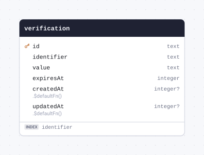
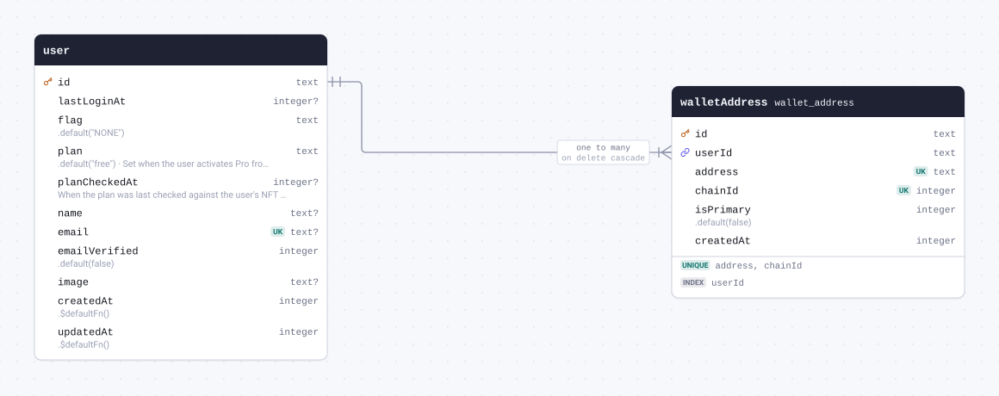
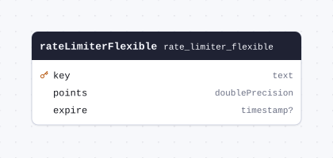
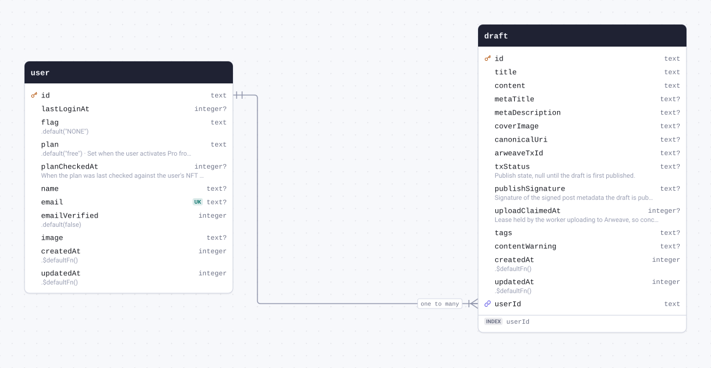
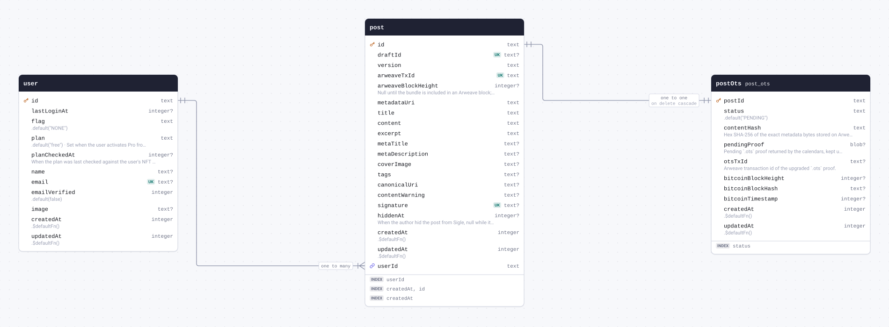
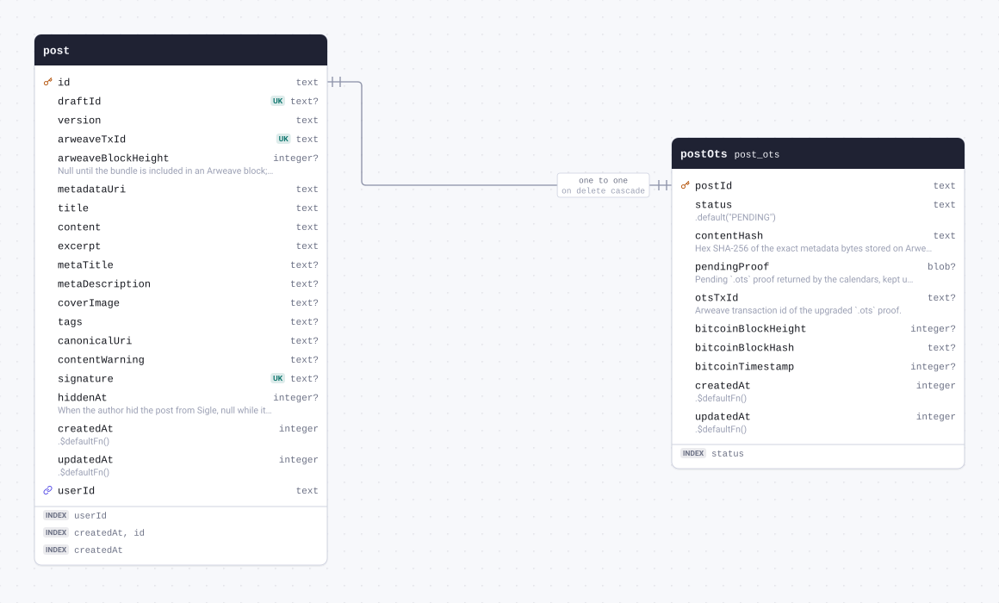

# Schema docs


<details>
<summary>The whole schema as SQL</summary>

```sql
CREATE TYPE "MediaImageStatus" AS ENUM('PENDING', 'READY', 'FAILED');

CREATE TYPE "PostOtsStatus" AS ENUM('PENDING', 'UPGRADED', 'FAILED');

CREATE TYPE "UserFlag" AS ENUM('NONE', 'VERIFIED');

CREATE TABLE "account" (
	"id" text PRIMARY KEY,
	"account_id" text NOT NULL,
	"provider_id" text NOT NULL,
	"user_id" text NOT NULL,
	"access_token" text,
	"refresh_token" text,
	"id_token" text,
	"access_token_expires_at" timestamp(3),
	"refresh_token_expires_at" timestamp(3),
	"scope" text,
	"password" text,
	"created_at" timestamp(3) DEFAULT now() NOT NULL,
	"updated_at" timestamp(3) DEFAULT now() NOT NULL
);

CREATE TABLE "draft" (
	"id" text PRIMARY KEY,
	"title" text NOT NULL,
	"content" text NOT NULL,
	"meta_title" text,
	"meta_description" text,
	"cover_image" text,
	"canonical_uri" text,
	"arweave_tx_id" text,
	"tx_status" text,
	"publish_signature" text,
	"upload_claimed_at" timestamp(3),
	"tags" text[],
	"created_at" timestamp(3) DEFAULT now() NOT NULL,
	"updated_at" timestamp(3) DEFAULT now() NOT NULL,
	"user_id" text NOT NULL
);

CREATE TABLE "media_image" (
	"id" text PRIMARY KEY,
	"status" "MediaImageStatus" DEFAULT 'PENDING'::"MediaImageStatus" NOT NULL,
	"mime_type" text,
	"width" integer,
	"height" integer,
	"size" integer,
	"thumbhash" text,
	"created_at" timestamp(3) DEFAULT now() NOT NULL,
	"updated_at" timestamp(3) DEFAULT now() NOT NULL
);

CREATE TABLE "post" (
	"id" text PRIMARY KEY,
	"draft_id" text CONSTRAINT "post_draft_id_key" UNIQUE,
	"version" text NOT NULL,
	"arweave_tx_id" text NOT NULL CONSTRAINT "post_arweave_tx_id_key" UNIQUE,
	"arweave_block_height" integer,
	"metadata_uri" text NOT NULL,
	"title" text NOT NULL,
	"content" text NOT NULL,
	"excerpt" text NOT NULL,
	"meta_title" text,
	"meta_description" text,
	"cover_image" text,
	"tags" text[],
	"canonical_uri" text,
	"signature" text CONSTRAINT "post_signature_key" UNIQUE,
	"created_at" timestamp(3) DEFAULT now() NOT NULL,
	"updated_at" timestamp(3) DEFAULT now() NOT NULL,
	"user_id" text NOT NULL
);

CREATE TABLE "post_ots" (
	"post_id" text PRIMARY KEY,
	"status" "PostOtsStatus" DEFAULT 'PENDING'::"PostOtsStatus" NOT NULL,
	"content_hash" text NOT NULL,
	"pending_proof" bytea,
	"ots_tx_id" text,
	"bitcoin_block_height" integer,
	"bitcoin_block_hash" text,
	"bitcoin_timestamp" timestamp(3),
	"created_at" timestamp(3) DEFAULT now() NOT NULL,
	"updated_at" timestamp(3) DEFAULT now() NOT NULL
);

CREATE TABLE "profile" (
	"address" text PRIMARY KEY,
	"arweave_tx_id" text NOT NULL CONSTRAINT "profile_arweave_tx_id_key" UNIQUE,
	"arweave_block_height" integer,
	"signature" text NOT NULL CONSTRAINT "profile_signature_key" UNIQUE,
	"display_name" text,
	"description" text,
	"website" text,
	"twitter" text,
	"picture" text,
	"cover_picture" text,
	"created_at" timestamp(3) DEFAULT now() NOT NULL,
	"updated_at" timestamp(3) DEFAULT now() NOT NULL
);

CREATE TABLE "rate_limiter_flexible" (
	"key" text PRIMARY KEY,
	"points" double precision NOT NULL,
	"expire" timestamp(3)
);

CREATE TABLE "session" (
	"id" text PRIMARY KEY,
	"expires_at" timestamp(3) NOT NULL,
	"token" text NOT NULL CONSTRAINT "session_token_key" UNIQUE,
	"created_at" timestamp(3) DEFAULT now() NOT NULL,
	"updated_at" timestamp(3) DEFAULT now() NOT NULL,
	"ip_address" text,
	"user_agent" text,
	"user_id" text NOT NULL
);

CREATE TABLE "user" (
	"id" text PRIMARY KEY,
	"last_login_at" timestamp(3),
	"flag" "UserFlag" DEFAULT 'NONE'::"UserFlag" NOT NULL,
	"name" text,
	"email" text CONSTRAINT "user_email_key" UNIQUE,
	"email_verified" boolean DEFAULT false NOT NULL,
	"image" text,
	"created_at" timestamp(3) DEFAULT now() NOT NULL,
	"updated_at" timestamp(3) DEFAULT now() NOT NULL
);

CREATE TABLE "verification" (
	"id" text PRIMARY KEY,
	"identifier" text NOT NULL,
	"value" text NOT NULL,
	"expires_at" timestamp(3) NOT NULL,
	"created_at" timestamp(3) DEFAULT now(),
	"updated_at" timestamp(3) DEFAULT now()
);

CREATE TABLE "wallet_address" (
	"id" text PRIMARY KEY,
	"user_id" text NOT NULL,
	"address" text NOT NULL,
	"chain_id" bigint NOT NULL,
	"is_primary" boolean DEFAULT false NOT NULL,
	"created_at" timestamp(3) NOT NULL
);

CREATE INDEX "account_user_id_idx" ON "account" ("user_id");

CREATE INDEX "draft_user_id_idx" ON "draft" ("user_id");

CREATE INDEX "media_image_pending_idx" ON "media_image" ("created_at") WHERE status = 'PENDING';

CREATE INDEX "post_user_id_idx" ON "post" ("user_id");

CREATE INDEX "post_arweave_pending_idx" ON "post" ("created_at") WHERE arweave_block_height is null;

CREATE INDEX "post_ots_status_idx" ON "post_ots" ("status");

CREATE INDEX "session_user_id_idx" ON "session" ("user_id");

CREATE INDEX "verification_identifier_idx" ON "verification" ("identifier");

CREATE INDEX "wallet_address_user_id_idx" ON "wallet_address" ("user_id");

CREATE UNIQUE INDEX "wallet_address_address_chain_id_unique" ON "wallet_address" ("address","chain_id");

ALTER TABLE "account" ADD CONSTRAINT "account_user_id_user_id_fkey" FOREIGN KEY ("user_id") REFERENCES "user"("id") ON DELETE CASCADE;

ALTER TABLE "draft" ADD CONSTRAINT "draft_user_id_user_id_fkey" FOREIGN KEY ("user_id") REFERENCES "user"("id");

ALTER TABLE "post" ADD CONSTRAINT "post_user_id_user_id_fkey" FOREIGN KEY ("user_id") REFERENCES "user"("id");

ALTER TABLE "post_ots" ADD CONSTRAINT "post_ots_post_id_post_id_fkey" FOREIGN KEY ("post_id") REFERENCES "post"("id") ON DELETE CASCADE;

ALTER TABLE "session" ADD CONSTRAINT "session_user_id_user_id_fkey" FOREIGN KEY ("user_id") REFERENCES "user"("id") ON DELETE CASCADE;

ALTER TABLE "wallet_address" ADD CONSTRAINT "wallet_address_user_id_user_id_fkey" FOREIGN KEY ("user_id") REFERENCES "user"("id") ON DELETE CASCADE;
```

</details>

## Contents

| Table                                             | Name in the database    | Description                                                                                                                                                                                                                                                                                     |
| ------------------------------------------------- | ----------------------- | ----------------------------------------------------------------------------------------------------------------------------------------------------------------------------------------------------------------------------------------------------------------------------------------------- |
| [user](#table-user)                               | `user`                  |                                                                                                                                                                                                                                                                                                 |
| [session](#table-session)                         | `session`               |                                                                                                                                                                                                                                                                                                 |
| [account](#table-account)                         | `account`               |                                                                                                                                                                                                                                                                                                 |
| [verification](#table-verification)               | `verification`          |                                                                                                                                                                                                                                                                                                 |
| [walletAddress](#table-walletAddress)             | `wallet_address`        | Wallet identity model added by the sign-in-with-stacks better-auth plugin.                                                                                                                                                                                                                      |
| [rateLimiterFlexible](#table-rateLimiterFlexible) | `rate_limiter_flexible` | Backing store for the persistent rate limiter (`RateLimiterFlexible` in the legacy Prisma schema).                                                                                                                                                                                              |
| [draft](#table-draft)                             | `draft`                 |                                                                                                                                                                                                                                                                                                 |
| [profile](#table-profile)                         | `profile`               |                                                                                                                                                                                                                                                                                                 |
| [mediaImage](#table-mediaImage)                   | `media_image`           | Placeholder metadata for an image referenced by a post cover or a profile picture. `id` is the canonical URL stored on `post.cover_image` and `profile.picture`/`cover_picture`; rows are created eagerly as PENDING by the producers and filled in by the thumbhash job (or inline on upload). |
| [post](#table-post)                               | `post`                  |                                                                                                                                                                                                                                                                                                 |
| [postOts](#table-postOts)                         | `post_ots`              | One OpenTimestamps proof per published post. The post metadata JSON uploaded to Arweave is the file being anchored, identified by `contentHash`.                                                                                                                                                |

| Enum                                               | Name in the database | Description |
| -------------------------------------------------- | -------------------- | ----------- |
| [userFlagEnum](#enum-userFlagEnum)                 | `UserFlag`           |             |
| [mediaImageStatusEnum](#enum-mediaImageStatusEnum) | `MediaImageStatus`   |             |
| [postOtsStatusEnum](#enum-postOtsStatusEnum)       | `PostOtsStatus`      |             |

## Tables

<a id="table-user"></a>

### user


| Column                             | Type                                 | Constraints | Default            | Description |
| ---------------------------------- | ------------------------------------ | ----------- | ------------------ | ----------- |
| `id`                               | `text`                               | PK NOT NULL |                    |             |
| `lastLoginAt` (`last_login_at`)    | `timestamp`                          | NULL        |                    |             |
| `flag`                             | [`userFlagEnum`](#enum-userFlagEnum) | NOT NULL    | `.default("NONE")` |             |
| `name`                             | `text`                               | NULL        |                    |             |
| `email`                            | `text`                               | UNIQUE NULL |                    |             |
| `emailVerified` (`email_verified`) | `boolean`                            | NOT NULL    | `.default(false)`  |             |
| `image`                            | `text`                               | NULL        |                    |             |
| `createdAt` (`created_at`)         | `timestamp`                          | NOT NULL    | `.defaultNow()`    |             |
| `updatedAt` (`updated_at`)         | `timestamp`                          | NOT NULL    | `.defaultNow()`    |             |

#### Definition

```sql
CREATE TABLE "user" (
	"id" text PRIMARY KEY,
	"last_login_at" timestamp(3),
	"flag" "UserFlag" DEFAULT 'NONE'::"UserFlag" NOT NULL,
	"name" text,
	"email" text CONSTRAINT "user_email_key" UNIQUE,
	"email_verified" boolean DEFAULT false NOT NULL,
	"image" text,
	"created_at" timestamp(3) DEFAULT now() NOT NULL,
	"updated_at" timestamp(3) DEFAULT now() NOT NULL
);
```

#### Referenced by

- `id` → [session.userId](#table-session) (one to many, on delete cascade)
- `id` → [account.userId](#table-account) (one to many, on delete cascade)
- `id` → [walletAddress.userId](#table-walletAddress) (one to many, on delete cascade)
- `id` → [draft.userId](#table-draft) (one to many)
- `id` → [post.userId](#table-post) (one to many)

<details>
<summary>Queries and their SQL</summary>

**Select**: Every row of user.

```ts
db.select().from(user);
```

```sql
select "id", "last_login_at", "flag", "name", "email", "email_verified", "image", "created_at", "updated_at"
from "user"
```

**Count**: How many rows user has.

```ts
db.select({ count: count() }).from(user);
```

```sql
select count(*)
from "user"
```

**Find many with relations**: The rows of user with what they relate to, through the relational query API.

```ts
db.query.user.findMany({
  with: { sessions: true, accounts: true, walletAddresses: true, drafts: true, posts: true },
});
```

```sql
select "d0"."id" as "id", "d0"."last_login_at" as "lastLoginAt", "d0"."flag" as "flag", "d0"."name" as "name", "d0"."email" as "email", "d0"."email_verified" as "emailVerified", "d0"."image" as "image", "d0"."created_at" as "createdAt", "d0"."updated_at" as "updatedAt", "sessions"."r" as "sessions", "accounts"."r" as "accounts", "walletAddresses"."r" as "walletAddresses", "drafts"."r" as "drafts", "posts"."r" as "posts"
from "user" as "d0"
left join lateral(select coalesce(json_agg(row_to_json("t".*)), '[]') as "r" from (select "d1"."id" as "id", "d1"."expires_at" as "expiresAt", "d1"."token" as "token", "d1"."created_at" as "createdAt", "d1"."updated_at" as "updatedAt", "d1"."ip_address" as "ipAddress", "d1"."user_agent" as "userAgent", "d1"."user_id" as "userId" from "session" as "d1" where "d0"."id" = "d1"."user_id") as "t") as "sessions" on true
left join lateral(select coalesce(json_agg(row_to_json("t".*)), '[]') as "r" from (select "d1"."id" as "id", "d1"."account_id" as "accountId", "d1"."provider_id" as "providerId", "d1"."user_id" as "userId", "d1"."access_token" as "accessToken", "d1"."refresh_token" as "refreshToken", "d1"."id_token" as "idToken", "d1"."access_token_expires_at" as "accessTokenExpiresAt", "d1"."refresh_token_expires_at" as "refreshTokenExpiresAt", "d1"."scope" as "scope", "d1"."password" as "password", "d1"."created_at" as "createdAt", "d1"."updated_at" as "updatedAt" from "account" as "d1" where "d0"."id" = "d1"."user_id") as "t") as "accounts" on true
left join lateral(select coalesce(json_agg(row_to_json("t".*)), '[]') as "r" from (select "d1"."id" as "id", "d1"."user_id" as "userId", "d1"."address" as "address", "d1"."chain_id" as "chainId", "d1"."is_primary" as "isPrimary", "d1"."created_at" as "createdAt" from "wallet_address" as "d1" where "d0"."id" = "d1"."user_id") as "t") as "walletAddresses" on true
left join lateral(select coalesce(json_agg(row_to_json("t".*)), '[]') as "r" from (select "d1"."id" as "id", "d1"."title" as "title", "d1"."content" as "content", "d1"."meta_title" as "metaTitle", "d1"."meta_description" as "metaDescription", "d1"."cover_image" as "coverImage", "d1"."canonical_uri" as "canonicalUri", "d1"."arweave_tx_id" as "arweaveTxId", "d1"."tx_status" as "txStatus", "d1"."publish_signature" as "publishSignature", "d1"."upload_claimed_at" as "uploadClaimedAt", "d1"."tags" as "tags", "d1"."created_at" as "createdAt", "d1"."updated_at" as "updatedAt", "d1"."user_id" as "userId" from "draft" as "d1" where "d0"."id" = "d1"."user_id") as "t") as "drafts" on true
left join lateral(select coalesce(json_agg(row_to_json("t".*)), '[]') as "r" from (select "d1"."id" as "id", "d1"."draft_id" as "draftId", "d1"."version" as "version", "d1"."arweave_tx_id" as "arweaveTxId", "d1"."arweave_block_height" as "arweaveBlockHeight", "d1"."metadata_uri" as "metadataUri", "d1"."title" as "title", "d1"."content" as "content", "d1"."excerpt" as "excerpt", "d1"."meta_title" as "metaTitle", "d1"."meta_description" as "metaDescription", "d1"."cover_image" as "coverImage", "d1"."tags" as "tags", "d1"."canonical_uri" as "canonicalUri", "d1"."signature" as "signature", "d1"."created_at" as "createdAt", "d1"."updated_at" as "updatedAt", "d1"."user_id" as "userId" from "post" as "d1" where "d0"."id" = "d1"."user_id") as "t") as "posts" on true
```

**Find by primary key**: One row of user, through the relational query API.

```ts
db.query.user.findFirst({ where: { id: "id" } });
```

```sql
select "d0"."id" as "id", "d0"."last_login_at" as "lastLoginAt", "d0"."flag" as "flag", "d0"."name" as "name", "d0"."email" as "email", "d0"."email_verified" as "emailVerified", "d0"."image" as "image", "d0"."created_at" as "createdAt", "d0"."updated_at" as "updatedAt"
from "user" as "d0"
where "d0"."id" = $1
limit $2
-- params: ["id",1]
```

**Insert**: Adds a row to user, giving the columns that have no default.

```ts
db.insert(user).values({ id: "id" });
```

```sql
insert into "user" ("id", "last_login_at", "flag", "name", "email", "email_verified", "image", "created_at", "updated_at")
values ($1, default, default, default, default, default, default, default, default)
-- params: ["id"]
```

**Update**: Changes a row of user, found by its primary key.

```ts
db.update(user)
  .set({ lastLoginAt: new Date("2026-01-01T00:00:00.000Z") })
  .where(eq(user.id, "id"));
```

```sql
update "user"
set "last_login_at" = $1
where "user"."id" = $2
-- params: ["2026-01-01T00:00:00.000Z","id"]
```

**Delete**: Deletes a row of user, found by its primary key.

```ts
db.delete(user).where(eq(user.id, "id"));
```

```sql
delete from "user"
where "user"."id" = $1
-- params: ["id"]
```

</details>

<a id="table-session"></a>

### session


| Column                     | Type        | Constraints                       | Default         | Description |
| -------------------------- | ----------- | --------------------------------- | --------------- | ----------- |
| `id`                       | `text`      | PK NOT NULL                       |                 |             |
| `expiresAt` (`expires_at`) | `timestamp` | NOT NULL                          |                 |             |
| `token`                    | `text`      | UNIQUE NOT NULL                   |                 |             |
| `createdAt` (`created_at`) | `timestamp` | NOT NULL                          | `.defaultNow()` |             |
| `updatedAt` (`updated_at`) | `timestamp` | NOT NULL                          | `.defaultNow()` |             |
| `ipAddress` (`ip_address`) | `text`      | NULL                              |                 |             |
| `userAgent` (`user_agent`) | `text`      | NULL                              |                 |             |
| `userId` (`user_id`)       | `text`      | NOT NULL → [user.id](#table-user) |                 |             |

#### Definition

```sql
CREATE TABLE "session" (
	"id" text PRIMARY KEY,
	"expires_at" timestamp(3) NOT NULL,
	"token" text NOT NULL CONSTRAINT "session_token_key" UNIQUE,
	"created_at" timestamp(3) DEFAULT now() NOT NULL,
	"updated_at" timestamp(3) DEFAULT now() NOT NULL,
	"ip_address" text,
	"user_agent" text,
	"user_id" text NOT NULL
);

CREATE INDEX "session_user_id_idx" ON "session" ("user_id");

ALTER TABLE "session" ADD CONSTRAINT "session_user_id_user_id_fkey" FOREIGN KEY ("user_id") REFERENCES "user"("id") ON DELETE CASCADE;
```

#### Indexes

- INDEX `userId`

#### References

- `userId` → [user.id](#table-user) (many to one, on delete cascade)

<details>
<summary>Queries and their SQL</summary>

**Select**: Every row of session.

```ts
db.select().from(session);
```

```sql
select "id", "expires_at", "token", "created_at", "updated_at", "ip_address", "user_agent", "user_id"
from "session"
```

**Count**: How many rows session has.

```ts
db.select({ count: count() }).from(session);
```

```sql
select count(*)
from "session"
```

**Find many with relations**: The rows of session with what they relate to, through the relational query API.

```ts
db.query.session.findMany({ with: { user: true } });
```

```sql
select "d0"."id" as "id", "d0"."expires_at" as "expiresAt", "d0"."token" as "token", "d0"."created_at" as "createdAt", "d0"."updated_at" as "updatedAt", "d0"."ip_address" as "ipAddress", "d0"."user_agent" as "userAgent", "d0"."user_id" as "userId", "user"."r" as "user"
from "session" as "d0"
left join lateral(select row_to_json("t".*) "r" from (select "d1"."id" as "id", "d1"."last_login_at" as "lastLoginAt", "d1"."flag" as "flag", "d1"."name" as "name", "d1"."email" as "email", "d1"."email_verified" as "emailVerified", "d1"."image" as "image", "d1"."created_at" as "createdAt", "d1"."updated_at" as "updatedAt" from "user" as "d1" where "d0"."user_id" = "d1"."id" limit $1) as "t") as "user" on true
-- params: [1]
```

**Find by primary key**: One row of session, through the relational query API.

```ts
db.query.session.findFirst({ where: { id: "id" } });
```

```sql
select "d0"."id" as "id", "d0"."expires_at" as "expiresAt", "d0"."token" as "token", "d0"."created_at" as "createdAt", "d0"."updated_at" as "updatedAt", "d0"."ip_address" as "ipAddress", "d0"."user_agent" as "userAgent", "d0"."user_id" as "userId"
from "session" as "d0"
where "d0"."id" = $1
limit $2
-- params: ["id",1]
```

**Insert**: Adds a row to session, giving the columns that have no default.

```ts
db.insert(session).values({
  id: "id",
  expiresAt: new Date("2026-01-01T00:00:00.000Z"),
  token: "token",
  userId: "userId",
});
```

```sql
insert into "session" ("id", "expires_at", "token", "created_at", "updated_at", "ip_address", "user_agent", "user_id")
values ($1, $2, $3, default, default, default, default, $4)
-- params: ["id","2026-01-01T00:00:00.000Z","token","userId"]
```

**Update**: Changes a row of session, found by its primary key.

```ts
db.update(session)
  .set({ expiresAt: new Date("2026-01-01T00:00:00.000Z") })
  .where(eq(session.id, "id"));
```

```sql
update "session"
set "expires_at" = $1
where "session"."id" = $2
-- params: ["2026-01-01T00:00:00.000Z","id"]
```

**Delete**: Deletes a row of session, found by its primary key.

```ts
db.delete(session).where(eq(session.id, "id"));
```

```sql
delete from "session"
where "session"."id" = $1
-- params: ["id"]
```

</details>

<a id="table-account"></a>

### account


| Column                                               | Type        | Constraints                       | Default         | Description |
| ---------------------------------------------------- | ----------- | --------------------------------- | --------------- | ----------- |
| `id`                                                 | `text`      | PK NOT NULL                       |                 |             |
| `accountId` (`account_id`)                           | `text`      | NOT NULL                          |                 |             |
| `providerId` (`provider_id`)                         | `text`      | NOT NULL                          |                 |             |
| `userId` (`user_id`)                                 | `text`      | NOT NULL → [user.id](#table-user) |                 |             |
| `accessToken` (`access_token`)                       | `text`      | NULL                              |                 |             |
| `refreshToken` (`refresh_token`)                     | `text`      | NULL                              |                 |             |
| `idToken` (`id_token`)                               | `text`      | NULL                              |                 |             |
| `accessTokenExpiresAt` (`access_token_expires_at`)   | `timestamp` | NULL                              |                 |             |
| `refreshTokenExpiresAt` (`refresh_token_expires_at`) | `timestamp` | NULL                              |                 |             |
| `scope`                                              | `text`      | NULL                              |                 |             |
| `password`                                           | `text`      | NULL                              |                 |             |
| `createdAt` (`created_at`)                           | `timestamp` | NOT NULL                          | `.defaultNow()` |             |
| `updatedAt` (`updated_at`)                           | `timestamp` | NOT NULL                          | `.defaultNow()` |             |

#### Definition

```sql
CREATE TABLE "account" (
	"id" text PRIMARY KEY,
	"account_id" text NOT NULL,
	"provider_id" text NOT NULL,
	"user_id" text NOT NULL,
	"access_token" text,
	"refresh_token" text,
	"id_token" text,
	"access_token_expires_at" timestamp(3),
	"refresh_token_expires_at" timestamp(3),
	"scope" text,
	"password" text,
	"created_at" timestamp(3) DEFAULT now() NOT NULL,
	"updated_at" timestamp(3) DEFAULT now() NOT NULL
);

CREATE INDEX "account_user_id_idx" ON "account" ("user_id");

ALTER TABLE "account" ADD CONSTRAINT "account_user_id_user_id_fkey" FOREIGN KEY ("user_id") REFERENCES "user"("id") ON DELETE CASCADE;
```

#### Indexes

- INDEX `userId`

#### References

- `userId` → [user.id](#table-user) (many to one, on delete cascade)

<details>
<summary>Queries and their SQL</summary>

**Select**: Every row of account.

```ts
db.select().from(account);
```

```sql
select "id", "account_id", "provider_id", "user_id", "access_token", "refresh_token", "id_token", "access_token_expires_at", "refresh_token_expires_at", "scope", "password", "created_at", "updated_at"
from "account"
```

**Count**: How many rows account has.

```ts
db.select({ count: count() }).from(account);
```

```sql
select count(*)
from "account"
```

**Find many with relations**: The rows of account with what they relate to, through the relational query API.

```ts
db.query.account.findMany({ with: { user: true } });
```

```sql
select "d0"."id" as "id", "d0"."account_id" as "accountId", "d0"."provider_id" as "providerId", "d0"."user_id" as "userId", "d0"."access_token" as "accessToken", "d0"."refresh_token" as "refreshToken", "d0"."id_token" as "idToken", "d0"."access_token_expires_at" as "accessTokenExpiresAt", "d0"."refresh_token_expires_at" as "refreshTokenExpiresAt", "d0"."scope" as "scope", "d0"."password" as "password", "d0"."created_at" as "createdAt", "d0"."updated_at" as "updatedAt", "user"."r" as "user"
from "account" as "d0"
left join lateral(select row_to_json("t".*) "r" from (select "d1"."id" as "id", "d1"."last_login_at" as "lastLoginAt", "d1"."flag" as "flag", "d1"."name" as "name", "d1"."email" as "email", "d1"."email_verified" as "emailVerified", "d1"."image" as "image", "d1"."created_at" as "createdAt", "d1"."updated_at" as "updatedAt" from "user" as "d1" where "d0"."user_id" = "d1"."id" limit $1) as "t") as "user" on true
-- params: [1]
```

**Find by primary key**: One row of account, through the relational query API.

```ts
db.query.account.findFirst({ where: { id: "id" } });
```

```sql
select "d0"."id" as "id", "d0"."account_id" as "accountId", "d0"."provider_id" as "providerId", "d0"."user_id" as "userId", "d0"."access_token" as "accessToken", "d0"."refresh_token" as "refreshToken", "d0"."id_token" as "idToken", "d0"."access_token_expires_at" as "accessTokenExpiresAt", "d0"."refresh_token_expires_at" as "refreshTokenExpiresAt", "d0"."scope" as "scope", "d0"."password" as "password", "d0"."created_at" as "createdAt", "d0"."updated_at" as "updatedAt"
from "account" as "d0"
where "d0"."id" = $1
limit $2
-- params: ["id",1]
```

**Insert**: Adds a row to account, giving the columns that have no default.

```ts
db.insert(account).values({
  id: "id",
  accountId: "accountId",
  providerId: "providerId",
  userId: "userId",
});
```

```sql
insert into "account" ("id", "account_id", "provider_id", "user_id", "access_token", "refresh_token", "id_token", "access_token_expires_at", "refresh_token_expires_at", "scope", "password", "created_at", "updated_at")
values ($1, $2, $3, $4, default, default, default, default, default, default, default, default, default)
-- params: ["id","accountId","providerId","userId"]
```

**Update**: Changes a row of account, found by its primary key.

```ts
db.update(account).set({ accountId: "accountId" }).where(eq(account.id, "id"));
```

```sql
update "account"
set "account_id" = $1
where "account"."id" = $2
-- params: ["accountId","id"]
```

**Delete**: Deletes a row of account, found by its primary key.

```ts
db.delete(account).where(eq(account.id, "id"));
```

```sql
delete from "account"
where "account"."id" = $1
-- params: ["id"]
```

</details>

<a id="table-verification"></a>

### verification



| Column                     | Type        | Constraints | Default         | Description |
| -------------------------- | ----------- | ----------- | --------------- | ----------- |
| `id`                       | `text`      | PK NOT NULL |                 |             |
| `identifier`               | `text`      | NOT NULL    |                 |             |
| `value`                    | `text`      | NOT NULL    |                 |             |
| `expiresAt` (`expires_at`) | `timestamp` | NOT NULL    |                 |             |
| `createdAt` (`created_at`) | `timestamp` | NULL        | `.defaultNow()` |             |
| `updatedAt` (`updated_at`) | `timestamp` | NULL        | `.defaultNow()` |             |

#### Definition

```sql
CREATE TABLE "verification" (
	"id" text PRIMARY KEY,
	"identifier" text NOT NULL,
	"value" text NOT NULL,
	"expires_at" timestamp(3) NOT NULL,
	"created_at" timestamp(3) DEFAULT now(),
	"updated_at" timestamp(3) DEFAULT now()
);

CREATE INDEX "verification_identifier_idx" ON "verification" ("identifier");
```

#### Indexes

- INDEX `identifier`

<details>
<summary>Queries and their SQL</summary>

**Select**: Every row of verification.

```ts
db.select().from(verification);
```

```sql
select "id", "identifier", "value", "expires_at", "created_at", "updated_at"
from "verification"
```

**Count**: How many rows verification has.

```ts
db.select({ count: count() }).from(verification);
```

```sql
select count(*)
from "verification"
```

**Find many**: The rows of verification, through the relational query API.

```ts
db.query.verification.findMany();
```

```sql
select "d0"."id" as "id", "d0"."identifier" as "identifier", "d0"."value" as "value", "d0"."expires_at" as "expiresAt", "d0"."created_at" as "createdAt", "d0"."updated_at" as "updatedAt"
from "verification" as "d0"
```

**Find by primary key**: One row of verification, through the relational query API.

```ts
db.query.verification.findFirst({ where: { id: "id" } });
```

```sql
select "d0"."id" as "id", "d0"."identifier" as "identifier", "d0"."value" as "value", "d0"."expires_at" as "expiresAt", "d0"."created_at" as "createdAt", "d0"."updated_at" as "updatedAt"
from "verification" as "d0"
where "d0"."id" = $1
limit $2
-- params: ["id",1]
```

**Insert**: Adds a row to verification, giving the columns that have no default.

```ts
db.insert(verification).values({
  id: "id",
  identifier: "identifier",
  value: "value",
  expiresAt: new Date("2026-01-01T00:00:00.000Z"),
});
```

```sql
insert into "verification" ("id", "identifier", "value", "expires_at", "created_at", "updated_at")
values ($1, $2, $3, $4, default, default)
-- params: ["id","identifier","value","2026-01-01T00:00:00.000Z"]
```

**Update**: Changes a row of verification, found by its primary key.

```ts
db.update(verification).set({ identifier: "identifier" }).where(eq(verification.id, "id"));
```

```sql
update "verification"
set "identifier" = $1
where "verification"."id" = $2
-- params: ["identifier","id"]
```

**Delete**: Deletes a row of verification, found by its primary key.

```ts
db.delete(verification).where(eq(verification.id, "id"));
```

```sql
delete from "verification"
where "verification"."id" = $1
-- params: ["id"]
```

</details>

<a id="table-walletAddress"></a>

### walletAddress

Table `wallet_address`. Wallet identity model added by the sign-in-with-stacks better-auth plugin.



| Column                     | Type        | Constraints                       | Default           | Description |
| -------------------------- | ----------- | --------------------------------- | ----------------- | ----------- |
| `id`                       | `text`      | PK NOT NULL                       |                   |             |
| `userId` (`user_id`)       | `text`      | NOT NULL → [user.id](#table-user) |                   |             |
| `address`                  | `text`      | NOT NULL                          |                   |             |
| `chainId` (`chain_id`)     | `bigint`    | NOT NULL                          |                   |             |
| `isPrimary` (`is_primary`) | `boolean`   | NOT NULL                          | `.default(false)` |             |
| `createdAt` (`created_at`) | `timestamp` | NOT NULL                          |                   |             |

#### Definition

```sql
CREATE TABLE "wallet_address" (
	"id" text PRIMARY KEY,
	"user_id" text NOT NULL,
	"address" text NOT NULL,
	"chain_id" bigint NOT NULL,
	"is_primary" boolean DEFAULT false NOT NULL,
	"created_at" timestamp(3) NOT NULL
);

CREATE INDEX "wallet_address_user_id_idx" ON "wallet_address" ("user_id");

CREATE UNIQUE INDEX "wallet_address_address_chain_id_unique" ON "wallet_address" ("address","chain_id");

ALTER TABLE "wallet_address" ADD CONSTRAINT "wallet_address_user_id_user_id_fkey" FOREIGN KEY ("user_id") REFERENCES "user"("id") ON DELETE CASCADE;
```

#### Indexes

- INDEX `userId`
- UNIQUE `address`, `chainId`

#### References

- `userId` → [user.id](#table-user) (many to one, on delete cascade)

<details>
<summary>Queries and their SQL</summary>

**Select**: Every row of walletAddress.

```ts
db.select().from(walletAddress);
```

```sql
select "id", "user_id", "address", "chain_id", "is_primary", "created_at"
from "wallet_address"
```

**Count**: How many rows walletAddress has.

```ts
db.select({ count: count() }).from(walletAddress);
```

```sql
select count(*)
from "wallet_address"
```

**Find many with relations**: The rows of walletAddress with what they relate to, through the relational query API.

```ts
db.query.walletAddress.findMany({ with: { user: true } });
```

```sql
select "d0"."id" as "id", "d0"."user_id" as "userId", "d0"."address" as "address", "d0"."chain_id" as "chainId", "d0"."is_primary" as "isPrimary", "d0"."created_at" as "createdAt", "user"."r" as "user"
from "wallet_address" as "d0"
left join lateral(select row_to_json("t".*) "r" from (select "d1"."id" as "id", "d1"."last_login_at" as "lastLoginAt", "d1"."flag" as "flag", "d1"."name" as "name", "d1"."email" as "email", "d1"."email_verified" as "emailVerified", "d1"."image" as "image", "d1"."created_at" as "createdAt", "d1"."updated_at" as "updatedAt" from "user" as "d1" where "d0"."user_id" = "d1"."id" limit $1) as "t") as "user" on true
-- params: [1]
```

**Find by primary key**: One row of walletAddress, through the relational query API.

```ts
db.query.walletAddress.findFirst({ where: { id: "id" } });
```

```sql
select "d0"."id" as "id", "d0"."user_id" as "userId", "d0"."address" as "address", "d0"."chain_id" as "chainId", "d0"."is_primary" as "isPrimary", "d0"."created_at" as "createdAt"
from "wallet_address" as "d0"
where "d0"."id" = $1
limit $2
-- params: ["id",1]
```

**Insert**: Adds a row to walletAddress, giving the columns that have no default.

```ts
db.insert(walletAddress).values({
  id: "id",
  userId: "userId",
  address: "address",
  chainId: 1,
  createdAt: new Date("2026-01-01T00:00:00.000Z"),
});
```

```sql
insert into "wallet_address" ("id", "user_id", "address", "chain_id", "is_primary", "created_at")
values ($1, $2, $3, $4, default, $5)
-- params: ["id","userId","address",1,"2026-01-01T00:00:00.000Z"]
```

**Update**: Changes a row of walletAddress, found by its primary key.

```ts
db.update(walletAddress).set({ userId: "userId" }).where(eq(walletAddress.id, "id"));
```

```sql
update "wallet_address"
set "user_id" = $1
where "wallet_address"."id" = $2
-- params: ["userId","id"]
```

**Delete**: Deletes a row of walletAddress, found by its primary key.

```ts
db.delete(walletAddress).where(eq(walletAddress.id, "id"));
```

```sql
delete from "wallet_address"
where "wallet_address"."id" = $1
-- params: ["id"]
```

</details>

<a id="table-rateLimiterFlexible"></a>

### rateLimiterFlexible

Table `rate_limiter_flexible`. Backing store for the persistent rate limiter (`RateLimiterFlexible` in the legacy Prisma schema).



| Column   | Type              | Constraints | Default | Description |
| -------- | ----------------- | ----------- | ------- | ----------- |
| `key`    | `text`            | PK NOT NULL |         |             |
| `points` | `doublePrecision` | NOT NULL    |         |             |
| `expire` | `timestamp`       | NULL        |         |             |

#### Definition

```sql
CREATE TABLE "rate_limiter_flexible" (
	"key" text PRIMARY KEY,
	"points" double precision NOT NULL,
	"expire" timestamp(3)
);
```

<details>
<summary>Queries and their SQL</summary>

**Select**: Every row of rateLimiterFlexible.

```ts
db.select().from(rateLimiterFlexible);
```

```sql
select "key", "points", "expire"
from "rate_limiter_flexible"
```

**Count**: How many rows rateLimiterFlexible has.

```ts
db.select({ count: count() }).from(rateLimiterFlexible);
```

```sql
select count(*)
from "rate_limiter_flexible"
```

**Find many**: The rows of rateLimiterFlexible, through the relational query API.

```ts
db.query.rateLimiterFlexible.findMany();
```

```sql
select "d0"."key" as "key", "d0"."points" as "points", "d0"."expire" as "expire"
from "rate_limiter_flexible" as "d0"
```

**Find by primary key**: One row of rateLimiterFlexible, through the relational query API.

```ts
db.query.rateLimiterFlexible.findFirst({ where: { key: "key" } });
```

```sql
select "d0"."key" as "key", "d0"."points" as "points", "d0"."expire" as "expire"
from "rate_limiter_flexible" as "d0"
where "d0"."key" = $1
limit $2
-- params: ["key",1]
```

**Insert**: Adds a row to rateLimiterFlexible, giving the columns that have no default.

```ts
db.insert(rateLimiterFlexible).values({ key: "key", points: 1 });
```

```sql
insert into "rate_limiter_flexible" ("key", "points", "expire")
values ($1, $2, default)
-- params: ["key",1]
```

**Update**: Changes a row of rateLimiterFlexible, found by its primary key.

```ts
db.update(rateLimiterFlexible).set({ points: 1 }).where(eq(rateLimiterFlexible.key, "key"));
```

```sql
update "rate_limiter_flexible"
set "points" = $1
where "rate_limiter_flexible"."key" = $2
-- params: [1,"key"]
```

**Delete**: Deletes a row of rateLimiterFlexible, found by its primary key.

```ts
db.delete(rateLimiterFlexible).where(eq(rateLimiterFlexible.key, "key"));
```

```sql
delete from "rate_limiter_flexible"
where "rate_limiter_flexible"."key" = $1
-- params: ["key"]
```

</details>

<a id="table-draft"></a>

### draft



| Column                                   | Type        | Constraints                       | Default         | Description                                                                                                                                   |
| ---------------------------------------- | ----------- | --------------------------------- | --------------- | --------------------------------------------------------------------------------------------------------------------------------------------- |
| `id`                                     | `text`      | PK NOT NULL                       |                 |                                                                                                                                               |
| `title`                                  | `text`      | NOT NULL                          |                 |                                                                                                                                               |
| `content`                                | `text`      | NOT NULL                          |                 |                                                                                                                                               |
| `metaTitle` (`meta_title`)               | `text`      | NULL                              |                 |                                                                                                                                               |
| `metaDescription` (`meta_description`)   | `text`      | NULL                              |                 |                                                                                                                                               |
| `coverImage` (`cover_image`)             | `text`      | NULL                              |                 |                                                                                                                                               |
| `canonicalUri` (`canonical_uri`)         | `text`      | NULL                              |                 |                                                                                                                                               |
| `arweaveTxId` (`arweave_tx_id`)          | `text`      | NULL                              |                 |                                                                                                                                               |
| `txStatus` (`tx_status`)                 | `text`      | NULL                              |                 |                                                                                                                                               |
| `publishSignature` (`publish_signature`) | `text`      | NULL                              |                 | Signature of the signed post metadata the draft is publishing (or last attempted). `arweaveTxId` is a valid checkpoint only while it matches. |
| `uploadClaimedAt` (`upload_claimed_at`)  | `timestamp` | NULL                              |                 | Lease held by the worker uploading to Arweave, so concurrent workers for the same signature do not upload the same metadata twice.            |
| `tags`                                   | `text[]`    | NULL                              |                 |                                                                                                                                               |
| `createdAt` (`created_at`)               | `timestamp` | NOT NULL                          | `.defaultNow()` |                                                                                                                                               |
| `updatedAt` (`updated_at`)               | `timestamp` | NOT NULL                          | `.defaultNow()` |                                                                                                                                               |
| `userId` (`user_id`)                     | `text`      | NOT NULL → [user.id](#table-user) |                 |                                                                                                                                               |

#### Definition

```sql
CREATE TABLE "draft" (
	"id" text PRIMARY KEY,
	"title" text NOT NULL,
	"content" text NOT NULL,
	"meta_title" text,
	"meta_description" text,
	"cover_image" text,
	"canonical_uri" text,
	"arweave_tx_id" text,
	"tx_status" text,
	"publish_signature" text,
	"upload_claimed_at" timestamp(3),
	"tags" text[],
	"created_at" timestamp(3) DEFAULT now() NOT NULL,
	"updated_at" timestamp(3) DEFAULT now() NOT NULL,
	"user_id" text NOT NULL
);

CREATE INDEX "draft_user_id_idx" ON "draft" ("user_id");

ALTER TABLE "draft" ADD CONSTRAINT "draft_user_id_user_id_fkey" FOREIGN KEY ("user_id") REFERENCES "user"("id");
```

#### Indexes

- INDEX `userId`

#### References

- `userId` → [user.id](#table-user) (many to one)

<details>
<summary>Queries and their SQL</summary>

**Select**: Every row of draft.

```ts
db.select().from(draft);
```

```sql
select "id", "title", "content", "meta_title", "meta_description", "cover_image", "canonical_uri", "arweave_tx_id", "tx_status", "publish_signature", "upload_claimed_at", "tags", "created_at", "updated_at", "user_id"
from "draft"
```

**Count**: How many rows draft has.

```ts
db.select({ count: count() }).from(draft);
```

```sql
select count(*)
from "draft"
```

**Find many with relations**: The rows of draft with what they relate to, through the relational query API.

```ts
db.query.draft.findMany({ with: { user: true } });
```

```sql
select "d0"."id" as "id", "d0"."title" as "title", "d0"."content" as "content", "d0"."meta_title" as "metaTitle", "d0"."meta_description" as "metaDescription", "d0"."cover_image" as "coverImage", "d0"."canonical_uri" as "canonicalUri", "d0"."arweave_tx_id" as "arweaveTxId", "d0"."tx_status" as "txStatus", "d0"."publish_signature" as "publishSignature", "d0"."upload_claimed_at" as "uploadClaimedAt", "d0"."tags" as "tags", "d0"."created_at" as "createdAt", "d0"."updated_at" as "updatedAt", "d0"."user_id" as "userId", "user"."r" as "user"
from "draft" as "d0"
left join lateral(select row_to_json("t".*) "r" from (select "d1"."id" as "id", "d1"."last_login_at" as "lastLoginAt", "d1"."flag" as "flag", "d1"."name" as "name", "d1"."email" as "email", "d1"."email_verified" as "emailVerified", "d1"."image" as "image", "d1"."created_at" as "createdAt", "d1"."updated_at" as "updatedAt" from "user" as "d1" where "d0"."user_id" = "d1"."id" limit $1) as "t") as "user" on true
-- params: [1]
```

**Find by primary key**: One row of draft, through the relational query API.

```ts
db.query.draft.findFirst({ where: { id: "id" } });
```

```sql
select "d0"."id" as "id", "d0"."title" as "title", "d0"."content" as "content", "d0"."meta_title" as "metaTitle", "d0"."meta_description" as "metaDescription", "d0"."cover_image" as "coverImage", "d0"."canonical_uri" as "canonicalUri", "d0"."arweave_tx_id" as "arweaveTxId", "d0"."tx_status" as "txStatus", "d0"."publish_signature" as "publishSignature", "d0"."upload_claimed_at" as "uploadClaimedAt", "d0"."tags" as "tags", "d0"."created_at" as "createdAt", "d0"."updated_at" as "updatedAt", "d0"."user_id" as "userId"
from "draft" as "d0"
where "d0"."id" = $1
limit $2
-- params: ["id",1]
```

**Insert**: Adds a row to draft, giving the columns that have no default.

```ts
db.insert(draft).values({ id: "id", title: "title", content: "content", userId: "userId" });
```

```sql
insert into "draft" ("id", "title", "content", "meta_title", "meta_description", "cover_image", "canonical_uri", "arweave_tx_id", "tx_status", "publish_signature", "upload_claimed_at", "tags", "created_at", "updated_at", "user_id")
values ($1, $2, $3, default, default, default, default, default, default, default, default, default, default, default, $4)
-- params: ["id","title","content","userId"]
```

**Update**: Changes a row of draft, found by its primary key.

```ts
db.update(draft).set({ title: "title" }).where(eq(draft.id, "id"));
```

```sql
update "draft"
set "title" = $1
where "draft"."id" = $2
-- params: ["title","id"]
```

**Delete**: Deletes a row of draft, found by its primary key.

```ts
db.delete(draft).where(eq(draft.id, "id"));
```

```sql
delete from "draft"
where "draft"."id" = $1
-- params: ["id"]
```

</details>

<a id="table-profile"></a>

### profile


| Column                                        | Type        | Constraints     | Default         | Description                                                                                                                                                                                              |
| --------------------------------------------- | ----------- | --------------- | --------------- | -------------------------------------------------------------------------------------------------------------------------------------------------------------------------------------------------------- |
| `address`                                     | `text`      | PK NOT NULL     |                 | Stacks address that signed the latest profile metadata. A profile belongs to the signing address rather than to an account, so a profile published on Arweave exists even if its signer never signed in. |
| `arweaveTxId` (`arweave_tx_id`)               | `text`      | UNIQUE NOT NULL |                 |                                                                                                                                                                                                          |
| `arweaveBlockHeight` (`arweave_block_height`) | `integer`   | NULL            |                 | Null until the profile transaction is included in an Arweave block; set by the profile indexer.                                                                                                          |
| `signature`                                   | `text`      | UNIQUE NOT NULL |                 |                                                                                                                                                                                                          |
| `displayName` (`display_name`)                | `text`      | NULL            |                 |                                                                                                                                                                                                          |
| `description`                                 | `text`      | NULL            |                 |                                                                                                                                                                                                          |
| `website`                                     | `text`      | NULL            |                 |                                                                                                                                                                                                          |
| `twitter`                                     | `text`      | NULL            |                 |                                                                                                                                                                                                          |
| `picture`                                     | `text`      | NULL            |                 |                                                                                                                                                                                                          |
| `coverPicture` (`cover_picture`)              | `text`      | NULL            |                 |                                                                                                                                                                                                          |
| `createdAt` (`created_at`)                    | `timestamp` | NOT NULL        | `.defaultNow()` |                                                                                                                                                                                                          |
| `updatedAt` (`updated_at`)                    | `timestamp` | NOT NULL        | `.defaultNow()` |                                                                                                                                                                                                          |

#### Definition

```sql
CREATE TABLE "profile" (
	"address" text PRIMARY KEY,
	"arweave_tx_id" text NOT NULL CONSTRAINT "profile_arweave_tx_id_key" UNIQUE,
	"arweave_block_height" integer,
	"signature" text NOT NULL CONSTRAINT "profile_signature_key" UNIQUE,
	"display_name" text,
	"description" text,
	"website" text,
	"twitter" text,
	"picture" text,
	"cover_picture" text,
	"created_at" timestamp(3) DEFAULT now() NOT NULL,
	"updated_at" timestamp(3) DEFAULT now() NOT NULL
);
```

<details>
<summary>Queries and their SQL</summary>

**Select**: Every row of profile.

```ts
db.select().from(profile);
```

```sql
select "address", "arweave_tx_id", "arweave_block_height", "signature", "display_name", "description", "website", "twitter", "picture", "cover_picture", "created_at", "updated_at"
from "profile"
```

**Count**: How many rows profile has.

```ts
db.select({ count: count() }).from(profile);
```

```sql
select count(*)
from "profile"
```

**Find many**: The rows of profile, through the relational query API.

```ts
db.query.profile.findMany();
```

```sql
select "d0"."address" as "address", "d0"."arweave_tx_id" as "arweaveTxId", "d0"."arweave_block_height" as "arweaveBlockHeight", "d0"."signature" as "signature", "d0"."display_name" as "displayName", "d0"."description" as "description", "d0"."website" as "website", "d0"."twitter" as "twitter", "d0"."picture" as "picture", "d0"."cover_picture" as "coverPicture", "d0"."created_at" as "createdAt", "d0"."updated_at" as "updatedAt"
from "profile" as "d0"
```

**Find by primary key**: One row of profile, through the relational query API.

```ts
db.query.profile.findFirst({ where: { address: "address" } });
```

```sql
select "d0"."address" as "address", "d0"."arweave_tx_id" as "arweaveTxId", "d0"."arweave_block_height" as "arweaveBlockHeight", "d0"."signature" as "signature", "d0"."display_name" as "displayName", "d0"."description" as "description", "d0"."website" as "website", "d0"."twitter" as "twitter", "d0"."picture" as "picture", "d0"."cover_picture" as "coverPicture", "d0"."created_at" as "createdAt", "d0"."updated_at" as "updatedAt"
from "profile" as "d0"
where "d0"."address" = $1
limit $2
-- params: ["address",1]
```

**Insert**: Adds a row to profile, giving the columns that have no default.

```ts
db.insert(profile).values({
  address: "address",
  arweaveTxId: "arweaveTxId",
  signature: "signature",
});
```

```sql
insert into "profile" ("address", "arweave_tx_id", "arweave_block_height", "signature", "display_name", "description", "website", "twitter", "picture", "cover_picture", "created_at", "updated_at")
values ($1, $2, default, $3, default, default, default, default, default, default, default, default)
-- params: ["address","arweaveTxId","signature"]
```

**Update**: Changes a row of profile, found by its primary key.

```ts
db.update(profile).set({ arweaveTxId: "arweaveTxId" }).where(eq(profile.address, "address"));
```

```sql
update "profile"
set "arweave_tx_id" = $1
where "profile"."address" = $2
-- params: ["arweaveTxId","address"]
```

**Delete**: Deletes a row of profile, found by its primary key.

```ts
db.delete(profile).where(eq(profile.address, "address"));
```

```sql
delete from "profile"
where "profile"."address" = $1
-- params: ["address"]
```

</details>

<a id="table-mediaImage"></a>

### mediaImage

Table `media_image`. Placeholder metadata for an image referenced by a post cover or a profile picture. `id` is the canonical URL stored on `post.cover_image` and `profile.picture`/`cover_picture`; rows are created eagerly as PENDING by the producers and filled in by the thumbhash job (or inline on upload).


| Column                     | Type                                                 | Constraints | Default               | Description                                  |
| -------------------------- | ---------------------------------------------------- | ----------- | --------------------- | -------------------------------------------- |
| `id`                       | `text`                                               | PK NOT NULL |                       |                                              |
| `status`                   | [`mediaImageStatusEnum`](#enum-mediaImageStatusEnum) | NOT NULL    | `.default("PENDING")` |                                              |
| `mimeType` (`mime_type`)   | `text`                                               | NULL        |                       |                                              |
| `width`                    | `integer`                                            | NULL        |                       |                                              |
| `height`                   | `integer`                                            | NULL        |                       |                                              |
| `size`                     | `integer`                                            | NULL        |                       |                                              |
| `thumbhash`                | `text`                                               | NULL        |                       | Base64 of the 25-byte ThumbHash placeholder. |
| `createdAt` (`created_at`) | `timestamp`                                          | NOT NULL    | `.defaultNow()`       |                                              |
| `updatedAt` (`updated_at`) | `timestamp`                                          | NOT NULL    | `.defaultNow()`       |                                              |

#### Definition

```sql
CREATE TABLE "media_image" (
	"id" text PRIMARY KEY,
	"status" "MediaImageStatus" DEFAULT 'PENDING'::"MediaImageStatus" NOT NULL,
	"mime_type" text,
	"width" integer,
	"height" integer,
	"size" integer,
	"thumbhash" text,
	"created_at" timestamp(3) DEFAULT now() NOT NULL,
	"updated_at" timestamp(3) DEFAULT now() NOT NULL
);

CREATE INDEX "media_image_pending_idx" ON "media_image" ("created_at") WHERE status = 'PENDING';
```

#### Indexes

- INDEX `createdAt`

<details>
<summary>Queries and their SQL</summary>

**Select**: Every row of mediaImage.

```ts
db.select().from(mediaImage);
```

```sql
select "id", "status", "mime_type", "width", "height", "size", "thumbhash", "created_at", "updated_at"
from "media_image"
```

**Count**: How many rows mediaImage has.

```ts
db.select({ count: count() }).from(mediaImage);
```

```sql
select count(*)
from "media_image"
```

**Find many**: The rows of mediaImage, through the relational query API.

```ts
db.query.mediaImage.findMany();
```

```sql
select "d0"."id" as "id", "d0"."status" as "status", "d0"."mime_type" as "mimeType", "d0"."width" as "width", "d0"."height" as "height", "d0"."size" as "size", "d0"."thumbhash" as "thumbhash", "d0"."created_at" as "createdAt", "d0"."updated_at" as "updatedAt"
from "media_image" as "d0"
```

**Find by primary key**: One row of mediaImage, through the relational query API.

```ts
db.query.mediaImage.findFirst({ where: { id: "id" } });
```

```sql
select "d0"."id" as "id", "d0"."status" as "status", "d0"."mime_type" as "mimeType", "d0"."width" as "width", "d0"."height" as "height", "d0"."size" as "size", "d0"."thumbhash" as "thumbhash", "d0"."created_at" as "createdAt", "d0"."updated_at" as "updatedAt"
from "media_image" as "d0"
where "d0"."id" = $1
limit $2
-- params: ["id",1]
```

**Insert**: Adds a row to mediaImage, giving the columns that have no default.

```ts
db.insert(mediaImage).values({ id: "id" });
```

```sql
insert into "media_image" ("id", "status", "mime_type", "width", "height", "size", "thumbhash", "created_at", "updated_at")
values ($1, default, default, default, default, default, default, default, default)
-- params: ["id"]
```

**Update**: Changes a row of mediaImage, found by its primary key.

```ts
db.update(mediaImage).set({ status: "PENDING" }).where(eq(mediaImage.id, "id"));
```

```sql
update "media_image"
set "status" = $1
where "media_image"."id" = $2
-- params: ["PENDING","id"]
```

**Delete**: Deletes a row of mediaImage, found by its primary key.

```ts
db.delete(mediaImage).where(eq(mediaImage.id, "id"));
```

```sql
delete from "media_image"
where "media_image"."id" = $1
-- params: ["id"]
```

</details>

<a id="table-post"></a>

### post



| Column                                        | Type        | Constraints                       | Default         | Description                                                                        |
| --------------------------------------------- | ----------- | --------------------------------- | --------------- | ---------------------------------------------------------------------------------- |
| `id`                                          | `text`      | PK NOT NULL                       |                 |                                                                                    |
| `draftId` (`draft_id`)                        | `text`      | UNIQUE NULL                       |                 |                                                                                    |
| `version`                                     | `text`      | NOT NULL                          |                 |                                                                                    |
| `arweaveTxId` (`arweave_tx_id`)               | `text`      | UNIQUE NOT NULL                   |                 |                                                                                    |
| `arweaveBlockHeight` (`arweave_block_height`) | `integer`   | NULL                              |                 | Null until the bundle is included in an Arweave block; populated by a later queue. |
| `metadataUri` (`metadata_uri`)                | `text`      | NOT NULL                          |                 |                                                                                    |
| `title`                                       | `text`      | NOT NULL                          |                 |                                                                                    |
| `content`                                     | `text`      | NOT NULL                          |                 |                                                                                    |
| `excerpt`                                     | `text`      | NOT NULL                          |                 |                                                                                    |
| `metaTitle` (`meta_title`)                    | `text`      | NULL                              |                 |                                                                                    |
| `metaDescription` (`meta_description`)        | `text`      | NULL                              |                 |                                                                                    |
| `coverImage` (`cover_image`)                  | `text`      | NULL                              |                 |                                                                                    |
| `tags`                                        | `text[]`    | NULL                              |                 |                                                                                    |
| `canonicalUri` (`canonical_uri`)              | `text`      | NULL                              |                 |                                                                                    |
| `signature`                                   | `text`      | UNIQUE NULL                       |                 |                                                                                    |
| `createdAt` (`created_at`)                    | `timestamp` | NOT NULL                          | `.defaultNow()` |                                                                                    |
| `updatedAt` (`updated_at`)                    | `timestamp` | NOT NULL                          | `.defaultNow()` |                                                                                    |
| `userId` (`user_id`)                          | `text`      | NOT NULL → [user.id](#table-user) |                 |                                                                                    |

#### Definition

```sql
CREATE TABLE "post" (
	"id" text PRIMARY KEY,
	"draft_id" text CONSTRAINT "post_draft_id_key" UNIQUE,
	"version" text NOT NULL,
	"arweave_tx_id" text NOT NULL CONSTRAINT "post_arweave_tx_id_key" UNIQUE,
	"arweave_block_height" integer,
	"metadata_uri" text NOT NULL,
	"title" text NOT NULL,
	"content" text NOT NULL,
	"excerpt" text NOT NULL,
	"meta_title" text,
	"meta_description" text,
	"cover_image" text,
	"tags" text[],
	"canonical_uri" text,
	"signature" text CONSTRAINT "post_signature_key" UNIQUE,
	"created_at" timestamp(3) DEFAULT now() NOT NULL,
	"updated_at" timestamp(3) DEFAULT now() NOT NULL,
	"user_id" text NOT NULL
);

CREATE INDEX "post_user_id_idx" ON "post" ("user_id");

CREATE INDEX "post_arweave_pending_idx" ON "post" ("created_at") WHERE arweave_block_height is null;

ALTER TABLE "post" ADD CONSTRAINT "post_user_id_user_id_fkey" FOREIGN KEY ("user_id") REFERENCES "user"("id");
```

#### Indexes

- INDEX `userId`
- INDEX `createdAt`

#### References

- `userId` → [user.id](#table-user) (many to one)

#### Referenced by

- `id` → [postOts.postId](#table-postOts) (one to one, on delete cascade)

<details>
<summary>Queries and their SQL</summary>

**Select**: Every row of post.

```ts
db.select().from(post);
```

```sql
select "id", "draft_id", "version", "arweave_tx_id", "arweave_block_height", "metadata_uri", "title", "content", "excerpt", "meta_title", "meta_description", "cover_image", "tags", "canonical_uri", "signature", "created_at", "updated_at", "user_id"
from "post"
```

**Count**: How many rows post has.

```ts
db.select({ count: count() }).from(post);
```

```sql
select count(*)
from "post"
```

**Find many with relations**: The rows of post with what they relate to, through the relational query API.

```ts
db.query.post.findMany({ with: { user: true, ots: true } });
```

```sql
select "d0"."id" as "id", "d0"."draft_id" as "draftId", "d0"."version" as "version", "d0"."arweave_tx_id" as "arweaveTxId", "d0"."arweave_block_height" as "arweaveBlockHeight", "d0"."metadata_uri" as "metadataUri", "d0"."title" as "title", "d0"."content" as "content", "d0"."excerpt" as "excerpt", "d0"."meta_title" as "metaTitle", "d0"."meta_description" as "metaDescription", "d0"."cover_image" as "coverImage", "d0"."tags" as "tags", "d0"."canonical_uri" as "canonicalUri", "d0"."signature" as "signature", "d0"."created_at" as "createdAt", "d0"."updated_at" as "updatedAt", "d0"."user_id" as "userId", "user"."r" as "user", "ots"."r" as "ots"
from "post" as "d0"
left join lateral(select row_to_json("t".*) "r" from (select "d1"."id" as "id", "d1"."last_login_at" as "lastLoginAt", "d1"."flag" as "flag", "d1"."name" as "name", "d1"."email" as "email", "d1"."email_verified" as "emailVerified", "d1"."image" as "image", "d1"."created_at" as "createdAt", "d1"."updated_at" as "updatedAt" from "user" as "d1" where "d0"."user_id" = "d1"."id" limit $1) as "t") as "user" on true
left join lateral(select row_to_json("t".*) "r" from (select "d1"."post_id" as "postId", "d1"."status" as "status", "d1"."content_hash" as "contentHash", "d1"."pending_proof" as "pendingProof", "d1"."ots_tx_id" as "otsTxId", "d1"."bitcoin_block_height" as "bitcoinBlockHeight", "d1"."bitcoin_block_hash" as "bitcoinBlockHash", "d1"."bitcoin_timestamp" as "bitcoinTimestamp", "d1"."created_at" as "createdAt", "d1"."updated_at" as "updatedAt" from "post_ots" as "d1" where "d0"."id" = "d1"."post_id" limit $2) as "t") as "ots" on true
-- params: [1,1]
```

**Find by primary key**: One row of post, through the relational query API.

```ts
db.query.post.findFirst({ where: { id: "id" } });
```

```sql
select "d0"."id" as "id", "d0"."draft_id" as "draftId", "d0"."version" as "version", "d0"."arweave_tx_id" as "arweaveTxId", "d0"."arweave_block_height" as "arweaveBlockHeight", "d0"."metadata_uri" as "metadataUri", "d0"."title" as "title", "d0"."content" as "content", "d0"."excerpt" as "excerpt", "d0"."meta_title" as "metaTitle", "d0"."meta_description" as "metaDescription", "d0"."cover_image" as "coverImage", "d0"."tags" as "tags", "d0"."canonical_uri" as "canonicalUri", "d0"."signature" as "signature", "d0"."created_at" as "createdAt", "d0"."updated_at" as "updatedAt", "d0"."user_id" as "userId"
from "post" as "d0"
where "d0"."id" = $1
limit $2
-- params: ["id",1]
```

**Insert**: Adds a row to post, giving the columns that have no default.

```ts
db.insert(post).values({
  id: "id",
  version: "version",
  arweaveTxId: "arweaveTxId",
  metadataUri: "metadataUri",
  title: "title",
  content: "content",
  excerpt: "excerpt",
  userId: "userId",
});
```

```sql
insert into "post" ("id", "draft_id", "version", "arweave_tx_id", "arweave_block_height", "metadata_uri", "title", "content", "excerpt", "meta_title", "meta_description", "cover_image", "tags", "canonical_uri", "signature", "created_at", "updated_at", "user_id")
values ($1, default, $2, $3, default, $4, $5, $6, $7, default, default, default, default, default, default, default, default, $8)
-- params: ["id","version","arweaveTxId","metadataUri","title","content","excerpt","userId"]
```

**Update**: Changes a row of post, found by its primary key.

```ts
db.update(post).set({ draftId: "draftId" }).where(eq(post.id, "id"));
```

```sql
update "post"
set "draft_id" = $1
where "post"."id" = $2
-- params: ["draftId","id"]
```

**Delete**: Deletes a row of post, found by its primary key.

```ts
db.delete(post).where(eq(post.id, "id"));
```

```sql
delete from "post"
where "post"."id" = $1
-- params: ["id"]
```

</details>

<a id="table-postOts"></a>

### postOts

Table `post_ots`. One OpenTimestamps proof per published post. The post metadata JSON uploaded to Arweave is the file being anchored, identified by `contentHash`.



| Column                                        | Type                                           | Constraints                          | Default               | Description                                                                                                |
| --------------------------------------------- | ---------------------------------------------- | ------------------------------------ | --------------------- | ---------------------------------------------------------------------------------------------------------- |
| `postId` (`post_id`)                          | `text`                                         | PK NOT NULL → [post.id](#table-post) |                       |                                                                                                            |
| `status`                                      | [`postOtsStatusEnum`](#enum-postOtsStatusEnum) | NOT NULL                             | `.default("PENDING")` |                                                                                                            |
| `contentHash` (`content_hash`)                | `text`                                         | NOT NULL                             |                       | Hex SHA-256 of the exact metadata bytes stored on Arweave.                                                 |
| `pendingProof` (`pending_proof`)              | `bytea`                                        | NULL                                 |                       | Pending `.ots` proof returned by the calendars, kept until it can be upgraded to a Bitcoin-anchored proof. |
| `otsTxId` (`ots_tx_id`)                       | `text`                                         | NULL                                 |                       | Arweave transaction id of the upgraded `.ots` proof.                                                       |
| `bitcoinBlockHeight` (`bitcoin_block_height`) | `integer`                                      | NULL                                 |                       |                                                                                                            |
| `bitcoinBlockHash` (`bitcoin_block_hash`)     | `text`                                         | NULL                                 |                       |                                                                                                            |
| `bitcoinTimestamp` (`bitcoin_timestamp`)      | `timestamp`                                    | NULL                                 |                       |                                                                                                            |
| `createdAt` (`created_at`)                    | `timestamp`                                    | NOT NULL                             | `.defaultNow()`       |                                                                                                            |
| `updatedAt` (`updated_at`)                    | `timestamp`                                    | NOT NULL                             | `.defaultNow()`       |                                                                                                            |

#### Definition

```sql
CREATE TABLE "post_ots" (
	"post_id" text PRIMARY KEY,
	"status" "PostOtsStatus" DEFAULT 'PENDING'::"PostOtsStatus" NOT NULL,
	"content_hash" text NOT NULL,
	"pending_proof" bytea,
	"ots_tx_id" text,
	"bitcoin_block_height" integer,
	"bitcoin_block_hash" text,
	"bitcoin_timestamp" timestamp(3),
	"created_at" timestamp(3) DEFAULT now() NOT NULL,
	"updated_at" timestamp(3) DEFAULT now() NOT NULL
);

CREATE INDEX "post_ots_status_idx" ON "post_ots" ("status");

ALTER TABLE "post_ots" ADD CONSTRAINT "post_ots_post_id_post_id_fkey" FOREIGN KEY ("post_id") REFERENCES "post"("id") ON DELETE CASCADE;
```

#### Indexes

- INDEX `status`

#### References

- `postId` → [post.id](#table-post) (one to one, on delete cascade)

<details>
<summary>Queries and their SQL</summary>

**Select**: Every row of postOts.

```ts
db.select().from(postOts);
```

```sql
select "post_id", "status", "content_hash", "pending_proof", "ots_tx_id", "bitcoin_block_height", "bitcoin_block_hash", "bitcoin_timestamp", "created_at", "updated_at"
from "post_ots"
```

**Count**: How many rows postOts has.

```ts
db.select({ count: count() }).from(postOts);
```

```sql
select count(*)
from "post_ots"
```

**Find many with relations**: The rows of postOts with what they relate to, through the relational query API.

```ts
db.query.postOts.findMany({ with: { post: true } });
```

```sql
select "d0"."post_id" as "postId", "d0"."status" as "status", "d0"."content_hash" as "contentHash", "d0"."pending_proof" as "pendingProof", "d0"."ots_tx_id" as "otsTxId", "d0"."bitcoin_block_height" as "bitcoinBlockHeight", "d0"."bitcoin_block_hash" as "bitcoinBlockHash", "d0"."bitcoin_timestamp" as "bitcoinTimestamp", "d0"."created_at" as "createdAt", "d0"."updated_at" as "updatedAt", "post"."r" as "post"
from "post_ots" as "d0"
left join lateral(select row_to_json("t".*) "r" from (select "d1"."id" as "id", "d1"."draft_id" as "draftId", "d1"."version" as "version", "d1"."arweave_tx_id" as "arweaveTxId", "d1"."arweave_block_height" as "arweaveBlockHeight", "d1"."metadata_uri" as "metadataUri", "d1"."title" as "title", "d1"."content" as "content", "d1"."excerpt" as "excerpt", "d1"."meta_title" as "metaTitle", "d1"."meta_description" as "metaDescription", "d1"."cover_image" as "coverImage", "d1"."tags" as "tags", "d1"."canonical_uri" as "canonicalUri", "d1"."signature" as "signature", "d1"."created_at" as "createdAt", "d1"."updated_at" as "updatedAt", "d1"."user_id" as "userId" from "post" as "d1" where "d0"."post_id" = "d1"."id" limit $1) as "t") as "post" on true
-- params: [1]
```

**Find by primary key**: One row of postOts, through the relational query API.

```ts
db.query.postOts.findFirst({ where: { postId: "postId" } });
```

```sql
select "d0"."post_id" as "postId", "d0"."status" as "status", "d0"."content_hash" as "contentHash", "d0"."pending_proof" as "pendingProof", "d0"."ots_tx_id" as "otsTxId", "d0"."bitcoin_block_height" as "bitcoinBlockHeight", "d0"."bitcoin_block_hash" as "bitcoinBlockHash", "d0"."bitcoin_timestamp" as "bitcoinTimestamp", "d0"."created_at" as "createdAt", "d0"."updated_at" as "updatedAt"
from "post_ots" as "d0"
where "d0"."post_id" = $1
limit $2
-- params: ["postId",1]
```

**Insert**: Adds a row to postOts, giving the columns that have no default.

```ts
db.insert(postOts).values({ postId: "postId", contentHash: "contentHash" });
```

```sql
insert into "post_ots" ("post_id", "status", "content_hash", "pending_proof", "ots_tx_id", "bitcoin_block_height", "bitcoin_block_hash", "bitcoin_timestamp", "created_at", "updated_at")
values ($1, default, $2, default, default, default, default, default, default, default)
-- params: ["postId","contentHash"]
```

**Update**: Changes a row of postOts, found by its primary key.

```ts
db.update(postOts).set({ status: "PENDING" }).where(eq(postOts.postId, "postId"));
```

```sql
update "post_ots"
set "status" = $1
where "post_ots"."post_id" = $2
-- params: ["PENDING","postId"]
```

**Delete**: Deletes a row of postOts, found by its primary key.

```ts
db.delete(postOts).where(eq(postOts.postId, "postId"));
```

```sql
delete from "post_ots"
where "post_ots"."post_id" = $1
-- params: ["postId"]
```

</details>

## Enums

<a id="enum-userFlagEnum"></a>

### userFlagEnum

Type `UserFlag`.

- `NONE`
- `VERIFIED`

#### Definition

```sql
CREATE TYPE "UserFlag" AS ENUM('NONE', 'VERIFIED');
```

<a id="enum-mediaImageStatusEnum"></a>

### mediaImageStatusEnum

Type `MediaImageStatus`.

- `PENDING`
- `READY`
- `FAILED`

#### Definition

```sql
CREATE TYPE "MediaImageStatus" AS ENUM('PENDING', 'READY', 'FAILED');
```

<a id="enum-postOtsStatusEnum"></a>

### postOtsStatusEnum

Type `PostOtsStatus`.

- `PENDING`
- `UPGRADED`
- `FAILED`

#### Definition

```sql
CREATE TYPE "PostOtsStatus" AS ENUM('PENDING', 'UPGRADED', 'FAILED');
```
