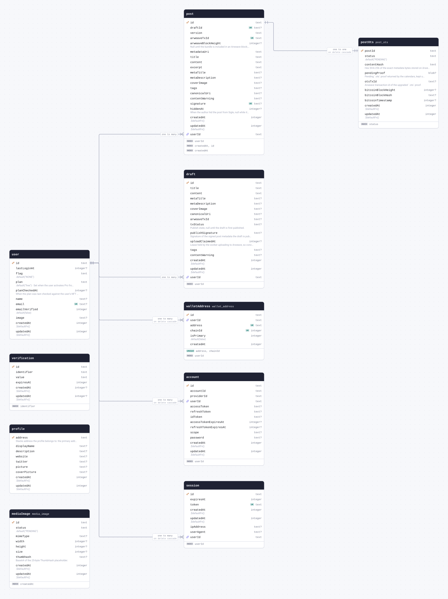
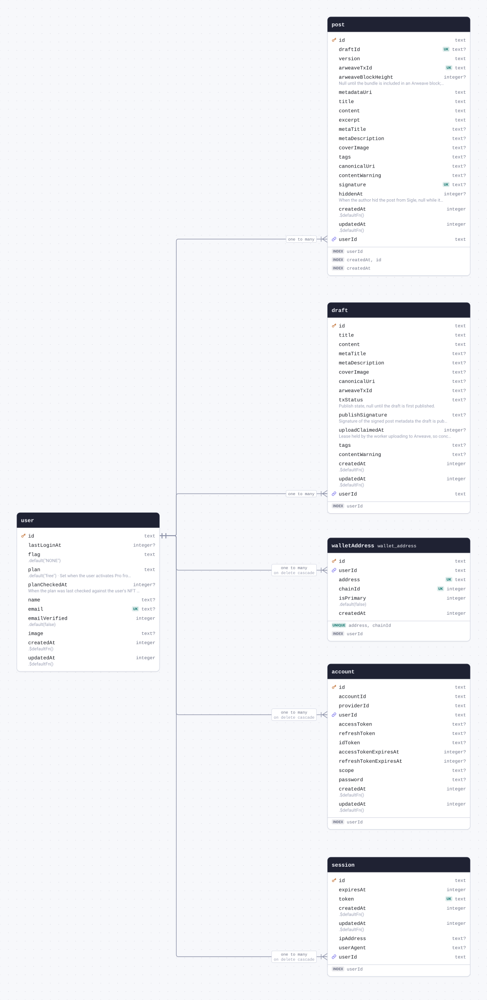
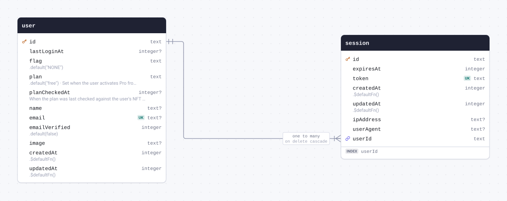
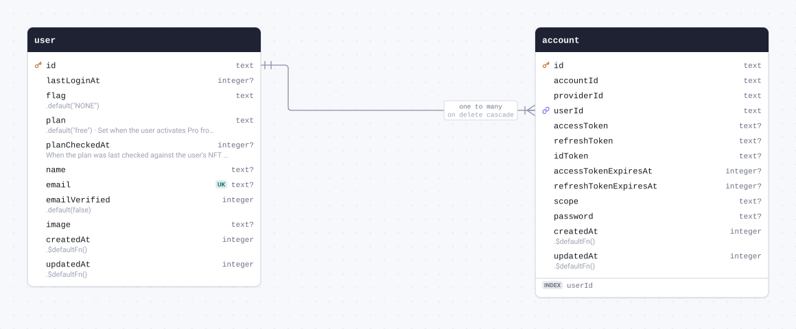
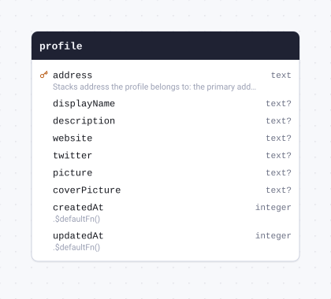
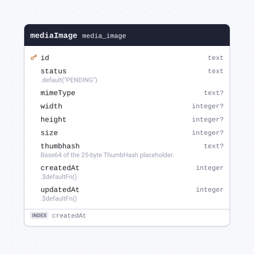

# Schema docs



<details>
<summary>The whole schema as SQL</summary>

```sql
CREATE TABLE `account` (
	`id` text PRIMARY KEY,
	`account_id` text NOT NULL,
	`provider_id` text NOT NULL,
	`user_id` text NOT NULL,
	`access_token` text,
	`refresh_token` text,
	`id_token` text,
	`access_token_expires_at` integer,
	`refresh_token_expires_at` integer,
	`scope` text,
	`password` text,
	`created_at` integer NOT NULL,
	`updated_at` integer NOT NULL,
	CONSTRAINT `fk_account_user_id_user_id_fk` FOREIGN KEY (`user_id`) REFERENCES `user`(`id`) ON DELETE CASCADE
);

CREATE TABLE `draft` (
	`id` text PRIMARY KEY,
	`title` text NOT NULL,
	`content` text NOT NULL,
	`meta_title` text,
	`meta_description` text,
	`cover_image` text,
	`canonical_uri` text,
	`arweave_tx_id` text,
	`tx_status` text,
	`publish_signature` text,
	`upload_claimed_at` integer,
	`tags` text,
	`content_warning` text,
	`created_at` integer NOT NULL,
	`updated_at` integer NOT NULL,
	`user_id` text NOT NULL,
	CONSTRAINT `fk_draft_user_id_user_id_fk` FOREIGN KEY (`user_id`) REFERENCES `user`(`id`)
);

CREATE TABLE `media_image` (
	`id` text PRIMARY KEY,
	`status` text DEFAULT 'PENDING' NOT NULL,
	`mime_type` text,
	`width` integer,
	`height` integer,
	`size` integer,
	`thumbhash` text,
	`created_at` integer NOT NULL,
	`updated_at` integer NOT NULL,
	CONSTRAINT "media_image_status_check" CHECK("status" IN ('PENDING', 'READY', 'FAILED'))
);

CREATE TABLE `post` (
	`id` text PRIMARY KEY,
	`draft_id` text CONSTRAINT `post_draft_id_key` UNIQUE,
	`version` text NOT NULL,
	`arweave_tx_id` text NOT NULL CONSTRAINT `post_arweave_tx_id_key` UNIQUE,
	`arweave_block_height` integer,
	`metadata_uri` text NOT NULL,
	`title` text NOT NULL,
	`content` text NOT NULL,
	`excerpt` text NOT NULL,
	`meta_title` text,
	`meta_description` text,
	`cover_image` text,
	`tags` text,
	`canonical_uri` text,
	`content_warning` text,
	`signature` text CONSTRAINT `post_signature_key` UNIQUE,
	`hidden_at` integer,
	`created_at` integer NOT NULL,
	`updated_at` integer NOT NULL,
	`user_id` text NOT NULL,
	CONSTRAINT `fk_post_user_id_user_id_fk` FOREIGN KEY (`user_id`) REFERENCES `user`(`id`)
);

CREATE TABLE `post_ots` (
	`post_id` text PRIMARY KEY,
	`status` text DEFAULT 'PENDING' NOT NULL,
	`content_hash` text NOT NULL,
	`pending_proof` blob,
	`ots_tx_id` text,
	`bitcoin_block_height` integer,
	`bitcoin_block_hash` text,
	`bitcoin_timestamp` integer,
	`created_at` integer NOT NULL,
	`updated_at` integer NOT NULL,
	CONSTRAINT `fk_post_ots_post_id_post_id_fk` FOREIGN KEY (`post_id`) REFERENCES `post`(`id`) ON DELETE CASCADE,
	CONSTRAINT "post_ots_status_check" CHECK("status" IN ('PENDING', 'UPGRADED', 'FAILED'))
);

CREATE TABLE `profile` (
	`address` text PRIMARY KEY,
	`display_name` text,
	`description` text,
	`website` text,
	`twitter` text,
	`picture` text,
	`cover_picture` text,
	`created_at` integer NOT NULL,
	`updated_at` integer NOT NULL
);

CREATE TABLE `session` (
	`id` text PRIMARY KEY,
	`expires_at` integer NOT NULL,
	`token` text NOT NULL CONSTRAINT `session_token_key` UNIQUE,
	`created_at` integer NOT NULL,
	`updated_at` integer NOT NULL,
	`ip_address` text,
	`user_agent` text,
	`user_id` text NOT NULL,
	CONSTRAINT `fk_session_user_id_user_id_fk` FOREIGN KEY (`user_id`) REFERENCES `user`(`id`) ON DELETE CASCADE
);

CREATE TABLE `user` (
	`id` text PRIMARY KEY,
	`last_login_at` integer,
	`flag` text DEFAULT 'NONE' NOT NULL,
	`plan` text DEFAULT 'free' NOT NULL,
	`plan_checked_at` integer,
	`name` text,
	`email` text CONSTRAINT `user_email_key` UNIQUE,
	`email_verified` integer DEFAULT false NOT NULL,
	`image` text,
	`created_at` integer NOT NULL,
	`updated_at` integer NOT NULL,
	CONSTRAINT "user_flag_check" CHECK("flag" IN ('NONE', 'VERIFIED'))
);

CREATE TABLE `verification` (
	`id` text PRIMARY KEY,
	`identifier` text NOT NULL,
	`value` text NOT NULL,
	`expires_at` integer NOT NULL,
	`created_at` integer,
	`updated_at` integer
);

CREATE TABLE `wallet_address` (
	`id` text PRIMARY KEY,
	`user_id` text NOT NULL,
	`address` text NOT NULL,
	`chain_id` integer NOT NULL,
	`is_primary` integer DEFAULT false NOT NULL,
	`created_at` integer NOT NULL,
	CONSTRAINT `fk_wallet_address_user_id_user_id_fk` FOREIGN KEY (`user_id`) REFERENCES `user`(`id`) ON DELETE CASCADE
);

CREATE INDEX `account_user_id_idx` ON `account` (`user_id`);

CREATE INDEX `draft_user_id_idx` ON `draft` (`user_id`);

CREATE INDEX `media_image_pending_idx` ON `media_image` (`created_at`) WHERE status = 'PENDING';

CREATE INDEX `post_user_id_idx` ON `post` (`user_id`);

CREATE INDEX `post_created_at_id_idx` ON `post` (`created_at`,`id`);

CREATE INDEX `post_arweave_pending_idx` ON `post` (`created_at`) WHERE arweave_block_height is null;

CREATE INDEX `post_ots_status_idx` ON `post_ots` (`status`);

CREATE INDEX `session_user_id_idx` ON `session` (`user_id`);

CREATE INDEX `verification_identifier_idx` ON `verification` (`identifier`);

CREATE INDEX `wallet_address_user_id_idx` ON `wallet_address` (`user_id`);

CREATE UNIQUE INDEX `wallet_address_address_chain_id_unique` ON `wallet_address` (`address`,`chain_id`);
```

</details>

## Contents

| Table                                 | Name in the database | Description                                                                                                                                      |
| ------------------------------------- | -------------------- | ------------------------------------------------------------------------------------------------------------------------------------------------ |
| [user](#table-user)                   | `user`               |                                                                                                                                                  |
| [session](#table-session)             | `session`            |                                                                                                                                                  |
| [account](#table-account)             | `account`            |                                                                                                                                                  |
| [verification](#table-verification)   | `verification`       |                                                                                                                                                  |
| [walletAddress](#table-walletAddress) | `wallet_address`     | Wallet identity model added by the sign-in-with-stacks better-auth plugin.                                                                       |
| [draft](#table-draft)                 | `draft`              |                                                                                                                                                  |
| [profile](#table-profile)             | `profile`            |                                                                                                                                                  |
| [mediaImage](#table-mediaImage)       | `media_image`        |                                                                                                                                                  |
| [post](#table-post)                   | `post`               |                                                                                                                                                  |
| [postOts](#table-postOts)             | `post_ots`           | One OpenTimestamps proof per published post. The post metadata JSON uploaded to Arweave is the file being anchored, identified by `contentHash`. |

## Tables

<a id="table-user"></a>

### user



| Column                              | Type      | Constraints | Default            | Description                                                                                         |
| ----------------------------------- | --------- | ----------- | ------------------ | --------------------------------------------------------------------------------------------------- |
| `id`                                | `text`    | PK NOT NULL |                    |                                                                                                     |
| `lastLoginAt` (`last_login_at`)     | `integer` | NULL        |                    |                                                                                                     |
| `flag`                              | `text`    | NOT NULL    | `.default("NONE")` |                                                                                                     |
| `plan`                              | `text`    | NOT NULL    | `.default("free")` | Set when the user activates Pro from the website, and re-checked twice a day while they are on Pro. |
| `planCheckedAt` (`plan_checked_at`) | `integer` | NULL        |                    | When the plan was last checked against the user's NFT holdings, null when never.                    |
| `name`                              | `text`    | NULL        |                    |                                                                                                     |
| `email`                             | `text`    | UNIQUE NULL |                    |                                                                                                     |
| `emailVerified` (`email_verified`)  | `integer` | NOT NULL    | `.default(false)`  |                                                                                                     |
| `image`                             | `text`    | NULL        |                    |                                                                                                     |
| `createdAt` (`created_at`)          | `integer` | NOT NULL    | `.$defaultFn()`    |                                                                                                     |
| `updatedAt` (`updated_at`)          | `integer` | NOT NULL    | `.$defaultFn()`    |                                                                                                     |

#### Definition

```sql
CREATE TABLE `user` (
	`id` text PRIMARY KEY,
	`last_login_at` integer,
	`flag` text DEFAULT 'NONE' NOT NULL,
	`plan` text DEFAULT 'free' NOT NULL,
	`plan_checked_at` integer,
	`name` text,
	`email` text CONSTRAINT `user_email_key` UNIQUE,
	`email_verified` integer DEFAULT false NOT NULL,
	`image` text,
	`created_at` integer NOT NULL,
	`updated_at` integer NOT NULL,
	CONSTRAINT "user_flag_check" CHECK("flag" IN ('NONE', 'VERIFIED'))
);
```

#### Referenced by

- `id` → [session.userId](#table-session) (one to many, on delete cascade)
- `id` → [account.userId](#table-account) (one to many, on delete cascade)
- `id` → [walletAddress.userId](#table-walletAddress) (one to many, on delete cascade)
- `id` → [draft.userId](#table-draft) (one to many)
- `id` → [post.userId](#table-post) (one to many)

<details>
<summary>Queries and their SQL</summary>

**Select**: Every row of user.

```ts
db.select().from(user);
```

```sql
select "id", "last_login_at", "flag", "plan", "plan_checked_at", "name", "email", "email_verified", "image", "created_at", "updated_at"
from "user"
```

**Count**: How many rows user has.

```ts
db.select({ count: count() }).from(user);
```

```sql
select count(*)
from "user"
```

**Find many with relations**: The rows of user with what they relate to, through the relational query API.

```ts
db.query.user.findMany({
  with: { sessions: true, accounts: true, walletAddresses: true, drafts: true, posts: true },
});
```

```sql
select "d0"."id" as "id", "d0"."last_login_at" as "lastLoginAt", "d0"."flag" as "flag", "d0"."plan" as "plan", "d0"."plan_checked_at" as "planCheckedAt", "d0"."name" as "name", "d0"."email" as "email", "d0"."email_verified" as "emailVerified", "d0"."image" as "image", "d0"."created_at" as "createdAt", "d0"."updated_at" as "updatedAt", (select json_group_array(json_object('id', "id", 'expiresAt', "expiresAt", 'token', "token", 'createdAt', "createdAt", 'updatedAt', "updatedAt", 'ipAddress', "ipAddress", 'userAgent', "userAgent", 'userId', "userId")) as "r" from (select "d1"."id" as "id", "d1"."expires_at" as "expiresAt", "d1"."token" as "token", "d1"."created_at" as "createdAt", "d1"."updated_at" as "updatedAt", "d1"."ip_address" as "ipAddress", "d1"."user_agent" as "userAgent", "d1"."user_id" as "userId" from "session" as "d1" where "d0"."id" = "d1"."user_id") as "t") as "sessions", (select json_group_array(json_object('id', "id", 'accountId', "accountId", 'providerId', "providerId", 'userId', "userId", 'accessToken', "accessToken", 'refreshToken', "refreshToken", 'idToken', "idToken", 'accessTokenExpiresAt', "accessTokenExpiresAt", 'refreshTokenExpiresAt', "refreshTokenExpiresAt", 'scope', "scope", 'password', "password", 'createdAt', "createdAt", 'updatedAt', "updatedAt")) as "r" from (select "d1"."id" as "id", "d1"."account_id" as "accountId", "d1"."provider_id" as "providerId", "d1"."user_id" as "userId", "d1"."access_token" as "accessToken", "d1"."refresh_token" as "refreshToken", "d1"."id_token" as "idToken", "d1"."access_token_expires_at" as "accessTokenExpiresAt", "d1"."refresh_token_expires_at" as "refreshTokenExpiresAt", "d1"."scope" as "scope", "d1"."password" as "password", "d1"."created_at" as "createdAt", "d1"."updated_at" as "updatedAt" from "account" as "d1" where "d0"."id" = "d1"."user_id") as "t") as "accounts", (select json_group_array(json_object('id', "id", 'userId', "userId", 'address', "address", 'chainId', "chainId", 'isPrimary', "isPrimary", 'createdAt', "createdAt")) as "r" from (select "d1"."id" as "id", "d1"."user_id" as "userId", "d1"."address" as "address", "d1"."chain_id" as "chainId", "d1"."is_primary" as "isPrimary", "d1"."created_at" as "createdAt" from "wallet_address" as "d1" where "d0"."id" = "d1"."user_id") as "t") as "walletAddresses", (select json_group_array(json_object('id', "id", 'title', "title", 'content', "content", 'metaTitle', "metaTitle", 'metaDescription', "metaDescription", 'coverImage', "coverImage", 'canonicalUri', "canonicalUri", 'arweaveTxId', "arweaveTxId", 'txStatus', "txStatus", 'publishSignature', "publishSignature", 'uploadClaimedAt', "uploadClaimedAt", 'tags', "tags", 'contentWarning', "contentWarning", 'createdAt', "createdAt", 'updatedAt', "updatedAt", 'userId', "userId")) as "r" from (select "d1"."id" as "id", "d1"."title" as "title", "d1"."content" as "content", "d1"."meta_title" as "metaTitle", "d1"."meta_description" as "metaDescription", "d1"."cover_image" as "coverImage", "d1"."canonical_uri" as "canonicalUri", "d1"."arweave_tx_id" as "arweaveTxId", "d1"."tx_status" as "txStatus", "d1"."publish_signature" as "publishSignature", "d1"."upload_claimed_at" as "uploadClaimedAt", "d1"."tags" as "tags", "d1"."content_warning" as "contentWarning", "d1"."created_at" as "createdAt", "d1"."updated_at" as "updatedAt", "d1"."user_id" as "userId" from "draft" as "d1" where "d0"."id" = "d1"."user_id") as "t") as "drafts", (select json_group_array(json_object('id', "id", 'draftId', "draftId", 'version', "version", 'arweaveTxId', "arweaveTxId", 'arweaveBlockHeight', "arweaveBlockHeight", 'metadataUri', "metadataUri", 'title', "title", 'content', "content", 'excerpt', "excerpt", 'metaTitle', "metaTitle", 'metaDescription', "metaDescription", 'coverImage', "coverImage", 'tags', "tags", 'canonicalUri', "canonicalUri", 'contentWarning', "contentWarning", 'signature', "signature", 'hiddenAt', "hiddenAt", 'createdAt', "createdAt", 'updatedAt', "updatedAt", 'userId', "userId")) as "r" from (select "d1"."id" as "id", "d1"."draft_id" as "draftId", "d1"."version" as "version", "d1"."arweave_tx_id" as "arweaveTxId", "d1"."arweave_block_height" as "arweaveBlockHeight", "d1"."metadata_uri" as "metadataUri", "d1"."title" as "title", "d1"."content" as "content", "d1"."excerpt" as "excerpt", "d1"."meta_title" as "metaTitle", "d1"."meta_description" as "metaDescription", "d1"."cover_image" as "coverImage", "d1"."tags" as "tags", "d1"."canonical_uri" as "canonicalUri", "d1"."content_warning" as "contentWarning", "d1"."signature" as "signature", "d1"."hidden_at" as "hiddenAt", "d1"."created_at" as "createdAt", "d1"."updated_at" as "updatedAt", "d1"."user_id" as "userId" from "post" as "d1" where "d0"."id" = "d1"."user_id") as "t") as "posts"
from "user" as "d0"
```

**Find by primary key**: One row of user, through the relational query API.

```ts
db.query.user.findFirst({ where: { id: "id" } });
```

```sql
select "d0"."id" as "id", "d0"."last_login_at" as "lastLoginAt", "d0"."flag" as "flag", "d0"."plan" as "plan", "d0"."plan_checked_at" as "planCheckedAt", "d0"."name" as "name", "d0"."email" as "email", "d0"."email_verified" as "emailVerified", "d0"."image" as "image", "d0"."created_at" as "createdAt", "d0"."updated_at" as "updatedAt"
from "user" as "d0"
where "d0"."id" = ?
limit ?
-- params: ["id",1]
```

**Insert**: Adds a row to user, giving the columns that have no default.

```ts
db.insert(user).values({ id: "id" });
```

```sql
insert into "user" ("id", "last_login_at", "flag", "plan", "plan_checked_at", "name", "email", "email_verified", "image", "created_at", "updated_at")
values (?, null, ?, ?, null, null, null, ?, null, ?, ?)
-- params: ["id","NONE","free",0,1767225600000,1767225600000]
```

**Update**: Changes a row of user, found by its primary key.

```ts
db.update(user).set({ lastLoginAt: 1 }).where(eq(user.id, "id"));
```

```sql
update "user"
set "last_login_at" = ?
where "user"."id" = ?
-- params: [1,"id"]
```

**Delete**: Deletes a row of user, found by its primary key.

```ts
db.delete(user).where(eq(user.id, "id"));
```

```sql
delete from "user"
where "user"."id" = ?
-- params: ["id"]
```

</details>

<a id="table-session"></a>

### session



| Column                     | Type      | Constraints                       | Default         | Description |
| -------------------------- | --------- | --------------------------------- | --------------- | ----------- |
| `id`                       | `text`    | PK NOT NULL                       |                 |             |
| `expiresAt` (`expires_at`) | `integer` | NOT NULL                          |                 |             |
| `token`                    | `text`    | UNIQUE NOT NULL                   |                 |             |
| `createdAt` (`created_at`) | `integer` | NOT NULL                          | `.$defaultFn()` |             |
| `updatedAt` (`updated_at`) | `integer` | NOT NULL                          | `.$defaultFn()` |             |
| `ipAddress` (`ip_address`) | `text`    | NULL                              |                 |             |
| `userAgent` (`user_agent`) | `text`    | NULL                              |                 |             |
| `userId` (`user_id`)       | `text`    | NOT NULL → [user.id](#table-user) |                 |             |

#### Definition

```sql
CREATE TABLE `session` (
	`id` text PRIMARY KEY,
	`expires_at` integer NOT NULL,
	`token` text NOT NULL CONSTRAINT `session_token_key` UNIQUE,
	`created_at` integer NOT NULL,
	`updated_at` integer NOT NULL,
	`ip_address` text,
	`user_agent` text,
	`user_id` text NOT NULL,
	CONSTRAINT `fk_session_user_id_user_id_fk` FOREIGN KEY (`user_id`) REFERENCES `user`(`id`) ON DELETE CASCADE
);

CREATE INDEX `session_user_id_idx` ON `session` (`user_id`);
```

#### Indexes

- INDEX `userId`

#### References

- `userId` → [user.id](#table-user) (many to one, on delete cascade)

<details>
<summary>Queries and their SQL</summary>

**Select**: Every row of session.

```ts
db.select().from(session);
```

```sql
select "id", "expires_at", "token", "created_at", "updated_at", "ip_address", "user_agent", "user_id"
from "session"
```

**Count**: How many rows session has.

```ts
db.select({ count: count() }).from(session);
```

```sql
select count(*)
from "session"
```

**Find many with relations**: The rows of session with what they relate to, through the relational query API.

```ts
db.query.session.findMany({ with: { user: true } });
```

```sql
select "d0"."id" as "id", "d0"."expires_at" as "expiresAt", "d0"."token" as "token", "d0"."created_at" as "createdAt", "d0"."updated_at" as "updatedAt", "d0"."ip_address" as "ipAddress", "d0"."user_agent" as "userAgent", "d0"."user_id" as "userId", (select json_object('id', "id", 'lastLoginAt', "lastLoginAt", 'flag', "flag", 'plan', "plan", 'planCheckedAt', "planCheckedAt", 'name', "name", 'email', "email", 'emailVerified', "emailVerified", 'image', "image", 'createdAt', "createdAt", 'updatedAt', "updatedAt") as "r" from (select "d1"."id" as "id", "d1"."last_login_at" as "lastLoginAt", "d1"."flag" as "flag", "d1"."plan" as "plan", "d1"."plan_checked_at" as "planCheckedAt", "d1"."name" as "name", "d1"."email" as "email", "d1"."email_verified" as "emailVerified", "d1"."image" as "image", "d1"."created_at" as "createdAt", "d1"."updated_at" as "updatedAt" from "user" as "d1" where "d0"."user_id" = "d1"."id" limit ?) as "t") as "user"
from "session" as "d0"
-- params: [1]
```

**Find by primary key**: One row of session, through the relational query API.

```ts
db.query.session.findFirst({ where: { id: "id" } });
```

```sql
select "d0"."id" as "id", "d0"."expires_at" as "expiresAt", "d0"."token" as "token", "d0"."created_at" as "createdAt", "d0"."updated_at" as "updatedAt", "d0"."ip_address" as "ipAddress", "d0"."user_agent" as "userAgent", "d0"."user_id" as "userId"
from "session" as "d0"
where "d0"."id" = ?
limit ?
-- params: ["id",1]
```

**Insert**: Adds a row to session, giving the columns that have no default.

```ts
db.insert(session).values({ id: "id", expiresAt: 1, token: "token", userId: "userId" });
```

```sql
insert into "session" ("id", "expires_at", "token", "created_at", "updated_at", "ip_address", "user_agent", "user_id")
values (?, ?, ?, ?, ?, null, null, ?)
-- params: ["id",1,"token",1767225600000,1767225600000,"userId"]
```

**Update**: Changes a row of session, found by its primary key.

```ts
db.update(session).set({ expiresAt: 1 }).where(eq(session.id, "id"));
```

```sql
update "session"
set "expires_at" = ?
where "session"."id" = ?
-- params: [1,"id"]
```

**Delete**: Deletes a row of session, found by its primary key.

```ts
db.delete(session).where(eq(session.id, "id"));
```

```sql
delete from "session"
where "session"."id" = ?
-- params: ["id"]
```

</details>

<a id="table-account"></a>

### account



| Column                                               | Type      | Constraints                       | Default         | Description |
| ---------------------------------------------------- | --------- | --------------------------------- | --------------- | ----------- |
| `id`                                                 | `text`    | PK NOT NULL                       |                 |             |
| `accountId` (`account_id`)                           | `text`    | NOT NULL                          |                 |             |
| `providerId` (`provider_id`)                         | `text`    | NOT NULL                          |                 |             |
| `userId` (`user_id`)                                 | `text`    | NOT NULL → [user.id](#table-user) |                 |             |
| `accessToken` (`access_token`)                       | `text`    | NULL                              |                 |             |
| `refreshToken` (`refresh_token`)                     | `text`    | NULL                              |                 |             |
| `idToken` (`id_token`)                               | `text`    | NULL                              |                 |             |
| `accessTokenExpiresAt` (`access_token_expires_at`)   | `integer` | NULL                              |                 |             |
| `refreshTokenExpiresAt` (`refresh_token_expires_at`) | `integer` | NULL                              |                 |             |
| `scope`                                              | `text`    | NULL                              |                 |             |
| `password`                                           | `text`    | NULL                              |                 |             |
| `createdAt` (`created_at`)                           | `integer` | NOT NULL                          | `.$defaultFn()` |             |
| `updatedAt` (`updated_at`)                           | `integer` | NOT NULL                          | `.$defaultFn()` |             |

#### Definition

```sql
CREATE TABLE `account` (
	`id` text PRIMARY KEY,
	`account_id` text NOT NULL,
	`provider_id` text NOT NULL,
	`user_id` text NOT NULL,
	`access_token` text,
	`refresh_token` text,
	`id_token` text,
	`access_token_expires_at` integer,
	`refresh_token_expires_at` integer,
	`scope` text,
	`password` text,
	`created_at` integer NOT NULL,
	`updated_at` integer NOT NULL,
	CONSTRAINT `fk_account_user_id_user_id_fk` FOREIGN KEY (`user_id`) REFERENCES `user`(`id`) ON DELETE CASCADE
);

CREATE INDEX `account_user_id_idx` ON `account` (`user_id`);
```

#### Indexes

- INDEX `userId`

#### References

- `userId` → [user.id](#table-user) (many to one, on delete cascade)

<details>
<summary>Queries and their SQL</summary>

**Select**: Every row of account.

```ts
db.select().from(account);
```

```sql
select "id", "account_id", "provider_id", "user_id", "access_token", "refresh_token", "id_token", "access_token_expires_at", "refresh_token_expires_at", "scope", "password", "created_at", "updated_at"
from "account"
```

**Count**: How many rows account has.

```ts
db.select({ count: count() }).from(account);
```

```sql
select count(*)
from "account"
```

**Find many with relations**: The rows of account with what they relate to, through the relational query API.

```ts
db.query.account.findMany({ with: { user: true } });
```

```sql
select "d0"."id" as "id", "d0"."account_id" as "accountId", "d0"."provider_id" as "providerId", "d0"."user_id" as "userId", "d0"."access_token" as "accessToken", "d0"."refresh_token" as "refreshToken", "d0"."id_token" as "idToken", "d0"."access_token_expires_at" as "accessTokenExpiresAt", "d0"."refresh_token_expires_at" as "refreshTokenExpiresAt", "d0"."scope" as "scope", "d0"."password" as "password", "d0"."created_at" as "createdAt", "d0"."updated_at" as "updatedAt", (select json_object('id', "id", 'lastLoginAt', "lastLoginAt", 'flag', "flag", 'plan', "plan", 'planCheckedAt', "planCheckedAt", 'name', "name", 'email', "email", 'emailVerified', "emailVerified", 'image', "image", 'createdAt', "createdAt", 'updatedAt', "updatedAt") as "r" from (select "d1"."id" as "id", "d1"."last_login_at" as "lastLoginAt", "d1"."flag" as "flag", "d1"."plan" as "plan", "d1"."plan_checked_at" as "planCheckedAt", "d1"."name" as "name", "d1"."email" as "email", "d1"."email_verified" as "emailVerified", "d1"."image" as "image", "d1"."created_at" as "createdAt", "d1"."updated_at" as "updatedAt" from "user" as "d1" where "d0"."user_id" = "d1"."id" limit ?) as "t") as "user"
from "account" as "d0"
-- params: [1]
```

**Find by primary key**: One row of account, through the relational query API.

```ts
db.query.account.findFirst({ where: { id: "id" } });
```

```sql
select "d0"."id" as "id", "d0"."account_id" as "accountId", "d0"."provider_id" as "providerId", "d0"."user_id" as "userId", "d0"."access_token" as "accessToken", "d0"."refresh_token" as "refreshToken", "d0"."id_token" as "idToken", "d0"."access_token_expires_at" as "accessTokenExpiresAt", "d0"."refresh_token_expires_at" as "refreshTokenExpiresAt", "d0"."scope" as "scope", "d0"."password" as "password", "d0"."created_at" as "createdAt", "d0"."updated_at" as "updatedAt"
from "account" as "d0"
where "d0"."id" = ?
limit ?
-- params: ["id",1]
```

**Insert**: Adds a row to account, giving the columns that have no default.

```ts
db.insert(account).values({
  id: "id",
  accountId: "accountId",
  providerId: "providerId",
  userId: "userId",
});
```

```sql
insert into "account" ("id", "account_id", "provider_id", "user_id", "access_token", "refresh_token", "id_token", "access_token_expires_at", "refresh_token_expires_at", "scope", "password", "created_at", "updated_at")
values (?, ?, ?, ?, null, null, null, null, null, null, null, ?, ?)
-- params: ["id","accountId","providerId","userId",1767225600000,1767225600000]
```

**Update**: Changes a row of account, found by its primary key.

```ts
db.update(account).set({ accountId: "accountId" }).where(eq(account.id, "id"));
```

```sql
update "account"
set "account_id" = ?
where "account"."id" = ?
-- params: ["accountId","id"]
```

**Delete**: Deletes a row of account, found by its primary key.

```ts
db.delete(account).where(eq(account.id, "id"));
```

```sql
delete from "account"
where "account"."id" = ?
-- params: ["id"]
```

</details>

<a id="table-verification"></a>

### verification


| Column                     | Type      | Constraints | Default         | Description |
| -------------------------- | --------- | ----------- | --------------- | ----------- |
| `id`                       | `text`    | PK NOT NULL |                 |             |
| `identifier`               | `text`    | NOT NULL    |                 |             |
| `value`                    | `text`    | NOT NULL    |                 |             |
| `expiresAt` (`expires_at`) | `integer` | NOT NULL    |                 |             |
| `createdAt` (`created_at`) | `integer` | NULL        | `.$defaultFn()` |             |
| `updatedAt` (`updated_at`) | `integer` | NULL        | `.$defaultFn()` |             |

#### Definition

```sql
CREATE TABLE `verification` (
	`id` text PRIMARY KEY,
	`identifier` text NOT NULL,
	`value` text NOT NULL,
	`expires_at` integer NOT NULL,
	`created_at` integer,
	`updated_at` integer
);

CREATE INDEX `verification_identifier_idx` ON `verification` (`identifier`);
```

#### Indexes

- INDEX `identifier`

<details>
<summary>Queries and their SQL</summary>

**Select**: Every row of verification.

```ts
db.select().from(verification);
```

```sql
select "id", "identifier", "value", "expires_at", "created_at", "updated_at"
from "verification"
```

**Count**: How many rows verification has.

```ts
db.select({ count: count() }).from(verification);
```

```sql
select count(*)
from "verification"
```

**Find many**: The rows of verification, through the relational query API.

```ts
db.query.verification.findMany();
```

```sql
select "d0"."id" as "id", "d0"."identifier" as "identifier", "d0"."value" as "value", "d0"."expires_at" as "expiresAt", "d0"."created_at" as "createdAt", "d0"."updated_at" as "updatedAt"
from "verification" as "d0"
```

**Find by primary key**: One row of verification, through the relational query API.

```ts
db.query.verification.findFirst({ where: { id: "id" } });
```

```sql
select "d0"."id" as "id", "d0"."identifier" as "identifier", "d0"."value" as "value", "d0"."expires_at" as "expiresAt", "d0"."created_at" as "createdAt", "d0"."updated_at" as "updatedAt"
from "verification" as "d0"
where "d0"."id" = ?
limit ?
-- params: ["id",1]
```

**Insert**: Adds a row to verification, giving the columns that have no default.

```ts
db.insert(verification).values({
  id: "id",
  identifier: "identifier",
  value: "value",
  expiresAt: 1,
});
```

```sql
insert into "verification" ("id", "identifier", "value", "expires_at", "created_at", "updated_at")
values (?, ?, ?, ?, ?, ?)
-- params: ["id","identifier","value",1,1767225600000,1767225600000]
```

**Update**: Changes a row of verification, found by its primary key.

```ts
db.update(verification).set({ identifier: "identifier" }).where(eq(verification.id, "id"));
```

```sql
update "verification"
set "identifier" = ?
where "verification"."id" = ?
-- params: ["identifier","id"]
```

**Delete**: Deletes a row of verification, found by its primary key.

```ts
db.delete(verification).where(eq(verification.id, "id"));
```

```sql
delete from "verification"
where "verification"."id" = ?
-- params: ["id"]
```

</details>

<a id="table-walletAddress"></a>

### walletAddress

Table `wallet_address`. Wallet identity model added by the sign-in-with-stacks better-auth plugin.


| Column                     | Type      | Constraints                       | Default           | Description |
| -------------------------- | --------- | --------------------------------- | ----------------- | ----------- |
| `id`                       | `text`    | PK NOT NULL                       |                   |             |
| `userId` (`user_id`)       | `text`    | NOT NULL → [user.id](#table-user) |                   |             |
| `address`                  | `text`    | NOT NULL                          |                   |             |
| `chainId` (`chain_id`)     | `integer` | NOT NULL                          |                   |             |
| `isPrimary` (`is_primary`) | `integer` | NOT NULL                          | `.default(false)` |             |
| `createdAt` (`created_at`) | `integer` | NOT NULL                          |                   |             |

#### Definition

```sql
CREATE TABLE `wallet_address` (
	`id` text PRIMARY KEY,
	`user_id` text NOT NULL,
	`address` text NOT NULL,
	`chain_id` integer NOT NULL,
	`is_primary` integer DEFAULT false NOT NULL,
	`created_at` integer NOT NULL,
	CONSTRAINT `fk_wallet_address_user_id_user_id_fk` FOREIGN KEY (`user_id`) REFERENCES `user`(`id`) ON DELETE CASCADE
);

CREATE INDEX `wallet_address_user_id_idx` ON `wallet_address` (`user_id`);

CREATE UNIQUE INDEX `wallet_address_address_chain_id_unique` ON `wallet_address` (`address`,`chain_id`);
```

#### Indexes

- INDEX `userId`
- UNIQUE `address`, `chainId`

#### References

- `userId` → [user.id](#table-user) (many to one, on delete cascade)

<details>
<summary>Queries and their SQL</summary>

**Select**: Every row of walletAddress.

```ts
db.select().from(walletAddress);
```

```sql
select "id", "user_id", "address", "chain_id", "is_primary", "created_at"
from "wallet_address"
```

**Count**: How many rows walletAddress has.

```ts
db.select({ count: count() }).from(walletAddress);
```

```sql
select count(*)
from "wallet_address"
```

**Find many with relations**: The rows of walletAddress with what they relate to, through the relational query API.

```ts
db.query.walletAddress.findMany({ with: { user: true } });
```

```sql
select "d0"."id" as "id", "d0"."user_id" as "userId", "d0"."address" as "address", "d0"."chain_id" as "chainId", "d0"."is_primary" as "isPrimary", "d0"."created_at" as "createdAt", (select json_object('id', "id", 'lastLoginAt', "lastLoginAt", 'flag', "flag", 'plan', "plan", 'planCheckedAt', "planCheckedAt", 'name', "name", 'email', "email", 'emailVerified', "emailVerified", 'image', "image", 'createdAt', "createdAt", 'updatedAt', "updatedAt") as "r" from (select "d1"."id" as "id", "d1"."last_login_at" as "lastLoginAt", "d1"."flag" as "flag", "d1"."plan" as "plan", "d1"."plan_checked_at" as "planCheckedAt", "d1"."name" as "name", "d1"."email" as "email", "d1"."email_verified" as "emailVerified", "d1"."image" as "image", "d1"."created_at" as "createdAt", "d1"."updated_at" as "updatedAt" from "user" as "d1" where "d0"."user_id" = "d1"."id" limit ?) as "t") as "user"
from "wallet_address" as "d0"
-- params: [1]
```

**Find by primary key**: One row of walletAddress, through the relational query API.

```ts
db.query.walletAddress.findFirst({ where: { id: "id" } });
```

```sql
select "d0"."id" as "id", "d0"."user_id" as "userId", "d0"."address" as "address", "d0"."chain_id" as "chainId", "d0"."is_primary" as "isPrimary", "d0"."created_at" as "createdAt"
from "wallet_address" as "d0"
where "d0"."id" = ?
limit ?
-- params: ["id",1]
```

**Insert**: Adds a row to walletAddress, giving the columns that have no default.

```ts
db.insert(walletAddress).values({
  id: "id",
  userId: "userId",
  address: "address",
  chainId: 1,
  createdAt: 1,
});
```

```sql
insert into "wallet_address" ("id", "user_id", "address", "chain_id", "is_primary", "created_at")
values (?, ?, ?, ?, ?, ?)
-- params: ["id","userId","address",1,0,1]
```

**Update**: Changes a row of walletAddress, found by its primary key.

```ts
db.update(walletAddress).set({ userId: "userId" }).where(eq(walletAddress.id, "id"));
```

```sql
update "wallet_address"
set "user_id" = ?
where "wallet_address"."id" = ?
-- params: ["userId","id"]
```

**Delete**: Deletes a row of walletAddress, found by its primary key.

```ts
db.delete(walletAddress).where(eq(walletAddress.id, "id"));
```

```sql
delete from "wallet_address"
where "wallet_address"."id" = ?
-- params: ["id"]
```

</details>

<a id="table-draft"></a>

### draft


| Column                                   | Type      | Constraints                       | Default         | Description                                                                                                                                   |
| ---------------------------------------- | --------- | --------------------------------- | --------------- | --------------------------------------------------------------------------------------------------------------------------------------------- |
| `id`                                     | `text`    | PK NOT NULL                       |                 |                                                                                                                                               |
| `title`                                  | `text`    | NOT NULL                          |                 |                                                                                                                                               |
| `content`                                | `text`    | NOT NULL                          |                 |                                                                                                                                               |
| `metaTitle` (`meta_title`)               | `text`    | NULL                              |                 |                                                                                                                                               |
| `metaDescription` (`meta_description`)   | `text`    | NULL                              |                 |                                                                                                                                               |
| `coverImage` (`cover_image`)             | `text`    | NULL                              |                 |                                                                                                                                               |
| `canonicalUri` (`canonical_uri`)         | `text`    | NULL                              |                 |                                                                                                                                               |
| `arweaveTxId` (`arweave_tx_id`)          | `text`    | NULL                              |                 |                                                                                                                                               |
| `txStatus` (`tx_status`)                 | `text`    | NULL                              |                 | Publish state, null until the draft is first published.                                                                                       |
| `publishSignature` (`publish_signature`) | `text`    | NULL                              |                 | Signature of the signed post metadata the draft is publishing (or last attempted). `arweaveTxId` is a valid checkpoint only while it matches. |
| `uploadClaimedAt` (`upload_claimed_at`)  | `integer` | NULL                              |                 | Lease held by the worker uploading to Arweave, so concurrent workers for the same signature do not upload the same metadata twice.            |
| `tags`                                   | `text`    | NULL                              |                 |                                                                                                                                               |
| `contentWarning` (`content_warning`)     | `text`    | NULL                              |                 |                                                                                                                                               |
| `createdAt` (`created_at`)               | `integer` | NOT NULL                          | `.$defaultFn()` |                                                                                                                                               |
| `updatedAt` (`updated_at`)               | `integer` | NOT NULL                          | `.$defaultFn()` |                                                                                                                                               |
| `userId` (`user_id`)                     | `text`    | NOT NULL → [user.id](#table-user) |                 |                                                                                                                                               |

#### Definition

```sql
CREATE TABLE `draft` (
	`id` text PRIMARY KEY,
	`title` text NOT NULL,
	`content` text NOT NULL,
	`meta_title` text,
	`meta_description` text,
	`cover_image` text,
	`canonical_uri` text,
	`arweave_tx_id` text,
	`tx_status` text,
	`publish_signature` text,
	`upload_claimed_at` integer,
	`tags` text,
	`content_warning` text,
	`created_at` integer NOT NULL,
	`updated_at` integer NOT NULL,
	`user_id` text NOT NULL,
	CONSTRAINT `fk_draft_user_id_user_id_fk` FOREIGN KEY (`user_id`) REFERENCES `user`(`id`)
);

CREATE INDEX `draft_user_id_idx` ON `draft` (`user_id`);
```

#### Indexes

- INDEX `userId`

#### References

- `userId` → [user.id](#table-user) (many to one)

<details>
<summary>Queries and their SQL</summary>

**Select**: Every row of draft.

```ts
db.select().from(draft);
```

```sql
select "id", "title", "content", "meta_title", "meta_description", "cover_image", "canonical_uri", "arweave_tx_id", "tx_status", "publish_signature", "upload_claimed_at", "tags", "content_warning", "created_at", "updated_at", "user_id"
from "draft"
```

**Count**: How many rows draft has.

```ts
db.select({ count: count() }).from(draft);
```

```sql
select count(*)
from "draft"
```

**Find many with relations**: The rows of draft with what they relate to, through the relational query API.

```ts
db.query.draft.findMany({ with: { user: true } });
```

```sql
select "d0"."id" as "id", "d0"."title" as "title", "d0"."content" as "content", "d0"."meta_title" as "metaTitle", "d0"."meta_description" as "metaDescription", "d0"."cover_image" as "coverImage", "d0"."canonical_uri" as "canonicalUri", "d0"."arweave_tx_id" as "arweaveTxId", "d0"."tx_status" as "txStatus", "d0"."publish_signature" as "publishSignature", "d0"."upload_claimed_at" as "uploadClaimedAt", "d0"."tags" as "tags", "d0"."content_warning" as "contentWarning", "d0"."created_at" as "createdAt", "d0"."updated_at" as "updatedAt", "d0"."user_id" as "userId", (select json_object('id', "id", 'lastLoginAt', "lastLoginAt", 'flag', "flag", 'plan', "plan", 'planCheckedAt', "planCheckedAt", 'name', "name", 'email', "email", 'emailVerified', "emailVerified", 'image', "image", 'createdAt', "createdAt", 'updatedAt', "updatedAt") as "r" from (select "d1"."id" as "id", "d1"."last_login_at" as "lastLoginAt", "d1"."flag" as "flag", "d1"."plan" as "plan", "d1"."plan_checked_at" as "planCheckedAt", "d1"."name" as "name", "d1"."email" as "email", "d1"."email_verified" as "emailVerified", "d1"."image" as "image", "d1"."created_at" as "createdAt", "d1"."updated_at" as "updatedAt" from "user" as "d1" where "d0"."user_id" = "d1"."id" limit ?) as "t") as "user"
from "draft" as "d0"
-- params: [1]
```

**Find by primary key**: One row of draft, through the relational query API.

```ts
db.query.draft.findFirst({ where: { id: "id" } });
```

```sql
select "d0"."id" as "id", "d0"."title" as "title", "d0"."content" as "content", "d0"."meta_title" as "metaTitle", "d0"."meta_description" as "metaDescription", "d0"."cover_image" as "coverImage", "d0"."canonical_uri" as "canonicalUri", "d0"."arweave_tx_id" as "arweaveTxId", "d0"."tx_status" as "txStatus", "d0"."publish_signature" as "publishSignature", "d0"."upload_claimed_at" as "uploadClaimedAt", "d0"."tags" as "tags", "d0"."content_warning" as "contentWarning", "d0"."created_at" as "createdAt", "d0"."updated_at" as "updatedAt", "d0"."user_id" as "userId"
from "draft" as "d0"
where "d0"."id" = ?
limit ?
-- params: ["id",1]
```

**Insert**: Adds a row to draft, giving the columns that have no default.

```ts
db.insert(draft).values({ id: "id", title: "title", content: "content", userId: "userId" });
```

```sql
insert into "draft" ("id", "title", "content", "meta_title", "meta_description", "cover_image", "canonical_uri", "arweave_tx_id", "tx_status", "publish_signature", "upload_claimed_at", "tags", "content_warning", "created_at", "updated_at", "user_id")
values (?, ?, ?, null, null, null, null, null, null, null, null, null, null, ?, ?, ?)
-- params: ["id","title","content",1767225600000,1767225600000,"userId"]
```

**Update**: Changes a row of draft, found by its primary key.

```ts
db.update(draft).set({ title: "title" }).where(eq(draft.id, "id"));
```

```sql
update "draft"
set "title" = ?
where "draft"."id" = ?
-- params: ["title","id"]
```

**Delete**: Deletes a row of draft, found by its primary key.

```ts
db.delete(draft).where(eq(draft.id, "id"));
```

```sql
delete from "draft"
where "draft"."id" = ?
-- params: ["id"]
```

</details>

<a id="table-profile"></a>

### profile



| Column                           | Type      | Constraints | Default         | Description                                                                                                                                                                                                           |
| -------------------------------- | --------- | ----------- | --------------- | --------------------------------------------------------------------------------------------------------------------------------------------------------------------------------------------------------------------- |
| `address`                        | `text`    | PK NOT NULL |                 | Stacks address the profile belongs to: the primary address of the user who saved it. Profiles published on Arweave before profiles moved to the database are kept, including those of addresses that never signed in. |
| `displayName` (`display_name`)   | `text`    | NULL        |                 |                                                                                                                                                                                                                       |
| `description`                    | `text`    | NULL        |                 |                                                                                                                                                                                                                       |
| `website`                        | `text`    | NULL        |                 |                                                                                                                                                                                                                       |
| `twitter`                        | `text`    | NULL        |                 |                                                                                                                                                                                                                       |
| `picture`                        | `text`    | NULL        |                 |                                                                                                                                                                                                                       |
| `coverPicture` (`cover_picture`) | `text`    | NULL        |                 |                                                                                                                                                                                                                       |
| `createdAt` (`created_at`)       | `integer` | NOT NULL    | `.$defaultFn()` |                                                                                                                                                                                                                       |
| `updatedAt` (`updated_at`)       | `integer` | NOT NULL    | `.$defaultFn()` |                                                                                                                                                                                                                       |

#### Definition

```sql
CREATE TABLE `profile` (
	`address` text PRIMARY KEY,
	`display_name` text,
	`description` text,
	`website` text,
	`twitter` text,
	`picture` text,
	`cover_picture` text,
	`created_at` integer NOT NULL,
	`updated_at` integer NOT NULL
);
```

<details>
<summary>Queries and their SQL</summary>

**Select**: Every row of profile.

```ts
db.select().from(profile);
```

```sql
select "address", "display_name", "description", "website", "twitter", "picture", "cover_picture", "created_at", "updated_at"
from "profile"
```

**Count**: How many rows profile has.

```ts
db.select({ count: count() }).from(profile);
```

```sql
select count(*)
from "profile"
```

**Find many**: The rows of profile, through the relational query API.

```ts
db.query.profile.findMany();
```

```sql
select "d0"."address" as "address", "d0"."display_name" as "displayName", "d0"."description" as "description", "d0"."website" as "website", "d0"."twitter" as "twitter", "d0"."picture" as "picture", "d0"."cover_picture" as "coverPicture", "d0"."created_at" as "createdAt", "d0"."updated_at" as "updatedAt"
from "profile" as "d0"
```

**Find by primary key**: One row of profile, through the relational query API.

```ts
db.query.profile.findFirst({ where: { address: "address" } });
```

```sql
select "d0"."address" as "address", "d0"."display_name" as "displayName", "d0"."description" as "description", "d0"."website" as "website", "d0"."twitter" as "twitter", "d0"."picture" as "picture", "d0"."cover_picture" as "coverPicture", "d0"."created_at" as "createdAt", "d0"."updated_at" as "updatedAt"
from "profile" as "d0"
where "d0"."address" = ?
limit ?
-- params: ["address",1]
```

**Insert**: Adds a row to profile, giving the columns that have no default.

```ts
db.insert(profile).values({ address: "address" });
```

```sql
insert into "profile" ("address", "display_name", "description", "website", "twitter", "picture", "cover_picture", "created_at", "updated_at")
values (?, null, null, null, null, null, null, ?, ?)
-- params: ["address",1767225600000,1767225600000]
```

**Update**: Changes a row of profile, found by its primary key.

```ts
db.update(profile).set({ displayName: "displayName" }).where(eq(profile.address, "address"));
```

```sql
update "profile"
set "display_name" = ?
where "profile"."address" = ?
-- params: ["displayName","address"]
```

**Delete**: Deletes a row of profile, found by its primary key.

```ts
db.delete(profile).where(eq(profile.address, "address"));
```

```sql
delete from "profile"
where "profile"."address" = ?
-- params: ["address"]
```

</details>

<a id="table-mediaImage"></a>

### mediaImage

Table `media_image`.



| Column                     | Type      | Constraints | Default               | Description                                  |
| -------------------------- | --------- | ----------- | --------------------- | -------------------------------------------- |
| `id`                       | `text`    | PK NOT NULL |                       |                                              |
| `status`                   | `text`    | NOT NULL    | `.default("PENDING")` |                                              |
| `mimeType` (`mime_type`)   | `text`    | NULL        |                       |                                              |
| `width`                    | `integer` | NULL        |                       |                                              |
| `height`                   | `integer` | NULL        |                       |                                              |
| `size`                     | `integer` | NULL        |                       |                                              |
| `thumbhash`                | `text`    | NULL        |                       | Base64 of the 25-byte ThumbHash placeholder. |
| `createdAt` (`created_at`) | `integer` | NOT NULL    | `.$defaultFn()`       |                                              |
| `updatedAt` (`updated_at`) | `integer` | NOT NULL    | `.$defaultFn()`       |                                              |

#### Definition

```sql
CREATE TABLE `media_image` (
	`id` text PRIMARY KEY,
	`status` text DEFAULT 'PENDING' NOT NULL,
	`mime_type` text,
	`width` integer,
	`height` integer,
	`size` integer,
	`thumbhash` text,
	`created_at` integer NOT NULL,
	`updated_at` integer NOT NULL,
	CONSTRAINT "media_image_status_check" CHECK("status" IN ('PENDING', 'READY', 'FAILED'))
);

CREATE INDEX `media_image_pending_idx` ON `media_image` (`created_at`) WHERE status = 'PENDING';
```

#### Indexes

- INDEX `createdAt`

<details>
<summary>Queries and their SQL</summary>

**Select**: Every row of mediaImage.

```ts
db.select().from(mediaImage);
```

```sql
select "id", "status", "mime_type", "width", "height", "size", "thumbhash", "created_at", "updated_at"
from "media_image"
```

**Count**: How many rows mediaImage has.

```ts
db.select({ count: count() }).from(mediaImage);
```

```sql
select count(*)
from "media_image"
```

**Find many**: The rows of mediaImage, through the relational query API.

```ts
db.query.mediaImage.findMany();
```

```sql
select "d0"."id" as "id", "d0"."status" as "status", "d0"."mime_type" as "mimeType", "d0"."width" as "width", "d0"."height" as "height", "d0"."size" as "size", "d0"."thumbhash" as "thumbhash", "d0"."created_at" as "createdAt", "d0"."updated_at" as "updatedAt"
from "media_image" as "d0"
```

**Find by primary key**: One row of mediaImage, through the relational query API.

```ts
db.query.mediaImage.findFirst({ where: { id: "id" } });
```

```sql
select "d0"."id" as "id", "d0"."status" as "status", "d0"."mime_type" as "mimeType", "d0"."width" as "width", "d0"."height" as "height", "d0"."size" as "size", "d0"."thumbhash" as "thumbhash", "d0"."created_at" as "createdAt", "d0"."updated_at" as "updatedAt"
from "media_image" as "d0"
where "d0"."id" = ?
limit ?
-- params: ["id",1]
```

**Insert**: Adds a row to mediaImage, giving the columns that have no default.

```ts
db.insert(mediaImage).values({ id: "id" });
```

```sql
insert into "media_image" ("id", "status", "mime_type", "width", "height", "size", "thumbhash", "created_at", "updated_at")
values (?, ?, null, null, null, null, null, ?, ?)
-- params: ["id","PENDING",1767225600000,1767225600000]
```

**Update**: Changes a row of mediaImage, found by its primary key.

```ts
db.update(mediaImage).set({ status: "status" }).where(eq(mediaImage.id, "id"));
```

```sql
update "media_image"
set "status" = ?
where "media_image"."id" = ?
-- params: ["status","id"]
```

**Delete**: Deletes a row of mediaImage, found by its primary key.

```ts
db.delete(mediaImage).where(eq(mediaImage.id, "id"));
```

```sql
delete from "media_image"
where "media_image"."id" = ?
-- params: ["id"]
```

</details>

<a id="table-post"></a>

### post


| Column                                        | Type      | Constraints                       | Default         | Description                                                                                                                     |
| --------------------------------------------- | --------- | --------------------------------- | --------------- | ------------------------------------------------------------------------------------------------------------------------------- |
| `id`                                          | `text`    | PK NOT NULL                       |                 |                                                                                                                                 |
| `draftId` (`draft_id`)                        | `text`    | UNIQUE NULL                       |                 |                                                                                                                                 |
| `version`                                     | `text`    | NOT NULL                          |                 |                                                                                                                                 |
| `arweaveTxId` (`arweave_tx_id`)               | `text`    | UNIQUE NOT NULL                   |                 |                                                                                                                                 |
| `arweaveBlockHeight` (`arweave_block_height`) | `integer` | NULL                              |                 | Null until the bundle is included in an Arweave block; populated by a later queue.                                              |
| `metadataUri` (`metadata_uri`)                | `text`    | NOT NULL                          |                 |                                                                                                                                 |
| `title`                                       | `text`    | NOT NULL                          |                 |                                                                                                                                 |
| `content`                                     | `text`    | NOT NULL                          |                 |                                                                                                                                 |
| `excerpt`                                     | `text`    | NOT NULL                          |                 |                                                                                                                                 |
| `metaTitle` (`meta_title`)                    | `text`    | NULL                              |                 |                                                                                                                                 |
| `metaDescription` (`meta_description`)        | `text`    | NULL                              |                 |                                                                                                                                 |
| `coverImage` (`cover_image`)                  | `text`    | NULL                              |                 |                                                                                                                                 |
| `tags`                                        | `text`    | NULL                              |                 |                                                                                                                                 |
| `canonicalUri` (`canonical_uri`)              | `text`    | NULL                              |                 |                                                                                                                                 |
| `contentWarning` (`content_warning`)          | `text`    | NULL                              |                 |                                                                                                                                 |
| `signature`                                   | `text`    | UNIQUE NULL                       |                 |                                                                                                                                 |
| `hiddenAt` (`hidden_at`)                      | `integer` | NULL                              |                 | When the author hid the post from Sigle, null while it is shown. A hidden post stays on Arweave, but Sigle no longer serves it. |
| `createdAt` (`created_at`)                    | `integer` | NOT NULL                          | `.$defaultFn()` |                                                                                                                                 |
| `updatedAt` (`updated_at`)                    | `integer` | NOT NULL                          | `.$defaultFn()` |                                                                                                                                 |
| `userId` (`user_id`)                          | `text`    | NOT NULL → [user.id](#table-user) |                 |                                                                                                                                 |

#### Definition

```sql
CREATE TABLE `post` (
	`id` text PRIMARY KEY,
	`draft_id` text CONSTRAINT `post_draft_id_key` UNIQUE,
	`version` text NOT NULL,
	`arweave_tx_id` text NOT NULL CONSTRAINT `post_arweave_tx_id_key` UNIQUE,
	`arweave_block_height` integer,
	`metadata_uri` text NOT NULL,
	`title` text NOT NULL,
	`content` text NOT NULL,
	`excerpt` text NOT NULL,
	`meta_title` text,
	`meta_description` text,
	`cover_image` text,
	`tags` text,
	`canonical_uri` text,
	`content_warning` text,
	`signature` text CONSTRAINT `post_signature_key` UNIQUE,
	`hidden_at` integer,
	`created_at` integer NOT NULL,
	`updated_at` integer NOT NULL,
	`user_id` text NOT NULL,
	CONSTRAINT `fk_post_user_id_user_id_fk` FOREIGN KEY (`user_id`) REFERENCES `user`(`id`)
);

CREATE INDEX `post_user_id_idx` ON `post` (`user_id`);

CREATE INDEX `post_created_at_id_idx` ON `post` (`created_at`,`id`);

CREATE INDEX `post_arweave_pending_idx` ON `post` (`created_at`) WHERE arweave_block_height is null;
```

#### Indexes

- INDEX `userId`
- INDEX `createdAt`, `id`
- INDEX `createdAt`

#### References

- `userId` → [user.id](#table-user) (many to one)

#### Referenced by

- `id` → [postOts.postId](#table-postOts) (one to one, on delete cascade)

<details>
<summary>Queries and their SQL</summary>

**Select**: Every row of post.

```ts
db.select().from(post);
```

```sql
select "id", "draft_id", "version", "arweave_tx_id", "arweave_block_height", "metadata_uri", "title", "content", "excerpt", "meta_title", "meta_description", "cover_image", "tags", "canonical_uri", "content_warning", "signature", "hidden_at", "created_at", "updated_at", "user_id"
from "post"
```

**Count**: How many rows post has.

```ts
db.select({ count: count() }).from(post);
```

```sql
select count(*)
from "post"
```

**Find many with relations**: The rows of post with what they relate to, through the relational query API.

```ts
db.query.post.findMany({ with: { user: true, ots: true } });
```

```sql
select "d0"."id" as "id", "d0"."draft_id" as "draftId", "d0"."version" as "version", "d0"."arweave_tx_id" as "arweaveTxId", "d0"."arweave_block_height" as "arweaveBlockHeight", "d0"."metadata_uri" as "metadataUri", "d0"."title" as "title", "d0"."content" as "content", "d0"."excerpt" as "excerpt", "d0"."meta_title" as "metaTitle", "d0"."meta_description" as "metaDescription", "d0"."cover_image" as "coverImage", "d0"."tags" as "tags", "d0"."canonical_uri" as "canonicalUri", "d0"."content_warning" as "contentWarning", "d0"."signature" as "signature", "d0"."hidden_at" as "hiddenAt", "d0"."created_at" as "createdAt", "d0"."updated_at" as "updatedAt", "d0"."user_id" as "userId", (select json_object('id', "id", 'lastLoginAt', "lastLoginAt", 'flag', "flag", 'plan', "plan", 'planCheckedAt', "planCheckedAt", 'name', "name", 'email', "email", 'emailVerified', "emailVerified", 'image', "image", 'createdAt', "createdAt", 'updatedAt', "updatedAt") as "r" from (select "d1"."id" as "id", "d1"."last_login_at" as "lastLoginAt", "d1"."flag" as "flag", "d1"."plan" as "plan", "d1"."plan_checked_at" as "planCheckedAt", "d1"."name" as "name", "d1"."email" as "email", "d1"."email_verified" as "emailVerified", "d1"."image" as "image", "d1"."created_at" as "createdAt", "d1"."updated_at" as "updatedAt" from "user" as "d1" where "d0"."user_id" = "d1"."id" limit ?) as "t") as "user", (select json_object('postId', "postId", 'status', "status", 'contentHash', "contentHash", 'pendingProof', "pendingProof", 'otsTxId', "otsTxId", 'bitcoinBlockHeight', "bitcoinBlockHeight", 'bitcoinBlockHash', "bitcoinBlockHash", 'bitcoinTimestamp', "bitcoinTimestamp", 'createdAt', "createdAt", 'updatedAt', "updatedAt") as "r" from (select "d1"."post_id" as "postId", "d1"."status" as "status", "d1"."content_hash" as "contentHash", "d1"."pending_proof" as "pendingProof", "d1"."ots_tx_id" as "otsTxId", "d1"."bitcoin_block_height" as "bitcoinBlockHeight", "d1"."bitcoin_block_hash" as "bitcoinBlockHash", "d1"."bitcoin_timestamp" as "bitcoinTimestamp", "d1"."created_at" as "createdAt", "d1"."updated_at" as "updatedAt" from "post_ots" as "d1" where "d0"."id" = "d1"."post_id" limit ?) as "t") as "ots"
from "post" as "d0"
-- params: [1,1]
```

**Find by primary key**: One row of post, through the relational query API.

```ts
db.query.post.findFirst({ where: { id: "id" } });
```

```sql
select "d0"."id" as "id", "d0"."draft_id" as "draftId", "d0"."version" as "version", "d0"."arweave_tx_id" as "arweaveTxId", "d0"."arweave_block_height" as "arweaveBlockHeight", "d0"."metadata_uri" as "metadataUri", "d0"."title" as "title", "d0"."content" as "content", "d0"."excerpt" as "excerpt", "d0"."meta_title" as "metaTitle", "d0"."meta_description" as "metaDescription", "d0"."cover_image" as "coverImage", "d0"."tags" as "tags", "d0"."canonical_uri" as "canonicalUri", "d0"."content_warning" as "contentWarning", "d0"."signature" as "signature", "d0"."hidden_at" as "hiddenAt", "d0"."created_at" as "createdAt", "d0"."updated_at" as "updatedAt", "d0"."user_id" as "userId"
from "post" as "d0"
where "d0"."id" = ?
limit ?
-- params: ["id",1]
```

**Insert**: Adds a row to post, giving the columns that have no default.

```ts
db.insert(post).values({
  id: "id",
  version: "version",
  arweaveTxId: "arweaveTxId",
  metadataUri: "metadataUri",
  title: "title",
  content: "content",
  excerpt: "excerpt",
  userId: "userId",
});
```

```sql
insert into "post" ("id", "draft_id", "version", "arweave_tx_id", "arweave_block_height", "metadata_uri", "title", "content", "excerpt", "meta_title", "meta_description", "cover_image", "tags", "canonical_uri", "content_warning", "signature", "hidden_at", "created_at", "updated_at", "user_id")
values (?, null, ?, ?, null, ?, ?, ?, ?, null, null, null, null, null, null, null, null, ?, ?, ?)
-- params: ["id","version","arweaveTxId","metadataUri","title","content","excerpt",1767225600000,1767225600000,"userId"]
```

**Update**: Changes a row of post, found by its primary key.

```ts
db.update(post).set({ draftId: "draftId" }).where(eq(post.id, "id"));
```

```sql
update "post"
set "draft_id" = ?
where "post"."id" = ?
-- params: ["draftId","id"]
```

**Delete**: Deletes a row of post, found by its primary key.

```ts
db.delete(post).where(eq(post.id, "id"));
```

```sql
delete from "post"
where "post"."id" = ?
-- params: ["id"]
```

</details>

<a id="table-postOts"></a>

### postOts

Table `post_ots`. One OpenTimestamps proof per published post. The post metadata JSON uploaded to Arweave is the file being anchored, identified by `contentHash`.


| Column                                        | Type      | Constraints                          | Default               | Description                                                                                                |
| --------------------------------------------- | --------- | ------------------------------------ | --------------------- | ---------------------------------------------------------------------------------------------------------- |
| `postId` (`post_id`)                          | `text`    | PK NOT NULL → [post.id](#table-post) |                       |                                                                                                            |
| `status`                                      | `text`    | NOT NULL                             | `.default("PENDING")` |                                                                                                            |
| `contentHash` (`content_hash`)                | `text`    | NOT NULL                             |                       | Hex SHA-256 of the exact metadata bytes stored on Arweave.                                                 |
| `pendingProof` (`pending_proof`)              | `blob`    | NULL                                 |                       | Pending `.ots` proof returned by the calendars, kept until it can be upgraded to a Bitcoin-anchored proof. |
| `otsTxId` (`ots_tx_id`)                       | `text`    | NULL                                 |                       | Arweave transaction id of the upgraded `.ots` proof.                                                       |
| `bitcoinBlockHeight` (`bitcoin_block_height`) | `integer` | NULL                                 |                       |                                                                                                            |
| `bitcoinBlockHash` (`bitcoin_block_hash`)     | `text`    | NULL                                 |                       |                                                                                                            |
| `bitcoinTimestamp` (`bitcoin_timestamp`)      | `integer` | NULL                                 |                       |                                                                                                            |
| `createdAt` (`created_at`)                    | `integer` | NOT NULL                             | `.$defaultFn()`       |                                                                                                            |
| `updatedAt` (`updated_at`)                    | `integer` | NOT NULL                             | `.$defaultFn()`       |                                                                                                            |

#### Definition

```sql
CREATE TABLE `post_ots` (
	`post_id` text PRIMARY KEY,
	`status` text DEFAULT 'PENDING' NOT NULL,
	`content_hash` text NOT NULL,
	`pending_proof` blob,
	`ots_tx_id` text,
	`bitcoin_block_height` integer,
	`bitcoin_block_hash` text,
	`bitcoin_timestamp` integer,
	`created_at` integer NOT NULL,
	`updated_at` integer NOT NULL,
	CONSTRAINT `fk_post_ots_post_id_post_id_fk` FOREIGN KEY (`post_id`) REFERENCES `post`(`id`) ON DELETE CASCADE,
	CONSTRAINT "post_ots_status_check" CHECK("status" IN ('PENDING', 'UPGRADED', 'FAILED'))
);

CREATE INDEX `post_ots_status_idx` ON `post_ots` (`status`);
```

#### Indexes

- INDEX `status`

#### References

- `postId` → [post.id](#table-post) (one to one, on delete cascade)

<details>
<summary>Queries and their SQL</summary>

**Select**: Every row of postOts.

```ts
db.select().from(postOts);
```

```sql
select "post_id", "status", "content_hash", "pending_proof", "ots_tx_id", "bitcoin_block_height", "bitcoin_block_hash", "bitcoin_timestamp", "created_at", "updated_at"
from "post_ots"
```

**Count**: How many rows postOts has.

```ts
db.select({ count: count() }).from(postOts);
```

```sql
select count(*)
from "post_ots"
```

**Find many with relations**: The rows of postOts with what they relate to, through the relational query API.

```ts
db.query.postOts.findMany({ with: { post: true } });
```

```sql
select "d0"."post_id" as "postId", "d0"."status" as "status", "d0"."content_hash" as "contentHash", "d0"."pending_proof" as "pendingProof", "d0"."ots_tx_id" as "otsTxId", "d0"."bitcoin_block_height" as "bitcoinBlockHeight", "d0"."bitcoin_block_hash" as "bitcoinBlockHash", "d0"."bitcoin_timestamp" as "bitcoinTimestamp", "d0"."created_at" as "createdAt", "d0"."updated_at" as "updatedAt", (select json_object('id', "id", 'draftId', "draftId", 'version', "version", 'arweaveTxId', "arweaveTxId", 'arweaveBlockHeight', "arweaveBlockHeight", 'metadataUri', "metadataUri", 'title', "title", 'content', "content", 'excerpt', "excerpt", 'metaTitle', "metaTitle", 'metaDescription', "metaDescription", 'coverImage', "coverImage", 'tags', "tags", 'canonicalUri', "canonicalUri", 'contentWarning', "contentWarning", 'signature', "signature", 'hiddenAt', "hiddenAt", 'createdAt', "createdAt", 'updatedAt', "updatedAt", 'userId', "userId") as "r" from (select "d1"."id" as "id", "d1"."draft_id" as "draftId", "d1"."version" as "version", "d1"."arweave_tx_id" as "arweaveTxId", "d1"."arweave_block_height" as "arweaveBlockHeight", "d1"."metadata_uri" as "metadataUri", "d1"."title" as "title", "d1"."content" as "content", "d1"."excerpt" as "excerpt", "d1"."meta_title" as "metaTitle", "d1"."meta_description" as "metaDescription", "d1"."cover_image" as "coverImage", "d1"."tags" as "tags", "d1"."canonical_uri" as "canonicalUri", "d1"."content_warning" as "contentWarning", "d1"."signature" as "signature", "d1"."hidden_at" as "hiddenAt", "d1"."created_at" as "createdAt", "d1"."updated_at" as "updatedAt", "d1"."user_id" as "userId" from "post" as "d1" where "d0"."post_id" = "d1"."id" limit ?) as "t") as "post"
from "post_ots" as "d0"
-- params: [1]
```

**Find by primary key**: One row of postOts, through the relational query API.

```ts
db.query.postOts.findFirst({ where: { postId: "postId" } });
```

```sql
select "d0"."post_id" as "postId", "d0"."status" as "status", "d0"."content_hash" as "contentHash", "d0"."pending_proof" as "pendingProof", "d0"."ots_tx_id" as "otsTxId", "d0"."bitcoin_block_height" as "bitcoinBlockHeight", "d0"."bitcoin_block_hash" as "bitcoinBlockHash", "d0"."bitcoin_timestamp" as "bitcoinTimestamp", "d0"."created_at" as "createdAt", "d0"."updated_at" as "updatedAt"
from "post_ots" as "d0"
where "d0"."post_id" = ?
limit ?
-- params: ["postId",1]
```

**Insert**: Adds a row to postOts, giving the columns that have no default.

```ts
db.insert(postOts).values({ postId: "postId", contentHash: "contentHash" });
```

```sql
insert into "post_ots" ("post_id", "status", "content_hash", "pending_proof", "ots_tx_id", "bitcoin_block_height", "bitcoin_block_hash", "bitcoin_timestamp", "created_at", "updated_at")
values (?, ?, ?, null, null, null, null, null, ?, ?)
-- params: ["postId","PENDING","contentHash",1767225600000,1767225600000]
```

**Update**: Changes a row of postOts, found by its primary key.

```ts
db.update(postOts).set({ status: "status" }).where(eq(postOts.postId, "postId"));
```

```sql
update "post_ots"
set "status" = ?
where "post_ots"."post_id" = ?
-- params: ["status","postId"]
```

**Delete**: Deletes a row of postOts, found by its primary key.

```ts
db.delete(postOts).where(eq(postOts.postId, "postId"));
```

```sql
delete from "post_ots"
where "post_ots"."post_id" = ?
-- params: ["postId"]
```

</details>
