# Schema docs


<details>
<summary>The whole schema as SQL</summary>

```sql
CREATE TYPE "api_key_access" AS ENUM('read', 'write');

CREATE TYPE "aws_marketplace_license_status" AS ENUM('pending', 'active', 'inactive');

CREATE TYPE "aws_marketplace_usage_report_status" AS ENUM('pending', 'reported', 'rejected');

CREATE TYPE "background_work_kind" AS ENUM('deployment_side_effects', 'fork_content_copy', 'fork_sync', 'fork_rollback');

CREATE TYPE "background_work_status_value" AS ENUM('pending', 'processing', 'completed', 'completed_with_warnings', 'failed');

CREATE TYPE "billing_blocked_reason" AS ENUM('payment_failed', 'dispute');

CREATE TYPE "billing_entity_type" AS ENUM('user', 'organization');

CREATE TYPE "chat_type" AS ENUM('mothership', 'copilot');

CREATE TYPE "copilot_async_tool_status" AS ENUM('pending', 'running', 'completed', 'failed', 'cancelled', 'delivered');

CREATE TYPE "copilot_run_status" AS ENUM('active', 'paused_waiting_for_tool', 'resuming', 'complete', 'error', 'cancelled');

CREATE TYPE "copilot_tool_permission_decision" AS ENUM('allow', 'allow_chat', 'always_allow', 'skip');

CREATE TYPE "credential_group_enrollment_status" AS ENUM('invited', 'delivery_failed', 'in_progress', 'completed', 'revoked');

CREATE TYPE "credential_group_status" AS ENUM('active', 'disabled');

CREATE TYPE "credential_member_role" AS ENUM('admin', 'member');

CREATE TYPE "credential_member_status" AS ENUM('active', 'pending', 'revoked');

CREATE TYPE "credential_type" AS ENUM('oauth', 'managed_oauth', 'managed_mcp', 'env_workspace', 'env_personal', 'service_account', 'personal_token');

CREATE TYPE "data_drain_cadence" AS ENUM('hourly', 'daily');

CREATE TYPE "data_drain_destination" AS ENUM('s3', 'gcs', 'azure_blob', 'sentinel', 'datadog', 'bigquery', 'snowflake', 'webhook');

CREATE TYPE "data_drain_run_status" AS ENUM('running', 'success', 'failed');

CREATE TYPE "data_drain_run_trigger" AS ENUM('cron', 'manual');

CREATE TYPE "data_drain_source" AS ENUM('workflow_logs', 'job_logs', 'audit_logs', 'copilot_chats', 'copilot_runs');

CREATE TYPE "execution_large_value_reference_source" AS ENUM('execution_log', 'paused_snapshot');

CREATE TYPE "folder_resource_type" AS ENUM('workflow', 'file', 'knowledge_base', 'table');

CREATE TYPE "invitation_kind" AS ENUM('organization', 'workspace');

CREATE TYPE "invitation_membership_intent" AS ENUM('internal', 'external');

CREATE TYPE "invitation_status" AS ENUM('pending', 'accepted', 'rejected', 'cancelled', 'expired');

CREATE TYPE "managed_oauth_credential_status" AS ENUM('active', 'needs_reauth', 'revoked');

CREATE TYPE "permission_type" AS ENUM('admin', 'write', 'read');

CREATE TYPE "sandbox_image_status" AS ENUM('pending', 'building', 'ready', 'failed');

CREATE TYPE "sandbox_language" AS ENUM('javascript', 'python');

CREATE TYPE "secret_usage_scope" AS ENUM('workspace', 'personal');

CREATE TYPE "secret_usage_source" AS ENUM('workflow', 'copilot', 'mcp');

CREATE TYPE "upload_session_method" AS ENUM('put', 'multipart');

CREATE TYPE "upload_session_provider" AS ENUM('local', 's3', 'blob', 'gcs');

CREATE TYPE "upload_session_purpose" AS ENUM('workspace_file', 'project_file', 'table_import', 'knowledge_import', 'knowledge_document', 'profile_picture', 'workspace_logo', 'organization_logo', 'mothership_attachment', 'execution_attachment');

CREATE TYPE "upload_session_status" AS ENUM('uploading', 'completing', 'finalizing', 'completed', 'aborting', 'aborted', 'failed', 'expired');

CREATE TYPE "usage_log_category" AS ENUM('model', 'fixed', 'tool', 'model_unbilled');

CREATE TYPE "usage_log_source" AS ENUM('workflow', 'wand', 'copilot', 'workspace-chat', 'mcp_copilot', 'mothership_block', 'knowledge-base', 'voice-input', 'enrichment', 'voice-output', 'api-tool', 'workflow-test');

CREATE TYPE "workspace_file_search_index_status" AS ENUM('pending', 'ready', 'skipped', 'failed');

CREATE TYPE "workspace_file_version_source" AS ENUM('upload', 'user', 'api', 'copilot', 'workflow', 'collab', 'revert', 'unknown');

CREATE TYPE "workspace_fork_promote_direction" AS ENUM('push', 'pull');

CREATE TYPE "workspace_fork_resource_type" AS ENUM('workflow', 'oauth_credential', 'service_account_credential', 'env_var', 'table', 'knowledge_base', 'knowledge_document', 'file', 'file_folder', 'mcp_server', 'workflow_mcp_server', 'custom_block', 'custom_tool', 'skill', 'sandbox');

CREATE TYPE "workspace_mode" AS ENUM('personal', 'organization', 'grandfathered_shared');

CREATE SEQUENCE "public"."copilot_async_tool_calls_persist_seq" INCREMENT BY 1 MINVALUE 1 MAXVALUE 9223372036854775807 START WITH 1 CACHE 1;

CREATE TABLE "account" (
	"id" text PRIMARY KEY,
	"account_id" text NOT NULL,
	"provider_id" text NOT NULL,
	"user_id" text NOT NULL,
	"access_token" text,
	"refresh_token" text,
	"id_token" text,
	"access_token_expires_at" timestamp,
	"refresh_token_expires_at" timestamp,
	"scope" text,
	"password" text,
	"oauth_config" text,
	"refresh_revoked_at" timestamp,
	"refresh_revoked_code" text,
	"refresh_revoked_token_hash" text,
	"created_at" timestamp NOT NULL,
	"updated_at" timestamp NOT NULL
);

CREATE TABLE "agent_memory_turn" (
	"id" text PRIMARY KEY,
	"memory_id" text NOT NULL,
	"workflow_id" text NOT NULL,
	"execution_id" text NOT NULL,
	"block_id" text NOT NULL,
	"node_id" text NOT NULL,
	"execution_order" integer NOT NULL,
	"encrypted_state" text,
	"revision" integer DEFAULT 0 NOT NULL,
	"created_at" timestamp DEFAULT now() NOT NULL,
	"updated_at" timestamp DEFAULT now() NOT NULL
);

CREATE TABLE "api_key" (
	"id" text PRIMARY KEY,
	"user_id" text NOT NULL,
	"workspace_id" text,
	"created_by" text,
	"name" text NOT NULL,
	"key" text NOT NULL UNIQUE,
	"key_hash" text,
	"type" text DEFAULT 'personal' NOT NULL,
	"access" "api_key_access" DEFAULT 'write'::"api_key_access" NOT NULL,
	"last_used" timestamp,
	"created_at" timestamp DEFAULT now() NOT NULL,
	"updated_at" timestamp DEFAULT now() NOT NULL,
	"expires_at" timestamp,
	CONSTRAINT "workspace_type_check" CHECK ((type = 'workspace' AND workspace_id IS NOT NULL) OR (type = 'personal' AND workspace_id IS NULL))
);

CREATE TABLE "assistant_tool_permission" (
	"organization_id" text,
	"user_id" text,
	"credential_id" text,
	"revision" integer DEFAULT 1 NOT NULL,
	"read_policy" text DEFAULT 'allow' NOT NULL,
	"write_policy" text DEFAULT 'ask' NOT NULL,
	"overrides" jsonb DEFAULT '{}' NOT NULL,
	"updated_at" timestamp DEFAULT now() NOT NULL,
	CONSTRAINT "assistant_tool_permission_pkey" PRIMARY KEY("organization_id","user_id","credential_id"),
	CONSTRAINT "assistant_tool_permission_policy_check" CHECK ("read_policy" IN ('allow', 'ask', 'block') AND "write_policy" IN ('allow', 'ask', 'block')),
	CONSTRAINT "assistant_tool_permission_revision_check" CHECK ("revision" > 0)
);

CREATE TABLE "async_jobs" (
	"id" text PRIMARY KEY,
	"type" text NOT NULL,
	"payload" jsonb NOT NULL,
	"status" text DEFAULT 'pending' NOT NULL,
	"created_at" timestamp DEFAULT now() NOT NULL,
	"started_at" timestamp,
	"completed_at" timestamp,
	"run_at" timestamp,
	"attempts" integer DEFAULT 0 NOT NULL,
	"max_attempts" integer DEFAULT 3 NOT NULL,
	"error" text,
	"output" jsonb,
	"metadata" jsonb DEFAULT '"{}"' NOT NULL,
	"updated_at" timestamp DEFAULT now() NOT NULL
);

CREATE TABLE "audit_log" (
	"id" text PRIMARY KEY,
	"workspace_id" text,
	"actor_id" text,
	"action" text NOT NULL,
	"resource_type" text NOT NULL,
	"resource_id" text,
	"actor_name" text,
	"actor_email" text,
	"resource_name" text,
	"description" text,
	"metadata" jsonb DEFAULT '"{}"',
	"ip_address" text,
	"user_agent" text,
	"surface" text,
	"created_at" timestamp DEFAULT now() NOT NULL
);

CREATE TABLE "aws_marketplace_license" (
	"id" text PRIMARY KEY,
	"license_arn" text NOT NULL,
	"product_code" text NOT NULL,
	"customer_aws_account_id" text NOT NULL,
	"agreement_id" text,
	"agreement_seen_at" timestamp,
	"renewed_agreement_id" text,
	"organization_id" text,
	"status" "aws_marketplace_license_status" DEFAULT 'pending'::"aws_marketplace_license_status" NOT NULL,
	"dimension" text,
	"quantity" integer,
	"expires_at" timestamp,
	"last_verified_at" timestamp NOT NULL,
	"last_verification_attempt_at" timestamp NOT NULL,
	"license_event_received_at" timestamp,
	"claim_token_hash" text,
	"claim_expires_at" timestamp,
	"linked_by_user_id" text,
	"organization_linked_at" timestamp,
	"ended_at" timestamp,
	"contact_email" text,
	"company_name" text,
	"created_at" timestamp DEFAULT now() NOT NULL,
	"updated_at" timestamp DEFAULT now() NOT NULL
);

CREATE TABLE "aws_marketplace_usage_report" (
	"id" text PRIMARY KEY,
	"organization_id" text,
	"license_id" text NOT NULL,
	"dimension" text NOT NULL,
	"hour_start" timestamp NOT NULL,
	"quantity" integer NOT NULL,
	"status" "aws_marketplace_usage_report_status" DEFAULT 'pending'::"aws_marketplace_usage_report_status" NOT NULL,
	"sent_at" timestamp,
	"metering_record_id" text,
	"error" text,
	"reported_at" timestamp,
	"created_at" timestamp DEFAULT now() NOT NULL,
	"updated_at" timestamp DEFAULT now() NOT NULL
);

CREATE TABLE "aws_marketplace_usage_tally" (
	"organization_id" text,
	"dimension" text,
	"period_start" timestamp,
	"counted_from" timestamp NOT NULL,
	"cost_usd" numeric NOT NULL,
	"units" integer NOT NULL,
	"updated_at" timestamp DEFAULT now() NOT NULL,
	CONSTRAINT "aws_marketplace_usage_tally_pkey" PRIMARY KEY("organization_id","dimension","period_start")
);

CREATE TABLE "background_work_status" (
	"id" text PRIMARY KEY,
	"workspace_id" text NOT NULL,
	"workflow_id" text,
	"kind" "background_work_kind" NOT NULL,
	"status" "background_work_status_value" NOT NULL,
	"message" text,
	"error" text,
	"metadata" jsonb,
	"started_at" timestamp DEFAULT now() NOT NULL,
	"completed_at" timestamp,
	"updated_at" timestamp DEFAULT now() NOT NULL
);

CREATE TABLE "changelog_change" (
	"id" text PRIMARY KEY,
	"release_id" text NOT NULL,
	"position" integer NOT NULL,
	"text" text NOT NULL,
	"workflow_id" text,
	"deployment_version_id" text,
	"chat_id" uuid
);

CREATE TABLE "changelog_release" (
	"id" text PRIMARY KEY,
	"workspace_id" text NOT NULL,
	"title" text NOT NULL,
	"version_major" integer NOT NULL,
	"version_minor" integer NOT NULL,
	"version_patch" integer NOT NULL,
	"bump_reason" text NOT NULL,
	"body_file_id" text NOT NULL,
	"revision" integer DEFAULT 1 NOT NULL,
	"published_at" timestamp(3) DEFAULT now() NOT NULL,
	"created_by" text,
	"updated_by" text,
	"created_at" timestamp DEFAULT now() NOT NULL,
	"updated_at" timestamp DEFAULT now() NOT NULL,
	CONSTRAINT "changelog_release_version_check" CHECK ("version_major" >= 0 AND "version_minor" >= 0 AND "version_patch" >= 0)
);

CREATE TABLE "chat" (
	"id" text PRIMARY KEY,
	"workflow_id" text NOT NULL,
	"user_id" text NOT NULL,
	"identifier" text NOT NULL,
	"title" text NOT NULL,
	"description" text,
	"is_active" boolean DEFAULT true NOT NULL,
	"customizations" json DEFAULT '"{}"',
	"auth_type" text DEFAULT 'public' NOT NULL,
	"password" text,
	"allowed_emails" json DEFAULT '"[]"',
	"output_configs" json DEFAULT '"[]"',
	"include_thinking" boolean DEFAULT false NOT NULL,
	"include_tool_calls" boolean DEFAULT false NOT NULL,
	"archived_at" timestamp,
	"created_at" timestamp DEFAULT now() NOT NULL,
	"updated_at" timestamp DEFAULT now() NOT NULL
);

CREATE TABLE "client_credential_token" (
	"id" text PRIMARY KEY,
	"encrypted_value" text NOT NULL,
	"access_token_digest" text,
	"expires_at" timestamp NOT NULL,
	"updated_at" timestamp DEFAULT now() NOT NULL
);

CREATE TABLE "copilot_async_tool_calls" (
	"id" uuid PRIMARY KEY DEFAULT gen_random_uuid(),
	"run_id" uuid NOT NULL,
	"checkpoint_id" uuid,
	"tool_call_id" text NOT NULL,
	"tool_name" text NOT NULL,
	"args" jsonb DEFAULT '"{}"' NOT NULL,
	"executable_name" text,
	"target_workspace_id" text,
	"approved_args" jsonb,
	"assistant_action" jsonb,
	"execution_retryable" boolean DEFAULT true NOT NULL,
	"status" "copilot_async_tool_status" DEFAULT 'pending'::"copilot_async_tool_status" NOT NULL,
	"result" jsonb,
	"error" text,
	"permission_decision" "copilot_tool_permission_decision",
	"permission_decided_at" timestamp,
	"permission_requested_at" timestamp,
	"pickup_deadline_at" timestamp with time zone,
	"persist_seq" bigint DEFAULT nextval('copilot_async_tool_calls_persist_seq'),
	"claimed_at" timestamp,
	"claimed_by" text,
	"browser_download_started_at" timestamp,
	"execution_started_at" timestamp,
	"execution_settled_at" timestamp,
	"execution_owner_token" text,
	"execution_lease_expires_at" timestamp with time zone,
	"execution_revoked_at" timestamp with time zone,
	"execution_attempts" integer DEFAULT 0 NOT NULL,
	"execution_deadline_at" timestamp with time zone,
	"client_workflow_execution_id" text,
	"sandbox_processes" jsonb DEFAULT '{}' NOT NULL,
	"completed_at" timestamp,
	"created_at" timestamp DEFAULT now() NOT NULL,
	"updated_at" timestamp DEFAULT now() NOT NULL
);

CREATE TABLE "copilot_chats" (
	"id" uuid PRIMARY KEY DEFAULT gen_random_uuid(),
	"user_id" text NOT NULL,
	"workflow_id" text,
	"workspace_id" text,
	"organization_id" text,
	"memory_space_id" uuid,
	"type" "chat_type" DEFAULT 'copilot'::"chat_type" NOT NULL,
	"title" text,
	"model" text DEFAULT 'claude-3-7-sonnet-latest' NOT NULL,
	"conversation_id" text,
	"external_conversation_key" text,
	"external_conversation_metadata" jsonb,
	"preview_yaml" text,
	"config" jsonb,
	"resources" jsonb DEFAULT '"[]"' NOT NULL,
	"auto_allowed_tools" jsonb DEFAULT '"[]"' NOT NULL,
	"last_seen_at" timestamp,
	"pinned" boolean DEFAULT false NOT NULL,
	"deleted_at" timestamp,
	"created_at" timestamp DEFAULT now() NOT NULL,
	"updated_at" timestamp DEFAULT now() NOT NULL,
	CONSTRAINT "copilot_chats_owner_check" CHECK (num_nonnulls("workspace_id", "organization_id") <= 1),
	CONSTRAINT "copilot_chats_organization_workflow_check" CHECK ("organization_id" IS NULL OR "workflow_id" IS NULL)
);

CREATE TABLE "copilot_feedback" (
	"feedback_id" uuid PRIMARY KEY DEFAULT gen_random_uuid(),
	"user_id" text NOT NULL,
	"chat_id" uuid NOT NULL,
	"user_query" text NOT NULL,
	"agent_response" text NOT NULL,
	"is_positive" boolean NOT NULL,
	"feedback" text,
	"workflow_yaml" text,
	"created_at" timestamp DEFAULT now() NOT NULL,
	"updated_at" timestamp DEFAULT now() NOT NULL
);

CREATE TABLE "copilot_messages" (
	"id" uuid PRIMARY KEY DEFAULT gen_random_uuid(),
	"chat_id" uuid NOT NULL,
	"message_id" text NOT NULL,
	"role" text NOT NULL,
	"content" jsonb NOT NULL,
	"display_content" jsonb,
	"stream_id" text,
	"model" text,
	"seq" integer,
	"deleted_at" timestamp,
	"created_at" timestamp DEFAULT now() NOT NULL,
	"updated_at" timestamp DEFAULT now() NOT NULL
);

CREATE TABLE "copilot_organization_request_stops" (
	"user_id" text,
	"organization_id" text,
	"stream_id" text,
	"stopped_at" timestamp with time zone DEFAULT now() NOT NULL,
	CONSTRAINT "copilot_organization_request_stops_pkey" PRIMARY KEY("user_id","organization_id","stream_id")
);

CREATE TABLE "copilot_request_stops" (
	"user_id" text,
	"workspace_id" text,
	"stream_id" text,
	"stopped_at" timestamp with time zone DEFAULT now() NOT NULL,
	CONSTRAINT "copilot_request_stops_pkey" PRIMARY KEY("user_id","workspace_id","stream_id")
);

CREATE TABLE "copilot_run_checkpoints" (
	"id" uuid PRIMARY KEY DEFAULT gen_random_uuid(),
	"run_id" uuid NOT NULL,
	"pending_tool_call_id" text NOT NULL,
	"conversation_snapshot" jsonb DEFAULT '"{}"' NOT NULL,
	"agent_state" jsonb DEFAULT '"{}"' NOT NULL,
	"provider_request" jsonb DEFAULT '"{}"' NOT NULL,
	"created_at" timestamp DEFAULT now() NOT NULL,
	"updated_at" timestamp DEFAULT now() NOT NULL
);

CREATE TABLE "copilot_runs" (
	"id" uuid PRIMARY KEY DEFAULT gen_random_uuid(),
	"execution_id" text NOT NULL,
	"tool_execution_version" integer DEFAULT 0 NOT NULL,
	"tool_admission_closed_at" timestamp,
	"parent_run_id" uuid,
	"chat_id" uuid NOT NULL,
	"user_id" text NOT NULL,
	"workflow_id" text,
	"workspace_id" text,
	"stream_id" text NOT NULL,
	"organization_id" text,
	"agent" text,
	"model" text,
	"provider" text,
	"status" "copilot_run_status" DEFAULT 'active'::"copilot_run_status" NOT NULL,
	"request_context" jsonb DEFAULT '"{}"' NOT NULL,
	"desktop_device_id" text,
	"started_at" timestamp DEFAULT now() NOT NULL,
	"completed_at" timestamp,
	"created_at" timestamp DEFAULT now() NOT NULL,
	"updated_at" timestamp DEFAULT now() NOT NULL,
	"error" text
);

CREATE TABLE "copilot_service_usage" (
	"id" uuid PRIMARY KEY,
	"stream_id" uuid NOT NULL,
	"tool_call_id" text NOT NULL,
	"service" text NOT NULL,
	"cost_usd" numeric(12,8),
	"worker_origin" text NOT NULL,
	"created_at" timestamp with time zone DEFAULT now() NOT NULL,
	"next_attempt_at" timestamp with time zone DEFAULT now() NOT NULL,
	"attempts" integer DEFAULT 0 NOT NULL,
	"delivered_at" timestamp with time zone,
	"last_error" text
);

CREATE TABLE "credential" (
	"id" text PRIMARY KEY,
	"workspace_id" text,
	"organization_id" text,
	"slack_app_id" text,
	"type" "credential_type" NOT NULL,
	"display_name" text NOT NULL,
	"description" text,
	"unredacted" boolean DEFAULT false NOT NULL,
	"provider_id" text,
	"account_id" text,
	"env_key" text,
	"env_owner_user_id" text,
	"encrypted_service_account_key" text,
	"encrypted_personal_token" text,
	"authorization_app_id" text,
	"credential_group_enrollment_id" text,
	"credential_group_option_id" text,
	"mcp_server_id" text,
	"mcp_oauth_config_version" integer,
	"managed_oauth_scope_version" integer,
	"provider_subject_id" text,
	"provider_tenant_id" text,
	"managed_oauth_status" "managed_oauth_credential_status",
	"granted_scopes" text[],
	"provider_metadata" jsonb,
	"encrypted_oauth_token_set" text,
	"mcp_tools" jsonb,
	"mcp_tools_refreshed_at" timestamp,
	"granted_at" timestamp,
	"revoked_at" timestamp,
	"access_token_expires_at" timestamp,
	"refresh_token_expires_at" timestamp,
	"last_refreshed_at" timestamp,
	"created_by" text,
	"created_at" timestamp DEFAULT now() NOT NULL,
	"updated_at" timestamp DEFAULT now() NOT NULL,
	CONSTRAINT "credential_owner_check" CHECK (num_nonnulls("workspace_id", "organization_id") = 1),
	CONSTRAINT "credential_organization_type_check" CHECK ("organization_id" IS NULL OR "type" IN ('oauth', 'managed_oauth', 'managed_mcp', 'service_account', 'personal_token')),
	CONSTRAINT "credential_personal_token_source_check" CHECK ((type::text <> 'personal_token') OR (
        created_by IS NOT NULL
        AND provider_id IS NOT NULL
        AND provider_id = 'gitlab'
        AND provider_subject_id IS NOT NULL
        AND provider_tenant_id IS NOT NULL
        AND encrypted_personal_token IS NOT NULL
        AND granted_scopes IS NOT NULL
        AND cardinality(granted_scopes) > 0
        AND account_id IS NULL
        AND env_key IS NULL
        AND env_owner_user_id IS NULL
        AND authorization_app_id IS NULL
        AND encrypted_oauth_token_set IS NULL
        AND encrypted_service_account_key IS NULL
        AND unredacted = false
      )),
	CONSTRAINT "credential_oauth_source_check" CHECK ((type <> 'oauth') OR (account_id IS NOT NULL AND provider_id IS NOT NULL)),
	CONSTRAINT "credential_managed_oauth_source_check" CHECK ((type::text <> 'managed_oauth') OR (
        account_id IS NULL
        AND provider_id IS NOT NULL
        AND authorization_app_id IS NOT NULL
        AND provider_subject_id IS NOT NULL
        AND managed_oauth_status IS NOT NULL
        AND granted_scopes IS NOT NULL
        AND encrypted_oauth_token_set IS NOT NULL
        AND granted_at IS NOT NULL
      )),
	CONSTRAINT "credential_managed_oauth_group_binding_check" CHECK ((type::text <> 'managed_oauth') OR (
        credential_group_enrollment_id IS NOT NULL
        AND credential_group_option_id IS NOT NULL
        AND managed_oauth_scope_version IS NOT NULL
        AND managed_oauth_scope_version > 0
      )),
	CONSTRAINT "credential_managed_mcp_source_check" CHECK ((type::text <> 'managed_mcp') OR (
        id LIKE 'mcp-cg-%'
        AND account_id IS NULL
        AND provider_id IS NULL
        AND authorization_app_id IS NULL
        AND credential_group_enrollment_id IS NOT NULL
        AND credential_group_option_id IS NULL
        AND mcp_server_id IS NOT NULL
        AND managed_oauth_status IS NOT NULL
        AND (managed_oauth_status <> 'active' OR (
          encrypted_oauth_token_set IS NOT NULL
          AND mcp_tools IS NOT NULL
        ))
        AND granted_at IS NOT NULL
        AND managed_oauth_scope_version IS NULL
        AND granted_scopes IS NULL
        AND provider_metadata IS NULL
        AND created_by IS NULL
        AND env_key IS NULL
        AND env_owner_user_id IS NULL
        AND encrypted_service_account_key IS NULL
        AND unredacted = false
      )),
	CONSTRAINT "credential_creator_source_check" CHECK ((type::text = 'managed_mcp') OR created_by IS NOT NULL),
	CONSTRAINT "credential_workspace_env_source_check" CHECK ((type <> 'env_workspace') OR (env_key IS NOT NULL AND env_owner_user_id IS NULL)),
	CONSTRAINT "credential_personal_env_source_check" CHECK ((type <> 'env_personal') OR (env_key IS NOT NULL AND env_owner_user_id IS NOT NULL))
);

CREATE TABLE "credential_group" (
	"id" text PRIMARY KEY,
	"workspace_id" text,
	"organization_id" text,
	"public_id" text NOT NULL,
	"name" text NOT NULL,
	"description" text,
	"options" jsonb NOT NULL,
	"encrypted_provider_configuration" text,
	"status" "credential_group_status" DEFAULT 'active'::"credential_group_status" NOT NULL,
	"created_by" text,
	"created_at" timestamp DEFAULT now() NOT NULL,
	"updated_at" timestamp DEFAULT now() NOT NULL,
	CONSTRAINT "credential_group_owner_check" CHECK (num_nonnulls("workspace_id", "organization_id") = 1)
);

CREATE TABLE "credential_group_enrollment" (
	"id" text PRIMARY KEY,
	"credential_group_id" text NOT NULL,
	"email" text NOT NULL,
	"user_id" text,
	"status" "credential_group_enrollment_status" DEFAULT 'invited'::"credential_group_enrollment_status" NOT NULL,
	"invitation_token_hash" text NOT NULL,
	"invitation_expires_at" timestamp NOT NULL,
	"invited_at" timestamp NOT NULL,
	"sent_at" timestamp,
	"completed_at" timestamp,
	"revoked_at" timestamp,
	"last_delivery_error" text,
	"created_by" text,
	"created_at" timestamp DEFAULT now() NOT NULL,
	"updated_at" timestamp DEFAULT now() NOT NULL,
	CONSTRAINT "credential_group_enrollment_normalized_email_check" CHECK ("email" = lower(btrim("email")) AND length("email") BETWEEN 3 AND 320),
	CONSTRAINT "credential_group_enrollment_invitation_token_hash_length_check" CHECK (length("invitation_token_hash") = 64)
);

CREATE TABLE "credential_member" (
	"id" text PRIMARY KEY,
	"credential_id" text NOT NULL,
	"user_id" text NOT NULL,
	"role" "credential_member_role" DEFAULT 'member'::"credential_member_role" NOT NULL,
	"status" "credential_member_status" DEFAULT 'active'::"credential_member_status" NOT NULL,
	"joined_at" timestamp,
	"invited_by" text,
	"created_at" timestamp DEFAULT now() NOT NULL,
	"updated_at" timestamp DEFAULT now() NOT NULL
);

CREATE TABLE "custom_block" (
	"id" text PRIMARY KEY,
	"organization_id" text NOT NULL,
	"workflow_id" text NOT NULL,
	"type" text NOT NULL,
	"name" text NOT NULL,
	"description" text DEFAULT '' NOT NULL,
	"icon_url" text,
	"inputs" json,
	"outputs" json,
	"enabled" boolean DEFAULT true NOT NULL,
	"trace_child_runs" boolean DEFAULT false NOT NULL,
	"created_by" text,
	"created_at" timestamp DEFAULT now() NOT NULL,
	"updated_at" timestamp DEFAULT now() NOT NULL
);

CREATE TABLE "custom_tools" (
	"id" text PRIMARY KEY,
	"workspace_id" text,
	"user_id" text,
	"title" text NOT NULL,
	"schema" json NOT NULL,
	"code" text NOT NULL,
	"created_at" timestamp DEFAULT now() NOT NULL,
	"updated_at" timestamp DEFAULT now() NOT NULL
);

CREATE TABLE "dashboard" (
	"id" text PRIMARY KEY,
	"workspace_id" text NOT NULL,
	"content" text NOT NULL,
	"revision" integer DEFAULT 1 NOT NULL,
	"created_by" text,
	"updated_by" text,
	"created_at" timestamp DEFAULT now() NOT NULL,
	"updated_at" timestamp DEFAULT now() NOT NULL
);

CREATE TABLE "data_drain_runs" (
	"id" text PRIMARY KEY,
	"drain_id" text NOT NULL,
	"status" "data_drain_run_status" NOT NULL,
	"trigger" "data_drain_run_trigger" NOT NULL,
	"started_at" timestamp DEFAULT now() NOT NULL,
	"finished_at" timestamp,
	"rows_exported" integer DEFAULT 0 NOT NULL,
	"bytes_written" bigint DEFAULT 0 NOT NULL,
	"cursor_before" text,
	"cursor_after" text,
	"error" text,
	"locators" jsonb DEFAULT '[]' NOT NULL
);

CREATE TABLE "data_drains" (
	"id" text PRIMARY KEY,
	"organization_id" text NOT NULL,
	"name" text NOT NULL,
	"source" "data_drain_source" NOT NULL,
	"destination_type" "data_drain_destination" NOT NULL,
	"destination_config" jsonb NOT NULL,
	"destination_credentials" text NOT NULL,
	"schedule_cadence" "data_drain_cadence" NOT NULL,
	"enabled" boolean DEFAULT true NOT NULL,
	"cursor" text,
	"last_run_at" timestamp,
	"last_success_at" timestamp,
	"created_by" text NOT NULL,
	"created_at" timestamp DEFAULT now() NOT NULL,
	"updated_at" timestamp DEFAULT now() NOT NULL
);

CREATE TABLE "deleted_account_identity" (
	"identity_hash" text PRIMARY KEY,
	"deleted_at" timestamp DEFAULT now() NOT NULL,
	"expires_at" timestamp NOT NULL
);

CREATE TABLE "desktop_devices" (
	"id" text PRIMARY KEY,
	"user_id" text NOT NULL,
	"session_id" text,
	"name" text NOT NULL,
	"app_version" text NOT NULL,
	"platform" text NOT NULL,
	"capabilities" jsonb NOT NULL,
	"last_seen_at" timestamp with time zone DEFAULT now() NOT NULL,
	"revoked_at" timestamp with time zone,
	"created_at" timestamp with time zone DEFAULT now() NOT NULL,
	"updated_at" timestamp with time zone DEFAULT now() NOT NULL
);

CREATE TABLE "docs_embeddings" (
	"chunk_id" uuid PRIMARY KEY DEFAULT gen_random_uuid(),
	"chunk_text" text NOT NULL,
	"source_document" text NOT NULL,
	"source_link" text NOT NULL,
	"header_text" text NOT NULL,
	"header_level" integer NOT NULL,
	"token_count" integer NOT NULL,
	"embedding" vector(1536) NOT NULL,
	"embedding_model" text DEFAULT 'text-embedding-3-small' NOT NULL,
	"metadata" jsonb DEFAULT '"{}"' NOT NULL,
	"chunk_text_tsv" tsvector GENERATED ALWAYS AS (to_tsvector('english', "docs_embeddings"."chunk_text")) STORED,
	"created_at" timestamp DEFAULT now() NOT NULL,
	"updated_at" timestamp DEFAULT now() NOT NULL,
	CONSTRAINT "docs_embedding_not_null_check" CHECK ("embedding" IS NOT NULL),
	CONSTRAINT "docs_header_level_check" CHECK ("header_level" >= 1 AND "header_level" <= 6)
);

CREATE TABLE "document" (
	"id" text PRIMARY KEY,
	"knowledge_base_id" text NOT NULL,
	"filename" text NOT NULL,
	"file_url" text NOT NULL,
	"storage_key" text,
	"file_size" integer NOT NULL,
	"mime_type" text NOT NULL,
	"chunk_count" integer DEFAULT 0 NOT NULL,
	"token_count" integer DEFAULT 0 NOT NULL,
	"character_count" integer DEFAULT 0 NOT NULL,
	"processing_status" text DEFAULT 'pending' NOT NULL,
	"processing_attempts" integer DEFAULT 0 NOT NULL,
	"processing_queued_at" timestamp,
	"processing_queue_token" text,
	"processing_started_at" timestamp,
	"processing_deferred_until" timestamp,
	"processing_completed_at" timestamp,
	"processing_error" text,
	"processing_recovery_after" timestamp,
	"enabled" boolean DEFAULT true NOT NULL,
	"archived_at" timestamp,
	"deleted_at" timestamp,
	"user_excluded" boolean DEFAULT false NOT NULL,
	"tag1" text,
	"tag2" text,
	"tag3" text,
	"tag4" text,
	"tag5" text,
	"tag6" text,
	"tag7" text,
	"number1" double precision,
	"number2" double precision,
	"number3" double precision,
	"number4" double precision,
	"number5" double precision,
	"date1" timestamp,
	"date2" timestamp,
	"boolean1" boolean,
	"boolean2" boolean,
	"boolean3" boolean,
	"connector_id" text,
	"external_id" text,
	"content_hash" text,
	"source_url" text,
	"secret_provenance_version" integer,
	"uploaded_by" text,
	"acl" text[] DEFAULT '{ws}'::text[] NOT NULL,
	"acl_requirements" jsonb DEFAULT '[]' NOT NULL,
	"acl_verified_at" timestamp,
	"source_modified_at" timestamp,
	"source_seen_at" timestamp,
	"uploaded_at" timestamp DEFAULT now() NOT NULL,
	CONSTRAINT "doc_acl_token_shape_check" CHECK (array_position("acl", NULL) IS NULL AND (cardinality("acl") = 0 OR (cardinality("acl") = array_length(string_to_array(array_to_string("acl", E'\n'), E'\n'), 1) AND array_to_string("acl", E'\n') ~ '^((ws|pub|link|u:[^\nA-Z]+@[^\nA-Z]+|[gs]:[^\n:]+:[^\n:]+:[^\n]+)(\n(ws|pub|link|u:[^\nA-Z]+@[^\nA-Z]+|[gs]:[^\n:]+:[^\n:]+:[^\n]+))*)$')))
);

CREATE TABLE "document_secret_provenance" (
	"document_id" text PRIMARY KEY,
	"source_hash" text NOT NULL,
	"status" text NOT NULL,
	"entries" jsonb DEFAULT '[]' NOT NULL,
	"updated_at" timestamp DEFAULT now() NOT NULL,
	CONSTRAINT "document_secret_provenance_status_check" CHECK ("status" IN ('exact', 'unknown'))
);

CREATE TABLE "embedding" (
	"id" text PRIMARY KEY,
	"knowledge_base_id" text NOT NULL,
	"document_id" text NOT NULL,
	"chunk_index" integer NOT NULL,
	"chunk_hash" text NOT NULL,
	"content" text NOT NULL,
	"secret_provenance_version" integer,
	"content_length" integer NOT NULL,
	"token_count" integer NOT NULL,
	"embedding" vector(1536),
	"embedding_384" vector(384),
	"embedding_768" vector(768),
	"embedding_1024" vector(1024),
	"embedding_3072" vector(3072),
	"embedding_model" text DEFAULT 'text-embedding-3-small' NOT NULL,
	"start_offset" integer NOT NULL,
	"end_offset" integer NOT NULL,
	"tag1" text,
	"tag2" text,
	"tag3" text,
	"tag4" text,
	"tag5" text,
	"tag6" text,
	"tag7" text,
	"number1" double precision,
	"number2" double precision,
	"number3" double precision,
	"number4" double precision,
	"number5" double precision,
	"date1" timestamp,
	"date2" timestamp,
	"boolean1" boolean,
	"boolean2" boolean,
	"boolean3" boolean,
	"enabled" boolean DEFAULT true NOT NULL,
	"content_tsv" tsvector GENERATED ALWAYS AS (to_tsvector('english', "embedding"."content")) STORED,
	"created_at" timestamp DEFAULT now() NOT NULL,
	"updated_at" timestamp DEFAULT now() NOT NULL,
	CONSTRAINT "embedding_width_check" CHECK (num_nonnulls("embedding", "embedding_384", "embedding_768", "embedding_1024", "embedding_3072") = 1)
);

CREATE TABLE "embedding_search" (
	"id" text PRIMARY KEY,
	"knowledge_base_id" text NOT NULL,
	"document_id" text NOT NULL,
	"enabled" boolean NOT NULL,
	"connector_id" text,
	"acl" text[],
	"binary" bit(1536),
	"binary_384" bit(384),
	"binary_768" bit(768),
	"binary_1024" bit(1024),
	"binary_3072" bit(3072),
	"vector" halfvec(1536),
	"vector_384" halfvec(384),
	"vector_512" halfvec(512),
	"vector_768" halfvec(768),
	"vector_1024" halfvec(1024),
	"vector_3072" halfvec(3072),
	CONSTRAINT "embedding_search_width_check" CHECK (num_nonnulls("binary", "binary_384", "binary_768", "binary_1024", "binary_3072") = 1)
);

CREATE TABLE "embedding_secret_provenance" (
	"embedding_id" text PRIMARY KEY,
	"content_hash" text NOT NULL,
	"status" text NOT NULL,
	"entries" jsonb DEFAULT '[]' NOT NULL,
	"updated_at" timestamp DEFAULT now() NOT NULL,
	CONSTRAINT "embedding_secret_provenance_status_check" CHECK ("status" IN ('exact', 'unknown'))
);

CREATE TABLE "environment" (
	"id" text PRIMARY KEY,
	"user_id" text NOT NULL UNIQUE,
	"variables" json NOT NULL,
	"updated_at" timestamp DEFAULT now() NOT NULL
);

CREATE TABLE "execution_large_value_dependencies" (
	"parent_key" text,
	"child_key" text,
	"workspace_id" text NOT NULL,
	"created_at" timestamp DEFAULT now() NOT NULL,
	CONSTRAINT "execution_large_value_dependencies_pkey" PRIMARY KEY("parent_key","child_key")
);

CREATE TABLE "execution_large_value_references" (
	"key" text,
	"execution_id" text,
	"source" "execution_large_value_reference_source",
	"workspace_id" text NOT NULL,
	"workflow_id" text,
	"created_at" timestamp DEFAULT now() NOT NULL,
	CONSTRAINT "execution_large_value_references_pkey" PRIMARY KEY("key","execution_id","source")
);

CREATE TABLE "execution_large_values" (
	"key" text PRIMARY KEY,
	"workspace_id" text NOT NULL,
	"workflow_id" text,
	"owner_execution_id" text NOT NULL,
	"size" integer NOT NULL,
	"created_at" timestamp DEFAULT now() NOT NULL,
	"deleted_at" timestamp
);

CREATE TABLE "file_search_dependency" (
	"build_id" text,
	"file_id" text,
	"key" text NOT NULL,
	"source_content_updated_at" timestamp NOT NULL,
	"entity_type" text,
	"entity_id" text,
	CONSTRAINT "file_search_dependency_pkey" PRIMARY KEY("build_id","file_id")
);

CREATE TABLE "file_search_dispatch_queue" (
	"entity_type" text,
	"entity_id" text,
	"enqueued_at" timestamp DEFAULT now() NOT NULL,
	"last_dispatched_at" timestamp,
	"updated_at" timestamp DEFAULT now() NOT NULL,
	CONSTRAINT "file_search_dispatch_queue_pkey" PRIMARY KEY("entity_type","entity_id"),
	CONSTRAINT "file_search_dispatch_owner_check" CHECK ("entity_type" IN ('workspace', 'project') AND length("entity_id") > 0)
);

CREATE TABLE "folder" (
	"id" text PRIMARY KEY,
	"project_id" text,
	"resource_type" "folder_resource_type" NOT NULL,
	"name" text NOT NULL,
	"user_id" text NOT NULL,
	"workspace_id" text,
	"parent_id" text,
	"locked" boolean DEFAULT false NOT NULL,
	"sort_order" integer DEFAULT 0 NOT NULL,
	"created_at" timestamp DEFAULT now() NOT NULL,
	"updated_at" timestamp DEFAULT now() NOT NULL,
	"deleted_at" timestamp,
	CONSTRAINT "folder_workspace_owner_type_unique" UNIQUE("id","workspace_id","resource_type"),
	CONSTRAINT "folder_project_owner_type_unique" UNIQUE("id","project_id","resource_type"),
	CONSTRAINT "folder_owner_check" CHECK (num_nonnulls("workspace_id", "project_id") = 1 AND ("project_id" IS NULL OR "resource_type" = 'file'))
);

CREATE TABLE "idempotency_key" (
	"key" text PRIMARY KEY,
	"result" json NOT NULL,
	"created_at" timestamp DEFAULT now() NOT NULL
);

CREATE TABLE "invitation" (
	"id" text PRIMARY KEY,
	"kind" "invitation_kind" DEFAULT 'organization'::"invitation_kind" NOT NULL,
	"email" text NOT NULL,
	"inviter_id" text NOT NULL,
	"organization_id" text,
	"membership_intent" "invitation_membership_intent" DEFAULT 'internal'::"invitation_membership_intent" NOT NULL,
	"role" text NOT NULL,
	"status" "invitation_status" DEFAULT 'pending'::"invitation_status" NOT NULL,
	"token" text NOT NULL UNIQUE,
	"expires_at" timestamp NOT NULL,
	"created_at" timestamp DEFAULT now() NOT NULL,
	"updated_at" timestamp DEFAULT now() NOT NULL
);

CREATE TABLE "invitation_workspace_grant" (
	"id" text PRIMARY KEY,
	"invitation_id" text NOT NULL,
	"workspace_id" text NOT NULL,
	"permission" "permission_type" NOT NULL,
	"created_at" timestamp DEFAULT now() NOT NULL,
	"updated_at" timestamp DEFAULT now() NOT NULL
);

CREATE TABLE "job_execution_logs" (
	"id" text PRIMARY KEY,
	"schedule_id" text,
	"workspace_id" text NOT NULL,
	"execution_id" text NOT NULL,
	"level" text NOT NULL,
	"status" text DEFAULT 'running' NOT NULL,
	"trigger" text NOT NULL,
	"started_at" timestamp NOT NULL,
	"ended_at" timestamp,
	"total_duration_ms" integer,
	"execution_data" jsonb DEFAULT '"{}"' NOT NULL,
	"cost" jsonb,
	"occurrence_at" timestamp,
	"outcome" text,
	"summary" text,
	"billing_request_id" text,
	"created_at" timestamp DEFAULT now() NOT NULL
);

CREATE TABLE "knowledge_base" (
	"id" text PRIMARY KEY,
	"user_id" text NOT NULL,
	"workspace_id" text,
	"organization_id" text,
	"folder_id" text,
	"name" text NOT NULL,
	"description" text,
	"is_search_index" boolean DEFAULT false NOT NULL,
	"token_count" integer DEFAULT 0 NOT NULL,
	"embedding_model" text DEFAULT 'text-embedding-3-small' NOT NULL,
	"embedding_dimension" integer DEFAULT 1536 NOT NULL,
	"chunking_config" json DEFAULT '"{\"maxSize\": 1024, \"minSize\": 1, \"overlap\": 200}"' NOT NULL,
	"deleted_at" timestamp,
	"created_at" timestamp DEFAULT now() NOT NULL,
	"updated_at" timestamp DEFAULT now() NOT NULL,
	CONSTRAINT "kb_owner_check" CHECK (num_nonnulls("workspace_id", "organization_id") = 1),
	CONSTRAINT "kb_organization_search_index_check" CHECK ("organization_id" IS NULL OR "is_search_index"),
	CONSTRAINT "kb_organization_folder_check" CHECK ("organization_id" IS NULL OR "folder_id" IS NULL)
);

CREATE TABLE "knowledge_base_import" (
	"id" text PRIMARY KEY,
	"workspace_id" text NOT NULL,
	"user_id" text NOT NULL,
	"source_key" text NOT NULL,
	"knowledge_base_id" text,
	"status" text DEFAULT 'running' NOT NULL,
	"documents_total" integer DEFAULT 0 NOT NULL,
	"documents_imported" integer DEFAULT 0 NOT NULL,
	"documents_failed" integer DEFAULT 0 NOT NULL,
	"vectors_reused" boolean DEFAULT false NOT NULL,
	"failures" jsonb DEFAULT '[]' NOT NULL,
	"error" text,
	"created_at" timestamp DEFAULT now() NOT NULL,
	"started_at" timestamp,
	"updated_at" timestamp DEFAULT now() NOT NULL,
	"completed_at" timestamp
);

CREATE TABLE "knowledge_base_tag_definitions" (
	"id" text PRIMARY KEY,
	"knowledge_base_id" text NOT NULL,
	"tag_slot" text NOT NULL,
	"display_name" text NOT NULL,
	"field_type" text DEFAULT 'text' NOT NULL,
	"created_at" timestamp DEFAULT now() NOT NULL,
	"updated_at" timestamp DEFAULT now() NOT NULL
);

CREATE TABLE "knowledge_connector" (
	"id" text PRIMARY KEY,
	"knowledge_base_id" text NOT NULL,
	"connector_type" text NOT NULL,
	"credential_id" text,
	"encrypted_api_key" text,
	"source_config" json NOT NULL,
	"sync_mode" text DEFAULT 'full' NOT NULL,
	"sync_interval_minutes" integer DEFAULT 1440 NOT NULL,
	"access_mode" text DEFAULT 'workspace' NOT NULL,
	"credential_group_id" text,
	"credential_group_option_id" text,
	"member_sync_status" text DEFAULT 'idle' NOT NULL,
	"member_sync_lock_token" text,
	"member_sync_lock_lease_at" timestamp,
	"next_member_sync_at" timestamp(3),
	"last_member_sync_at" timestamp,
	"last_member_sync_error" text,
	"member_sync_consecutive_failures" integer DEFAULT 0 NOT NULL,
	"access_rewrite_pending" boolean DEFAULT false NOT NULL,
	"image_removal_pending" boolean DEFAULT false NOT NULL,
	"member_tombstone_cursor" jsonb,
	"member_resurrection_cursor" text,
	"status" text DEFAULT 'active' NOT NULL,
	"last_sync_at" timestamp,
	"last_sync_error" text,
	"last_sync_doc_count" integer,
	"listing_checkpoint" jsonb,
	"directory_checkpoint" jsonb,
	"next_sync_at" timestamp(3),
	"next_directory_sync_at" timestamp DEFAULT now() NOT NULL,
	"consecutive_failures" integer DEFAULT 0 NOT NULL,
	"sync_lock_token" text,
	"sync_lock_lease_at" timestamp,
	"created_at" timestamp DEFAULT now() NOT NULL,
	"updated_at" timestamp DEFAULT now() NOT NULL,
	"archived_at" timestamp,
	"deleted_at" timestamp,
	"detached_at" timestamp,
	"detach_reserved_bytes" bigint DEFAULT 0 NOT NULL,
	CONSTRAINT "kc_access_mode_check" CHECK ("access_mode" IN ('workspace', 'members', 'admin')),
	CONSTRAINT "kc_member_sync_status_check" CHECK ("member_sync_status" IN ('idle', 'pending', 'running', 'error', 'disabled')),
	CONSTRAINT "kc_sync_lock_exclusive_check" CHECK (NOT ("sync_lock_token" IS NOT NULL AND "member_sync_lock_token" IS NOT NULL))
);

CREATE TABLE "knowledge_connector_member" (
	"id" text PRIMARY KEY,
	"workspace_id" text,
	"organization_id" text,
	"connector_id" text NOT NULL,
	"credential_id" text NOT NULL,
	"subject_token" text NOT NULL,
	"status" text DEFAULT 'active' NOT NULL,
	"consecutive_failures" integer DEFAULT 0 NOT NULL,
	"next_attempt_at" timestamp,
	"last_started_at" timestamp,
	"last_complete_listing_at" timestamp,
	"last_listed_count" integer,
	"last_error" text,
	"member_synced_through" timestamp,
	"scope_renewed_at" timestamp,
	"scope_renewal_cursor" text,
	"scope_renewal_started_at" timestamp,
	"change_cursor" text,
	"listing_checkpoint" jsonb,
	"suspended_at" timestamp,
	"created_at" timestamp DEFAULT now() NOT NULL,
	"updated_at" timestamp DEFAULT now() NOT NULL,
	CONSTRAINT "kcm_owner_check" CHECK (num_nonnulls("workspace_id", "organization_id") = 1),
	CONSTRAINT "kcm_status_check" CHECK ("status" IN ('active', 'suspended', 'disabled')),
	CONSTRAINT "kcm_subject_token_shape_check" CHECK ("subject_token" ~ '^s:[^:]+:[^:]+:.+$')
);

CREATE TABLE "knowledge_connector_member_sync_log" (
	"id" text PRIMARY KEY,
	"connector_id" text NOT NULL,
	"status" text NOT NULL,
	"started_at" timestamp DEFAULT now() NOT NULL,
	"completed_at" timestamp,
	"members_claimed" integer DEFAULT 0 NOT NULL,
	"members_completed" integer DEFAULT 0 NOT NULL,
	"members_incomplete" integer DEFAULT 0 NOT NULL,
	"members_failed" integer DEFAULT 0 NOT NULL,
	"docs_failed" integer,
	"processing_dispatch_failed" integer,
	"docs_listed" integer DEFAULT 0 NOT NULL,
	"docs_added" integer DEFAULT 0 NOT NULL,
	"docs_updated" integer DEFAULT 0 NOT NULL,
	"docs_unchanged" integer DEFAULT 0 NOT NULL,
	"docs_hydrated_once" integer DEFAULT 0 NOT NULL,
	"observations_added" integer DEFAULT 0 NOT NULL,
	"observations_renewed" integer DEFAULT 0 NOT NULL,
	"observations_removed" integer DEFAULT 0 NOT NULL,
	"docs_tombstoned" integer DEFAULT 0 NOT NULL,
	"docs_resurrected" integer DEFAULT 0 NOT NULL,
	"docs_purged" integer DEFAULT 0 NOT NULL,
	"credentials_audited" integer DEFAULT 0 NOT NULL,
	"error_message" text,
	"database_failure_class" text,
	CONSTRAINT "kcmsl_status_check" CHECK ("status" IN ('started', 'partial', 'completed', 'failed')),
	CONSTRAINT "kcmsl_database_failure_class_check" CHECK ("database_failure_class" IN ('capacity', 'conflict', 'connection'))
);

CREATE TABLE "knowledge_connector_partition" (
	"connector_id" text,
	"partition_key" text,
	"generation_id" text NOT NULL,
	"context" jsonb NOT NULL,
	"cursor" text,
	"status" text DEFAULT 'pending' NOT NULL,
	"attempts" integer DEFAULT 0 NOT NULL,
	"retry_at" timestamp DEFAULT now() NOT NULL,
	"last_served_at" timestamp,
	"failure" jsonb,
	"permission_cursor" text,
	"permission_attempts" integer DEFAULT 0 NOT NULL,
	"permission_retry_at" timestamp NOT NULL,
	"permission_last_served_at" timestamp,
	"permission_started_at" timestamp,
	"permission_failure" jsonb,
	CONSTRAINT "kcp_pk" PRIMARY KEY("connector_id","partition_key"),
	CONSTRAINT "kcp_partition_key_check" CHECK (octet_length("partition_key") BETWEEN 1 AND 1024),
	CONSTRAINT "kcp_context_check" CHECK (jsonb_typeof("context") = 'object' AND octet_length("context"::text) <= 16384),
	CONSTRAINT "kcp_status_check" CHECK ("status" IN ('pending', 'complete', 'blocked')),
	CONSTRAINT "kcp_cursor_check" CHECK (("cursor" IS NULL OR octet_length("cursor") <= 393216) AND ("permission_cursor" IS NULL OR octet_length("permission_cursor") <= 393216)),
	CONSTRAINT "kcp_attempts_check" CHECK ("attempts" >= 0 AND "permission_attempts" >= 0)
);

CREATE TABLE "knowledge_connector_permission_grant" (
	"connector_id" text,
	"group_key" text,
	"subject_token" text,
	CONSTRAINT "kcpg_pk" PRIMARY KEY("connector_id","group_key","subject_token"),
	CONSTRAINT "kcpg_group_check" CHECK (length("group_key") BETWEEN 1 AND 255),
	CONSTRAINT "kcpg_subject_check" CHECK ("subject_token" ~ '^u:[^[:space:]A-Z]+@[^[:space:]A-Z]+$')
);

CREATE TABLE "knowledge_connector_permission_snapshot" (
	"connector_id" text PRIMARY KEY,
	"revision" integer NOT NULL,
	"metadata" jsonb NOT NULL,
	"payload" jsonb NOT NULL,
	CONSTRAINT "kcps_revision_check" CHECK ("revision" > 0)
);

CREATE TABLE "knowledge_connector_sync_log" (
	"id" text PRIMARY KEY,
	"connector_id" text NOT NULL,
	"status" text NOT NULL,
	"started_at" timestamp DEFAULT now() NOT NULL,
	"completed_at" timestamp,
	"docs_added" integer DEFAULT 0 NOT NULL,
	"docs_updated" integer DEFAULT 0 NOT NULL,
	"docs_deleted" integer DEFAULT 0 NOT NULL,
	"docs_unchanged" integer DEFAULT 0 NOT NULL,
	"docs_skipped" integer DEFAULT 0 NOT NULL,
	"docs_failed" integer DEFAULT 0 NOT NULL,
	"listed_count" integer,
	"error_message" text,
	"database_failure_class" text,
	CONSTRAINT "kcsl_database_failure_class_check" CHECK ("database_failure_class" IN ('capacity', 'conflict', 'connection'))
);

CREATE TABLE "knowledge_document_observation" (
	"document_id" text,
	"member_id" text,
	"last_seen_at" timestamp DEFAULT now() NOT NULL,
	"run_id" text NOT NULL,
	CONSTRAINT "knowledge_document_observation_pkey" PRIMARY KEY("document_id","member_id")
);

CREATE TABLE "knowledge_external_directory" (
	"workspace_id" text,
	"organization_id" text,
	"provider_id" text NOT NULL,
	"tenant_id" text NOT NULL,
	"sync_lock_token" text,
	"sync_lock_lease_at" timestamp,
	"last_started_at" timestamp,
	"last_complete_sync_at" timestamp,
	CONSTRAINT "ked_owner_check" CHECK (num_nonnulls("workspace_id", "organization_id") = 1)
);

CREATE TABLE "knowledge_external_group" (
	"id" text PRIMARY KEY,
	"workspace_id" text,
	"organization_id" text,
	"provider_id" text NOT NULL,
	"tenant_id" text NOT NULL,
	"external_group_id" text NOT NULL,
	"last_synced_at" timestamp,
	"created_at" timestamp DEFAULT now() NOT NULL,
	"updated_at" timestamp DEFAULT now() NOT NULL,
	CONSTRAINT "keg_owner_check" CHECK (num_nonnulls("workspace_id", "organization_id") = 1)
);

CREATE TABLE "knowledge_external_group_member" (
	"group_id" text,
	"subject_token" text,
	"created_at" timestamp DEFAULT now() NOT NULL,
	CONSTRAINT "knowledge_external_group_member_pkey" PRIMARY KEY("group_id","subject_token")
);

CREATE TABLE "knowledge_projection_dirty" (
	"document_id" text PRIMARY KEY,
	"generation" bigint DEFAULT 1 NOT NULL,
	"content" boolean DEFAULT false NOT NULL,
	"marked_at" timestamp with time zone DEFAULT now() NOT NULL
);

CREATE TABLE "mcp_server_oauth" (
	"id" text PRIMARY KEY,
	"mcp_server_id" text NOT NULL,
	"user_id" text,
	"workspace_id" text,
	"organization_id" text,
	"client_information" text,
	"tokens" text,
	"code_verifier" text,
	"state" text,
	"state_created_at" timestamp,
	"last_refreshed_at" timestamp,
	"created_at" timestamp DEFAULT now() NOT NULL,
	"updated_at" timestamp DEFAULT now() NOT NULL,
	CONSTRAINT "mcp_server_oauth_owner_check" CHECK (num_nonnulls("workspace_id", "organization_id") = 1)
);

CREATE TABLE "mcp_servers" (
	"id" text PRIMARY KEY,
	"workspace_id" text,
	"organization_id" text,
	"credential_group_id" text,
	"managed_connector_id" text,
	"oauth_config_version" integer DEFAULT 1 NOT NULL,
	"created_by" text,
	"name" text NOT NULL,
	"description" text,
	"transport" text NOT NULL,
	"url" text,
	"auth_type" text DEFAULT 'headers' NOT NULL,
	"oauth_client_id" text,
	"oauth_client_secret" text,
	"headers" json DEFAULT '"{}"',
	"timeout" integer DEFAULT 30000,
	"retries" integer DEFAULT 3,
	"enabled" boolean DEFAULT true NOT NULL,
	"last_connected" timestamp,
	"connection_status" text DEFAULT 'disconnected',
	"last_error" text,
	"status_config" jsonb DEFAULT '"{}"',
	"tool_count" integer DEFAULT 0,
	"last_tools_refresh" timestamp,
	"total_requests" integer DEFAULT 0,
	"last_used" timestamp,
	"deleted_at" timestamp,
	"created_at" timestamp DEFAULT now() NOT NULL,
	"updated_at" timestamp DEFAULT now() NOT NULL,
	CONSTRAINT "mcp_servers_owner_check" CHECK (num_nonnulls("workspace_id", "organization_id") = 1),
	CONSTRAINT "mcp_servers_organization_managed_check" CHECK ("organization_id" IS NULL OR "credential_group_id" IS NOT NULL),
	CONSTRAINT "mcp_servers_credential_group_managed_connector_check" CHECK ("credential_group_id" IS NULL OR "managed_connector_id" IS NOT NULL),
	CONSTRAINT "mcp_servers_managed_connector_oauth_check" CHECK ("managed_connector_id" IS NULL OR "auth_type" = 'oauth')
);

CREATE TABLE "member" (
	"id" text PRIMARY KEY,
	"user_id" text NOT NULL,
	"organization_id" text NOT NULL,
	"role" text NOT NULL,
	"created_at" timestamp DEFAULT now() NOT NULL
);

CREATE TABLE "member_profile" (
	"member_id" text PRIMARY KEY,
	"title" text,
	"department" text,
	"location" text,
	"start_date" date,
	"manager_member_id" text,
	"updated_by" text,
	"updated_at" timestamp DEFAULT now() NOT NULL,
	CONSTRAINT "member_profile_not_own_manager" CHECK ("manager_member_id" <> "member_id")
);

CREATE TABLE "memory" (
	"id" text PRIMARY KEY,
	"workspace_id" text NOT NULL,
	"key" text NOT NULL,
	"data" jsonb NOT NULL,
	"storage_version" integer DEFAULT 1 NOT NULL,
	"encrypted_context_summary" text,
	"secret_provenance_version" integer,
	"created_at" timestamp DEFAULT now() NOT NULL,
	"updated_at" timestamp DEFAULT now() NOT NULL,
	"deleted_at" timestamp
);

CREATE TABLE "memory_artifact" (
	"memory_id" text,
	"key" text,
	CONSTRAINT "memory_artifact_pkey" PRIMARY KEY("memory_id","key")
);

CREATE TABLE "memory_item" (
	"id" text PRIMARY KEY,
	"memory_id" text NOT NULL,
	"sequence" bigint GENERATED ALWAYS AS IDENTITY (sequence name "memory_item_sequence_seq" INCREMENT BY 1 MINVALUE 1 MAXVALUE 9223372036854775807 START WITH 1 CACHE 1),
	"append_key" text NOT NULL,
	"turn_id" text,
	"kind" text NOT NULL,
	"data" jsonb NOT NULL,
	"content_hash" text NOT NULL,
	"provenance_status" text NOT NULL,
	"provenance_entries" jsonb DEFAULT '[]' NOT NULL,
	"created_at" timestamp DEFAULT now() NOT NULL,
	CONSTRAINT "memory_item_kind_check" CHECK ("kind" IN ('message', 'exchange')),
	CONSTRAINT "memory_item_provenance_status_check" CHECK ("provenance_status" IN ('exact', 'unknown'))
);

CREATE TABLE "memory_secret_provenance" (
	"memory_id" text PRIMARY KEY,
	"content_hash" text NOT NULL,
	"status" text NOT NULL,
	"entries" jsonb DEFAULT '[]' NOT NULL,
	"updated_at" timestamp DEFAULT now() NOT NULL,
	CONSTRAINT "memory_secret_provenance_status_check" CHECK ("status" IN ('exact', 'unknown'))
);

CREATE TABLE "mothership_benchmark_runs" (
	"id" text PRIMARY KEY,
	"benchmark_id" text NOT NULL,
	"label" text DEFAULT '' NOT NULL,
	"evaluation_key" text NOT NULL,
	"reviews" jsonb DEFAULT '[]' NOT NULL,
	"version" integer DEFAULT 1 NOT NULL,
	"reviewed_at" timestamp,
	"correct" integer NOT NULL,
	"automatic_correct" integer NOT NULL,
	"total" integer NOT NULL,
	"artifacts" jsonb NOT NULL,
	"created_at" timestamp DEFAULT now() NOT NULL,
	CONSTRAINT "mothership_benchmark_runs_score_check" CHECK ("total" > 0 AND "correct" >= 0 AND "correct" <= "total"),
	CONSTRAINT "mothership_benchmark_runs_version_check" CHECK ("version" > 0),
	CONSTRAINT "mothership_benchmark_runs_automatic_score_check" CHECK ("automatic_correct" >= 0 AND "automatic_correct" <= "total")
);

CREATE TABLE "mothership_benchmarks" (
	"id" text PRIMARY KEY,
	"organization_id" text NOT NULL,
	"user_id" text NOT NULL,
	"run_as_user_id" text,
	"source_workspace_id" text NOT NULL,
	"name" text NOT NULL,
	"artifacts" jsonb NOT NULL,
	"version" integer DEFAULT 1 NOT NULL,
	"running_stage" text,
	"attempt_id" text,
	"lease_expires_at" timestamp,
	"planner_chat_id" text,
	"error" text,
	"created_at" timestamp DEFAULT now() NOT NULL,
	"updated_at" timestamp DEFAULT now() NOT NULL,
	CONSTRAINT "mothership_benchmarks_version_check" CHECK ("version" > 0),
	CONSTRAINT "mothership_benchmarks_attempt_check" CHECK (("running_stage" IS NULL AND "attempt_id" IS NULL AND "lease_expires_at" IS NULL) OR ("running_stage" IS NOT NULL AND "running_stage" IN ('distill', 'redact', 'plan', 'reconstruct', 'grade') AND "attempt_id" IS NOT NULL AND "lease_expires_at" IS NOT NULL))
);

CREATE TABLE "mothership_inbox_allowed_sender" (
	"id" text PRIMARY KEY,
	"workspace_id" text NOT NULL,
	"email" text NOT NULL,
	"label" text,
	"added_by" text NOT NULL,
	"created_at" timestamp DEFAULT now() NOT NULL
);

CREATE TABLE "mothership_inbox_task" (
	"id" text PRIMARY KEY,
	"workspace_id" text NOT NULL,
	"from_email" text NOT NULL,
	"sender_authenticated" boolean DEFAULT false NOT NULL,
	"from_name" text,
	"subject" text NOT NULL,
	"body_preview" text,
	"body_text" text,
	"body_html" text,
	"email_message_id" text,
	"in_reply_to" text,
	"response_message_id" text,
	"agentmail_message_id" text,
	"status" text DEFAULT 'received' NOT NULL,
	"chat_id" uuid,
	"trigger_job_id" text,
	"result_summary" text,
	"error_message" text,
	"rejection_reason" text,
	"has_attachments" boolean DEFAULT false NOT NULL,
	"cc_recipients" text,
	"created_at" timestamp DEFAULT now() NOT NULL,
	"processing_started_at" timestamp,
	"completed_at" timestamp
);

CREATE TABLE "mothership_inbox_webhook" (
	"id" text PRIMARY KEY,
	"workspace_id" text NOT NULL UNIQUE,
	"webhook_id" text NOT NULL,
	"secret" text NOT NULL,
	"created_at" timestamp DEFAULT now() NOT NULL
);

CREATE TABLE "mothership_memory_selections" (
	"user_id" text,
	"organization_id" text,
	"space_id" uuid,
	CONSTRAINT "mothership_memory_selections_pkey" PRIMARY KEY("user_id","organization_id")
);

CREATE TABLE "mothership_memory_spaces" (
	"id" uuid PRIMARY KEY,
	"user_id" text NOT NULL,
	"organization_id" text NOT NULL,
	"name" text NOT NULL,
	"created_at" timestamp DEFAULT now() NOT NULL
);

CREATE TABLE "mothership_resource_effects" (
	"chat_id" uuid,
	"effect_id" text,
	"created_at" timestamp DEFAULT now() NOT NULL,
	CONSTRAINT "mothership_resource_effects_pkey" PRIMARY KEY("chat_id","effect_id")
);

CREATE TABLE "oauth_access_token" (
	"id" text PRIMARY KEY,
	"token" text NOT NULL UNIQUE,
	"client_id" text NOT NULL,
	"session_id" text,
	"user_id" text,
	"reference_id" text,
	"refresh_id" text,
	"expires_at" timestamp NOT NULL,
	"created_at" timestamp NOT NULL,
	"scopes" text[] NOT NULL,
	"resource" text,
	CONSTRAINT "oauth_access_token_search_resource_check" CHECK (NOT ('search:read' = ANY("scopes")) OR "resource" IS NOT NULL)
);

CREATE TABLE "oauth_client" (
	"id" text PRIMARY KEY,
	"client_id" text NOT NULL UNIQUE,
	"client_secret" text,
	"disabled" boolean DEFAULT false NOT NULL,
	"skip_consent" boolean,
	"enable_end_session" boolean,
	"subject_type" text,
	"scopes" text[],
	"user_id" text,
	"created_at" timestamp,
	"updated_at" timestamp,
	"name" text,
	"uri" text,
	"icon" text,
	"contacts" text[],
	"tos" text,
	"policy" text,
	"software_id" text,
	"software_version" text,
	"software_statement" text,
	"redirect_uris" text[] NOT NULL,
	"post_logout_redirect_uris" text[],
	"token_endpoint_auth_method" text,
	"grant_types" text[],
	"response_types" text[],
	"public" boolean,
	"type" text,
	"require_pkce" boolean,
	"reference_id" text,
	"metadata" jsonb
);

CREATE TABLE "oauth_consent" (
	"id" text PRIMARY KEY,
	"client_id" text NOT NULL,
	"user_id" text,
	"reference_id" text,
	"scopes" text[] NOT NULL,
	"created_at" timestamp NOT NULL,
	"updated_at" timestamp NOT NULL,
	CONSTRAINT "oauth_consent_user_client_reference_unique" UNIQUE NULLS NOT DISTINCT("user_id","client_id","reference_id")
);

CREATE TABLE "oauth_refresh_token" (
	"id" text PRIMARY KEY,
	"token" text NOT NULL UNIQUE,
	"client_id" text NOT NULL,
	"session_id" text,
	"user_id" text NOT NULL,
	"reference_id" text,
	"expires_at" timestamp NOT NULL,
	"created_at" timestamp NOT NULL,
	"revoked" timestamp,
	"auth_time" timestamp,
	"scopes" text[] NOT NULL,
	"resource" text,
	"family_id" text NOT NULL,
	"generation" integer NOT NULL,
	CONSTRAINT "oauth_refresh_token_family_generation_unique" UNIQUE("family_id","generation"),
	CONSTRAINT "oauth_refresh_token_generation_check" CHECK ("generation" BETWEEN 0 AND 1000),
	CONSTRAINT "oauth_refresh_token_search_resource_check" CHECK (NOT ('search:read' = ANY("scopes")) OR "resource" IS NOT NULL)
);

CREATE TABLE "oauth_token_family" (
	"id" text PRIMARY KEY,
	"client_id" text NOT NULL,
	"session_id" text,
	"user_id" text NOT NULL,
	"reference_id" text,
	"consent_id" text,
	"current_generation" integer DEFAULT 0 NOT NULL,
	"created_at" timestamp NOT NULL,
	"expires_at" timestamp NOT NULL,
	CONSTRAINT "oauth_token_family_generation_check" CHECK ("current_generation" BETWEEN 0 AND 1000)
);

CREATE TABLE "organization" (
	"id" text PRIMARY KEY,
	"name" text NOT NULL,
	"slug" text NOT NULL,
	"logo" text,
	"metadata" json,
	"session_policy_settings" json,
	"security_policy_version" integer DEFAULT 1 NOT NULL,
	"require_sso" boolean DEFAULT false NOT NULL,
	"whitelabel_settings" json,
	"data_retention_settings" json,
	"org_usage_limit" numeric,
	"storage_used_bytes" bigint DEFAULT 0 NOT NULL,
	"limit_notifications" jsonb DEFAULT '{}' NOT NULL,
	"credit_balance" numeric DEFAULT '0' NOT NULL,
	"created_at" timestamp DEFAULT now() NOT NULL,
	"updated_at" timestamp DEFAULT now() NOT NULL
);

CREATE TABLE "organization_access_request_settings" (
	"organization_id" text PRIMARY KEY,
	"allow_requests" boolean DEFAULT true NOT NULL,
	"updated_at" timestamp DEFAULT now() NOT NULL,
	"updated_by" text
);

CREATE TABLE "organization_byok_keys" (
	"id" text PRIMARY KEY,
	"organization_id" text NOT NULL,
	"provider_id" text NOT NULL,
	"encrypted_api_key" text NOT NULL,
	"name" text,
	"created_by" text,
	"created_at" timestamp DEFAULT now() NOT NULL,
	"updated_at" timestamp DEFAULT now() NOT NULL
);

CREATE TABLE "organization_member_usage_limit" (
	"id" text PRIMARY KEY,
	"organization_id" text NOT NULL,
	"user_id" text NOT NULL,
	"usage_limit" numeric NOT NULL,
	"set_by" text,
	"created_at" timestamp DEFAULT now() NOT NULL,
	"updated_at" timestamp DEFAULT now() NOT NULL
);

CREATE TABLE "organization_search_history" (
	"organization_id" text,
	"user_id" text,
	"sources" jsonb DEFAULT '[]' NOT NULL,
	"queries" jsonb DEFAULT '[]' NOT NULL,
	CONSTRAINT "organization_search_history_pkey" PRIMARY KEY("organization_id","user_id")
);

CREATE TABLE "organization_search_integration" (
	"organization_id" text,
	"connector_type" text,
	"approved" boolean NOT NULL,
	"updated_at" timestamp DEFAULT now() NOT NULL,
	CONSTRAINT "organization_search_integration_pkey" PRIMARY KEY("organization_id","connector_type")
);

CREATE TABLE "organization_search_mcp_invocation" (
	"id" text PRIMARY KEY,
	"organization_id" text NOT NULL,
	"user_id" text,
	"auth_kind" text NOT NULL,
	"oauth_client_id" text,
	"client_name" text,
	"tool_name" text NOT NULL,
	"outcome" text NOT NULL,
	"duration_ms" integer NOT NULL,
	"created_at" timestamp with time zone DEFAULT now() NOT NULL,
	CONSTRAINT "organization_search_mcp_invocation_tool_check" CHECK ("tool_name" IN ('search', 'read_document', 'chat')),
	CONSTRAINT "organization_search_mcp_invocation_outcome_check" CHECK ("outcome" IN ('success', 'error', 'cancelled', 'rate_limited')),
	CONSTRAINT "organization_search_mcp_invocation_duration_check" CHECK ("duration_ms" >= 0),
	CONSTRAINT "organization_search_mcp_invocation_client_name_check" CHECK (length("client_name") <= 256),
	CONSTRAINT "organization_search_mcp_invocation_auth_check" CHECK (("auth_kind" = 'oauth_access_token' AND "oauth_client_id" IS NOT NULL)
        OR ("auth_kind" IN ('personal_api_key', 'workspace_api_key') AND "oauth_client_id" IS NULL AND "client_name" IS NULL))
);

CREATE TABLE "organization_secret" (
	"id" text PRIMARY KEY,
	"source_id" text NOT NULL,
	"owner_user_id" text,
	"name" text NOT NULL,
	"encrypted_value" text NOT NULL,
	"updated_at" timestamp DEFAULT now() NOT NULL
);

CREATE TABLE "organization_secret_source" (
	"id" text PRIMARY KEY,
	"organization_id" text NOT NULL,
	"mode" text NOT NULL,
	"created_at" timestamp DEFAULT now() NOT NULL,
	"updated_at" timestamp DEFAULT now() NOT NULL,
	CONSTRAINT "organization_secret_source_mode_check" CHECK ("mode" IN ('organization', 'member'))
);

CREATE TABLE "outbox_event" (
	"id" text PRIMARY KEY,
	"event_type" text NOT NULL,
	"payload" json NOT NULL,
	"status" text DEFAULT 'pending' NOT NULL,
	"attempts" integer DEFAULT 0 NOT NULL,
	"max_attempts" integer DEFAULT 10 NOT NULL,
	"available_at" timestamp DEFAULT now() NOT NULL,
	"locked_at" timestamp,
	"last_error" text,
	"created_at" timestamp DEFAULT now() NOT NULL,
	"processed_at" timestamp
);

CREATE TABLE "paused_executions" (
	"id" text PRIMARY KEY,
	"workflow_id" text NOT NULL,
	"execution_id" text NOT NULL,
	"execution_snapshot" jsonb NOT NULL,
	"pause_points" jsonb NOT NULL,
	"total_pause_count" integer NOT NULL,
	"resumed_count" integer DEFAULT 0 NOT NULL,
	"automatic_resume_retry_count" integer DEFAULT 0 NOT NULL,
	"status" text DEFAULT 'paused' NOT NULL,
	"metadata" jsonb DEFAULT '{}' NOT NULL,
	"paused_at" timestamp DEFAULT now() NOT NULL,
	"updated_at" timestamp DEFAULT now() NOT NULL,
	"expires_at" timestamp,
	"next_resume_at" timestamp
);

CREATE TABLE "pending_credential_draft" (
	"id" text PRIMARY KEY,
	"user_id" text NOT NULL,
	"workspace_id" text,
	"organization_id" text,
	"provider_id" text NOT NULL,
	"display_name" text NOT NULL,
	"description" text,
	"credential_id" text,
	"oauth_config" text,
	"expires_at" timestamp NOT NULL,
	"created_at" timestamp DEFAULT now() NOT NULL,
	CONSTRAINT "pending_draft_owner_check" CHECK (num_nonnulls("workspace_id", "organization_id") = 1)
);

CREATE TABLE "people_directory_entry" (
	"id" text PRIMARY KEY,
	"organization_id" text NOT NULL,
	"source" text NOT NULL,
	"external_id" text NOT NULL,
	"email" text NOT NULL,
	"name" text NOT NULL,
	"title" text,
	"department" text,
	"location" text,
	"manager_external_id" text,
	"created_at" timestamp DEFAULT now() NOT NULL
);

CREATE TABLE "people_directory_page" (
	"organization_id" text,
	"run_id" text,
	"page_hash" text,
	CONSTRAINT "people_directory_page_pkey" PRIMARY KEY("organization_id","run_id","page_hash")
);

CREATE TABLE "people_directory_scim_change" (
	"organization_id" text PRIMARY KEY,
	"changed_at" timestamp DEFAULT now() NOT NULL
);

CREATE TABLE "people_directory_stage" (
	"organization_id" text,
	"run_id" text,
	"external_id" text,
	"proposed_id" text NOT NULL,
	"email" text NOT NULL,
	"name" text NOT NULL,
	"title" text,
	"department" text,
	"location" text,
	"manager_external_id" text,
	"reports_cursor" text,
	"reports_complete" boolean DEFAULT false NOT NULL,
	CONSTRAINT "people_directory_stage_pkey" PRIMARY KEY("organization_id","run_id","external_id")
);

CREATE TABLE "people_directory_sync" (
	"organization_id" text PRIMARY KEY,
	"source" text NOT NULL,
	"source_target" text NOT NULL,
	"client_id" text,
	"encrypted_credential" text,
	"configured_by" text,
	"lease_token" text,
	"lease_expires_at" timestamp,
	"run_id" text,
	"run_started_at" timestamp,
	"phase" text,
	"cursor" text,
	"users_read" integer DEFAULT 0 NOT NULL,
	"retry_count" integer DEFAULT 0 NOT NULL,
	"next_sync_at" timestamp DEFAULT now() NOT NULL,
	"last_attempt_at" timestamp,
	"last_success_at" timestamp,
	"last_failed_at" timestamp,
	"last_error" text
);

CREATE TABLE "permission_access_request" (
	"id" text PRIMARY KEY,
	"organization_id" text NOT NULL,
	"requester_id" text NOT NULL,
	"workspace_id" text,
	"scope_key" text NOT NULL,
	"target_key" text NOT NULL,
	"target" jsonb NOT NULL,
	"target_label" text NOT NULL,
	"membership_id" text NOT NULL,
	"group_id" text,
	"group_name" text,
	"reason" text DEFAULT '' NOT NULL,
	"status" text DEFAULT 'pending' NOT NULL,
	"decision_reason" text,
	"decided_by" text,
	"decision" jsonb,
	"created_at" timestamp DEFAULT now() NOT NULL,
	"updated_at" timestamp DEFAULT now() NOT NULL,
	"decided_at" timestamp,
	CONSTRAINT "permission_access_request_status_check" CHECK ("status" in ('pending', 'fulfilled', 'declined', 'cancelled', 'closed'))
);

CREATE TABLE "permission_group" (
	"id" text PRIMARY KEY,
	"organization_id" text NOT NULL,
	"name" text NOT NULL,
	"description" text,
	"config" jsonb DEFAULT '"{}"' NOT NULL,
	"created_by" text NOT NULL,
	"created_at" timestamp DEFAULT now() NOT NULL,
	"updated_at" timestamp DEFAULT now() NOT NULL,
	"is_default" boolean DEFAULT false NOT NULL,
	"membership_mode" text DEFAULT 'inherit' NOT NULL
);

CREATE TABLE "permission_group_member" (
	"id" text PRIMARY KEY,
	"permission_group_id" text NOT NULL,
	"organization_id" text NOT NULL,
	"user_id" text NOT NULL,
	"assigned_by" text,
	"assigned_at" timestamp DEFAULT now() NOT NULL
);

CREATE TABLE "permission_group_workspace" (
	"id" text PRIMARY KEY,
	"permission_group_id" text NOT NULL,
	"workspace_id" text NOT NULL,
	"organization_id" text NOT NULL,
	"created_at" timestamp DEFAULT now() NOT NULL
);

CREATE TABLE "permissions" (
	"id" text PRIMARY KEY,
	"user_id" text NOT NULL,
	"entity_type" text NOT NULL,
	"entity_id" text NOT NULL,
	"permission_type" "permission_type" NOT NULL,
	"created_at" timestamp DEFAULT now() NOT NULL,
	"updated_at" timestamp DEFAULT now() NOT NULL
);

CREATE TABLE "pinned_item" (
	"id" text PRIMARY KEY,
	"user_id" text NOT NULL,
	"workspace_id" text NOT NULL,
	"resource_type" text NOT NULL,
	"resource_id" text NOT NULL,
	"pinned_at" timestamp DEFAULT now() NOT NULL
);

CREATE TABLE "project" (
	"id" text PRIMARY KEY,
	"name" text NOT NULL,
	"organization_id" text,
	"organization_scope_key" text GENERATED ALWAYS AS (CASE WHEN organization_id IS NULL THEN 'personal' ELSE 'organization:' || organization_id END) STORED,
	"owner_id" text NOT NULL,
	"archived_at" timestamp,
	"created_at" timestamp DEFAULT now() NOT NULL,
	"updated_at" timestamp DEFAULT now() NOT NULL,
	CONSTRAINT "project_id_organization_scope_unique" UNIQUE("id","organization_scope_key"),
	CONSTRAINT "project_name_length" CHECK (char_length(btrim("name")) BETWEEN 1 AND 100)
);

CREATE TABLE "public_share" (
	"id" text PRIMARY KEY,
	"resource_type" text NOT NULL,
	"resource_id" text NOT NULL,
	"entity_type" text,
	"entity_id" text,
	"workspace_id" text,
	"created_by" text,
	"token" text NOT NULL,
	"is_active" boolean DEFAULT true NOT NULL,
	"auth_type" text DEFAULT 'public' NOT NULL,
	"password" text,
	"allowed_emails" json DEFAULT '"[]"',
	"created_at" timestamp DEFAULT now() NOT NULL,
	"updated_at" timestamp DEFAULT now() NOT NULL,
	CONSTRAINT "public_share_entity_binding_check" CHECK (
      ("entity_type" IS NULL AND "entity_id" IS NULL AND "workspace_id" IS NOT NULL)
      OR ("entity_type" IS NOT NULL AND "entity_id" IS NOT NULL AND char_length("entity_id") > 0
        AND (("entity_type" = 'workspace' AND "workspace_id" IS NOT NULL AND "entity_id" = "workspace_id")
          OR ("entity_type" = 'project' AND "workspace_id" IS NULL AND "resource_type" = 'file')))
    )
);

CREATE TABLE "rate_limit_bucket" (
	"key" text PRIMARY KEY,
	"tokens" numeric NOT NULL,
	"last_refill_at" timestamp NOT NULL,
	"blocked_until" timestamp,
	"capacity_state" jsonb,
	"updated_at" timestamp DEFAULT now() NOT NULL
);

CREATE TABLE "resource_policy" (
	"id" text PRIMARY KEY,
	"workspace_id" text,
	"organization_id" text,
	"resource_type" text NOT NULL,
	"resource_id" text NOT NULL,
	"revision" integer DEFAULT 1 NOT NULL,
	"document" jsonb NOT NULL,
	"created_by" text,
	"updated_by" text,
	"created_at" timestamp DEFAULT now() NOT NULL,
	"updated_at" timestamp DEFAULT now() NOT NULL,
	CONSTRAINT "resource_policy_owner_check" CHECK (num_nonnulls("workspace_id", "organization_id") = 1)
);

CREATE TABLE "resume_queue" (
	"id" text PRIMARY KEY,
	"paused_execution_id" text NOT NULL,
	"parent_execution_id" text NOT NULL,
	"new_execution_id" text NOT NULL,
	"context_id" text NOT NULL,
	"resume_input" jsonb,
	"status" text DEFAULT 'pending' NOT NULL,
	"queued_at" timestamp DEFAULT now() NOT NULL,
	"claimed_at" timestamp,
	"completed_at" timestamp,
	"failure_reason" text
);

CREATE TABLE "sandbox_image" (
	"id" text PRIMARY KEY,
	"provider" text NOT NULL,
	"spec_hash" text NOT NULL,
	"spec" jsonb NOT NULL,
	"status" "sandbox_image_status" DEFAULT 'pending'::"sandbox_image_status" NOT NULL,
	"image_ref" text,
	"provider_image_id" text,
	"build_id" text,
	"materialization_generation" bigint,
	"error_code" text,
	"error_message" text,
	"error_detail" text,
	"last_used_at" timestamp,
	"created_at" timestamp DEFAULT now() NOT NULL,
	"updated_at" timestamp DEFAULT now() NOT NULL
);

CREATE TABLE "scim_connection" (
	"id" text PRIMARY KEY,
	"organization_id" text NOT NULL,
	"status" text DEFAULT 'active' NOT NULL,
	"settings" jsonb DEFAULT '{}' NOT NULL,
	"last_request_at" timestamp,
	"reconcile_lock_token" text,
	"reconcile_lease_at" timestamp,
	"reconciled_at" timestamp,
	"created_by" text,
	"created_at" timestamp DEFAULT now() NOT NULL,
	"updated_at" timestamp DEFAULT now() NOT NULL
);

CREATE TABLE "scim_credential" (
	"id" text PRIMARY KEY,
	"connection_id" text NOT NULL,
	"token_hash" text NOT NULL,
	"token_prefix" text NOT NULL,
	"scopes" jsonb NOT NULL,
	"expires_at" timestamp,
	"revoked_at" timestamp,
	"revoked_by" text,
	"last_used_at" timestamp,
	"created_by" text,
	"created_at" timestamp DEFAULT now() NOT NULL
);

CREATE TABLE "scim_group" (
	"id" text PRIMARY KEY,
	"connection_id" text NOT NULL,
	"external_id" text,
	"display_name" text NOT NULL,
	"display_name_key" text NOT NULL,
	"order_key" text NOT NULL,
	"created_at" timestamp DEFAULT now() NOT NULL,
	"updated_at" timestamp DEFAULT now() NOT NULL
);

CREATE TABLE "scim_group_mapping" (
	"id" text PRIMARY KEY,
	"group_id" text NOT NULL,
	"target_kind" text NOT NULL,
	"permission_group_id" text,
	"workspace_id" text,
	"permission_type" "permission_type",
	"role" text,
	"source" text DEFAULT 'manual' NOT NULL,
	"created_by" text,
	"created_at" timestamp DEFAULT now() NOT NULL,
	CONSTRAINT "scim_group_mapping_target_shape" CHECK ((
        ("target_kind" = 'permission_group' AND "permission_group_id" IS NOT NULL AND "workspace_id" IS NULL AND "permission_type" IS NULL AND "role" IS NULL)
        OR ("target_kind" = 'workspace' AND "workspace_id" IS NOT NULL AND "permission_type" IS NOT NULL AND "permission_group_id" IS NULL AND "role" IS NULL)
        OR ("target_kind" = 'org_role' AND "role" IS NOT NULL AND "permission_group_id" IS NULL AND "workspace_id" IS NULL AND "permission_type" IS NULL)
      ))
);

CREATE TABLE "scim_group_member" (
	"id" text PRIMARY KEY,
	"group_id" text NOT NULL,
	"scim_user_id" text NOT NULL,
	"created_at" timestamp DEFAULT now() NOT NULL
);

CREATE TABLE "scim_projection_grant" (
	"id" text PRIMARY KEY,
	"connection_id" text NOT NULL,
	"scim_user_id" text NOT NULL,
	"target_kind" text NOT NULL,
	"target_id" text NOT NULL,
	"permission_type" "permission_type",
	"baseline_permission" "permission_type",
	"origin" text DEFAULT 'directory' NOT NULL,
	"created_at" timestamp DEFAULT now() NOT NULL,
	"updated_at" timestamp DEFAULT now() NOT NULL
);

CREATE TABLE "scim_request_log" (
	"id" text PRIMARY KEY,
	"connection_id" text NOT NULL,
	"credential_id" text,
	"method" text NOT NULL,
	"path" text NOT NULL,
	"status" integer NOT NULL,
	"scim_type" text,
	"detail" text,
	"user_agent" text,
	"duration_ms" integer NOT NULL,
	"created_at" timestamp DEFAULT now() NOT NULL
);

CREATE TABLE "scim_user" (
	"id" text PRIMARY KEY,
	"connection_id" text NOT NULL,
	"user_id" text NOT NULL,
	"external_id" text,
	"user_name" text NOT NULL,
	"active" boolean DEFAULT true NOT NULL,
	"attributes" jsonb NOT NULL,
	"order_key" text NOT NULL,
	"created_at" timestamp DEFAULT now() NOT NULL,
	"updated_at" timestamp DEFAULT now() NOT NULL
);

CREATE TABLE "scim_user_tombstone" (
	"id" text PRIMARY KEY,
	"connection_id" text NOT NULL,
	"external_id" text NOT NULL,
	"user_id" text NOT NULL,
	"deleted_at" timestamp DEFAULT now() NOT NULL
);

CREATE TABLE "secret_usage" (
	"id" text PRIMARY KEY,
	"workspace_id" text NOT NULL,
	"secret_name" text NOT NULL,
	"secret_scope" "secret_usage_scope" NOT NULL,
	"secret_owner_user_id" text DEFAULT '' NOT NULL,
	"source" "secret_usage_source" NOT NULL,
	"workflow_id" text DEFAULT '' NOT NULL,
	"actor_user_id" text DEFAULT '' NOT NULL,
	"usage_date" date NOT NULL,
	"use_count" integer DEFAULT 0 NOT NULL,
	"last_used_at" timestamp NOT NULL,
	"last_execution_id" text,
	"last_trigger" text,
	"created_at" timestamp DEFAULT now() NOT NULL,
	"updated_at" timestamp DEFAULT now() NOT NULL
);

CREATE TABLE "session" (
	"id" text PRIMARY KEY,
	"expires_at" timestamp NOT NULL,
	"token" text NOT NULL UNIQUE,
	"created_at" timestamp NOT NULL,
	"updated_at" timestamp NOT NULL,
	"ip_address" text,
	"user_agent" text,
	"user_id" text NOT NULL,
	"active_organization_id" text,
	"impersonated_by" text
);

CREATE TABLE "settings" (
	"id" text PRIMARY KEY,
	"user_id" text NOT NULL UNIQUE,
	"theme" text DEFAULT 'system' NOT NULL,
	"auto_connect" boolean DEFAULT true NOT NULL,
	"telemetry_enabled" boolean DEFAULT true NOT NULL,
	"email_preferences" json DEFAULT '"{}"' NOT NULL,
	"billing_usage_notifications_enabled" boolean DEFAULT true NOT NULL,
	"super_user_mode_enabled" boolean DEFAULT true NOT NULL,
	"mothership_environment" text DEFAULT 'default' NOT NULL,
	"error_notifications_enabled" boolean DEFAULT true NOT NULL,
	"snap_to_grid_size" integer DEFAULT 0 NOT NULL,
	"show_action_bar" boolean DEFAULT true NOT NULL,
	"auto_focus_on_click" boolean DEFAULT true NOT NULL,
	"timezone" text,
	"copilot_auto_allowed_tools" jsonb DEFAULT '"[]"' NOT NULL,
	"last_active_workspace_id" text,
	"updated_at" timestamp DEFAULT now() NOT NULL
);

CREATE TABLE "sim_link" (
	"id" text PRIMARY KEY,
	"organization_id" text NOT NULL,
	"name" text NOT NULL,
	"normalized_name" text NOT NULL,
	"url" text NOT NULL,
	"default_url" text,
	"description" text,
	"unlisted" boolean DEFAULT false NOT NULL,
	"restrict_edit" boolean DEFAULT false NOT NULL,
	"visit_count" integer DEFAULT 0 NOT NULL,
	"last_visited_at" timestamp,
	"created_by" text,
	"created_at" timestamp DEFAULT now() NOT NULL,
	"updated_at" timestamp DEFAULT now() NOT NULL
);

CREATE TABLE "sim_trigger_state" (
	"workflow_id" text,
	"block_id" text,
	"scope_key" text DEFAULT '',
	"last_fired_at" timestamp,
	"updated_at" timestamp DEFAULT now() NOT NULL,
	CONSTRAINT "sim_trigger_state_pkey" PRIMARY KEY("workflow_id","block_id","scope_key")
);

CREATE TABLE "skill" (
	"id" text PRIMARY KEY,
	"workspace_id" text,
	"user_id" text,
	"name" text NOT NULL,
	"description" text NOT NULL,
	"content" text NOT NULL,
	"created_at" timestamp DEFAULT now() NOT NULL,
	"updated_at" timestamp DEFAULT now() NOT NULL
);

CREATE TABLE "skill_member" (
	"id" text PRIMARY KEY,
	"skill_id" text NOT NULL,
	"user_id" text NOT NULL,
	"invited_by" text,
	"created_at" timestamp DEFAULT now() NOT NULL,
	"updated_at" timestamp DEFAULT now() NOT NULL
);

CREATE TABLE "slack_app" (
	"id" text PRIMARY KEY,
	"organization_id" text,
	"kind" text NOT NULL,
	"client_id" text,
	"encrypted_client_secret" text,
	"encrypted_signing_secret" text,
	"revision" text NOT NULL,
	"created_at" timestamp DEFAULT now() NOT NULL,
	"updated_at" timestamp DEFAULT now() NOT NULL,
	CONSTRAINT "slack_app_owner_check" CHECK (("kind" = 'custom' AND "organization_id" IS NOT NULL) OR ("kind" = 'shared' AND "organization_id" IS NULL)),
	CONSTRAINT "slack_app_custom_credentials_check" CHECK ("kind" = 'shared' OR ("client_id" IS NOT NULL AND "encrypted_client_secret" IS NOT NULL AND "encrypted_signing_secret" IS NOT NULL))
);

CREATE TABLE "slack_search_installation" (
	"id" text PRIMARY KEY,
	"organization_id" text NOT NULL,
	"credential_id" text NOT NULL,
	"app_id" text NOT NULL,
	"slack_app_id" text,
	"team_id" text NOT NULL,
	"team_name" text NOT NULL,
	"bot_user_id" text NOT NULL,
	"enterprise_id" text,
	"enabled" boolean DEFAULT false NOT NULL,
	"credential_version" text NOT NULL,
	"revision" text NOT NULL,
	"last_outcome" text,
	"last_event_at" timestamp,
	"created_at" timestamp DEFAULT now() NOT NULL,
	"updated_at" timestamp DEFAULT now() NOT NULL
);

CREATE TABLE "slack_search_turn" (
	"id" text PRIMARY KEY,
	"ordinal" integer GENERATED ALWAYS AS IDENTITY (sequence name "slack_search_turn_ordinal_seq" INCREMENT BY 1 MINVALUE 1 MAXVALUE 2147483647 START WITH 1 CACHE 1),
	"installation_id" text NOT NULL,
	"conversation_key" text NOT NULL,
	"event_id" text NOT NULL,
	"payload" jsonb NOT NULL,
	"status" text DEFAULT 'pending' NOT NULL,
	"lease_id" text,
	"lease_expires_at" timestamp,
	"outcome" text,
	"created_at" timestamp DEFAULT now() NOT NULL,
	"updated_at" timestamp DEFAULT now() NOT NULL
);

CREATE TABLE "sso_domain" (
	"id" text PRIMARY KEY,
	"organization_id" text NOT NULL,
	"domain" text NOT NULL,
	"status" text DEFAULT 'pending' NOT NULL,
	"verification_token" text NOT NULL,
	"verified_at" timestamp,
	"primary_provider_id" text,
	"created_by" text,
	"created_at" timestamp DEFAULT now() NOT NULL,
	"updated_at" timestamp DEFAULT now() NOT NULL
);

CREATE TABLE "sso_provider" (
	"id" text PRIMARY KEY,
	"issuer" text NOT NULL,
	"domain" text NOT NULL,
	"oidc_config" text,
	"saml_config" text,
	"user_id" text NOT NULL,
	"provider_id" text NOT NULL,
	"organization_id" text,
	"domain_verified" boolean DEFAULT true NOT NULL,
	"jit_provisioning_enabled" boolean DEFAULT true NOT NULL
);

CREATE TABLE "subscription" (
	"id" text PRIMARY KEY,
	"plan" text NOT NULL,
	"reference_id" text NOT NULL,
	"stripe_customer_id" text,
	"stripe_subscription_id" text,
	"status" text,
	"period_start" timestamp,
	"period_end" timestamp,
	"cancel_at_period_end" boolean,
	"cancel_at" timestamp,
	"canceled_at" timestamp,
	"ended_at" timestamp,
	"seats" integer,
	"trial_start" timestamp,
	"trial_end" timestamp,
	"billing_interval" text,
	"stripe_schedule_id" text,
	"metadata" json,
	"last_closed_period_start" timestamp,
	CONSTRAINT "check_enterprise_metadata" CHECK (plan != 'enterprise' OR metadata IS NOT NULL)
);

CREATE TABLE "table_jobs" (
	"id" text PRIMARY KEY,
	"table_id" text NOT NULL,
	"workspace_id" text NOT NULL,
	"type" text NOT NULL,
	"status" text DEFAULT 'running' NOT NULL,
	"payload" jsonb,
	"rows_processed" integer DEFAULT 0 NOT NULL,
	"error" text,
	"started_at" timestamp DEFAULT now() NOT NULL,
	"updated_at" timestamp DEFAULT now() NOT NULL,
	"completed_at" timestamp
);

CREATE TABLE "table_row_executions" (
	"table_id" text NOT NULL,
	"row_id" text,
	"group_id" text,
	"status" text NOT NULL,
	"execution_id" text,
	"job_id" text,
	"workflow_id" text NOT NULL,
	"error" text,
	"running_block_ids" text[] DEFAULT '{}'::text[] NOT NULL,
	"block_errors" jsonb DEFAULT '{}' NOT NULL,
	"cancelled_at" timestamp,
	"capability_governed_user_id" text,
	"enrichment_details" jsonb,
	"updated_at" timestamp DEFAULT now() NOT NULL,
	CONSTRAINT "table_row_executions_pkey" PRIMARY KEY("row_id","group_id")
);

CREATE TABLE "table_run_dispatches" (
	"id" text PRIMARY KEY,
	"table_id" text NOT NULL,
	"workspace_id" text NOT NULL,
	"request_id" text NOT NULL,
	"mode" text NOT NULL,
	"scope" jsonb NOT NULL,
	"status" text DEFAULT 'pending' NOT NULL,
	"cursor" integer DEFAULT 0 NOT NULL,
	"limit" jsonb,
	"processed_count" integer DEFAULT 0 NOT NULL,
	"is_manual_run" boolean DEFAULT true NOT NULL,
	"triggered_by_user_id" text,
	"capability_governed_user_id" text,
	"requested_at" timestamp DEFAULT now() NOT NULL,
	"heartbeat_at" timestamp,
	"completed_at" timestamp,
	"cancelled_at" timestamp
);

CREATE TABLE "table_views" (
	"id" text PRIMARY KEY,
	"table_id" text NOT NULL,
	"workspace_id" text NOT NULL,
	"name" text NOT NULL,
	"config" jsonb DEFAULT '"{}"' NOT NULL,
	"is_default" boolean DEFAULT false NOT NULL,
	"created_by" text,
	"created_at" timestamp DEFAULT now() NOT NULL,
	"updated_at" timestamp DEFAULT now() NOT NULL
);

CREATE TABLE "upload_session" (
	"id" text PRIMARY KEY,
	"token_hash" text NOT NULL,
	"user_id" text NOT NULL,
	"workspace_id" text,
	"knowledge_base_id" text,
	"workflow_id" text,
	"execution_id" text,
	"purpose" "upload_session_purpose" NOT NULL,
	"method" "upload_session_method" NOT NULL,
	"storage_context" text NOT NULL,
	"final_key" text NOT NULL,
	"storage_provider" "upload_session_provider" NOT NULL,
	"provider_upload_id" text,
	"provider_object_version" text,
	"file_name" text NOT NULL,
	"content_type" text NOT NULL,
	"file_size" bigint NOT NULL,
	"part_size" integer,
	"part_count" integer,
	"status" "upload_session_status" DEFAULT 'uploading'::"upload_session_status" NOT NULL,
	"metadata" jsonb DEFAULT '{}' NOT NULL,
	"processing_lease_id" text,
	"processing_lease_expires_at" timestamp,
	"completed_file_id" text,
	"error" text,
	"created_at" timestamp DEFAULT now() NOT NULL,
	"expires_at" timestamp NOT NULL,
	"completed_at" timestamp,
	"updated_at" timestamp DEFAULT now() NOT NULL
);

CREATE TABLE "usage_log" (
	"id" text PRIMARY KEY,
	"user_id" text NOT NULL,
	"category" "usage_log_category" NOT NULL,
	"source" "usage_log_source" NOT NULL,
	"description" text NOT NULL,
	"metadata" jsonb,
	"cost" numeric NOT NULL,
	"event_key" text,
	"billing_entity_type" "billing_entity_type",
	"billing_entity_id" text,
	"billing_period_start" timestamp,
	"billing_period_end" timestamp,
	"workspace_id" text,
	"workflow_id" text,
	"execution_id" text,
	"created_at" timestamp DEFAULT now() NOT NULL,
	CONSTRAINT "usage_log_billing_scope_all_or_none" CHECK ((
        ("billing_entity_type" IS NULL AND "billing_entity_id" IS NULL AND "billing_period_start" IS NULL AND "billing_period_end" IS NULL)
        OR
        ("billing_entity_type" IS NOT NULL AND "billing_entity_id" IS NOT NULL AND "billing_period_start" IS NOT NULL AND "billing_period_end" IS NOT NULL AND "billing_period_start" < "billing_period_end")
      ))
);

CREATE TABLE "user" (
	"id" text PRIMARY KEY,
	"name" text NOT NULL,
	"email" text NOT NULL UNIQUE,
	"normalized_email" text UNIQUE,
	"email_verified" boolean NOT NULL,
	"image" text,
	"created_at" timestamp NOT NULL,
	"updated_at" timestamp NOT NULL,
	"stripe_customer_id" text,
	"role" text DEFAULT 'user',
	"banned" boolean DEFAULT false,
	"ban_reason" text,
	"ban_expires" timestamp,
	"suspended_at" timestamp,
	"suspension_source" text
);

CREATE TABLE "user_stats" (
	"id" text PRIMARY KEY,
	"user_id" text NOT NULL UNIQUE,
	"current_usage_limit" numeric DEFAULT '5',
	"usage_limit_updated_at" timestamp DEFAULT now(),
	"last_period_cost" numeric DEFAULT '0',
	"billed_overage_this_period" numeric DEFAULT '0' NOT NULL,
	"credit_balance" numeric DEFAULT '0' NOT NULL,
	"last_period_copilot_cost" numeric DEFAULT '0',
	"storage_used_bytes" bigint DEFAULT 0 NOT NULL,
	"free_tier_eligible" boolean DEFAULT true NOT NULL,
	"billing_blocked" boolean DEFAULT false NOT NULL,
	"billing_blocked_reason" "billing_blocked_reason",
	"limit_notifications" jsonb DEFAULT '{}' NOT NULL
);

CREATE TABLE "user_table_definitions" (
	"id" text PRIMARY KEY,
	"workspace_id" text NOT NULL,
	"folder_id" text,
	"name" text NOT NULL,
	"description" text,
	"schema" jsonb NOT NULL,
	"metadata" jsonb,
	"max_rows" integer DEFAULT 10000 NOT NULL,
	"row_count" integer DEFAULT 0 NOT NULL,
	"rows_version" bigint DEFAULT 0 NOT NULL,
	"schema_locked" boolean DEFAULT false NOT NULL,
	"insert_locked" boolean DEFAULT false NOT NULL,
	"update_locked" boolean DEFAULT false NOT NULL,
	"delete_locked" boolean DEFAULT false NOT NULL,
	"archived_at" timestamp,
	"created_by" text NOT NULL,
	"created_at" timestamp DEFAULT now() NOT NULL,
	"updated_at" timestamp DEFAULT now() NOT NULL
);

CREATE TABLE "user_table_row_changes" (
	"id" bigint PRIMARY KEY GENERATED ALWAYS AS IDENTITY (sequence name "user_table_row_changes_id_seq" INCREMENT BY 1 MINVALUE 1 MAXVALUE 9223372036854775807 START WITH 1 CACHE 1),
	"table_id" text NOT NULL,
	"row_delta" integer NOT NULL
);

CREATE TABLE "user_table_row_secret_provenance" (
	"row_id" text PRIMARY KEY,
	"content_updated_at" timestamp NOT NULL,
	"status" text NOT NULL,
	"entries" jsonb DEFAULT '[]' NOT NULL,
	"updated_at" timestamp DEFAULT now() NOT NULL,
	CONSTRAINT "user_table_row_secret_provenance_status_check" CHECK ("status" IN ('exact', 'unknown'))
);

CREATE TABLE "user_table_rows" (
	"id" text PRIMARY KEY,
	"table_id" text NOT NULL,
	"workspace_id" text NOT NULL,
	"data" jsonb NOT NULL,
	"position" integer DEFAULT 0 NOT NULL,
	"order_key" text,
	"secret_provenance_version" integer,
	"created_at" timestamp DEFAULT now() NOT NULL,
	"updated_at" timestamp DEFAULT now() NOT NULL,
	"created_by" text
);

CREATE TABLE "verification" (
	"id" text PRIMARY KEY,
	"identifier" text NOT NULL,
	"value" text NOT NULL,
	"expires_at" timestamp NOT NULL,
	"created_at" timestamp,
	"updated_at" timestamp
);

CREATE TABLE "waitlist" (
	"id" text PRIMARY KEY,
	"email" text NOT NULL UNIQUE,
	"status" text DEFAULT 'pending' NOT NULL,
	"created_at" timestamp DEFAULT now() NOT NULL,
	"updated_at" timestamp DEFAULT now() NOT NULL
);

CREATE TABLE "webhook" (
	"id" text PRIMARY KEY,
	"workflow_id" text NOT NULL,
	"deployment_version_id" text,
	"registration_status" text,
	"registration_generation" integer,
	"config_fingerprint" text,
	"prepared_at" timestamp,
	"block_id" text,
	"path" text,
	"routing_key" text,
	"provider" text,
	"provider_config" json,
	"is_active" boolean DEFAULT true NOT NULL,
	"failed_count" integer DEFAULT 0,
	"last_failed_at" timestamp,
	"archived_at" timestamp,
	"created_at" timestamp DEFAULT now() NOT NULL,
	"updated_at" timestamp DEFAULT now() NOT NULL,
	CONSTRAINT "webhook_registration_status_check" CHECK ("registration_status" IS NULL OR "registration_status" IN ('active', 'candidate', 'retired', 'orphaned')),
	CONSTRAINT "webhook_registration_generation_check" CHECK ("registration_generation" IS NULL OR "registration_generation" >= 0)
);

CREATE TABLE "webhook_path_claim" (
	"path" text PRIMARY KEY,
	"workflow_id" text NOT NULL,
	"generation" integer NOT NULL,
	"created_at" timestamp DEFAULT now() NOT NULL,
	"updated_at" timestamp DEFAULT now() NOT NULL,
	CONSTRAINT "webhook_path_claim_generation_check" CHECK ("generation" >= 0)
);

CREATE TABLE "workflow" (
	"id" text PRIMARY KEY,
	"user_id" text NOT NULL,
	"workspace_id" text,
	"folder_id" text,
	"sort_order" integer DEFAULT 0 NOT NULL,
	"name" text NOT NULL,
	"description" text,
	"last_synced" timestamp NOT NULL,
	"created_at" timestamp NOT NULL,
	"updated_at" timestamp NOT NULL,
	"is_deployed" boolean DEFAULT false NOT NULL,
	"deployed_at" timestamp,
	"is_public_api" boolean DEFAULT false NOT NULL,
	"locked" boolean DEFAULT false NOT NULL,
	"fork_sync_excluded" boolean DEFAULT false NOT NULL,
	"run_count" integer DEFAULT 0 NOT NULL,
	"last_run_at" timestamp,
	"variables" json DEFAULT '"{}"',
	"archived_at" timestamp
);

CREATE TABLE "workflow_blocks" (
	"id" text PRIMARY KEY,
	"workflow_id" text NOT NULL,
	"type" text NOT NULL,
	"name" text NOT NULL,
	"position_x" numeric NOT NULL,
	"position_y" numeric NOT NULL,
	"enabled" boolean DEFAULT true NOT NULL,
	"horizontal_handles" boolean DEFAULT true NOT NULL,
	"is_wide" boolean DEFAULT false NOT NULL,
	"advanced_mode" boolean DEFAULT false NOT NULL,
	"trigger_mode" boolean DEFAULT false NOT NULL,
	"error_enabled" boolean DEFAULT false NOT NULL,
	"retry" jsonb,
	"locked" boolean DEFAULT false NOT NULL,
	"height" numeric DEFAULT '0' NOT NULL,
	"sub_blocks" jsonb DEFAULT '"{}"' NOT NULL,
	"outputs" jsonb DEFAULT '"{}"' NOT NULL,
	"data" jsonb DEFAULT '"{}"',
	"created_at" timestamp DEFAULT now() NOT NULL,
	"updated_at" timestamp DEFAULT now() NOT NULL
);

CREATE TABLE "workflow_checkpoints" (
	"id" uuid PRIMARY KEY DEFAULT gen_random_uuid(),
	"user_id" text NOT NULL,
	"workflow_id" text NOT NULL,
	"chat_id" uuid NOT NULL,
	"message_id" text,
	"workflow_state" json NOT NULL,
	"created_at" timestamp DEFAULT now() NOT NULL,
	"updated_at" timestamp DEFAULT now() NOT NULL
);

CREATE TABLE "workflow_deployment_operation" (
	"id" text PRIMARY KEY,
	"workflow_id" text NOT NULL,
	"deployment_version_id" text NOT NULL,
	"version" integer NOT NULL,
	"previous_active_version_id" text,
	"action" text NOT NULL,
	"protocol_version" integer NOT NULL,
	"generation" integer NOT NULL,
	"status" text DEFAULT 'preparing' NOT NULL,
	"component_readiness" jsonb DEFAULT '{}' NOT NULL,
	"error_code" text,
	"error_message" text,
	"idempotency_key" text,
	"request_hash" text NOT NULL,
	"actor_id" text NOT NULL,
	"completed_at" timestamp,
	"created_at" timestamp DEFAULT now() NOT NULL,
	"updated_at" timestamp DEFAULT now() NOT NULL,
	CONSTRAINT "workflow_deployment_operation_action_check" CHECK ("action" IN ('deploy', 'activate')),
	CONSTRAINT "workflow_deployment_operation_status_check" CHECK ("status" IN ('preparing', 'activating', 'active', 'failed', 'superseded')),
	CONSTRAINT "workflow_deployment_operation_generation_check" CHECK ("generation" > 0),
	CONSTRAINT "workflow_deployment_operation_protocol_version_check" CHECK ("protocol_version" > 0)
);

CREATE TABLE "workflow_deployment_version" (
	"id" text PRIMARY KEY,
	"workflow_id" text NOT NULL,
	"version" integer NOT NULL,
	"name" text,
	"description" text,
	"state" json NOT NULL,
	"is_active" boolean DEFAULT false NOT NULL,
	"created_at" timestamp DEFAULT now() NOT NULL,
	"created_by" text
);

CREATE TABLE "workflow_edges" (
	"id" text PRIMARY KEY,
	"workflow_id" text NOT NULL,
	"source_block_id" text NOT NULL,
	"target_block_id" text NOT NULL,
	"source_handle" text,
	"target_handle" text,
	"created_at" timestamp DEFAULT now() NOT NULL
);

CREATE TABLE "workflow_execution_logs" (
	"id" text PRIMARY KEY,
	"workflow_id" text,
	"workspace_id" text NOT NULL,
	"execution_id" text NOT NULL,
	"state_snapshot_id" text NOT NULL,
	"deployment_version_id" text,
	"level" text NOT NULL,
	"status" text DEFAULT 'running' NOT NULL,
	"trigger" text NOT NULL,
	"started_at" timestamp NOT NULL,
	"execution_deadline_at" timestamp,
	"ended_at" timestamp,
	"total_duration_ms" integer,
	"execution_data" jsonb DEFAULT '"{}"' NOT NULL,
	"cost_total" numeric,
	"models_used" text[],
	"files" jsonb,
	"created_at" timestamp DEFAULT now() NOT NULL
);

CREATE TABLE "workflow_execution_snapshots" (
	"id" text PRIMARY KEY,
	"workflow_id" text,
	"state_hash" text NOT NULL,
	"state_data" jsonb NOT NULL,
	"created_at" timestamp DEFAULT now() NOT NULL
);

CREATE TABLE "workflow_mcp_server" (
	"id" text PRIMARY KEY,
	"workspace_id" text NOT NULL,
	"created_by" text NOT NULL,
	"name" text NOT NULL,
	"description" text,
	"is_public" boolean DEFAULT false NOT NULL,
	"deleted_at" timestamp,
	"created_at" timestamp DEFAULT now() NOT NULL,
	"updated_at" timestamp DEFAULT now() NOT NULL
);

CREATE TABLE "workflow_mcp_tool" (
	"id" text PRIMARY KEY,
	"server_id" text NOT NULL,
	"workflow_id" text NOT NULL,
	"tool_name" text NOT NULL,
	"tool_description" text,
	"parameter_schema" json DEFAULT '"{}"' NOT NULL,
	"parameter_description_overrides" json DEFAULT '{}' NOT NULL,
	"archived_at" timestamp,
	"created_at" timestamp DEFAULT now() NOT NULL,
	"updated_at" timestamp DEFAULT now() NOT NULL
);

CREATE TABLE "workflow_schedule" (
	"id" text PRIMARY KEY,
	"workflow_id" text,
	"deployment_version_id" text,
	"deployment_operation_id" text,
	"block_id" text,
	"cron_expression" text,
	"next_run_at" timestamp,
	"last_ran_at" timestamp,
	"last_queued_at" timestamp,
	"trigger_type" text NOT NULL,
	"timezone" text DEFAULT 'UTC' NOT NULL,
	"failed_count" integer DEFAULT 0 NOT NULL,
	"infra_retry_count" integer DEFAULT 0 NOT NULL,
	"status" text DEFAULT 'active' NOT NULL,
	"last_failed_at" timestamp,
	"source_type" text DEFAULT 'workflow' NOT NULL,
	"job_title" text,
	"prompt" text,
	"lifecycle" text DEFAULT 'persistent' NOT NULL,
	"success_condition" text,
	"max_runs" integer,
	"run_count" integer DEFAULT 0 NOT NULL,
	"source_chat_id" text,
	"source_task_name" text,
	"source_user_id" text,
	"source_workspace_id" text,
	"secret_scope" text DEFAULT 'all' NOT NULL,
	"mounted_secrets" jsonb DEFAULT '[]' NOT NULL,
	"job_history" jsonb,
	"contexts" jsonb,
	"excluded_dates" jsonb,
	"ends_at" timestamp,
	"run_budget_usd" numeric(12,4),
	"archived_at" timestamp,
	"created_at" timestamp DEFAULT now() NOT NULL,
	"updated_at" timestamp DEFAULT now() NOT NULL
);

CREATE TABLE "workflow_subflows" (
	"id" text PRIMARY KEY,
	"workflow_id" text NOT NULL,
	"type" text NOT NULL,
	"config" jsonb DEFAULT '"{}"' NOT NULL,
	"created_at" timestamp DEFAULT now() NOT NULL,
	"updated_at" timestamp DEFAULT now() NOT NULL
);

CREATE TABLE "workflow_test" (
	"id" text PRIMARY KEY,
	"workspace_id" text NOT NULL,
	"name" text NOT NULL,
	"title" text NOT NULL,
	"description" text,
	"body_file_id" text NOT NULL,
	"cases" jsonb DEFAULT '"[]"' NOT NULL,
	"source_hash" text NOT NULL,
	"created_by_user_id" text,
	"deleted_at" timestamp,
	"created_at" timestamp DEFAULT now() NOT NULL,
	"updated_at" timestamp DEFAULT now() NOT NULL
);

CREATE TABLE "workflow_test_run" (
	"id" text PRIMARY KEY,
	"test_id" text NOT NULL,
	"workspace_id" text NOT NULL,
	"version" text NOT NULL,
	"status" text DEFAULT 'running' NOT NULL,
	"passed" integer DEFAULT 0 NOT NULL,
	"failed" integer DEFAULT 0 NOT NULL,
	"skipped" integer DEFAULT 0 NOT NULL,
	"report" jsonb,
	"error" text,
	"source_hash" text,
	"ran_against" jsonb,
	"progress" jsonb,
	"triggered_by_actor" jsonb NOT NULL,
	"triggered_by_user_id" text,
	"started_at" timestamp DEFAULT now() NOT NULL,
	"completed_at" timestamp,
	CONSTRAINT "workflow_test_run_version_check" CHECK ("version" IN ('draft', 'deployed')),
	CONSTRAINT "workflow_test_run_status_check" CHECK ("status" IN ('running', 'passed', 'failed', 'error')),
	CONSTRAINT "workflow_test_run_completed_check" CHECK (("status" = 'running') = ("completed_at" IS NULL))
);

CREATE TABLE "workload_identity_pending_subject" (
	"id" text PRIMARY KEY,
	"workspace_id" text NOT NULL,
	"user_id" text NOT NULL,
	"provider" text NOT NULL,
	"subject" text NOT NULL,
	"created_at" timestamp DEFAULT now() NOT NULL,
	"expires_at" timestamp NOT NULL
);

CREATE TABLE "workspace" (
	"id" text PRIMARY KEY,
	"name" text NOT NULL,
	"color" text DEFAULT '#33C482' NOT NULL,
	"logo_url" text,
	"owner_id" text NOT NULL,
	"organization_id" text,
	"organization_scope_key" text GENERATED ALWAYS AS (CASE WHEN organization_id IS NULL THEN 'personal' ELSE 'organization:' || organization_id END) STORED,
	"project_id" text NOT NULL,
	"workspace_mode" "workspace_mode" DEFAULT 'grandfathered_shared'::"workspace_mode" NOT NULL,
	"billed_account_user_id" text NOT NULL,
	"storage_used_bytes" bigint DEFAULT 0 NOT NULL,
	"allow_personal_api_keys" boolean DEFAULT true NOT NULL,
	"inbox_enabled" boolean DEFAULT false NOT NULL,
	"inbox_address" text,
	"inbox_provider_id" text,
	"inbox_secret_scope" text DEFAULT 'all' NOT NULL,
	"inbox_mounted_secrets" jsonb DEFAULT '[]' NOT NULL,
	"archived_at" timestamp,
	"organization_assigned_at" timestamp,
	"forked_from_workspace_id" text,
	"fork_sync_new_workflows_excluded" boolean DEFAULT false NOT NULL,
	"created_at" timestamp DEFAULT now() NOT NULL,
	"updated_at" timestamp DEFAULT now() NOT NULL,
	CONSTRAINT "workspace_id_project_unique" UNIQUE("id","project_id"),
	CONSTRAINT "workspace_storage_used_bytes_non_negative" CHECK ("storage_used_bytes" >= 0)
);

CREATE TABLE "workspace_byok_keys" (
	"id" text PRIMARY KEY,
	"workspace_id" text NOT NULL,
	"provider_id" text NOT NULL,
	"encrypted_api_key" text NOT NULL,
	"name" text,
	"created_by" text,
	"created_at" timestamp DEFAULT now() NOT NULL,
	"updated_at" timestamp DEFAULT now() NOT NULL
);

CREATE TABLE "workspace_environment" (
	"id" text PRIMARY KEY,
	"workspace_id" text NOT NULL,
	"variables" json DEFAULT '"{}"' NOT NULL,
	"created_at" timestamp DEFAULT now() NOT NULL,
	"updated_at" timestamp DEFAULT now() NOT NULL
);

CREATE TABLE "workspace_file" (
	"id" text PRIMARY KEY,
	"workspace_id" text NOT NULL,
	"name" text NOT NULL,
	"key" text NOT NULL UNIQUE,
	"size" integer NOT NULL,
	"type" text NOT NULL,
	"uploaded_by" text NOT NULL,
	"deleted_at" timestamp,
	"uploaded_at" timestamp DEFAULT now() NOT NULL
);

CREATE TABLE "workspace_file_collab_state" (
	"file_id" text PRIMARY KEY,
	"doc_state" bytea NOT NULL,
	"source_hash" text NOT NULL,
	"updated_at" timestamp DEFAULT now() NOT NULL
);

CREATE TABLE "workspace_file_search_backfill" (
	"id" text PRIMARY KEY,
	"after_workspace_id" text,
	"after_entity_type" text,
	"after_entity_id" text,
	"after_file_id" text,
	"completed_at" timestamp,
	"updated_at" timestamp DEFAULT now() NOT NULL
);

CREATE TABLE "workspace_file_search_build" (
	"id" text PRIMARY KEY,
	"file_id" text NOT NULL,
	"workspace_id" text,
	"entity_type" text,
	"entity_id" text,
	"artifact_key" text,
	"source_content_updated_at" timestamp NOT NULL,
	"created_at" timestamp DEFAULT now() NOT NULL,
	"expires_at" timestamp,
	CONSTRAINT "file_search_build_owner_check" CHECK (("entity_type" IS NULL AND "entity_id" IS NULL AND "workspace_id" IS NOT NULL) OR ("entity_type" = 'workspace' AND "entity_id" = "workspace_id") OR ("entity_type" = 'project' AND length("entity_id") > 0 AND "workspace_id" IS NULL))
);

CREATE TABLE "workspace_file_search_chunk" (
	"build_id" text,
	"workspace_id" text,
	"entity_type" text,
	"entity_id" text,
	"ordinal" integer,
	"line_start" integer NOT NULL,
	"fragment" boolean NOT NULL,
	"overlap" integer DEFAULT 0 NOT NULL,
	"content" text NOT NULL,
	CONSTRAINT "workspace_file_search_chunk_pk" PRIMARY KEY("build_id","ordinal"),
	CONSTRAINT "file_search_chunk_owner_check" CHECK (("entity_type" IS NULL AND "entity_id" IS NULL AND "workspace_id" IS NOT NULL) OR ("entity_type" = 'workspace' AND "entity_id" = "workspace_id") OR ("entity_type" = 'project' AND length("entity_id") > 0 AND "workspace_id" IS NULL)),
	CONSTRAINT "workspace_file_search_chunk_content_size" CHECK (octet_length("content") <= 8192),
	CONSTRAINT "workspace_file_search_chunk_position" CHECK ("ordinal" >= 0 AND "line_start" > 0 AND "overlap" BETWEEN 0 AND 2)
);

CREATE TABLE "workspace_file_search_dispatch_queue" (
	"workspace_id" text PRIMARY KEY,
	"enqueued_at" timestamp DEFAULT now() NOT NULL,
	"last_dispatched_at" timestamp,
	"updated_at" timestamp DEFAULT now() NOT NULL
);

CREATE TABLE "workspace_file_search_index" (
	"file_id" text,
	"workspace_id" text NOT NULL,
	"source_content_updated_at" timestamp,
	"status" "workspace_file_search_index_status" DEFAULT 'pending'::"workspace_file_search_index_status" NOT NULL,
	"partial" boolean DEFAULT false NOT NULL,
	"failure_reason" text,
	"line_count" integer DEFAULT 0 NOT NULL,
	"indexed_bytes" integer DEFAULT 0 NOT NULL,
	"dispatched_at" timestamp,
	"created_at" timestamp DEFAULT now() NOT NULL,
	"updated_at" timestamp DEFAULT now() NOT NULL,
	CONSTRAINT "workspace_file_search_index_pk" PRIMARY KEY("file_id","source_content_updated_at")
);

CREATE TABLE "workspace_file_search_revision" (
	"file_id" text PRIMARY KEY,
	"workspace_id" text,
	"entity_type" text,
	"entity_id" text,
	"source_content_updated_at" timestamp NOT NULL,
	"status" "workspace_file_search_index_status" DEFAULT 'pending'::"workspace_file_search_index_status" NOT NULL,
	"build_id" text,
	"failure_reason" text,
	"line_count" integer DEFAULT 0 NOT NULL,
	"indexed_bytes" integer DEFAULT 0 NOT NULL,
	"chunk_count" integer DEFAULT 0 NOT NULL,
	"dispatched_at" timestamp,
	"handoff_expires_at" timestamp,
	"updated_at" timestamp DEFAULT now() NOT NULL,
	CONSTRAINT "file_search_revision_owner_check" CHECK (("entity_type" IS NULL AND "entity_id" IS NULL AND "workspace_id" IS NOT NULL) OR ("entity_type" = 'workspace' AND "entity_id" = "workspace_id") OR ("entity_type" = 'project' AND length("entity_id") > 0 AND "workspace_id" IS NULL))
);

CREATE TABLE "workspace_file_search_segment" (
	"file_id" text,
	"workspace_id" text NOT NULL,
	"source_content_updated_at" timestamp,
	"line_number" integer,
	"segment_number" integer,
	"segment_start" integer NOT NULL,
	"line_length" integer NOT NULL,
	"content" text NOT NULL,
	CONSTRAINT "workspace_file_search_segment_pk" PRIMARY KEY("file_id","source_content_updated_at","line_number","segment_number")
);

CREATE TABLE "workspace_file_secret_provenance" (
	"file_id" text PRIMARY KEY,
	"content_updated_at" timestamp NOT NULL,
	"status" text NOT NULL,
	"entries" jsonb DEFAULT '[]' NOT NULL,
	"updated_at" timestamp DEFAULT now() NOT NULL,
	CONSTRAINT "workspace_file_secret_provenance_status_check" CHECK ("status" IN ('exact', 'unknown', 'unrecorded'))
);

CREATE TABLE "workspace_file_version" (
	"id" text PRIMARY KEY,
	"file_id" text NOT NULL,
	"workspace_id" text,
	"version" integer NOT NULL,
	"key" text NOT NULL,
	"size_bytes" bigint NOT NULL,
	"content_type" text NOT NULL,
	"content_hash" text,
	"superseded_at" timestamp,
	"source" "workspace_file_version_source" NOT NULL,
	"author_user_ids" text[] DEFAULT '{}'::text[] NOT NULL,
	"restored_from_version" integer,
	"secret_provenance_status" text,
	"secret_provenance_entries" jsonb DEFAULT '[]' NOT NULL,
	"created_at" timestamp DEFAULT now() NOT NULL,
	"updated_at" timestamp DEFAULT now() NOT NULL,
	CONSTRAINT "workspace_file_version_provenance_status_check" CHECK ("secret_provenance_status" IS NULL OR "secret_provenance_status" IN ('exact', 'unknown', 'unrecorded'))
);

CREATE TABLE "workspace_files" (
	"id" text PRIMARY KEY,
	"project_id" text,
	"key" text NOT NULL,
	"user_id" text NOT NULL,
	"workspace_id" text,
	"organization_id" text,
	"folder_id" text,
	"context" text NOT NULL,
	"chat_id" uuid,
	"message_id" text,
	"original_name" text NOT NULL,
	"display_name" text,
	"content_type" text NOT NULL,
	"size_bytes" bigint,
	"width" integer,
	"height" integer,
	"deleted_at" timestamp,
	"uploaded_at" timestamp DEFAULT now() NOT NULL,
	"updated_at" timestamp DEFAULT now() NOT NULL,
	"content_updated_at" timestamp DEFAULT date_trunc('milliseconds', now()) NOT NULL,
	"secret_provenance_version" integer,
	CONSTRAINT "workspace_files_owner_check" CHECK (num_nonnulls("workspace_id", "project_id", "organization_id") <= 1),
	CONSTRAINT "workspace_files_workspace_binding_check" CHECK ("context" NOT IN ('workspace', 'chat', 'mothership', 'execution', 'workspace-logos') OR "workspace_id" IS NOT NULL),
	CONSTRAINT "workspace_files_project_binding_check" CHECK (("project_id" IS NOT NULL) = ("context" = 'project') AND ("project_id" IS NULL OR "chat_id" IS NULL)),
	CONSTRAINT "workspace_files_organization_binding_check" CHECK ("organization_id" IS NULL OR ("workspace_id" IS NULL AND "context" = 'knowledge-base' AND "folder_id" IS NULL AND "chat_id" IS NULL))
);

CREATE TABLE "workspace_fork_block_map" (
	"id" text PRIMARY KEY,
	"child_workspace_id" text NOT NULL,
	"parent_workflow_id" text NOT NULL,
	"parent_block_id" text NOT NULL,
	"child_workflow_id" text NOT NULL,
	"child_block_id" text NOT NULL,
	"created_at" timestamp DEFAULT now() NOT NULL,
	"updated_at" timestamp DEFAULT now() NOT NULL
);

CREATE TABLE "workspace_fork_dependent_value" (
	"id" text PRIMARY KEY,
	"child_workspace_id" text NOT NULL,
	"target_workflow_id" text NOT NULL,
	"target_block_id" text NOT NULL,
	"sub_block_key" text NOT NULL,
	"value" text NOT NULL,
	"created_at" timestamp DEFAULT now() NOT NULL,
	"updated_at" timestamp DEFAULT now() NOT NULL
);

CREATE TABLE "workspace_fork_promote_run" (
	"id" text PRIMARY KEY,
	"child_workspace_id" text NOT NULL,
	"source_workspace_id" text NOT NULL,
	"target_workspace_id" text NOT NULL,
	"direction" "workspace_fork_promote_direction" NOT NULL,
	"snapshot" jsonb NOT NULL,
	"created_by" text,
	"created_at" timestamp DEFAULT now() NOT NULL
);

CREATE TABLE "workspace_fork_resource_map" (
	"id" text PRIMARY KEY,
	"child_workspace_id" text NOT NULL,
	"resource_type" "workspace_fork_resource_type" NOT NULL,
	"parent_resource_id" text NOT NULL,
	"child_resource_id" text,
	"created_by" text,
	"created_at" timestamp DEFAULT now() NOT NULL,
	"updated_at" timestamp DEFAULT now() NOT NULL
);

CREATE TABLE "workspace_fork_workflow_sync" (
	"deployment_operation_id" text PRIMARY KEY,
	"child_workspace_id" text NOT NULL,
	"source_workflow_id" text NOT NULL,
	"target_workflow_id" text NOT NULL,
	"source_deployment_version_id" text NOT NULL,
	"sequence" bigint GENERATED ALWAYS AS IDENTITY (sequence name "workspace_fork_workflow_sync_sequence_seq" INCREMENT BY 1 MINVALUE 1 MAXVALUE 9223372036854775807 START WITH 1 CACHE 1),
	"promote_run_id" text NOT NULL,
	"activated_at" timestamp,
	"rollback_operation_id" text,
	"rolled_back_at" timestamp
);

CREATE TABLE "workspace_operation_receipt" (
	"id" text PRIMARY KEY,
	"workspace_id" text NOT NULL,
	"request_id" text NOT NULL,
	"request_hash" text NOT NULL,
	"kind" text NOT NULL,
	"report" jsonb NOT NULL,
	"created_at" timestamp DEFAULT now() NOT NULL,
	"updated_at" timestamp DEFAULT now() NOT NULL
);

CREATE TABLE "workspace_sandbox" (
	"id" text PRIMARY KEY,
	"workspace_id" text NOT NULL,
	"name" text NOT NULL,
	"language" "sandbox_language" NOT NULL,
	"dependencies" jsonb DEFAULT '[]' NOT NULL,
	"cli_tools" jsonb DEFAULT '[]' NOT NULL,
	"system_packages" jsonb DEFAULT '[]' NOT NULL,
	"spec_hash" text NOT NULL,
	"created_by" text,
	"created_at" timestamp DEFAULT now() NOT NULL,
	"updated_at" timestamp DEFAULT now() NOT NULL
);

CREATE TABLE "workspace_visit" (
	"user_id" text,
	"workspace_id" text,
	"visited_at" timestamp DEFAULT now() NOT NULL,
	CONSTRAINT "workspace_visit_pkey" PRIMARY KEY("user_id","workspace_id")
);

CREATE INDEX "account_user_id_idx" ON "account" ("user_id");

CREATE INDEX "idx_account_on_account_id_provider_id" ON "account" ("account_id","provider_id");

CREATE UNIQUE INDEX "agent_memory_turn_invocation_unique" ON "agent_memory_turn" ("memory_id","workflow_id","execution_id","block_id","node_id","execution_order");

CREATE INDEX "agent_memory_turn_workflow_idx" ON "agent_memory_turn" ("workflow_id");

CREATE INDEX "api_key_workspace_type_idx" ON "api_key" ("workspace_id","type");

CREATE INDEX "api_key_user_type_idx" ON "api_key" ("user_id","type");

CREATE UNIQUE INDEX "api_key_key_hash_idx" ON "api_key" ("key_hash");

CREATE INDEX "assistant_tool_permission_credential_idx" ON "assistant_tool_permission" ("credential_id");

CREATE INDEX "assistant_tool_permission_user_idx" ON "assistant_tool_permission" ("user_id");

CREATE INDEX "async_jobs_status_started_at_idx" ON "async_jobs" ("status","started_at");

CREATE INDEX "async_jobs_status_completed_at_idx" ON "async_jobs" ("status","completed_at");

CREATE INDEX "async_jobs_schedule_pending_run_at_idx" ON "async_jobs" ("run_at","created_at","id") WHERE "type" = 'schedule-execution' AND "status" = 'pending';

CREATE INDEX "async_jobs_schedule_processing_started_at_idx" ON "async_jobs" ("started_at","id") WHERE "type" = 'schedule-execution' AND "status" = 'processing';

CREATE INDEX "async_jobs_schedule_unreconciled_terminal_idx" ON "async_jobs" ("updated_at","id") WHERE "type" = 'schedule-execution' AND "status" IN ('completed', 'failed', 'cancelled') AND COALESCE("metadata" ->> 'scheduleReconciled', 'false') <> 'true';

CREATE INDEX "audit_log_workspace_created_idx" ON "audit_log" ("workspace_id","created_at");

CREATE INDEX "audit_log_workspace_created_at_id_idx" ON "audit_log" ("workspace_id",date_trunc('milliseconds', "created_at"),"id");

CREATE INDEX "audit_log_actor_created_idx" ON "audit_log" ("actor_id","created_at");

CREATE INDEX CONCURRENTLY "audit_log_org_level_created_at_id_idx" ON "audit_log" (("metadata"->>'organizationId'),date_trunc('milliseconds', "created_at"),"id") WHERE "workspace_id" IS NULL AND ("metadata"->>'organizationId') IS NOT NULL;

CREATE INDEX "audit_log_resource_idx" ON "audit_log" ("resource_type","resource_id");

CREATE INDEX "audit_log_action_idx" ON "audit_log" ("action");

CREATE UNIQUE INDEX "aws_marketplace_license_arn_unique" ON "aws_marketplace_license" ("license_arn");

CREATE UNIQUE INDEX "aws_marketplace_license_claim_token_hash_unique" ON "aws_marketplace_license" ("claim_token_hash");

CREATE INDEX "aws_marketplace_license_agreement_id_idx" ON "aws_marketplace_license" ("agreement_id");

CREATE INDEX "aws_marketplace_license_renewed_agreement_id_idx" ON "aws_marketplace_license" ("renewed_agreement_id");

CREATE INDEX "aws_marketplace_license_account_product_idx" ON "aws_marketplace_license" ("customer_aws_account_id","product_code");

CREATE INDEX "aws_marketplace_license_last_attempt_idx" ON "aws_marketplace_license" ("last_verification_attempt_at");

CREATE INDEX "aws_marketplace_license_organization_id_idx" ON "aws_marketplace_license" ("organization_id");

CREATE INDEX "aws_marketplace_license_linked_by_user_id_idx" ON "aws_marketplace_license" ("linked_by_user_id");

CREATE UNIQUE INDEX "aws_marketplace_usage_report_license_dimension_hour_unique" ON "aws_marketplace_usage_report" ("license_id","dimension","hour_start");

CREATE INDEX "aws_marketplace_usage_report_status_hour_idx" ON "aws_marketplace_usage_report" ("status","hour_start");

CREATE INDEX "aws_marketplace_usage_report_organization_id_idx" ON "aws_marketplace_usage_report" ("organization_id");

CREATE INDEX "background_work_status_workspace_status_idx" ON "background_work_status" ("workspace_id","status");

CREATE INDEX "background_work_status_workflow_status_idx" ON "background_work_status" ("workflow_id","status");

CREATE INDEX "background_work_status_meta_child_ws_idx" ON "background_work_status" (("metadata" ->> 'childWorkspaceId'));

CREATE INDEX "background_work_status_meta_other_ws_idx" ON "background_work_status" (("metadata" ->> 'otherWorkspaceId'));

CREATE UNIQUE INDEX "changelog_change_release_position_unique" ON "changelog_change" ("release_id","position");

CREATE UNIQUE INDEX "changelog_release_workspace_version_unique" ON "changelog_release" ("workspace_id","version_major","version_minor","version_patch");

CREATE UNIQUE INDEX "changelog_release_body_file_unique" ON "changelog_release" ("body_file_id");

CREATE INDEX "changelog_release_workspace_published_idx" ON "changelog_release" ("workspace_id","published_at","id");

CREATE UNIQUE INDEX "identifier_idx" ON "chat" ("identifier") WHERE "archived_at" IS NULL;

CREATE INDEX "chat_archived_at_partial_idx" ON "chat" ("archived_at") WHERE "archived_at" IS NOT NULL;

CREATE INDEX "idx_chat_on_workflow_id_archived_at" ON "chat" ("workflow_id","archived_at");

CREATE INDEX CONCURRENTLY "chat_user_id_idx" ON "chat" ("user_id");

CREATE INDEX "client_credential_token_expires_at_idx" ON "client_credential_token" ("expires_at") WHERE "access_token_digest" IS NULL;

CREATE INDEX "client_credential_token_access_token_digest_idx" ON "client_credential_token" ("access_token_digest") WHERE "access_token_digest" IS NOT NULL;

CREATE INDEX "copilot_async_tool_calls_checkpoint_id_idx" ON "copilot_async_tool_calls" ("checkpoint_id");

CREATE INDEX "copilot_async_tool_calls_status_idx" ON "copilot_async_tool_calls" ("status");

CREATE INDEX "copilot_async_tool_calls_run_status_idx" ON "copilot_async_tool_calls" ("run_id","status");

CREATE UNIQUE INDEX "copilot_async_tool_calls_tool_call_id_unique" ON "copilot_async_tool_calls" ("tool_call_id");

CREATE INDEX "copilot_chats_organization_id_idx" ON "copilot_chats" ("organization_id");

CREATE UNIQUE INDEX "copilot_chats_external_conversation_unique" ON "copilot_chats" ("external_conversation_key") WHERE "external_conversation_key" IS NOT NULL;

CREATE INDEX "copilot_chats_user_org_created_idx" ON "copilot_chats" ("user_id","organization_id","created_at","id");

CREATE INDEX "copilot_chats_workflow_id_idx" ON "copilot_chats" ("workflow_id");

CREATE INDEX "copilot_chats_user_workflow_idx" ON "copilot_chats" ("user_id","workflow_id");

CREATE INDEX "copilot_chats_user_workspace_idx" ON "copilot_chats" ("user_id","workspace_id");

CREATE INDEX "copilot_chats_created_at_idx" ON "copilot_chats" ("created_at");

CREATE INDEX "copilot_chats_updated_at_idx" ON "copilot_chats" ("updated_at");

CREATE INDEX "copilot_chats_workspace_created_at_id_idx" ON "copilot_chats" ("workspace_id",date_trunc('milliseconds', "created_at"),"id");

CREATE INDEX "copilot_chats_user_workspace_deleted_partial_idx" ON "copilot_chats" ("user_id","workspace_id") WHERE "deleted_at" IS NOT NULL;

CREATE INDEX "copilot_feedback_user_id_idx" ON "copilot_feedback" ("user_id");

CREATE INDEX "copilot_feedback_chat_id_idx" ON "copilot_feedback" ("chat_id");

CREATE INDEX "copilot_feedback_user_chat_idx" ON "copilot_feedback" ("user_id","chat_id");

CREATE INDEX "copilot_feedback_is_positive_idx" ON "copilot_feedback" ("is_positive");

CREATE INDEX "copilot_feedback_created_at_idx" ON "copilot_feedback" ("created_at");

CREATE UNIQUE INDEX "copilot_messages_chat_message_unique" ON "copilot_messages" ("chat_id","message_id");

CREATE INDEX "copilot_messages_chat_created_at_idx" ON "copilot_messages" ("chat_id","created_at","id") WHERE "deleted_at" IS NULL;

CREATE INDEX "copilot_messages_chat_seq_idx" ON "copilot_messages" ("chat_id","seq") WHERE "deleted_at" IS NULL;

CREATE INDEX "copilot_messages_chat_stream_idx" ON "copilot_messages" ("chat_id","stream_id") WHERE "stream_id" IS NOT NULL;

CREATE INDEX "copilot_messages_user_created_at_idx" ON "copilot_messages" ("created_at","chat_id","message_id") WHERE "role" = 'user' AND "deleted_at" IS NULL;

CREATE INDEX "copilot_run_checkpoints_pending_tool_call_id_idx" ON "copilot_run_checkpoints" ("pending_tool_call_id");

CREATE UNIQUE INDEX "copilot_run_checkpoints_run_pending_tool_unique" ON "copilot_run_checkpoints" ("run_id","pending_tool_call_id");

CREATE INDEX "copilot_runs_parent_run_id_idx" ON "copilot_runs" ("parent_run_id");

CREATE INDEX "copilot_runs_chat_started_at_idx" ON "copilot_runs" ("chat_id","started_at");

CREATE INDEX "copilot_runs_user_id_idx" ON "copilot_runs" ("user_id");

CREATE INDEX "copilot_runs_workflow_id_idx" ON "copilot_runs" ("workflow_id");

CREATE INDEX "copilot_runs_status_idx" ON "copilot_runs" ("status");

CREATE INDEX "copilot_runs_chat_execution_idx" ON "copilot_runs" ("chat_id","execution_id");

CREATE INDEX "copilot_runs_execution_started_at_idx" ON "copilot_runs" ("execution_id","started_at");

CREATE INDEX "copilot_runs_workspace_completed_at_id_idx" ON "copilot_runs" ("workspace_id",date_trunc('milliseconds', "completed_at"),"id");

CREATE UNIQUE INDEX "copilot_runs_stream_id_unique" ON "copilot_runs" ("stream_id");

CREATE INDEX CONCURRENTLY "copilot_runs_desktop_device_started_at_idx" ON "copilot_runs" ("desktop_device_id","started_at") WHERE "desktop_device_id" IS NOT NULL;

CREATE INDEX "copilot_service_usage_pending_idx" ON "copilot_service_usage" ("next_attempt_at") WHERE delivered_at IS NULL;

CREATE INDEX "credential_organization_id_idx" ON "credential" ("organization_id");

CREATE UNIQUE INDEX "credential_organization_account_unique" ON "credential" ("organization_id","account_id") WHERE "account_id" IS NOT NULL;

CREATE UNIQUE INDEX "credential_org_personal_token_unique" ON "credential" ("organization_id","created_by","provider_id","provider_tenant_id","provider_subject_id") WHERE "type" = 'personal_token';

CREATE INDEX "credential_workspace_id_idx" ON "credential" ("workspace_id");

CREATE INDEX "credential_type_idx" ON "credential" ("type");

CREATE INDEX "credential_provider_id_idx" ON "credential" ("provider_id");

CREATE INDEX "credential_account_id_idx" ON "credential" ("account_id");

CREATE INDEX "credential_env_owner_user_id_idx" ON "credential" ("env_owner_user_id");

CREATE INDEX "credential_group_enrollment_idx" ON "credential" ("credential_group_enrollment_id");

CREATE INDEX "credential_mcp_server_idx" ON "credential" ("mcp_server_id");

CREATE UNIQUE INDEX "credential_group_option_identity_unique" ON "credential" ("credential_group_enrollment_id","credential_group_option_id","provider_subject_id",coalesce("provider_tenant_id", '')) WHERE "type" = 'managed_oauth';

CREATE UNIQUE INDEX "credential_managed_mcp_enrollment_server_identity_unique" ON "credential" ("credential_group_enrollment_id","mcp_server_id",coalesce("provider_subject_id", ''),coalesce("provider_tenant_id", '')) WHERE "type" = 'managed_mcp';

CREATE UNIQUE INDEX "credential_workspace_account_unique" ON "credential" ("workspace_id","account_id") WHERE account_id IS NOT NULL;

CREATE UNIQUE INDEX "credential_workspace_env_unique" ON "credential" ("workspace_id","type","env_key") WHERE type = 'env_workspace';

CREATE UNIQUE INDEX "credential_workspace_personal_env_unique" ON "credential" ("workspace_id","type","env_key","env_owner_user_id") WHERE type = 'env_personal';

CREATE UNIQUE INDEX "credential_personal_token_identity_unique" ON "credential" ("workspace_id","created_by","provider_id","provider_tenant_id","provider_subject_id") WHERE type = 'personal_token';

CREATE UNIQUE INDEX "credential_group_organization_unique" ON "credential_group" ("organization_id");

CREATE UNIQUE INDEX "credential_group_public_id_unique" ON "credential_group" ("public_id");

CREATE UNIQUE INDEX "credential_group_workspace_unique" ON "credential_group" ("workspace_id");

CREATE UNIQUE INDEX "credential_group_enrollment_group_user_unique" ON "credential_group_enrollment" ("credential_group_id","user_id") WHERE "user_id" IS NOT NULL;

CREATE INDEX "credential_group_enrollment_user_id_idx" ON "credential_group_enrollment" ("user_id");

CREATE UNIQUE INDEX "credential_group_enrollment_group_email_unique" ON "credential_group_enrollment" ("credential_group_id","email");

CREATE UNIQUE INDEX "credential_group_enrollment_invitation_token_hash_unique" ON "credential_group_enrollment" ("invitation_token_hash");

CREATE INDEX "credential_group_enrollment_group_status_idx" ON "credential_group_enrollment" ("credential_group_id","status");

CREATE INDEX "credential_group_enrollment_group_invited_at_id_idx" ON "credential_group_enrollment" ("credential_group_id","invited_at","id");

CREATE INDEX "credential_member_user_id_idx" ON "credential_member" ("user_id");

CREATE INDEX "credential_member_role_idx" ON "credential_member" ("role");

CREATE INDEX "credential_member_status_idx" ON "credential_member" ("status");

CREATE UNIQUE INDEX "credential_member_unique" ON "credential_member" ("credential_id","user_id");

CREATE INDEX "custom_block_workflow_id_idx" ON "custom_block" ("workflow_id");

CREATE UNIQUE INDEX "custom_block_organization_type_unique" ON "custom_block" ("organization_id","type");

CREATE UNIQUE INDEX "custom_tools_workspace_title_unique" ON "custom_tools" ("workspace_id","title");

CREATE UNIQUE INDEX "dashboard_workspace_id_unique" ON "dashboard" ("workspace_id");

CREATE INDEX "data_drain_runs_drain_started_idx" ON "data_drain_runs" ("drain_id","started_at");

CREATE INDEX "data_drains_due_idx" ON "data_drains" ("enabled","last_run_at");

CREATE UNIQUE INDEX "data_drains_org_name_unique" ON "data_drains" ("organization_id","name");

CREATE INDEX "deleted_account_identity_expires_at_idx" ON "deleted_account_identity" ("expires_at");

CREATE INDEX "desktop_devices_user_id_idx" ON "desktop_devices" ("user_id");

CREATE INDEX "desktop_devices_session_id_idx" ON "desktop_devices" ("session_id");

CREATE INDEX "docs_emb_source_document_idx" ON "docs_embeddings" ("source_document");

CREATE INDEX "docs_emb_header_level_idx" ON "docs_embeddings" ("header_level");

CREATE INDEX "docs_emb_source_header_idx" ON "docs_embeddings" ("source_document","header_level");

CREATE INDEX "docs_emb_model_idx" ON "docs_embeddings" ("embedding_model");

CREATE INDEX "docs_emb_created_at_idx" ON "docs_embeddings" ("created_at");

CREATE INDEX "docs_embedding_vector_hnsw_idx" ON "docs_embeddings" USING hnsw ("embedding" vector_cosine_ops) WITH (m=16, ef_construction=64);

CREATE INDEX "docs_emb_metadata_gin_idx" ON "docs_embeddings" USING gin ("metadata");

CREATE INDEX "docs_emb_chunk_text_fts_idx" ON "docs_embeddings" USING gin ("chunk_text_tsv");

CREATE INDEX CONCURRENTLY "doc_uploaded_by_idx" ON "document" ("uploaded_by") WHERE "uploaded_by" IS NOT NULL;

CREATE INDEX CONCURRENTLY "doc_kb_source_modified_idx" ON "document" ("knowledge_base_id","source_modified_at") WHERE "deleted_at" IS NULL;

CREATE INDEX "doc_acl_gin_idx" ON "document" USING gin ("acl" array_ops) WHERE "deleted_at" IS NULL;

CREATE INDEX "doc_filename_idx" ON "document" ("filename");

CREATE INDEX "doc_processing_status_idx" ON "document" ("knowledge_base_id","processing_status");

CREATE INDEX CONCURRENTLY "doc_connector_processing_recovery_idx" ON "document" ("connector_id","uploaded_at","id") WHERE "processing_status" IN ('pending', 'processing', 'failed') AND "connector_id" IS NOT NULL AND "content_hash" IS NOT NULL AND "storage_key" IS NOT NULL AND "user_excluded" = false AND "archived_at" IS NULL AND "deleted_at" IS NULL;

CREATE INDEX "doc_connector_processing_status_idx" ON "document" ("connector_id","processing_status") WHERE "processing_status" IN ('pending', 'processing', 'failed') AND "connector_id" IS NOT NULL AND "user_excluded" = false AND "archived_at" IS NULL AND "deleted_at" IS NULL;

CREATE UNIQUE INDEX "doc_connector_external_id_idx" ON "document" ("connector_id","external_id") WHERE "deleted_at" IS NULL;

CREATE INDEX "doc_connector_source_lookup_idx" ON "document" ("connector_id","external_id");

CREATE INDEX CONCURRENTLY "doc_connector_reconciliation_v2_idx" ON "document" ("connector_id","id") WHERE "user_excluded" = false AND "archived_at" IS NULL;

CREATE INDEX "doc_active_kb_token_count_idx" ON "document" ("knowledge_base_id","token_count") WHERE "user_excluded" = false AND "archived_at" IS NULL AND "deleted_at" IS NULL;

CREATE INDEX "doc_storage_key_idx" ON "document" ("storage_key") WHERE "storage_key" IS NOT NULL;

CREATE INDEX "doc_archived_at_partial_idx" ON "document" ("archived_at") WHERE "archived_at" IS NOT NULL;

CREATE INDEX "doc_deleted_at_partial_idx" ON "document" ("deleted_at") WHERE "deleted_at" IS NOT NULL;

CREATE INDEX "doc_connector_tombstone_idx" ON "document" ("connector_id") WHERE "archived_at" IS NULL AND ("deleted_at" IS NOT NULL OR "content_hash" IS NULL);

CREATE INDEX "doc_connector_live_idx" ON "document" ("connector_id") WHERE "user_excluded" = false AND "archived_at" IS NULL AND "deleted_at" IS NULL;

CREATE INDEX "doc_kb_tag1_lower_idx" ON "document" ("knowledge_base_id",lower("tag1"));

CREATE INDEX "doc_kb_tag2_lower_idx" ON "document" ("knowledge_base_id",lower("tag2"));

CREATE INDEX "doc_kb_tag3_lower_idx" ON "document" ("knowledge_base_id",lower("tag3"));

CREATE INDEX "doc_kb_tag4_lower_idx" ON "document" ("knowledge_base_id",lower("tag4"));

CREATE INDEX "doc_kb_tag5_lower_idx" ON "document" ("knowledge_base_id",lower("tag5"));

CREATE INDEX "doc_kb_tag6_lower_idx" ON "document" ("knowledge_base_id",lower("tag6"));

CREATE INDEX "doc_kb_tag7_lower_idx" ON "document" ("knowledge_base_id",lower("tag7"));

CREATE INDEX "doc_number1_idx" ON "document" ("number1");

CREATE INDEX "doc_number2_idx" ON "document" ("number2");

CREATE INDEX "doc_number3_idx" ON "document" ("number3");

CREATE INDEX "doc_number4_idx" ON "document" ("number4");

CREATE INDEX "doc_number5_idx" ON "document" ("number5");

CREATE INDEX CONCURRENTLY "doc_date1_idx" ON "document" ("date1");

CREATE INDEX CONCURRENTLY "doc_date2_idx" ON "document" ("date2");

CREATE INDEX "doc_boolean1_idx" ON "document" ("boolean1");

CREATE INDEX "doc_boolean2_idx" ON "document" ("boolean2");

CREATE INDEX "doc_boolean3_idx" ON "document" ("boolean3");

CREATE UNIQUE INDEX "emb_doc_chunk_idx" ON "embedding" ("document_id","chunk_index");

CREATE INDEX "emb_kb_model_idx" ON "embedding" ("knowledge_base_id","embedding_model");

CREATE INDEX "emb_kb_enabled_idx" ON "embedding" ("knowledge_base_id","enabled");

CREATE INDEX "emb_doc_enabled_idx" ON "embedding" ("document_id","enabled");

CREATE INDEX "emb_kb_tag1_lower_idx" ON "embedding" ("knowledge_base_id",lower("tag1"));

CREATE INDEX "emb_kb_tag2_lower_idx" ON "embedding" ("knowledge_base_id",lower("tag2"));

CREATE INDEX "emb_kb_tag3_lower_idx" ON "embedding" ("knowledge_base_id",lower("tag3"));

CREATE INDEX "emb_kb_tag4_lower_idx" ON "embedding" ("knowledge_base_id",lower("tag4"));

CREATE INDEX "emb_kb_tag5_lower_idx" ON "embedding" ("knowledge_base_id",lower("tag5"));

CREATE INDEX "emb_kb_tag6_lower_idx" ON "embedding" ("knowledge_base_id",lower("tag6"));

CREATE INDEX "emb_kb_tag7_lower_idx" ON "embedding" ("knowledge_base_id",lower("tag7"));

CREATE INDEX "emb_number1_idx" ON "embedding" ("number1");

CREATE INDEX "emb_number2_idx" ON "embedding" ("number2");

CREATE INDEX "emb_number3_idx" ON "embedding" ("number3");

CREATE INDEX "emb_number4_idx" ON "embedding" ("number4");

CREATE INDEX "emb_number5_idx" ON "embedding" ("number5");

CREATE INDEX CONCURRENTLY "emb_date1_idx" ON "embedding" ("date1");

CREATE INDEX CONCURRENTLY "emb_date2_idx" ON "embedding" ("date2");

CREATE INDEX "emb_boolean1_idx" ON "embedding" ("boolean1");

CREATE INDEX "emb_boolean2_idx" ON "embedding" ("boolean2");

CREATE INDEX "emb_boolean3_idx" ON "embedding" ("boolean3");

CREATE INDEX "emb_content_fts_idx" ON "embedding" USING gin ("content_tsv") WITH (fastupdate=off);

CREATE INDEX "embedding_search_kb_idx" ON "embedding_search" ("knowledge_base_id");

CREATE INDEX CONCURRENTLY "embedding_search_document_lookup_idx" ON "embedding_search" ("document_id","knowledge_base_id","id") WHERE "enabled";

CREATE INDEX "embedding_search_cosine_hnsw_idx" ON "embedding_search" USING hnsw ("vector" halfvec_cosine_ops) WITH (m=16, ef_construction=64);

CREATE INDEX "embedding_search_512_cosine_hnsw_idx" ON "embedding_search" USING hnsw ("vector_512" halfvec_cosine_ops) WITH (m=16, ef_construction=64);

CREATE INDEX "embedding_search_384_cosine_hnsw_idx" ON "embedding_search" USING hnsw ("vector_384" halfvec_cosine_ops) WITH (m=16, ef_construction=64);

CREATE INDEX "embedding_search_768_cosine_hnsw_idx" ON "embedding_search" USING hnsw ("vector_768" halfvec_cosine_ops) WITH (m=16, ef_construction=64);

CREATE INDEX "embedding_search_1024_cosine_hnsw_idx" ON "embedding_search" USING hnsw ("vector_1024" halfvec_cosine_ops) WITH (m=16, ef_construction=64);

CREATE INDEX "embedding_search_3072_cosine_hnsw_idx" ON "embedding_search" USING hnsw ("vector_3072" halfvec_cosine_ops) WITH (m=16, ef_construction=64);

CREATE INDEX "execution_large_value_dependencies_workspace_parent_key_idx" ON "execution_large_value_dependencies" ("workspace_id","parent_key");

CREATE INDEX "execution_large_value_dependencies_workspace_child_key_idx" ON "execution_large_value_dependencies" ("workspace_id","child_key");

CREATE INDEX "execution_large_value_references_workspace_execution_source_idx" ON "execution_large_value_references" ("workspace_id","execution_id","source");

CREATE INDEX "execution_large_value_references_workflow_id_idx" ON "execution_large_value_references" ("workflow_id");

CREATE INDEX "execution_large_values_owner_execution_id_idx" ON "execution_large_values" ("owner_execution_id");

CREATE INDEX "execution_large_values_cleanup_idx" ON "execution_large_values" ("workspace_id","created_at","key") WHERE "deleted_at" IS NULL;

CREATE INDEX "execution_large_values_tombstone_cleanup_idx" ON "execution_large_values" ("workspace_id","deleted_at","key") WHERE "deleted_at" IS NOT NULL;

CREATE INDEX "execution_large_values_workflow_id_idx" ON "execution_large_values" ("workflow_id");

CREATE INDEX CONCURRENTLY "execution_large_values_workspace_id_idx" ON "execution_large_values" ("workspace_id");

CREATE INDEX "file_search_dependency_file_idx" ON "file_search_dependency" ("file_id","build_id");

CREATE INDEX CONCURRENTLY "file_search_dependency_owner_idx" ON "file_search_dependency" ("entity_type","entity_id","build_id");

CREATE INDEX "file_search_dispatch_schedule_idx" ON "file_search_dispatch_queue" ("last_dispatched_at" NULLS FIRST,"enqueued_at","entity_type","entity_id");

CREATE INDEX CONCURRENTLY "folder_project_id_idx" ON "folder" ("project_id","id");

CREATE UNIQUE INDEX CONCURRENTLY "folder_project_resource_parent_name_active_unique" ON "folder" ("project_id","resource_type",coalesce("parent_id", ''),"name") WHERE "deleted_at" IS NULL AND "project_id" IS NOT NULL;

CREATE INDEX "folder_user_idx" ON "folder" ("user_id");

CREATE INDEX "folder_workspace_resource_parent_idx" ON "folder" ("workspace_id","resource_type","parent_id");

CREATE INDEX "folder_parent_sort_idx" ON "folder" ("parent_id","sort_order");

CREATE INDEX "folder_deleted_at_idx" ON "folder" ("deleted_at");

CREATE INDEX "folder_workspace_deleted_partial_idx" ON "folder" ("workspace_id","deleted_at") WHERE "deleted_at" IS NOT NULL;

CREATE UNIQUE INDEX "folder_workspace_resource_parent_name_active_unique" ON "folder" ("workspace_id","resource_type",coalesce("parent_id", ''),"name") WHERE "deleted_at" IS NULL;

CREATE INDEX "idempotency_key_created_at_idx" ON "idempotency_key" ("created_at");

CREATE INDEX "invitation_email_idx" ON "invitation" ("email");

CREATE INDEX "invitation_organization_id_idx" ON "invitation" ("organization_id");

CREATE INDEX "invitation_status_idx" ON "invitation" ("status");

CREATE UNIQUE INDEX "invitation_pending_email_org_unique" ON "invitation" ("email","organization_id") WHERE "status" = 'pending' AND "organization_id" IS NOT NULL;

CREATE UNIQUE INDEX "invitation_workspace_grant_unique" ON "invitation_workspace_grant" ("invitation_id","workspace_id");

CREATE INDEX "invitation_workspace_grant_workspace_id_idx" ON "invitation_workspace_grant" ("workspace_id");

CREATE UNIQUE INDEX "job_execution_logs_schedule_occurrence_unique" ON "job_execution_logs" ("schedule_id","occurrence_at");

CREATE UNIQUE INDEX "job_execution_logs_billing_request_unique" ON "job_execution_logs" ("billing_request_id") WHERE "billing_request_id" IS NOT NULL;

CREATE INDEX "job_execution_logs_open_idx" ON "job_execution_logs" ("started_at") WHERE "status" IN ('queued', 'running');

CREATE INDEX "job_execution_logs_workspace_started_at_idx" ON "job_execution_logs" ("workspace_id","started_at");

CREATE INDEX "job_execution_logs_workspace_ended_at_id_idx" ON "job_execution_logs" ("workspace_id",date_trunc('milliseconds', "ended_at"),"id");

CREATE UNIQUE INDEX "job_execution_logs_execution_id_unique" ON "job_execution_logs" ("execution_id");

CREATE INDEX "job_execution_logs_trigger_idx" ON "job_execution_logs" ("trigger");

CREATE INDEX "kb_organization_id_idx" ON "knowledge_base" ("organization_id");

CREATE UNIQUE INDEX "kb_organization_search_index_unique" ON "knowledge_base" ("organization_id") WHERE "is_search_index" = true AND "deleted_at" IS NULL;

CREATE UNIQUE INDEX "kb_organization_name_active_unique" ON "knowledge_base" ("organization_id","name") WHERE "deleted_at" IS NULL;

CREATE INDEX "kb_workspace_id_idx" ON "knowledge_base" ("workspace_id");

CREATE INDEX "kb_user_workspace_idx" ON "knowledge_base" ("user_id","workspace_id");

CREATE INDEX "kb_folder_id_idx" ON "knowledge_base" ("folder_id");

CREATE INDEX "kb_deleted_at_idx" ON "knowledge_base" ("deleted_at");

CREATE INDEX "kb_workspace_deleted_partial_idx" ON "knowledge_base" ("workspace_id","deleted_at") WHERE "deleted_at" IS NOT NULL;

CREATE UNIQUE INDEX "kb_workspace_name_active_unique" ON "knowledge_base" ("workspace_id","name") WHERE "deleted_at" IS NULL;

CREATE UNIQUE INDEX "kb_workspace_search_index_unique" ON "knowledge_base" ("workspace_id") WHERE "is_search_index" = true AND "deleted_at" IS NULL;

CREATE INDEX "knowledge_base_import_watchdog_idx" ON "knowledge_base_import" ("status","updated_at");

CREATE INDEX "knowledge_base_import_knowledge_base_id_idx" ON "knowledge_base_import" ("knowledge_base_id");

CREATE UNIQUE INDEX "kb_tag_definitions_kb_slot_idx" ON "knowledge_base_tag_definitions" ("knowledge_base_id","tag_slot");

CREATE UNIQUE INDEX "kb_tag_definitions_kb_display_name_idx" ON "knowledge_base_tag_definitions" ("knowledge_base_id","display_name");

CREATE INDEX "kc_knowledge_base_id_idx" ON "knowledge_connector" ("knowledge_base_id");

CREATE INDEX "kc_status_next_sync_idx" ON "knowledge_connector" ("status","next_sync_at");

CREATE INDEX "kc_archived_at_partial_idx" ON "knowledge_connector" ("archived_at") WHERE "archived_at" IS NOT NULL;

CREATE INDEX "kc_deleted_at_partial_idx" ON "knowledge_connector" ("deleted_at") WHERE "deleted_at" IS NOT NULL;

CREATE INDEX "kc_member_sync_due_idx" ON "knowledge_connector" ("member_sync_status","next_member_sync_at") WHERE "access_mode" = 'members' AND "deleted_at" IS NULL;

CREATE INDEX "kc_directory_sync_due_idx" ON "knowledge_connector" ("next_directory_sync_at","id") WHERE "access_mode" = 'admin' AND "deleted_at" IS NULL;

CREATE INDEX "kcm_organization_id_idx" ON "knowledge_connector_member" ("organization_id");

CREATE UNIQUE INDEX "kcm_connector_credential_unique" ON "knowledge_connector_member" ("connector_id","credential_id");

CREATE INDEX "kcm_connector_queue_idx" ON "knowledge_connector_member" ("connector_id","next_attempt_at" NULLS FIRST,"last_started_at" NULLS FIRST);

CREATE INDEX "kcm_credential_idx" ON "knowledge_connector_member" ("credential_id");

CREATE INDEX "kcmsl_connector_started_at_idx" ON "knowledge_connector_member_sync_log" ("connector_id","started_at" DESC);

CREATE INDEX "kcmsl_started_at_partial_idx" ON "knowledge_connector_member_sync_log" ("started_at") WHERE "status" = 'started';

CREATE INDEX "kcp_content_due_idx" ON "knowledge_connector_partition" ("connector_id","generation_id","status","retry_at","last_served_at");

CREATE INDEX "kcp_permission_due_idx" ON "knowledge_connector_partition" ("connector_id","generation_id","permission_retry_at","permission_last_served_at");

CREATE INDEX "kcpg_subject_idx" ON "knowledge_connector_permission_grant" ("subject_token","connector_id","group_key");

CREATE INDEX "kcsl_connector_started_at_idx" ON "knowledge_connector_sync_log" ("connector_id","started_at" DESC);

CREATE INDEX "kcsl_started_at_partial_idx" ON "knowledge_connector_sync_log" ("started_at") WHERE "status" = 'started';

CREATE INDEX CONCURRENTLY "kcsl_terminal_started_at_idx" ON "knowledge_connector_sync_log" ("started_at") WHERE "status" IN ('completed', 'failed');

CREATE INDEX "kdo_member_idx" ON "knowledge_document_observation" ("member_id");

CREATE UNIQUE INDEX "ked_workspace_identity_unique" ON "knowledge_external_directory" ("workspace_id","provider_id","tenant_id");

CREATE UNIQUE INDEX "ked_organization_identity_unique" ON "knowledge_external_directory" ("organization_id","provider_id","tenant_id");

CREATE UNIQUE INDEX "keg_organization_identity_unique" ON "knowledge_external_group" ("organization_id","provider_id","tenant_id","external_group_id");

CREATE INDEX "keg_organization_synced_idx" ON "knowledge_external_group" ("organization_id","last_synced_at" NULLS FIRST);

CREATE UNIQUE INDEX "keg_identity_unique" ON "knowledge_external_group" ("workspace_id","provider_id","tenant_id","external_group_id");

CREATE INDEX "keg_workspace_synced_idx" ON "knowledge_external_group" ("workspace_id","last_synced_at" NULLS FIRST);

CREATE INDEX "kegm_subject_token_idx" ON "knowledge_external_group_member" ("subject_token");

CREATE INDEX "knowledge_projection_dirty_marked_at_idx" ON "knowledge_projection_dirty" ("marked_at");

CREATE UNIQUE INDEX "mcp_server_oauth_server_unique" ON "mcp_server_oauth" ("mcp_server_id");

CREATE INDEX "mcp_server_oauth_state_idx" ON "mcp_server_oauth" ("state");

CREATE INDEX "mcp_servers_organization_id_idx" ON "mcp_servers" ("organization_id");

CREATE INDEX "mcp_servers_workspace_enabled_idx" ON "mcp_servers" ("workspace_id","enabled");

CREATE INDEX "mcp_servers_credential_group_idx" ON "mcp_servers" ("credential_group_id");

CREATE UNIQUE INDEX "mcp_servers_credential_group_managed_connector_unique" ON "mcp_servers" ("credential_group_id","managed_connector_id") WHERE "credential_group_id" IS NOT NULL AND "managed_connector_id" IS NOT NULL AND "deleted_at" IS NULL;

CREATE INDEX "mcp_servers_workspace_deleted_partial_idx" ON "mcp_servers" ("workspace_id","deleted_at") WHERE "deleted_at" IS NOT NULL;

CREATE UNIQUE INDEX "member_user_id_unique" ON "member" ("user_id");

CREATE INDEX "member_organization_id_idx" ON "member" ("organization_id");

CREATE INDEX "member_profile_manager_member_id_idx" ON "member_profile" ("manager_member_id");

CREATE INDEX "member_profile_updated_by_idx" ON "member_profile" ("updated_by");

CREATE INDEX "memory_key_idx" ON "memory" ("key");

CREATE UNIQUE INDEX "memory_workspace_key_idx" ON "memory" ("workspace_id","key");

CREATE INDEX "memory_workspace_deleted_partial_idx" ON "memory" ("workspace_id","deleted_at") WHERE "deleted_at" IS NOT NULL;

CREATE INDEX "memory_artifact_key_idx" ON "memory_artifact" ("key");

CREATE UNIQUE INDEX "memory_item_append_unique" ON "memory_item" ("memory_id","append_key");

CREATE INDEX "memory_item_sequence_idx" ON "memory_item" ("memory_id","sequence");

CREATE INDEX "mothership_benchmark_runs_benchmark_created_idx" ON "mothership_benchmark_runs" ("benchmark_id","created_at","id");

CREATE INDEX "mothership_benchmarks_owner_created_idx" ON "mothership_benchmarks" ("organization_id","user_id","created_at","id");

CREATE INDEX "mothership_benchmarks_workspace_idx" ON "mothership_benchmarks" ("source_workspace_id");

CREATE UNIQUE INDEX "inbox_sender_ws_email_idx" ON "mothership_inbox_allowed_sender" ("workspace_id","email");

CREATE INDEX "inbox_task_ws_created_at_idx" ON "mothership_inbox_task" ("workspace_id","created_at");

CREATE INDEX "inbox_task_ws_status_idx" ON "mothership_inbox_task" ("workspace_id","status");

CREATE INDEX "inbox_task_response_msg_id_idx" ON "mothership_inbox_task" ("response_message_id");

CREATE INDEX "inbox_task_email_msg_id_idx" ON "mothership_inbox_task" ("email_message_id");

CREATE INDEX "mothership_memory_spaces_owner_idx" ON "mothership_memory_spaces" ("user_id","organization_id");

CREATE INDEX "oauth_access_token_client_id_idx" ON "oauth_access_token" ("client_id");

CREATE INDEX "oauth_access_token_session_id_idx" ON "oauth_access_token" ("session_id");

CREATE INDEX "oauth_access_token_refresh_id_idx" ON "oauth_access_token" ("refresh_id");

CREATE INDEX "oauth_access_token_user_client_idx" ON "oauth_access_token" ("user_id","client_id");

CREATE INDEX "oauth_access_token_expires_at_idx" ON "oauth_access_token" ("expires_at");

CREATE INDEX "oauth_client_user_id_idx" ON "oauth_client" ("user_id");

CREATE INDEX "oauth_consent_client_id_idx" ON "oauth_consent" ("client_id");

CREATE INDEX "oauth_refresh_token_client_id_idx" ON "oauth_refresh_token" ("client_id");

CREATE INDEX "oauth_refresh_token_session_id_idx" ON "oauth_refresh_token" ("session_id");

CREATE INDEX "oauth_refresh_token_user_client_idx" ON "oauth_refresh_token" ("user_id","client_id");

CREATE INDEX "oauth_refresh_token_expires_at_idx" ON "oauth_refresh_token" ("expires_at");

CREATE INDEX "oauth_token_family_client_id_idx" ON "oauth_token_family" ("client_id");

CREATE INDEX "oauth_token_family_session_id_idx" ON "oauth_token_family" ("session_id");

CREATE INDEX "oauth_token_family_user_client_idx" ON "oauth_token_family" ("user_id","client_id");

CREATE INDEX "oauth_token_family_consent_id_idx" ON "oauth_token_family" ("consent_id");

CREATE INDEX "oauth_token_family_expires_at_idx" ON "oauth_token_family" ("expires_at");

CREATE INDEX "organization_byok_organization_provider_idx" ON "organization_byok_keys" ("organization_id","provider_id");

CREATE UNIQUE INDEX "org_member_usage_limit_org_user_unique" ON "organization_member_usage_limit" ("organization_id","user_id");

CREATE INDEX "org_member_usage_limit_organization_id_idx" ON "organization_member_usage_limit" ("organization_id");

CREATE INDEX "organization_search_history_user_idx" ON "organization_search_history" ("user_id");

CREATE INDEX "organization_search_mcp_invocation_org_created_idx" ON "organization_search_mcp_invocation" ("organization_id","created_at");

CREATE INDEX "organization_search_mcp_invocation_user_idx" ON "organization_search_mcp_invocation" ("user_id");

CREATE UNIQUE INDEX "organization_secret_shared_unique" ON "organization_secret" ("source_id","name") WHERE "owner_user_id" IS NULL;

CREATE UNIQUE INDEX "organization_secret_member_unique" ON "organization_secret" ("source_id","owner_user_id","name") WHERE "owner_user_id" IS NOT NULL;

CREATE INDEX "organization_secret_owner_idx" ON "organization_secret" ("owner_user_id");

CREATE UNIQUE INDEX "organization_secret_source_org_unique" ON "organization_secret_source" ("organization_id");

CREATE INDEX "outbox_event_status_available_idx" ON "outbox_event" ("status","available_at");

CREATE INDEX "outbox_event_pending_type_available_idx" ON "outbox_event" ("event_type","available_at","created_at","id") WHERE "status" = 'pending';

CREATE INDEX "outbox_event_locked_at_idx" ON "outbox_event" ("locked_at");

CREATE INDEX "outbox_event_type_created_idx" ON "outbox_event" ("event_type","created_at");

CREATE INDEX "paused_executions_workflow_id_idx" ON "paused_executions" ("workflow_id");

CREATE INDEX "paused_executions_status_idx" ON "paused_executions" ("status");

CREATE UNIQUE INDEX "paused_executions_execution_id_unique" ON "paused_executions" ("execution_id");

CREATE INDEX "paused_executions_next_resume_at_idx" ON "paused_executions" ("next_resume_at") WHERE status = 'paused' AND next_resume_at IS NOT NULL;

CREATE INDEX "pending_draft_organization_id_idx" ON "pending_credential_draft" ("organization_id");

CREATE UNIQUE INDEX "pending_draft_user_provider_org" ON "pending_credential_draft" ("user_id","provider_id","organization_id");

CREATE UNIQUE INDEX "pending_draft_user_provider_ws" ON "pending_credential_draft" ("user_id","provider_id","workspace_id");

CREATE UNIQUE INDEX "people_directory_entry_source_id_idx" ON "people_directory_entry" ("organization_id","external_id");

CREATE INDEX "people_directory_entry_email_idx" ON "people_directory_entry" ("organization_id","email");

CREATE INDEX "people_directory_entry_manager_idx" ON "people_directory_entry" ("organization_id","manager_external_id");

CREATE INDEX "people_directory_scim_change_due_idx" ON "people_directory_scim_change" ("changed_at","organization_id");

CREATE UNIQUE INDEX "people_directory_stage_email_idx" ON "people_directory_stage" ("organization_id","run_id","email");

CREATE INDEX "people_directory_stage_pending_idx" ON "people_directory_stage" ("organization_id","run_id","external_id") WHERE NOT "reports_complete";

CREATE INDEX "people_directory_sync_due_idx" ON "people_directory_sync" ("next_sync_at");

CREATE UNIQUE INDEX "permission_access_request_pending_unique" ON "permission_access_request" ("organization_id","requester_id","scope_key","target_key") WHERE "status" = 'pending';

CREATE INDEX "permission_access_request_org_queue_idx" ON "permission_access_request" ("organization_id","status","created_at","id");

CREATE INDEX "permission_access_request_requester_idx" ON "permission_access_request" ("organization_id","requester_id","scope_key","created_at","id");

CREATE INDEX "permission_group_created_by_idx" ON "permission_group" ("created_by");

CREATE UNIQUE INDEX "permission_group_organization_name_unique" ON "permission_group" ("organization_id","name");

CREATE UNIQUE INDEX "permission_group_organization_default_unique" ON "permission_group" ("organization_id") WHERE is_default = true;

CREATE UNIQUE INDEX "permission_group_member_group_user_unique" ON "permission_group_member" ("permission_group_id","user_id");

CREATE INDEX "permission_group_member_organization_user_idx" ON "permission_group_member" ("organization_id","user_id");

CREATE INDEX "permission_group_workspace_workspace_id_idx" ON "permission_group_workspace" ("workspace_id");

CREATE UNIQUE INDEX "permission_group_workspace_group_workspace_unique" ON "permission_group_workspace" ("permission_group_id","workspace_id");

CREATE INDEX "permissions_entity_idx" ON "permissions" ("entity_type","entity_id");

CREATE INDEX "permissions_user_entity_permission_idx" ON "permissions" ("user_id","entity_type","permission_type");

CREATE UNIQUE INDEX "permissions_unique_constraint" ON "permissions" ("user_id","entity_type","entity_id");

CREATE INDEX "pinned_item_user_workspace_idx" ON "pinned_item" ("user_id","workspace_id");

CREATE INDEX "pinned_item_resource_idx" ON "pinned_item" ("resource_type","resource_id");

CREATE UNIQUE INDEX "pinned_item_user_resource_unique" ON "pinned_item" ("user_id","resource_type","resource_id");

CREATE INDEX "project_organization_archive_id_idx" ON "project" ("organization_id","archived_at","id");

CREATE INDEX "project_owner_archive_id_idx" ON "project" ("owner_id","archived_at","id");

CREATE INDEX "public_share_entity_id_idx" ON "public_share" ("entity_type","entity_id","resource_type");

CREATE UNIQUE INDEX "public_share_token_unique" ON "public_share" ("token");

CREATE UNIQUE INDEX "public_share_resource_unique" ON "public_share" ("resource_type","resource_id");

CREATE INDEX "public_share_resource_id_idx" ON "public_share" ("resource_id");

CREATE INDEX "public_share_workspace_id_idx" ON "public_share" ("workspace_id");

CREATE INDEX "resource_policy_organization_id_idx" ON "resource_policy" ("organization_id");

CREATE UNIQUE INDEX "resource_policy_resource_unique" ON "resource_policy" ("resource_type","resource_id");

CREATE INDEX "resource_policy_workspace_id_idx" ON "resource_policy" ("workspace_id");

CREATE INDEX "resume_queue_parent_status_idx" ON "resume_queue" ("parent_execution_id","status","queued_at");

CREATE INDEX "resume_queue_new_execution_idx" ON "resume_queue" ("new_execution_id");

CREATE UNIQUE INDEX "sandbox_image_provider_spec_unique" ON "sandbox_image" ("provider","spec_hash");

CREATE INDEX "sandbox_image_status_idx" ON "sandbox_image" ("status");

CREATE INDEX "sandbox_image_last_used_idx" ON "sandbox_image" ("last_used_at");

CREATE UNIQUE INDEX "scim_connection_organization_unique" ON "scim_connection" ("organization_id");

CREATE INDEX "scim_connection_reconcile_due_idx" ON "scim_connection" ("reconciled_at");

CREATE UNIQUE INDEX "scim_credential_token_hash_unique" ON "scim_credential" ("token_hash");

CREATE INDEX "scim_credential_connection_idx" ON "scim_credential" ("connection_id");

CREATE UNIQUE INDEX "scim_group_connection_display_name_unique" ON "scim_group" ("connection_id","display_name_key");

CREATE UNIQUE INDEX "scim_group_connection_external_id_unique" ON "scim_group" ("connection_id","external_id") WHERE external_id is not null;

CREATE INDEX "scim_group_connection_order_idx" ON "scim_group" ("connection_id","order_key");

CREATE INDEX "scim_group_mapping_permission_group_idx" ON "scim_group_mapping" ("permission_group_id");

CREATE INDEX "scim_group_mapping_workspace_idx" ON "scim_group_mapping" ("workspace_id");

CREATE UNIQUE INDEX "scim_group_mapping_group_target_unique" ON "scim_group_mapping" ("group_id","target_kind",coalesce("permission_group_id", "workspace_id", "role"));

CREATE UNIQUE INDEX "scim_group_member_group_user_unique" ON "scim_group_member" ("group_id","scim_user_id");

CREATE INDEX "scim_group_member_scim_user_idx" ON "scim_group_member" ("scim_user_id");

CREATE UNIQUE INDEX "scim_projection_grant_user_target_unique" ON "scim_projection_grant" ("scim_user_id","target_kind","target_id");

CREATE INDEX "scim_projection_grant_connection_idx" ON "scim_projection_grant" ("connection_id");

CREATE INDEX "scim_request_log_connection_created_idx" ON "scim_request_log" ("connection_id","created_at");

CREATE UNIQUE INDEX "scim_user_connection_user_unique" ON "scim_user" ("connection_id","user_id");

CREATE UNIQUE INDEX "scim_user_connection_user_name_unique" ON "scim_user" ("connection_id","user_name");

CREATE UNIQUE INDEX "scim_user_connection_external_id_unique" ON "scim_user" ("connection_id","external_id") WHERE external_id is not null;

CREATE INDEX "scim_user_connection_order_idx" ON "scim_user" ("connection_id","order_key");

CREATE INDEX "scim_user_user_idx" ON "scim_user" ("user_id");

CREATE UNIQUE INDEX "scim_user_tombstone_connection_external_id_unique" ON "scim_user_tombstone" ("connection_id","external_id");

CREATE INDEX "scim_user_tombstone_user_idx" ON "scim_user_tombstone" ("user_id");

CREATE UNIQUE INDEX "secret_usage_bucket_unique" ON "secret_usage" ("workspace_id","secret_name","secret_scope","secret_owner_user_id","source","workflow_id","actor_user_id","usage_date");

CREATE INDEX "secret_usage_secret_recent_idx" ON "secret_usage" ("workspace_id","secret_name","secret_scope","secret_owner_user_id","last_used_at" DESC NULLS LAST);

CREATE INDEX "session_user_id_idx" ON "session" ("user_id");

CREATE UNIQUE INDEX "sim_link_organization_name_unique" ON "sim_link" ("organization_id","normalized_name");

CREATE INDEX "sim_link_created_by_idx" ON "sim_link" ("created_by");

CREATE UNIQUE INDEX "skill_workspace_name_unique" ON "skill" ("workspace_id","name");

CREATE INDEX "skill_member_user_id_idx" ON "skill_member" ("user_id");

CREATE UNIQUE INDEX "skill_member_unique" ON "skill_member" ("skill_id","user_id");

CREATE INDEX "slack_search_installation_organization_idx" ON "slack_search_installation" ("organization_id");

CREATE UNIQUE INDEX "slack_search_installation_credential_unique" ON "slack_search_installation" ("credential_id");

CREATE UNIQUE INDEX "slack_search_installation_app_team_unique" ON "slack_search_installation" ("app_id","team_id");

CREATE UNIQUE INDEX "slack_search_installation_active_team_unique" ON "slack_search_installation" ("team_id") WHERE "enabled" = true;

CREATE UNIQUE INDEX "slack_search_turn_event_unique" ON "slack_search_turn" ("installation_id","event_id");

CREATE INDEX "slack_search_turn_pending_idx" ON "slack_search_turn" ("installation_id","status","created_at");

CREATE INDEX "slack_search_turn_thread_idx" ON "slack_search_turn" ("conversation_key","status");

CREATE UNIQUE INDEX "slack_search_turn_active_thread_unique" ON "slack_search_turn" ("conversation_key") WHERE "status" = 'running';

CREATE INDEX "sso_domain_domain_idx" ON "sso_domain" ("domain");

CREATE UNIQUE INDEX "sso_domain_org_domain_unique" ON "sso_domain" ("organization_id","domain");

CREATE UNIQUE INDEX "sso_domain_verified_unique" ON "sso_domain" ("domain") WHERE status = 'verified';

CREATE UNIQUE INDEX "sso_provider_provider_id_unique" ON "sso_provider" ("provider_id");

CREATE INDEX "sso_provider_domain_idx" ON "sso_provider" ("domain");

CREATE INDEX "sso_provider_user_id_idx" ON "sso_provider" ("user_id");

CREATE INDEX "sso_provider_organization_id_idx" ON "sso_provider" ("organization_id");

CREATE INDEX "subscription_reference_status_idx" ON "subscription" ("reference_id","status");

CREATE INDEX "subscription_cycle_close_lagging_idx" ON "subscription" ("id") WHERE "status" in ('active', 'past_due') and "period_start" is not null and ("last_closed_period_start" is null or "last_closed_period_start" < "period_start");

CREATE UNIQUE INDEX "table_jobs_one_active_per_table" ON "table_jobs" ("table_id") WHERE "status" = 'running' AND "type" <> 'export';

CREATE INDEX "table_jobs_watchdog_idx" ON "table_jobs" ("status","updated_at");

CREATE INDEX "table_jobs_table_started_idx" ON "table_jobs" ("table_id","started_at");

CREATE INDEX "table_row_executions_table_status_idx" ON "table_row_executions" ("table_id","status") WHERE "status" IN ('queued', 'running', 'pending');

CREATE INDEX "table_row_executions_execution_id_idx" ON "table_row_executions" ("execution_id") WHERE "execution_id" IS NOT NULL;

CREATE INDEX "table_row_executions_table_group_idx" ON "table_row_executions" ("table_id","group_id");

CREATE INDEX "table_run_dispatches_active_idx" ON "table_run_dispatches" ("table_id","status");

CREATE INDEX "table_run_dispatches_watchdog_idx" ON "table_run_dispatches" ("status","requested_at");

CREATE INDEX "table_run_dispatches_governed_active_idx" ON "table_run_dispatches" ("capability_governed_user_id","status") WHERE "status" IN ('pending', 'dispatching');

CREATE INDEX "table_views_table_created_idx" ON "table_views" ("table_id","created_at");

CREATE INDEX "table_views_workspace_created_idx" ON "table_views" ("workspace_id","created_at","id");

CREATE UNIQUE INDEX "table_views_table_default_unique" ON "table_views" ("table_id") WHERE is_default = true;

CREATE UNIQUE INDEX "upload_session_token_hash_unique" ON "upload_session" ("token_hash");

CREATE UNIQUE INDEX "upload_session_final_key_unique" ON "upload_session" ("final_key");

CREATE INDEX "upload_session_status_expires_at_idx" ON "upload_session" ("status","expires_at");

CREATE INDEX "usage_log_user_created_at_idx" ON "usage_log" ("user_id","created_at");

CREATE INDEX "usage_log_source_idx" ON "usage_log" ("source");

CREATE INDEX "usage_log_workflow_id_idx" ON "usage_log" ("workflow_id");

CREATE UNIQUE INDEX "usage_log_event_key_unique" ON "usage_log" ("event_key") WHERE "event_key" IS NOT NULL;

CREATE INDEX "usage_log_billing_entity_period_cost_idx" ON "usage_log" ("billing_entity_type","billing_entity_id","billing_period_start","billing_period_end","user_id","created_at","source","cost") WHERE "billing_entity_type" IS NOT NULL;

CREATE INDEX "usage_log_billing_entity_created_at_cost_idx" ON "usage_log" ("billing_entity_type","billing_entity_id","created_at","user_id","source","cost") WHERE "billing_entity_type" IS NOT NULL;

CREATE INDEX "usage_log_workspace_created_at_cost_idx" ON "usage_log" ("workspace_id","created_at","billing_entity_type","billing_entity_id","user_id","source","cost","workflow_id");

CREATE INDEX "usage_log_execution_id_idx" ON "usage_log" ("execution_id");

CREATE INDEX "user_email_lower_idx" ON "user" (lower(btrim("email")));

CREATE INDEX "user_gmail_mailbox_idx" ON "user" ((CASE WHEN split_part(lower(btrim("email")), '@', 2) IN ('gmail.com', 'googlemail.com') THEN replace(split_part(split_part(lower(btrim("email")), '@', 1), '+', 1), '.', '') || '@gmail.com' END)) WHERE (CASE WHEN split_part(lower(btrim("email")), '@', 2) IN ('gmail.com', 'googlemail.com') THEN replace(split_part(split_part(lower(btrim("email")), '@', 1), '+', 1), '.', '') || '@gmail.com' END) IS NOT NULL;

CREATE INDEX "user_table_def_workspace_id_idx" ON "user_table_definitions" ("workspace_id");

CREATE INDEX "user_table_def_folder_id_idx" ON "user_table_definitions" ("folder_id");

CREATE INDEX CONCURRENTLY "user_table_def_created_by_idx" ON "user_table_definitions" ("created_by");

CREATE UNIQUE INDEX "user_table_def_workspace_name_unique" ON "user_table_definitions" ("workspace_id","name") WHERE "archived_at" IS NULL;

CREATE INDEX "user_table_def_archived_at_idx" ON "user_table_definitions" ("archived_at");

CREATE INDEX "user_table_def_workspace_archived_partial_idx" ON "user_table_definitions" ("workspace_id","archived_at") WHERE "archived_at" IS NOT NULL;

CREATE INDEX "user_table_row_changes_table_id_idx" ON "user_table_row_changes" ("table_id");

CREATE INDEX CONCURRENTLY "user_table_rows_created_by_idx" ON "user_table_rows" ("created_by") WHERE "created_by" IS NOT NULL;

CREATE INDEX "user_table_rows_tenant_data_gin_idx" ON "user_table_rows" USING gin ("table_id","data" jsonb_path_ops) WITH (fastupdate=off);

CREATE INDEX "user_table_rows_workspace_table_idx" ON "user_table_rows" ("workspace_id","table_id");

CREATE INDEX "user_table_rows_table_position_idx" ON "user_table_rows" ("table_id","position");

CREATE INDEX "user_table_rows_table_order_key_idx" ON "user_table_rows" ("table_id","order_key","id");

CREATE INDEX "user_table_rows_table_created_id_idx" ON "user_table_rows" ("table_id","created_at","id");

CREATE INDEX "user_table_rows_table_id_id_idx" ON "user_table_rows" ("table_id","id");

CREATE INDEX "verification_identifier_idx" ON "verification" ("identifier");

CREATE INDEX "verification_expires_at_idx" ON "verification" ("expires_at");

CREATE UNIQUE INDEX "path_deployment_unique" ON "webhook" ("path","deployment_version_id") WHERE "archived_at" IS NULL;

CREATE INDEX "webhook_workflow_deployment_idx" ON "webhook" ("workflow_id","deployment_version_id");

CREATE INDEX "webhook_routing_key_active_idx" ON "webhook" ("routing_key","provider") WHERE "archived_at" IS NULL AND "routing_key" IS NOT NULL;

CREATE INDEX "webhook_archived_at_partial_idx" ON "webhook" ("archived_at") WHERE "archived_at" IS NOT NULL;

CREATE INDEX "idx_webhook_on_provider_is_active_workflow_id_deploym_bdeed5468" ON "webhook" ("provider","is_active","workflow_id","deployment_version_id");

CREATE INDEX "idx_webhook_on_workflow_id_block_id_updated_at_desc" ON "webhook" ("workflow_id","block_id","updated_at" DESC NULLS LAST);

CREATE UNIQUE INDEX "webhook_active_registration_unique" ON "webhook" ("workflow_id","block_id") WHERE "registration_status" = 'active' AND "block_id" IS NOT NULL AND "archived_at" IS NULL;

CREATE UNIQUE INDEX "webhook_candidate_registration_unique" ON "webhook" ("workflow_id","block_id") WHERE "registration_status" = 'candidate' AND "block_id" IS NOT NULL;

CREATE INDEX "webhook_registration_status_generation_idx" ON "webhook" ("workflow_id","registration_status","registration_generation");

CREATE INDEX "webhook_path_claim_workflow_idx" ON "webhook_path_claim" ("workflow_id");

CREATE INDEX "workflow_workspace_id_idx" ON "workflow" ("workspace_id");

CREATE INDEX "workflow_user_workspace_idx" ON "workflow" ("user_id","workspace_id");

CREATE UNIQUE INDEX "workflow_workspace_folder_name_active_unique" ON "workflow" ("workspace_id",coalesce("folder_id", ''),"name") WHERE "archived_at" IS NULL;

CREATE INDEX "workflow_folder_sort_idx" ON "workflow" ("folder_id","sort_order");

CREATE INDEX "workflow_active_workspace_sort_idx" ON "workflow" ("workspace_id","sort_order","created_at","id") WHERE "archived_at" IS NULL;

CREATE INDEX "workflow_archived_at_idx" ON "workflow" ("archived_at");

CREATE INDEX "workflow_workspace_archived_partial_idx" ON "workflow" ("workspace_id","archived_at") WHERE "archived_at" IS NOT NULL;

CREATE INDEX "workflow_blocks_workflow_id_idx" ON "workflow_blocks" ("workflow_id");

CREATE INDEX "workflow_blocks_type_idx" ON "workflow_blocks" ("type");

CREATE INDEX "workflow_checkpoints_chat_id_idx" ON "workflow_checkpoints" ("chat_id");

CREATE INDEX "workflow_checkpoints_message_id_idx" ON "workflow_checkpoints" ("message_id");

CREATE INDEX "workflow_checkpoints_user_workflow_idx" ON "workflow_checkpoints" ("user_id","workflow_id");

CREATE INDEX "workflow_checkpoints_workflow_chat_idx" ON "workflow_checkpoints" ("workflow_id","chat_id");

CREATE INDEX "workflow_checkpoints_created_at_idx" ON "workflow_checkpoints" ("created_at");

CREATE INDEX "workflow_checkpoints_chat_created_at_idx" ON "workflow_checkpoints" ("chat_id","created_at");

CREATE UNIQUE INDEX "workflow_deployment_operation_workflow_generation_unique" ON "workflow_deployment_operation" ("workflow_id","generation");

CREATE UNIQUE INDEX "workflow_deployment_operation_workflow_idempotency_unique" ON "workflow_deployment_operation" ("workflow_id","idempotency_key") WHERE "idempotency_key" IS NOT NULL;

CREATE UNIQUE INDEX "workflow_deployment_operation_workflow_in_flight_unique" ON "workflow_deployment_operation" ("workflow_id") WHERE "status" IN ('preparing', 'activating');

CREATE INDEX "workflow_deployment_operation_workflow_status_idx" ON "workflow_deployment_operation" ("workflow_id","status");

CREATE INDEX "workflow_deployment_operation_deployment_version_idx" ON "workflow_deployment_operation" ("deployment_version_id");

CREATE INDEX "workflow_deployment_operation_workflow_version_generation_idx" ON "workflow_deployment_operation" ("workflow_id","deployment_version_id","generation" DESC NULLS LAST);

CREATE UNIQUE INDEX "workflow_deployment_version_workflow_version_unique" ON "workflow_deployment_version" ("workflow_id","version");

CREATE INDEX "workflow_deployment_version_workflow_active_idx" ON "workflow_deployment_version" ("workflow_id","is_active");

CREATE INDEX "workflow_deployment_version_created_at_idx" ON "workflow_deployment_version" ("created_at");

CREATE INDEX "workflow_edges_workflow_source_idx" ON "workflow_edges" ("workflow_id","source_block_id");

CREATE INDEX "workflow_edges_workflow_target_idx" ON "workflow_edges" ("workflow_id","target_block_id");

CREATE INDEX "workflow_execution_logs_state_snapshot_id_idx" ON "workflow_execution_logs" ("state_snapshot_id");

CREATE INDEX "workflow_execution_logs_deployment_version_id_idx" ON "workflow_execution_logs" ("deployment_version_id");

CREATE INDEX "workflow_execution_logs_trigger_idx" ON "workflow_execution_logs" ("trigger");

CREATE INDEX "workflow_execution_logs_level_idx" ON "workflow_execution_logs" ("level");

CREATE INDEX "workflow_execution_logs_started_at_idx" ON "workflow_execution_logs" ("started_at");

CREATE UNIQUE INDEX "workflow_execution_logs_execution_id_unique" ON "workflow_execution_logs" ("execution_id");

CREATE INDEX "workflow_execution_logs_workflow_started_at_idx" ON "workflow_execution_logs" ("workflow_id","started_at");

CREATE INDEX CONCURRENTLY "workflow_execution_logs_workspace_activity_level_idx" ON "workflow_execution_logs" ("workspace_id","started_at","status","total_duration_ms","workflow_id","trigger","level");

CREATE INDEX "workflow_execution_logs_workspace_started_at_id_desc_idx" ON "workflow_execution_logs" ("workspace_id","started_at" DESC NULLS LAST,"id" DESC);

CREATE INDEX "workflow_execution_logs_workspace_cost_total_idx" ON "workflow_execution_logs" ("workspace_id","cost_total");

CREATE INDEX "workflow_execution_logs_models_used_idx" ON "workflow_execution_logs" USING gin ("models_used");

CREATE INDEX "workflow_execution_logs_workspace_ended_at_id_idx" ON "workflow_execution_logs" ("workspace_id",date_trunc('milliseconds', "ended_at"),"id");

CREATE INDEX "workflow_execution_logs_running_started_at_idx" ON "workflow_execution_logs" ("started_at") WHERE status = 'running';

CREATE INDEX "workflow_execution_logs_running_deadline_idx" ON "workflow_execution_logs" ("execution_deadline_at") WHERE "status" = 'running' AND "execution_deadline_at" IS NOT NULL;

CREATE INDEX "workflow_execution_logs_redacting_started_at_idx" ON "workflow_execution_logs" ("started_at") WHERE status = 'redacting';

CREATE INDEX "workflow_execution_logs_redacting_deadline_idx" ON "workflow_execution_logs" ("execution_deadline_at") WHERE "status" = 'redacting' AND "execution_deadline_at" IS NOT NULL;

CREATE INDEX "workflow_execution_logs_completed_ended_at_idx" ON "workflow_execution_logs" ("ended_at","workspace_id","execution_id") WHERE "status" = 'completed' AND "level" = 'info' AND "ended_at" IS NOT NULL;

CREATE INDEX "workflow_snapshots_hash_idx" ON "workflow_execution_snapshots" ("state_hash");

CREATE UNIQUE INDEX "workflow_snapshots_workflow_hash_idx" ON "workflow_execution_snapshots" ("workflow_id","state_hash");

CREATE INDEX "workflow_snapshots_created_at_idx" ON "workflow_execution_snapshots" ("created_at");

CREATE INDEX "workflow_mcp_server_workspace_id_idx" ON "workflow_mcp_server" ("workspace_id");

CREATE INDEX "workflow_mcp_server_created_by_idx" ON "workflow_mcp_server" ("created_by");

CREATE INDEX "workflow_mcp_server_deleted_at_idx" ON "workflow_mcp_server" ("deleted_at");

CREATE INDEX "workflow_mcp_server_workspace_deleted_partial_idx" ON "workflow_mcp_server" ("workspace_id","deleted_at") WHERE "deleted_at" IS NOT NULL;

CREATE INDEX "workflow_mcp_tool_server_id_idx" ON "workflow_mcp_tool" ("server_id");

CREATE INDEX "workflow_mcp_tool_workflow_id_idx" ON "workflow_mcp_tool" ("workflow_id");

CREATE UNIQUE INDEX "workflow_mcp_tool_server_workflow_unique" ON "workflow_mcp_tool" ("server_id","workflow_id") WHERE "archived_at" IS NULL;

CREATE INDEX "workflow_mcp_tool_archived_at_partial_idx" ON "workflow_mcp_tool" ("archived_at") WHERE "archived_at" IS NOT NULL;

CREATE UNIQUE INDEX "workflow_schedule_workflow_block_deployment_unique" ON "workflow_schedule" ("workflow_id","block_id","deployment_version_id") WHERE "archived_at" IS NULL;

CREATE INDEX "workflow_schedule_workflow_deployment_idx" ON "workflow_schedule" ("workflow_id","deployment_version_id");

CREATE INDEX "workflow_schedule_archived_at_partial_idx" ON "workflow_schedule" ("archived_at") WHERE "archived_at" IS NOT NULL;

CREATE INDEX "idx_workflow_schedule_on_source_workspace_id_source_t_c07f3bba6" ON "workflow_schedule" ("source_workspace_id","source_type","archived_at","status");

CREATE INDEX "workflow_schedule_due_workflow_idx" ON "workflow_schedule" ("next_run_at","last_queued_at","deployment_version_id","workflow_id") WHERE "archived_at" IS NULL AND "status" NOT IN ('disabled', 'completed') AND ("source_type" = 'workflow' OR "source_type" IS NULL);

CREATE INDEX "workflow_schedule_due_job_idx" ON "workflow_schedule" ("next_run_at","last_queued_at") WHERE "archived_at" IS NULL AND "status" NOT IN ('disabled', 'completed') AND "source_type" = 'job';

CREATE INDEX "workflow_subflows_workflow_type_idx" ON "workflow_subflows" ("workflow_id","type");

CREATE UNIQUE INDEX "workflow_test_workspace_name_unique" ON "workflow_test" ("workspace_id","name") WHERE "deleted_at" IS NULL;

CREATE UNIQUE INDEX "workflow_test_body_file_unique" ON "workflow_test" ("body_file_id");

CREATE INDEX "workflow_test_run_test_version_started_idx" ON "workflow_test_run" ("test_id","version","started_at");

CREATE UNIQUE INDEX "workload_identity_pending_subject_subject_unique" ON "workload_identity_pending_subject" ("subject");

CREATE INDEX "workload_identity_pending_subject_issuer_idx" ON "workload_identity_pending_subject" ("workspace_id","user_id","provider","created_at");

CREATE INDEX "workload_identity_pending_subject_user_id_idx" ON "workload_identity_pending_subject" ("user_id");

CREATE INDEX "workspace_owner_id_idx" ON "workspace" ("owner_id");

CREATE INDEX "workspace_organization_id_idx" ON "workspace" ("organization_id");

CREATE INDEX CONCURRENTLY "workspace_billed_account_user_id_idx" ON "workspace" ("billed_account_user_id");

CREATE INDEX CONCURRENTLY "workspace_project_id_id_idx" ON "workspace" ("project_id","id");

CREATE INDEX "workspace_mode_idx" ON "workspace" ("workspace_mode");

CREATE INDEX "workspace_forked_from_workspace_id_idx" ON "workspace" ("forked_from_workspace_id");

CREATE UNIQUE INDEX "workspace_inbox_provider_id_idx" ON "workspace" ("inbox_provider_id") WHERE "inbox_provider_id" IS NOT NULL;

CREATE INDEX "workspace_byok_workspace_provider_idx" ON "workspace_byok_keys" ("workspace_id","provider_id");

CREATE UNIQUE INDEX "workspace_environment_workspace_unique" ON "workspace_environment" ("workspace_id");

CREATE INDEX "workspace_file_workspace_id_idx" ON "workspace_file" ("workspace_id");

CREATE INDEX "workspace_file_deleted_at_idx" ON "workspace_file" ("deleted_at");

CREATE INDEX "workspace_file_workspace_deleted_partial_idx" ON "workspace_file" ("workspace_id","deleted_at") WHERE "deleted_at" IS NOT NULL;

CREATE INDEX CONCURRENTLY "workspace_file_uploaded_by_idx" ON "workspace_file" ("uploaded_by");

CREATE INDEX "workspace_file_search_build_file_idx" ON "workspace_file_search_build" ("file_id");

CREATE INDEX "workspace_file_search_build_cleanup_idx" ON "workspace_file_search_build" ("expires_at","id") WHERE "expires_at" IS NOT NULL;

CREATE INDEX CONCURRENTLY "file_search_chunk_owner_content_idx" ON "workspace_file_search_chunk" USING gin ("entity_type" text_ops,"entity_id" text_ops,"content" gin_trgm_ops) WITH (fastupdate=off) WHERE "entity_type" = 'project';

CREATE INDEX "workspace_file_search_chunk_line_idx" ON "workspace_file_search_chunk" ("build_id","line_start","ordinal");

CREATE INDEX CONCURRENTLY "workspace_file_search_chunk_content_idx" ON "workspace_file_search_chunk" USING gin ("workspace_id" text_ops,"content" gin_trgm_ops) WITH (fastupdate=off);

CREATE INDEX "workspace_file_search_dispatch_queue_schedule_idx" ON "workspace_file_search_dispatch_queue" ("last_dispatched_at" NULLS FIRST,"enqueued_at","workspace_id");

CREATE INDEX "workspace_file_search_index_workspace_status_idx" ON "workspace_file_search_index" ("workspace_id","status","source_content_updated_at");

CREATE INDEX "workspace_file_search_index_pending_dispatch_idx" ON "workspace_file_search_index" ("workspace_id","updated_at","file_id","source_content_updated_at") WHERE "status" = 'pending' AND "dispatched_at" IS NULL;

CREATE INDEX "workspace_file_search_index_active_dispatch_idx" ON "workspace_file_search_index" ("workspace_id","dispatched_at") WHERE "status" = 'pending' AND "dispatched_at" IS NOT NULL;

CREATE INDEX CONCURRENTLY "file_search_revision_owner_pending_idx" ON "workspace_file_search_revision" (coalesce("entity_type", 'workspace'),coalesce("entity_id", "workspace_id"),"updated_at","file_id","source_content_updated_at") WHERE "status" = 'pending' AND "dispatched_at" IS NULL;

CREATE INDEX CONCURRENTLY "file_search_revision_owner_status_idx" ON "workspace_file_search_revision" (coalesce("entity_type", 'workspace'),coalesce("entity_id", "workspace_id"),"status","dispatched_at");

CREATE INDEX "workspace_file_search_revision_workspace_status_idx" ON "workspace_file_search_revision" ("workspace_id","status");

CREATE INDEX "workspace_file_search_revision_build_idx" ON "workspace_file_search_revision" ("build_id");

CREATE INDEX "workspace_file_search_revision_pending_idx" ON "workspace_file_search_revision" ("workspace_id","updated_at","file_id","source_content_updated_at") WHERE "status" = 'pending' AND "dispatched_at" IS NULL;

CREATE INDEX "workspace_file_search_revision_active_idx" ON "workspace_file_search_revision" ("dispatched_at","workspace_id") WHERE "status" = 'pending' AND "dispatched_at" IS NOT NULL;

CREATE INDEX "workspace_file_search_segment_workspace_revision_idx" ON "workspace_file_search_segment" ("workspace_id","file_id","source_content_updated_at");

CREATE INDEX "workspace_file_search_segment_workspace_content_trgm_idx" ON "workspace_file_search_segment" USING gin ("workspace_id" text_ops,"content" gin_trgm_ops);

CREATE UNIQUE INDEX "workspace_file_version_file_version_unique" ON "workspace_file_version" ("file_id","version");

CREATE UNIQUE INDEX "workspace_file_version_key_unique" ON "workspace_file_version" ("key");

CREATE INDEX "workspace_file_version_workspace_id_idx" ON "workspace_file_version" ("workspace_id","id");

CREATE INDEX "workspace_file_version_workspace_superseded_idx" ON "workspace_file_version" ("workspace_id","superseded_at") WHERE "superseded_at" IS NOT NULL;

CREATE INDEX CONCURRENTLY "workspace_files_project_id_idx" ON "workspace_files" ("project_id","id");

CREATE UNIQUE INDEX CONCURRENTLY "workspace_files_project_folder_name_active_unique" ON "workspace_files" ("project_id",coalesce("folder_id", ''),"original_name") WHERE "deleted_at" IS NULL AND "project_id" IS NOT NULL;

CREATE UNIQUE INDEX "workspace_files_key_active_unique" ON "workspace_files" ("key") WHERE "deleted_at" IS NULL;

CREATE UNIQUE INDEX "workspace_files_workspace_folder_name_active_unique" ON "workspace_files" ("workspace_id",coalesce("folder_id", ''),"original_name") WHERE "deleted_at" IS NULL AND "context" = 'workspace' AND "workspace_id" IS NOT NULL;

CREATE INDEX CONCURRENTLY "workspace_files_search_owner_keyset_idx" ON "workspace_files" ((CASE WHEN "project_id" IS NOT NULL THEN 'project' ELSE 'workspace' END),coalesce("project_id", "workspace_id"),"id") WHERE "deleted_at" IS NULL AND (("context" = 'workspace' AND "workspace_id" IS NOT NULL) OR ("context" = 'project' AND "project_id" IS NOT NULL));

CREATE INDEX CONCURRENTLY "workspace_files_workspace_active_keyset_idx" ON "workspace_files" ("workspace_id","id") WHERE "deleted_at" IS NULL AND "context" = 'workspace' AND "workspace_id" IS NOT NULL;

CREATE INDEX CONCURRENTLY "workspace_files_workspace_active_uploaded_idx" ON "workspace_files" ("workspace_id","uploaded_at","id") WHERE "deleted_at" IS NULL AND "context" = 'workspace' AND "workspace_id" IS NOT NULL;

CREATE INDEX CONCURRENTLY "workspace_files_workspace_active_updated_idx" ON "workspace_files" ("workspace_id","updated_at","id") WHERE "deleted_at" IS NULL AND "context" = 'workspace' AND "workspace_id" IS NOT NULL;

CREATE INDEX CONCURRENTLY "workspace_files_workspace_folder_uploaded_idx" ON "workspace_files" ("workspace_id",coalesce("folder_id", ''),"uploaded_at","id") WHERE "deleted_at" IS NULL AND "context" = 'workspace' AND "workspace_id" IS NOT NULL;

CREATE INDEX CONCURRENTLY "workspace_files_workspace_name_trgm_idx" ON "workspace_files" USING gin ("workspace_id" text_ops,"original_name" gin_trgm_ops) WITH (fastupdate=off) WHERE "deleted_at" IS NULL AND "context" = 'workspace' AND "workspace_id" IS NOT NULL;

CREATE INDEX CONCURRENTLY "workspace_files_workspace_display_name_idx" ON "workspace_files" ("workspace_id",regexp_replace(regexp_replace(regexp_replace(normalize("original_name", NFC), '^[ \t\n\v\f\r\u00a0\u1680\u2000-\u200a\u2028\u2029\u202f\u205f\u3000\ufeff]+|[ \t\n\v\f\r\u00a0\u1680\u2000-\u200a\u2028\u2029\u202f\u205f\u3000\ufeff]+$', '', 'g'), '[\x01-\x1f\x7f]', '', 'g'), '[ \t\n\v\f\r\u00a0\u1680\u2000-\u200a\u2028\u2029\u202f\u205f\u3000\ufeff]+', ' ', 'g')) WHERE "deleted_at" IS NULL AND "context" = 'workspace' AND "workspace_id" IS NOT NULL;

CREATE UNIQUE INDEX "workspace_files_chat_display_name_unique" ON "workspace_files" ("chat_id","display_name") WHERE "context" = 'mothership' AND "chat_id" IS NOT NULL;

CREATE INDEX "workspace_files_organization_id_idx" ON "workspace_files" ("organization_id");

CREATE INDEX "workspace_files_key_idx" ON "workspace_files" ("key");

CREATE INDEX "workspace_files_user_id_idx" ON "workspace_files" ("user_id");

CREATE INDEX "workspace_files_workspace_id_idx" ON "workspace_files" ("workspace_id");

CREATE INDEX "workspace_files_folder_id_idx" ON "workspace_files" ("folder_id");

CREATE INDEX "workspace_files_context_idx" ON "workspace_files" ("context");

CREATE INDEX "workspace_files_chat_id_idx" ON "workspace_files" ("chat_id");

CREATE INDEX "workspace_files_deleted_at_idx" ON "workspace_files" ("deleted_at");

CREATE INDEX "workspace_files_workspace_deleted_partial_idx" ON "workspace_files" ("workspace_id","deleted_at") WHERE "deleted_at" IS NOT NULL;

CREATE UNIQUE INDEX "workspace_fork_block_map_child_ws_parent_unique" ON "workspace_fork_block_map" ("child_workspace_id","parent_block_id");

CREATE UNIQUE INDEX "workspace_fork_block_map_child_ws_child_unique" ON "workspace_fork_block_map" ("child_workspace_id","child_block_id");

CREATE INDEX "workspace_fork_block_map_child_ws_parent_wf_idx" ON "workspace_fork_block_map" ("child_workspace_id","parent_workflow_id");

CREATE INDEX "workspace_fork_block_map_child_ws_child_wf_idx" ON "workspace_fork_block_map" ("child_workspace_id","child_workflow_id");

CREATE UNIQUE INDEX "workspace_fork_dependent_value_field_unique" ON "workspace_fork_dependent_value" ("child_workspace_id","target_workflow_id","target_block_id","sub_block_key");

CREATE UNIQUE INDEX "workspace_fork_promote_run_child_ws_target_unique" ON "workspace_fork_promote_run" ("child_workspace_id","target_workspace_id");

CREATE INDEX "workspace_fork_promote_run_target_ws_idx" ON "workspace_fork_promote_run" ("target_workspace_id");

CREATE UNIQUE INDEX "workspace_fork_resource_map_child_type_parent_unique" ON "workspace_fork_resource_map" ("child_workspace_id","resource_type","parent_resource_id");

CREATE INDEX "workspace_fork_workflow_sync_baseline_idx" ON "workspace_fork_workflow_sync" ("child_workspace_id","source_workflow_id","target_workflow_id","sequence" DESC NULLS LAST) WHERE "activated_at" IS NOT NULL AND "rolled_back_at" IS NULL;

CREATE INDEX "workspace_fork_workflow_sync_run_idx" ON "workspace_fork_workflow_sync" ("promote_run_id","target_workflow_id");

CREATE INDEX "workspace_fork_workflow_sync_rollback_idx" ON "workspace_fork_workflow_sync" ("rollback_operation_id") WHERE "rollback_operation_id" IS NOT NULL;

CREATE INDEX "workspace_fork_workflow_sync_source_idx" ON "workspace_fork_workflow_sync" ("source_workflow_id");

CREATE INDEX "workspace_fork_workflow_sync_target_idx" ON "workspace_fork_workflow_sync" ("target_workflow_id");

CREATE INDEX "workspace_fork_workflow_sync_child_workspace_idx" ON "workspace_fork_workflow_sync" ("child_workspace_id");

CREATE UNIQUE INDEX "workspace_operation_receipt_request_unique" ON "workspace_operation_receipt" ("workspace_id","request_id");

CREATE INDEX "workspace_operation_receipt_workspace_created_idx" ON "workspace_operation_receipt" ("workspace_id","created_at","id");

CREATE UNIQUE INDEX "workspace_sandbox_workspace_name_unique" ON "workspace_sandbox" ("workspace_id","name");

CREATE INDEX "workspace_sandbox_spec_hash_idx" ON "workspace_sandbox" ("spec_hash");

CREATE INDEX "workspace_visit_workspace_idx" ON "workspace_visit" ("workspace_id");

ALTER TABLE "account" ADD CONSTRAINT "account_user_id_user_id_fkey" FOREIGN KEY ("user_id") REFERENCES "user"("id") ON DELETE CASCADE;

ALTER TABLE "agent_memory_turn" ADD CONSTRAINT "agent_memory_turn_memory_id_memory_id_fkey" FOREIGN KEY ("memory_id") REFERENCES "memory"("id") ON DELETE CASCADE;

ALTER TABLE "agent_memory_turn" ADD CONSTRAINT "agent_memory_turn_workflow_id_workflow_id_fkey" FOREIGN KEY ("workflow_id") REFERENCES "workflow"("id") ON DELETE CASCADE;

ALTER TABLE "api_key" ADD CONSTRAINT "api_key_user_id_user_id_fkey" FOREIGN KEY ("user_id") REFERENCES "user"("id") ON DELETE CASCADE;

ALTER TABLE "api_key" ADD CONSTRAINT "api_key_workspace_id_workspace_id_fkey" FOREIGN KEY ("workspace_id") REFERENCES "workspace"("id") ON DELETE CASCADE;

ALTER TABLE "api_key" ADD CONSTRAINT "api_key_created_by_user_id_fkey" FOREIGN KEY ("created_by") REFERENCES "user"("id") ON DELETE SET NULL;

ALTER TABLE "assistant_tool_permission" ADD CONSTRAINT "assistant_tool_permission_organization_id_organization_id_fkey" FOREIGN KEY ("organization_id") REFERENCES "organization"("id") ON DELETE CASCADE;

ALTER TABLE "assistant_tool_permission" ADD CONSTRAINT "assistant_tool_permission_user_id_user_id_fkey" FOREIGN KEY ("user_id") REFERENCES "user"("id") ON DELETE CASCADE;

ALTER TABLE "assistant_tool_permission" ADD CONSTRAINT "assistant_tool_permission_credential_id_credential_id_fkey" FOREIGN KEY ("credential_id") REFERENCES "credential"("id") ON DELETE CASCADE;

ALTER TABLE "audit_log" ADD CONSTRAINT "audit_log_workspace_id_workspace_id_fkey" FOREIGN KEY ("workspace_id") REFERENCES "workspace"("id") ON DELETE SET NULL;

ALTER TABLE "audit_log" ADD CONSTRAINT "audit_log_actor_id_user_id_fkey" FOREIGN KEY ("actor_id") REFERENCES "user"("id") ON DELETE SET NULL;

ALTER TABLE "aws_marketplace_license" ADD CONSTRAINT "aws_marketplace_license_organization_id_organization_id_fkey" FOREIGN KEY ("organization_id") REFERENCES "organization"("id") ON DELETE SET NULL;

ALTER TABLE "aws_marketplace_license" ADD CONSTRAINT "aws_marketplace_license_linked_by_user_id_user_id_fkey" FOREIGN KEY ("linked_by_user_id") REFERENCES "user"("id") ON DELETE SET NULL;

ALTER TABLE "aws_marketplace_usage_report" ADD CONSTRAINT "aws_marketplace_usage_report_WGckhC8h3te0_fkey" FOREIGN KEY ("organization_id") REFERENCES "organization"("id") ON DELETE SET NULL;

ALTER TABLE "aws_marketplace_usage_report" ADD CONSTRAINT "aws_marketplace_usage_report_suH71byxJvr8_fkey" FOREIGN KEY ("license_id") REFERENCES "aws_marketplace_license"("id") ON DELETE CASCADE;

ALTER TABLE "aws_marketplace_usage_tally" ADD CONSTRAINT "aws_marketplace_usage_tally_p7ZS99JLol5Q_fkey" FOREIGN KEY ("organization_id") REFERENCES "organization"("id") ON DELETE CASCADE;

ALTER TABLE "background_work_status" ADD CONSTRAINT "background_work_status_workspace_id_workspace_id_fkey" FOREIGN KEY ("workspace_id") REFERENCES "workspace"("id") ON DELETE CASCADE;

ALTER TABLE "background_work_status" ADD CONSTRAINT "background_work_status_workflow_id_workflow_id_fkey" FOREIGN KEY ("workflow_id") REFERENCES "workflow"("id") ON DELETE CASCADE;

ALTER TABLE "changelog_change" ADD CONSTRAINT "changelog_change_release_id_changelog_release_id_fkey" FOREIGN KEY ("release_id") REFERENCES "changelog_release"("id") ON DELETE CASCADE;

ALTER TABLE "changelog_change" ADD CONSTRAINT "changelog_change_workflow_id_workflow_id_fkey" FOREIGN KEY ("workflow_id") REFERENCES "workflow"("id") ON DELETE SET NULL;

ALTER TABLE "changelog_change" ADD CONSTRAINT "changelog_change_ncDpRuDb7Xxt_fkey" FOREIGN KEY ("deployment_version_id") REFERENCES "workflow_deployment_version"("id") ON DELETE SET NULL;

ALTER TABLE "changelog_change" ADD CONSTRAINT "changelog_change_chat_id_copilot_chats_id_fkey" FOREIGN KEY ("chat_id") REFERENCES "copilot_chats"("id") ON DELETE SET NULL;

ALTER TABLE "changelog_release" ADD CONSTRAINT "changelog_release_workspace_id_workspace_id_fkey" FOREIGN KEY ("workspace_id") REFERENCES "workspace"("id") ON DELETE CASCADE;

ALTER TABLE "changelog_release" ADD CONSTRAINT "changelog_release_body_file_id_workspace_files_id_fkey" FOREIGN KEY ("body_file_id") REFERENCES "workspace_files"("id");

ALTER TABLE "changelog_release" ADD CONSTRAINT "changelog_release_created_by_user_id_fkey" FOREIGN KEY ("created_by") REFERENCES "user"("id") ON DELETE SET NULL;

ALTER TABLE "changelog_release" ADD CONSTRAINT "changelog_release_updated_by_user_id_fkey" FOREIGN KEY ("updated_by") REFERENCES "user"("id") ON DELETE SET NULL;

ALTER TABLE "chat" ADD CONSTRAINT "chat_workflow_id_workflow_id_fkey" FOREIGN KEY ("workflow_id") REFERENCES "workflow"("id") ON DELETE CASCADE;

ALTER TABLE "chat" ADD CONSTRAINT "chat_user_id_user_id_fkey" FOREIGN KEY ("user_id") REFERENCES "user"("id") ON DELETE CASCADE;

ALTER TABLE "copilot_async_tool_calls" ADD CONSTRAINT "copilot_async_tool_calls_run_id_copilot_runs_id_fkey" FOREIGN KEY ("run_id") REFERENCES "copilot_runs"("id") ON DELETE CASCADE;

ALTER TABLE "copilot_async_tool_calls" ADD CONSTRAINT "copilot_async_tool_calls_zGnigStkJxOu_fkey" FOREIGN KEY ("checkpoint_id") REFERENCES "copilot_run_checkpoints"("id") ON DELETE CASCADE;

ALTER TABLE "copilot_chats" ADD CONSTRAINT "copilot_chats_user_id_user_id_fkey" FOREIGN KEY ("user_id") REFERENCES "user"("id") ON DELETE CASCADE;

ALTER TABLE "copilot_chats" ADD CONSTRAINT "copilot_chats_workflow_id_workflow_id_fkey" FOREIGN KEY ("workflow_id") REFERENCES "workflow"("id") ON DELETE CASCADE;

ALTER TABLE "copilot_chats" ADD CONSTRAINT "copilot_chats_workspace_id_workspace_id_fkey" FOREIGN KEY ("workspace_id") REFERENCES "workspace"("id") ON DELETE CASCADE;

ALTER TABLE "copilot_chats" ADD CONSTRAINT "copilot_chats_organization_id_organization_id_fkey" FOREIGN KEY ("organization_id") REFERENCES "organization"("id") ON DELETE CASCADE;

ALTER TABLE "copilot_feedback" ADD CONSTRAINT "copilot_feedback_user_id_user_id_fkey" FOREIGN KEY ("user_id") REFERENCES "user"("id") ON DELETE CASCADE;

ALTER TABLE "copilot_feedback" ADD CONSTRAINT "copilot_feedback_chat_id_copilot_chats_id_fkey" FOREIGN KEY ("chat_id") REFERENCES "copilot_chats"("id") ON DELETE CASCADE;

ALTER TABLE "copilot_messages" ADD CONSTRAINT "copilot_messages_chat_id_copilot_chats_id_fkey" FOREIGN KEY ("chat_id") REFERENCES "copilot_chats"("id") ON DELETE CASCADE;

ALTER TABLE "copilot_organization_request_stops" ADD CONSTRAINT "copilot_organization_request_stops_user_id_user_id_fkey" FOREIGN KEY ("user_id") REFERENCES "user"("id") ON DELETE CASCADE;

ALTER TABLE "copilot_organization_request_stops" ADD CONSTRAINT "copilot_organization_request_stops_oylP0v7YFPVi_fkey" FOREIGN KEY ("organization_id") REFERENCES "organization"("id") ON DELETE CASCADE;

ALTER TABLE "copilot_request_stops" ADD CONSTRAINT "copilot_request_stops_user_id_user_id_fkey" FOREIGN KEY ("user_id") REFERENCES "user"("id") ON DELETE CASCADE;

ALTER TABLE "copilot_request_stops" ADD CONSTRAINT "copilot_request_stops_workspace_id_workspace_id_fkey" FOREIGN KEY ("workspace_id") REFERENCES "workspace"("id") ON DELETE CASCADE;

ALTER TABLE "copilot_run_checkpoints" ADD CONSTRAINT "copilot_run_checkpoints_run_id_copilot_runs_id_fkey" FOREIGN KEY ("run_id") REFERENCES "copilot_runs"("id") ON DELETE CASCADE;

ALTER TABLE "copilot_runs" ADD CONSTRAINT "copilot_runs_chat_id_copilot_chats_id_fkey" FOREIGN KEY ("chat_id") REFERENCES "copilot_chats"("id") ON DELETE CASCADE;

ALTER TABLE "copilot_runs" ADD CONSTRAINT "copilot_runs_user_id_user_id_fkey" FOREIGN KEY ("user_id") REFERENCES "user"("id") ON DELETE CASCADE;

ALTER TABLE "copilot_runs" ADD CONSTRAINT "copilot_runs_workflow_id_workflow_id_fkey" FOREIGN KEY ("workflow_id") REFERENCES "workflow"("id") ON DELETE CASCADE;

ALTER TABLE "copilot_runs" ADD CONSTRAINT "copilot_runs_workspace_id_workspace_id_fkey" FOREIGN KEY ("workspace_id") REFERENCES "workspace"("id") ON DELETE CASCADE;

ALTER TABLE "copilot_runs" ADD CONSTRAINT "copilot_runs_organization_id_organization_id_fkey" FOREIGN KEY ("organization_id") REFERENCES "organization"("id") ON DELETE CASCADE;

ALTER TABLE "copilot_runs" ADD CONSTRAINT "copilot_runs_desktop_device_id_desktop_devices_id_fkey" FOREIGN KEY ("desktop_device_id") REFERENCES "desktop_devices"("id") ON DELETE SET NULL;

ALTER TABLE "credential" ADD CONSTRAINT "credential_workspace_id_workspace_id_fkey" FOREIGN KEY ("workspace_id") REFERENCES "workspace"("id") ON DELETE CASCADE;

ALTER TABLE "credential" ADD CONSTRAINT "credential_organization_id_organization_id_fkey" FOREIGN KEY ("organization_id") REFERENCES "organization"("id") ON DELETE CASCADE;

ALTER TABLE "credential" ADD CONSTRAINT "credential_slack_app_id_slack_app_id_fkey" FOREIGN KEY ("slack_app_id") REFERENCES "slack_app"("id");

ALTER TABLE "credential" ADD CONSTRAINT "credential_account_id_account_id_fkey" FOREIGN KEY ("account_id") REFERENCES "account"("id") ON DELETE CASCADE;

ALTER TABLE "credential" ADD CONSTRAINT "credential_env_owner_user_id_user_id_fkey" FOREIGN KEY ("env_owner_user_id") REFERENCES "user"("id") ON DELETE CASCADE;

ALTER TABLE "credential" ADD CONSTRAINT "credential_Mj3v1yq2npTF_fkey" FOREIGN KEY ("credential_group_enrollment_id") REFERENCES "credential_group_enrollment"("id") ON DELETE CASCADE;

ALTER TABLE "credential" ADD CONSTRAINT "credential_mcp_server_id_mcp_servers_id_fkey" FOREIGN KEY ("mcp_server_id") REFERENCES "mcp_servers"("id") ON DELETE CASCADE;

ALTER TABLE "credential" ADD CONSTRAINT "credential_created_by_user_id_fkey" FOREIGN KEY ("created_by") REFERENCES "user"("id") ON DELETE CASCADE;

ALTER TABLE "credential_group" ADD CONSTRAINT "credential_group_workspace_id_workspace_id_fkey" FOREIGN KEY ("workspace_id") REFERENCES "workspace"("id") ON DELETE CASCADE;

ALTER TABLE "credential_group" ADD CONSTRAINT "credential_group_organization_id_organization_id_fkey" FOREIGN KEY ("organization_id") REFERENCES "organization"("id") ON DELETE CASCADE;

ALTER TABLE "credential_group" ADD CONSTRAINT "credential_group_created_by_user_id_fkey" FOREIGN KEY ("created_by") REFERENCES "user"("id") ON DELETE SET NULL;

ALTER TABLE "credential_group_enrollment" ADD CONSTRAINT "credential_group_enrollment_GV0G7svPFl1K_fkey" FOREIGN KEY ("credential_group_id") REFERENCES "credential_group"("id") ON DELETE CASCADE;

ALTER TABLE "credential_group_enrollment" ADD CONSTRAINT "credential_group_enrollment_user_id_user_id_fkey" FOREIGN KEY ("user_id") REFERENCES "user"("id") ON DELETE CASCADE;

ALTER TABLE "credential_group_enrollment" ADD CONSTRAINT "credential_group_enrollment_created_by_user_id_fkey" FOREIGN KEY ("created_by") REFERENCES "user"("id") ON DELETE SET NULL;

ALTER TABLE "credential_member" ADD CONSTRAINT "credential_member_credential_id_credential_id_fkey" FOREIGN KEY ("credential_id") REFERENCES "credential"("id") ON DELETE CASCADE;

ALTER TABLE "credential_member" ADD CONSTRAINT "credential_member_user_id_user_id_fkey" FOREIGN KEY ("user_id") REFERENCES "user"("id") ON DELETE CASCADE;

ALTER TABLE "credential_member" ADD CONSTRAINT "credential_member_invited_by_user_id_fkey" FOREIGN KEY ("invited_by") REFERENCES "user"("id") ON DELETE SET NULL;

ALTER TABLE "custom_block" ADD CONSTRAINT "custom_block_organization_id_organization_id_fkey" FOREIGN KEY ("organization_id") REFERENCES "organization"("id") ON DELETE CASCADE;

ALTER TABLE "custom_block" ADD CONSTRAINT "custom_block_workflow_id_workflow_id_fkey" FOREIGN KEY ("workflow_id") REFERENCES "workflow"("id") ON DELETE CASCADE;

ALTER TABLE "custom_block" ADD CONSTRAINT "custom_block_created_by_user_id_fkey" FOREIGN KEY ("created_by") REFERENCES "user"("id") ON DELETE SET NULL;

ALTER TABLE "custom_tools" ADD CONSTRAINT "custom_tools_workspace_id_workspace_id_fkey" FOREIGN KEY ("workspace_id") REFERENCES "workspace"("id") ON DELETE CASCADE;

ALTER TABLE "custom_tools" ADD CONSTRAINT "custom_tools_user_id_user_id_fkey" FOREIGN KEY ("user_id") REFERENCES "user"("id") ON DELETE SET NULL;

ALTER TABLE "dashboard" ADD CONSTRAINT "dashboard_workspace_id_workspace_id_fkey" FOREIGN KEY ("workspace_id") REFERENCES "workspace"("id") ON DELETE CASCADE;

ALTER TABLE "dashboard" ADD CONSTRAINT "dashboard_created_by_user_id_fkey" FOREIGN KEY ("created_by") REFERENCES "user"("id") ON DELETE SET NULL;

ALTER TABLE "dashboard" ADD CONSTRAINT "dashboard_updated_by_user_id_fkey" FOREIGN KEY ("updated_by") REFERENCES "user"("id") ON DELETE SET NULL;

ALTER TABLE "data_drain_runs" ADD CONSTRAINT "data_drain_runs_drain_id_data_drains_id_fkey" FOREIGN KEY ("drain_id") REFERENCES "data_drains"("id") ON DELETE CASCADE;

ALTER TABLE "data_drains" ADD CONSTRAINT "data_drains_organization_id_organization_id_fkey" FOREIGN KEY ("organization_id") REFERENCES "organization"("id") ON DELETE CASCADE;

ALTER TABLE "data_drains" ADD CONSTRAINT "data_drains_created_by_user_id_fkey" FOREIGN KEY ("created_by") REFERENCES "user"("id");

ALTER TABLE "desktop_devices" ADD CONSTRAINT "desktop_devices_user_id_user_id_fkey" FOREIGN KEY ("user_id") REFERENCES "user"("id") ON DELETE CASCADE;

ALTER TABLE "desktop_devices" ADD CONSTRAINT "desktop_devices_session_id_session_id_fkey" FOREIGN KEY ("session_id") REFERENCES "session"("id") ON DELETE SET NULL;

ALTER TABLE "document" ADD CONSTRAINT "document_knowledge_base_id_knowledge_base_id_fkey" FOREIGN KEY ("knowledge_base_id") REFERENCES "knowledge_base"("id") ON DELETE CASCADE;

ALTER TABLE "document" ADD CONSTRAINT "document_connector_id_knowledge_connector_id_fkey" FOREIGN KEY ("connector_id") REFERENCES "knowledge_connector"("id") ON DELETE SET NULL;

ALTER TABLE "document" ADD CONSTRAINT "document_uploaded_by_user_id_fkey" FOREIGN KEY ("uploaded_by") REFERENCES "user"("id") ON DELETE SET NULL;

ALTER TABLE "document_secret_provenance" ADD CONSTRAINT "document_secret_provenance_document_id_document_id_fkey" FOREIGN KEY ("document_id") REFERENCES "document"("id") ON DELETE CASCADE;

ALTER TABLE "embedding" ADD CONSTRAINT "embedding_knowledge_base_id_knowledge_base_id_fkey" FOREIGN KEY ("knowledge_base_id") REFERENCES "knowledge_base"("id") ON DELETE CASCADE;

ALTER TABLE "embedding" ADD CONSTRAINT "embedding_document_id_document_id_fkey" FOREIGN KEY ("document_id") REFERENCES "document"("id") ON DELETE CASCADE;

ALTER TABLE "embedding_search" ADD CONSTRAINT "embedding_search_id_embedding_id_fkey" FOREIGN KEY ("id") REFERENCES "embedding"("id") ON DELETE CASCADE;

ALTER TABLE "embedding_secret_provenance" ADD CONSTRAINT "embedding_secret_provenance_embedding_id_embedding_id_fkey" FOREIGN KEY ("embedding_id") REFERENCES "embedding"("id") ON DELETE CASCADE;

ALTER TABLE "environment" ADD CONSTRAINT "environment_user_id_user_id_fkey" FOREIGN KEY ("user_id") REFERENCES "user"("id") ON DELETE CASCADE;

ALTER TABLE "execution_large_value_dependencies" ADD CONSTRAINT "execution_large_value_dependencies_B8G287S6c4T8_fkey" FOREIGN KEY ("workspace_id") REFERENCES "workspace"("id") ON DELETE CASCADE;

ALTER TABLE "execution_large_value_references" ADD CONSTRAINT "execution_large_value_references_workspace_id_workspace_id_fkey" FOREIGN KEY ("workspace_id") REFERENCES "workspace"("id") ON DELETE CASCADE;

ALTER TABLE "execution_large_value_references" ADD CONSTRAINT "execution_large_value_references_workflow_id_workflow_id_fkey" FOREIGN KEY ("workflow_id") REFERENCES "workflow"("id") ON DELETE SET NULL;

ALTER TABLE "execution_large_values" ADD CONSTRAINT "execution_large_values_workspace_id_workspace_id_fkey" FOREIGN KEY ("workspace_id") REFERENCES "workspace"("id") ON DELETE CASCADE;

ALTER TABLE "execution_large_values" ADD CONSTRAINT "execution_large_values_workflow_id_workflow_id_fkey" FOREIGN KEY ("workflow_id") REFERENCES "workflow"("id") ON DELETE SET NULL;

ALTER TABLE "file_search_dependency" ADD CONSTRAINT "file_search_dependency_zqez95sydtnv_fkey" FOREIGN KEY ("build_id") REFERENCES "workspace_file_search_build"("id") ON DELETE CASCADE;

ALTER TABLE "folder" ADD CONSTRAINT "folder_project_id_project_id_fkey" FOREIGN KEY ("project_id") REFERENCES "project"("id") ON DELETE RESTRICT;

ALTER TABLE "folder" ADD CONSTRAINT "folder_user_id_user_id_fkey" FOREIGN KEY ("user_id") REFERENCES "user"("id") ON DELETE CASCADE;

ALTER TABLE "folder" ADD CONSTRAINT "folder_workspace_id_workspace_id_fkey" FOREIGN KEY ("workspace_id") REFERENCES "workspace"("id") ON DELETE CASCADE;

ALTER TABLE "folder" ADD CONSTRAINT "folder_parent_id_folder_id_fkey" FOREIGN KEY ("parent_id") REFERENCES "folder"("id") ON DELETE SET NULL;

ALTER TABLE "folder" ADD CONSTRAINT "folder_workspace_parent_owner_fk" FOREIGN KEY ("parent_id","workspace_id","resource_type") REFERENCES "folder"("id","workspace_id","resource_type");

ALTER TABLE "folder" ADD CONSTRAINT "folder_project_parent_owner_fk" FOREIGN KEY ("parent_id","project_id","resource_type") REFERENCES "folder"("id","project_id","resource_type");

ALTER TABLE "invitation" ADD CONSTRAINT "invitation_inviter_id_user_id_fkey" FOREIGN KEY ("inviter_id") REFERENCES "user"("id") ON DELETE CASCADE;

ALTER TABLE "invitation" ADD CONSTRAINT "invitation_organization_id_organization_id_fkey" FOREIGN KEY ("organization_id") REFERENCES "organization"("id") ON DELETE CASCADE;

ALTER TABLE "invitation_workspace_grant" ADD CONSTRAINT "invitation_workspace_grant_invitation_id_invitation_id_fkey" FOREIGN KEY ("invitation_id") REFERENCES "invitation"("id") ON DELETE CASCADE;

ALTER TABLE "invitation_workspace_grant" ADD CONSTRAINT "invitation_workspace_grant_workspace_id_workspace_id_fkey" FOREIGN KEY ("workspace_id") REFERENCES "workspace"("id") ON DELETE CASCADE;

ALTER TABLE "job_execution_logs" ADD CONSTRAINT "job_execution_logs_schedule_id_workflow_schedule_id_fkey" FOREIGN KEY ("schedule_id") REFERENCES "workflow_schedule"("id") ON DELETE SET NULL;

ALTER TABLE "job_execution_logs" ADD CONSTRAINT "job_execution_logs_workspace_id_workspace_id_fkey" FOREIGN KEY ("workspace_id") REFERENCES "workspace"("id") ON DELETE CASCADE;

ALTER TABLE "knowledge_base" ADD CONSTRAINT "knowledge_base_user_id_user_id_fkey" FOREIGN KEY ("user_id") REFERENCES "user"("id") ON DELETE CASCADE;

ALTER TABLE "knowledge_base" ADD CONSTRAINT "knowledge_base_workspace_id_workspace_id_fkey" FOREIGN KEY ("workspace_id") REFERENCES "workspace"("id") ON DELETE CASCADE;

ALTER TABLE "knowledge_base" ADD CONSTRAINT "knowledge_base_organization_id_organization_id_fkey" FOREIGN KEY ("organization_id") REFERENCES "organization"("id") ON DELETE CASCADE;

ALTER TABLE "knowledge_base" ADD CONSTRAINT "knowledge_base_folder_id_folder_id_fkey" FOREIGN KEY ("folder_id") REFERENCES "folder"("id") ON DELETE SET NULL;

ALTER TABLE "knowledge_base_import" ADD CONSTRAINT "knowledge_base_import_workspace_id_workspace_id_fkey" FOREIGN KEY ("workspace_id") REFERENCES "workspace"("id") ON DELETE CASCADE;

ALTER TABLE "knowledge_base_import" ADD CONSTRAINT "knowledge_base_import_knowledge_base_id_knowledge_base_id_fkey" FOREIGN KEY ("knowledge_base_id") REFERENCES "knowledge_base"("id") ON DELETE SET NULL;

ALTER TABLE "knowledge_base_tag_definitions" ADD CONSTRAINT "knowledge_base_tag_definitions_kqd2udvidSbu_fkey" FOREIGN KEY ("knowledge_base_id") REFERENCES "knowledge_base"("id") ON DELETE CASCADE;

ALTER TABLE "knowledge_connector" ADD CONSTRAINT "knowledge_connector_knowledge_base_id_knowledge_base_id_fkey" FOREIGN KEY ("knowledge_base_id") REFERENCES "knowledge_base"("id") ON DELETE CASCADE;

ALTER TABLE "knowledge_connector" ADD CONSTRAINT "knowledge_connector_epA6HNJsXxQU_fkey" FOREIGN KEY ("credential_group_id") REFERENCES "credential_group"("id") ON DELETE SET NULL;

ALTER TABLE "knowledge_connector_member" ADD CONSTRAINT "knowledge_connector_member_workspace_id_workspace_id_fkey" FOREIGN KEY ("workspace_id") REFERENCES "workspace"("id") ON DELETE CASCADE;

ALTER TABLE "knowledge_connector_member" ADD CONSTRAINT "knowledge_connector_member_organization_id_organization_id_fkey" FOREIGN KEY ("organization_id") REFERENCES "organization"("id") ON DELETE CASCADE;

ALTER TABLE "knowledge_connector_member" ADD CONSTRAINT "knowledge_connector_member_nYavfHFr63i2_fkey" FOREIGN KEY ("connector_id") REFERENCES "knowledge_connector"("id") ON DELETE CASCADE;

ALTER TABLE "knowledge_connector_member" ADD CONSTRAINT "knowledge_connector_member_credential_id_credential_id_fkey" FOREIGN KEY ("credential_id") REFERENCES "credential"("id") ON DELETE CASCADE;

ALTER TABLE "knowledge_connector_member_sync_log" ADD CONSTRAINT "knowledge_connector_member_sync_log_zKvrpc0YkCSz_fkey" FOREIGN KEY ("connector_id") REFERENCES "knowledge_connector"("id") ON DELETE CASCADE;

ALTER TABLE "knowledge_connector_partition" ADD CONSTRAINT "knowledge_connector_partition_JJ2fnlKhsrDe_fkey" FOREIGN KEY ("connector_id") REFERENCES "knowledge_connector"("id") ON DELETE CASCADE;

ALTER TABLE "knowledge_connector_permission_grant" ADD CONSTRAINT "kcpg_snapshot_fk" FOREIGN KEY ("connector_id") REFERENCES "knowledge_connector_permission_snapshot"("connector_id") ON DELETE CASCADE;

ALTER TABLE "knowledge_connector_permission_snapshot" ADD CONSTRAINT "kcps_connector_fk" FOREIGN KEY ("connector_id") REFERENCES "knowledge_connector"("id") ON DELETE CASCADE;

ALTER TABLE "knowledge_connector_sync_log" ADD CONSTRAINT "knowledge_connector_sync_log_nIcgTOSBwEPS_fkey" FOREIGN KEY ("connector_id") REFERENCES "knowledge_connector"("id") ON DELETE CASCADE;

ALTER TABLE "knowledge_document_observation" ADD CONSTRAINT "knowledge_document_observation_document_id_document_id_fkey" FOREIGN KEY ("document_id") REFERENCES "document"("id") ON DELETE CASCADE;

ALTER TABLE "knowledge_document_observation" ADD CONSTRAINT "knowledge_document_observation_3qsOoDN5rt2y_fkey" FOREIGN KEY ("member_id") REFERENCES "knowledge_connector_member"("id") ON DELETE CASCADE;

ALTER TABLE "knowledge_external_directory" ADD CONSTRAINT "knowledge_external_directory_workspace_id_workspace_id_fkey" FOREIGN KEY ("workspace_id") REFERENCES "workspace"("id") ON DELETE CASCADE;

ALTER TABLE "knowledge_external_directory" ADD CONSTRAINT "knowledge_external_directory_fRI0EESVNX1e_fkey" FOREIGN KEY ("organization_id") REFERENCES "organization"("id") ON DELETE CASCADE;

ALTER TABLE "knowledge_external_group" ADD CONSTRAINT "knowledge_external_group_organization_id_organization_id_fkey" FOREIGN KEY ("organization_id") REFERENCES "organization"("id") ON DELETE CASCADE;

ALTER TABLE "knowledge_external_group" ADD CONSTRAINT "keg_workspace_fk" FOREIGN KEY ("workspace_id") REFERENCES "workspace"("id") ON DELETE CASCADE;

ALTER TABLE "knowledge_external_group_member" ADD CONSTRAINT "kegm_group_fk" FOREIGN KEY ("group_id") REFERENCES "knowledge_external_group"("id") ON DELETE CASCADE;

ALTER TABLE "knowledge_projection_dirty" ADD CONSTRAINT "knowledge_projection_dirty_document_id_document_id_fkey" FOREIGN KEY ("document_id") REFERENCES "document"("id") ON DELETE CASCADE;

ALTER TABLE "mcp_server_oauth" ADD CONSTRAINT "mcp_server_oauth_mcp_server_id_mcp_servers_id_fkey" FOREIGN KEY ("mcp_server_id") REFERENCES "mcp_servers"("id") ON DELETE CASCADE;

ALTER TABLE "mcp_server_oauth" ADD CONSTRAINT "mcp_server_oauth_user_id_user_id_fkey" FOREIGN KEY ("user_id") REFERENCES "user"("id") ON DELETE SET NULL;

ALTER TABLE "mcp_server_oauth" ADD CONSTRAINT "mcp_server_oauth_workspace_id_workspace_id_fkey" FOREIGN KEY ("workspace_id") REFERENCES "workspace"("id") ON DELETE CASCADE;

ALTER TABLE "mcp_server_oauth" ADD CONSTRAINT "mcp_server_oauth_organization_id_organization_id_fkey" FOREIGN KEY ("organization_id") REFERENCES "organization"("id") ON DELETE CASCADE;

ALTER TABLE "mcp_servers" ADD CONSTRAINT "mcp_servers_workspace_id_workspace_id_fkey" FOREIGN KEY ("workspace_id") REFERENCES "workspace"("id") ON DELETE CASCADE;

ALTER TABLE "mcp_servers" ADD CONSTRAINT "mcp_servers_organization_id_organization_id_fkey" FOREIGN KEY ("organization_id") REFERENCES "organization"("id") ON DELETE CASCADE;

ALTER TABLE "mcp_servers" ADD CONSTRAINT "mcp_servers_credential_group_id_credential_group_id_fkey" FOREIGN KEY ("credential_group_id") REFERENCES "credential_group"("id") ON DELETE SET NULL;

ALTER TABLE "mcp_servers" ADD CONSTRAINT "mcp_servers_created_by_user_id_fkey" FOREIGN KEY ("created_by") REFERENCES "user"("id") ON DELETE SET NULL;

ALTER TABLE "member" ADD CONSTRAINT "member_user_id_user_id_fkey" FOREIGN KEY ("user_id") REFERENCES "user"("id") ON DELETE CASCADE;

ALTER TABLE "member" ADD CONSTRAINT "member_organization_id_organization_id_fkey" FOREIGN KEY ("organization_id") REFERENCES "organization"("id") ON DELETE CASCADE;

ALTER TABLE "member_profile" ADD CONSTRAINT "member_profile_member_id_member_id_fkey" FOREIGN KEY ("member_id") REFERENCES "member"("id") ON DELETE CASCADE;

ALTER TABLE "member_profile" ADD CONSTRAINT "member_profile_manager_member_id_member_id_fkey" FOREIGN KEY ("manager_member_id") REFERENCES "member"("id") ON DELETE SET NULL;

ALTER TABLE "member_profile" ADD CONSTRAINT "member_profile_updated_by_user_id_fkey" FOREIGN KEY ("updated_by") REFERENCES "user"("id") ON DELETE SET NULL;

ALTER TABLE "memory" ADD CONSTRAINT "memory_workspace_id_workspace_id_fkey" FOREIGN KEY ("workspace_id") REFERENCES "workspace"("id") ON DELETE CASCADE;

ALTER TABLE "memory_artifact" ADD CONSTRAINT "memory_artifact_memory_id_memory_id_fkey" FOREIGN KEY ("memory_id") REFERENCES "memory"("id") ON DELETE CASCADE;

ALTER TABLE "memory_artifact" ADD CONSTRAINT "memory_artifact_key_execution_large_values_key_fkey" FOREIGN KEY ("key") REFERENCES "execution_large_values"("key") ON DELETE CASCADE;

ALTER TABLE "memory_item" ADD CONSTRAINT "memory_item_memory_id_memory_id_fkey" FOREIGN KEY ("memory_id") REFERENCES "memory"("id") ON DELETE CASCADE;

ALTER TABLE "memory_secret_provenance" ADD CONSTRAINT "memory_secret_provenance_memory_id_memory_id_fkey" FOREIGN KEY ("memory_id") REFERENCES "memory"("id") ON DELETE CASCADE;

ALTER TABLE "mothership_benchmark_runs" ADD CONSTRAINT "mothership_benchmark_runs_87VflmVC0mbl_fkey" FOREIGN KEY ("benchmark_id") REFERENCES "mothership_benchmarks"("id") ON DELETE CASCADE;

ALTER TABLE "mothership_benchmarks" ADD CONSTRAINT "mothership_benchmarks_organization_id_organization_id_fkey" FOREIGN KEY ("organization_id") REFERENCES "organization"("id") ON DELETE CASCADE;

ALTER TABLE "mothership_benchmarks" ADD CONSTRAINT "mothership_benchmarks_user_id_user_id_fkey" FOREIGN KEY ("user_id") REFERENCES "user"("id") ON DELETE CASCADE;

ALTER TABLE "mothership_benchmarks" ADD CONSTRAINT "mothership_benchmarks_run_as_user_id_user_id_fkey" FOREIGN KEY ("run_as_user_id") REFERENCES "user"("id") ON DELETE CASCADE;

ALTER TABLE "mothership_benchmarks" ADD CONSTRAINT "mothership_benchmarks_source_workspace_id_workspace_id_fkey" FOREIGN KEY ("source_workspace_id") REFERENCES "workspace"("id") ON DELETE CASCADE;

ALTER TABLE "mothership_inbox_allowed_sender" ADD CONSTRAINT "mothership_inbox_allowed_sender_workspace_id_workspace_id_fkey" FOREIGN KEY ("workspace_id") REFERENCES "workspace"("id") ON DELETE CASCADE;

ALTER TABLE "mothership_inbox_allowed_sender" ADD CONSTRAINT "mothership_inbox_allowed_sender_added_by_user_id_fkey" FOREIGN KEY ("added_by") REFERENCES "user"("id") ON DELETE CASCADE;

ALTER TABLE "mothership_inbox_task" ADD CONSTRAINT "mothership_inbox_task_workspace_id_workspace_id_fkey" FOREIGN KEY ("workspace_id") REFERENCES "workspace"("id") ON DELETE CASCADE;

ALTER TABLE "mothership_inbox_task" ADD CONSTRAINT "mothership_inbox_task_chat_id_copilot_chats_id_fkey" FOREIGN KEY ("chat_id") REFERENCES "copilot_chats"("id") ON DELETE SET NULL;

ALTER TABLE "mothership_inbox_webhook" ADD CONSTRAINT "mothership_inbox_webhook_workspace_id_workspace_id_fkey" FOREIGN KEY ("workspace_id") REFERENCES "workspace"("id") ON DELETE CASCADE;

ALTER TABLE "mothership_memory_selections" ADD CONSTRAINT "mothership_memory_selections_user_id_user_id_fkey" FOREIGN KEY ("user_id") REFERENCES "user"("id") ON DELETE CASCADE;

ALTER TABLE "mothership_memory_selections" ADD CONSTRAINT "mothership_memory_selections_Kb97AEFuxj5z_fkey" FOREIGN KEY ("organization_id") REFERENCES "organization"("id") ON DELETE CASCADE;

ALTER TABLE "mothership_memory_selections" ADD CONSTRAINT "mothership_memory_selections_mzP5cUrhe3aw_fkey" FOREIGN KEY ("space_id") REFERENCES "mothership_memory_spaces"("id");

ALTER TABLE "mothership_memory_spaces" ADD CONSTRAINT "mothership_memory_spaces_user_id_user_id_fkey" FOREIGN KEY ("user_id") REFERENCES "user"("id") ON DELETE CASCADE;

ALTER TABLE "mothership_memory_spaces" ADD CONSTRAINT "mothership_memory_spaces_organization_id_organization_id_fkey" FOREIGN KEY ("organization_id") REFERENCES "organization"("id") ON DELETE CASCADE;

ALTER TABLE "mothership_resource_effects" ADD CONSTRAINT "mothership_resource_effects_chat_id_copilot_chats_id_fkey" FOREIGN KEY ("chat_id") REFERENCES "copilot_chats"("id") ON DELETE CASCADE;

ALTER TABLE "oauth_access_token" ADD CONSTRAINT "oauth_access_token_client_id_oauth_client_client_id_fkey" FOREIGN KEY ("client_id") REFERENCES "oauth_client"("client_id") ON DELETE CASCADE;

ALTER TABLE "oauth_access_token" ADD CONSTRAINT "oauth_access_token_session_id_session_id_fkey" FOREIGN KEY ("session_id") REFERENCES "session"("id") ON DELETE SET NULL;

ALTER TABLE "oauth_access_token" ADD CONSTRAINT "oauth_access_token_user_id_user_id_fkey" FOREIGN KEY ("user_id") REFERENCES "user"("id") ON DELETE CASCADE;

ALTER TABLE "oauth_access_token" ADD CONSTRAINT "oauth_access_token_refresh_id_oauth_refresh_token_id_fkey" FOREIGN KEY ("refresh_id") REFERENCES "oauth_refresh_token"("id") ON DELETE CASCADE;

ALTER TABLE "oauth_client" ADD CONSTRAINT "oauth_client_user_id_user_id_fkey" FOREIGN KEY ("user_id") REFERENCES "user"("id") ON DELETE CASCADE;

ALTER TABLE "oauth_consent" ADD CONSTRAINT "oauth_consent_client_id_oauth_client_client_id_fkey" FOREIGN KEY ("client_id") REFERENCES "oauth_client"("client_id") ON DELETE CASCADE;

ALTER TABLE "oauth_consent" ADD CONSTRAINT "oauth_consent_user_id_user_id_fkey" FOREIGN KEY ("user_id") REFERENCES "user"("id") ON DELETE CASCADE;

ALTER TABLE "oauth_refresh_token" ADD CONSTRAINT "oauth_refresh_token_client_id_oauth_client_client_id_fkey" FOREIGN KEY ("client_id") REFERENCES "oauth_client"("client_id") ON DELETE CASCADE;

ALTER TABLE "oauth_refresh_token" ADD CONSTRAINT "oauth_refresh_token_session_id_session_id_fkey" FOREIGN KEY ("session_id") REFERENCES "session"("id") ON DELETE SET NULL;

ALTER TABLE "oauth_refresh_token" ADD CONSTRAINT "oauth_refresh_token_user_id_user_id_fkey" FOREIGN KEY ("user_id") REFERENCES "user"("id") ON DELETE CASCADE;

ALTER TABLE "oauth_refresh_token" ADD CONSTRAINT "oauth_refresh_token_family_id_oauth_token_family_id_fkey" FOREIGN KEY ("family_id") REFERENCES "oauth_token_family"("id") ON DELETE CASCADE;

ALTER TABLE "oauth_token_family" ADD CONSTRAINT "oauth_token_family_client_id_oauth_client_client_id_fkey" FOREIGN KEY ("client_id") REFERENCES "oauth_client"("client_id") ON DELETE CASCADE;

ALTER TABLE "oauth_token_family" ADD CONSTRAINT "oauth_token_family_session_id_session_id_fkey" FOREIGN KEY ("session_id") REFERENCES "session"("id") ON DELETE SET NULL;

ALTER TABLE "oauth_token_family" ADD CONSTRAINT "oauth_token_family_user_id_user_id_fkey" FOREIGN KEY ("user_id") REFERENCES "user"("id") ON DELETE CASCADE;

ALTER TABLE "oauth_token_family" ADD CONSTRAINT "oauth_token_family_consent_id_oauth_consent_id_fkey" FOREIGN KEY ("consent_id") REFERENCES "oauth_consent"("id") ON DELETE CASCADE;

ALTER TABLE "organization_access_request_settings" ADD CONSTRAINT "organization_access_request_settings_XzSoC8EGNvBS_fkey" FOREIGN KEY ("organization_id") REFERENCES "organization"("id") ON DELETE CASCADE;

ALTER TABLE "organization_access_request_settings" ADD CONSTRAINT "organization_access_request_settings_updated_by_user_id_fkey" FOREIGN KEY ("updated_by") REFERENCES "user"("id") ON DELETE SET NULL;

ALTER TABLE "organization_byok_keys" ADD CONSTRAINT "organization_byok_keys_organization_id_organization_id_fkey" FOREIGN KEY ("organization_id") REFERENCES "organization"("id") ON DELETE CASCADE;

ALTER TABLE "organization_byok_keys" ADD CONSTRAINT "organization_byok_keys_created_by_user_id_fkey" FOREIGN KEY ("created_by") REFERENCES "user"("id") ON DELETE SET NULL;

ALTER TABLE "organization_member_usage_limit" ADD CONSTRAINT "organization_member_usage_limit_paCWptLl6euE_fkey" FOREIGN KEY ("organization_id") REFERENCES "organization"("id") ON DELETE CASCADE;

ALTER TABLE "organization_member_usage_limit" ADD CONSTRAINT "organization_member_usage_limit_user_id_user_id_fkey" FOREIGN KEY ("user_id") REFERENCES "user"("id") ON DELETE CASCADE;

ALTER TABLE "organization_member_usage_limit" ADD CONSTRAINT "organization_member_usage_limit_set_by_user_id_fkey" FOREIGN KEY ("set_by") REFERENCES "user"("id") ON DELETE SET NULL;

ALTER TABLE "organization_search_history" ADD CONSTRAINT "organization_search_history_QlOx3IEKvI0N_fkey" FOREIGN KEY ("organization_id") REFERENCES "organization"("id") ON DELETE CASCADE;

ALTER TABLE "organization_search_history" ADD CONSTRAINT "organization_search_history_user_id_user_id_fkey" FOREIGN KEY ("user_id") REFERENCES "user"("id") ON DELETE CASCADE;

ALTER TABLE "organization_search_integration" ADD CONSTRAINT "organization_search_integration_TzndQPgKN6y3_fkey" FOREIGN KEY ("organization_id") REFERENCES "organization"("id") ON DELETE CASCADE;

ALTER TABLE "organization_search_mcp_invocation" ADD CONSTRAINT "org_search_mcp_invocation_org_fk" FOREIGN KEY ("organization_id") REFERENCES "organization"("id") ON DELETE CASCADE;

ALTER TABLE "organization_search_mcp_invocation" ADD CONSTRAINT "org_search_mcp_invocation_user_fk" FOREIGN KEY ("user_id") REFERENCES "user"("id") ON DELETE SET NULL;

ALTER TABLE "organization_secret" ADD CONSTRAINT "organization_secret_OGs03UvwX6IF_fkey" FOREIGN KEY ("source_id") REFERENCES "organization_secret_source"("id") ON DELETE CASCADE;

ALTER TABLE "organization_secret" ADD CONSTRAINT "organization_secret_owner_user_id_user_id_fkey" FOREIGN KEY ("owner_user_id") REFERENCES "user"("id") ON DELETE CASCADE;

ALTER TABLE "organization_secret_source" ADD CONSTRAINT "organization_secret_source_organization_id_organization_id_fkey" FOREIGN KEY ("organization_id") REFERENCES "organization"("id") ON DELETE CASCADE;

ALTER TABLE "paused_executions" ADD CONSTRAINT "paused_executions_workflow_id_workflow_id_fkey" FOREIGN KEY ("workflow_id") REFERENCES "workflow"("id") ON DELETE CASCADE;

ALTER TABLE "pending_credential_draft" ADD CONSTRAINT "pending_credential_draft_user_id_user_id_fkey" FOREIGN KEY ("user_id") REFERENCES "user"("id") ON DELETE CASCADE;

ALTER TABLE "pending_credential_draft" ADD CONSTRAINT "pending_credential_draft_workspace_id_workspace_id_fkey" FOREIGN KEY ("workspace_id") REFERENCES "workspace"("id") ON DELETE CASCADE;

ALTER TABLE "pending_credential_draft" ADD CONSTRAINT "pending_credential_draft_organization_id_organization_id_fkey" FOREIGN KEY ("organization_id") REFERENCES "organization"("id") ON DELETE CASCADE;

ALTER TABLE "pending_credential_draft" ADD CONSTRAINT "pending_credential_draft_credential_id_credential_id_fkey" FOREIGN KEY ("credential_id") REFERENCES "credential"("id") ON DELETE CASCADE;

ALTER TABLE "people_directory_entry" ADD CONSTRAINT "people_directory_entry_91Wbxbo2xgAo_fkey" FOREIGN KEY ("organization_id") REFERENCES "people_directory_sync"("organization_id") ON DELETE CASCADE;

ALTER TABLE "people_directory_page" ADD CONSTRAINT "people_directory_page_wB4QMeGjiPKf_fkey" FOREIGN KEY ("organization_id") REFERENCES "people_directory_sync"("organization_id") ON DELETE CASCADE;

ALTER TABLE "people_directory_scim_change" ADD CONSTRAINT "people_directory_scim_change_OYSqQENLm2TZ_fkey" FOREIGN KEY ("organization_id") REFERENCES "organization"("id") ON DELETE CASCADE;

ALTER TABLE "people_directory_stage" ADD CONSTRAINT "people_directory_stage_Z403m7UoBy6q_fkey" FOREIGN KEY ("organization_id") REFERENCES "people_directory_sync"("organization_id") ON DELETE CASCADE;

ALTER TABLE "people_directory_sync" ADD CONSTRAINT "people_directory_sync_organization_id_organization_id_fkey" FOREIGN KEY ("organization_id") REFERENCES "organization"("id") ON DELETE CASCADE;

ALTER TABLE "people_directory_sync" ADD CONSTRAINT "people_directory_sync_configured_by_user_id_fkey" FOREIGN KEY ("configured_by") REFERENCES "user"("id") ON DELETE SET NULL;

ALTER TABLE "permission_access_request" ADD CONSTRAINT "permission_access_request_organization_id_organization_id_fkey" FOREIGN KEY ("organization_id") REFERENCES "organization"("id") ON DELETE CASCADE;

ALTER TABLE "permission_access_request" ADD CONSTRAINT "permission_access_request_requester_id_user_id_fkey" FOREIGN KEY ("requester_id") REFERENCES "user"("id") ON DELETE CASCADE;

ALTER TABLE "permission_access_request" ADD CONSTRAINT "permission_access_request_decided_by_user_id_fkey" FOREIGN KEY ("decided_by") REFERENCES "user"("id") ON DELETE SET NULL;

ALTER TABLE "permission_group" ADD CONSTRAINT "permission_group_organization_id_organization_id_fkey" FOREIGN KEY ("organization_id") REFERENCES "organization"("id") ON DELETE CASCADE;

ALTER TABLE "permission_group" ADD CONSTRAINT "permission_group_created_by_user_id_fkey" FOREIGN KEY ("created_by") REFERENCES "user"("id") ON DELETE CASCADE;

ALTER TABLE "permission_group_member" ADD CONSTRAINT "permission_group_member_8xhjr19CpLWi_fkey" FOREIGN KEY ("permission_group_id") REFERENCES "permission_group"("id") ON DELETE CASCADE;

ALTER TABLE "permission_group_member" ADD CONSTRAINT "permission_group_member_organization_id_organization_id_fkey" FOREIGN KEY ("organization_id") REFERENCES "organization"("id") ON DELETE CASCADE;

ALTER TABLE "permission_group_member" ADD CONSTRAINT "permission_group_member_user_id_user_id_fkey" FOREIGN KEY ("user_id") REFERENCES "user"("id") ON DELETE CASCADE;

ALTER TABLE "permission_group_member" ADD CONSTRAINT "permission_group_member_assigned_by_user_id_fkey" FOREIGN KEY ("assigned_by") REFERENCES "user"("id") ON DELETE SET NULL;

ALTER TABLE "permission_group_workspace" ADD CONSTRAINT "permission_group_workspace_MLC43TNUosep_fkey" FOREIGN KEY ("permission_group_id") REFERENCES "permission_group"("id") ON DELETE CASCADE;

ALTER TABLE "permission_group_workspace" ADD CONSTRAINT "permission_group_workspace_workspace_id_workspace_id_fkey" FOREIGN KEY ("workspace_id") REFERENCES "workspace"("id") ON DELETE CASCADE;

ALTER TABLE "permission_group_workspace" ADD CONSTRAINT "permission_group_workspace_organization_id_organization_id_fkey" FOREIGN KEY ("organization_id") REFERENCES "organization"("id") ON DELETE CASCADE;

ALTER TABLE "permissions" ADD CONSTRAINT "permissions_user_id_user_id_fkey" FOREIGN KEY ("user_id") REFERENCES "user"("id") ON DELETE CASCADE;

ALTER TABLE "pinned_item" ADD CONSTRAINT "pinned_item_user_id_user_id_fkey" FOREIGN KEY ("user_id") REFERENCES "user"("id") ON DELETE CASCADE;

ALTER TABLE "pinned_item" ADD CONSTRAINT "pinned_item_workspace_id_workspace_id_fkey" FOREIGN KEY ("workspace_id") REFERENCES "workspace"("id") ON DELETE CASCADE;

ALTER TABLE "project" ADD CONSTRAINT "project_organization_id_organization_id_fkey" FOREIGN KEY ("organization_id") REFERENCES "organization"("id") ON DELETE RESTRICT;

ALTER TABLE "project" ADD CONSTRAINT "project_owner_id_user_id_fkey" FOREIGN KEY ("owner_id") REFERENCES "user"("id") ON DELETE RESTRICT;

ALTER TABLE "public_share" ADD CONSTRAINT "public_share_workspace_id_workspace_id_fkey" FOREIGN KEY ("workspace_id") REFERENCES "workspace"("id") ON DELETE CASCADE;

ALTER TABLE "public_share" ADD CONSTRAINT "public_share_created_by_user_id_fkey" FOREIGN KEY ("created_by") REFERENCES "user"("id") ON DELETE SET NULL;

ALTER TABLE "resource_policy" ADD CONSTRAINT "resource_policy_workspace_id_workspace_id_fkey" FOREIGN KEY ("workspace_id") REFERENCES "workspace"("id") ON DELETE CASCADE;

ALTER TABLE "resource_policy" ADD CONSTRAINT "resource_policy_organization_id_organization_id_fkey" FOREIGN KEY ("organization_id") REFERENCES "organization"("id") ON DELETE CASCADE;

ALTER TABLE "resource_policy" ADD CONSTRAINT "resource_policy_created_by_user_id_fkey" FOREIGN KEY ("created_by") REFERENCES "user"("id") ON DELETE SET NULL;

ALTER TABLE "resource_policy" ADD CONSTRAINT "resource_policy_updated_by_user_id_fkey" FOREIGN KEY ("updated_by") REFERENCES "user"("id") ON DELETE SET NULL;

ALTER TABLE "resume_queue" ADD CONSTRAINT "resume_queue_paused_execution_id_paused_executions_id_fkey" FOREIGN KEY ("paused_execution_id") REFERENCES "paused_executions"("id") ON DELETE CASCADE;

ALTER TABLE "scim_connection" ADD CONSTRAINT "scim_connection_organization_id_organization_id_fkey" FOREIGN KEY ("organization_id") REFERENCES "organization"("id") ON DELETE CASCADE;

ALTER TABLE "scim_connection" ADD CONSTRAINT "scim_connection_created_by_user_id_fkey" FOREIGN KEY ("created_by") REFERENCES "user"("id") ON DELETE SET NULL;

ALTER TABLE "scim_credential" ADD CONSTRAINT "scim_credential_connection_id_scim_connection_id_fkey" FOREIGN KEY ("connection_id") REFERENCES "scim_connection"("id") ON DELETE CASCADE;

ALTER TABLE "scim_credential" ADD CONSTRAINT "scim_credential_revoked_by_user_id_fkey" FOREIGN KEY ("revoked_by") REFERENCES "user"("id") ON DELETE SET NULL;

ALTER TABLE "scim_credential" ADD CONSTRAINT "scim_credential_created_by_user_id_fkey" FOREIGN KEY ("created_by") REFERENCES "user"("id") ON DELETE SET NULL;

ALTER TABLE "scim_group" ADD CONSTRAINT "scim_group_connection_id_scim_connection_id_fkey" FOREIGN KEY ("connection_id") REFERENCES "scim_connection"("id") ON DELETE CASCADE;

ALTER TABLE "scim_group_mapping" ADD CONSTRAINT "scim_group_mapping_group_id_scim_group_id_fkey" FOREIGN KEY ("group_id") REFERENCES "scim_group"("id") ON DELETE CASCADE;

ALTER TABLE "scim_group_mapping" ADD CONSTRAINT "scim_group_mapping_permission_group_id_permission_group_id_fkey" FOREIGN KEY ("permission_group_id") REFERENCES "permission_group"("id") ON DELETE CASCADE;

ALTER TABLE "scim_group_mapping" ADD CONSTRAINT "scim_group_mapping_workspace_id_workspace_id_fkey" FOREIGN KEY ("workspace_id") REFERENCES "workspace"("id") ON DELETE CASCADE;

ALTER TABLE "scim_group_mapping" ADD CONSTRAINT "scim_group_mapping_created_by_user_id_fkey" FOREIGN KEY ("created_by") REFERENCES "user"("id") ON DELETE SET NULL;

ALTER TABLE "scim_group_member" ADD CONSTRAINT "scim_group_member_group_id_scim_group_id_fkey" FOREIGN KEY ("group_id") REFERENCES "scim_group"("id") ON DELETE CASCADE;

ALTER TABLE "scim_group_member" ADD CONSTRAINT "scim_group_member_scim_user_id_scim_user_id_fkey" FOREIGN KEY ("scim_user_id") REFERENCES "scim_user"("id") ON DELETE CASCADE;

ALTER TABLE "scim_projection_grant" ADD CONSTRAINT "scim_projection_grant_connection_id_scim_connection_id_fkey" FOREIGN KEY ("connection_id") REFERENCES "scim_connection"("id") ON DELETE CASCADE;

ALTER TABLE "scim_projection_grant" ADD CONSTRAINT "scim_projection_grant_scim_user_id_scim_user_id_fkey" FOREIGN KEY ("scim_user_id") REFERENCES "scim_user"("id") ON DELETE CASCADE;

ALTER TABLE "scim_request_log" ADD CONSTRAINT "scim_request_log_connection_id_scim_connection_id_fkey" FOREIGN KEY ("connection_id") REFERENCES "scim_connection"("id") ON DELETE CASCADE;

ALTER TABLE "scim_user" ADD CONSTRAINT "scim_user_connection_id_scim_connection_id_fkey" FOREIGN KEY ("connection_id") REFERENCES "scim_connection"("id") ON DELETE CASCADE;

ALTER TABLE "scim_user" ADD CONSTRAINT "scim_user_user_id_user_id_fkey" FOREIGN KEY ("user_id") REFERENCES "user"("id") ON DELETE CASCADE;

ALTER TABLE "scim_user_tombstone" ADD CONSTRAINT "scim_user_tombstone_connection_id_scim_connection_id_fkey" FOREIGN KEY ("connection_id") REFERENCES "scim_connection"("id") ON DELETE CASCADE;

ALTER TABLE "scim_user_tombstone" ADD CONSTRAINT "scim_user_tombstone_user_id_user_id_fkey" FOREIGN KEY ("user_id") REFERENCES "user"("id") ON DELETE CASCADE;

ALTER TABLE "secret_usage" ADD CONSTRAINT "secret_usage_workspace_id_workspace_id_fkey" FOREIGN KEY ("workspace_id") REFERENCES "workspace"("id") ON DELETE CASCADE;

ALTER TABLE "session" ADD CONSTRAINT "session_user_id_user_id_fkey" FOREIGN KEY ("user_id") REFERENCES "user"("id") ON DELETE CASCADE;

ALTER TABLE "session" ADD CONSTRAINT "session_active_organization_id_organization_id_fkey" FOREIGN KEY ("active_organization_id") REFERENCES "organization"("id") ON DELETE SET NULL;

ALTER TABLE "settings" ADD CONSTRAINT "settings_user_id_user_id_fkey" FOREIGN KEY ("user_id") REFERENCES "user"("id") ON DELETE CASCADE;

ALTER TABLE "sim_link" ADD CONSTRAINT "sim_link_organization_id_organization_id_fkey" FOREIGN KEY ("organization_id") REFERENCES "organization"("id") ON DELETE CASCADE;

ALTER TABLE "sim_link" ADD CONSTRAINT "sim_link_created_by_user_id_fkey" FOREIGN KEY ("created_by") REFERENCES "user"("id") ON DELETE SET NULL;

ALTER TABLE "sim_trigger_state" ADD CONSTRAINT "sim_trigger_state_workflow_id_workflow_id_fkey" FOREIGN KEY ("workflow_id") REFERENCES "workflow"("id") ON DELETE CASCADE;

ALTER TABLE "skill" ADD CONSTRAINT "skill_workspace_id_workspace_id_fkey" FOREIGN KEY ("workspace_id") REFERENCES "workspace"("id") ON DELETE CASCADE;

ALTER TABLE "skill" ADD CONSTRAINT "skill_user_id_user_id_fkey" FOREIGN KEY ("user_id") REFERENCES "user"("id") ON DELETE SET NULL;

ALTER TABLE "skill_member" ADD CONSTRAINT "skill_member_skill_id_skill_id_fkey" FOREIGN KEY ("skill_id") REFERENCES "skill"("id") ON DELETE CASCADE;

ALTER TABLE "skill_member" ADD CONSTRAINT "skill_member_user_id_user_id_fkey" FOREIGN KEY ("user_id") REFERENCES "user"("id") ON DELETE CASCADE;

ALTER TABLE "skill_member" ADD CONSTRAINT "skill_member_invited_by_user_id_fkey" FOREIGN KEY ("invited_by") REFERENCES "user"("id") ON DELETE SET NULL;

ALTER TABLE "slack_app" ADD CONSTRAINT "slack_app_organization_id_organization_id_fkey" FOREIGN KEY ("organization_id") REFERENCES "organization"("id") ON DELETE CASCADE;

ALTER TABLE "slack_search_installation" ADD CONSTRAINT "slack_search_installation_organization_id_organization_id_fkey" FOREIGN KEY ("organization_id") REFERENCES "organization"("id") ON DELETE CASCADE;

ALTER TABLE "slack_search_installation" ADD CONSTRAINT "slack_search_installation_credential_id_credential_id_fkey" FOREIGN KEY ("credential_id") REFERENCES "credential"("id") ON DELETE CASCADE;

ALTER TABLE "slack_search_installation" ADD CONSTRAINT "slack_search_installation_slack_app_id_slack_app_id_fkey" FOREIGN KEY ("slack_app_id") REFERENCES "slack_app"("id");

ALTER TABLE "slack_search_turn" ADD CONSTRAINT "slack_search_turn_ow2L7A5Ots9X_fkey" FOREIGN KEY ("installation_id") REFERENCES "slack_search_installation"("id") ON DELETE CASCADE;

ALTER TABLE "sso_domain" ADD CONSTRAINT "sso_domain_organization_id_organization_id_fkey" FOREIGN KEY ("organization_id") REFERENCES "organization"("id") ON DELETE CASCADE;

ALTER TABLE "sso_domain" ADD CONSTRAINT "sso_domain_created_by_user_id_fkey" FOREIGN KEY ("created_by") REFERENCES "user"("id") ON DELETE SET NULL;

ALTER TABLE "sso_provider" ADD CONSTRAINT "sso_provider_user_id_user_id_fkey" FOREIGN KEY ("user_id") REFERENCES "user"("id") ON DELETE CASCADE;

ALTER TABLE "sso_provider" ADD CONSTRAINT "sso_provider_organization_id_organization_id_fkey" FOREIGN KEY ("organization_id") REFERENCES "organization"("id") ON DELETE CASCADE;

ALTER TABLE "table_jobs" ADD CONSTRAINT "table_jobs_table_id_user_table_definitions_id_fkey" FOREIGN KEY ("table_id") REFERENCES "user_table_definitions"("id") ON DELETE CASCADE;

ALTER TABLE "table_jobs" ADD CONSTRAINT "table_jobs_workspace_id_workspace_id_fkey" FOREIGN KEY ("workspace_id") REFERENCES "workspace"("id") ON DELETE CASCADE;

ALTER TABLE "table_row_executions" ADD CONSTRAINT "table_row_executions_table_id_user_table_definitions_id_fkey" FOREIGN KEY ("table_id") REFERENCES "user_table_definitions"("id") ON DELETE CASCADE;

ALTER TABLE "table_row_executions" ADD CONSTRAINT "table_row_executions_row_id_user_table_rows_id_fkey" FOREIGN KEY ("row_id") REFERENCES "user_table_rows"("id") ON DELETE CASCADE;

ALTER TABLE "table_row_executions" ADD CONSTRAINT "table_row_executions_capability_governed_user_id_user_id_fkey" FOREIGN KEY ("capability_governed_user_id") REFERENCES "user"("id") ON DELETE SET NULL;

ALTER TABLE "table_run_dispatches" ADD CONSTRAINT "table_run_dispatches_table_id_user_table_definitions_id_fkey" FOREIGN KEY ("table_id") REFERENCES "user_table_definitions"("id") ON DELETE CASCADE;

ALTER TABLE "table_run_dispatches" ADD CONSTRAINT "table_run_dispatches_workspace_id_workspace_id_fkey" FOREIGN KEY ("workspace_id") REFERENCES "workspace"("id") ON DELETE CASCADE;

ALTER TABLE "table_run_dispatches" ADD CONSTRAINT "table_run_dispatches_triggered_by_user_id_user_id_fkey" FOREIGN KEY ("triggered_by_user_id") REFERENCES "user"("id") ON DELETE SET NULL;

ALTER TABLE "table_run_dispatches" ADD CONSTRAINT "table_run_dispatches_capability_governed_user_id_user_id_fkey" FOREIGN KEY ("capability_governed_user_id") REFERENCES "user"("id") ON DELETE SET NULL;

ALTER TABLE "table_views" ADD CONSTRAINT "table_views_table_id_user_table_definitions_id_fkey" FOREIGN KEY ("table_id") REFERENCES "user_table_definitions"("id") ON DELETE CASCADE;

ALTER TABLE "table_views" ADD CONSTRAINT "table_views_workspace_id_workspace_id_fkey" FOREIGN KEY ("workspace_id") REFERENCES "workspace"("id") ON DELETE CASCADE;

ALTER TABLE "table_views" ADD CONSTRAINT "table_views_created_by_user_id_fkey" FOREIGN KEY ("created_by") REFERENCES "user"("id") ON DELETE SET NULL;

ALTER TABLE "usage_log" ADD CONSTRAINT "usage_log_user_id_user_id_fkey" FOREIGN KEY ("user_id") REFERENCES "user"("id") ON DELETE CASCADE;

ALTER TABLE "usage_log" ADD CONSTRAINT "usage_log_workspace_id_workspace_id_fkey" FOREIGN KEY ("workspace_id") REFERENCES "workspace"("id") ON DELETE SET NULL;

ALTER TABLE "usage_log" ADD CONSTRAINT "usage_log_workflow_id_workflow_id_fkey" FOREIGN KEY ("workflow_id") REFERENCES "workflow"("id") ON DELETE SET NULL;

ALTER TABLE "user_stats" ADD CONSTRAINT "user_stats_user_id_user_id_fkey" FOREIGN KEY ("user_id") REFERENCES "user"("id") ON DELETE CASCADE;

ALTER TABLE "user_table_definitions" ADD CONSTRAINT "user_table_definitions_workspace_id_workspace_id_fkey" FOREIGN KEY ("workspace_id") REFERENCES "workspace"("id") ON DELETE CASCADE;

ALTER TABLE "user_table_definitions" ADD CONSTRAINT "user_table_definitions_folder_id_folder_id_fkey" FOREIGN KEY ("folder_id") REFERENCES "folder"("id") ON DELETE SET NULL;

ALTER TABLE "user_table_definitions" ADD CONSTRAINT "user_table_definitions_created_by_user_id_fkey" FOREIGN KEY ("created_by") REFERENCES "user"("id") ON DELETE CASCADE;

ALTER TABLE "user_table_row_changes" ADD CONSTRAINT "user_table_row_changes_table_id_user_table_definitions_id_fkey" FOREIGN KEY ("table_id") REFERENCES "user_table_definitions"("id") ON DELETE CASCADE;

ALTER TABLE "user_table_row_secret_provenance" ADD CONSTRAINT "user_table_row_secret_provenance_row_id_user_table_rows_id_fkey" FOREIGN KEY ("row_id") REFERENCES "user_table_rows"("id") ON DELETE CASCADE;

ALTER TABLE "user_table_rows" ADD CONSTRAINT "user_table_rows_table_id_user_table_definitions_id_fkey" FOREIGN KEY ("table_id") REFERENCES "user_table_definitions"("id") ON DELETE CASCADE;

ALTER TABLE "user_table_rows" ADD CONSTRAINT "user_table_rows_workspace_id_workspace_id_fkey" FOREIGN KEY ("workspace_id") REFERENCES "workspace"("id") ON DELETE CASCADE;

ALTER TABLE "user_table_rows" ADD CONSTRAINT "user_table_rows_created_by_user_id_fkey" FOREIGN KEY ("created_by") REFERENCES "user"("id") ON DELETE SET NULL;

ALTER TABLE "webhook" ADD CONSTRAINT "webhook_workflow_id_workflow_id_fkey" FOREIGN KEY ("workflow_id") REFERENCES "workflow"("id") ON DELETE CASCADE;

ALTER TABLE "webhook" ADD CONSTRAINT "webhook_7eeCd11XzWhb_fkey" FOREIGN KEY ("deployment_version_id") REFERENCES "workflow_deployment_version"("id") ON DELETE CASCADE;

ALTER TABLE "webhook_path_claim" ADD CONSTRAINT "webhook_path_claim_workflow_id_workflow_id_fkey" FOREIGN KEY ("workflow_id") REFERENCES "workflow"("id") ON DELETE CASCADE;

ALTER TABLE "workflow" ADD CONSTRAINT "workflow_user_id_user_id_fkey" FOREIGN KEY ("user_id") REFERENCES "user"("id") ON DELETE CASCADE;

ALTER TABLE "workflow" ADD CONSTRAINT "workflow_workspace_id_workspace_id_fkey" FOREIGN KEY ("workspace_id") REFERENCES "workspace"("id") ON DELETE CASCADE;

ALTER TABLE "workflow" ADD CONSTRAINT "workflow_folder_id_folder_id_fkey" FOREIGN KEY ("folder_id") REFERENCES "folder"("id") ON DELETE SET NULL;

ALTER TABLE "workflow_blocks" ADD CONSTRAINT "workflow_blocks_workflow_id_workflow_id_fkey" FOREIGN KEY ("workflow_id") REFERENCES "workflow"("id") ON DELETE CASCADE;

ALTER TABLE "workflow_checkpoints" ADD CONSTRAINT "workflow_checkpoints_user_id_user_id_fkey" FOREIGN KEY ("user_id") REFERENCES "user"("id") ON DELETE CASCADE;

ALTER TABLE "workflow_checkpoints" ADD CONSTRAINT "workflow_checkpoints_workflow_id_workflow_id_fkey" FOREIGN KEY ("workflow_id") REFERENCES "workflow"("id") ON DELETE CASCADE;

ALTER TABLE "workflow_checkpoints" ADD CONSTRAINT "workflow_checkpoints_chat_id_copilot_chats_id_fkey" FOREIGN KEY ("chat_id") REFERENCES "copilot_chats"("id") ON DELETE CASCADE;

ALTER TABLE "workflow_deployment_operation" ADD CONSTRAINT "workflow_deployment_operation_workflow_id_workflow_id_fkey" FOREIGN KEY ("workflow_id") REFERENCES "workflow"("id") ON DELETE CASCADE;

ALTER TABLE "workflow_deployment_operation" ADD CONSTRAINT "workflow_deployment_operation_FAiQNYy0CmH7_fkey" FOREIGN KEY ("deployment_version_id") REFERENCES "workflow_deployment_version"("id") ON DELETE CASCADE;

ALTER TABLE "workflow_deployment_operation" ADD CONSTRAINT "workflow_deployment_operation_XguzjTz4QzFm_fkey" FOREIGN KEY ("previous_active_version_id") REFERENCES "workflow_deployment_version"("id") ON DELETE SET NULL;

ALTER TABLE "workflow_deployment_version" ADD CONSTRAINT "workflow_deployment_version_workflow_id_workflow_id_fkey" FOREIGN KEY ("workflow_id") REFERENCES "workflow"("id") ON DELETE CASCADE;

ALTER TABLE "workflow_edges" ADD CONSTRAINT "workflow_edges_workflow_id_workflow_id_fkey" FOREIGN KEY ("workflow_id") REFERENCES "workflow"("id") ON DELETE CASCADE;

ALTER TABLE "workflow_edges" ADD CONSTRAINT "workflow_edges_source_block_id_workflow_blocks_id_fkey" FOREIGN KEY ("source_block_id") REFERENCES "workflow_blocks"("id") ON DELETE CASCADE;

ALTER TABLE "workflow_edges" ADD CONSTRAINT "workflow_edges_target_block_id_workflow_blocks_id_fkey" FOREIGN KEY ("target_block_id") REFERENCES "workflow_blocks"("id") ON DELETE CASCADE;

ALTER TABLE "workflow_execution_logs" ADD CONSTRAINT "workflow_execution_logs_workflow_id_workflow_id_fkey" FOREIGN KEY ("workflow_id") REFERENCES "workflow"("id") ON DELETE SET NULL;

ALTER TABLE "workflow_execution_logs" ADD CONSTRAINT "workflow_execution_logs_workspace_id_workspace_id_fkey" FOREIGN KEY ("workspace_id") REFERENCES "workspace"("id") ON DELETE CASCADE;

ALTER TABLE "workflow_execution_logs" ADD CONSTRAINT "workflow_execution_logs_OM6jluh6ZFbM_fkey" FOREIGN KEY ("state_snapshot_id") REFERENCES "workflow_execution_snapshots"("id");

ALTER TABLE "workflow_execution_logs" ADD CONSTRAINT "workflow_execution_logs_wTSIoAG7WWfW_fkey" FOREIGN KEY ("deployment_version_id") REFERENCES "workflow_deployment_version"("id") ON DELETE SET NULL;

ALTER TABLE "workflow_execution_snapshots" ADD CONSTRAINT "workflow_execution_snapshots_workflow_id_workflow_id_fkey" FOREIGN KEY ("workflow_id") REFERENCES "workflow"("id") ON DELETE SET NULL;

ALTER TABLE "workflow_mcp_server" ADD CONSTRAINT "workflow_mcp_server_workspace_id_workspace_id_fkey" FOREIGN KEY ("workspace_id") REFERENCES "workspace"("id") ON DELETE CASCADE;

ALTER TABLE "workflow_mcp_server" ADD CONSTRAINT "workflow_mcp_server_created_by_user_id_fkey" FOREIGN KEY ("created_by") REFERENCES "user"("id") ON DELETE CASCADE;

ALTER TABLE "workflow_mcp_tool" ADD CONSTRAINT "workflow_mcp_tool_server_id_workflow_mcp_server_id_fkey" FOREIGN KEY ("server_id") REFERENCES "workflow_mcp_server"("id") ON DELETE CASCADE;

ALTER TABLE "workflow_mcp_tool" ADD CONSTRAINT "workflow_mcp_tool_workflow_id_workflow_id_fkey" FOREIGN KEY ("workflow_id") REFERENCES "workflow"("id") ON DELETE CASCADE;

ALTER TABLE "workflow_schedule" ADD CONSTRAINT "workflow_schedule_workflow_id_workflow_id_fkey" FOREIGN KEY ("workflow_id") REFERENCES "workflow"("id") ON DELETE CASCADE;

ALTER TABLE "workflow_schedule" ADD CONSTRAINT "workflow_schedule_4qEJ3nv5iI1j_fkey" FOREIGN KEY ("deployment_version_id") REFERENCES "workflow_deployment_version"("id") ON DELETE CASCADE;

ALTER TABLE "workflow_schedule" ADD CONSTRAINT "workflow_schedule_ZvKuQvSdwaCD_fkey" FOREIGN KEY ("deployment_operation_id") REFERENCES "workflow_deployment_operation"("id") ON DELETE SET NULL;

ALTER TABLE "workflow_schedule" ADD CONSTRAINT "workflow_schedule_source_user_id_user_id_fkey" FOREIGN KEY ("source_user_id") REFERENCES "user"("id") ON DELETE CASCADE;

ALTER TABLE "workflow_schedule" ADD CONSTRAINT "workflow_schedule_source_workspace_id_workspace_id_fkey" FOREIGN KEY ("source_workspace_id") REFERENCES "workspace"("id") ON DELETE CASCADE;

ALTER TABLE "workflow_subflows" ADD CONSTRAINT "workflow_subflows_workflow_id_workflow_id_fkey" FOREIGN KEY ("workflow_id") REFERENCES "workflow"("id") ON DELETE CASCADE;

ALTER TABLE "workflow_test" ADD CONSTRAINT "workflow_test_workspace_id_workspace_id_fkey" FOREIGN KEY ("workspace_id") REFERENCES "workspace"("id") ON DELETE CASCADE;

ALTER TABLE "workflow_test" ADD CONSTRAINT "workflow_test_body_file_id_workspace_files_id_fkey" FOREIGN KEY ("body_file_id") REFERENCES "workspace_files"("id");

ALTER TABLE "workflow_test" ADD CONSTRAINT "workflow_test_created_by_user_id_user_id_fkey" FOREIGN KEY ("created_by_user_id") REFERENCES "user"("id") ON DELETE SET NULL;

ALTER TABLE "workflow_test_run" ADD CONSTRAINT "workflow_test_run_test_id_workflow_test_id_fkey" FOREIGN KEY ("test_id") REFERENCES "workflow_test"("id") ON DELETE CASCADE;

ALTER TABLE "workflow_test_run" ADD CONSTRAINT "workflow_test_run_workspace_id_workspace_id_fkey" FOREIGN KEY ("workspace_id") REFERENCES "workspace"("id") ON DELETE CASCADE;

ALTER TABLE "workflow_test_run" ADD CONSTRAINT "workflow_test_run_triggered_by_user_id_user_id_fkey" FOREIGN KEY ("triggered_by_user_id") REFERENCES "user"("id") ON DELETE SET NULL;

ALTER TABLE "workload_identity_pending_subject" ADD CONSTRAINT "workload_identity_pending_subject_zfptNrqrghUF_fkey" FOREIGN KEY ("workspace_id") REFERENCES "workspace"("id") ON DELETE CASCADE;

ALTER TABLE "workload_identity_pending_subject" ADD CONSTRAINT "workload_identity_pending_subject_user_id_user_id_fkey" FOREIGN KEY ("user_id") REFERENCES "user"("id") ON DELETE CASCADE;

ALTER TABLE "workspace" ADD CONSTRAINT "workspace_owner_id_user_id_fkey" FOREIGN KEY ("owner_id") REFERENCES "user"("id") ON DELETE CASCADE;

ALTER TABLE "workspace" ADD CONSTRAINT "workspace_organization_id_organization_id_fkey" FOREIGN KEY ("organization_id") REFERENCES "organization"("id") ON DELETE SET NULL;

ALTER TABLE "workspace" ADD CONSTRAINT "workspace_project_id_project_id_fkey" FOREIGN KEY ("project_id") REFERENCES "project"("id") ON DELETE RESTRICT;

ALTER TABLE "workspace" ADD CONSTRAINT "workspace_billed_account_user_id_user_id_fkey" FOREIGN KEY ("billed_account_user_id") REFERENCES "user"("id");

ALTER TABLE "workspace" ADD CONSTRAINT "workspace_forked_from_workspace_id_workspace_id_fkey" FOREIGN KEY ("forked_from_workspace_id") REFERENCES "workspace"("id") ON DELETE SET NULL;

ALTER TABLE "workspace" ADD CONSTRAINT "workspace_project_organization_fk" FOREIGN KEY ("project_id","organization_scope_key") REFERENCES "project"("id","organization_scope_key");

ALTER TABLE "workspace" ADD CONSTRAINT "workspace_fork_project_fk" FOREIGN KEY ("forked_from_workspace_id","project_id") REFERENCES "workspace"("id","project_id");

ALTER TABLE "workspace_byok_keys" ADD CONSTRAINT "workspace_byok_keys_workspace_id_workspace_id_fkey" FOREIGN KEY ("workspace_id") REFERENCES "workspace"("id") ON DELETE CASCADE;

ALTER TABLE "workspace_byok_keys" ADD CONSTRAINT "workspace_byok_keys_created_by_user_id_fkey" FOREIGN KEY ("created_by") REFERENCES "user"("id") ON DELETE SET NULL;

ALTER TABLE "workspace_environment" ADD CONSTRAINT "workspace_environment_workspace_id_workspace_id_fkey" FOREIGN KEY ("workspace_id") REFERENCES "workspace"("id") ON DELETE CASCADE;

ALTER TABLE "workspace_file" ADD CONSTRAINT "workspace_file_workspace_id_workspace_id_fkey" FOREIGN KEY ("workspace_id") REFERENCES "workspace"("id") ON DELETE CASCADE;

ALTER TABLE "workspace_file" ADD CONSTRAINT "workspace_file_uploaded_by_user_id_fkey" FOREIGN KEY ("uploaded_by") REFERENCES "user"("id") ON DELETE CASCADE;

ALTER TABLE "workspace_file_collab_state" ADD CONSTRAINT "workspace_file_collab_state_file_id_workspace_files_id_fkey" FOREIGN KEY ("file_id") REFERENCES "workspace_files"("id") ON DELETE CASCADE;

ALTER TABLE "workspace_file_search_chunk" ADD CONSTRAINT "workspace_file_search_chunk_IBVYbkzO93Kx_fkey" FOREIGN KEY ("build_id") REFERENCES "workspace_file_search_build"("id");

ALTER TABLE "workspace_file_search_dispatch_queue" ADD CONSTRAINT "workspace_file_search_queue_workspace_fk" FOREIGN KEY ("workspace_id") REFERENCES "workspace"("id") ON DELETE CASCADE;

ALTER TABLE "workspace_file_search_index" ADD CONSTRAINT "workspace_file_search_index_file_fk" FOREIGN KEY ("file_id") REFERENCES "workspace_files"("id") ON DELETE CASCADE;

ALTER TABLE "workspace_file_search_index" ADD CONSTRAINT "workspace_file_search_index_workspace_fk" FOREIGN KEY ("workspace_id") REFERENCES "workspace"("id") ON DELETE CASCADE;

ALTER TABLE "workspace_file_search_revision" ADD CONSTRAINT "workspace_file_search_revision_file_id_workspace_files_id_fkey" FOREIGN KEY ("file_id") REFERENCES "workspace_files"("id") ON DELETE CASCADE;

ALTER TABLE "workspace_file_search_revision" ADD CONSTRAINT "workspace_file_search_revision_dRAYjS17CzyP_fkey" FOREIGN KEY ("build_id") REFERENCES "workspace_file_search_build"("id") ON DELETE SET NULL;

ALTER TABLE "workspace_file_search_segment" ADD CONSTRAINT "workspace_file_search_segment_file_fk" FOREIGN KEY ("file_id") REFERENCES "workspace_files"("id") ON DELETE CASCADE;

ALTER TABLE "workspace_file_search_segment" ADD CONSTRAINT "workspace_file_search_segment_workspace_fk" FOREIGN KEY ("workspace_id") REFERENCES "workspace"("id") ON DELETE CASCADE;

ALTER TABLE "workspace_file_secret_provenance" ADD CONSTRAINT "workspace_file_secret_provenance_XnrnVjC9vDl2_fkey" FOREIGN KEY ("file_id") REFERENCES "workspace_files"("id") ON DELETE CASCADE;

ALTER TABLE "workspace_file_version" ADD CONSTRAINT "workspace_file_version_file_id_workspace_files_id_fkey" FOREIGN KEY ("file_id") REFERENCES "workspace_files"("id") ON DELETE CASCADE;

ALTER TABLE "workspace_file_version" ADD CONSTRAINT "workspace_file_version_workspace_id_workspace_id_fkey" FOREIGN KEY ("workspace_id") REFERENCES "workspace"("id") ON DELETE CASCADE;

ALTER TABLE "workspace_files" ADD CONSTRAINT "workspace_files_project_id_project_id_fkey" FOREIGN KEY ("project_id") REFERENCES "project"("id") ON DELETE RESTRICT;

ALTER TABLE "workspace_files" ADD CONSTRAINT "workspace_files_user_id_user_id_fkey" FOREIGN KEY ("user_id") REFERENCES "user"("id") ON DELETE CASCADE;

ALTER TABLE "workspace_files" ADD CONSTRAINT "workspace_files_workspace_id_workspace_id_fkey" FOREIGN KEY ("workspace_id") REFERENCES "workspace"("id") ON DELETE CASCADE;

ALTER TABLE "workspace_files" ADD CONSTRAINT "workspace_files_organization_id_organization_id_fkey" FOREIGN KEY ("organization_id") REFERENCES "organization"("id") ON DELETE CASCADE;

ALTER TABLE "workspace_files" ADD CONSTRAINT "workspace_files_folder_id_folder_id_fkey" FOREIGN KEY ("folder_id") REFERENCES "folder"("id") ON DELETE SET NULL;

ALTER TABLE "workspace_files" ADD CONSTRAINT "workspace_files_chat_id_copilot_chats_id_fkey" FOREIGN KEY ("chat_id") REFERENCES "copilot_chats"("id") ON DELETE CASCADE;

ALTER TABLE "workspace_fork_block_map" ADD CONSTRAINT "workspace_fork_block_map_child_workspace_id_workspace_id_fkey" FOREIGN KEY ("child_workspace_id") REFERENCES "workspace"("id") ON DELETE CASCADE;

ALTER TABLE "workspace_fork_dependent_value" ADD CONSTRAINT "workspace_fork_dependent_value_sFxs6gGdKL5F_fkey" FOREIGN KEY ("child_workspace_id") REFERENCES "workspace"("id") ON DELETE CASCADE;

ALTER TABLE "workspace_fork_promote_run" ADD CONSTRAINT "workspace_fork_promote_run_child_workspace_id_workspace_id_fkey" FOREIGN KEY ("child_workspace_id") REFERENCES "workspace"("id") ON DELETE CASCADE;

ALTER TABLE "workspace_fork_promote_run" ADD CONSTRAINT "workspace_fork_promote_run_created_by_user_id_fkey" FOREIGN KEY ("created_by") REFERENCES "user"("id") ON DELETE SET NULL;

ALTER TABLE "workspace_fork_resource_map" ADD CONSTRAINT "workspace_fork_resource_map_idLQE1rcjE1D_fkey" FOREIGN KEY ("child_workspace_id") REFERENCES "workspace"("id") ON DELETE CASCADE;

ALTER TABLE "workspace_fork_resource_map" ADD CONSTRAINT "workspace_fork_resource_map_created_by_user_id_fkey" FOREIGN KEY ("created_by") REFERENCES "user"("id") ON DELETE SET NULL;

ALTER TABLE "workspace_fork_workflow_sync" ADD CONSTRAINT "workspace_fork_workflow_sync_gWNRXiAX4Fyb_fkey" FOREIGN KEY ("child_workspace_id") REFERENCES "workspace"("id") ON DELETE CASCADE;

ALTER TABLE "workspace_fork_workflow_sync" ADD CONSTRAINT "workspace_fork_workflow_sync_nVTgq3CeBJ1O_fkey" FOREIGN KEY ("source_workflow_id") REFERENCES "workflow"("id") ON DELETE CASCADE;

ALTER TABLE "workspace_fork_workflow_sync" ADD CONSTRAINT "workspace_fork_workflow_sync_DN2snv7HET0m_fkey" FOREIGN KEY ("target_workflow_id") REFERENCES "workflow"("id") ON DELETE CASCADE;

ALTER TABLE "workspace_operation_receipt" ADD CONSTRAINT "workspace_operation_receipt_workspace_id_workspace_id_fkey" FOREIGN KEY ("workspace_id") REFERENCES "workspace"("id") ON DELETE CASCADE;

ALTER TABLE "workspace_sandbox" ADD CONSTRAINT "workspace_sandbox_workspace_id_workspace_id_fkey" FOREIGN KEY ("workspace_id") REFERENCES "workspace"("id") ON DELETE CASCADE;

ALTER TABLE "workspace_sandbox" ADD CONSTRAINT "workspace_sandbox_created_by_user_id_fkey" FOREIGN KEY ("created_by") REFERENCES "user"("id") ON DELETE SET NULL;

ALTER TABLE "workspace_visit" ADD CONSTRAINT "workspace_visit_user_id_user_id_fkey" FOREIGN KEY ("user_id") REFERENCES "user"("id") ON DELETE CASCADE;

ALTER TABLE "workspace_visit" ADD CONSTRAINT "workspace_visit_workspace_id_workspace_id_fkey" FOREIGN KEY ("workspace_id") REFERENCES "workspace"("id") ON DELETE CASCADE;
```

</details>

## Contents

| Table                                                                               | Name in the database                      | Description                                                                                                                                                                                                                                                                                                                                                                                                                                                                                                                                                                                                                                                                                                                                                                                                                                                                                                                                                                                                                                                                                                                                                                          |
| ----------------------------------------------------------------------------------- | ----------------------------------------- | ------------------------------------------------------------------------------------------------------------------------------------------------------------------------------------------------------------------------------------------------------------------------------------------------------------------------------------------------------------------------------------------------------------------------------------------------------------------------------------------------------------------------------------------------------------------------------------------------------------------------------------------------------------------------------------------------------------------------------------------------------------------------------------------------------------------------------------------------------------------------------------------------------------------------------------------------------------------------------------------------------------------------------------------------------------------------------------------------------------------------------------------------------------------------------------ |
| [user](#table-user)                                                                 | `user`                                    |                                                                                                                                                                                                                                                                                                                                                                                                                                                                                                                                                                                                                                                                                                                                                                                                                                                                                                                                                                                                                                                                                                                                                                                      |
| [session](#table-session)                                                           | `session`                                 |                                                                                                                                                                                                                                                                                                                                                                                                                                                                                                                                                                                                                                                                                                                                                                                                                                                                                                                                                                                                                                                                                                                                                                                      |
| [account](#table-account)                                                           | `account`                                 |                                                                                                                                                                                                                                                                                                                                                                                                                                                                                                                                                                                                                                                                                                                                                                                                                                                                                                                                                                                                                                                                                                                                                                                      |
| [verification](#table-verification)                                                 | `verification`                            |                                                                                                                                                                                                                                                                                                                                                                                                                                                                                                                                                                                                                                                                                                                                                                                                                                                                                                                                                                                                                                                                                                                                                                                      |
| [folder](#table-folder)                                                             | `folder`                                  | Generic folder hierarchy shared by workflows, files, knowledge bases, and tables. Supersedes the resource-specific `workflow_folder` and `workspace_file_folders` tables, dropped in migration 0276 once the cutover was verified against production. `resourceType` is a real `pgEnum` here — unlike `pinnedItem.resourceType` — because the set of folder-bearing resources is small and fixed. A folder may only parent a folder of the same `resourceType` in the same workspace; that invariant is enforced both in the application layer and by the `folder_parent_resource_type_match` trigger, since a plain FK cannot express it. `locked` carries over the existing workflow-folder lock feature verbatim. It is NOT extended to the other resource types — file/knowledge_base/table folders leave it at `false` and no lock cascade reads it for them. Dropping the column would regress shipped workflow-folder locking. `color` and `isExpanded` from the old `workflow_folder` table are intentionally not carried over: `color` has no UI consumer, and `isExpanded`'s real state lives client-side in the folders Zustand store and is never read back from the DB. |
| [pinnedItem](#table-pinnedItem)                                                     | `pinned_item`                             | Per-user pinning of workspace resources. Polymorphic on `resourceType`, following the same shape as `publicShare.resourceType` below — deliberately plain `text` rather than a `pgEnum`, because the set of pinnable kinds is expected to grow (folders become pinnable alongside the generic-folder work) and widening a text column costs nothing where widening an enum needs a migration. Pins are per-user, not per-workspace: two members of the same workspace pin independently, which is why `userId` leads the unique index and every read path filters on the session user.                                                                                                                                                                                                                                                                                                                                                                                                                                                                                                                                                                                               |
| [workspaceVisit](#table-workspaceVisit)                                             | `workspace_visit`                         | When each user last opened each workspace. The workspace list returns these so the switcher orders by recency on the server — every render agrees on the order, and it follows the user across devices.                                                                                                                                                                                                                                                                                                                                                                                                                                                                                                                                                                                                                                                                                                                                                                                                                                                                                                                                                                              |
| [workflow](#table-workflow)                                                         | `workflow`                                |                                                                                                                                                                                                                                                                                                                                                                                                                                                                                                                                                                                                                                                                                                                                                                                                                                                                                                                                                                                                                                                                                                                                                                                      |
| [workflowBlocks](#table-workflowBlocks)                                             | `workflow_blocks`                         |                                                                                                                                                                                                                                                                                                                                                                                                                                                                                                                                                                                                                                                                                                                                                                                                                                                                                                                                                                                                                                                                                                                                                                                      |
| [workflowEdges](#table-workflowEdges)                                               | `workflow_edges`                          |                                                                                                                                                                                                                                                                                                                                                                                                                                                                                                                                                                                                                                                                                                                                                                                                                                                                                                                                                                                                                                                                                                                                                                                      |
| [workflowSubflows](#table-workflowSubflows)                                         | `workflow_subflows`                       |                                                                                                                                                                                                                                                                                                                                                                                                                                                                                                                                                                                                                                                                                                                                                                                                                                                                                                                                                                                                                                                                                                                                                                                      |
| [waitlist](#table-waitlist)                                                         | `waitlist`                                |                                                                                                                                                                                                                                                                                                                                                                                                                                                                                                                                                                                                                                                                                                                                                                                                                                                                                                                                                                                                                                                                                                                                                                                      |
| [workflowExecutionSnapshots](#table-workflowExecutionSnapshots)                     | `workflow_execution_snapshots`            |                                                                                                                                                                                                                                                                                                                                                                                                                                                                                                                                                                                                                                                                                                                                                                                                                                                                                                                                                                                                                                                                                                                                                                                      |
| [workflowExecutionLogs](#table-workflowExecutionLogs)                               | `workflow_execution_logs`                 |                                                                                                                                                                                                                                                                                                                                                                                                                                                                                                                                                                                                                                                                                                                                                                                                                                                                                                                                                                                                                                                                                                                                                                                      |
| [executionLargeValues](#table-executionLargeValues)                                 | `execution_large_values`                  |                                                                                                                                                                                                                                                                                                                                                                                                                                                                                                                                                                                                                                                                                                                                                                                                                                                                                                                                                                                                                                                                                                                                                                                      |
| [executionLargeValueReferences](#table-executionLargeValueReferences)               | `execution_large_value_references`        |                                                                                                                                                                                                                                                                                                                                                                                                                                                                                                                                                                                                                                                                                                                                                                                                                                                                                                                                                                                                                                                                                                                                                                                      |
| [executionLargeValueDependencies](#table-executionLargeValueDependencies)           | `execution_large_value_dependencies`      |                                                                                                                                                                                                                                                                                                                                                                                                                                                                                                                                                                                                                                                                                                                                                                                                                                                                                                                                                                                                                                                                                                                                                                                      |
| [pausedExecutions](#table-pausedExecutions)                                         | `paused_executions`                       |                                                                                                                                                                                                                                                                                                                                                                                                                                                                                                                                                                                                                                                                                                                                                                                                                                                                                                                                                                                                                                                                                                                                                                                      |
| [resumeQueue](#table-resumeQueue)                                                   | `resume_queue`                            |                                                                                                                                                                                                                                                                                                                                                                                                                                                                                                                                                                                                                                                                                                                                                                                                                                                                                                                                                                                                                                                                                                                                                                                      |
| [clientCredentialToken](#table-clientCredentialToken)                               | `client_credential_token`                 | Durable encrypted application permissions and tokens, plus expiring token-exchange failures.                                                                                                                                                                                                                                                                                                                                                                                                                                                                                                                                                                                                                                                                                                                                                                                                                                                                                                                                                                                                                                                                                         |
| [environment](#table-environment)                                                   | `environment`                             |                                                                                                                                                                                                                                                                                                                                                                                                                                                                                                                                                                                                                                                                                                                                                                                                                                                                                                                                                                                                                                                                                                                                                                                      |
| [organizationSecretSource](#table-organizationSecretSource)                         | `organization_secret_source`              | Generic Secrets source configuration, independent of indexed/searchable connectors.                                                                                                                                                                                                                                                                                                                                                                                                                                                                                                                                                                                                                                                                                                                                                                                                                                                                                                                                                                                                                                                                                                  |
| [organizationSecret](#table-organizationSecret)                                     | `organization_secret`                     | Ciphertext only; a null owner denotes the organization's shared environment.                                                                                                                                                                                                                                                                                                                                                                                                                                                                                                                                                                                                                                                                                                                                                                                                                                                                                                                                                                                                                                                                                                         |
| [simLink](#table-simLink)                                                           | `sim_link`                                | An organization's Sim links (go links): `sim/<name>` redirects members to `url`. Names match case- and punctuation-insensitively through `normalized_name`. `{*}` in `url` marks a variable link filled from the path after the name, and `default_url` serves a variable link opened without values. `visit_count` counts redirects.                                                                                                                                                                                                                                                                                                                                                                                                                                                                                                                                                                                                                                                                                                                                                                                                                                                |
| [workspaceEnvironment](#table-workspaceEnvironment)                                 | `workspace_environment`                   |                                                                                                                                                                                                                                                                                                                                                                                                                                                                                                                                                                                                                                                                                                                                                                                                                                                                                                                                                                                                                                                                                                                                                                                      |
| [secretUsage](#table-secretUsage)                                                   | `secret_usage`                            | Per-day rollup of which secrets a run actually resolved. Execution logs cannot answer this. They persist the whole _available_ encrypted environment rather than what a run referenced, they only evidence a secret where value-matching redaction happened to fire, and they expire under `DataRetentionSettings.logRetentionHours`. A secret's usage trail has to outlive its runs' logs, so it is written here instead of derived from them. Rows are a rollup rather than one per run: a workflow on a one-minute schedule touching three secrets would otherwise write thousands of rows a day, which is also why this is not `audit_log` — that table is a human-scale compliance surface and machine-scale rows would drown it. `secretScope` and `secretOwnerUserId` are part of the key because a workspace secret and a personal secret can share a name — as can two people's personal secrets — and none of them may merge. `lastTriggeredByUserId` is deliberately _not_ in the key: a public endpoint called by many people would otherwise fragment one bucket per caller.                                                                                            |
| [workspaceBYOKKeys](#table-workspaceBYOKKeys)                                       | `workspace_byok_keys`                     |                                                                                                                                                                                                                                                                                                                                                                                                                                                                                                                                                                                                                                                                                                                                                                                                                                                                                                                                                                                                                                                                                                                                                                                      |
| [organizationBYOKKeys](#table-organizationBYOKKeys)                                 | `organization_byok_keys`                  |                                                                                                                                                                                                                                                                                                                                                                                                                                                                                                                                                                                                                                                                                                                                                                                                                                                                                                                                                                                                                                                                                                                                                                                      |
| [settings](#table-settings)                                                         | `settings`                                | contract-pending(after the release that stops declaring them is deployed): drop settings.show_training_controls and settings.copilot_enabled_models — nothing has read or written either since v0.7.56; safe once no deployed release declares them.                                                                                                                                                                                                                                                                                                                                                                                                                                                                                                                                                                                                                                                                                                                                                                                                                                                                                                                                 |
| [workflowSchedule](#table-workflowSchedule)                                         | `workflow_schedule`                       |                                                                                                                                                                                                                                                                                                                                                                                                                                                                                                                                                                                                                                                                                                                                                                                                                                                                                                                                                                                                                                                                                                                                                                                      |
| [jobExecutionLogs](#table-jobExecutionLogs)                                         | `job_execution_logs`                      |                                                                                                                                                                                                                                                                                                                                                                                                                                                                                                                                                                                                                                                                                                                                                                                                                                                                                                                                                                                                                                                                                                                                                                                      |
| [webhook](#table-webhook)                                                           | `webhook`                                 |                                                                                                                                                                                                                                                                                                                                                                                                                                                                                                                                                                                                                                                                                                                                                                                                                                                                                                                                                                                                                                                                                                                                                                                      |
| [webhookPathClaim](#table-webhookPathClaim)                                         | `webhook_path_claim`                      | Owns a normalized path independently from registration generations.                                                                                                                                                                                                                                                                                                                                                                                                                                                                                                                                                                                                                                                                                                                                                                                                                                                                                                                                                                                                                                                                                                                  |
| [simTriggerState](#table-simTriggerState)                                           | `sim_trigger_state`                       | Cooldown state for Sim workspace-event trigger subscriptions. Keyed by (workflowId, blockId, scopeKey) rather than the webhook row because webhook rows are recreated per deployment version — state stored there would reset on every redeploy. `scopeKey` is '' for subscription-level cooldowns and the source workflow ID for per-source-workflow rules (no_activity).                                                                                                                                                                                                                                                                                                                                                                                                                                                                                                                                                                                                                                                                                                                                                                                                           |
| [apiKey](#table-apiKey)                                                             | `api_key`                                 |                                                                                                                                                                                                                                                                                                                                                                                                                                                                                                                                                                                                                                                                                                                                                                                                                                                                                                                                                                                                                                                                                                                                                                                      |
| [userStats](#table-userStats)                                                       | `user_stats`                              |                                                                                                                                                                                                                                                                                                                                                                                                                                                                                                                                                                                                                                                                                                                                                                                                                                                                                                                                                                                                                                                                                                                                                                                      |
| [deletedAccountIdentity](#table-deletedAccountIdentity)                             | `deleted_account_identity`                | Keyed one-way digests of the sign-in identities (canonical email, OAuth provider subject) of accounts deleted at their holder's request, kept for a bounded window so a new account on the same identity does not receive a second free-tier allowance. Holds no user id, address, or other profile data. The digests are pseudonymous: the server key (derived from `BETTER_AUTH_SECRET`) can test a candidate identity against them, and rotating that secret orphans them. Rows are purged once `expiresAt` passes.                                                                                                                                                                                                                                                                                                                                                                                                                                                                                                                                                                                                                                                               |
| [customTools](#table-customTools)                                                   | `custom_tools`                            |                                                                                                                                                                                                                                                                                                                                                                                                                                                                                                                                                                                                                                                                                                                                                                                                                                                                                                                                                                                                                                                                                                                                                                                      |
| [skill](#table-skill)                                                               | `skill`                                   |                                                                                                                                                                                                                                                                                                                                                                                                                                                                                                                                                                                                                                                                                                                                                                                                                                                                                                                                                                                                                                                                                                                                                                                      |
| [skillMember](#table-skillMember)                                                   | `skill_member`                            | Editor grants for a skill. A row makes the user an editor (edit, delete, share); workspace admins are derived editors and need no rows. Everyone with workspace access can see and use every skill regardless of rows.                                                                                                                                                                                                                                                                                                                                                                                                                                                                                                                                                                                                                                                                                                                                                                                                                                                                                                                                                               |
| [subscription](#table-subscription)                                                 | `subscription`                            |                                                                                                                                                                                                                                                                                                                                                                                                                                                                                                                                                                                                                                                                                                                                                                                                                                                                                                                                                                                                                                                                                                                                                                                      |
| [rateLimitBucket](#table-rateLimitBucket)                                           | `rate_limit_bucket`                       |                                                                                                                                                                                                                                                                                                                                                                                                                                                                                                                                                                                                                                                                                                                                                                                                                                                                                                                                                                                                                                                                                                                                                                                      |
| [chat](#table-chat)                                                                 | `chat`                                    |                                                                                                                                                                                                                                                                                                                                                                                                                                                                                                                                                                                                                                                                                                                                                                                                                                                                                                                                                                                                                                                                                                                                                                                      |
| [organization](#table-organization)                                                 | `organization`                            |                                                                                                                                                                                                                                                                                                                                                                                                                                                                                                                                                                                                                                                                                                                                                                                                                                                                                                                                                                                                                                                                                                                                                                                      |
| [awsMarketplaceLicense](#table-awsMarketplaceLicense)                               | `aws_marketplace_license`                 | An AWS Marketplace SaaS contract license, one row per license ARN: AWS grants a new license with every agreement, so one account can hold several, and the account ID names the buyer but not the license. `status` is the newest Entitlement Service read, never a contract amount; `pending` means AWS has returned no entitlement yet, which `inactive` (lapsed or deprovisioned) is not. While a buyer's setup is open, their browser holds a one-time claim whose hash and expiry live here; a verification recording `inactive` clears it.                                                                                                                                                                                                                                                                                                                                                                                                                                                                                                                                                                                                                                     |
| [awsMarketplaceUsageTally](#table-awsMarketplaceUsageTally)                         | `aws_marketplace_usage_tally`             | How much of an organization's billed usage AWS Marketplace has been charged for, per dimension and billing period. Each meter run re-sums the period's usage and charges only the whole units above `units`, so a cost raised in place after it was first counted is still charged, and a fraction of a unit waits in `cost_usd` until it adds up. `counted_from` fixes where the period's sum starts, the moment the organization's billing through AWS began.                                                                                                                                                                                                                                                                                                                                                                                                                                                                                                                                                                                                                                                                                                                      |
| [awsMarketplaceUsageReport](#table-awsMarketplaceUsageReport)                       | `aws_marketplace_usage_report`            | The units owed to AWS Marketplace for usage counted during one hour, on one license and dimension: the key AWS deduplicates records on. A row gathers units while its hour is open and is sent once it closes, or at once for a license that has ended.                                                                                                                                                                                                                                                                                                                                                                                                                                                                                                                                                                                                                                                                                                                                                                                                                                                                                                                              |
| [organizationSearchHistory](#table-organizationSearchHistory)                       | `organization_search_history`             | Private navigation snapshots, scoped to the person and organization that recorded them.                                                                                                                                                                                                                                                                                                                                                                                                                                                                                                                                                                                                                                                                                                                                                                                                                                                                                                                                                                                                                                                                                              |
| [member](#table-member)                                                             | `member`                                  |                                                                                                                                                                                                                                                                                                                                                                                                                                                                                                                                                                                                                                                                                                                                                                                                                                                                                                                                                                                                                                                                                                                                                                                      |
| [memberProfile](#table-memberProfile)                                               | `member_profile`                          | A member's place in their organization, from an admin's people-data import or edit: the facts behind the People page, profiles and reporting lines. At most one row per member, deleted with the membership; `manager_member_id` is cleared when the manager's membership ends. Both members belong to the same organization, which every writer checks.                                                                                                                                                                                                                                                                                                                                                                                                                                                                                                                                                                                                                                                                                                                                                                                                                             |
| [peopleDirectorySync](#table-peopleDirectorySync)                                   | `people_directory_sync`                   | The single authoritative People source and its fenced synchronization lease for one organization.                                                                                                                                                                                                                                                                                                                                                                                                                                                                                                                                                                                                                                                                                                                                                                                                                                                                                                                                                                                                                                                                                    |
| [peopleDirectoryScimChange](#table-peopleDirectoryScimChange)                       | `people_directory_scim_change`            | Coalesces provisioning changes independently of the worker's long-held publication lock.                                                                                                                                                                                                                                                                                                                                                                                                                                                                                                                                                                                                                                                                                                                                                                                                                                                                                                                                                                                                                                                                                             |
| [peopleDirectoryEntry](#table-peopleDirectoryEntry)                                 | `people_directory_entry`                  | Source identities live independently of accounts, memberships, seats, and access grants.                                                                                                                                                                                                                                                                                                                                                                                                                                                                                                                                                                                                                                                                                                                                                                                                                                                                                                                                                                                                                                                                                             |
| [peopleDirectoryStage](#table-peopleDirectoryStage)                                 | `people_directory_stage`                  | A private working generation. Only a complete generation may replace the public People entries.                                                                                                                                                                                                                                                                                                                                                                                                                                                                                                                                                                                                                                                                                                                                                                                                                                                                                                                                                                                                                                                                                      |
| [peopleDirectoryPage](#table-peopleDirectoryPage)                                   | `people_directory_page`                   | Stores hashes of processed user-list and direct-report cursors to detect replays.                                                                                                                                                                                                                                                                                                                                                                                                                                                                                                                                                                                                                                                                                                                                                                                                                                                                                                                                                                                                                                                                                                    |
| [organizationMemberUsageLimit](#table-organizationMemberUsageLimit)                 | `organization_member_usage_limit`         | Per-member usage limit (in dollars) scoped to a single organization. Keyed by `(organizationId, userId)` so it covers both organization members (rows in `member`) and external members (users with workspace permissions in org-owned workspaces but no `member` row). Independent of `user_stats.current_usage_limit`, which is the user's personal subscription cap and is nulled for org-scoped members. An absent row means "no per-member cap" (only the pooled org limit applies). Enforced for usage in org-owned workspaces; hosted-only.                                                                                                                                                                                                                                                                                                                                                                                                                                                                                                                                                                                                                                   |
| [organizationAccessRequestSettings](#table-organizationAccessRequestSettings)       | `organization_access_request_settings`    | Organization opt-out; an absent row keeps access requests enabled.                                                                                                                                                                                                                                                                                                                                                                                                                                                                                                                                                                                                                                                                                                                                                                                                                                                                                                                                                                                                                                                                                                                   |
| [permissionAccessRequest](#table-permissionAccessRequest)                           | `permission_access_request`               | Durable review history, scoped to the organization that owned the request at creation.                                                                                                                                                                                                                                                                                                                                                                                                                                                                                                                                                                                                                                                                                                                                                                                                                                                                                                                                                                                                                                                                                               |
| [invitation](#table-invitation)                                                     | `invitation`                              |                                                                                                                                                                                                                                                                                                                                                                                                                                                                                                                                                                                                                                                                                                                                                                                                                                                                                                                                                                                                                                                                                                                                                                                      |
| [workspace](#table-workspace)                                                       | `workspace`                               |                                                                                                                                                                                                                                                                                                                                                                                                                                                                                                                                                                                                                                                                                                                                                                                                                                                                                                                                                                                                                                                                                                                                                                                      |
| [project](#table-project)                                                           | `project`                                 | Stable owner of environments and project-wide resources, independent of fork lineage.                                                                                                                                                                                                                                                                                                                                                                                                                                                                                                                                                                                                                                                                                                                                                                                                                                                                                                                                                                                                                                                                                                |
| [workspaceForkResourceMap](#table-workspaceForkResourceMap)                         | `workspace_fork_resource_map`             |                                                                                                                                                                                                                                                                                                                                                                                                                                                                                                                                                                                                                                                                                                                                                                                                                                                                                                                                                                                                                                                                                                                                                                                      |
| [workspaceForkBlockMap](#table-workspaceForkBlockMap)                               | `workspace_fork_block_map`                | Stable 1:1 block-identity map between a fork (child) and its parent, per edge. Seeded at fork creation (parent block -> derived child block) and reconciled on every promote. Promote looks a source block up here to reuse its counterpart's EXISTING id instead of re-deriving: without it, pushing a fork's workflow over the parent would re-key the parent's blocks and change their webhook URLs (the path falls back to the block id). Each pair records BOTH workflow ids so a lookup can be scoped to the workflow it belongs to: a target workflow that was archived and re-created gets a fresh id (the pair no longer matches), which avoids reusing an archived workflow's block id and colliding on the global `workflow_blocks` primary key. Block ids are plain text (no FK to `workflow_blocks`, which is rewritten on every deploy); only the edge (`child_workspace_id`) cascades. A parent block can map to different children across sibling forks, so uniqueness is per (edge, parent) and per (edge, child).                                                                                                                                                  |
| [workspaceForkDependentValue](#table-workspaceForkDependentValue)                   | `workspace_fork_dependent_value`          | The user's stored dependent-field re-picks for an edge: a (target workflow, target block, subblock) -> selected value mapping (a Gmail label, a KB document, a sheet tab). The sync modal reads and writes this, and every promote applies it verbatim - it is the single source of truth for dependent values, replacing the old implicit "preserve the target's value if the credential is unchanged" path. Block ids are plain text (no FK to `workflow_blocks`, which is rewritten on every deploy); only the edge (`child_workspace_id`) cascades. The target workflow id encodes direction (push -> parent workflow, pull -> child workflow), so no separate direction column is needed.                                                                                                                                                                                                                                                                                                                                                                                                                                                                                       |
| [workspaceForkPromoteRun](#table-workspaceForkPromoteRun)                           | `workspace_fork_promote_run`              |                                                                                                                                                                                                                                                                                                                                                                                                                                                                                                                                                                                                                                                                                                                                                                                                                                                                                                                                                                                                                                                                                                                                                                                      |
| [workspaceForkWorkflowSync](#table-workspaceForkWorkflowSync)                       | `workspace_fork_workflow_sync`            | Source provenance survives deployment-operation retention and deleted source snapshots.                                                                                                                                                                                                                                                                                                                                                                                                                                                                                                                                                                                                                                                                                                                                                                                                                                                                                                                                                                                                                                                                                              |
| [backgroundWorkStatus](#table-backgroundWorkStatus)                                 | `background_work_status`                  | Durable status for asynchronous background work (post-sync/rollback deployment side-effects and fork content copy), so the canvas can show a "work in progress" banner that survives a reload. A row scoped to a single workflow sets `workflowId`; workspace-spanning work (fork content copy) leaves it null.                                                                                                                                                                                                                                                                                                                                                                                                                                                                                                                                                                                                                                                                                                                                                                                                                                                                      |
| [workspaceOperationReceipt](#table-workspaceOperationReceipt)                       | `workspace_operation_receipt`             | Workspace-lifetime mutation deduplication and bounded, durable operation reports.                                                                                                                                                                                                                                                                                                                                                                                                                                                                                                                                                                                                                                                                                                                                                                                                                                                                                                                                                                                                                                                                                                    |
| [workspaceFile](#table-workspaceFile)                                               | `workspace_file`                          |                                                                                                                                                                                                                                                                                                                                                                                                                                                                                                                                                                                                                                                                                                                                                                                                                                                                                                                                                                                                                                                                                                                                                                                      |
| [dashboard](#table-dashboard)                                                       | `dashboard`                               | A dashboard: YAML over live tables, built by Sim. `revision` guards against lost updates. The unique workspace index keeps one dashboard per workspace; dropping it allows several.                                                                                                                                                                                                                                                                                                                                                                                                                                                                                                                                                                                                                                                                                                                                                                                                                                                                                                                                                                                                  |
| [workflowTest](#table-workflowTest)                                                 | `workflow_test`                           | A workflow test file: one concern, read as `tests/<name>.test.js`. `tests create` sets the name, title, and description; the source is a workspace file with `context = 'test'`, so it keeps versions and Sim's file edits, and `cases` is what its last accepted write declared.                                                                                                                                                                                                                                                                                                                                                                                                                                                                                                                                                                                                                                                                                                                                                                                                                                                                                                    |
| [workflowTestRun](#table-workflowTestRun)                                           | `workflow_test_run`                       | One run of a test file against the draft or deployed workflows.                                                                                                                                                                                                                                                                                                                                                                                                                                                                                                                                                                                                                                                                                                                                                                                                                                                                                                                                                                                                                                                                                                                      |
| [changelogRelease](#table-changelogRelease)                                         | `changelog_release`                       | A published changelog release, read as `changelog/<id>.md`. The body is a workspace file with `context = 'changelog'`, so it keeps versions and Sim's file edits. The version is a label: Sim picks the bump, the server computes the number, and people may relabel it; links use the id. `revision` guards the release's own fields against lost updates.                                                                                                                                                                                                                                                                                                                                                                                                                                                                                                                                                                                                                                                                                                                                                                                                                          |
| [changelogChange](#table-changelogChange)                                           | `changelog_change`                        | One line of a release: what changed, and where it came from when Sim knows.                                                                                                                                                                                                                                                                                                                                                                                                                                                                                                                                                                                                                                                                                                                                                                                                                                                                                                                                                                                                                                                                                                          |
| [workspaceFiles](#table-workspaceFiles)                                             | `workspace_files`                         |                                                                                                                                                                                                                                                                                                                                                                                                                                                                                                                                                                                                                                                                                                                                                                                                                                                                                                                                                                                                                                                                                                                                                                                      |
| [workspaceFileSearchIndex](#table-workspaceFileSearchIndex)                         | `workspace_file_search_index`             | contract-pending(chunk search fully deployed): retire legacy index state and segments after rollback window.                                                                                                                                                                                                                                                                                                                                                                                                                                                                                                                                                                                                                                                                                                                                                                                                                                                                                                                                                                                                                                                                         |
| [workspaceFileSearchDispatchQueue](#table-workspaceFileSearchDispatchQueue)         | `workspace_file_search_dispatch_queue`    | contract-pending(after owner-aware search workers are fully deployed): retire this queue and dual enqueue after old dispatchers and retries drain.                                                                                                                                                                                                                                                                                                                                                                                                                                                                                                                                                                                                                                                                                                                                                                                                                                                                                                                                                                                                                                   |
| [fileSearchDispatchQueue](#table-fileSearchDispatchQueue)                           | `file_search_dispatch_queue`              | Owner-neutral dispatch replaces the workspace-only queue after older workers drain.                                                                                                                                                                                                                                                                                                                                                                                                                                                                                                                                                                                                                                                                                                                                                                                                                                                                                                                                                                                                                                                                                                  |
| [workspaceFileSearchBackfill](#table-workspaceFileSearchBackfill)                   | `workspace_file_search_backfill`          | Singleton keyset cursor for the resumable initial workspace-file search backfill.                                                                                                                                                                                                                                                                                                                                                                                                                                                                                                                                                                                                                                                                                                                                                                                                                                                                                                                                                                                                                                                                                                    |
| [workspaceFileSearchSegment](#table-workspaceFileSearchSegment)                     | `workspace_file_search_segment`           | Bounded, overlapping logical-line segments searched through PostgreSQL trigram indexes.                                                                                                                                                                                                                                                                                                                                                                                                                                                                                                                                                                                                                                                                                                                                                                                                                                                                                                                                                                                                                                                                                              |
| [workspaceFileSearchBuild](#table-workspaceFileSearchBuild)                         | `workspace_file_search_build`             | Builds outlive file deletion so their text can be reclaimed in bounded background batches.                                                                                                                                                                                                                                                                                                                                                                                                                                                                                                                                                                                                                                                                                                                                                                                                                                                                                                                                                                                                                                                                                           |
| [workspaceFileSearchRevision](#table-workspaceFileSearchRevision)                   | `workspace_file_search_revision`          | One current revision per file. The build identity fences retries and publishes complete coverage.                                                                                                                                                                                                                                                                                                                                                                                                                                                                                                                                                                                                                                                                                                                                                                                                                                                                                                                                                                                                                                                                                    |
| [workspaceFileSearchChunk](#table-workspaceFileSearchChunk)                         | `workspace_file_search_chunk`             | UTF-8 byte-bounded blocks; long-line fragments overlap only for conservative candidate lookup.                                                                                                                                                                                                                                                                                                                                                                                                                                                                                                                                                                                                                                                                                                                                                                                                                                                                                                                                                                                                                                                                                       |
| [fileSearchDependency](#table-fileSearchDependency)                                 | `file_search_dependency`                  | A bounded compiled-input manifest outlives input deletion until its build is retired.                                                                                                                                                                                                                                                                                                                                                                                                                                                                                                                                                                                                                                                                                                                                                                                                                                                                                                                                                                                                                                                                                                |
| [uploadSession](#table-uploadSession)                                               | `upload_session`                          | Durable control-plane state for direct-to-provider PUT and multipart uploads.                                                                                                                                                                                                                                                                                                                                                                                                                                                                                                                                                                                                                                                                                                                                                                                                                                                                                                                                                                                                                                                                                                        |
| [workspaceFileSecretProvenance](#table-workspaceFileSecretProvenance)               | `workspace_file_secret_provenance`        | Private, durable provenance for bytes stored in `workspace_files`. Absence is reserved for legacy files that predate provenance tracking. `exact` records carry the encrypted values found in one content version (including an empty set); `unknown` records fail closed at model attachment boundaries. Keeping this one-to-one state outside `workspace_files` prevents private metadata from leaking through broad workspace-file record projections.                                                                                                                                                                                                                                                                                                                                                                                                                                                                                                                                                                                                                                                                                                                            |
| [workspaceFileCollabState](#table-workspaceFileCollabState)                         | `workspace_file_collab_state`             | Cached collaborative-document state for a workspace markdown file: the last-persisted Yjs binary and a hash of the markdown it was derived from. On a cold room open the seed loads this binary directly (the Hocuspocus load-document pattern) rather than re-converting markdown → Yjs — which avoids the "recreate the CRDT from a non-binary format" anti-pattern (fresh client ids / content duplication on reconnect) and the server-side headless-editor conversion. The row is STALE, and the seed re-converts from markdown, when `sourceHash` no longer matches the file's current markdown (edited externally by a copilot write or a direct save). One row per file; dropped by FK cascade when the file is deleted.                                                                                                                                                                                                                                                                                                                                                                                                                                                     |
| [workspaceFileVersion](#table-workspaceFileVersion)                                 | `workspace_file_version`                  | One content state of a workspace file. Rows cover every state since versioning began, including the current one (the row whose `key` equals `workspace_files.key`); a file with no rows has an implicit version 1 that the first content write materializes. Each row owns an immutable storage object, so a key referenced here must never be deleted while the row exists. `supersededAt` is NULL only for the current version and is the age retention measures from. `secretProvenanceStatus` NULL means the bytes predate provenance tracking (reads as exact-empty, like `workspace_files.secret_provenance_version` NULL); otherwise the status and entries are a snapshot of the sidecar for exactly these bytes, which a revert must reinstate.                                                                                                                                                                                                                                                                                                                                                                                                                             |
| [publicShare](#table-publicShare)                                                   | `public_share`                            | Public share links for workspace resources. Polymorphic on `resourceType` so a single mechanism serves files now and folders later. One row per resource (disable/re-enable flips `isActive` and keeps the same token).                                                                                                                                                                                                                                                                                                                                                                                                                                                                                                                                                                                                                                                                                                                                                                                                                                                                                                                                                              |
| [invitationWorkspaceGrant](#table-invitationWorkspaceGrant)                         | `invitation_workspace_grant`              |                                                                                                                                                                                                                                                                                                                                                                                                                                                                                                                                                                                                                                                                                                                                                                                                                                                                                                                                                                                                                                                                                                                                                                                      |
| [permissions](#table-permissions)                                                   | `permissions`                             | Polymorphic access grants: `entityType` + `entityId` reference a workspace, workflow, organization, etc. by id, but `entityId` is **not a foreign key** — so deleting the referenced entity does NOT cascade-delete these rows. Soft deletes (e.g. workspace archive) intentionally keep them: the entity is blocked everywhere by its `archivedAt`, so the rows are harmless, and a future restore would need them. Only a **hard** delete/purge of an entity must remove its grants explicitly — e.g. `DELETE FROM permissions WHERE entity_type = 'workspace' AND entity_id = $id` — or they orphan.                                                                                                                                                                                                                                                                                                                                                                                                                                                                                                                                                                              |
| [memory](#table-memory)                                                             | `memory`                                  |                                                                                                                                                                                                                                                                                                                                                                                                                                                                                                                                                                                                                                                                                                                                                                                                                                                                                                                                                                                                                                                                                                                                                                                      |
| [memorySecretProvenance](#table-memorySecretProvenance)                             | `memory_secret_provenance`                | Private provenance bound to one exact canonical hash of the persisted memory data.                                                                                                                                                                                                                                                                                                                                                                                                                                                                                                                                                                                                                                                                                                                                                                                                                                                                                                                                                                                                                                                                                                   |
| [memoryItem](#table-memoryItem)                                                     | `memory_item`                             | Ordered additions to a conversation; exchange payloads remain private to Agent history.                                                                                                                                                                                                                                                                                                                                                                                                                                                                                                                                                                                                                                                                                                                                                                                                                                                                                                                                                                                                                                                                                              |
| [agentMemoryTurn](#table-agentMemoryTurn)                                           | `agent_memory_turn`                       | Recovery journal for one logical Agent invocation; provider state is encrypted by its owner.                                                                                                                                                                                                                                                                                                                                                                                                                                                                                                                                                                                                                                                                                                                                                                                                                                                                                                                                                                                                                                                                                         |
| [memoryArtifact](#table-memoryArtifact)                                             | `memory_artifact`                         | Retains large tool results for the lifetime of their conversation rather than their run log.                                                                                                                                                                                                                                                                                                                                                                                                                                                                                                                                                                                                                                                                                                                                                                                                                                                                                                                                                                                                                                                                                         |
| [organizationSearchIntegration](#table-organizationSearchIntegration)               | `organization_search_integration`         | Organization Search approval is independent of credentials, sources, and sync status.                                                                                                                                                                                                                                                                                                                                                                                                                                                                                                                                                                                                                                                                                                                                                                                                                                                                                                                                                                                                                                                                                                |
| [knowledgeBase](#table-knowledgeBase)                                               | `knowledge_base`                          |                                                                                                                                                                                                                                                                                                                                                                                                                                                                                                                                                                                                                                                                                                                                                                                                                                                                                                                                                                                                                                                                                                                                                                                      |
| [knowledgeBaseImport](#table-knowledgeBaseImport)                                   | `knowledge_base_import`                   | One knowledge-base bundle import, from the moment its uploaded archive is complete. The id is the upload session's id, so the resource keeps one id across both halves of its life; the base it creates is linked once it exists.                                                                                                                                                                                                                                                                                                                                                                                                                                                                                                                                                                                                                                                                                                                                                                                                                                                                                                                                                    |
| [document](#table-document)                                                         | `document`                                |                                                                                                                                                                                                                                                                                                                                                                                                                                                                                                                                                                                                                                                                                                                                                                                                                                                                                                                                                                                                                                                                                                                                                                                      |
| [documentSecretProvenance](#table-documentSecretProvenance)                         | `document_secret_provenance`              | Private provenance for a document ingestion source, bound by a deterministic source hash.                                                                                                                                                                                                                                                                                                                                                                                                                                                                                                                                                                                                                                                                                                                                                                                                                                                                                                                                                                                                                                                                                            |
| [knowledgeBaseTagDefinitions](#table-knowledgeBaseTagDefinitions)                   | `knowledge_base_tag_definitions`          |                                                                                                                                                                                                                                                                                                                                                                                                                                                                                                                                                                                                                                                                                                                                                                                                                                                                                                                                                                                                                                                                                                                                                                                      |
| [embedding](#table-embedding)                                                       | `embedding`                               |                                                                                                                                                                                                                                                                                                                                                                                                                                                                                                                                                                                                                                                                                                                                                                                                                                                                                                                                                                                                                                                                                                                                                                                      |
| [embeddingSearch](#table-embeddingSearch)                                           | `embedding_search`                        | Candidate projection. Keeping identities and half-precision vectors apart from content prevents candidate scans from fetching full-precision TOAST values. Application writers only change `embedding`: its trigger writes this projection in the writer's transaction, and deletes the row instead for a chunk of a retired Search knowledge base (`isSearchIndex`). A chunk write that skipped the trigger, as releases that deferred projection did, is written by the knowledge projector after the commit (see {@link knowledgeProjectionDirty}).                                                                                                                                                                                                                                                                                                                                                                                                                                                                                                                                                                                                                               |
| [knowledgeProjectionDirty](#table-knowledgeProjectionDirty)                         | `knowledge_projection_dirty`              | Documents whose search projection rows may lag their source rows. The `document` and `embedding` triggers mark a document here whenever they change what its projection rows carry, in the writer's transaction; the projector rewrites the rows and then removes the mark, but only on the generation it read, so a change made while it ran leaves the mark in place. A workspace document's mark with no content to project is removed without a pass: its writer already wrote the rows its searches read. Search-index search decides a marked document's rows on the document itself, so a mark never widens what a reader sees. A side table rather than a column on `document`: a mark is written by the writer that already holds the document row, but clearing it would otherwise take that row again, and readers probe this small table instead of joining `document` per ranked row. contract-pending(after deferred vector content is repaired and projection mark writers/workers are retired): drop knowledge_projection_dirty — legacy ACL copies need no repair, but unfinished vector repairs must survive retirement.                                           |
| [embeddingSecretProvenance](#table-embeddingSecretProvenance)                       | `embedding_secret_provenance`             | Private provenance bound to one exact SHA-256 hash of the persisted chunk content.                                                                                                                                                                                                                                                                                                                                                                                                                                                                                                                                                                                                                                                                                                                                                                                                                                                                                                                                                                                                                                                                                                   |
| [docsEmbeddings](#table-docsEmbeddings)                                             | `docs_embeddings`                         |                                                                                                                                                                                                                                                                                                                                                                                                                                                                                                                                                                                                                                                                                                                                                                                                                                                                                                                                                                                                                                                                                                                                                                                      |
| [mothershipBenchmarks](#table-mothershipBenchmarks)                                 | `mothership_benchmarks`                   | Private benchmark artifacts retain their source scope and fence each asynchronous attempt.                                                                                                                                                                                                                                                                                                                                                                                                                                                                                                                                                                                                                                                                                                                                                                                                                                                                                                                                                                                                                                                                                           |
| [mothershipBenchmarkRuns](#table-mothershipBenchmarkRuns)                           | `mothership_benchmark_runs`               | Immutable artifacts with separate human reviews; the parent owns access and deletion.                                                                                                                                                                                                                                                                                                                                                                                                                                                                                                                                                                                                                                                                                                                                                                                                                                                                                                                                                                                                                                                                                                |
| [mothershipMemorySpaces](#table-mothershipMemorySpaces)                             | `mothership_memory_spaces`                | Private graph names; memory content stays in the memory service.                                                                                                                                                                                                                                                                                                                                                                                                                                                                                                                                                                                                                                                                                                                                                                                                                                                                                                                                                                                                                                                                                                                     |
| [mothershipMemorySelections](#table-mothershipMemorySelections)                     | `mothership_memory_selections`            | Null selects the implicit Default, whose original namespace never changes.                                                                                                                                                                                                                                                                                                                                                                                                                                                                                                                                                                                                                                                                                                                                                                                                                                                                                                                                                                                                                                                                                                           |
| [copilotChats](#table-copilotChats)                                                 | `copilot_chats`                           | contract-pending(after the release that stops declaring plan_artifact is deployed): drop copilot_chats.plan_artifact — the plan artifact moved into the message transcript; safe once no deployed release declares the column.                                                                                                                                                                                                                                                                                                                                                                                                                                                                                                                                                                                                                                                                                                                                                                                                                                                                                                                                                       |
| [mothershipResourceEffects](#table-mothershipResourceEffects)                       | `mothership_resource_effects`             | Resource effects and panel state commit together; replay cannot undo a later user edit.                                                                                                                                                                                                                                                                                                                                                                                                                                                                                                                                                                                                                                                                                                                                                                                                                                                                                                                                                                                                                                                                                              |
| [copilotMessages](#table-copilotMessages)                                           | `copilot_messages`                        | contract-pending(after the release that stops declaring them is deployed): drop copilot_messages.parent_message_id, tokens_in, and tokens_out — no code has read or written them since they were added; safe once no deployed release declares them.                                                                                                                                                                                                                                                                                                                                                                                                                                                                                                                                                                                                                                                                                                                                                                                                                                                                                                                                 |
| [workflowCheckpoints](#table-workflowCheckpoints)                                   | `workflow_checkpoints`                    |                                                                                                                                                                                                                                                                                                                                                                                                                                                                                                                                                                                                                                                                                                                                                                                                                                                                                                                                                                                                                                                                                                                                                                                      |
| [copilotRequestStops](#table-copilotRequestStops)                                   | `copilot_request_stops`                   | Stop may arrive before chat creation. Its actor/workspace scope cannot cancel another request.                                                                                                                                                                                                                                                                                                                                                                                                                                                                                                                                                                                                                                                                                                                                                                                                                                                                                                                                                                                                                                                                                       |
| [copilotOrganizationRequestStops](#table-copilotOrganizationRequestStops)           | `copilot_organization_request_stops`      | Organization Stop intents preserve the workspace table's deployed key and write contract.                                                                                                                                                                                                                                                                                                                                                                                                                                                                                                                                                                                                                                                                                                                                                                                                                                                                                                                                                                                                                                                                                            |
| [desktopDevices](#table-desktopDevices)                                             | `desktop_devices`                         | A Sim desktop install that can run a user's desktop tools while no chat view is open. The id is the install's own identifier; the row binds it to one user and to the Better Auth session that registered it, so signing out (which deletes that session) disconnects the device.                                                                                                                                                                                                                                                                                                                                                                                                                                                                                                                                                                                                                                                                                                                                                                                                                                                                                                    |
| [copilotRuns](#table-copilotRuns)                                                   | `copilot_runs`                            |                                                                                                                                                                                                                                                                                                                                                                                                                                                                                                                                                                                                                                                                                                                                                                                                                                                                                                                                                                                                                                                                                                                                                                                      |
| [copilotRunCheckpoints](#table-copilotRunCheckpoints)                               | `copilot_run_checkpoints`                 |                                                                                                                                                                                                                                                                                                                                                                                                                                                                                                                                                                                                                                                                                                                                                                                                                                                                                                                                                                                                                                                                                                                                                                                      |
| [copilotAsyncToolCalls](#table-copilotAsyncToolCalls)                               | `copilot_async_tool_calls`                |                                                                                                                                                                                                                                                                                                                                                                                                                                                                                                                                                                                                                                                                                                                                                                                                                                                                                                                                                                                                                                                                                                                                                                                      |
| [copilotFeedback](#table-copilotFeedback)                                           | `copilot_feedback`                        |                                                                                                                                                                                                                                                                                                                                                                                                                                                                                                                                                                                                                                                                                                                                                                                                                                                                                                                                                                                                                                                                                                                                                                                      |
| [workflowDeploymentVersion](#table-workflowDeploymentVersion)                       | `workflow_deployment_version`             | Tracks immutable deployment versions for each workflow                                                                                                                                                                                                                                                                                                                                                                                                                                                                                                                                                                                                                                                                                                                                                                                                                                                                                                                                                                                                                                                                                                                               |
| [workflowDeploymentOperation](#table-workflowDeploymentOperation)                   | `workflow_deployment_operation`           | Tracks mutable deployment attempts separately from immutable version snapshots.                                                                                                                                                                                                                                                                                                                                                                                                                                                                                                                                                                                                                                                                                                                                                                                                                                                                                                                                                                                                                                                                                                      |
| [idempotencyKey](#table-idempotencyKey)                                             | `idempotency_key`                         | Idempotency keys for preventing duplicate processing across all webhooks and triggers                                                                                                                                                                                                                                                                                                                                                                                                                                                                                                                                                                                                                                                                                                                                                                                                                                                                                                                                                                                                                                                                                                |
| [outboxEvent](#table-outboxEvent)                                                   | `outbox_event`                            |                                                                                                                                                                                                                                                                                                                                                                                                                                                                                                                                                                                                                                                                                                                                                                                                                                                                                                                                                                                                                                                                                                                                                                                      |
| [mcpServers](#table-mcpServers)                                                     | `mcp_servers`                             |                                                                                                                                                                                                                                                                                                                                                                                                                                                                                                                                                                                                                                                                                                                                                                                                                                                                                                                                                                                                                                                                                                                                                                                      |
| [mcpServerOauth](#table-mcpServerOauth)                                             | `mcp_server_oauth`                        | Workspace-scoped OAuth state for an outbound MCP server. Holds the SDK-managed OAuth artifacts needed to drive the standard MCP OAuth 2.1 + PKCE + dynamic-client-registration flow against a remote MCP server. One row per MCP server; workspace members share the authorized connection just like they share the MCP server definition.                                                                                                                                                                                                                                                                                                                                                                                                                                                                                                                                                                                                                                                                                                                                                                                                                                           |
| [ssoProvider](#table-ssoProvider)                                                   | `sso_provider`                            |                                                                                                                                                                                                                                                                                                                                                                                                                                                                                                                                                                                                                                                                                                                                                                                                                                                                                                                                                                                                                                                                                                                                                                                      |
| [ssoDomain](#table-ssoDomain)                                                       | `sso_domain`                              | An email domain an organization has claimed, and its verification state. A domain must be **verified** (via a DNS TXT challenge — the org places `verificationToken` in a `_sim-challenge.<domain>` record) before it can be configured for single sign-on: verifying proves the org controls the domain, which is the security precondition for wiring it to an identity provider. Existing `sso_provider` domains are grandfathered as `verified` by the backfill in migration 0266.                                                                                                                                                                                                                                                                                                                                                                                                                                                                                                                                                                                                                                                                                               |
| [oauthClient](#table-oauthClient)                                                   | `oauth_client`                            | OAuth 2.0 provider tables (Better Auth `@better-auth/oauth-provider`). Sim is the authorization server: a registered client (the Sim CLI, or an admin-created third-party app) sends a user through `/api/auth/oauth2/authorize`, the user consents, and the client redeems a code for an opaque access token and a rotating refresh token. Tokens are stored hashed; the plaintext exists only in the client. Column keys follow the plugin's model fields so the Better Auth drizzle adapter maps them without a per-field `fieldName` override.                                                                                                                                                                                                                                                                                                                                                                                                                                                                                                                                                                                                                                   |
| [oauthConsent](#table-oauthConsent)                                                 | `oauth_consent`                           | The scopes a user has granted a client; deleted when the user revokes the app.                                                                                                                                                                                                                                                                                                                                                                                                                                                                                                                                                                                                                                                                                                                                                                                                                                                                                                                                                                                                                                                                                                       |
| [oauthTokenFamily](#table-oauthTokenFamily)                                         | `oauth_token_family`                      | One independently revocable login. Every rotating refresh token belongs to a stable family so replay and logout can atomically remove all descendants.                                                                                                                                                                                                                                                                                                                                                                                                                                                                                                                                                                                                                                                                                                                                                                                                                                                                                                                                                                                                                               |
| [oauthRefreshToken](#table-oauthRefreshToken)                                       | `oauth_refresh_token`                     | A member of a rotating refresh-token family.                                                                                                                                                                                                                                                                                                                                                                                                                                                                                                                                                                                                                                                                                                                                                                                                                                                                                                                                                                                                                                                                                                                                         |
| [oauthAccessToken](#table-oauthAccessToken)                                         | `oauth_access_token`                      | An opaque access token, looked up by hash on every bearer-authenticated request.                                                                                                                                                                                                                                                                                                                                                                                                                                                                                                                                                                                                                                                                                                                                                                                                                                                                                                                                                                                                                                                                                                     |
| [workflowMcpServer](#table-workflowMcpServer)                                       | `workflow_mcp_server`                     | Workflow MCP Servers - User-created MCP servers that expose workflows as tools. These servers are accessible by external MCP clients via API key authentication, or publicly if isPublic is set to true.                                                                                                                                                                                                                                                                                                                                                                                                                                                                                                                                                                                                                                                                                                                                                                                                                                                                                                                                                                             |
| [workflowMcpTool](#table-workflowMcpTool)                                           | `workflow_mcp_tool`                       | Workflow MCP Tools - Workflows registered as tools within a Workflow MCP Server. Each tool maps to a deployed workflow's execute endpoint.                                                                                                                                                                                                                                                                                                                                                                                                                                                                                                                                                                                                                                                                                                                                                                                                                                                                                                                                                                                                                                           |
| [customBlock](#table-customBlock)                                                   | `custom_block`                            | Custom Blocks - a deployed workflow published as a reusable, org-wide block. Scoped to an organization: available across every workspace in the org. Bound to a source `workflowId` and always executes that workflow's latest deployment. Start input fields are derived live (not snapshotted). `type` is the stable lowercase block-type slug (`custom_block_<shortId>`) that flows into the block registry overlay, the palette, and permission-group `allowedIntegrations` access control.                                                                                                                                                                                                                                                                                                                                                                                                                                                                                                                                                                                                                                                                                      |
| [auditLog](#table-auditLog)                                                         | `audit_log`                               |                                                                                                                                                                                                                                                                                                                                                                                                                                                                                                                                                                                                                                                                                                                                                                                                                                                                                                                                                                                                                                                                                                                                                                                      |
| [organizationSearchMcpInvocation](#table-organizationSearchMcpInvocation)           | `organization_search_mcp_invocation`      | MCP tool attempts, separate from successful Search invocations and billable usage.                                                                                                                                                                                                                                                                                                                                                                                                                                                                                                                                                                                                                                                                                                                                                                                                                                                                                                                                                                                                                                                                                                   |
| [usageLog](#table-usageLog)                                                         | `usage_log`                               |                                                                                                                                                                                                                                                                                                                                                                                                                                                                                                                                                                                                                                                                                                                                                                                                                                                                                                                                                                                                                                                                                                                                                                                      |
| [credential](#table-credential)                                                     | `credential`                              | contract-pending(after all GitLab tokens migrate and workspace-token writers are retired): drop credential_personal_token_identity_unique; only the index is retired.                                                                                                                                                                                                                                                                                                                                                                                                                                                                                                                                                                                                                                                                                                                                                                                                                                                                                                                                                                                                                |
| [workloadIdentityPendingSubject](#table-workloadIdentityPendingSubject)             | `workload_identity_pending_subject`       | Keyless trust subjects Sim issued that no credential holds yet. A customer pins the subject in a trust policy that can take days to apply, so the subject outlives the connect dialog: reopening it shows the same subject, and its issuer can renew the proof that attaches it to a new credential. The row is deleted once a credential saves the subject, so a subject is never offered again after it has been used.                                                                                                                                                                                                                                                                                                                                                                                                                                                                                                                                                                                                                                                                                                                                                             |
| [credentialGroup](#table-credentialGroup)                                           | `credential_group`                        | Singleton configuration for collecting an organization's connected accounts.                                                                                                                                                                                                                                                                                                                                                                                                                                                                                                                                                                                                                                                                                                                                                                                                                                                                                                                                                                                                                                                                                                         |
| [slackApp](#table-slackApp)                                                         | `slack_app`                               | App-wide configuration, shared by every installation of the same Slack app.                                                                                                                                                                                                                                                                                                                                                                                                                                                                                                                                                                                                                                                                                                                                                                                                                                                                                                                                                                                                                                                                                                          |
| [slackSearchInstallation](#table-slackSearchInstallation)                           | `slack_search_installation`               | An opt-in organization Search binding with an installation-specific bot credential.                                                                                                                                                                                                                                                                                                                                                                                                                                                                                                                                                                                                                                                                                                                                                                                                                                                                                                                                                                                                                                                                                                  |
| [slackSearchTurn](#table-slackSearchTurn)                                           | `slack_search_turn`                       | Durable, deduplicated turns; a running turn is never replayed after its lease expires.                                                                                                                                                                                                                                                                                                                                                                                                                                                                                                                                                                                                                                                                                                                                                                                                                                                                                                                                                                                                                                                                                               |
| [credentialGroupEnrollment](#table-credentialGroupEnrollment)                       | `credential_group_enrollment`             | Email-bound invitation and resumable progress for one credential-group recipient.                                                                                                                                                                                                                                                                                                                                                                                                                                                                                                                                                                                                                                                                                                                                                                                                                                                                                                                                                                                                                                                                                                    |
| [assistantToolPermission](#table-assistantToolPermission)                           | `assistant_tool_permission`               | Personal Assistant preferences never confer access to another account or override organization policy.                                                                                                                                                                                                                                                                                                                                                                                                                                                                                                                                                                                                                                                                                                                                                                                                                                                                                                                                                                                                                                                                               |
| [credentialMember](#table-credentialMember)                                         | `credential_member`                       |                                                                                                                                                                                                                                                                                                                                                                                                                                                                                                                                                                                                                                                                                                                                                                                                                                                                                                                                                                                                                                                                                                                                                                                      |
| [pendingCredentialDraft](#table-pendingCredentialDraft)                             | `pending_credential_draft`                |                                                                                                                                                                                                                                                                                                                                                                                                                                                                                                                                                                                                                                                                                                                                                                                                                                                                                                                                                                                                                                                                                                                                                                                      |
| [permissionGroup](#table-permissionGroup)                                           | `permission_group`                        | A named set of access-control restrictions (`config`) governing users within an organization. Scope invariant: the organization's single default group (`isDefault`) is org-wide and governs everyone not covered by another group. Every non-default group targets specific workspaces (rows in `permission_group_workspace`), and a non-default group with no rows governs nothing. Being org-wide is definitionally `isDefault` — there is no separate flag. Enforced by the API contracts/routes. Member invariant: a non-default group with no `permission_group_member` rows governs every member of its workspaces (including external members); adding members narrows it to only those users. The default group ignores membership.                                                                                                                                                                                                                                                                                                                                                                                                                                         |
| [permissionGroupWorkspace](#table-permissionGroupWorkspace)                         | `permission_group_workspace`              | Workspaces a non-default `permission_group` targets. Rows are absent for the organization-wide default group; a non-default group with zero rows governs no workspace.                                                                                                                                                                                                                                                                                                                                                                                                                                                                                                                                                                                                                                                                                                                                                                                                                                                                                                                                                                                                               |
| [permissionGroupMember](#table-permissionGroupMember)                               | `permission_group_member`                 | Explicit members of a `permission_group`. Membership narrows a non-default group to only these users; a non-default group with no rows here governs every member of its workspaces (including external members). The default group ignores these rows.                                                                                                                                                                                                                                                                                                                                                                                                                                                                                                                                                                                                                                                                                                                                                                                                                                                                                                                               |
| [resourcePolicy](#table-resourcePolicy)                                             | `resource_policy`                         | Versioned statement policy attached to one canonical workspace or organization resource.                                                                                                                                                                                                                                                                                                                                                                                                                                                                                                                                                                                                                                                                                                                                                                                                                                                                                                                                                                                                                                                                                             |
| [asyncJobs](#table-asyncJobs)                                                       | `async_jobs`                              | Async Jobs - Queue for background job processing (Redis/DB backends) Used when trigger.dev is not available for async workflow executions                                                                                                                                                                                                                                                                                                                                                                                                                                                                                                                                                                                                                                                                                                                                                                                                                                                                                                                                                                                                                                            |
| [knowledgeConnector](#table-knowledgeConnector)                                     | `knowledge_connector`                     | Knowledge Connector - persistent link to an external source (Confluence, Google Drive, etc.) that syncs documents into a knowledge base.                                                                                                                                                                                                                                                                                                                                                                                                                                                                                                                                                                                                                                                                                                                                                                                                                                                                                                                                                                                                                                             |
| [knowledgeConnectorPartition](#table-knowledgeConnectorPartition)                   | `knowledge_connector_partition`           | Bounded provider partitions, committed atomically with their owning connector listing checkpoint.                                                                                                                                                                                                                                                                                                                                                                                                                                                                                                                                                                                                                                                                                                                                                                                                                                                                                                                                                                                                                                                                                    |
| [knowledgeConnectorPermissionSnapshot](#table-knowledgeConnectorPermissionSnapshot) | `knowledge_connector_permission_snapshot` | Private provider configuration; metadata reads never materialize the larger normalized payload.                                                                                                                                                                                                                                                                                                                                                                                                                                                                                                                                                                                                                                                                                                                                                                                                                                                                                                                                                                                                                                                                                      |
| [knowledgeConnectorPermissionGrant](#table-knowledgeConnectorPermissionGrant)       | `knowledge_connector_permission_grant`    | Administrator-managed connector groups; provider directory crawls never write these grants.                                                                                                                                                                                                                                                                                                                                                                                                                                                                                                                                                                                                                                                                                                                                                                                                                                                                                                                                                                                                                                                                                          |
| [knowledgeConnectorMember](#table-knowledgeConnectorMember)                         | `knowledge_connector_member`              | One row per (members-mode connector, member credential). Membership is derived from the credential-group option on every run: `active` while the managed credential is usable and the enrollment live, `suspended` otherwise (needs re-auth, enrollment revoked, option disabled). Suspension drops the member's token from every ACL immediately but keeps their observations, so a routine scope-version bump never wipes the observation graph. A row is deleted only when the credential row is gone (cascade), the option no longer references it, or it has stayed suspended past the purge window.                                                                                                                                                                                                                                                                                                                                                                                                                                                                                                                                                                            |
| [knowledgeDocumentObservation](#table-knowledgeDocumentObservation)                 | `knowledge_document_observation`          | "Member M's crawl returned document D." A members-mode document's ACL is exactly the subject tokens of its active observers; a document with no observation of any status is tombstoned and, after the purge window, hard deleted.                                                                                                                                                                                                                                                                                                                                                                                                                                                                                                                                                                                                                                                                                                                                                                                                                                                                                                                                                   |
| [knowledgeExternalDirectory](#table-knowledgeExternalDirectory)                     | `knowledge_external_directory`            | Shared refresh ownership and complete-pass evidence for a workspace/provider/tenant directory.                                                                                                                                                                                                                                                                                                                                                                                                                                                                                                                                                                                                                                                                                                                                                                                                                                                                                                                                                                                                                                                                                       |
| [knowledgeExternalGroup](#table-knowledgeExternalGroup)                             | `knowledge_external_group`                | A group in an external directory, as an admin-mode crawl names it. Scoped by workspace, provider and tenant rather than by connector: two Drive connectors over the same Google Workspace domain grant the same groups, and resolving that domain's directory once per connector would multiply the Admin SDK traffic by the number of knowledge bases. `externalGroupId` is whatever the source's permissions API names a group by — a group email in Drive, a group id in Confluence — canonicalised by `canonicalGroupId`, exactly as `groupToken` spells it. Keying the directory by the same identifier the grant carries is what lets a token resolve to membership with no lookup in between.                                                                                                                                                                                                                                                                                                                                                                                                                                                                                 |
| [knowledgeExternalGroupMember](#table-knowledgeExternalGroupMember)                 | `knowledge_external_group_member`         | External group membership keyed by canonical identity tokens: verified addresses (`u:`) or provider account identities (`s:`). Provider identities preserve permissions when a directory hides email addresses. Confluence space audiences may also reference native groups, whose members remain identities.                                                                                                                                                                                                                                                                                                                                                                                                                                                                                                                                                                                                                                                                                                                                                                                                                                                                        |
| [knowledgeConnectorMemberSyncLog](#table-knowledgeConnectorMemberSyncLog)           | `knowledge_connector_member_sync_log`     | Audit trail for members-mode runs; the content sync log is untouched. The row id doubles as the run's lease token so the scheduler can tell an orphaned `started` row from one a live run still holds.                                                                                                                                                                                                                                                                                                                                                                                                                                                                                                                                                                                                                                                                                                                                                                                                                                                                                                                                                                               |
| [knowledgeConnectorSyncLog](#table-knowledgeConnectorSyncLog)                       | `knowledge_connector_sync_log`            | Knowledge Connector Sync Log - audit trail for connector sync operations.                                                                                                                                                                                                                                                                                                                                                                                                                                                                                                                                                                                                                                                                                                                                                                                                                                                                                                                                                                                                                                                                                                            |
| [userTableDefinitions](#table-userTableDefinitions)                                 | `user_table_definitions`                  | User-defined table definitions Stores schema and metadata for custom tables created by users                                                                                                                                                                                                                                                                                                                                                                                                                                                                                                                                                                                                                                                                                                                                                                                                                                                                                                                                                                                                                                                                                         |
| [userTableRows](#table-userTableRows)                                               | `user_table_rows`                         | User-defined table rows Stores actual row data as JSONB for flexible schema                                                                                                                                                                                                                                                                                                                                                                                                                                                                                                                                                                                                                                                                                                                                                                                                                                                                                                                                                                                                                                                                                                          |
| [userTableRowChanges](#table-userTableRowChanges)                                   | `user_table_row_changes`                  | Append-only log of row mutations not yet folded into `user_table_definitions`. A table's current `row_count` is the stored count plus the sum of its `row_delta`s, and its current `rows_version` is the stored version plus its number of log rows, read in one statement (see `lib/table/row-changes.ts`). Writers only insert here, so no row write waits on the shared definition row; a background fold moves each table's rows into the definition row and deletes them in one transaction.                                                                                                                                                                                                                                                                                                                                                                                                                                                                                                                                                                                                                                                                                    |
| [userTableRowSecretProvenance](#table-userTableRowSecretProvenance)                 | `user_table_row_secret_provenance`        | Encrypted secret provenance for a table row's current JSONB payload. The sidecar is bound to `user_table_rows.updated_at`; a missing or stale sidecar on a tracked row is treated as unknown at model re-entry.                                                                                                                                                                                                                                                                                                                                                                                                                                                                                                                                                                                                                                                                                                                                                                                                                                                                                                                                                                      |
| [tableViews](#table-tableViews)                                                     | `table_views`                             | Saved views for a user-defined table — a named filter + sort + column layout. Workspace-shared: anyone who can read the table sees every view, and `write` is required to create, update, or delete one. New tables are seeded with one default view; legacy tables without one temporarily retain the built-in "All" fallback. A dedicated table rather than a key on `user_table_definitions.metadata`: that column is written read-modify-write with a shallow merge, so a stale snapshot from any concurrent column resize would silently drop a view saved in between. Per-view rows make each save an independent insert.                                                                                                                                                                                                                                                                                                                                                                                                                                                                                                                                                      |
| [tableJobs](#table-tableJobs)                                                       | `table_jobs`                              | Background data-mutation jobs on a user table (CSV import, bulk filtered delete). One row per job. A detached worker streams progress into `rows_processed` and flips `status` to a terminal state; cancel flips `status` to `'canceled'` and the worker bails at its next ownership check. The partial-unique index on `table_id WHERE status = 'running'` is the concurrency gate: at most one running job per table, so a second import, or an import + delete, can't write into the same table at once. Distinct from `table_run_dispatches` — that fans workflow runs across rows via trigger.dev; this mutates row data directly.                                                                                                                                                                                                                                                                                                                                                                                                                                                                                                                                              |
| [tableRowExecutions](#table-tableRowExecutions)                                     | `table_row_executions`                    | Per-row workflow-group execution state. One row per (rowId, groupId) — the group's run metadata (status, executionId, jobId, blockErrors, etc.) for one row of one user-defined table. Lives in a sidecar table (not a JSONB column on `user_table_rows`) so the dispatcher and "X running" counter can hit `(table_id, status)` and `(table_id, group_id)` indexes directly instead of walking JSONB blobs, and so each cell-write rewrites only its own row instead of the whole executions object on the parent row tuple.                                                                                                                                                                                                                                                                                                                                                                                                                                                                                                                                                                                                                                                        |
| [tableRunDispatches](#table-tableRunDispatches)                                     | `table_run_dispatches`                    | One row per "Run column / Run row / Run all rows" gesture on a user table. The dispatcher task walks the table in row-position windows, advancing `cursor` as it enqueues cells into trigger.dev. Cancel flips `status` to `'cancelled'` in one write; the dispatcher bails at the next iteration and a bulk-SQL cell-cancel sweep neuters anything still in trigger.dev's queue (workers no-op on pickup via the cancel-sticky guard).                                                                                                                                                                                                                                                                                                                                                                                                                                                                                                                                                                                                                                                                                                                                              |
| [mothershipInboxAllowedSender](#table-mothershipInboxAllowedSender)                 | `mothership_inbox_allowed_sender`         |                                                                                                                                                                                                                                                                                                                                                                                                                                                                                                                                                                                                                                                                                                                                                                                                                                                                                                                                                                                                                                                                                                                                                                                      |
| [mothershipInboxTask](#table-mothershipInboxTask)                                   | `mothership_inbox_task`                   |                                                                                                                                                                                                                                                                                                                                                                                                                                                                                                                                                                                                                                                                                                                                                                                                                                                                                                                                                                                                                                                                                                                                                                                      |
| [mothershipInboxWebhook](#table-mothershipInboxWebhook)                             | `mothership_inbox_webhook`                |                                                                                                                                                                                                                                                                                                                                                                                                                                                                                                                                                                                                                                                                                                                                                                                                                                                                                                                                                                                                                                                                                                                                                                                      |
| [dataDrains](#table-dataDrains)                                                     | `data_drains`                             |                                                                                                                                                                                                                                                                                                                                                                                                                                                                                                                                                                                                                                                                                                                                                                                                                                                                                                                                                                                                                                                                                                                                                                                      |
| [dataDrainRuns](#table-dataDrainRuns)                                               | `data_drain_runs`                         |                                                                                                                                                                                                                                                                                                                                                                                                                                                                                                                                                                                                                                                                                                                                                                                                                                                                                                                                                                                                                                                                                                                                                                                      |
| [workspaceSandbox](#table-workspaceSandbox)                                         | `workspace_sandbox`                       | A workspace's named library of dependency sets. Provider-agnostic: the same row drives a prebuilt E2B template and a Daytona runtime install, and only the materialization step differs. `specHash` is the content address shared with `sandboxImage`, so editing dependencies points the sandbox at a new build while the old one stays valid for in-flight executions.                                                                                                                                                                                                                                                                                                                                                                                                                                                                                                                                                                                                                                                                                                                                                                                                             |
| [sandboxImage](#table-sandboxImage)                                                 | `sandbox_image`                           | Build registry for the prebuilt strategy, keyed by content address so two workspaces declaring the same dependency set share one build. Never written under a runtime-strategy provider.                                                                                                                                                                                                                                                                                                                                                                                                                                                                                                                                                                                                                                                                                                                                                                                                                                                                                                                                                                                             |
| [scimConnection](#table-scimConnection)                                             | `scim_connection`                         | One directory-provisioning connection per organization. The bearer credential an identity provider presents resolves to this row, and that row is the entire authorization scope: no SCIM request names an organization, so no request can reach another tenant's users.                                                                                                                                                                                                                                                                                                                                                                                                                                                                                                                                                                                                                                                                                                                                                                                                                                                                                                             |
| [scimCredential](#table-scimCredential)                                             | `scim_credential`                         | A bearer credential for one connection. Only the SHA-256 digest is stored, so a database read cannot recover a live token. Two credentials may be active at once, which is what lets an administrator rotate without a window where the directory cannot authenticate.                                                                                                                                                                                                                                                                                                                                                                                                                                                                                                                                                                                                                                                                                                                                                                                                                                                                                                               |
| [scimUser](#table-scimUser)                                                         | `scim_user`                               | The User resource one connection provisioned, and its link to a Sim account. `id` is the SCIM resource id the provider stores and addresses; it is never a Sim user id, so a provider cannot reach an account it did not provision by guessing one.                                                                                                                                                                                                                                                                                                                                                                                                                                                                                                                                                                                                                                                                                                                                                                                                                                                                                                                                  |
| [scimUserTombstone](#table-scimUserTombstone)                                       | `scim_user_tombstone`                     | Remembers which Sim account a deleted external identity belonged to. Directories delete and recreate a person for an ordinary rename or rehire. The tombstone makes the recreated resource relink to the same account instead of creating a second one, which is what would otherwise strand the original.                                                                                                                                                                                                                                                                                                                                                                                                                                                                                                                                                                                                                                                                                                                                                                                                                                                                           |
| [scimGroup](#table-scimGroup)                                                       | `scim_group`                              | A Group resource one connection provisioned.                                                                                                                                                                                                                                                                                                                                                                                                                                                                                                                                                                                                                                                                                                                                                                                                                                                                                                                                                                                                                                                                                                                                         |
| [scimGroupMember](#table-scimGroupMember)                                           | `scim_group_member`                       | Membership of a provisioned group.                                                                                                                                                                                                                                                                                                                                                                                                                                                                                                                                                                                                                                                                                                                                                                                                                                                                                                                                                                                                                                                                                                                                                   |
| [scimGroupMapping](#table-scimGroupMapping)                                         | `scim_group_mapping`                      | What a directory group means inside Sim, as an administrator configured it. A group may carry several mappings — a permission group, one or more workspaces, and the organization admin role are independent targets.                                                                                                                                                                                                                                                                                                                                                                                                                                                                                                                                                                                                                                                                                                                                                                                                                                                                                                                                                                |
| [scimProjectionGrant](#table-scimProjectionGrant)                                   | `scim_projection_grant`                   | Provenance for every access SCIM granted. Without it, withdrawing a group's access could not tell an access the directory granted from one a workspace administrator granted by hand, and a routine group change would revoke the administrator's work.                                                                                                                                                                                                                                                                                                                                                                                                                                                                                                                                                                                                                                                                                                                                                                                                                                                                                                                              |
| [scimRequestLog](#table-scimRequestLog)                                             | `scim_request_log`                        | Recent provisioning requests, for the settings activity view. Microsoft Entra reports a failed sync without saying what it sent, so an administrator debugging a connection has no other way to see the request that failed. Pruned by the reconcile job.                                                                                                                                                                                                                                                                                                                                                                                                                                                                                                                                                                                                                                                                                                                                                                                                                                                                                                                            |
| [copilotServiceUsage](#table-copilotServiceUsage)                                   | `copilot_service_usage`                   | Provider costs outlive tool results and chat deletion until the billing owner acknowledges them.                                                                                                                                                                                                                                                                                                                                                                                                                                                                                                                                                                                                                                                                                                                                                                                                                                                                                                                                                                                                                                                                                     |

| Enum                                                                                   | Name in the database                     | Description                                                                                                                                                                                                                                                                                                                                                                                                                                                                                               |
| -------------------------------------------------------------------------------------- | ---------------------------------------- | --------------------------------------------------------------------------------------------------------------------------------------------------------------------------------------------------------------------------------------------------------------------------------------------------------------------------------------------------------------------------------------------------------------------------------------------------------------------------------------------------------- |
| [folderResourceTypeEnum](#enum-folderResourceTypeEnum)                                 | `folder_resource_type`                   |                                                                                                                                                                                                                                                                                                                                                                                                                                                                                                           |
| [executionLargeValueReferenceSourceEnum](#enum-executionLargeValueReferenceSourceEnum) | `execution_large_value_reference_source` |                                                                                                                                                                                                                                                                                                                                                                                                                                                                                                           |
| [secretUsageScopeEnum](#enum-secretUsageScopeEnum)                                     | `secret_usage_scope`                     | Which principal a run resolved a secret under, and which surface asked for it.                                                                                                                                                                                                                                                                                                                                                                                                                            |
| [secretUsageSourceEnum](#enum-secretUsageSourceEnum)                                   | `secret_usage_source`                    |                                                                                                                                                                                                                                                                                                                                                                                                                                                                                                           |
| [apiKeyAccessEnum](#enum-apiKeyAccessEnum)                                             | `api_key_access`                         | What an API key may do: `read` keys are refused every operation that changes state.                                                                                                                                                                                                                                                                                                                                                                                                                       |
| [billingBlockedReasonEnum](#enum-billingBlockedReasonEnum)                             | `billing_blocked_reason`                 |                                                                                                                                                                                                                                                                                                                                                                                                                                                                                                           |
| [billingEntityTypeEnum](#enum-billingEntityTypeEnum)                                   | `billing_entity_type`                    |                                                                                                                                                                                                                                                                                                                                                                                                                                                                                                           |
| [awsMarketplaceLicenseStatusEnum](#enum-awsMarketplaceLicenseStatusEnum)               | `aws_marketplace_license_status`         |                                                                                                                                                                                                                                                                                                                                                                                                                                                                                                           |
| [awsMarketplaceUsageReportStatusEnum](#enum-awsMarketplaceUsageReportStatusEnum)       | `aws_marketplace_usage_report_status`    | A usage report's progress: `pending` until AWS answers, `reported` once AWS accepted it (a duplicate counts, since AWS keeps the first record for the hour), `rejected` when AWS refused it or it aged out of the 24 hours AWS accepts.                                                                                                                                                                                                                                                                   |
| [invitationKindEnum](#enum-invitationKindEnum)                                         | `invitation_kind`                        |                                                                                                                                                                                                                                                                                                                                                                                                                                                                                                           |
| [invitationMembershipIntentEnum](#enum-invitationMembershipIntentEnum)                 | `invitation_membership_intent`           |                                                                                                                                                                                                                                                                                                                                                                                                                                                                                                           |
| [invitationStatusEnum](#enum-invitationStatusEnum)                                     | `invitation_status`                      |                                                                                                                                                                                                                                                                                                                                                                                                                                                                                                           |
| [workspaceModeEnum](#enum-workspaceModeEnum)                                           | `workspace_mode`                         |                                                                                                                                                                                                                                                                                                                                                                                                                                                                                                           |
| [workspaceForkResourceTypeEnum](#enum-workspaceForkResourceTypeEnum)                   | `workspace_fork_resource_type`           |                                                                                                                                                                                                                                                                                                                                                                                                                                                                                                           |
| [workspaceForkPromoteDirectionEnum](#enum-workspaceForkPromoteDirectionEnum)           | `workspace_fork_promote_direction`       |                                                                                                                                                                                                                                                                                                                                                                                                                                                                                                           |
| [backgroundWorkKindEnum](#enum-backgroundWorkKindEnum)                                 | `background_work_kind`                   |                                                                                                                                                                                                                                                                                                                                                                                                                                                                                                           |
| [backgroundWorkStatusValueEnum](#enum-backgroundWorkStatusValueEnum)                   | `background_work_status_value`           |                                                                                                                                                                                                                                                                                                                                                                                                                                                                                                           |
| [workspaceFileSearchIndexStatusEnum](#enum-workspaceFileSearchIndexStatusEnum)         | `workspace_file_search_index_status`     |                                                                                                                                                                                                                                                                                                                                                                                                                                                                                                           |
| [uploadSessionStatusEnum](#enum-uploadSessionStatusEnum)                               | `upload_session_status`                  |                                                                                                                                                                                                                                                                                                                                                                                                                                                                                                           |
| [uploadSessionMethodEnum](#enum-uploadSessionMethodEnum)                               | `upload_session_method`                  |                                                                                                                                                                                                                                                                                                                                                                                                                                                                                                           |
| [uploadSessionProviderEnum](#enum-uploadSessionProviderEnum)                           | `upload_session_provider`                |                                                                                                                                                                                                                                                                                                                                                                                                                                                                                                           |
| [uploadSessionPurposeEnum](#enum-uploadSessionPurposeEnum)                             | `upload_session_purpose`                 |                                                                                                                                                                                                                                                                                                                                                                                                                                                                                                           |
| [workspaceFileVersionSourceEnum](#enum-workspaceFileVersionSourceEnum)                 | `workspace_file_version_source`          | Where a workspace file version's bytes came from.                                                                                                                                                                                                                                                                                                                                                                                                                                                         |
| [permissionTypeEnum](#enum-permissionTypeEnum)                                         | `permission_type`                        |                                                                                                                                                                                                                                                                                                                                                                                                                                                                                                           |
| [chatTypeEnum](#enum-chatTypeEnum)                                                     | `chat_type`                              |                                                                                                                                                                                                                                                                                                                                                                                                                                                                                                           |
| [copilotRunStatusEnum](#enum-copilotRunStatusEnum)                                     | `copilot_run_status`                     |                                                                                                                                                                                                                                                                                                                                                                                                                                                                                                           |
| [copilotAsyncToolStatusEnum](#enum-copilotAsyncToolStatusEnum)                         | `copilot_async_tool_status`              |                                                                                                                                                                                                                                                                                                                                                                                                                                                                                                           |
| [copilotToolPermissionDecisionEnum](#enum-copilotToolPermissionDecisionEnum)           | `copilot_tool_permission_decision`       |                                                                                                                                                                                                                                                                                                                                                                                                                                                                                                           |
| [usageLogCategoryEnum](#enum-usageLogCategoryEnum)                                     | `usage_log_category`                     | `model_unbilled` records model usage Sim does not charge for — a call funded by the customer's own provider key (BYOK). Its `cost` is always `0` and its value is the token counts in `metadata`, so the org usage panel can report volume the billing ledger has no reason to know about. It is deliberately a distinct category rather than a `category = 'model'` row with `cost = 0`: every existing and future `where category = 'model'` billing query stays blind to these rows unless it opts in. |
| [usageLogSourceEnum](#enum-usageLogSourceEnum)                                         | `usage_log_source`                       |                                                                                                                                                                                                                                                                                                                                                                                                                                                                                                           |
| [credentialTypeEnum](#enum-credentialTypeEnum)                                         | `credential_type`                        |                                                                                                                                                                                                                                                                                                                                                                                                                                                                                                           |
| [managedOauthCredentialStatusEnum](#enum-managedOauthCredentialStatusEnum)             | `managed_oauth_credential_status`        |                                                                                                                                                                                                                                                                                                                                                                                                                                                                                                           |
| [credentialGroupStatusEnum](#enum-credentialGroupStatusEnum)                           | `credential_group_status`                |                                                                                                                                                                                                                                                                                                                                                                                                                                                                                                           |
| [credentialGroupEnrollmentStatusEnum](#enum-credentialGroupEnrollmentStatusEnum)       | `credential_group_enrollment_status`     |                                                                                                                                                                                                                                                                                                                                                                                                                                                                                                           |
| [credentialMemberRoleEnum](#enum-credentialMemberRoleEnum)                             | `credential_member_role`                 |                                                                                                                                                                                                                                                                                                                                                                                                                                                                                                           |
| [credentialMemberStatusEnum](#enum-credentialMemberStatusEnum)                         | `credential_member_status`               |                                                                                                                                                                                                                                                                                                                                                                                                                                                                                                           |
| [dataDrainSourceEnum](#enum-dataDrainSourceEnum)                                       | `data_drain_source`                      |                                                                                                                                                                                                                                                                                                                                                                                                                                                                                                           |
| [dataDrainDestinationEnum](#enum-dataDrainDestinationEnum)                             | `data_drain_destination`                 |                                                                                                                                                                                                                                                                                                                                                                                                                                                                                                           |
| [dataDrainCadenceEnum](#enum-dataDrainCadenceEnum)                                     | `data_drain_cadence`                     |                                                                                                                                                                                                                                                                                                                                                                                                                                                                                                           |
| [dataDrainRunStatusEnum](#enum-dataDrainRunStatusEnum)                                 | `data_drain_run_status`                  |                                                                                                                                                                                                                                                                                                                                                                                                                                                                                                           |
| [dataDrainRunTriggerEnum](#enum-dataDrainRunTriggerEnum)                               | `data_drain_run_trigger`                 |                                                                                                                                                                                                                                                                                                                                                                                                                                                                                                           |
| [sandboxLanguageEnum](#enum-sandboxLanguageEnum)                                       | `sandbox_language`                       |                                                                                                                                                                                                                                                                                                                                                                                                                                                                                                           |
| [sandboxImageStatusEnum](#enum-sandboxImageStatusEnum)                                 | `sandbox_image_status`                   |                                                                                                                                                                                                                                                                                                                                                                                                                                                                                                           |

## Tables

<a id="table-user"></a>

### user


| Column                                    | Type        | Constraints     | Default            | Description                                                                                                                                                                                                                                                                                                                                                                                                                                                                                                                                           |
| ----------------------------------------- | ----------- | --------------- | ------------------ | ----------------------------------------------------------------------------------------------------------------------------------------------------------------------------------------------------------------------------------------------------------------------------------------------------------------------------------------------------------------------------------------------------------------------------------------------------------------------------------------------------------------------------------------------------- |
| `id`                                      | `text`      | PK NOT NULL     |                    |                                                                                                                                                                                                                                                                                                                                                                                                                                                                                                                                                       |
| `name`                                    | `text`      | NOT NULL        |                    |                                                                                                                                                                                                                                                                                                                                                                                                                                                                                                                                                       |
| `email`                                   | `text`      | UNIQUE NOT NULL |                    | Unique byte-for-byte only. The identity an address names is `foldedEmail(email)`, which `user_email_lower_idx` indexes.                                                                                                                                                                                                                                                                                                                                                                                                                               |
| `normalizedEmail` (`normalized_email`)    | `text`      | UNIQUE NULL     |                    | Legacy signup normalization strips Gmail dots and tags and must never be used for identity. Retained for Better Auth and full-row readers that still select this column; removal needs a separate projection migration.                                                                                                                                                                                                                                                                                                                               |
| `emailVerified` (`email_verified`)        | `boolean`   | NOT NULL        |                    |                                                                                                                                                                                                                                                                                                                                                                                                                                                                                                                                                       |
| `image`                                   | `text`      | NULL            |                    |                                                                                                                                                                                                                                                                                                                                                                                                                                                                                                                                                       |
| `createdAt` (`created_at`)                | `timestamp` | NOT NULL        |                    |                                                                                                                                                                                                                                                                                                                                                                                                                                                                                                                                                       |
| `updatedAt` (`updated_at`)                | `timestamp` | NOT NULL        |                    |                                                                                                                                                                                                                                                                                                                                                                                                                                                                                                                                                       |
| `stripeCustomerId` (`stripe_customer_id`) | `text`      | NULL            |                    |                                                                                                                                                                                                                                                                                                                                                                                                                                                                                                                                                       |
| `role`                                    | `text`      | NULL            | `.default('user')` |                                                                                                                                                                                                                                                                                                                                                                                                                                                                                                                                                       |
| `banned`                                  | `boolean`   | NULL            | `.default(false)`  |                                                                                                                                                                                                                                                                                                                                                                                                                                                                                                                                                       |
| `banReason` (`ban_reason`)                | `text`      | NULL            |                    |                                                                                                                                                                                                                                                                                                                                                                                                                                                                                                                                                       |
| `banExpires` (`ban_expires`)              | `timestamp` | NULL            |                    |                                                                                                                                                                                                                                                                                                                                                                                                                                                                                                                                                       |
| `suspendedAt` (`suspended_at`)            | `timestamp` | NULL            |                    | When set, the account is suspended: sign-in is refused and API keys stop authenticating, while every resource the user owns is left untouched. Deliberately not `banned`. A ban is a platform-admin action whose `user.update.after` hook runs `disableUserResources`, archiving every workspace the user owns and deleting their API keys, and Sim has no server-side unban to reverse it. SCIM `active: false` is a reversible organization-level suspension that must preserve ownership for a later reactivation, so it needs a state of its own. |
| `suspensionSource` (`suspension_source`)  | `text`      | NULL            |                    | Who suspended the account. Only `scim` exists today; a source only ever lifts its own suspension, so a later source cannot have its suspensions undone by a directory sync.                                                                                                                                                                                                                                                                                                                                                                           |

#### Definition

```sql
CREATE TABLE "user" (
	"id" text PRIMARY KEY,
	"name" text NOT NULL,
	"email" text NOT NULL UNIQUE,
	"normalized_email" text UNIQUE,
	"email_verified" boolean NOT NULL,
	"image" text,
	"created_at" timestamp NOT NULL,
	"updated_at" timestamp NOT NULL,
	"stripe_customer_id" text,
	"role" text DEFAULT 'user',
	"banned" boolean DEFAULT false,
	"ban_reason" text,
	"ban_expires" timestamp,
	"suspended_at" timestamp,
	"suspension_source" text
);

CREATE INDEX "user_email_lower_idx" ON "user" (lower(btrim("email")));

CREATE INDEX "user_gmail_mailbox_idx" ON "user" ((CASE WHEN split_part(lower(btrim("email")), '@', 2) IN ('gmail.com', 'googlemail.com') THEN replace(split_part(split_part(lower(btrim("email")), '@', 1), '+', 1), '.', '') || '@gmail.com' END)) WHERE (CASE WHEN split_part(lower(btrim("email")), '@', 2) IN ('gmail.com', 'googlemail.com') THEN replace(split_part(split_part(lower(btrim("email")), '@', 1), '+', 1), '.', '') || '@gmail.com' END) IS NOT NULL;
```

#### Referenced by

- `id` → [session.userId](#table-session) (one to many, on delete cascade)
- `id` → [account.userId](#table-account) (one to many, on delete cascade)
- `id` → [folder.userId](#table-folder) (one to many, on delete cascade)
- `id` → [pinnedItem.userId](#table-pinnedItem) (one to many, on delete cascade)
- `id` → [workspaceVisit.userId](#table-workspaceVisit) (one to many, on delete cascade)
- `id` → [workflow.userId](#table-workflow) (one to many, on delete cascade)
- `id` → [environment.userId](#table-environment) (one to one, on delete cascade)
- `id` → [organizationSecret.ownerUserId](#table-organizationSecret) (one to many, on delete cascade)
- `id` → [simLink.createdBy](#table-simLink) (one to many, on delete set null)
- `id` → [workspaceBYOKKeys.createdBy](#table-workspaceBYOKKeys) (one to many, on delete set null)
- `id` → [organizationBYOKKeys.createdBy](#table-organizationBYOKKeys) (one to many, on delete set null)
- `id` → [settings.userId](#table-settings) (one to one, on delete cascade)
- `id` → [workflowSchedule.sourceUserId](#table-workflowSchedule) (one to many, on delete cascade)
- `id` → [apiKey.userId](#table-apiKey) (one to many, on delete cascade)
- `id` → [apiKey.createdBy](#table-apiKey) (one to many, on delete set null)
- `id` → [userStats.userId](#table-userStats) (one to one, on delete cascade)
- `id` → [customTools.userId](#table-customTools) (one to many, on delete set null)
- `id` → [skill.userId](#table-skill) (one to many, on delete set null)
- `id` → [skillMember.userId](#table-skillMember) (one to many, on delete cascade)
- `id` → [skillMember.invitedBy](#table-skillMember) (one to many, on delete set null)
- `id` → [chat.userId](#table-chat) (one to many, on delete cascade)
- `id` → [awsMarketplaceLicense.linkedByUserId](#table-awsMarketplaceLicense) (one to many, on delete set null)
- `id` → [organizationSearchHistory.userId](#table-organizationSearchHistory) (one to many, on delete cascade)
- `id` → [member.userId](#table-member) (one to one, on delete cascade)
- `id` → [memberProfile.updatedBy](#table-memberProfile) (one to many, on delete set null)
- `id` → [peopleDirectorySync.configuredBy](#table-peopleDirectorySync) (one to many, on delete set null)
- `id` → [organizationMemberUsageLimit.userId](#table-organizationMemberUsageLimit) (one to many, on delete cascade)
- `id` → [organizationMemberUsageLimit.setBy](#table-organizationMemberUsageLimit) (one to many, on delete set null)
- `id` → [organizationAccessRequestSettings.updatedBy](#table-organizationAccessRequestSettings) (one to many, on delete set null)
- `id` → [permissionAccessRequest.requesterId](#table-permissionAccessRequest) (one to many, on delete cascade)
- `id` → [permissionAccessRequest.decidedBy](#table-permissionAccessRequest) (one to many, on delete set null)
- `id` → [invitation.inviterId](#table-invitation) (one to many, on delete cascade)
- `id` → [workspace.ownerId](#table-workspace) (one to many, on delete cascade)
- `id` → [workspace.billedAccountUserId](#table-workspace) (one to many, on delete no action)
- `id` → [project.ownerId](#table-project) (one to many, on delete restrict)
- `id` → [workspaceForkResourceMap.createdBy](#table-workspaceForkResourceMap) (one to many, on delete set null)
- `id` → [workspaceForkPromoteRun.createdBy](#table-workspaceForkPromoteRun) (one to many, on delete set null)
- `id` → [workspaceFile.uploadedBy](#table-workspaceFile) (one to many, on delete cascade)
- `id` → [dashboard.createdBy](#table-dashboard) (one to many, on delete set null)
- `id` → [dashboard.updatedBy](#table-dashboard) (one to many, on delete set null)
- `id` → [workflowTest.createdByUserId](#table-workflowTest) (one to many, on delete set null)
- `id` → [workflowTestRun.triggeredByUserId](#table-workflowTestRun) (one to many, on delete set null)
- `id` → [changelogRelease.createdBy](#table-changelogRelease) (one to many, on delete set null)
- `id` → [changelogRelease.updatedBy](#table-changelogRelease) (one to many, on delete set null)
- `id` → [workspaceFiles.userId](#table-workspaceFiles) (one to many, on delete cascade)
- `id` → [publicShare.createdBy](#table-publicShare) (one to many, on delete set null)
- `id` → [permissions.userId](#table-permissions) (one to many, on delete cascade)
- `id` → [knowledgeBase.userId](#table-knowledgeBase) (one to many, on delete cascade)
- `id` → [document.uploadedBy](#table-document) (one to many, on delete set null)
- `id` → [mothershipBenchmarks.userId](#table-mothershipBenchmarks) (one to many, on delete cascade)
- `id` → [mothershipBenchmarks.runAsUserId](#table-mothershipBenchmarks) (one to many, on delete cascade)
- `id` → [mothershipMemorySpaces.userId](#table-mothershipMemorySpaces) (one to many, on delete cascade)
- `id` → [mothershipMemorySelections.userId](#table-mothershipMemorySelections) (one to many, on delete cascade)
- `id` → [copilotChats.userId](#table-copilotChats) (one to many, on delete cascade)
- `id` → [workflowCheckpoints.userId](#table-workflowCheckpoints) (one to many, on delete cascade)
- `id` → [copilotRequestStops.userId](#table-copilotRequestStops) (one to many, on delete cascade)
- `id` → [copilotOrganizationRequestStops.userId](#table-copilotOrganizationRequestStops) (one to many, on delete cascade)
- `id` → [desktopDevices.userId](#table-desktopDevices) (one to many, on delete cascade)
- `id` → [copilotRuns.userId](#table-copilotRuns) (one to many, on delete cascade)
- `id` → [copilotFeedback.userId](#table-copilotFeedback) (one to many, on delete cascade)
- `id` → [mcpServers.createdBy](#table-mcpServers) (one to many, on delete set null)
- `id` → [mcpServerOauth.userId](#table-mcpServerOauth) (one to many, on delete set null)
- `id` → [ssoProvider.userId](#table-ssoProvider) (one to many, on delete cascade)
- `id` → [ssoDomain.createdBy](#table-ssoDomain) (one to many, on delete set null)
- `id` → [oauthClient.userId](#table-oauthClient) (one to many, on delete cascade)
- `id` → [oauthConsent.userId](#table-oauthConsent) (one to many, on delete cascade)
- `id` → [oauthTokenFamily.userId](#table-oauthTokenFamily) (one to many, on delete cascade)
- `id` → [oauthRefreshToken.userId](#table-oauthRefreshToken) (one to many, on delete cascade)
- `id` → [oauthAccessToken.userId](#table-oauthAccessToken) (one to many, on delete cascade)
- `id` → [workflowMcpServer.createdBy](#table-workflowMcpServer) (one to many, on delete cascade)
- `id` → [customBlock.createdBy](#table-customBlock) (one to many, on delete set null)
- `id` → [auditLog.actorId](#table-auditLog) (one to many, on delete set null)
- `id` → [organizationSearchMcpInvocation.userId](#table-organizationSearchMcpInvocation) (one to many, on delete set null)
- `id` → [usageLog.userId](#table-usageLog) (one to many, on delete cascade)
- `id` → [credential.envOwnerUserId](#table-credential) (one to many, on delete cascade)
- `id` → [credential.createdBy](#table-credential) (one to many, on delete cascade)
- `id` → [workloadIdentityPendingSubject.userId](#table-workloadIdentityPendingSubject) (one to many, on delete cascade)
- `id` → [credentialGroup.createdBy](#table-credentialGroup) (one to many, on delete set null)
- `id` → [credentialGroupEnrollment.userId](#table-credentialGroupEnrollment) (one to many, on delete cascade)
- `id` → [credentialGroupEnrollment.createdBy](#table-credentialGroupEnrollment) (one to many, on delete set null)
- `id` → [assistantToolPermission.userId](#table-assistantToolPermission) (one to many, on delete cascade)
- `id` → [credentialMember.userId](#table-credentialMember) (one to many, on delete cascade)
- `id` → [credentialMember.invitedBy](#table-credentialMember) (one to many, on delete set null)
- `id` → [pendingCredentialDraft.userId](#table-pendingCredentialDraft) (one to many, on delete cascade)
- `id` → [permissionGroup.createdBy](#table-permissionGroup) (one to many, on delete cascade)
- `id` → [permissionGroupMember.userId](#table-permissionGroupMember) (one to many, on delete cascade)
- `id` → [permissionGroupMember.assignedBy](#table-permissionGroupMember) (one to many, on delete set null)
- `id` → [resourcePolicy.createdBy](#table-resourcePolicy) (one to many, on delete set null)
- `id` → [resourcePolicy.updatedBy](#table-resourcePolicy) (one to many, on delete set null)
- `id` → [userTableDefinitions.createdBy](#table-userTableDefinitions) (one to many, on delete cascade)
- `id` → [userTableRows.createdBy](#table-userTableRows) (one to many, on delete set null)
- `id` → [tableViews.createdBy](#table-tableViews) (one to many, on delete set null)
- `id` → [tableRowExecutions.capabilityGovernedUserId](#table-tableRowExecutions) (one to many, on delete set null)
- `id` → [tableRunDispatches.triggeredByUserId](#table-tableRunDispatches) (one to many, on delete set null)
- `id` → [tableRunDispatches.capabilityGovernedUserId](#table-tableRunDispatches) (one to many, on delete set null)
- `id` → [mothershipInboxAllowedSender.addedBy](#table-mothershipInboxAllowedSender) (one to many, on delete cascade)
- `id` → [dataDrains.createdBy](#table-dataDrains) (one to many)
- `id` → [workspaceSandbox.createdBy](#table-workspaceSandbox) (one to many, on delete set null)
- `id` → [scimConnection.createdBy](#table-scimConnection) (one to many, on delete set null)
- `id` → [scimCredential.revokedBy](#table-scimCredential) (one to many, on delete set null)
- `id` → [scimCredential.createdBy](#table-scimCredential) (one to many, on delete set null)
- `id` → [scimUser.userId](#table-scimUser) (one to many, on delete cascade)
- `id` → [scimUserTombstone.userId](#table-scimUserTombstone) (one to many, on delete cascade)
- `id` → [scimGroupMapping.createdBy](#table-scimGroupMapping) (one to many, on delete set null)

<details>
<summary>Queries and their SQL</summary>

**Select**: Every row of user.

```ts
db.select().from(user);
```

```sql
select "id", "name", "email", "normalized_email", "email_verified", "image", "created_at", "updated_at", "stripe_customer_id", "role", "banned", "ban_reason", "ban_expires", "suspended_at", "suspension_source"
from "user"
```

**Count**: How many rows user has.

```ts
db.select({ count: count() }).from(user);
```

```sql
select count(*)
from "user"
```

**Find many**: The rows of user, through the relational query API.

```ts
db.query.user.findMany();
```

```sql
select "d0"."id" as "id", "d0"."name" as "name", "d0"."email" as "email", "d0"."normalized_email" as "normalizedEmail", "d0"."email_verified" as "emailVerified", "d0"."image" as "image", "d0"."created_at" as "createdAt", "d0"."updated_at" as "updatedAt", "d0"."stripe_customer_id" as "stripeCustomerId", "d0"."role" as "role", "d0"."banned" as "banned", "d0"."ban_reason" as "banReason", "d0"."ban_expires" as "banExpires", "d0"."suspended_at" as "suspendedAt", "d0"."suspension_source" as "suspensionSource"
from "user" as "d0"
```

**Find by primary key**: One row of user, through the relational query API.

```ts
db.query.user.findFirst({ where: { id: "id" } });
```

```sql
select "d0"."id" as "id", "d0"."name" as "name", "d0"."email" as "email", "d0"."normalized_email" as "normalizedEmail", "d0"."email_verified" as "emailVerified", "d0"."image" as "image", "d0"."created_at" as "createdAt", "d0"."updated_at" as "updatedAt", "d0"."stripe_customer_id" as "stripeCustomerId", "d0"."role" as "role", "d0"."banned" as "banned", "d0"."ban_reason" as "banReason", "d0"."ban_expires" as "banExpires", "d0"."suspended_at" as "suspendedAt", "d0"."suspension_source" as "suspensionSource"
from "user" as "d0"
where "d0"."id" = $1
limit $2
-- params: ["id",1]
```

**Insert**: Adds a row to user, giving the columns that have no default.

```ts
db.insert(user).values({
  id: "id",
  name: "name",
  email: "email",
  emailVerified: true,
  createdAt: new Date("2026-01-01T00:00:00.000Z"),
  updatedAt: new Date("2026-01-01T00:00:00.000Z"),
});
```

```sql
insert into "user" ("id", "name", "email", "normalized_email", "email_verified", "image", "created_at", "updated_at", "stripe_customer_id", "role", "banned", "ban_reason", "ban_expires", "suspended_at", "suspension_source")
values ($1, $2, $3, default, $4, default, $5, $6, default, default, default, default, default, default, default)
-- params: ["id","name","email",true,"2026-01-01T00:00:00.000Z","2026-01-01T00:00:00.000Z"]
```

**Update**: Changes a row of user, found by its primary key.

```ts
db.update(user).set({ name: "name" }).where(eq(user.id, "id"));
```

```sql
update "user"
set "name" = $1
where "user"."id" = $2
-- params: ["name","id"]
```

**Delete**: Deletes a row of user, found by its primary key.

```ts
db.delete(user).where(eq(user.id, "id"));
```

```sql
delete from "user"
where "user"."id" = $1
-- params: ["id"]
```

</details>

<a id="table-session"></a>

### session

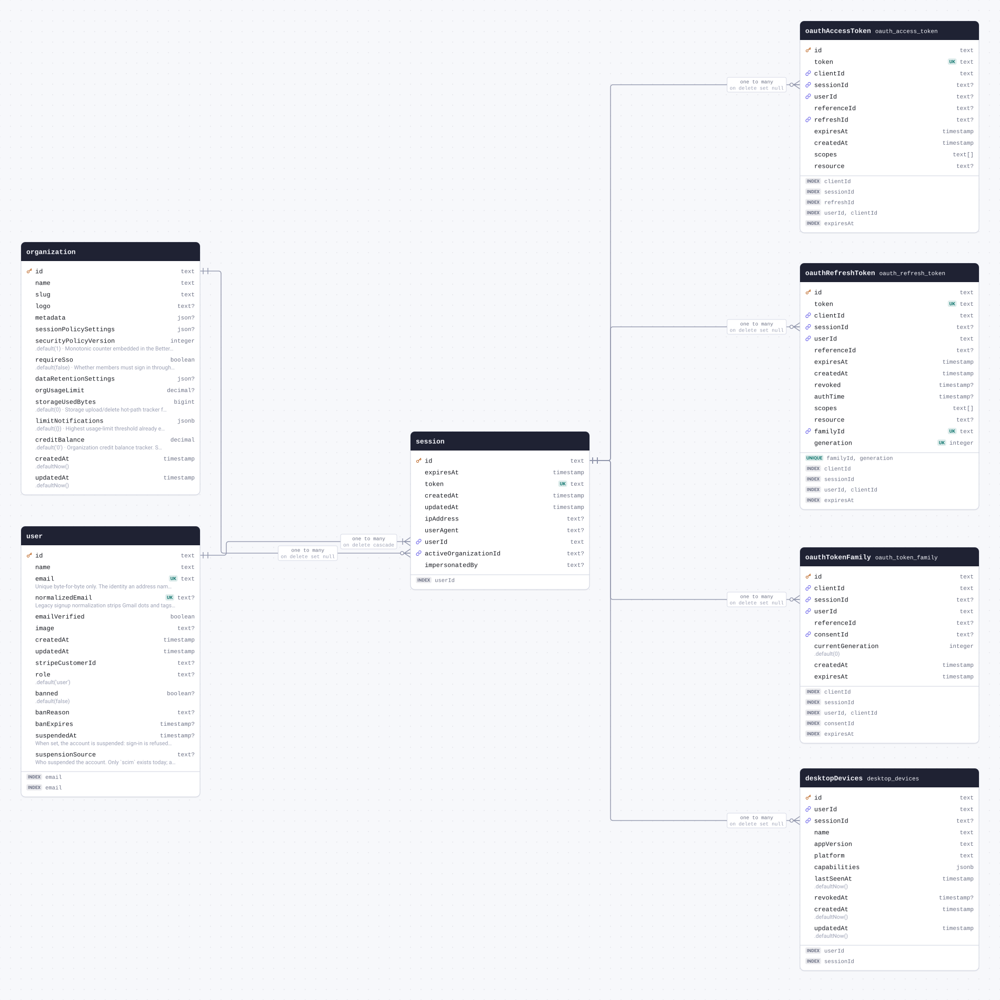

| Column                                            | Type        | Constraints                                   | Default | Description |
| ------------------------------------------------- | ----------- | --------------------------------------------- | ------- | ----------- |
| `id`                                              | `text`      | PK NOT NULL                                   |         |             |
| `expiresAt` (`expires_at`)                        | `timestamp` | NOT NULL                                      |         |             |
| `token`                                           | `text`      | UNIQUE NOT NULL                               |         |             |
| `createdAt` (`created_at`)                        | `timestamp` | NOT NULL                                      |         |             |
| `updatedAt` (`updated_at`)                        | `timestamp` | NOT NULL                                      |         |             |
| `ipAddress` (`ip_address`)                        | `text`      | NULL                                          |         |             |
| `userAgent` (`user_agent`)                        | `text`      | NULL                                          |         |             |
| `userId` (`user_id`)                              | `text`      | NOT NULL → [user.id](#table-user)             |         |             |
| `activeOrganizationId` (`active_organization_id`) | `text`      | NULL → [organization.id](#table-organization) |         |             |
| `impersonatedBy` (`impersonated_by`)              | `text`      | NULL                                          |         |             |

#### Definition

```sql
CREATE TABLE "session" (
	"id" text PRIMARY KEY,
	"expires_at" timestamp NOT NULL,
	"token" text NOT NULL UNIQUE,
	"created_at" timestamp NOT NULL,
	"updated_at" timestamp NOT NULL,
	"ip_address" text,
	"user_agent" text,
	"user_id" text NOT NULL,
	"active_organization_id" text,
	"impersonated_by" text
);

CREATE INDEX "session_user_id_idx" ON "session" ("user_id");

ALTER TABLE "session" ADD CONSTRAINT "session_user_id_user_id_fkey" FOREIGN KEY ("user_id") REFERENCES "user"("id") ON DELETE CASCADE;

ALTER TABLE "session" ADD CONSTRAINT "session_active_organization_id_organization_id_fkey" FOREIGN KEY ("active_organization_id") REFERENCES "organization"("id") ON DELETE SET NULL;
```

#### Indexes

- INDEX `userId`

#### References

- `userId` → [user.id](#table-user) (many to one, on delete cascade)
- `activeOrganizationId` → [organization.id](#table-organization) (many to one, on delete set null)

#### Referenced by

- `id` → [desktopDevices.sessionId](#table-desktopDevices) (one to many, on delete set null)
- `id` → [oauthTokenFamily.sessionId](#table-oauthTokenFamily) (one to many, on delete set null)
- `id` → [oauthRefreshToken.sessionId](#table-oauthRefreshToken) (one to many, on delete set null)
- `id` → [oauthAccessToken.sessionId](#table-oauthAccessToken) (one to many, on delete set null)

<details>
<summary>Queries and their SQL</summary>

**Select**: Every row of session.

```ts
db.select().from(session);
```

```sql
select "id", "expires_at", "token", "created_at", "updated_at", "ip_address", "user_agent", "user_id", "active_organization_id", "impersonated_by"
from "session"
```

**Count**: How many rows session has.

```ts
db.select({ count: count() }).from(session);
```

```sql
select count(*)
from "session"
```

**Find many**: The rows of session, through the relational query API.

```ts
db.query.session.findMany();
```

```sql
select "d0"."id" as "id", "d0"."expires_at" as "expiresAt", "d0"."token" as "token", "d0"."created_at" as "createdAt", "d0"."updated_at" as "updatedAt", "d0"."ip_address" as "ipAddress", "d0"."user_agent" as "userAgent", "d0"."user_id" as "userId", "d0"."active_organization_id" as "activeOrganizationId", "d0"."impersonated_by" as "impersonatedBy"
from "session" as "d0"
```

**Find by primary key**: One row of session, through the relational query API.

```ts
db.query.session.findFirst({ where: { id: "id" } });
```

```sql
select "d0"."id" as "id", "d0"."expires_at" as "expiresAt", "d0"."token" as "token", "d0"."created_at" as "createdAt", "d0"."updated_at" as "updatedAt", "d0"."ip_address" as "ipAddress", "d0"."user_agent" as "userAgent", "d0"."user_id" as "userId", "d0"."active_organization_id" as "activeOrganizationId", "d0"."impersonated_by" as "impersonatedBy"
from "session" as "d0"
where "d0"."id" = $1
limit $2
-- params: ["id",1]
```

**Insert**: Adds a row to session, giving the columns that have no default.

```ts
db.insert(session).values({
  id: "id",
  expiresAt: new Date("2026-01-01T00:00:00.000Z"),
  token: "token",
  createdAt: new Date("2026-01-01T00:00:00.000Z"),
  updatedAt: new Date("2026-01-01T00:00:00.000Z"),
  userId: "userId",
});
```

```sql
insert into "session" ("id", "expires_at", "token", "created_at", "updated_at", "ip_address", "user_agent", "user_id", "active_organization_id", "impersonated_by")
values ($1, $2, $3, $4, $5, default, default, $6, default, default)
-- params: ["id","2026-01-01T00:00:00.000Z","token","2026-01-01T00:00:00.000Z","2026-01-01T00:00:00.000Z","userId"]
```

**Update**: Changes a row of session, found by its primary key.

```ts
db.update(session)
  .set({ expiresAt: new Date("2026-01-01T00:00:00.000Z") })
  .where(eq(session.id, "id"));
```

```sql
update "session"
set "expires_at" = $1
where "session"."id" = $2
-- params: ["2026-01-01T00:00:00.000Z","id"]
```

**Delete**: Deletes a row of session, found by its primary key.

```ts
db.delete(session).where(eq(session.id, "id"));
```

```sql
delete from "session"
where "session"."id" = $1
-- params: ["id"]
```

</details>

<a id="table-account"></a>

### account

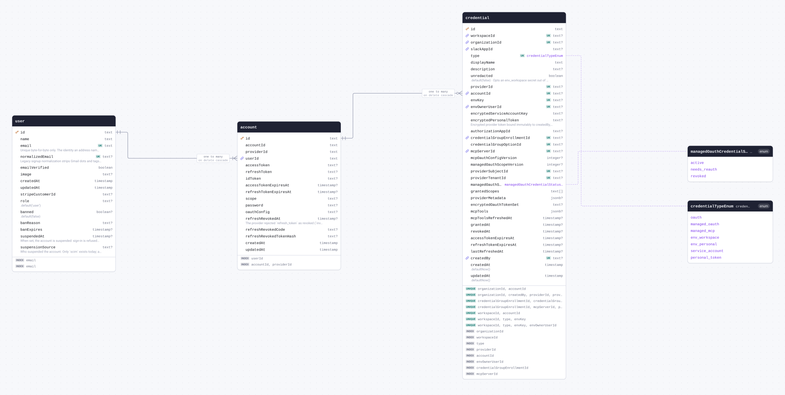

| Column                                                   | Type        | Constraints                       | Default | Description                                                                                                                                                                                                                                                                                                                                    |
| -------------------------------------------------------- | ----------- | --------------------------------- | ------- | ---------------------------------------------------------------------------------------------------------------------------------------------------------------------------------------------------------------------------------------------------------------------------------------------------------------------------------------------- |
| `id`                                                     | `text`      | PK NOT NULL                       |         |                                                                                                                                                                                                                                                                                                                                                |
| `accountId` (`account_id`)                               | `text`      | NOT NULL                          |         |                                                                                                                                                                                                                                                                                                                                                |
| `providerId` (`provider_id`)                             | `text`      | NOT NULL                          |         |                                                                                                                                                                                                                                                                                                                                                |
| `userId` (`user_id`)                                     | `text`      | NOT NULL → [user.id](#table-user) |         |                                                                                                                                                                                                                                                                                                                                                |
| `accessToken` (`access_token`)                           | `text`      | NULL                              |         |                                                                                                                                                                                                                                                                                                                                                |
| `refreshToken` (`refresh_token`)                         | `text`      | NULL                              |         |                                                                                                                                                                                                                                                                                                                                                |
| `idToken` (`id_token`)                                   | `text`      | NULL                              |         |                                                                                                                                                                                                                                                                                                                                                |
| `accessTokenExpiresAt` (`access_token_expires_at`)       | `timestamp` | NULL                              |         |                                                                                                                                                                                                                                                                                                                                                |
| `refreshTokenExpiresAt` (`refresh_token_expires_at`)     | `timestamp` | NULL                              |         |                                                                                                                                                                                                                                                                                                                                                |
| `scope`                                                  | `text`      | NULL                              |         |                                                                                                                                                                                                                                                                                                                                                |
| `password`                                               | `text`      | NULL                              |         |                                                                                                                                                                                                                                                                                                                                                |
| `oauthConfig` (`oauth_config`)                           | `text`      | NULL                              |         |                                                                                                                                                                                                                                                                                                                                                |
| `refreshRevokedAt` (`refresh_revoked_at`)                | `timestamp` | NULL                              |         | The provider rejected `refresh_token` as revoked (`invalid_grant` and kin). The marker holds only while `refresh_revoked_token_hash` still fingerprints the stored refresh token, so any writer that stores a new chain supersedes it; a reconnect clears it explicitly, since a provider may reauthorize without issuing a new refresh token. |
| `refreshRevokedCode` (`refresh_revoked_code`)            | `text`      | NULL                              |         |                                                                                                                                                                                                                                                                                                                                                |
| `refreshRevokedTokenHash` (`refresh_revoked_token_hash`) | `text`      | NULL                              |         |                                                                                                                                                                                                                                                                                                                                                |
| `createdAt` (`created_at`)                               | `timestamp` | NOT NULL                          |         |                                                                                                                                                                                                                                                                                                                                                |
| `updatedAt` (`updated_at`)                               | `timestamp` | NOT NULL                          |         |                                                                                                                                                                                                                                                                                                                                                |

#### Definition

```sql
CREATE TABLE "account" (
	"id" text PRIMARY KEY,
	"account_id" text NOT NULL,
	"provider_id" text NOT NULL,
	"user_id" text NOT NULL,
	"access_token" text,
	"refresh_token" text,
	"id_token" text,
	"access_token_expires_at" timestamp,
	"refresh_token_expires_at" timestamp,
	"scope" text,
	"password" text,
	"oauth_config" text,
	"refresh_revoked_at" timestamp,
	"refresh_revoked_code" text,
	"refresh_revoked_token_hash" text,
	"created_at" timestamp NOT NULL,
	"updated_at" timestamp NOT NULL
);

CREATE INDEX "account_user_id_idx" ON "account" ("user_id");

CREATE INDEX "idx_account_on_account_id_provider_id" ON "account" ("account_id","provider_id");

ALTER TABLE "account" ADD CONSTRAINT "account_user_id_user_id_fkey" FOREIGN KEY ("user_id") REFERENCES "user"("id") ON DELETE CASCADE;
```

#### Indexes

- INDEX `userId`
- INDEX `accountId`, `providerId`

#### References

- `userId` → [user.id](#table-user) (many to one, on delete cascade)

#### Referenced by

- `id` → [credential.accountId](#table-credential) (one to many, on delete cascade)

<details>
<summary>Queries and their SQL</summary>

**Select**: Every row of account.

```ts
db.select().from(account);
```

```sql
select "id", "account_id", "provider_id", "user_id", "access_token", "refresh_token", "id_token", "access_token_expires_at", "refresh_token_expires_at", "scope", "password", "oauth_config", "refresh_revoked_at", "refresh_revoked_code", "refresh_revoked_token_hash", "created_at", "updated_at"
from "account"
```

**Count**: How many rows account has.

```ts
db.select({ count: count() }).from(account);
```

```sql
select count(*)
from "account"
```

**Find many**: The rows of account, through the relational query API.

```ts
db.query.account.findMany();
```

```sql
select "d0"."id" as "id", "d0"."account_id" as "accountId", "d0"."provider_id" as "providerId", "d0"."user_id" as "userId", "d0"."access_token" as "accessToken", "d0"."refresh_token" as "refreshToken", "d0"."id_token" as "idToken", "d0"."access_token_expires_at" as "accessTokenExpiresAt", "d0"."refresh_token_expires_at" as "refreshTokenExpiresAt", "d0"."scope" as "scope", "d0"."password" as "password", "d0"."oauth_config" as "oauthConfig", "d0"."refresh_revoked_at" as "refreshRevokedAt", "d0"."refresh_revoked_code" as "refreshRevokedCode", "d0"."refresh_revoked_token_hash" as "refreshRevokedTokenHash", "d0"."created_at" as "createdAt", "d0"."updated_at" as "updatedAt"
from "account" as "d0"
```

**Find by primary key**: One row of account, through the relational query API.

```ts
db.query.account.findFirst({ where: { id: "id" } });
```

```sql
select "d0"."id" as "id", "d0"."account_id" as "accountId", "d0"."provider_id" as "providerId", "d0"."user_id" as "userId", "d0"."access_token" as "accessToken", "d0"."refresh_token" as "refreshToken", "d0"."id_token" as "idToken", "d0"."access_token_expires_at" as "accessTokenExpiresAt", "d0"."refresh_token_expires_at" as "refreshTokenExpiresAt", "d0"."scope" as "scope", "d0"."password" as "password", "d0"."oauth_config" as "oauthConfig", "d0"."refresh_revoked_at" as "refreshRevokedAt", "d0"."refresh_revoked_code" as "refreshRevokedCode", "d0"."refresh_revoked_token_hash" as "refreshRevokedTokenHash", "d0"."created_at" as "createdAt", "d0"."updated_at" as "updatedAt"
from "account" as "d0"
where "d0"."id" = $1
limit $2
-- params: ["id",1]
```

**Insert**: Adds a row to account, giving the columns that have no default.

```ts
db.insert(account).values({
  id: "id",
  accountId: "accountId",
  providerId: "providerId",
  userId: "userId",
  createdAt: new Date("2026-01-01T00:00:00.000Z"),
  updatedAt: new Date("2026-01-01T00:00:00.000Z"),
});
```

```sql
insert into "account" ("id", "account_id", "provider_id", "user_id", "access_token", "refresh_token", "id_token", "access_token_expires_at", "refresh_token_expires_at", "scope", "password", "oauth_config", "refresh_revoked_at", "refresh_revoked_code", "refresh_revoked_token_hash", "created_at", "updated_at")
values ($1, $2, $3, $4, default, default, default, default, default, default, default, default, default, default, default, $5, $6)
-- params: ["id","accountId","providerId","userId","2026-01-01T00:00:00.000Z","2026-01-01T00:00:00.000Z"]
```

**Update**: Changes a row of account, found by its primary key.

```ts
db.update(account).set({ accountId: "accountId" }).where(eq(account.id, "id"));
```

```sql
update "account"
set "account_id" = $1
where "account"."id" = $2
-- params: ["accountId","id"]
```

**Delete**: Deletes a row of account, found by its primary key.

```ts
db.delete(account).where(eq(account.id, "id"));
```

```sql
delete from "account"
where "account"."id" = $1
-- params: ["id"]
```

</details>

<a id="table-verification"></a>

### verification

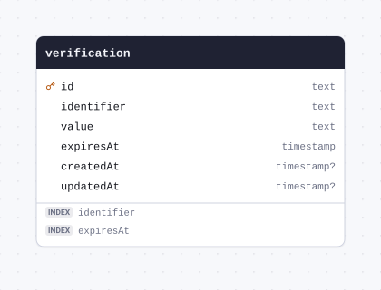

| Column                     | Type        | Constraints | Default | Description |
| -------------------------- | ----------- | ----------- | ------- | ----------- |
| `id`                       | `text`      | PK NOT NULL |         |             |
| `identifier`               | `text`      | NOT NULL    |         |             |
| `value`                    | `text`      | NOT NULL    |         |             |
| `expiresAt` (`expires_at`) | `timestamp` | NOT NULL    |         |             |
| `createdAt` (`created_at`) | `timestamp` | NULL        |         |             |
| `updatedAt` (`updated_at`) | `timestamp` | NULL        |         |             |

#### Definition

```sql
CREATE TABLE "verification" (
	"id" text PRIMARY KEY,
	"identifier" text NOT NULL,
	"value" text NOT NULL,
	"expires_at" timestamp NOT NULL,
	"created_at" timestamp,
	"updated_at" timestamp
);

CREATE INDEX "verification_identifier_idx" ON "verification" ("identifier");

CREATE INDEX "verification_expires_at_idx" ON "verification" ("expires_at");
```

#### Indexes

- INDEX `identifier`
- INDEX `expiresAt`

<details>
<summary>Queries and their SQL</summary>

**Select**: Every row of verification.

```ts
db.select().from(verification);
```

```sql
select "id", "identifier", "value", "expires_at", "created_at", "updated_at"
from "verification"
```

**Count**: How many rows verification has.

```ts
db.select({ count: count() }).from(verification);
```

```sql
select count(*)
from "verification"
```

**Find many**: The rows of verification, through the relational query API.

```ts
db.query.verification.findMany();
```

```sql
select "d0"."id" as "id", "d0"."identifier" as "identifier", "d0"."value" as "value", "d0"."expires_at" as "expiresAt", "d0"."created_at" as "createdAt", "d0"."updated_at" as "updatedAt"
from "verification" as "d0"
```

**Find by primary key**: One row of verification, through the relational query API.

```ts
db.query.verification.findFirst({ where: { id: "id" } });
```

```sql
select "d0"."id" as "id", "d0"."identifier" as "identifier", "d0"."value" as "value", "d0"."expires_at" as "expiresAt", "d0"."created_at" as "createdAt", "d0"."updated_at" as "updatedAt"
from "verification" as "d0"
where "d0"."id" = $1
limit $2
-- params: ["id",1]
```

**Insert**: Adds a row to verification, giving the columns that have no default.

```ts
db.insert(verification).values({
  id: "id",
  identifier: "identifier",
  value: "value",
  expiresAt: new Date("2026-01-01T00:00:00.000Z"),
});
```

```sql
insert into "verification" ("id", "identifier", "value", "expires_at", "created_at", "updated_at")
values ($1, $2, $3, $4, default, default)
-- params: ["id","identifier","value","2026-01-01T00:00:00.000Z"]
```

**Update**: Changes a row of verification, found by its primary key.

```ts
db.update(verification).set({ identifier: "identifier" }).where(eq(verification.id, "id"));
```

```sql
update "verification"
set "identifier" = $1
where "verification"."id" = $2
-- params: ["identifier","id"]
```

**Delete**: Deletes a row of verification, found by its primary key.

```ts
db.delete(verification).where(eq(verification.id, "id"));
```

```sql
delete from "verification"
where "verification"."id" = $1
-- params: ["id"]
```

</details>

<a id="table-folder"></a>

### folder

Generic folder hierarchy shared by workflows, files, knowledge bases, and tables. Supersedes the resource-specific `workflow_folder` and `workspace_file_folders` tables, dropped in migration 0276 once the cutover was verified against production. `resourceType` is a real `pgEnum` here — unlike `pinnedItem.resourceType` — because the set of folder-bearing resources is small and fixed. A folder may only parent a folder of the same `resourceType` in the same workspace; that invariant is enforced both in the application layer and by the `folder_parent_resource_type_match` trigger, since a plain FK cannot express it. `locked` carries over the existing workflow-folder lock feature verbatim. It is NOT extended to the other resource types — file/knowledge_base/table folders leave it at `false` and no lock cascade reads it for them. Dropping the column would regress shipped workflow-folder locking. `color` and `isExpanded` from the old `workflow_folder` table are intentionally not carried over: `color` has no UI consumer, and `isExpanded`'s real state lives client-side in the folders Zustand store and is never read back from the DB.

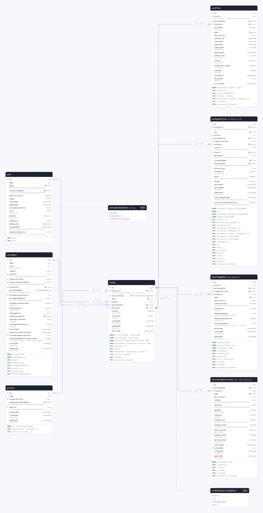

| Column                           | Type                                                     | Constraints                             | Default           | Description                                                                          |
| -------------------------------- | -------------------------------------------------------- | --------------------------------------- | ----------------- | ------------------------------------------------------------------------------------ |
| `id`                             | `text`                                                   | PK NOT NULL                             |                   |                                                                                      |
| `projectId` (`project_id`)       | `text`                                                   | NULL → [project.id](#table-project)     |                   | File folders may belong to a Project; other resource folders remain workspace-owned. |
| `resourceType` (`resource_type`) | [`folderResourceTypeEnum`](#enum-folderResourceTypeEnum) | NOT NULL                                |                   |                                                                                      |
| `name`                           | `text`                                                   | NOT NULL                                |                   |                                                                                      |
| `userId` (`user_id`)             | `text`                                                   | NOT NULL → [user.id](#table-user)       |                   |                                                                                      |
| `workspaceId` (`workspace_id`)   | `text`                                                   | NULL → [workspace.id](#table-workspace) |                   |                                                                                      |
| `parentId` (`parent_id`)         | `text`                                                   | NULL → [folder.id](#table-folder)       |                   |                                                                                      |
| `locked`                         | `boolean`                                                | NOT NULL                                | `.default(false)` |                                                                                      |
| `sortOrder` (`sort_order`)       | `integer`                                                | NOT NULL                                | `.default(0)`     |                                                                                      |
| `createdAt` (`created_at`)       | `timestamp`                                              | NOT NULL                                | `.defaultNow()`   |                                                                                      |
| `updatedAt` (`updated_at`)       | `timestamp`                                              | NOT NULL                                | `.defaultNow()`   |                                                                                      |
| `deletedAt` (`deleted_at`)       | `timestamp`                                              | NULL                                    |                   |                                                                                      |

#### Definition

```sql
CREATE TABLE "folder" (
	"id" text PRIMARY KEY,
	"project_id" text,
	"resource_type" "folder_resource_type" NOT NULL,
	"name" text NOT NULL,
	"user_id" text NOT NULL,
	"workspace_id" text,
	"parent_id" text,
	"locked" boolean DEFAULT false NOT NULL,
	"sort_order" integer DEFAULT 0 NOT NULL,
	"created_at" timestamp DEFAULT now() NOT NULL,
	"updated_at" timestamp DEFAULT now() NOT NULL,
	"deleted_at" timestamp,
	CONSTRAINT "folder_workspace_owner_type_unique" UNIQUE("id","workspace_id","resource_type"),
	CONSTRAINT "folder_project_owner_type_unique" UNIQUE("id","project_id","resource_type"),
	CONSTRAINT "folder_owner_check" CHECK (num_nonnulls("workspace_id", "project_id") = 1 AND ("project_id" IS NULL OR "resource_type" = 'file'))
);

CREATE INDEX CONCURRENTLY "folder_project_id_idx" ON "folder" ("project_id","id");

CREATE UNIQUE INDEX CONCURRENTLY "folder_project_resource_parent_name_active_unique" ON "folder" ("project_id","resource_type",coalesce("parent_id", ''),"name") WHERE "deleted_at" IS NULL AND "project_id" IS NOT NULL;

CREATE INDEX "folder_user_idx" ON "folder" ("user_id");

CREATE INDEX "folder_workspace_resource_parent_idx" ON "folder" ("workspace_id","resource_type","parent_id");

CREATE INDEX "folder_parent_sort_idx" ON "folder" ("parent_id","sort_order");

CREATE INDEX "folder_deleted_at_idx" ON "folder" ("deleted_at");

CREATE INDEX "folder_workspace_deleted_partial_idx" ON "folder" ("workspace_id","deleted_at") WHERE "deleted_at" IS NOT NULL;

CREATE UNIQUE INDEX "folder_workspace_resource_parent_name_active_unique" ON "folder" ("workspace_id","resource_type",coalesce("parent_id", ''),"name") WHERE "deleted_at" IS NULL;

ALTER TABLE "folder" ADD CONSTRAINT "folder_project_id_project_id_fkey" FOREIGN KEY ("project_id") REFERENCES "project"("id") ON DELETE RESTRICT;

ALTER TABLE "folder" ADD CONSTRAINT "folder_user_id_user_id_fkey" FOREIGN KEY ("user_id") REFERENCES "user"("id") ON DELETE CASCADE;

ALTER TABLE "folder" ADD CONSTRAINT "folder_workspace_id_workspace_id_fkey" FOREIGN KEY ("workspace_id") REFERENCES "workspace"("id") ON DELETE CASCADE;

ALTER TABLE "folder" ADD CONSTRAINT "folder_parent_id_folder_id_fkey" FOREIGN KEY ("parent_id") REFERENCES "folder"("id") ON DELETE SET NULL;

ALTER TABLE "folder" ADD CONSTRAINT "folder_workspace_parent_owner_fk" FOREIGN KEY ("parent_id","workspace_id","resource_type") REFERENCES "folder"("id","workspace_id","resource_type");

ALTER TABLE "folder" ADD CONSTRAINT "folder_project_parent_owner_fk" FOREIGN KEY ("parent_id","project_id","resource_type") REFERENCES "folder"("id","project_id","resource_type");
```

#### Indexes

- UNIQUE `id`, `workspaceId`, `resourceType`
- UNIQUE `id`, `projectId`, `resourceType`
- INDEX `projectId`, `id`
- UNIQUE `projectId`, `resourceType`, `name`
- INDEX `userId`
- INDEX `workspaceId`, `resourceType`, `parentId`
- INDEX `parentId`, `sortOrder`
- INDEX `deletedAt`
- INDEX `workspaceId`, `deletedAt`
- UNIQUE `workspaceId`, `resourceType`, `name`

#### References

- `projectId` → [project.id](#table-project) (many to one, on delete restrict)
- `userId` → [user.id](#table-user) (many to one, on delete cascade)
- `workspaceId` → [workspace.id](#table-workspace) (many to one, on delete cascade)
- `parentId` → [folder.id](#table-folder) (many to one, on delete set null)
- `parentId` → [folder.id](#table-folder) (many to one, on delete set null)
- `parentId` → [folder.id](#table-folder) (many to one, on delete set null)

#### Referenced by

- `id` → [folder.parentId](#table-folder) (one to many, on delete set null)
- `id` → [folder.parentId](#table-folder) (one to many, on delete set null)
- `id` → [folder.parentId](#table-folder) (one to many, on delete set null)
- `id` → [workflow.folderId](#table-workflow) (one to many, on delete set null)
- `id` → [workspaceFiles.folderId](#table-workspaceFiles) (one to many, on delete set null)
- `id` → [knowledgeBase.folderId](#table-knowledgeBase) (one to many, on delete set null)
- `id` → [userTableDefinitions.folderId](#table-userTableDefinitions) (one to many, on delete set null)

<details>
<summary>Queries and their SQL</summary>

**Select**: Every row of folder.

```ts
db.select().from(folder);
```

```sql
select "id", "project_id", "resource_type", "name", "user_id", "workspace_id", "parent_id", "locked", "sort_order", "created_at", "updated_at", "deleted_at"
from "folder"
```

**Count**: How many rows folder has.

```ts
db.select({ count: count() }).from(folder);
```

```sql
select count(*)
from "folder"
```

**Find many**: The rows of folder, through the relational query API.

```ts
db.query.folder.findMany();
```

```sql
select "d0"."id" as "id", "d0"."project_id" as "projectId", "d0"."resource_type" as "resourceType", "d0"."name" as "name", "d0"."user_id" as "userId", "d0"."workspace_id" as "workspaceId", "d0"."parent_id" as "parentId", "d0"."locked" as "locked", "d0"."sort_order" as "sortOrder", "d0"."created_at" as "createdAt", "d0"."updated_at" as "updatedAt", "d0"."deleted_at" as "deletedAt"
from "folder" as "d0"
```

**Find by primary key**: One row of folder, through the relational query API.

```ts
db.query.folder.findFirst({ where: { id: "id" } });
```

```sql
select "d0"."id" as "id", "d0"."project_id" as "projectId", "d0"."resource_type" as "resourceType", "d0"."name" as "name", "d0"."user_id" as "userId", "d0"."workspace_id" as "workspaceId", "d0"."parent_id" as "parentId", "d0"."locked" as "locked", "d0"."sort_order" as "sortOrder", "d0"."created_at" as "createdAt", "d0"."updated_at" as "updatedAt", "d0"."deleted_at" as "deletedAt"
from "folder" as "d0"
where "d0"."id" = $1
limit $2
-- params: ["id",1]
```

**Insert**: Adds a row to folder, giving the columns that have no default.

```ts
db.insert(folder).values({ id: "id", resourceType: "workflow", name: "name", userId: "userId" });
```

```sql
insert into "folder" ("id", "project_id", "resource_type", "name", "user_id", "workspace_id", "parent_id", "locked", "sort_order", "created_at", "updated_at", "deleted_at")
values ($1, default, $2, $3, $4, default, default, default, default, default, default, default)
-- params: ["id","workflow","name","userId"]
```

**Update**: Changes a row of folder, found by its primary key.

```ts
db.update(folder).set({ projectId: "projectId" }).where(eq(folder.id, "id"));
```

```sql
update "folder"
set "project_id" = $1
where "folder"."id" = $2
-- params: ["projectId","id"]
```

**Delete**: Deletes a row of folder, found by its primary key.

```ts
db.delete(folder).where(eq(folder.id, "id"));
```

```sql
delete from "folder"
where "folder"."id" = $1
-- params: ["id"]
```

</details>

<a id="table-pinnedItem"></a>

### pinnedItem

Table `pinned_item`. Per-user pinning of workspace resources. Polymorphic on `resourceType`, following the same shape as `publicShare.resourceType` below — deliberately plain `text` rather than a `pgEnum`, because the set of pinnable kinds is expected to grow (folders become pinnable alongside the generic-folder work) and widening a text column costs nothing where widening an enum needs a migration. Pins are per-user, not per-workspace: two members of the same workspace pin independently, which is why `userId` leads the unique index and every read path filters on the session user.

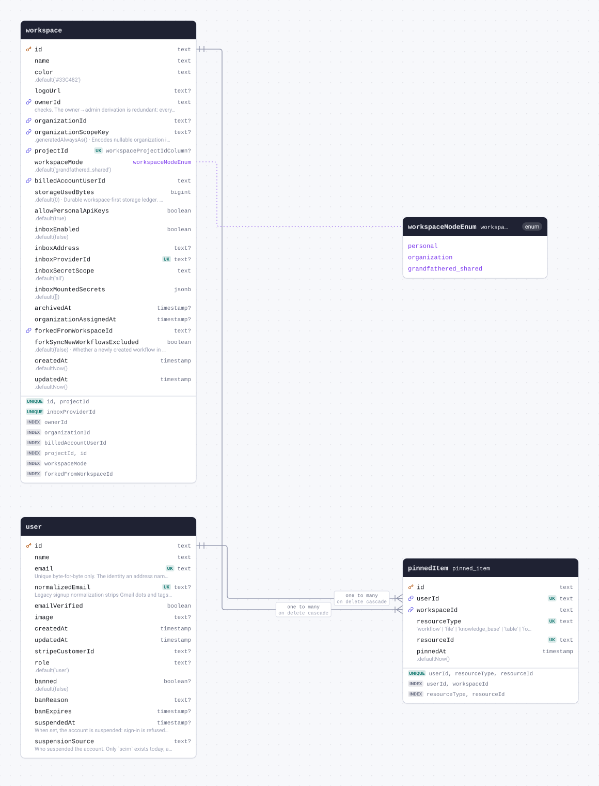

| Column                           | Type        | Constraints                                 | Default         | Description                                                                    |
| -------------------------------- | ----------- | ------------------------------------------- | --------------- | ------------------------------------------------------------------------------ |
| `id`                             | `text`      | PK NOT NULL                                 |                 |                                                                                |
| `userId` (`user_id`)             | `text`      | NOT NULL → [user.id](#table-user)           |                 |                                                                                |
| `workspaceId` (`workspace_id`)   | `text`      | NOT NULL → [workspace.id](#table-workspace) |                 |                                                                                |
| `resourceType` (`resource_type`) | `text`      | NOT NULL                                    |                 | 'workflow' \| 'file' \| 'knowledge_base' \| 'table' \| 'folder' \| 'workspace' |
| `resourceId` (`resource_id`)     | `text`      | NOT NULL                                    |                 |                                                                                |
| `pinnedAt` (`pinned_at`)         | `timestamp` | NOT NULL                                    | `.defaultNow()` |                                                                                |

#### Definition

```sql
CREATE TABLE "pinned_item" (
	"id" text PRIMARY KEY,
	"user_id" text NOT NULL,
	"workspace_id" text NOT NULL,
	"resource_type" text NOT NULL,
	"resource_id" text NOT NULL,
	"pinned_at" timestamp DEFAULT now() NOT NULL
);

CREATE INDEX "pinned_item_user_workspace_idx" ON "pinned_item" ("user_id","workspace_id");

CREATE INDEX "pinned_item_resource_idx" ON "pinned_item" ("resource_type","resource_id");

CREATE UNIQUE INDEX "pinned_item_user_resource_unique" ON "pinned_item" ("user_id","resource_type","resource_id");

ALTER TABLE "pinned_item" ADD CONSTRAINT "pinned_item_user_id_user_id_fkey" FOREIGN KEY ("user_id") REFERENCES "user"("id") ON DELETE CASCADE;

ALTER TABLE "pinned_item" ADD CONSTRAINT "pinned_item_workspace_id_workspace_id_fkey" FOREIGN KEY ("workspace_id") REFERENCES "workspace"("id") ON DELETE CASCADE;
```

#### Indexes

- INDEX `userId`, `workspaceId`
- INDEX `resourceType`, `resourceId`
- UNIQUE `userId`, `resourceType`, `resourceId`

#### References

- `userId` → [user.id](#table-user) (many to one, on delete cascade)
- `workspaceId` → [workspace.id](#table-workspace) (many to one, on delete cascade)

<details>
<summary>Queries and their SQL</summary>

**Select**: Every row of pinnedItem.

```ts
db.select().from(pinnedItem);
```

```sql
select "id", "user_id", "workspace_id", "resource_type", "resource_id", "pinned_at"
from "pinned_item"
```

**Count**: How many rows pinnedItem has.

```ts
db.select({ count: count() }).from(pinnedItem);
```

```sql
select count(*)
from "pinned_item"
```

**Find many**: The rows of pinnedItem, through the relational query API.

```ts
db.query.pinnedItem.findMany();
```

```sql
select "d0"."id" as "id", "d0"."user_id" as "userId", "d0"."workspace_id" as "workspaceId", "d0"."resource_type" as "resourceType", "d0"."resource_id" as "resourceId", "d0"."pinned_at" as "pinnedAt"
from "pinned_item" as "d0"
```

**Find by primary key**: One row of pinnedItem, through the relational query API.

```ts
db.query.pinnedItem.findFirst({ where: { id: "id" } });
```

```sql
select "d0"."id" as "id", "d0"."user_id" as "userId", "d0"."workspace_id" as "workspaceId", "d0"."resource_type" as "resourceType", "d0"."resource_id" as "resourceId", "d0"."pinned_at" as "pinnedAt"
from "pinned_item" as "d0"
where "d0"."id" = $1
limit $2
-- params: ["id",1]
```

**Insert**: Adds a row to pinnedItem, giving the columns that have no default.

```ts
db.insert(pinnedItem).values({
  id: "id",
  userId: "userId",
  workspaceId: "workspaceId",
  resourceType: "resourceType",
  resourceId: "resourceId",
});
```

```sql
insert into "pinned_item" ("id", "user_id", "workspace_id", "resource_type", "resource_id", "pinned_at")
values ($1, $2, $3, $4, $5, default)
-- params: ["id","userId","workspaceId","resourceType","resourceId"]
```

**Update**: Changes a row of pinnedItem, found by its primary key.

```ts
db.update(pinnedItem).set({ userId: "userId" }).where(eq(pinnedItem.id, "id"));
```

```sql
update "pinned_item"
set "user_id" = $1
where "pinned_item"."id" = $2
-- params: ["userId","id"]
```

**Delete**: Deletes a row of pinnedItem, found by its primary key.

```ts
db.delete(pinnedItem).where(eq(pinnedItem.id, "id"));
```

```sql
delete from "pinned_item"
where "pinned_item"."id" = $1
-- params: ["id"]
```

</details>

<a id="table-workspaceVisit"></a>

### workspaceVisit

Table `workspace_visit`. When each user last opened each workspace. The workspace list returns these so the switcher orders by recency on the server — every render agrees on the order, and it follows the user across devices.

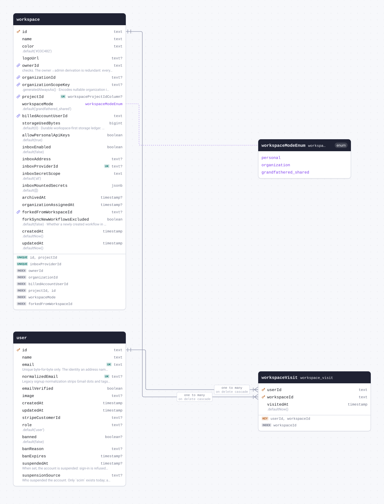

| Column                         | Type        | Constraints                                    | Default         | Description |
| ------------------------------ | ----------- | ---------------------------------------------- | --------------- | ----------- |
| `userId` (`user_id`)           | `text`      | PK NOT NULL → [user.id](#table-user)           |                 |             |
| `workspaceId` (`workspace_id`) | `text`      | PK NOT NULL → [workspace.id](#table-workspace) |                 |             |
| `visitedAt` (`visited_at`)     | `timestamp` | NOT NULL                                       | `.defaultNow()` |             |

#### Definition

```sql
CREATE TABLE "workspace_visit" (
	"user_id" text,
	"workspace_id" text,
	"visited_at" timestamp DEFAULT now() NOT NULL,
	CONSTRAINT "workspace_visit_pkey" PRIMARY KEY("user_id","workspace_id")
);

CREATE INDEX "workspace_visit_workspace_idx" ON "workspace_visit" ("workspace_id");

ALTER TABLE "workspace_visit" ADD CONSTRAINT "workspace_visit_user_id_user_id_fkey" FOREIGN KEY ("user_id") REFERENCES "user"("id") ON DELETE CASCADE;

ALTER TABLE "workspace_visit" ADD CONSTRAINT "workspace_visit_workspace_id_workspace_id_fkey" FOREIGN KEY ("workspace_id") REFERENCES "workspace"("id") ON DELETE CASCADE;
```

#### Indexes

- PRIMARY KEY `userId`, `workspaceId`
- INDEX `workspaceId`

#### References

- `userId` → [user.id](#table-user) (many to one, on delete cascade)
- `workspaceId` → [workspace.id](#table-workspace) (many to one, on delete cascade)

<details>
<summary>Queries and their SQL</summary>

**Select**: Every row of workspaceVisit.

```ts
db.select().from(workspaceVisit);
```

```sql
select "user_id", "workspace_id", "visited_at"
from "workspace_visit"
```

**Count**: How many rows workspaceVisit has.

```ts
db.select({ count: count() }).from(workspaceVisit);
```

```sql
select count(*)
from "workspace_visit"
```

**Find many**: The rows of workspaceVisit, through the relational query API.

```ts
db.query.workspaceVisit.findMany();
```

```sql
select "d0"."user_id" as "userId", "d0"."workspace_id" as "workspaceId", "d0"."visited_at" as "visitedAt"
from "workspace_visit" as "d0"
```

**Find by primary key**: One row of workspaceVisit, through the relational query API.

```ts
db.query.workspaceVisit.findFirst({ where: { userId: "userId", workspaceId: "workspaceId" } });
```

```sql
select "d0"."user_id" as "userId", "d0"."workspace_id" as "workspaceId", "d0"."visited_at" as "visitedAt"
from "workspace_visit" as "d0"
where (("d0"."user_id" = $1) and ("d0"."workspace_id" = $2))
limit $3
-- params: ["userId","workspaceId",1]
```

**Insert**: Adds a row to workspaceVisit, giving the columns that have no default.

```ts
db.insert(workspaceVisit).values({ userId: "userId", workspaceId: "workspaceId" });
```

```sql
insert into "workspace_visit" ("user_id", "workspace_id", "visited_at")
values ($1, $2, default)
-- params: ["userId","workspaceId"]
```

**Update**: Changes a row of workspaceVisit, found by its primary key.

```ts
db.update(workspaceVisit)
  .set({ visitedAt: new Date("2026-01-01T00:00:00.000Z") })
  .where(and(eq(workspaceVisit.userId, "userId"), eq(workspaceVisit.workspaceId, "workspaceId")));
```

```sql
update "workspace_visit"
set "visited_at" = $1
where (("workspace_visit"."user_id" = $2) and ("workspace_visit"."workspace_id" = $3))
-- params: ["2026-01-01T00:00:00.000Z","userId","workspaceId"]
```

**Delete**: Deletes a row of workspaceVisit, found by its primary key.

```ts
db.delete(workspaceVisit).where(
  and(eq(workspaceVisit.userId, "userId"), eq(workspaceVisit.workspaceId, "workspaceId")),
);
```

```sql
delete from "workspace_visit"
where (("workspace_visit"."user_id" = $1) and ("workspace_visit"."workspace_id" = $2))
-- params: ["userId","workspaceId"]
```

</details>

<a id="table-workflow"></a>

### workflow

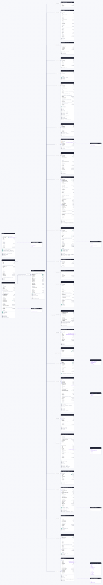

| Column                                    | Type        | Constraints                             | Default           | Description                                                                                                                                                                                                                                                                                                                                                                                                                                                                                                                                                                                                                                                                                                                                                                                                                                                                                                                                                                                                                                                                              |
| ----------------------------------------- | ----------- | --------------------------------------- | ----------------- | ---------------------------------------------------------------------------------------------------------------------------------------------------------------------------------------------------------------------------------------------------------------------------------------------------------------------------------------------------------------------------------------------------------------------------------------------------------------------------------------------------------------------------------------------------------------------------------------------------------------------------------------------------------------------------------------------------------------------------------------------------------------------------------------------------------------------------------------------------------------------------------------------------------------------------------------------------------------------------------------------------------------------------------------------------------------------------------------- |
| `id`                                      | `text`      | PK NOT NULL                             |                   |                                                                                                                                                                                                                                                                                                                                                                                                                                                                                                                                                                                                                                                                                                                                                                                                                                                                                                                                                                                                                                                                                          |
| `userId` (`user_id`)                      | `text`      | NOT NULL → [user.id](#table-user)       |                   | Creator and owner. Legitimate as ownership: it anchors personal (workspace-less) workflows, cascades the workflow away with the account, and names the owner for webhook config and deploy-as-block resolution. acts as, what it may read, or what it may authorize. The acting principal is `ExecutionMetadata.userId`, which the principal layer (`resolvePrincipalAttribution`) resolves to the caller for a session, personal API key, or delegated run, and to the workspace billing account for a workspace API key, schedule, or webhook. Exactly one execution use survives, carried as `ExecutionMetadata.workflowUserId`: the personal-environment fallback in `executeWorkflowCore`, for runs with no identifiable caller — workspace API keys, schedules, webhooks, and unauthenticated public-API calls. Those have nobody to resolve personal variables as, and a deployed workflow is routinely authored against its owner's personal keys, so dropping the fallback would break them. Workspace variables never fall back here; they always authorize against the actor. |
| `workspaceId` (`workspace_id`)            | `text`      | NULL → [workspace.id](#table-workspace) |                   |                                                                                                                                                                                                                                                                                                                                                                                                                                                                                                                                                                                                                                                                                                                                                                                                                                                                                                                                                                                                                                                                                          |
| `folderId` (`folder_id`)                  | `text`      | NULL → [folder.id](#table-folder)       |                   |                                                                                                                                                                                                                                                                                                                                                                                                                                                                                                                                                                                                                                                                                                                                                                                                                                                                                                                                                                                                                                                                                          |
| `sortOrder` (`sort_order`)                | `integer`   | NOT NULL                                | `.default(0)`     |                                                                                                                                                                                                                                                                                                                                                                                                                                                                                                                                                                                                                                                                                                                                                                                                                                                                                                                                                                                                                                                                                          |
| `name`                                    | `text`      | NOT NULL                                |                   |                                                                                                                                                                                                                                                                                                                                                                                                                                                                                                                                                                                                                                                                                                                                                                                                                                                                                                                                                                                                                                                                                          |
| `description`                             | `text`      | NULL                                    |                   |                                                                                                                                                                                                                                                                                                                                                                                                                                                                                                                                                                                                                                                                                                                                                                                                                                                                                                                                                                                                                                                                                          |
| `lastSynced` (`last_synced`)              | `timestamp` | NOT NULL                                |                   |                                                                                                                                                                                                                                                                                                                                                                                                                                                                                                                                                                                                                                                                                                                                                                                                                                                                                                                                                                                                                                                                                          |
| `createdAt` (`created_at`)                | `timestamp` | NOT NULL                                |                   |                                                                                                                                                                                                                                                                                                                                                                                                                                                                                                                                                                                                                                                                                                                                                                                                                                                                                                                                                                                                                                                                                          |
| `updatedAt` (`updated_at`)                | `timestamp` | NOT NULL                                |                   |                                                                                                                                                                                                                                                                                                                                                                                                                                                                                                                                                                                                                                                                                                                                                                                                                                                                                                                                                                                                                                                                                          |
| `isDeployed` (`is_deployed`)              | `boolean`   | NOT NULL                                | `.default(false)` |                                                                                                                                                                                                                                                                                                                                                                                                                                                                                                                                                                                                                                                                                                                                                                                                                                                                                                                                                                                                                                                                                          |
| `deployedAt` (`deployed_at`)              | `timestamp` | NULL                                    |                   |                                                                                                                                                                                                                                                                                                                                                                                                                                                                                                                                                                                                                                                                                                                                                                                                                                                                                                                                                                                                                                                                                          |
| `isPublicApi` (`is_public_api`)           | `boolean`   | NOT NULL                                | `.default(false)` |                                                                                                                                                                                                                                                                                                                                                                                                                                                                                                                                                                                                                                                                                                                                                                                                                                                                                                                                                                                                                                                                                          |
| `locked`                                  | `boolean`   | NOT NULL                                | `.default(false)` |                                                                                                                                                                                                                                                                                                                                                                                                                                                                                                                                                                                                                                                                                                                                                                                                                                                                                                                                                                                                                                                                                          |
| `forkSyncExcluded` (`fork_sync_excluded`) | `boolean`   | NOT NULL                                | `.default(false)` |                                                                                                                                                                                                                                                                                                                                                                                                                                                                                                                                                                                                                                                                                                                                                                                                                                                                                                                                                                                                                                                                                          |
| `runCount` (`run_count`)                  | `integer`   | NOT NULL                                | `.default(0)`     |                                                                                                                                                                                                                                                                                                                                                                                                                                                                                                                                                                                                                                                                                                                                                                                                                                                                                                                                                                                                                                                                                          |
| `lastRunAt` (`last_run_at`)               | `timestamp` | NULL                                    |                   |                                                                                                                                                                                                                                                                                                                                                                                                                                                                                                                                                                                                                                                                                                                                                                                                                                                                                                                                                                                                                                                                                          |
| `variables`                               | `json`      | NULL                                    | `.default('{}')`  |                                                                                                                                                                                                                                                                                                                                                                                                                                                                                                                                                                                                                                                                                                                                                                                                                                                                                                                                                                                                                                                                                          |
| `archivedAt` (`archived_at`)              | `timestamp` | NULL                                    |                   |                                                                                                                                                                                                                                                                                                                                                                                                                                                                                                                                                                                                                                                                                                                                                                                                                                                                                                                                                                                                                                                                                          |

#### Definition

```sql
CREATE TABLE "workflow" (
	"id" text PRIMARY KEY,
	"user_id" text NOT NULL,
	"workspace_id" text,
	"folder_id" text,
	"sort_order" integer DEFAULT 0 NOT NULL,
	"name" text NOT NULL,
	"description" text,
	"last_synced" timestamp NOT NULL,
	"created_at" timestamp NOT NULL,
	"updated_at" timestamp NOT NULL,
	"is_deployed" boolean DEFAULT false NOT NULL,
	"deployed_at" timestamp,
	"is_public_api" boolean DEFAULT false NOT NULL,
	"locked" boolean DEFAULT false NOT NULL,
	"fork_sync_excluded" boolean DEFAULT false NOT NULL,
	"run_count" integer DEFAULT 0 NOT NULL,
	"last_run_at" timestamp,
	"variables" json DEFAULT '"{}"',
	"archived_at" timestamp
);

CREATE INDEX "workflow_workspace_id_idx" ON "workflow" ("workspace_id");

CREATE INDEX "workflow_user_workspace_idx" ON "workflow" ("user_id","workspace_id");

CREATE UNIQUE INDEX "workflow_workspace_folder_name_active_unique" ON "workflow" ("workspace_id",coalesce("folder_id", ''),"name") WHERE "archived_at" IS NULL;

CREATE INDEX "workflow_folder_sort_idx" ON "workflow" ("folder_id","sort_order");

CREATE INDEX "workflow_active_workspace_sort_idx" ON "workflow" ("workspace_id","sort_order","created_at","id") WHERE "archived_at" IS NULL;

CREATE INDEX "workflow_archived_at_idx" ON "workflow" ("archived_at");

CREATE INDEX "workflow_workspace_archived_partial_idx" ON "workflow" ("workspace_id","archived_at") WHERE "archived_at" IS NOT NULL;

ALTER TABLE "workflow" ADD CONSTRAINT "workflow_user_id_user_id_fkey" FOREIGN KEY ("user_id") REFERENCES "user"("id") ON DELETE CASCADE;

ALTER TABLE "workflow" ADD CONSTRAINT "workflow_workspace_id_workspace_id_fkey" FOREIGN KEY ("workspace_id") REFERENCES "workspace"("id") ON DELETE CASCADE;

ALTER TABLE "workflow" ADD CONSTRAINT "workflow_folder_id_folder_id_fkey" FOREIGN KEY ("folder_id") REFERENCES "folder"("id") ON DELETE SET NULL;
```

#### Indexes

- INDEX `workspaceId`
- INDEX `userId`, `workspaceId`
- UNIQUE `workspaceId`, `name`
- INDEX `folderId`, `sortOrder`
- INDEX `workspaceId`, `sortOrder`, `createdAt`, `id`
- INDEX `archivedAt`
- INDEX `workspaceId`, `archivedAt`

#### References

- `userId` → [user.id](#table-user) (many to one, on delete cascade)
- `workspaceId` → [workspace.id](#table-workspace) (many to one, on delete cascade)
- `folderId` → [folder.id](#table-folder) (many to one, on delete set null)

#### Referenced by

- `id` → [workflowBlocks.workflowId](#table-workflowBlocks) (one to many, on delete cascade)
- `id` → [workflowEdges.workflowId](#table-workflowEdges) (one to many, on delete cascade)
- `id` → [workflowSubflows.workflowId](#table-workflowSubflows) (one to many, on delete cascade)
- `id` → [workflowExecutionSnapshots.workflowId](#table-workflowExecutionSnapshots) (one to many, on delete set null)
- `id` → [workflowExecutionLogs.workflowId](#table-workflowExecutionLogs) (one to many, on delete set null)
- `id` → [executionLargeValues.workflowId](#table-executionLargeValues) (one to many, on delete set null)
- `id` → [executionLargeValueReferences.workflowId](#table-executionLargeValueReferences) (one to many, on delete set null)
- `id` → [pausedExecutions.workflowId](#table-pausedExecutions) (one to many, on delete cascade)
- `id` → [workflowSchedule.workflowId](#table-workflowSchedule) (one to many, on delete cascade)
- `id` → [webhook.workflowId](#table-webhook) (one to many, on delete cascade)
- `id` → [webhookPathClaim.workflowId](#table-webhookPathClaim) (one to many, on delete cascade)
- `id` → [simTriggerState.workflowId](#table-simTriggerState) (one to many, on delete cascade)
- `id` → [chat.workflowId](#table-chat) (one to many, on delete cascade)
- `id` → [workspaceForkWorkflowSync.sourceWorkflowId](#table-workspaceForkWorkflowSync) (one to many, on delete cascade)
- `id` → [workspaceForkWorkflowSync.targetWorkflowId](#table-workspaceForkWorkflowSync) (one to many, on delete cascade)
- `id` → [backgroundWorkStatus.workflowId](#table-backgroundWorkStatus) (one to many, on delete cascade)
- `id` → [changelogChange.workflowId](#table-changelogChange) (one to many, on delete set null)
- `id` → [agentMemoryTurn.workflowId](#table-agentMemoryTurn) (one to many, on delete cascade)
- `id` → [copilotChats.workflowId](#table-copilotChats) (one to many, on delete cascade)
- `id` → [workflowCheckpoints.workflowId](#table-workflowCheckpoints) (one to many, on delete cascade)
- `id` → [copilotRuns.workflowId](#table-copilotRuns) (one to many, on delete cascade)
- `id` → [workflowDeploymentVersion.workflowId](#table-workflowDeploymentVersion) (one to many, on delete cascade)
- `id` → [workflowDeploymentOperation.workflowId](#table-workflowDeploymentOperation) (one to one, on delete cascade)
- `id` → [workflowMcpTool.workflowId](#table-workflowMcpTool) (one to many, on delete cascade)
- `id` → [customBlock.workflowId](#table-customBlock) (one to many, on delete cascade)
- `id` → [usageLog.workflowId](#table-usageLog) (one to many, on delete set null)

<details>
<summary>Queries and their SQL</summary>

**Select**: Every row of workflow.

```ts
db.select().from(workflow);
```

```sql
select "id", "user_id", "workspace_id", "folder_id", "sort_order", "name", "description", "last_synced", "created_at", "updated_at", "is_deployed", "deployed_at", "is_public_api", "locked", "fork_sync_excluded", "run_count", "last_run_at", "variables", "archived_at"
from "workflow"
```

**Count**: How many rows workflow has.

```ts
db.select({ count: count() }).from(workflow);
```

```sql
select count(*)
from "workflow"
```

**Find many**: The rows of workflow, through the relational query API.

```ts
db.query.workflow.findMany();
```

```sql
select "d0"."id" as "id", "d0"."user_id" as "userId", "d0"."workspace_id" as "workspaceId", "d0"."folder_id" as "folderId", "d0"."sort_order" as "sortOrder", "d0"."name" as "name", "d0"."description" as "description", "d0"."last_synced" as "lastSynced", "d0"."created_at" as "createdAt", "d0"."updated_at" as "updatedAt", "d0"."is_deployed" as "isDeployed", "d0"."deployed_at" as "deployedAt", "d0"."is_public_api" as "isPublicApi", "d0"."locked" as "locked", "d0"."fork_sync_excluded" as "forkSyncExcluded", "d0"."run_count" as "runCount", "d0"."last_run_at" as "lastRunAt", "d0"."variables" as "variables", "d0"."archived_at" as "archivedAt"
from "workflow" as "d0"
```

**Find by primary key**: One row of workflow, through the relational query API.

```ts
db.query.workflow.findFirst({ where: { id: "id" } });
```

```sql
select "d0"."id" as "id", "d0"."user_id" as "userId", "d0"."workspace_id" as "workspaceId", "d0"."folder_id" as "folderId", "d0"."sort_order" as "sortOrder", "d0"."name" as "name", "d0"."description" as "description", "d0"."last_synced" as "lastSynced", "d0"."created_at" as "createdAt", "d0"."updated_at" as "updatedAt", "d0"."is_deployed" as "isDeployed", "d0"."deployed_at" as "deployedAt", "d0"."is_public_api" as "isPublicApi", "d0"."locked" as "locked", "d0"."fork_sync_excluded" as "forkSyncExcluded", "d0"."run_count" as "runCount", "d0"."last_run_at" as "lastRunAt", "d0"."variables" as "variables", "d0"."archived_at" as "archivedAt"
from "workflow" as "d0"
where "d0"."id" = $1
limit $2
-- params: ["id",1]
```

**Insert**: Adds a row to workflow, giving the columns that have no default.

```ts
db.insert(workflow).values({
  id: "id",
  userId: "userId",
  name: "name",
  lastSynced: new Date("2026-01-01T00:00:00.000Z"),
  createdAt: new Date("2026-01-01T00:00:00.000Z"),
  updatedAt: new Date("2026-01-01T00:00:00.000Z"),
});
```

```sql
insert into "workflow" ("id", "user_id", "workspace_id", "folder_id", "sort_order", "name", "description", "last_synced", "created_at", "updated_at", "is_deployed", "deployed_at", "is_public_api", "locked", "fork_sync_excluded", "run_count", "last_run_at", "variables", "archived_at")
values ($1, $2, default, default, default, $3, default, $4, $5, $6, default, default, default, default, default, default, default, default, default)
-- params: ["id","userId","name","2026-01-01T00:00:00.000Z","2026-01-01T00:00:00.000Z","2026-01-01T00:00:00.000Z"]
```

**Update**: Changes a row of workflow, found by its primary key.

```ts
db.update(workflow).set({ userId: "userId" }).where(eq(workflow.id, "id"));
```

```sql
update "workflow"
set "user_id" = $1
where "workflow"."id" = $2
-- params: ["userId","id"]
```

**Delete**: Deletes a row of workflow, found by its primary key.

```ts
db.delete(workflow).where(eq(workflow.id, "id"));
```

```sql
delete from "workflow"
where "workflow"."id" = $1
-- params: ["id"]
```

</details>

<a id="table-workflowBlocks"></a>

### workflowBlocks

Table `workflow_blocks`.

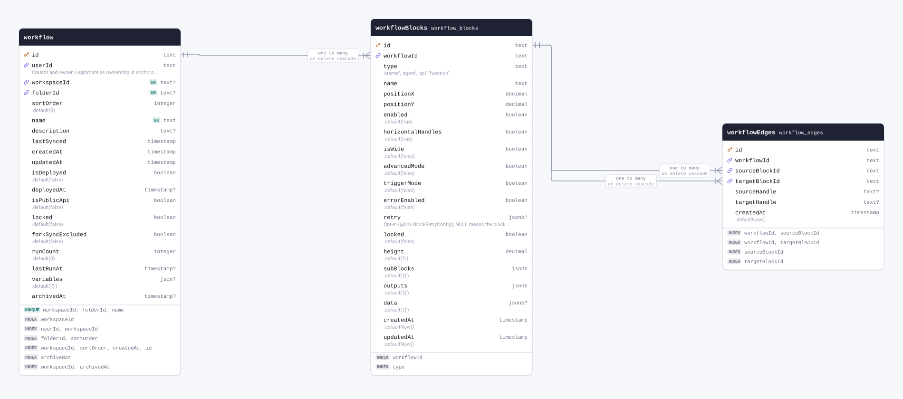

| Column                                     | Type        | Constraints                               | Default           | Description                                                          |
| ------------------------------------------ | ----------- | ----------------------------------------- | ----------------- | -------------------------------------------------------------------- |
| `id`                                       | `text`      | PK NOT NULL                               |                   |                                                                      |
| `workflowId` (`workflow_id`)               | `text`      | NOT NULL → [workflow.id](#table-workflow) |                   |                                                                      |
| `type`                                     | `text`      | NOT NULL                                  |                   | 'starter', 'agent', 'api', 'function'                                |
| `name`                                     | `text`      | NOT NULL                                  |                   |                                                                      |
| `positionX` (`position_x`)                 | `decimal`   | NOT NULL                                  |                   |                                                                      |
| `positionY` (`position_y`)                 | `decimal`   | NOT NULL                                  |                   |                                                                      |
| `enabled`                                  | `boolean`   | NOT NULL                                  | `.default(true)`  |                                                                      |
| `horizontalHandles` (`horizontal_handles`) | `boolean`   | NOT NULL                                  | `.default(true)`  |                                                                      |
| `isWide` (`is_wide`)                       | `boolean`   | NOT NULL                                  | `.default(false)` |                                                                      |
| `advancedMode` (`advanced_mode`)           | `boolean`   | NOT NULL                                  | `.default(false)` |                                                                      |
| `triggerMode` (`trigger_mode`)             | `boolean`   | NOT NULL                                  | `.default(false)` |                                                                      |
| `errorEnabled` (`error_enabled`)           | `boolean`   | NOT NULL                                  | `.default(false)` |                                                                      |
| `retry`                                    | `jsonb`     | NULL                                      |                   | Opt-in {@link BlockRetryConfig}; NULL means the block never retries. |
| `locked`                                   | `boolean`   | NOT NULL                                  | `.default(false)` |                                                                      |
| `height`                                   | `decimal`   | NOT NULL                                  | `.default('0')`   |                                                                      |
| `subBlocks` (`sub_blocks`)                 | `jsonb`     | NOT NULL                                  | `.default('{}')`  |                                                                      |
| `outputs`                                  | `jsonb`     | NOT NULL                                  | `.default('{}')`  |                                                                      |
| `data`                                     | `jsonb`     | NULL                                      | `.default('{}')`  |                                                                      |
| `createdAt` (`created_at`)                 | `timestamp` | NOT NULL                                  | `.defaultNow()`   |                                                                      |
| `updatedAt` (`updated_at`)                 | `timestamp` | NOT NULL                                  | `.defaultNow()`   |                                                                      |

#### Definition

```sql
CREATE TABLE "workflow_blocks" (
	"id" text PRIMARY KEY,
	"workflow_id" text NOT NULL,
	"type" text NOT NULL,
	"name" text NOT NULL,
	"position_x" numeric NOT NULL,
	"position_y" numeric NOT NULL,
	"enabled" boolean DEFAULT true NOT NULL,
	"horizontal_handles" boolean DEFAULT true NOT NULL,
	"is_wide" boolean DEFAULT false NOT NULL,
	"advanced_mode" boolean DEFAULT false NOT NULL,
	"trigger_mode" boolean DEFAULT false NOT NULL,
	"error_enabled" boolean DEFAULT false NOT NULL,
	"retry" jsonb,
	"locked" boolean DEFAULT false NOT NULL,
	"height" numeric DEFAULT '0' NOT NULL,
	"sub_blocks" jsonb DEFAULT '"{}"' NOT NULL,
	"outputs" jsonb DEFAULT '"{}"' NOT NULL,
	"data" jsonb DEFAULT '"{}"',
	"created_at" timestamp DEFAULT now() NOT NULL,
	"updated_at" timestamp DEFAULT now() NOT NULL
);

CREATE INDEX "workflow_blocks_workflow_id_idx" ON "workflow_blocks" ("workflow_id");

CREATE INDEX "workflow_blocks_type_idx" ON "workflow_blocks" ("type");

ALTER TABLE "workflow_blocks" ADD CONSTRAINT "workflow_blocks_workflow_id_workflow_id_fkey" FOREIGN KEY ("workflow_id") REFERENCES "workflow"("id") ON DELETE CASCADE;
```

#### Indexes

- INDEX `workflowId`
- INDEX `type`

#### References

- `workflowId` → [workflow.id](#table-workflow) (many to one, on delete cascade)

#### Referenced by

- `id` → [workflowEdges.sourceBlockId](#table-workflowEdges) (one to many, on delete cascade)
- `id` → [workflowEdges.targetBlockId](#table-workflowEdges) (one to many, on delete cascade)

<details>
<summary>Queries and their SQL</summary>

**Select**: Every row of workflowBlocks.

```ts
db.select().from(workflowBlocks);
```

```sql
select "id", "workflow_id", "type", "name", "position_x", "position_y", "enabled", "horizontal_handles", "is_wide", "advanced_mode", "trigger_mode", "error_enabled", "retry", "locked", "height", "sub_blocks", "outputs", "data", "created_at", "updated_at"
from "workflow_blocks"
```

**Count**: How many rows workflowBlocks has.

```ts
db.select({ count: count() }).from(workflowBlocks);
```

```sql
select count(*)
from "workflow_blocks"
```

**Find many**: The rows of workflowBlocks, through the relational query API.

```ts
db.query.workflowBlocks.findMany();
```

```sql
select "d0"."id" as "id", "d0"."workflow_id" as "workflowId", "d0"."type" as "type", "d0"."name" as "name", "d0"."position_x" as "positionX", "d0"."position_y" as "positionY", "d0"."enabled" as "enabled", "d0"."horizontal_handles" as "horizontalHandles", "d0"."is_wide" as "isWide", "d0"."advanced_mode" as "advancedMode", "d0"."trigger_mode" as "triggerMode", "d0"."error_enabled" as "errorEnabled", "d0"."retry" as "retry", "d0"."locked" as "locked", "d0"."height" as "height", "d0"."sub_blocks" as "subBlocks", "d0"."outputs" as "outputs", "d0"."data" as "data", "d0"."created_at" as "createdAt", "d0"."updated_at" as "updatedAt"
from "workflow_blocks" as "d0"
```

**Find by primary key**: One row of workflowBlocks, through the relational query API.

```ts
db.query.workflowBlocks.findFirst({ where: { id: "id" } });
```

```sql
select "d0"."id" as "id", "d0"."workflow_id" as "workflowId", "d0"."type" as "type", "d0"."name" as "name", "d0"."position_x" as "positionX", "d0"."position_y" as "positionY", "d0"."enabled" as "enabled", "d0"."horizontal_handles" as "horizontalHandles", "d0"."is_wide" as "isWide", "d0"."advanced_mode" as "advancedMode", "d0"."trigger_mode" as "triggerMode", "d0"."error_enabled" as "errorEnabled", "d0"."retry" as "retry", "d0"."locked" as "locked", "d0"."height" as "height", "d0"."sub_blocks" as "subBlocks", "d0"."outputs" as "outputs", "d0"."data" as "data", "d0"."created_at" as "createdAt", "d0"."updated_at" as "updatedAt"
from "workflow_blocks" as "d0"
where "d0"."id" = $1
limit $2
-- params: ["id",1]
```

**Insert**: Adds a row to workflowBlocks, giving the columns that have no default.

```ts
db.insert(workflowBlocks).values({
  id: "id",
  workflowId: "workflowId",
  type: "type",
  name: "name",
  positionX: "1.00",
  positionY: "1.00",
});
```

```sql
insert into "workflow_blocks" ("id", "workflow_id", "type", "name", "position_x", "position_y", "enabled", "horizontal_handles", "is_wide", "advanced_mode", "trigger_mode", "error_enabled", "retry", "locked", "height", "sub_blocks", "outputs", "data", "created_at", "updated_at")
values ($1, $2, $3, $4, $5, $6, default, default, default, default, default, default, default, default, default, default, default, default, default, default)
-- params: ["id","workflowId","type","name","1.00","1.00"]
```

**Update**: Changes a row of workflowBlocks, found by its primary key.

```ts
db.update(workflowBlocks).set({ workflowId: "workflowId" }).where(eq(workflowBlocks.id, "id"));
```

```sql
update "workflow_blocks"
set "workflow_id" = $1
where "workflow_blocks"."id" = $2
-- params: ["workflowId","id"]
```

**Delete**: Deletes a row of workflowBlocks, found by its primary key.

```ts
db.delete(workflowBlocks).where(eq(workflowBlocks.id, "id"));
```

```sql
delete from "workflow_blocks"
where "workflow_blocks"."id" = $1
-- params: ["id"]
```

</details>

<a id="table-workflowEdges"></a>

### workflowEdges

Table `workflow_edges`.

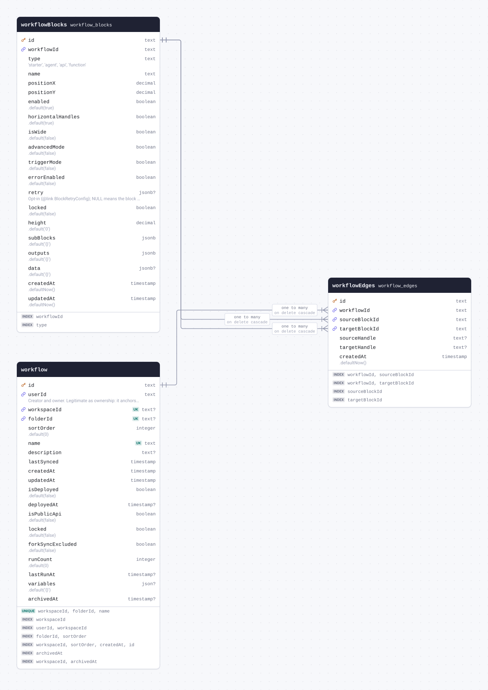

| Column                              | Type        | Constraints                                           | Default         | Description |
| ----------------------------------- | ----------- | ----------------------------------------------------- | --------------- | ----------- |
| `id`                                | `text`      | PK NOT NULL                                           |                 |             |
| `workflowId` (`workflow_id`)        | `text`      | NOT NULL → [workflow.id](#table-workflow)             |                 |             |
| `sourceBlockId` (`source_block_id`) | `text`      | NOT NULL → [workflowBlocks.id](#table-workflowBlocks) |                 |             |
| `targetBlockId` (`target_block_id`) | `text`      | NOT NULL → [workflowBlocks.id](#table-workflowBlocks) |                 |             |
| `sourceHandle` (`source_handle`)    | `text`      | NULL                                                  |                 |             |
| `targetHandle` (`target_handle`)    | `text`      | NULL                                                  |                 |             |
| `createdAt` (`created_at`)          | `timestamp` | NOT NULL                                              | `.defaultNow()` |             |

#### Definition

```sql
CREATE TABLE "workflow_edges" (
	"id" text PRIMARY KEY,
	"workflow_id" text NOT NULL,
	"source_block_id" text NOT NULL,
	"target_block_id" text NOT NULL,
	"source_handle" text,
	"target_handle" text,
	"created_at" timestamp DEFAULT now() NOT NULL
);

CREATE INDEX "workflow_edges_workflow_source_idx" ON "workflow_edges" ("workflow_id","source_block_id");

CREATE INDEX "workflow_edges_workflow_target_idx" ON "workflow_edges" ("workflow_id","target_block_id");

ALTER TABLE "workflow_edges" ADD CONSTRAINT "workflow_edges_workflow_id_workflow_id_fkey" FOREIGN KEY ("workflow_id") REFERENCES "workflow"("id") ON DELETE CASCADE;

ALTER TABLE "workflow_edges" ADD CONSTRAINT "workflow_edges_source_block_id_workflow_blocks_id_fkey" FOREIGN KEY ("source_block_id") REFERENCES "workflow_blocks"("id") ON DELETE CASCADE;

ALTER TABLE "workflow_edges" ADD CONSTRAINT "workflow_edges_target_block_id_workflow_blocks_id_fkey" FOREIGN KEY ("target_block_id") REFERENCES "workflow_blocks"("id") ON DELETE CASCADE;
```

#### Indexes

- INDEX `workflowId`, `sourceBlockId`
- INDEX `workflowId`, `targetBlockId`

#### References

- `workflowId` → [workflow.id](#table-workflow) (many to one, on delete cascade)
- `sourceBlockId` → [workflowBlocks.id](#table-workflowBlocks) (many to one, on delete cascade)
- `targetBlockId` → [workflowBlocks.id](#table-workflowBlocks) (many to one, on delete cascade)

<details>
<summary>Queries and their SQL</summary>

**Select**: Every row of workflowEdges.

```ts
db.select().from(workflowEdges);
```

```sql
select "id", "workflow_id", "source_block_id", "target_block_id", "source_handle", "target_handle", "created_at"
from "workflow_edges"
```

**Count**: How many rows workflowEdges has.

```ts
db.select({ count: count() }).from(workflowEdges);
```

```sql
select count(*)
from "workflow_edges"
```

**Find many**: The rows of workflowEdges, through the relational query API.

```ts
db.query.workflowEdges.findMany();
```

```sql
select "d0"."id" as "id", "d0"."workflow_id" as "workflowId", "d0"."source_block_id" as "sourceBlockId", "d0"."target_block_id" as "targetBlockId", "d0"."source_handle" as "sourceHandle", "d0"."target_handle" as "targetHandle", "d0"."created_at" as "createdAt"
from "workflow_edges" as "d0"
```

**Find by primary key**: One row of workflowEdges, through the relational query API.

```ts
db.query.workflowEdges.findFirst({ where: { id: "id" } });
```

```sql
select "d0"."id" as "id", "d0"."workflow_id" as "workflowId", "d0"."source_block_id" as "sourceBlockId", "d0"."target_block_id" as "targetBlockId", "d0"."source_handle" as "sourceHandle", "d0"."target_handle" as "targetHandle", "d0"."created_at" as "createdAt"
from "workflow_edges" as "d0"
where "d0"."id" = $1
limit $2
-- params: ["id",1]
```

**Insert**: Adds a row to workflowEdges, giving the columns that have no default.

```ts
db.insert(workflowEdges).values({
  id: "id",
  workflowId: "workflowId",
  sourceBlockId: "sourceBlockId",
  targetBlockId: "targetBlockId",
});
```

```sql
insert into "workflow_edges" ("id", "workflow_id", "source_block_id", "target_block_id", "source_handle", "target_handle", "created_at")
values ($1, $2, $3, $4, default, default, default)
-- params: ["id","workflowId","sourceBlockId","targetBlockId"]
```

**Update**: Changes a row of workflowEdges, found by its primary key.

```ts
db.update(workflowEdges).set({ workflowId: "workflowId" }).where(eq(workflowEdges.id, "id"));
```

```sql
update "workflow_edges"
set "workflow_id" = $1
where "workflow_edges"."id" = $2
-- params: ["workflowId","id"]
```

**Delete**: Deletes a row of workflowEdges, found by its primary key.

```ts
db.delete(workflowEdges).where(eq(workflowEdges.id, "id"));
```

```sql
delete from "workflow_edges"
where "workflow_edges"."id" = $1
-- params: ["id"]
```

</details>

<a id="table-workflowSubflows"></a>

### workflowSubflows

Table `workflow_subflows`.

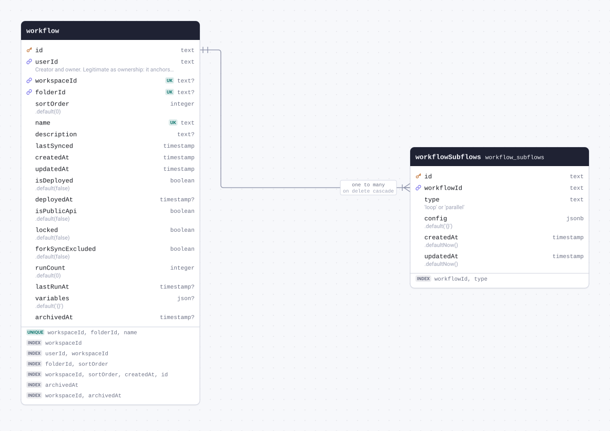

| Column                       | Type        | Constraints                               | Default          | Description          |
| ---------------------------- | ----------- | ----------------------------------------- | ---------------- | -------------------- |
| `id`                         | `text`      | PK NOT NULL                               |                  |                      |
| `workflowId` (`workflow_id`) | `text`      | NOT NULL → [workflow.id](#table-workflow) |                  |                      |
| `type`                       | `text`      | NOT NULL                                  |                  | 'loop' or 'parallel' |
| `config`                     | `jsonb`     | NOT NULL                                  | `.default('{}')` |                      |
| `createdAt` (`created_at`)   | `timestamp` | NOT NULL                                  | `.defaultNow()`  |                      |
| `updatedAt` (`updated_at`)   | `timestamp` | NOT NULL                                  | `.defaultNow()`  |                      |

#### Definition

```sql
CREATE TABLE "workflow_subflows" (
	"id" text PRIMARY KEY,
	"workflow_id" text NOT NULL,
	"type" text NOT NULL,
	"config" jsonb DEFAULT '"{}"' NOT NULL,
	"created_at" timestamp DEFAULT now() NOT NULL,
	"updated_at" timestamp DEFAULT now() NOT NULL
);

CREATE INDEX "workflow_subflows_workflow_type_idx" ON "workflow_subflows" ("workflow_id","type");

ALTER TABLE "workflow_subflows" ADD CONSTRAINT "workflow_subflows_workflow_id_workflow_id_fkey" FOREIGN KEY ("workflow_id") REFERENCES "workflow"("id") ON DELETE CASCADE;
```

#### Indexes

- INDEX `workflowId`, `type`

#### References

- `workflowId` → [workflow.id](#table-workflow) (many to one, on delete cascade)

<details>
<summary>Queries and their SQL</summary>

**Select**: Every row of workflowSubflows.

```ts
db.select().from(workflowSubflows);
```

```sql
select "id", "workflow_id", "type", "config", "created_at", "updated_at"
from "workflow_subflows"
```

**Count**: How many rows workflowSubflows has.

```ts
db.select({ count: count() }).from(workflowSubflows);
```

```sql
select count(*)
from "workflow_subflows"
```

**Find many**: The rows of workflowSubflows, through the relational query API.

```ts
db.query.workflowSubflows.findMany();
```

```sql
select "d0"."id" as "id", "d0"."workflow_id" as "workflowId", "d0"."type" as "type", "d0"."config" as "config", "d0"."created_at" as "createdAt", "d0"."updated_at" as "updatedAt"
from "workflow_subflows" as "d0"
```

**Find by primary key**: One row of workflowSubflows, through the relational query API.

```ts
db.query.workflowSubflows.findFirst({ where: { id: "id" } });
```

```sql
select "d0"."id" as "id", "d0"."workflow_id" as "workflowId", "d0"."type" as "type", "d0"."config" as "config", "d0"."created_at" as "createdAt", "d0"."updated_at" as "updatedAt"
from "workflow_subflows" as "d0"
where "d0"."id" = $1
limit $2
-- params: ["id",1]
```

**Insert**: Adds a row to workflowSubflows, giving the columns that have no default.

```ts
db.insert(workflowSubflows).values({ id: "id", workflowId: "workflowId", type: "type" });
```

```sql
insert into "workflow_subflows" ("id", "workflow_id", "type", "config", "created_at", "updated_at")
values ($1, $2, $3, default, default, default)
-- params: ["id","workflowId","type"]
```

**Update**: Changes a row of workflowSubflows, found by its primary key.

```ts
db.update(workflowSubflows).set({ workflowId: "workflowId" }).where(eq(workflowSubflows.id, "id"));
```

```sql
update "workflow_subflows"
set "workflow_id" = $1
where "workflow_subflows"."id" = $2
-- params: ["workflowId","id"]
```

**Delete**: Deletes a row of workflowSubflows, found by its primary key.

```ts
db.delete(workflowSubflows).where(eq(workflowSubflows.id, "id"));
```

```sql
delete from "workflow_subflows"
where "workflow_subflows"."id" = $1
-- params: ["id"]
```

</details>

<a id="table-waitlist"></a>

### waitlist

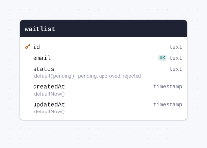

| Column                     | Type        | Constraints     | Default               | Description                 |
| -------------------------- | ----------- | --------------- | --------------------- | --------------------------- |
| `id`                       | `text`      | PK NOT NULL     |                       |                             |
| `email`                    | `text`      | UNIQUE NOT NULL |                       |                             |
| `status`                   | `text`      | NOT NULL        | `.default('pending')` | pending, approved, rejected |
| `createdAt` (`created_at`) | `timestamp` | NOT NULL        | `.defaultNow()`       |                             |
| `updatedAt` (`updated_at`) | `timestamp` | NOT NULL        | `.defaultNow()`       |                             |

#### Definition

```sql
CREATE TABLE "waitlist" (
	"id" text PRIMARY KEY,
	"email" text NOT NULL UNIQUE,
	"status" text DEFAULT 'pending' NOT NULL,
	"created_at" timestamp DEFAULT now() NOT NULL,
	"updated_at" timestamp DEFAULT now() NOT NULL
);
```

<details>
<summary>Queries and their SQL</summary>

**Select**: Every row of waitlist.

```ts
db.select().from(waitlist);
```

```sql
select "id", "email", "status", "created_at", "updated_at"
from "waitlist"
```

**Count**: How many rows waitlist has.

```ts
db.select({ count: count() }).from(waitlist);
```

```sql
select count(*)
from "waitlist"
```

**Find many**: The rows of waitlist, through the relational query API.

```ts
db.query.waitlist.findMany();
```

```sql
select "d0"."id" as "id", "d0"."email" as "email", "d0"."status" as "status", "d0"."created_at" as "createdAt", "d0"."updated_at" as "updatedAt"
from "waitlist" as "d0"
```

**Find by primary key**: One row of waitlist, through the relational query API.

```ts
db.query.waitlist.findFirst({ where: { id: "id" } });
```

```sql
select "d0"."id" as "id", "d0"."email" as "email", "d0"."status" as "status", "d0"."created_at" as "createdAt", "d0"."updated_at" as "updatedAt"
from "waitlist" as "d0"
where "d0"."id" = $1
limit $2
-- params: ["id",1]
```

**Insert**: Adds a row to waitlist, giving the columns that have no default.

```ts
db.insert(waitlist).values({ id: "id", email: "email" });
```

```sql
insert into "waitlist" ("id", "email", "status", "created_at", "updated_at")
values ($1, $2, default, default, default)
-- params: ["id","email"]
```

**Update**: Changes a row of waitlist, found by its primary key.

```ts
db.update(waitlist).set({ email: "email" }).where(eq(waitlist.id, "id"));
```

```sql
update "waitlist"
set "email" = $1
where "waitlist"."id" = $2
-- params: ["email","id"]
```

**Delete**: Deletes a row of waitlist, found by its primary key.

```ts
db.delete(waitlist).where(eq(waitlist.id, "id"));
```

```sql
delete from "waitlist"
where "waitlist"."id" = $1
-- params: ["id"]
```

</details>

<a id="table-workflowExecutionSnapshots"></a>

### workflowExecutionSnapshots

Table `workflow_execution_snapshots`.

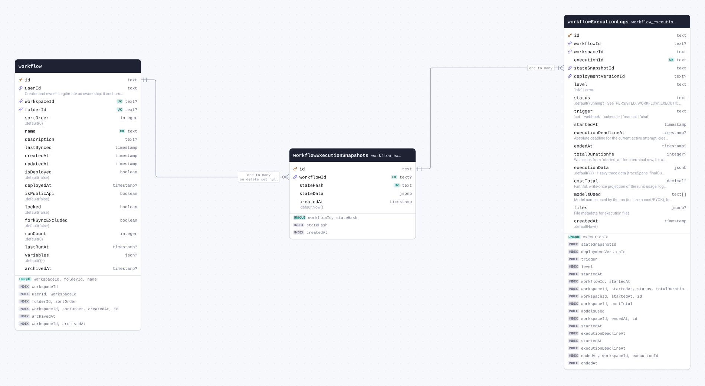

| Column                       | Type        | Constraints                           | Default         | Description |
| ---------------------------- | ----------- | ------------------------------------- | --------------- | ----------- |
| `id`                         | `text`      | PK NOT NULL                           |                 |             |
| `workflowId` (`workflow_id`) | `text`      | NULL → [workflow.id](#table-workflow) |                 |             |
| `stateHash` (`state_hash`)   | `text`      | NOT NULL                              |                 |             |
| `stateData` (`state_data`)   | `jsonb`     | NOT NULL                              |                 |             |
| `createdAt` (`created_at`)   | `timestamp` | NOT NULL                              | `.defaultNow()` |             |

#### Definition

```sql
CREATE TABLE "workflow_execution_snapshots" (
	"id" text PRIMARY KEY,
	"workflow_id" text,
	"state_hash" text NOT NULL,
	"state_data" jsonb NOT NULL,
	"created_at" timestamp DEFAULT now() NOT NULL
);

CREATE INDEX "workflow_snapshots_hash_idx" ON "workflow_execution_snapshots" ("state_hash");

CREATE UNIQUE INDEX "workflow_snapshots_workflow_hash_idx" ON "workflow_execution_snapshots" ("workflow_id","state_hash");

CREATE INDEX "workflow_snapshots_created_at_idx" ON "workflow_execution_snapshots" ("created_at");

ALTER TABLE "workflow_execution_snapshots" ADD CONSTRAINT "workflow_execution_snapshots_workflow_id_workflow_id_fkey" FOREIGN KEY ("workflow_id") REFERENCES "workflow"("id") ON DELETE SET NULL;
```

#### Indexes

- INDEX `stateHash`
- UNIQUE `workflowId`, `stateHash`
- INDEX `createdAt`

#### References

- `workflowId` → [workflow.id](#table-workflow) (many to one, on delete set null)

#### Referenced by

- `id` → [workflowExecutionLogs.stateSnapshotId](#table-workflowExecutionLogs) (one to many)

<details>
<summary>Queries and their SQL</summary>

**Select**: Every row of workflowExecutionSnapshots.

```ts
db.select().from(workflowExecutionSnapshots);
```

```sql
select "id", "workflow_id", "state_hash", "state_data", "created_at"
from "workflow_execution_snapshots"
```

**Count**: How many rows workflowExecutionSnapshots has.

```ts
db.select({ count: count() }).from(workflowExecutionSnapshots);
```

```sql
select count(*)
from "workflow_execution_snapshots"
```

**Find many**: The rows of workflowExecutionSnapshots, through the relational query API.

```ts
db.query.workflowExecutionSnapshots.findMany();
```

```sql
select "d0"."id" as "id", "d0"."workflow_id" as "workflowId", "d0"."state_hash" as "stateHash", "d0"."state_data" as "stateData", "d0"."created_at" as "createdAt"
from "workflow_execution_snapshots" as "d0"
```

**Find by primary key**: One row of workflowExecutionSnapshots, through the relational query API.

```ts
db.query.workflowExecutionSnapshots.findFirst({ where: { id: "id" } });
```

```sql
select "d0"."id" as "id", "d0"."workflow_id" as "workflowId", "d0"."state_hash" as "stateHash", "d0"."state_data" as "stateData", "d0"."created_at" as "createdAt"
from "workflow_execution_snapshots" as "d0"
where "d0"."id" = $1
limit $2
-- params: ["id",1]
```

**Insert**: Adds a row to workflowExecutionSnapshots, giving the columns that have no default.

```ts
db.insert(workflowExecutionSnapshots).values({ id: "id", stateHash: "stateHash", stateData: {} });
```

```sql
insert into "workflow_execution_snapshots" ("id", "workflow_id", "state_hash", "state_data", "created_at")
values ($1, default, $2, $3, default)
-- params: ["id","stateHash",{}]
```

**Update**: Changes a row of workflowExecutionSnapshots, found by its primary key.

```ts
db.update(workflowExecutionSnapshots)
  .set({ workflowId: "workflowId" })
  .where(eq(workflowExecutionSnapshots.id, "id"));
```

```sql
update "workflow_execution_snapshots"
set "workflow_id" = $1
where "workflow_execution_snapshots"."id" = $2
-- params: ["workflowId","id"]
```

**Delete**: Deletes a row of workflowExecutionSnapshots, found by its primary key.

```ts
db.delete(workflowExecutionSnapshots).where(eq(workflowExecutionSnapshots.id, "id"));
```

```sql
delete from "workflow_execution_snapshots"
where "workflow_execution_snapshots"."id" = $1
-- params: ["id"]
```

</details>

<a id="table-workflowExecutionLogs"></a>

### workflowExecutionLogs

Table `workflow_execution_logs`.

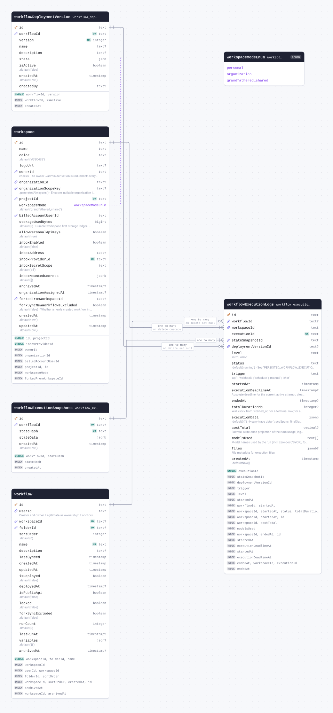

| Column                                          | Type        | Constraints                                                                   | Default               | Description                                                                                                                                                                                                                                                                                                                                                                                                                                                                                                                                                              |
| ----------------------------------------------- | ----------- | ----------------------------------------------------------------------------- | --------------------- | ------------------------------------------------------------------------------------------------------------------------------------------------------------------------------------------------------------------------------------------------------------------------------------------------------------------------------------------------------------------------------------------------------------------------------------------------------------------------------------------------------------------------------------------------------------------------ |
| `id`                                            | `text`      | PK NOT NULL                                                                   |                       |                                                                                                                                                                                                                                                                                                                                                                                                                                                                                                                                                                          |
| `workflowId` (`workflow_id`)                    | `text`      | NULL → [workflow.id](#table-workflow)                                         |                       |                                                                                                                                                                                                                                                                                                                                                                                                                                                                                                                                                                          |
| `workspaceId` (`workspace_id`)                  | `text`      | NOT NULL → [workspace.id](#table-workspace)                                   |                       |                                                                                                                                                                                                                                                                                                                                                                                                                                                                                                                                                                          |
| `executionId` (`execution_id`)                  | `text`      | NOT NULL                                                                      |                       |                                                                                                                                                                                                                                                                                                                                                                                                                                                                                                                                                                          |
| `stateSnapshotId` (`state_snapshot_id`)         | `text`      | NOT NULL → [workflowExecutionSnapshots.id](#table-workflowExecutionSnapshots) |                       |                                                                                                                                                                                                                                                                                                                                                                                                                                                                                                                                                                          |
| `deploymentVersionId` (`deployment_version_id`) | `text`      | NULL → [workflowDeploymentVersion.id](#table-workflowDeploymentVersion)       |                       |                                                                                                                                                                                                                                                                                                                                                                                                                                                                                                                                                                          |
| `level`                                         | `text`      | NOT NULL                                                                      |                       | 'info' \| 'error'                                                                                                                                                                                                                                                                                                                                                                                                                                                                                                                                                        |
| `status`                                        | `text`      | NOT NULL                                                                      | `.default('running')` | See `PERSISTED_WORKFLOW_EXECUTION_STATUSES` in `apps/sim/lib/logs/types.ts`.                                                                                                                                                                                                                                                                                                                                                                                                                                                                                             |
| `trigger`                                       | `text`      | NOT NULL                                                                      |                       | 'api' \| 'webhook' \| 'schedule' \| 'manual' \| 'chat'                                                                                                                                                                                                                                                                                                                                                                                                                                                                                                                   |
| `startedAt` (`started_at`)                      | `timestamp` | NOT NULL                                                                      |                       |                                                                                                                                                                                                                                                                                                                                                                                                                                                                                                                                                                          |
| `executionDeadlineAt` (`execution_deadline_at`) | `timestamp` | NULL                                                                          |                       | Absolute deadline for the current active attempt; cleared while paused or terminal.                                                                                                                                                                                                                                                                                                                                                                                                                                                                                      |
| `endedAt` (`ended_at`)                          | `timestamp` | NULL                                                                          |                       |                                                                                                                                                                                                                                                                                                                                                                                                                                                                                                                                                                          |
| `totalDurationMs` (`total_duration_ms`)         | `integer`   | NULL                                                                          |                       | Wall clock from `started_at` for a terminal row; for a `pending` (paused) row, the active duration recorded at the checkpoint, which excludes the time the run sits waiting. Resuming leaves that checkpoint value in place while the row accrues time again, so a `running` row's value is stale until the next terminal write recomputes it.                                                                                                                                                                                                                           |
| `executionData` (`execution_data`)              | `jsonb`     | NOT NULL                                                                      | `.default('{}')`      | Heavy trace data (traceSpans, finalOutput, workflowInput, executionState) is externalized to object storage; this column then holds a slim payload: a `traceStoreRef` (__simLargeValueRef) pointer to the stored object plus inline markers (hasTraceSpans, traceSpanCount, environment, trigger, truncation flags). It also still holds the FULL payload inline for legacy / not-yet-backfilled rows, for the storage-write-failure fallback, and for job_execution_logs. Required — not droppable. Read it via `materializeExecutionData`, which resolves the pointer. |
| `costTotal` (`cost_total`)                      | `decimal`   | NULL                                                                          |                       | Faithful, write-once projection of the run's usage_log ledger sum (dollars). Backs list cost display/filter/sort without live aggregation; never an independently-computed value (cost_total == SUM(usage_log) for the run).                                                                                                                                                                                                                                                                                                                                             |
| `modelsUsed` (`models_used`)                    | `text[]`    | NULL                                                                          |                       | Model names used by the run (incl. zero-cost/BYOK), for the v1 model filter.                                                                                                                                                                                                                                                                                                                                                                                                                                                                                             |
| `files`                                         | `jsonb`     | NULL                                                                          |                       | File metadata for execution files                                                                                                                                                                                                                                                                                                                                                                                                                                                                                                                                        |
| `createdAt` (`created_at`)                      | `timestamp` | NOT NULL                                                                      | `.defaultNow()`       |                                                                                                                                                                                                                                                                                                                                                                                                                                                                                                                                                                          |

#### Definition

```sql
CREATE TABLE "workflow_execution_logs" (
	"id" text PRIMARY KEY,
	"workflow_id" text,
	"workspace_id" text NOT NULL,
	"execution_id" text NOT NULL,
	"state_snapshot_id" text NOT NULL,
	"deployment_version_id" text,
	"level" text NOT NULL,
	"status" text DEFAULT 'running' NOT NULL,
	"trigger" text NOT NULL,
	"started_at" timestamp NOT NULL,
	"execution_deadline_at" timestamp,
	"ended_at" timestamp,
	"total_duration_ms" integer,
	"execution_data" jsonb DEFAULT '"{}"' NOT NULL,
	"cost_total" numeric,
	"models_used" text[],
	"files" jsonb,
	"created_at" timestamp DEFAULT now() NOT NULL
);

CREATE INDEX "workflow_execution_logs_state_snapshot_id_idx" ON "workflow_execution_logs" ("state_snapshot_id");

CREATE INDEX "workflow_execution_logs_deployment_version_id_idx" ON "workflow_execution_logs" ("deployment_version_id");

CREATE INDEX "workflow_execution_logs_trigger_idx" ON "workflow_execution_logs" ("trigger");

CREATE INDEX "workflow_execution_logs_level_idx" ON "workflow_execution_logs" ("level");

CREATE INDEX "workflow_execution_logs_started_at_idx" ON "workflow_execution_logs" ("started_at");

CREATE UNIQUE INDEX "workflow_execution_logs_execution_id_unique" ON "workflow_execution_logs" ("execution_id");

CREATE INDEX "workflow_execution_logs_workflow_started_at_idx" ON "workflow_execution_logs" ("workflow_id","started_at");

CREATE INDEX CONCURRENTLY "workflow_execution_logs_workspace_activity_level_idx" ON "workflow_execution_logs" ("workspace_id","started_at","status","total_duration_ms","workflow_id","trigger","level");

CREATE INDEX "workflow_execution_logs_workspace_started_at_id_desc_idx" ON "workflow_execution_logs" ("workspace_id","started_at" DESC NULLS LAST,"id" DESC);

CREATE INDEX "workflow_execution_logs_workspace_cost_total_idx" ON "workflow_execution_logs" ("workspace_id","cost_total");

CREATE INDEX "workflow_execution_logs_models_used_idx" ON "workflow_execution_logs" USING gin ("models_used");

CREATE INDEX "workflow_execution_logs_workspace_ended_at_id_idx" ON "workflow_execution_logs" ("workspace_id",date_trunc('milliseconds', "ended_at"),"id");

CREATE INDEX "workflow_execution_logs_running_started_at_idx" ON "workflow_execution_logs" ("started_at") WHERE status = 'running';

CREATE INDEX "workflow_execution_logs_running_deadline_idx" ON "workflow_execution_logs" ("execution_deadline_at") WHERE "status" = 'running' AND "execution_deadline_at" IS NOT NULL;

CREATE INDEX "workflow_execution_logs_redacting_started_at_idx" ON "workflow_execution_logs" ("started_at") WHERE status = 'redacting';

CREATE INDEX "workflow_execution_logs_redacting_deadline_idx" ON "workflow_execution_logs" ("execution_deadline_at") WHERE "status" = 'redacting' AND "execution_deadline_at" IS NOT NULL;

CREATE INDEX "workflow_execution_logs_completed_ended_at_idx" ON "workflow_execution_logs" ("ended_at","workspace_id","execution_id") WHERE "status" = 'completed' AND "level" = 'info' AND "ended_at" IS NOT NULL;

ALTER TABLE "workflow_execution_logs" ADD CONSTRAINT "workflow_execution_logs_workflow_id_workflow_id_fkey" FOREIGN KEY ("workflow_id") REFERENCES "workflow"("id") ON DELETE SET NULL;

ALTER TABLE "workflow_execution_logs" ADD CONSTRAINT "workflow_execution_logs_workspace_id_workspace_id_fkey" FOREIGN KEY ("workspace_id") REFERENCES "workspace"("id") ON DELETE CASCADE;

ALTER TABLE "workflow_execution_logs" ADD CONSTRAINT "workflow_execution_logs_OM6jluh6ZFbM_fkey" FOREIGN KEY ("state_snapshot_id") REFERENCES "workflow_execution_snapshots"("id");

ALTER TABLE "workflow_execution_logs" ADD CONSTRAINT "workflow_execution_logs_wTSIoAG7WWfW_fkey" FOREIGN KEY ("deployment_version_id") REFERENCES "workflow_deployment_version"("id") ON DELETE SET NULL;
```

#### Indexes

- INDEX `stateSnapshotId`
- INDEX `deploymentVersionId`
- INDEX `trigger`
- INDEX `level`
- INDEX `startedAt`
- UNIQUE `executionId`
- INDEX `workflowId`, `startedAt`
- INDEX `workspaceId`, `startedAt`, `status`, `totalDurationMs`, `workflowId`, `trigger`, `level`
- INDEX `workspaceId`
- INDEX `workspaceId`, `costTotal`
- INDEX `modelsUsed`
- INDEX `workspaceId`, `id`
- INDEX `startedAt`
- INDEX `executionDeadlineAt`
- INDEX `startedAt`
- INDEX `executionDeadlineAt`
- INDEX `endedAt`, `workspaceId`, `executionId`

#### References

- `workflowId` → [workflow.id](#table-workflow) (many to one, on delete set null)
- `workspaceId` → [workspace.id](#table-workspace) (many to one, on delete cascade)
- `stateSnapshotId` → [workflowExecutionSnapshots.id](#table-workflowExecutionSnapshots) (many to one)
- `deploymentVersionId` → [workflowDeploymentVersion.id](#table-workflowDeploymentVersion) (many to one, on delete set null)

<details>
<summary>Queries and their SQL</summary>

**Select**: Every row of workflowExecutionLogs.

```ts
db.select().from(workflowExecutionLogs);
```

```sql
select "id", "workflow_id", "workspace_id", "execution_id", "state_snapshot_id", "deployment_version_id", "level", "status", "trigger", "started_at", "execution_deadline_at", "ended_at", "total_duration_ms", "execution_data", "cost_total", "models_used", "files", "created_at"
from "workflow_execution_logs"
```

**Count**: How many rows workflowExecutionLogs has.

```ts
db.select({ count: count() }).from(workflowExecutionLogs);
```

```sql
select count(*)
from "workflow_execution_logs"
```

**Find many**: The rows of workflowExecutionLogs, through the relational query API.

```ts
db.query.workflowExecutionLogs.findMany();
```

```sql
select "d0"."id" as "id", "d0"."workflow_id" as "workflowId", "d0"."workspace_id" as "workspaceId", "d0"."execution_id" as "executionId", "d0"."state_snapshot_id" as "stateSnapshotId", "d0"."deployment_version_id" as "deploymentVersionId", "d0"."level" as "level", "d0"."status" as "status", "d0"."trigger" as "trigger", "d0"."started_at" as "startedAt", "d0"."execution_deadline_at" as "executionDeadlineAt", "d0"."ended_at" as "endedAt", "d0"."total_duration_ms" as "totalDurationMs", "d0"."execution_data" as "executionData", "d0"."cost_total" as "costTotal", "d0"."models_used" as "modelsUsed", "d0"."files" as "files", "d0"."created_at" as "createdAt"
from "workflow_execution_logs" as "d0"
```

**Find by primary key**: One row of workflowExecutionLogs, through the relational query API.

```ts
db.query.workflowExecutionLogs.findFirst({ where: { id: "id" } });
```

```sql
select "d0"."id" as "id", "d0"."workflow_id" as "workflowId", "d0"."workspace_id" as "workspaceId", "d0"."execution_id" as "executionId", "d0"."state_snapshot_id" as "stateSnapshotId", "d0"."deployment_version_id" as "deploymentVersionId", "d0"."level" as "level", "d0"."status" as "status", "d0"."trigger" as "trigger", "d0"."started_at" as "startedAt", "d0"."execution_deadline_at" as "executionDeadlineAt", "d0"."ended_at" as "endedAt", "d0"."total_duration_ms" as "totalDurationMs", "d0"."execution_data" as "executionData", "d0"."cost_total" as "costTotal", "d0"."models_used" as "modelsUsed", "d0"."files" as "files", "d0"."created_at" as "createdAt"
from "workflow_execution_logs" as "d0"
where "d0"."id" = $1
limit $2
-- params: ["id",1]
```

**Insert**: Adds a row to workflowExecutionLogs, giving the columns that have no default.

```ts
db.insert(workflowExecutionLogs).values({
  id: "id",
  workspaceId: "workspaceId",
  executionId: "executionId",
  stateSnapshotId: "stateSnapshotId",
  level: "level",
  trigger: "trigger",
  startedAt: new Date("2026-01-01T00:00:00.000Z"),
});
```

```sql
insert into "workflow_execution_logs" ("id", "workflow_id", "workspace_id", "execution_id", "state_snapshot_id", "deployment_version_id", "level", "status", "trigger", "started_at", "execution_deadline_at", "ended_at", "total_duration_ms", "execution_data", "cost_total", "models_used", "files", "created_at")
values ($1, default, $2, $3, $4, default, $5, default, $6, $7, default, default, default, default, default, default, default, default)
-- params: ["id","workspaceId","executionId","stateSnapshotId","level","trigger","2026-01-01T00:00:00.000Z"]
```

**Update**: Changes a row of workflowExecutionLogs, found by its primary key.

```ts
db.update(workflowExecutionLogs)
  .set({ workflowId: "workflowId" })
  .where(eq(workflowExecutionLogs.id, "id"));
```

```sql
update "workflow_execution_logs"
set "workflow_id" = $1
where "workflow_execution_logs"."id" = $2
-- params: ["workflowId","id"]
```

**Delete**: Deletes a row of workflowExecutionLogs, found by its primary key.

```ts
db.delete(workflowExecutionLogs).where(eq(workflowExecutionLogs.id, "id"));
```

```sql
delete from "workflow_execution_logs"
where "workflow_execution_logs"."id" = $1
-- params: ["id"]
```

</details>

<a id="table-executionLargeValues"></a>

### executionLargeValues

Table `execution_large_values`.

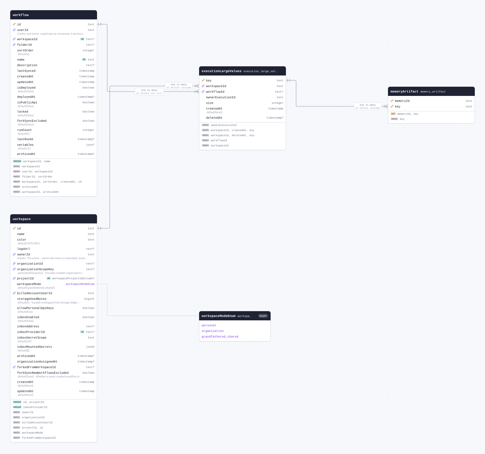

| Column                                    | Type        | Constraints                                 | Default         | Description |
| ----------------------------------------- | ----------- | ------------------------------------------- | --------------- | ----------- |
| `key`                                     | `text`      | PK NOT NULL                                 |                 |             |
| `workspaceId` (`workspace_id`)            | `text`      | NOT NULL → [workspace.id](#table-workspace) |                 |             |
| `workflowId` (`workflow_id`)              | `text`      | NULL → [workflow.id](#table-workflow)       |                 |             |
| `ownerExecutionId` (`owner_execution_id`) | `text`      | NOT NULL                                    |                 |             |
| `size`                                    | `integer`   | NOT NULL                                    |                 |             |
| `createdAt` (`created_at`)                | `timestamp` | NOT NULL                                    | `.defaultNow()` |             |
| `deletedAt` (`deleted_at`)                | `timestamp` | NULL                                        |                 |             |

#### Definition

```sql
CREATE TABLE "execution_large_values" (
	"key" text PRIMARY KEY,
	"workspace_id" text NOT NULL,
	"workflow_id" text,
	"owner_execution_id" text NOT NULL,
	"size" integer NOT NULL,
	"created_at" timestamp DEFAULT now() NOT NULL,
	"deleted_at" timestamp
);

CREATE INDEX "execution_large_values_owner_execution_id_idx" ON "execution_large_values" ("owner_execution_id");

CREATE INDEX "execution_large_values_cleanup_idx" ON "execution_large_values" ("workspace_id","created_at","key") WHERE "deleted_at" IS NULL;

CREATE INDEX "execution_large_values_tombstone_cleanup_idx" ON "execution_large_values" ("workspace_id","deleted_at","key") WHERE "deleted_at" IS NOT NULL;

CREATE INDEX "execution_large_values_workflow_id_idx" ON "execution_large_values" ("workflow_id");

CREATE INDEX CONCURRENTLY "execution_large_values_workspace_id_idx" ON "execution_large_values" ("workspace_id");

ALTER TABLE "execution_large_values" ADD CONSTRAINT "execution_large_values_workspace_id_workspace_id_fkey" FOREIGN KEY ("workspace_id") REFERENCES "workspace"("id") ON DELETE CASCADE;

ALTER TABLE "execution_large_values" ADD CONSTRAINT "execution_large_values_workflow_id_workflow_id_fkey" FOREIGN KEY ("workflow_id") REFERENCES "workflow"("id") ON DELETE SET NULL;
```

#### Indexes

- INDEX `ownerExecutionId`
- INDEX `workspaceId`, `createdAt`, `key`
- INDEX `workspaceId`, `deletedAt`, `key`
- INDEX `workflowId`
- INDEX `workspaceId`

#### References

- `workspaceId` → [workspace.id](#table-workspace) (many to one, on delete cascade)
- `workflowId` → [workflow.id](#table-workflow) (many to one, on delete set null)

#### Referenced by

- `key` → [memoryArtifact.key](#table-memoryArtifact) (one to many, on delete cascade)

<details>
<summary>Queries and their SQL</summary>

**Select**: Every row of executionLargeValues.

```ts
db.select().from(executionLargeValues);
```

```sql
select "key", "workspace_id", "workflow_id", "owner_execution_id", "size", "created_at", "deleted_at"
from "execution_large_values"
```

**Count**: How many rows executionLargeValues has.

```ts
db.select({ count: count() }).from(executionLargeValues);
```

```sql
select count(*)
from "execution_large_values"
```

**Find many**: The rows of executionLargeValues, through the relational query API.

```ts
db.query.executionLargeValues.findMany();
```

```sql
select "d0"."key" as "key", "d0"."workspace_id" as "workspaceId", "d0"."workflow_id" as "workflowId", "d0"."owner_execution_id" as "ownerExecutionId", "d0"."size" as "size", "d0"."created_at" as "createdAt", "d0"."deleted_at" as "deletedAt"
from "execution_large_values" as "d0"
```

**Find by primary key**: One row of executionLargeValues, through the relational query API.

```ts
db.query.executionLargeValues.findFirst({ where: { key: "key" } });
```

```sql
select "d0"."key" as "key", "d0"."workspace_id" as "workspaceId", "d0"."workflow_id" as "workflowId", "d0"."owner_execution_id" as "ownerExecutionId", "d0"."size" as "size", "d0"."created_at" as "createdAt", "d0"."deleted_at" as "deletedAt"
from "execution_large_values" as "d0"
where "d0"."key" = $1
limit $2
-- params: ["key",1]
```

**Insert**: Adds a row to executionLargeValues, giving the columns that have no default.

```ts
db.insert(executionLargeValues).values({
  key: "key",
  workspaceId: "workspaceId",
  ownerExecutionId: "ownerExecutionId",
  size: 1,
});
```

```sql
insert into "execution_large_values" ("key", "workspace_id", "workflow_id", "owner_execution_id", "size", "created_at", "deleted_at")
values ($1, $2, default, $3, $4, default, default)
-- params: ["key","workspaceId","ownerExecutionId",1]
```

**Update**: Changes a row of executionLargeValues, found by its primary key.

```ts
db.update(executionLargeValues)
  .set({ workspaceId: "workspaceId" })
  .where(eq(executionLargeValues.key, "key"));
```

```sql
update "execution_large_values"
set "workspace_id" = $1
where "execution_large_values"."key" = $2
-- params: ["workspaceId","key"]
```

**Delete**: Deletes a row of executionLargeValues, found by its primary key.

```ts
db.delete(executionLargeValues).where(eq(executionLargeValues.key, "key"));
```

```sql
delete from "execution_large_values"
where "execution_large_values"."key" = $1
-- params: ["key"]
```

</details>

<a id="table-executionLargeValueReferences"></a>

### executionLargeValueReferences

Table `execution_large_value_references`.

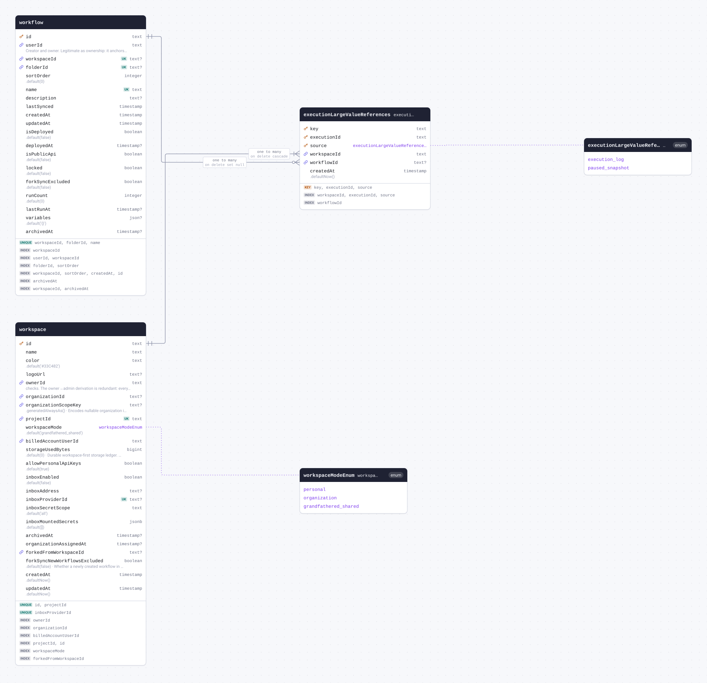

| Column                         | Type                                                                                     | Constraints                                 | Default         | Description |
| ------------------------------ | ---------------------------------------------------------------------------------------- | ------------------------------------------- | --------------- | ----------- |
| `key`                          | `text`                                                                                   | PK NOT NULL                                 |                 |             |
| `executionId` (`execution_id`) | `text`                                                                                   | PK NOT NULL                                 |                 |             |
| `source`                       | [`executionLargeValueReferenceSourceEnum`](#enum-executionLargeValueReferenceSourceEnum) | PK NOT NULL                                 |                 |             |
| `workspaceId` (`workspace_id`) | `text`                                                                                   | NOT NULL → [workspace.id](#table-workspace) |                 |             |
| `workflowId` (`workflow_id`)   | `text`                                                                                   | NULL → [workflow.id](#table-workflow)       |                 |             |
| `createdAt` (`created_at`)     | `timestamp`                                                                              | NOT NULL                                    | `.defaultNow()` |             |

#### Definition

```sql
CREATE TABLE "execution_large_value_references" (
	"key" text,
	"execution_id" text,
	"source" "execution_large_value_reference_source",
	"workspace_id" text NOT NULL,
	"workflow_id" text,
	"created_at" timestamp DEFAULT now() NOT NULL,
	CONSTRAINT "execution_large_value_references_pkey" PRIMARY KEY("key","execution_id","source")
);

CREATE INDEX "execution_large_value_references_workspace_execution_source_idx" ON "execution_large_value_references" ("workspace_id","execution_id","source");

CREATE INDEX "execution_large_value_references_workflow_id_idx" ON "execution_large_value_references" ("workflow_id");

ALTER TABLE "execution_large_value_references" ADD CONSTRAINT "execution_large_value_references_workspace_id_workspace_id_fkey" FOREIGN KEY ("workspace_id") REFERENCES "workspace"("id") ON DELETE CASCADE;

ALTER TABLE "execution_large_value_references" ADD CONSTRAINT "execution_large_value_references_workflow_id_workflow_id_fkey" FOREIGN KEY ("workflow_id") REFERENCES "workflow"("id") ON DELETE SET NULL;
```

#### Indexes

- PRIMARY KEY `key`, `executionId`, `source`
- INDEX `workspaceId`, `executionId`, `source`
- INDEX `workflowId`

#### References

- `workspaceId` → [workspace.id](#table-workspace) (many to one, on delete cascade)
- `workflowId` → [workflow.id](#table-workflow) (many to one, on delete set null)

<details>
<summary>Queries and their SQL</summary>

**Select**: Every row of executionLargeValueReferences.

```ts
db.select().from(executionLargeValueReferences);
```

```sql
select "key", "execution_id", "source", "workspace_id", "workflow_id", "created_at"
from "execution_large_value_references"
```

**Count**: How many rows executionLargeValueReferences has.

```ts
db.select({ count: count() }).from(executionLargeValueReferences);
```

```sql
select count(*)
from "execution_large_value_references"
```

**Find many**: The rows of executionLargeValueReferences, through the relational query API.

```ts
db.query.executionLargeValueReferences.findMany();
```

```sql
select "d0"."key" as "key", "d0"."execution_id" as "executionId", "d0"."source" as "source", "d0"."workspace_id" as "workspaceId", "d0"."workflow_id" as "workflowId", "d0"."created_at" as "createdAt"
from "execution_large_value_references" as "d0"
```

**Find by primary key**: One row of executionLargeValueReferences, through the relational query API.

```ts
db.query.executionLargeValueReferences.findFirst({
  where: { key: "key", executionId: "executionId", source: "execution_log" },
});
```

```sql
select "d0"."key" as "key", "d0"."execution_id" as "executionId", "d0"."source" as "source", "d0"."workspace_id" as "workspaceId", "d0"."workflow_id" as "workflowId", "d0"."created_at" as "createdAt"
from "execution_large_value_references" as "d0"
where (("d0"."key" = $1) and ("d0"."execution_id" = $2) and ("d0"."source" = $3))
limit $4
-- params: ["key","executionId","execution_log",1]
```

**Insert**: Adds a row to executionLargeValueReferences, giving the columns that have no default.

```ts
db.insert(executionLargeValueReferences).values({
  key: "key",
  executionId: "executionId",
  source: "execution_log",
  workspaceId: "workspaceId",
});
```

```sql
insert into "execution_large_value_references" ("key", "execution_id", "source", "workspace_id", "workflow_id", "created_at")
values ($1, $2, $3, $4, default, default)
-- params: ["key","executionId","execution_log","workspaceId"]
```

**Update**: Changes a row of executionLargeValueReferences, found by its primary key.

```ts
db.update(executionLargeValueReferences)
  .set({ workspaceId: "workspaceId" })
  .where(
    and(
      eq(executionLargeValueReferences.key, "key"),
      eq(executionLargeValueReferences.executionId, "executionId"),
      eq(executionLargeValueReferences.source, "execution_log"),
    ),
  );
```

```sql
update "execution_large_value_references"
set "workspace_id" = $1
where (("execution_large_value_references"."key" = $2) and ("execution_large_value_references"."execution_id" = $3) and ("execution_large_value_references"."source" = $4))
-- params: ["workspaceId","key","executionId","execution_log"]
```

**Delete**: Deletes a row of executionLargeValueReferences, found by its primary key.

```ts
db.delete(executionLargeValueReferences).where(
  and(
    eq(executionLargeValueReferences.key, "key"),
    eq(executionLargeValueReferences.executionId, "executionId"),
    eq(executionLargeValueReferences.source, "execution_log"),
  ),
);
```

```sql
delete from "execution_large_value_references"
where (("execution_large_value_references"."key" = $1) and ("execution_large_value_references"."execution_id" = $2) and ("execution_large_value_references"."source" = $3))
-- params: ["key","executionId","execution_log"]
```

</details>

<a id="table-executionLargeValueDependencies"></a>

### executionLargeValueDependencies

Table `execution_large_value_dependencies`.

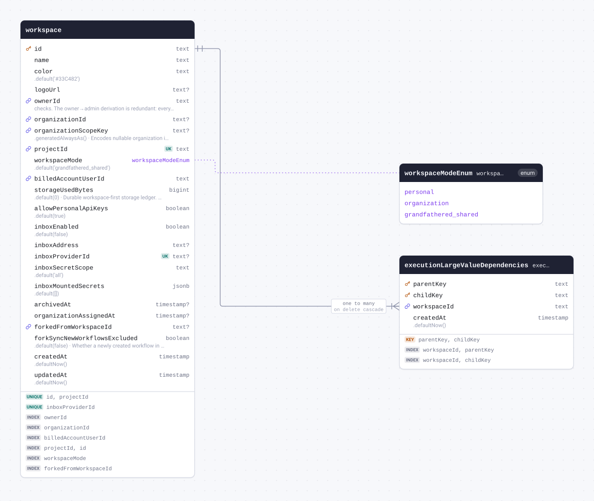

| Column                         | Type        | Constraints                                 | Default         | Description |
| ------------------------------ | ----------- | ------------------------------------------- | --------------- | ----------- |
| `parentKey` (`parent_key`)     | `text`      | PK NOT NULL                                 |                 |             |
| `childKey` (`child_key`)       | `text`      | PK NOT NULL                                 |                 |             |
| `workspaceId` (`workspace_id`) | `text`      | NOT NULL → [workspace.id](#table-workspace) |                 |             |
| `createdAt` (`created_at`)     | `timestamp` | NOT NULL                                    | `.defaultNow()` |             |

#### Definition

```sql
CREATE TABLE "execution_large_value_dependencies" (
	"parent_key" text,
	"child_key" text,
	"workspace_id" text NOT NULL,
	"created_at" timestamp DEFAULT now() NOT NULL,
	CONSTRAINT "execution_large_value_dependencies_pkey" PRIMARY KEY("parent_key","child_key")
);

CREATE INDEX "execution_large_value_dependencies_workspace_parent_key_idx" ON "execution_large_value_dependencies" ("workspace_id","parent_key");

CREATE INDEX "execution_large_value_dependencies_workspace_child_key_idx" ON "execution_large_value_dependencies" ("workspace_id","child_key");

ALTER TABLE "execution_large_value_dependencies" ADD CONSTRAINT "execution_large_value_dependencies_B8G287S6c4T8_fkey" FOREIGN KEY ("workspace_id") REFERENCES "workspace"("id") ON DELETE CASCADE;
```

#### Indexes

- PRIMARY KEY `parentKey`, `childKey`
- INDEX `workspaceId`, `parentKey`
- INDEX `workspaceId`, `childKey`

#### References

- `workspaceId` → [workspace.id](#table-workspace) (many to one, on delete cascade)

<details>
<summary>Queries and their SQL</summary>

**Select**: Every row of executionLargeValueDependencies.

```ts
db.select().from(executionLargeValueDependencies);
```

```sql
select "parent_key", "child_key", "workspace_id", "created_at"
from "execution_large_value_dependencies"
```

**Count**: How many rows executionLargeValueDependencies has.

```ts
db.select({ count: count() }).from(executionLargeValueDependencies);
```

```sql
select count(*)
from "execution_large_value_dependencies"
```

**Find many**: The rows of executionLargeValueDependencies, through the relational query API.

```ts
db.query.executionLargeValueDependencies.findMany();
```

```sql
select "d0"."parent_key" as "parentKey", "d0"."child_key" as "childKey", "d0"."workspace_id" as "workspaceId", "d0"."created_at" as "createdAt"
from "execution_large_value_dependencies" as "d0"
```

**Find by primary key**: One row of executionLargeValueDependencies, through the relational query API.

```ts
db.query.executionLargeValueDependencies.findFirst({
  where: { parentKey: "parentKey", childKey: "childKey" },
});
```

```sql
select "d0"."parent_key" as "parentKey", "d0"."child_key" as "childKey", "d0"."workspace_id" as "workspaceId", "d0"."created_at" as "createdAt"
from "execution_large_value_dependencies" as "d0"
where (("d0"."parent_key" = $1) and ("d0"."child_key" = $2))
limit $3
-- params: ["parentKey","childKey",1]
```

**Insert**: Adds a row to executionLargeValueDependencies, giving the columns that have no default.

```ts
db.insert(executionLargeValueDependencies).values({
  parentKey: "parentKey",
  childKey: "childKey",
  workspaceId: "workspaceId",
});
```

```sql
insert into "execution_large_value_dependencies" ("parent_key", "child_key", "workspace_id", "created_at")
values ($1, $2, $3, default)
-- params: ["parentKey","childKey","workspaceId"]
```

**Update**: Changes a row of executionLargeValueDependencies, found by its primary key.

```ts
db.update(executionLargeValueDependencies)
  .set({ workspaceId: "workspaceId" })
  .where(
    and(
      eq(executionLargeValueDependencies.parentKey, "parentKey"),
      eq(executionLargeValueDependencies.childKey, "childKey"),
    ),
  );
```

```sql
update "execution_large_value_dependencies"
set "workspace_id" = $1
where (("execution_large_value_dependencies"."parent_key" = $2) and ("execution_large_value_dependencies"."child_key" = $3))
-- params: ["workspaceId","parentKey","childKey"]
```

**Delete**: Deletes a row of executionLargeValueDependencies, found by its primary key.

```ts
db.delete(executionLargeValueDependencies).where(
  and(
    eq(executionLargeValueDependencies.parentKey, "parentKey"),
    eq(executionLargeValueDependencies.childKey, "childKey"),
  ),
);
```

```sql
delete from "execution_large_value_dependencies"
where (("execution_large_value_dependencies"."parent_key" = $1) and ("execution_large_value_dependencies"."child_key" = $2))
-- params: ["parentKey","childKey"]
```

</details>

<a id="table-pausedExecutions"></a>

### pausedExecutions

Table `paused_executions`.

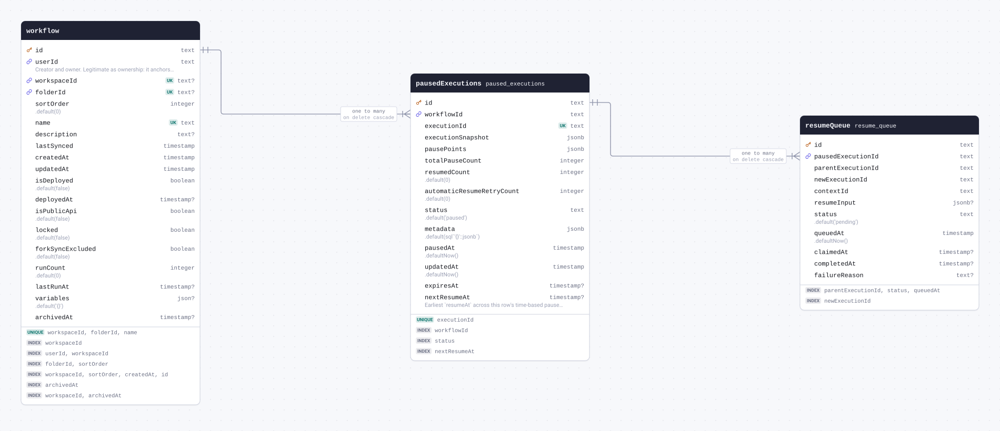

| Column                                                       | Type        | Constraints                               | Default                        | Description                                                                                |
| ------------------------------------------------------------ | ----------- | ----------------------------------------- | ------------------------------ | ------------------------------------------------------------------------------------------ |
| `id`                                                         | `text`      | PK NOT NULL                               |                                |                                                                                            |
| `workflowId` (`workflow_id`)                                 | `text`      | NOT NULL → [workflow.id](#table-workflow) |                                |                                                                                            |
| `executionId` (`execution_id`)                               | `text`      | NOT NULL                                  |                                |                                                                                            |
| `executionSnapshot` (`execution_snapshot`)                   | `jsonb`     | NOT NULL                                  |                                |                                                                                            |
| `pausePoints` (`pause_points`)                               | `jsonb`     | NOT NULL                                  |                                |                                                                                            |
| `totalPauseCount` (`total_pause_count`)                      | `integer`   | NOT NULL                                  |                                |                                                                                            |
| `resumedCount` (`resumed_count`)                             | `integer`   | NOT NULL                                  | `.default(0)`                  |                                                                                            |
| `automaticResumeRetryCount` (`automatic_resume_retry_count`) | `integer`   | NOT NULL                                  | `.default(0)`                  |                                                                                            |
| `status`                                                     | `text`      | NOT NULL                                  | `.default('paused')`           |                                                                                            |
| `metadata`                                                   | `jsonb`     | NOT NULL                                  | ``.default(sql`'{}'::jsonb`)`` |                                                                                            |
| `pausedAt` (`paused_at`)                                     | `timestamp` | NOT NULL                                  | `.defaultNow()`                |                                                                                            |
| `updatedAt` (`updated_at`)                                   | `timestamp` | NOT NULL                                  | `.defaultNow()`                |                                                                                            |
| `expiresAt` (`expires_at`)                                   | `timestamp` | NULL                                      |                                |                                                                                            |
| `nextResumeAt` (`next_resume_at`)                            | `timestamp` | NULL                                      |                                | Earliest `resumeAt` across this row's time-based pause points. NULL for human-only pauses. |

#### Definition

```sql
CREATE TABLE "paused_executions" (
	"id" text PRIMARY KEY,
	"workflow_id" text NOT NULL,
	"execution_id" text NOT NULL,
	"execution_snapshot" jsonb NOT NULL,
	"pause_points" jsonb NOT NULL,
	"total_pause_count" integer NOT NULL,
	"resumed_count" integer DEFAULT 0 NOT NULL,
	"automatic_resume_retry_count" integer DEFAULT 0 NOT NULL,
	"status" text DEFAULT 'paused' NOT NULL,
	"metadata" jsonb DEFAULT '{}' NOT NULL,
	"paused_at" timestamp DEFAULT now() NOT NULL,
	"updated_at" timestamp DEFAULT now() NOT NULL,
	"expires_at" timestamp,
	"next_resume_at" timestamp
);

CREATE INDEX "paused_executions_workflow_id_idx" ON "paused_executions" ("workflow_id");

CREATE INDEX "paused_executions_status_idx" ON "paused_executions" ("status");

CREATE UNIQUE INDEX "paused_executions_execution_id_unique" ON "paused_executions" ("execution_id");

CREATE INDEX "paused_executions_next_resume_at_idx" ON "paused_executions" ("next_resume_at") WHERE status = 'paused' AND next_resume_at IS NOT NULL;

ALTER TABLE "paused_executions" ADD CONSTRAINT "paused_executions_workflow_id_workflow_id_fkey" FOREIGN KEY ("workflow_id") REFERENCES "workflow"("id") ON DELETE CASCADE;
```

#### Indexes

- INDEX `workflowId`
- INDEX `status`
- UNIQUE `executionId`
- INDEX `nextResumeAt`

#### References

- `workflowId` → [workflow.id](#table-workflow) (many to one, on delete cascade)

#### Referenced by

- `id` → [resumeQueue.pausedExecutionId](#table-resumeQueue) (one to many, on delete cascade)

<details>
<summary>Queries and their SQL</summary>

**Select**: Every row of pausedExecutions.

```ts
db.select().from(pausedExecutions);
```

```sql
select "id", "workflow_id", "execution_id", "execution_snapshot", "pause_points", "total_pause_count", "resumed_count", "automatic_resume_retry_count", "status", "metadata", "paused_at", "updated_at", "expires_at", "next_resume_at"
from "paused_executions"
```

**Count**: How many rows pausedExecutions has.

```ts
db.select({ count: count() }).from(pausedExecutions);
```

```sql
select count(*)
from "paused_executions"
```

**Find many**: The rows of pausedExecutions, through the relational query API.

```ts
db.query.pausedExecutions.findMany();
```

```sql
select "d0"."id" as "id", "d0"."workflow_id" as "workflowId", "d0"."execution_id" as "executionId", "d0"."execution_snapshot" as "executionSnapshot", "d0"."pause_points" as "pausePoints", "d0"."total_pause_count" as "totalPauseCount", "d0"."resumed_count" as "resumedCount", "d0"."automatic_resume_retry_count" as "automaticResumeRetryCount", "d0"."status" as "status", "d0"."metadata" as "metadata", "d0"."paused_at" as "pausedAt", "d0"."updated_at" as "updatedAt", "d0"."expires_at" as "expiresAt", "d0"."next_resume_at" as "nextResumeAt"
from "paused_executions" as "d0"
```

**Find by primary key**: One row of pausedExecutions, through the relational query API.

```ts
db.query.pausedExecutions.findFirst({ where: { id: "id" } });
```

```sql
select "d0"."id" as "id", "d0"."workflow_id" as "workflowId", "d0"."execution_id" as "executionId", "d0"."execution_snapshot" as "executionSnapshot", "d0"."pause_points" as "pausePoints", "d0"."total_pause_count" as "totalPauseCount", "d0"."resumed_count" as "resumedCount", "d0"."automatic_resume_retry_count" as "automaticResumeRetryCount", "d0"."status" as "status", "d0"."metadata" as "metadata", "d0"."paused_at" as "pausedAt", "d0"."updated_at" as "updatedAt", "d0"."expires_at" as "expiresAt", "d0"."next_resume_at" as "nextResumeAt"
from "paused_executions" as "d0"
where "d0"."id" = $1
limit $2
-- params: ["id",1]
```

**Insert**: Adds a row to pausedExecutions, giving the columns that have no default.

```ts
db.insert(pausedExecutions).values({
  id: "id",
  workflowId: "workflowId",
  executionId: "executionId",
  executionSnapshot: {},
  pausePoints: {},
  totalPauseCount: 1,
});
```

```sql
insert into "paused_executions" ("id", "workflow_id", "execution_id", "execution_snapshot", "pause_points", "total_pause_count", "resumed_count", "automatic_resume_retry_count", "status", "metadata", "paused_at", "updated_at", "expires_at", "next_resume_at")
values ($1, $2, $3, $4, $5, $6, default, default, default, default, default, default, default, default)
-- params: ["id","workflowId","executionId",{},{},1]
```

**Update**: Changes a row of pausedExecutions, found by its primary key.

```ts
db.update(pausedExecutions).set({ workflowId: "workflowId" }).where(eq(pausedExecutions.id, "id"));
```

```sql
update "paused_executions"
set "workflow_id" = $1
where "paused_executions"."id" = $2
-- params: ["workflowId","id"]
```

**Delete**: Deletes a row of pausedExecutions, found by its primary key.

```ts
db.delete(pausedExecutions).where(eq(pausedExecutions.id, "id"));
```

```sql
delete from "paused_executions"
where "paused_executions"."id" = $1
-- params: ["id"]
```

</details>

<a id="table-resumeQueue"></a>

### resumeQueue

Table `resume_queue`.

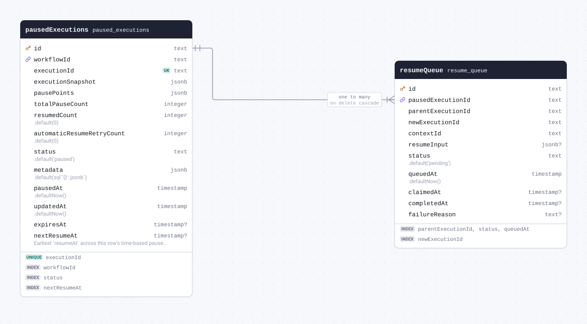

| Column                                      | Type        | Constraints                                               | Default               | Description |
| ------------------------------------------- | ----------- | --------------------------------------------------------- | --------------------- | ----------- |
| `id`                                        | `text`      | PK NOT NULL                                               |                       |             |
| `pausedExecutionId` (`paused_execution_id`) | `text`      | NOT NULL → [pausedExecutions.id](#table-pausedExecutions) |                       |             |
| `parentExecutionId` (`parent_execution_id`) | `text`      | NOT NULL                                                  |                       |             |
| `newExecutionId` (`new_execution_id`)       | `text`      | NOT NULL                                                  |                       |             |
| `contextId` (`context_id`)                  | `text`      | NOT NULL                                                  |                       |             |
| `resumeInput` (`resume_input`)              | `jsonb`     | NULL                                                      |                       |             |
| `status`                                    | `text`      | NOT NULL                                                  | `.default('pending')` |             |
| `queuedAt` (`queued_at`)                    | `timestamp` | NOT NULL                                                  | `.defaultNow()`       |             |
| `claimedAt` (`claimed_at`)                  | `timestamp` | NULL                                                      |                       |             |
| `completedAt` (`completed_at`)              | `timestamp` | NULL                                                      |                       |             |
| `failureReason` (`failure_reason`)          | `text`      | NULL                                                      |                       |             |

#### Definition

```sql
CREATE TABLE "resume_queue" (
	"id" text PRIMARY KEY,
	"paused_execution_id" text NOT NULL,
	"parent_execution_id" text NOT NULL,
	"new_execution_id" text NOT NULL,
	"context_id" text NOT NULL,
	"resume_input" jsonb,
	"status" text DEFAULT 'pending' NOT NULL,
	"queued_at" timestamp DEFAULT now() NOT NULL,
	"claimed_at" timestamp,
	"completed_at" timestamp,
	"failure_reason" text
);

CREATE INDEX "resume_queue_parent_status_idx" ON "resume_queue" ("parent_execution_id","status","queued_at");

CREATE INDEX "resume_queue_new_execution_idx" ON "resume_queue" ("new_execution_id");

ALTER TABLE "resume_queue" ADD CONSTRAINT "resume_queue_paused_execution_id_paused_executions_id_fkey" FOREIGN KEY ("paused_execution_id") REFERENCES "paused_executions"("id") ON DELETE CASCADE;
```

#### Indexes

- INDEX `parentExecutionId`, `status`, `queuedAt`
- INDEX `newExecutionId`

#### References

- `pausedExecutionId` → [pausedExecutions.id](#table-pausedExecutions) (many to one, on delete cascade)

<details>
<summary>Queries and their SQL</summary>

**Select**: Every row of resumeQueue.

```ts
db.select().from(resumeQueue);
```

```sql
select "id", "paused_execution_id", "parent_execution_id", "new_execution_id", "context_id", "resume_input", "status", "queued_at", "claimed_at", "completed_at", "failure_reason"
from "resume_queue"
```

**Count**: How many rows resumeQueue has.

```ts
db.select({ count: count() }).from(resumeQueue);
```

```sql
select count(*)
from "resume_queue"
```

**Find many**: The rows of resumeQueue, through the relational query API.

```ts
db.query.resumeQueue.findMany();
```

```sql
select "d0"."id" as "id", "d0"."paused_execution_id" as "pausedExecutionId", "d0"."parent_execution_id" as "parentExecutionId", "d0"."new_execution_id" as "newExecutionId", "d0"."context_id" as "contextId", "d0"."resume_input" as "resumeInput", "d0"."status" as "status", "d0"."queued_at" as "queuedAt", "d0"."claimed_at" as "claimedAt", "d0"."completed_at" as "completedAt", "d0"."failure_reason" as "failureReason"
from "resume_queue" as "d0"
```

**Find by primary key**: One row of resumeQueue, through the relational query API.

```ts
db.query.resumeQueue.findFirst({ where: { id: "id" } });
```

```sql
select "d0"."id" as "id", "d0"."paused_execution_id" as "pausedExecutionId", "d0"."parent_execution_id" as "parentExecutionId", "d0"."new_execution_id" as "newExecutionId", "d0"."context_id" as "contextId", "d0"."resume_input" as "resumeInput", "d0"."status" as "status", "d0"."queued_at" as "queuedAt", "d0"."claimed_at" as "claimedAt", "d0"."completed_at" as "completedAt", "d0"."failure_reason" as "failureReason"
from "resume_queue" as "d0"
where "d0"."id" = $1
limit $2
-- params: ["id",1]
```

**Insert**: Adds a row to resumeQueue, giving the columns that have no default.

```ts
db.insert(resumeQueue).values({
  id: "id",
  pausedExecutionId: "pausedExecutionId",
  parentExecutionId: "parentExecutionId",
  newExecutionId: "newExecutionId",
  contextId: "contextId",
});
```

```sql
insert into "resume_queue" ("id", "paused_execution_id", "parent_execution_id", "new_execution_id", "context_id", "resume_input", "status", "queued_at", "claimed_at", "completed_at", "failure_reason")
values ($1, $2, $3, $4, $5, default, default, default, default, default, default)
-- params: ["id","pausedExecutionId","parentExecutionId","newExecutionId","contextId"]
```

**Update**: Changes a row of resumeQueue, found by its primary key.

```ts
db.update(resumeQueue)
  .set({ pausedExecutionId: "pausedExecutionId" })
  .where(eq(resumeQueue.id, "id"));
```

```sql
update "resume_queue"
set "paused_execution_id" = $1
where "resume_queue"."id" = $2
-- params: ["pausedExecutionId","id"]
```

**Delete**: Deletes a row of resumeQueue, found by its primary key.

```ts
db.delete(resumeQueue).where(eq(resumeQueue.id, "id"));
```

```sql
delete from "resume_queue"
where "resume_queue"."id" = $1
-- params: ["id"]
```

</details>

<a id="table-clientCredentialToken"></a>

### clientCredentialToken

Table `client_credential_token`. Durable encrypted application permissions and tokens, plus expiring token-exchange failures.

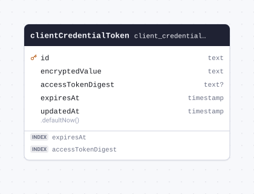

| Column                                      | Type        | Constraints | Default         | Description |
| ------------------------------------------- | ----------- | ----------- | --------------- | ----------- |
| `id`                                        | `text`      | PK NOT NULL |                 |             |
| `encryptedValue` (`encrypted_value`)        | `text`      | NOT NULL    |                 |             |
| `accessTokenDigest` (`access_token_digest`) | `text`      | NULL        |                 |             |
| `expiresAt` (`expires_at`)                  | `timestamp` | NOT NULL    |                 |             |
| `updatedAt` (`updated_at`)                  | `timestamp` | NOT NULL    | `.defaultNow()` |             |

#### Definition

```sql
CREATE TABLE "client_credential_token" (
	"id" text PRIMARY KEY,
	"encrypted_value" text NOT NULL,
	"access_token_digest" text,
	"expires_at" timestamp NOT NULL,
	"updated_at" timestamp DEFAULT now() NOT NULL
);

CREATE INDEX "client_credential_token_expires_at_idx" ON "client_credential_token" ("expires_at") WHERE "access_token_digest" IS NULL;

CREATE INDEX "client_credential_token_access_token_digest_idx" ON "client_credential_token" ("access_token_digest") WHERE "access_token_digest" IS NOT NULL;
```

#### Indexes

- INDEX `expiresAt`
- INDEX `accessTokenDigest`

<details>
<summary>Queries and their SQL</summary>

**Select**: Every row of clientCredentialToken.

```ts
db.select().from(clientCredentialToken);
```

```sql
select "id", "encrypted_value", "access_token_digest", "expires_at", "updated_at"
from "client_credential_token"
```

**Count**: How many rows clientCredentialToken has.

```ts
db.select({ count: count() }).from(clientCredentialToken);
```

```sql
select count(*)
from "client_credential_token"
```

**Find many**: The rows of clientCredentialToken, through the relational query API.

```ts
db.query.clientCredentialToken.findMany();
```

```sql
select "d0"."id" as "id", "d0"."encrypted_value" as "encryptedValue", "d0"."access_token_digest" as "accessTokenDigest", "d0"."expires_at" as "expiresAt", "d0"."updated_at" as "updatedAt"
from "client_credential_token" as "d0"
```

**Find by primary key**: One row of clientCredentialToken, through the relational query API.

```ts
db.query.clientCredentialToken.findFirst({ where: { id: "id" } });
```

```sql
select "d0"."id" as "id", "d0"."encrypted_value" as "encryptedValue", "d0"."access_token_digest" as "accessTokenDigest", "d0"."expires_at" as "expiresAt", "d0"."updated_at" as "updatedAt"
from "client_credential_token" as "d0"
where "d0"."id" = $1
limit $2
-- params: ["id",1]
```

**Insert**: Adds a row to clientCredentialToken, giving the columns that have no default.

```ts
db.insert(clientCredentialToken).values({
  id: "id",
  encryptedValue: "encryptedValue",
  expiresAt: new Date("2026-01-01T00:00:00.000Z"),
});
```

```sql
insert into "client_credential_token" ("id", "encrypted_value", "access_token_digest", "expires_at", "updated_at")
values ($1, $2, default, $3, default)
-- params: ["id","encryptedValue","2026-01-01T00:00:00.000Z"]
```

**Update**: Changes a row of clientCredentialToken, found by its primary key.

```ts
db.update(clientCredentialToken)
  .set({ encryptedValue: "encryptedValue" })
  .where(eq(clientCredentialToken.id, "id"));
```

```sql
update "client_credential_token"
set "encrypted_value" = $1
where "client_credential_token"."id" = $2
-- params: ["encryptedValue","id"]
```

**Delete**: Deletes a row of clientCredentialToken, found by its primary key.

```ts
db.delete(clientCredentialToken).where(eq(clientCredentialToken.id, "id"));
```

```sql
delete from "client_credential_token"
where "client_credential_token"."id" = $1
-- params: ["id"]
```

</details>

<a id="table-environment"></a>

### environment

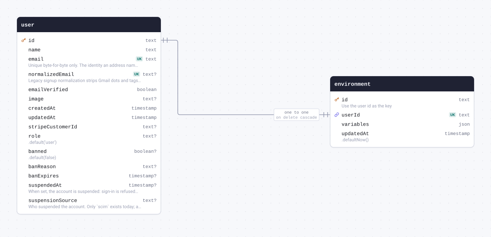

| Column                     | Type        | Constraints                              | Default         | Description                |
| -------------------------- | ----------- | ---------------------------------------- | --------------- | -------------------------- |
| `id`                       | `text`      | PK NOT NULL                              |                 | Use the user id as the key |
| `userId` (`user_id`)       | `text`      | UNIQUE NOT NULL → [user.id](#table-user) |                 |                            |
| `variables`                | `json`      | NOT NULL                                 |                 |                            |
| `updatedAt` (`updated_at`) | `timestamp` | NOT NULL                                 | `.defaultNow()` |                            |

#### Definition

```sql
CREATE TABLE "environment" (
	"id" text PRIMARY KEY,
	"user_id" text NOT NULL UNIQUE,
	"variables" json NOT NULL,
	"updated_at" timestamp DEFAULT now() NOT NULL
);

ALTER TABLE "environment" ADD CONSTRAINT "environment_user_id_user_id_fkey" FOREIGN KEY ("user_id") REFERENCES "user"("id") ON DELETE CASCADE;
```

#### References

- `userId` → [user.id](#table-user) (one to one, on delete cascade)

<details>
<summary>Queries and their SQL</summary>

**Select**: Every row of environment.

```ts
db.select().from(environment);
```

```sql
select "id", "user_id", "variables", "updated_at"
from "environment"
```

**Count**: How many rows environment has.

```ts
db.select({ count: count() }).from(environment);
```

```sql
select count(*)
from "environment"
```

**Find many**: The rows of environment, through the relational query API.

```ts
db.query.environment.findMany();
```

```sql
select "d0"."id" as "id", "d0"."user_id" as "userId", "d0"."variables" as "variables", "d0"."updated_at" as "updatedAt"
from "environment" as "d0"
```

**Find by primary key**: One row of environment, through the relational query API.

```ts
db.query.environment.findFirst({ where: { id: "id" } });
```

```sql
select "d0"."id" as "id", "d0"."user_id" as "userId", "d0"."variables" as "variables", "d0"."updated_at" as "updatedAt"
from "environment" as "d0"
where "d0"."id" = $1
limit $2
-- params: ["id",1]
```

**Insert**: Adds a row to environment, giving the columns that have no default.

```ts
db.insert(environment).values({ id: "id", userId: "userId", variables: {} });
```

```sql
insert into "environment" ("id", "user_id", "variables", "updated_at")
values ($1, $2, $3, default)
-- params: ["id","userId",{}]
```

**Update**: Changes a row of environment, found by its primary key.

```ts
db.update(environment).set({ userId: "userId" }).where(eq(environment.id, "id"));
```

```sql
update "environment"
set "user_id" = $1
where "environment"."id" = $2
-- params: ["userId","id"]
```

**Delete**: Deletes a row of environment, found by its primary key.

```ts
db.delete(environment).where(eq(environment.id, "id"));
```

```sql
delete from "environment"
where "environment"."id" = $1
-- params: ["id"]
```

</details>

<a id="table-organizationSecretSource"></a>

### organizationSecretSource

Table `organization_secret_source`. Generic Secrets source configuration, independent of indexed/searchable connectors.

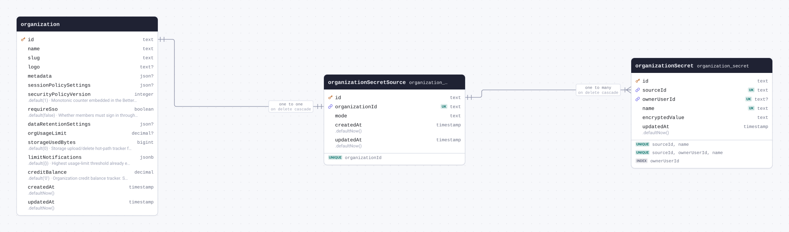

| Column                               | Type        | Constraints                                       | Default         | Description |
| ------------------------------------ | ----------- | ------------------------------------------------- | --------------- | ----------- |
| `id`                                 | `text`      | PK NOT NULL                                       |                 |             |
| `organizationId` (`organization_id`) | `text`      | NOT NULL → [organization.id](#table-organization) |                 |             |
| `mode`                               | `text`      | NOT NULL                                          |                 |             |
| `createdAt` (`created_at`)           | `timestamp` | NOT NULL                                          | `.defaultNow()` |             |
| `updatedAt` (`updated_at`)           | `timestamp` | NOT NULL                                          | `.defaultNow()` |             |

#### Definition

```sql
CREATE TABLE "organization_secret_source" (
	"id" text PRIMARY KEY,
	"organization_id" text NOT NULL,
	"mode" text NOT NULL,
	"created_at" timestamp DEFAULT now() NOT NULL,
	"updated_at" timestamp DEFAULT now() NOT NULL,
	CONSTRAINT "organization_secret_source_mode_check" CHECK ("mode" IN ('organization', 'member'))
);

CREATE UNIQUE INDEX "organization_secret_source_org_unique" ON "organization_secret_source" ("organization_id");

ALTER TABLE "organization_secret_source" ADD CONSTRAINT "organization_secret_source_organization_id_organization_id_fkey" FOREIGN KEY ("organization_id") REFERENCES "organization"("id") ON DELETE CASCADE;
```

#### Indexes

- UNIQUE `organizationId`

#### References

- `organizationId` → [organization.id](#table-organization) (one to one, on delete cascade)

#### Referenced by

- `id` → [organizationSecret.sourceId](#table-organizationSecret) (one to many, on delete cascade)

<details>
<summary>Queries and their SQL</summary>

**Select**: Every row of organizationSecretSource.

```ts
db.select().from(organizationSecretSource);
```

```sql
select "id", "organization_id", "mode", "created_at", "updated_at"
from "organization_secret_source"
```

**Count**: How many rows organizationSecretSource has.

```ts
db.select({ count: count() }).from(organizationSecretSource);
```

```sql
select count(*)
from "organization_secret_source"
```

**Find many**: The rows of organizationSecretSource, through the relational query API.

```ts
db.query.organizationSecretSource.findMany();
```

```sql
select "d0"."id" as "id", "d0"."organization_id" as "organizationId", "d0"."mode" as "mode", "d0"."created_at" as "createdAt", "d0"."updated_at" as "updatedAt"
from "organization_secret_source" as "d0"
```

**Find by primary key**: One row of organizationSecretSource, through the relational query API.

```ts
db.query.organizationSecretSource.findFirst({ where: { id: "id" } });
```

```sql
select "d0"."id" as "id", "d0"."organization_id" as "organizationId", "d0"."mode" as "mode", "d0"."created_at" as "createdAt", "d0"."updated_at" as "updatedAt"
from "organization_secret_source" as "d0"
where "d0"."id" = $1
limit $2
-- params: ["id",1]
```

**Insert**: Adds a row to organizationSecretSource, giving the columns that have no default.

```ts
db.insert(organizationSecretSource).values({
  id: "id",
  organizationId: "organizationId",
  mode: "mode",
});
```

```sql
insert into "organization_secret_source" ("id", "organization_id", "mode", "created_at", "updated_at")
values ($1, $2, $3, default, default)
-- params: ["id","organizationId","mode"]
```

**Update**: Changes a row of organizationSecretSource, found by its primary key.

```ts
db.update(organizationSecretSource)
  .set({ organizationId: "organizationId" })
  .where(eq(organizationSecretSource.id, "id"));
```

```sql
update "organization_secret_source"
set "organization_id" = $1
where "organization_secret_source"."id" = $2
-- params: ["organizationId","id"]
```

**Delete**: Deletes a row of organizationSecretSource, found by its primary key.

```ts
db.delete(organizationSecretSource).where(eq(organizationSecretSource.id, "id"));
```

```sql
delete from "organization_secret_source"
where "organization_secret_source"."id" = $1
-- params: ["id"]
```

</details>

<a id="table-organizationSecret"></a>

### organizationSecret

Table `organization_secret`. Ciphertext only; a null owner denotes the organization's shared environment.

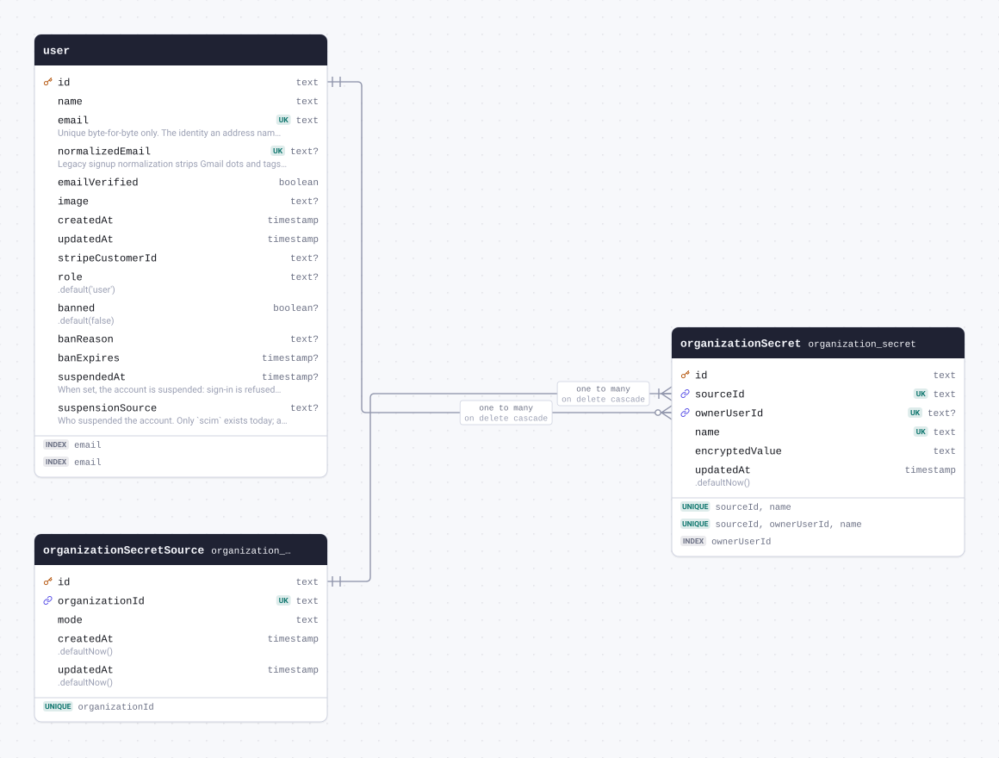

| Column                               | Type        | Constraints                                                               | Default         | Description |
| ------------------------------------ | ----------- | ------------------------------------------------------------------------- | --------------- | ----------- |
| `id`                                 | `text`      | PK NOT NULL                                                               |                 |             |
| `sourceId` (`source_id`)             | `text`      | NOT NULL → [organizationSecretSource.id](#table-organizationSecretSource) |                 |             |
| `ownerUserId` (`owner_user_id`)      | `text`      | NULL → [user.id](#table-user)                                             |                 |             |
| `name`                               | `text`      | NOT NULL                                                                  |                 |             |
| `encryptedValue` (`encrypted_value`) | `text`      | NOT NULL                                                                  |                 |             |
| `updatedAt` (`updated_at`)           | `timestamp` | NOT NULL                                                                  | `.defaultNow()` |             |

#### Definition

```sql
CREATE TABLE "organization_secret" (
	"id" text PRIMARY KEY,
	"source_id" text NOT NULL,
	"owner_user_id" text,
	"name" text NOT NULL,
	"encrypted_value" text NOT NULL,
	"updated_at" timestamp DEFAULT now() NOT NULL
);

CREATE UNIQUE INDEX "organization_secret_shared_unique" ON "organization_secret" ("source_id","name") WHERE "owner_user_id" IS NULL;

CREATE UNIQUE INDEX "organization_secret_member_unique" ON "organization_secret" ("source_id","owner_user_id","name") WHERE "owner_user_id" IS NOT NULL;

CREATE INDEX "organization_secret_owner_idx" ON "organization_secret" ("owner_user_id");

ALTER TABLE "organization_secret" ADD CONSTRAINT "organization_secret_OGs03UvwX6IF_fkey" FOREIGN KEY ("source_id") REFERENCES "organization_secret_source"("id") ON DELETE CASCADE;

ALTER TABLE "organization_secret" ADD CONSTRAINT "organization_secret_owner_user_id_user_id_fkey" FOREIGN KEY ("owner_user_id") REFERENCES "user"("id") ON DELETE CASCADE;
```

#### Indexes

- UNIQUE `sourceId`, `name`
- UNIQUE `sourceId`, `ownerUserId`, `name`
- INDEX `ownerUserId`

#### References

- `sourceId` → [organizationSecretSource.id](#table-organizationSecretSource) (many to one, on delete cascade)
- `ownerUserId` → [user.id](#table-user) (many to one, on delete cascade)

<details>
<summary>Queries and their SQL</summary>

**Select**: Every row of organizationSecret.

```ts
db.select().from(organizationSecret);
```

```sql
select "id", "source_id", "owner_user_id", "name", "encrypted_value", "updated_at"
from "organization_secret"
```

**Count**: How many rows organizationSecret has.

```ts
db.select({ count: count() }).from(organizationSecret);
```

```sql
select count(*)
from "organization_secret"
```

**Find many**: The rows of organizationSecret, through the relational query API.

```ts
db.query.organizationSecret.findMany();
```

```sql
select "d0"."id" as "id", "d0"."source_id" as "sourceId", "d0"."owner_user_id" as "ownerUserId", "d0"."name" as "name", "d0"."encrypted_value" as "encryptedValue", "d0"."updated_at" as "updatedAt"
from "organization_secret" as "d0"
```

**Find by primary key**: One row of organizationSecret, through the relational query API.

```ts
db.query.organizationSecret.findFirst({ where: { id: "id" } });
```

```sql
select "d0"."id" as "id", "d0"."source_id" as "sourceId", "d0"."owner_user_id" as "ownerUserId", "d0"."name" as "name", "d0"."encrypted_value" as "encryptedValue", "d0"."updated_at" as "updatedAt"
from "organization_secret" as "d0"
where "d0"."id" = $1
limit $2
-- params: ["id",1]
```

**Insert**: Adds a row to organizationSecret, giving the columns that have no default.

```ts
db.insert(organizationSecret).values({
  id: "id",
  sourceId: "sourceId",
  name: "name",
  encryptedValue: "encryptedValue",
});
```

```sql
insert into "organization_secret" ("id", "source_id", "owner_user_id", "name", "encrypted_value", "updated_at")
values ($1, $2, default, $3, $4, default)
-- params: ["id","sourceId","name","encryptedValue"]
```

**Update**: Changes a row of organizationSecret, found by its primary key.

```ts
db.update(organizationSecret).set({ sourceId: "sourceId" }).where(eq(organizationSecret.id, "id"));
```

```sql
update "organization_secret"
set "source_id" = $1
where "organization_secret"."id" = $2
-- params: ["sourceId","id"]
```

**Delete**: Deletes a row of organizationSecret, found by its primary key.

```ts
db.delete(organizationSecret).where(eq(organizationSecret.id, "id"));
```

```sql
delete from "organization_secret"
where "organization_secret"."id" = $1
-- params: ["id"]
```

</details>

<a id="table-simLink"></a>

### simLink

Table `sim_link`. An organization's Sim links (go links): `sim/<name>` redirects members to `url`. Names match case- and punctuation-insensitively through `normalized_name`. `{*}` in `url` marks a variable link filled from the path after the name, and `default_url` serves a variable link opened without values. `visit_count` counts redirects.

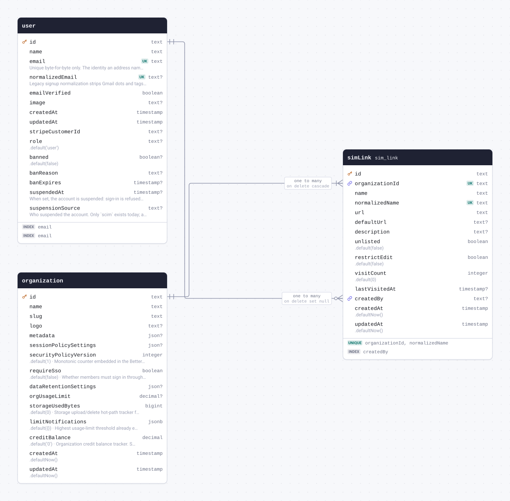

| Column                               | Type        | Constraints                                       | Default           | Description |
| ------------------------------------ | ----------- | ------------------------------------------------- | ----------------- | ----------- |
| `id`                                 | `text`      | PK NOT NULL                                       |                   |             |
| `organizationId` (`organization_id`) | `text`      | NOT NULL → [organization.id](#table-organization) |                   |             |
| `name`                               | `text`      | NOT NULL                                          |                   |             |
| `normalizedName` (`normalized_name`) | `text`      | NOT NULL                                          |                   |             |
| `url`                                | `text`      | NOT NULL                                          |                   |             |
| `defaultUrl` (`default_url`)         | `text`      | NULL                                              |                   |             |
| `description`                        | `text`      | NULL                                              |                   |             |
| `unlisted`                           | `boolean`   | NOT NULL                                          | `.default(false)` |             |
| `restrictEdit` (`restrict_edit`)     | `boolean`   | NOT NULL                                          | `.default(false)` |             |
| `visitCount` (`visit_count`)         | `integer`   | NOT NULL                                          | `.default(0)`     |             |
| `lastVisitedAt` (`last_visited_at`)  | `timestamp` | NULL                                              |                   |             |
| `createdBy` (`created_by`)           | `text`      | NULL → [user.id](#table-user)                     |                   |             |
| `createdAt` (`created_at`)           | `timestamp` | NOT NULL                                          | `.defaultNow()`   |             |
| `updatedAt` (`updated_at`)           | `timestamp` | NOT NULL                                          | `.defaultNow()`   |             |

#### Definition

```sql
CREATE TABLE "sim_link" (
	"id" text PRIMARY KEY,
	"organization_id" text NOT NULL,
	"name" text NOT NULL,
	"normalized_name" text NOT NULL,
	"url" text NOT NULL,
	"default_url" text,
	"description" text,
	"unlisted" boolean DEFAULT false NOT NULL,
	"restrict_edit" boolean DEFAULT false NOT NULL,
	"visit_count" integer DEFAULT 0 NOT NULL,
	"last_visited_at" timestamp,
	"created_by" text,
	"created_at" timestamp DEFAULT now() NOT NULL,
	"updated_at" timestamp DEFAULT now() NOT NULL
);

CREATE UNIQUE INDEX "sim_link_organization_name_unique" ON "sim_link" ("organization_id","normalized_name");

CREATE INDEX "sim_link_created_by_idx" ON "sim_link" ("created_by");

ALTER TABLE "sim_link" ADD CONSTRAINT "sim_link_organization_id_organization_id_fkey" FOREIGN KEY ("organization_id") REFERENCES "organization"("id") ON DELETE CASCADE;

ALTER TABLE "sim_link" ADD CONSTRAINT "sim_link_created_by_user_id_fkey" FOREIGN KEY ("created_by") REFERENCES "user"("id") ON DELETE SET NULL;
```

#### Indexes

- UNIQUE `organizationId`, `normalizedName`
- INDEX `createdBy`

#### References

- `organizationId` → [organization.id](#table-organization) (many to one, on delete cascade)
- `createdBy` → [user.id](#table-user) (many to one, on delete set null)

<details>
<summary>Queries and their SQL</summary>

**Select**: Every row of simLink.

```ts
db.select().from(simLink);
```

```sql
select "id", "organization_id", "name", "normalized_name", "url", "default_url", "description", "unlisted", "restrict_edit", "visit_count", "last_visited_at", "created_by", "created_at", "updated_at"
from "sim_link"
```

**Count**: How many rows simLink has.

```ts
db.select({ count: count() }).from(simLink);
```

```sql
select count(*)
from "sim_link"
```

**Find many**: The rows of simLink, through the relational query API.

```ts
db.query.simLink.findMany();
```

```sql
select "d0"."id" as "id", "d0"."organization_id" as "organizationId", "d0"."name" as "name", "d0"."normalized_name" as "normalizedName", "d0"."url" as "url", "d0"."default_url" as "defaultUrl", "d0"."description" as "description", "d0"."unlisted" as "unlisted", "d0"."restrict_edit" as "restrictEdit", "d0"."visit_count" as "visitCount", "d0"."last_visited_at" as "lastVisitedAt", "d0"."created_by" as "createdBy", "d0"."created_at" as "createdAt", "d0"."updated_at" as "updatedAt"
from "sim_link" as "d0"
```

**Find by primary key**: One row of simLink, through the relational query API.

```ts
db.query.simLink.findFirst({ where: { id: "id" } });
```

```sql
select "d0"."id" as "id", "d0"."organization_id" as "organizationId", "d0"."name" as "name", "d0"."normalized_name" as "normalizedName", "d0"."url" as "url", "d0"."default_url" as "defaultUrl", "d0"."description" as "description", "d0"."unlisted" as "unlisted", "d0"."restrict_edit" as "restrictEdit", "d0"."visit_count" as "visitCount", "d0"."last_visited_at" as "lastVisitedAt", "d0"."created_by" as "createdBy", "d0"."created_at" as "createdAt", "d0"."updated_at" as "updatedAt"
from "sim_link" as "d0"
where "d0"."id" = $1
limit $2
-- params: ["id",1]
```

**Insert**: Adds a row to simLink, giving the columns that have no default.

```ts
db.insert(simLink).values({
  id: "id",
  organizationId: "organizationId",
  name: "name",
  normalizedName: "normalizedName",
  url: "url",
});
```

```sql
insert into "sim_link" ("id", "organization_id", "name", "normalized_name", "url", "default_url", "description", "unlisted", "restrict_edit", "visit_count", "last_visited_at", "created_by", "created_at", "updated_at")
values ($1, $2, $3, $4, $5, default, default, default, default, default, default, default, default, default)
-- params: ["id","organizationId","name","normalizedName","url"]
```

**Update**: Changes a row of simLink, found by its primary key.

```ts
db.update(simLink).set({ organizationId: "organizationId" }).where(eq(simLink.id, "id"));
```

```sql
update "sim_link"
set "organization_id" = $1
where "sim_link"."id" = $2
-- params: ["organizationId","id"]
```

**Delete**: Deletes a row of simLink, found by its primary key.

```ts
db.delete(simLink).where(eq(simLink.id, "id"));
```

```sql
delete from "sim_link"
where "sim_link"."id" = $1
-- params: ["id"]
```

</details>

<a id="table-workspaceEnvironment"></a>

### workspaceEnvironment

Table `workspace_environment`.

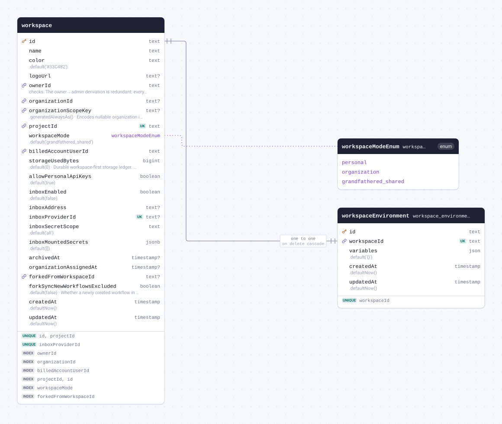

| Column                         | Type        | Constraints                                 | Default          | Description |
| ------------------------------ | ----------- | ------------------------------------------- | ---------------- | ----------- |
| `id`                           | `text`      | PK NOT NULL                                 |                  |             |
| `workspaceId` (`workspace_id`) | `text`      | NOT NULL → [workspace.id](#table-workspace) |                  |             |
| `variables`                    | `json`      | NOT NULL                                    | `.default('{}')` |             |
| `createdAt` (`created_at`)     | `timestamp` | NOT NULL                                    | `.defaultNow()`  |             |
| `updatedAt` (`updated_at`)     | `timestamp` | NOT NULL                                    | `.defaultNow()`  |             |

#### Definition

```sql
CREATE TABLE "workspace_environment" (
	"id" text PRIMARY KEY,
	"workspace_id" text NOT NULL,
	"variables" json DEFAULT '"{}"' NOT NULL,
	"created_at" timestamp DEFAULT now() NOT NULL,
	"updated_at" timestamp DEFAULT now() NOT NULL
);

CREATE UNIQUE INDEX "workspace_environment_workspace_unique" ON "workspace_environment" ("workspace_id");

ALTER TABLE "workspace_environment" ADD CONSTRAINT "workspace_environment_workspace_id_workspace_id_fkey" FOREIGN KEY ("workspace_id") REFERENCES "workspace"("id") ON DELETE CASCADE;
```

#### Indexes

- UNIQUE `workspaceId`

#### References

- `workspaceId` → [workspace.id](#table-workspace) (one to one, on delete cascade)

<details>
<summary>Queries and their SQL</summary>

**Select**: Every row of workspaceEnvironment.

```ts
db.select().from(workspaceEnvironment);
```

```sql
select "id", "workspace_id", "variables", "created_at", "updated_at"
from "workspace_environment"
```

**Count**: How many rows workspaceEnvironment has.

```ts
db.select({ count: count() }).from(workspaceEnvironment);
```

```sql
select count(*)
from "workspace_environment"
```

**Find many**: The rows of workspaceEnvironment, through the relational query API.

```ts
db.query.workspaceEnvironment.findMany();
```

```sql
select "d0"."id" as "id", "d0"."workspace_id" as "workspaceId", "d0"."variables" as "variables", "d0"."created_at" as "createdAt", "d0"."updated_at" as "updatedAt"
from "workspace_environment" as "d0"
```

**Find by primary key**: One row of workspaceEnvironment, through the relational query API.

```ts
db.query.workspaceEnvironment.findFirst({ where: { id: "id" } });
```

```sql
select "d0"."id" as "id", "d0"."workspace_id" as "workspaceId", "d0"."variables" as "variables", "d0"."created_at" as "createdAt", "d0"."updated_at" as "updatedAt"
from "workspace_environment" as "d0"
where "d0"."id" = $1
limit $2
-- params: ["id",1]
```

**Insert**: Adds a row to workspaceEnvironment, giving the columns that have no default.

```ts
db.insert(workspaceEnvironment).values({ id: "id", workspaceId: "workspaceId" });
```

```sql
insert into "workspace_environment" ("id", "workspace_id", "variables", "created_at", "updated_at")
values ($1, $2, default, default, default)
-- params: ["id","workspaceId"]
```

**Update**: Changes a row of workspaceEnvironment, found by its primary key.

```ts
db.update(workspaceEnvironment)
  .set({ workspaceId: "workspaceId" })
  .where(eq(workspaceEnvironment.id, "id"));
```

```sql
update "workspace_environment"
set "workspace_id" = $1
where "workspace_environment"."id" = $2
-- params: ["workspaceId","id"]
```

**Delete**: Deletes a row of workspaceEnvironment, found by its primary key.

```ts
db.delete(workspaceEnvironment).where(eq(workspaceEnvironment.id, "id"));
```

```sql
delete from "workspace_environment"
where "workspace_environment"."id" = $1
-- params: ["id"]
```

</details>

<a id="table-secretUsage"></a>

### secretUsage

Table `secret_usage`. Per-day rollup of which secrets a run actually resolved. Execution logs cannot answer this. They persist the whole _available_ encrypted environment rather than what a run referenced, they only evidence a secret where value-matching redaction happened to fire, and they expire under `DataRetentionSettings.logRetentionHours`. A secret's usage trail has to outlive its runs' logs, so it is written here instead of derived from them. Rows are a rollup rather than one per run: a workflow on a one-minute schedule touching three secrets would otherwise write thousands of rows a day, which is also why this is not `audit_log` — that table is a human-scale compliance surface and machine-scale rows would drown it. `secretScope` and `secretOwnerUserId` are part of the key because a workspace secret and a personal secret can share a name — as can two people's personal secrets — and none of them may merge. `lastTriggeredByUserId` is deliberately _not_ in the key: a public endpoint called by many people would otherwise fragment one bucket per caller.

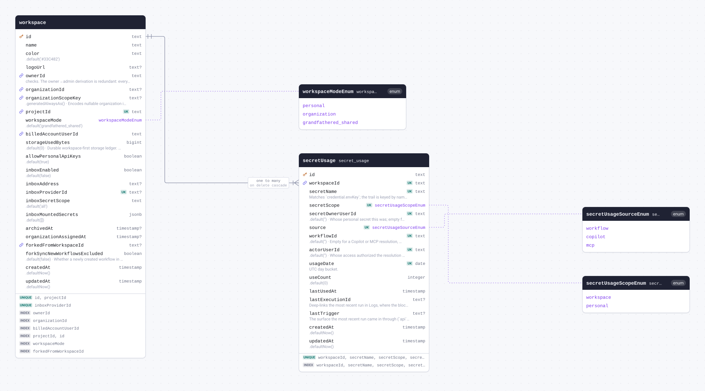

| Column                                       | Type                                                   | Constraints                                 | Default         | Description                                                                                                                                                                                                                                                                                                                                                                                                                                                                                                                                                                                                                                                                                                                                                                                                                                                                  |
| -------------------------------------------- | ------------------------------------------------------ | ------------------------------------------- | --------------- | ---------------------------------------------------------------------------------------------------------------------------------------------------------------------------------------------------------------------------------------------------------------------------------------------------------------------------------------------------------------------------------------------------------------------------------------------------------------------------------------------------------------------------------------------------------------------------------------------------------------------------------------------------------------------------------------------------------------------------------------------------------------------------------------------------------------------------------------------------------------------------- |
| `id`                                         | `text`                                                 | PK NOT NULL                                 |                 |                                                                                                                                                                                                                                                                                                                                                                                                                                                                                                                                                                                                                                                                                                                                                                                                                                                                              |
| `workspaceId` (`workspace_id`)               | `text`                                                 | NOT NULL → [workspace.id](#table-workspace) |                 |                                                                                                                                                                                                                                                                                                                                                                                                                                                                                                                                                                                                                                                                                                                                                                                                                                                                              |
| `secretName` (`secret_name`)                 | `text`                                                 | NOT NULL                                    |                 | Matches `credential.envKey`; the trail is keyed by name, not by credential row.                                                                                                                                                                                                                                                                                                                                                                                                                                                                                                                                                                                                                                                                                                                                                                                              |
| `secretScope` (`secret_scope`)               | [`secretUsageScopeEnum`](#enum-secretUsageScopeEnum)   | NOT NULL                                    |                 |                                                                                                                                                                                                                                                                                                                                                                                                                                                                                                                                                                                                                                                                                                                                                                                                                                                                              |
| `secretOwnerUserId` (`secret_owner_user_id`) | `text`                                                 | NOT NULL                                    | `.default('')`  | Whose personal secret this was; empty for a workspace one, which the workspace owns. Two people can hold personal secrets under the same name, and a personal secret shared with the workspace resolves for callers who do not own it, so name and scope alone do not identify a secret. Without this column one person's trail would show another's runs. Not the same as `actorUserId`: a scheduled run resolves the workflow owner's personal slice under the workspace's execution actor.                                                                                                                                                                                                                                                                                                                                                                                |
| `source`                                     | [`secretUsageSourceEnum`](#enum-secretUsageSourceEnum) | NOT NULL                                    |                 |                                                                                                                                                                                                                                                                                                                                                                                                                                                                                                                                                                                                                                                                                                                                                                                                                                                                              |
| `workflowId` (`workflow_id`)                 | `text`                                                 | NOT NULL                                    | `.default('')`  | Empty for a Copilot or MCP resolution, which has no workflow. Empty string rather than null because both this and `actorUserId` sit inside the unique key below, and Postgres treats nulls as distinct — two Copilot rows would never collide, so the upsert would insert forever instead of incrementing. A sentinel keeps the upsert identity explicit and null-free rather than relying on nullable uniqueness semantics. Deliberately not a foreign key, and neither is `actorUserId`. An `onDelete: 'set null'` would rewrite a key column, so two rows differing only by the deleted id would collide and an ordinary workflow or account deletion would fail on this constraint. They are historical facts in a usage ledger rather than live references, so they are stored as plain ids and joined leniently; a row outliving its workflow is the point of a trail. |
| `actorUserId` (`actor_user_id`)              | `text`                                                 | NOT NULL                                    | `.default('')`  | Whose access authorized the resolution — the run's actor; empty when there is none.                                                                                                                                                                                                                                                                                                                                                                                                                                                                                                                                                                                                                                                                                                                                                                                          |
| `usageDate` (`usage_date`)                   | `date`                                                 | NOT NULL                                    |                 | UTC day bucket.                                                                                                                                                                                                                                                                                                                                                                                                                                                                                                                                                                                                                                                                                                                                                                                                                                                              |
| `useCount` (`use_count`)                     | `integer`                                              | NOT NULL                                    | `.default(0)`   |                                                                                                                                                                                                                                                                                                                                                                                                                                                                                                                                                                                                                                                                                                                                                                                                                                                                              |
| `lastUsedAt` (`last_used_at`)                | `timestamp`                                            | NOT NULL                                    |                 |                                                                                                                                                                                                                                                                                                                                                                                                                                                                                                                                                                                                                                                                                                                                                                                                                                                                              |
| `lastExecutionId` (`last_execution_id`)      | `text`                                                 | NULL                                        |                 | Deep-links the most recent run in Logs, where the block and its code are visible.                                                                                                                                                                                                                                                                                                                                                                                                                                                                                                                                                                                                                                                                                                                                                                                            |
| `lastTrigger` (`last_trigger`)               | `text`                                                 | NULL                                        |                 | The surface the most recent run came in through (`api`, `webhook`, `schedule`, `manual`, `chat`, `copilot`). There is deliberately no separate "triggered by" column: for every trigger kind the executor can name a caller, that caller _is_ `actorUserId`, and for the rest (schedule, webhook, workspace key) no human triggered the run at all.                                                                                                                                                                                                                                                                                                                                                                                                                                                                                                                          |
| `createdAt` (`created_at`)                   | `timestamp`                                            | NOT NULL                                    | `.defaultNow()` |                                                                                                                                                                                                                                                                                                                                                                                                                                                                                                                                                                                                                                                                                                                                                                                                                                                                              |
| `updatedAt` (`updated_at`)                   | `timestamp`                                            | NOT NULL                                    | `.defaultNow()` |                                                                                                                                                                                                                                                                                                                                                                                                                                                                                                                                                                                                                                                                                                                                                                                                                                                                              |

#### Definition

```sql
CREATE TABLE "secret_usage" (
	"id" text PRIMARY KEY,
	"workspace_id" text NOT NULL,
	"secret_name" text NOT NULL,
	"secret_scope" "secret_usage_scope" NOT NULL,
	"secret_owner_user_id" text DEFAULT '' NOT NULL,
	"source" "secret_usage_source" NOT NULL,
	"workflow_id" text DEFAULT '' NOT NULL,
	"actor_user_id" text DEFAULT '' NOT NULL,
	"usage_date" date NOT NULL,
	"use_count" integer DEFAULT 0 NOT NULL,
	"last_used_at" timestamp NOT NULL,
	"last_execution_id" text,
	"last_trigger" text,
	"created_at" timestamp DEFAULT now() NOT NULL,
	"updated_at" timestamp DEFAULT now() NOT NULL
);

CREATE UNIQUE INDEX "secret_usage_bucket_unique" ON "secret_usage" ("workspace_id","secret_name","secret_scope","secret_owner_user_id","source","workflow_id","actor_user_id","usage_date");

CREATE INDEX "secret_usage_secret_recent_idx" ON "secret_usage" ("workspace_id","secret_name","secret_scope","secret_owner_user_id","last_used_at" DESC NULLS LAST);

ALTER TABLE "secret_usage" ADD CONSTRAINT "secret_usage_workspace_id_workspace_id_fkey" FOREIGN KEY ("workspace_id") REFERENCES "workspace"("id") ON DELETE CASCADE;
```

#### Indexes

- UNIQUE `workspaceId`, `secretName`, `secretScope`, `secretOwnerUserId`, `source`, `workflowId`, `actorUserId`, `usageDate`
- INDEX `workspaceId`, `secretName`, `secretScope`, `secretOwnerUserId`, `lastUsedAt`

#### References

- `workspaceId` → [workspace.id](#table-workspace) (many to one, on delete cascade)

<details>
<summary>Queries and their SQL</summary>

**Select**: Every row of secretUsage.

```ts
db.select().from(secretUsage);
```

```sql
select "id", "workspace_id", "secret_name", "secret_scope", "secret_owner_user_id", "source", "workflow_id", "actor_user_id", "usage_date", "use_count", "last_used_at", "last_execution_id", "last_trigger", "created_at", "updated_at"
from "secret_usage"
```

**Count**: How many rows secretUsage has.

```ts
db.select({ count: count() }).from(secretUsage);
```

```sql
select count(*)
from "secret_usage"
```

**Find many**: The rows of secretUsage, through the relational query API.

```ts
db.query.secretUsage.findMany();
```

```sql
select "d0"."id" as "id", "d0"."workspace_id" as "workspaceId", "d0"."secret_name" as "secretName", "d0"."secret_scope" as "secretScope", "d0"."secret_owner_user_id" as "secretOwnerUserId", "d0"."source" as "source", "d0"."workflow_id" as "workflowId", "d0"."actor_user_id" as "actorUserId", "d0"."usage_date" as "usageDate", "d0"."use_count" as "useCount", "d0"."last_used_at" as "lastUsedAt", "d0"."last_execution_id" as "lastExecutionId", "d0"."last_trigger" as "lastTrigger", "d0"."created_at" as "createdAt", "d0"."updated_at" as "updatedAt"
from "secret_usage" as "d0"
```

**Find by primary key**: One row of secretUsage, through the relational query API.

```ts
db.query.secretUsage.findFirst({ where: { id: "id" } });
```

```sql
select "d0"."id" as "id", "d0"."workspace_id" as "workspaceId", "d0"."secret_name" as "secretName", "d0"."secret_scope" as "secretScope", "d0"."secret_owner_user_id" as "secretOwnerUserId", "d0"."source" as "source", "d0"."workflow_id" as "workflowId", "d0"."actor_user_id" as "actorUserId", "d0"."usage_date" as "usageDate", "d0"."use_count" as "useCount", "d0"."last_used_at" as "lastUsedAt", "d0"."last_execution_id" as "lastExecutionId", "d0"."last_trigger" as "lastTrigger", "d0"."created_at" as "createdAt", "d0"."updated_at" as "updatedAt"
from "secret_usage" as "d0"
where "d0"."id" = $1
limit $2
-- params: ["id",1]
```

**Insert**: Adds a row to secretUsage, giving the columns that have no default.

```ts
db.insert(secretUsage).values({
  id: "id",
  workspaceId: "workspaceId",
  secretName: "secretName",
  secretScope: "workspace",
  source: "workflow",
  usageDate: new Date("2026-01-01T00:00:00.000Z"),
  lastUsedAt: new Date("2026-01-01T00:00:00.000Z"),
});
```

```sql
insert into "secret_usage" ("id", "workspace_id", "secret_name", "secret_scope", "secret_owner_user_id", "source", "workflow_id", "actor_user_id", "usage_date", "use_count", "last_used_at", "last_execution_id", "last_trigger", "created_at", "updated_at")
values ($1, $2, $3, $4, default, $5, default, default, $6, default, $7, default, default, default, default)
-- params: ["id","workspaceId","secretName","workspace","workflow","2026-01-01T00:00:00.000Z","2026-01-01T00:00:00.000Z"]
```

**Update**: Changes a row of secretUsage, found by its primary key.

```ts
db.update(secretUsage).set({ workspaceId: "workspaceId" }).where(eq(secretUsage.id, "id"));
```

```sql
update "secret_usage"
set "workspace_id" = $1
where "secret_usage"."id" = $2
-- params: ["workspaceId","id"]
```

**Delete**: Deletes a row of secretUsage, found by its primary key.

```ts
db.delete(secretUsage).where(eq(secretUsage.id, "id"));
```

```sql
delete from "secret_usage"
where "secret_usage"."id" = $1
-- params: ["id"]
```

</details>

<a id="table-workspaceBYOKKeys"></a>

### workspaceBYOKKeys

Table `workspace_byok_keys`.

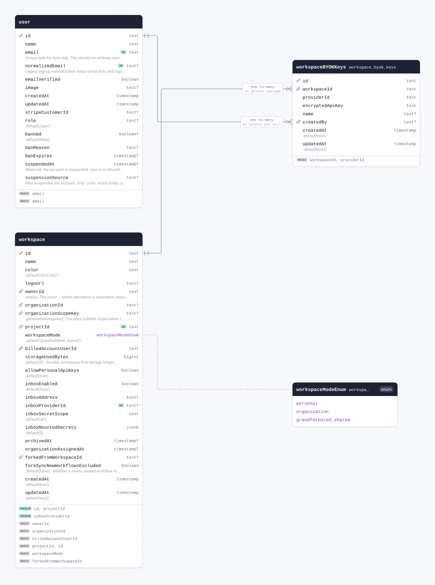

| Column                                  | Type        | Constraints                                 | Default         | Description |
| --------------------------------------- | ----------- | ------------------------------------------- | --------------- | ----------- |
| `id`                                    | `text`      | PK NOT NULL                                 |                 |             |
| `workspaceId` (`workspace_id`)          | `text`      | NOT NULL → [workspace.id](#table-workspace) |                 |             |
| `providerId` (`provider_id`)            | `text`      | NOT NULL                                    |                 |             |
| `encryptedApiKey` (`encrypted_api_key`) | `text`      | NOT NULL                                    |                 |             |
| `name`                                  | `text`      | NULL                                        |                 |             |
| `createdBy` (`created_by`)              | `text`      | NULL → [user.id](#table-user)               |                 |             |
| `createdAt` (`created_at`)              | `timestamp` | NOT NULL                                    | `.defaultNow()` |             |
| `updatedAt` (`updated_at`)              | `timestamp` | NOT NULL                                    | `.defaultNow()` |             |

#### Definition

```sql
CREATE TABLE "workspace_byok_keys" (
	"id" text PRIMARY KEY,
	"workspace_id" text NOT NULL,
	"provider_id" text NOT NULL,
	"encrypted_api_key" text NOT NULL,
	"name" text,
	"created_by" text,
	"created_at" timestamp DEFAULT now() NOT NULL,
	"updated_at" timestamp DEFAULT now() NOT NULL
);

CREATE INDEX "workspace_byok_workspace_provider_idx" ON "workspace_byok_keys" ("workspace_id","provider_id");

ALTER TABLE "workspace_byok_keys" ADD CONSTRAINT "workspace_byok_keys_workspace_id_workspace_id_fkey" FOREIGN KEY ("workspace_id") REFERENCES "workspace"("id") ON DELETE CASCADE;

ALTER TABLE "workspace_byok_keys" ADD CONSTRAINT "workspace_byok_keys_created_by_user_id_fkey" FOREIGN KEY ("created_by") REFERENCES "user"("id") ON DELETE SET NULL;
```

#### Indexes

- INDEX `workspaceId`, `providerId`

#### References

- `workspaceId` → [workspace.id](#table-workspace) (many to one, on delete cascade)
- `createdBy` → [user.id](#table-user) (many to one, on delete set null)

<details>
<summary>Queries and their SQL</summary>

**Select**: Every row of workspaceBYOKKeys.

```ts
db.select().from(workspaceBYOKKeys);
```

```sql
select "id", "workspace_id", "provider_id", "encrypted_api_key", "name", "created_by", "created_at", "updated_at"
from "workspace_byok_keys"
```

**Count**: How many rows workspaceBYOKKeys has.

```ts
db.select({ count: count() }).from(workspaceBYOKKeys);
```

```sql
select count(*)
from "workspace_byok_keys"
```

**Find many**: The rows of workspaceBYOKKeys, through the relational query API.

```ts
db.query.workspaceBYOKKeys.findMany();
```

```sql
select "d0"."id" as "id", "d0"."workspace_id" as "workspaceId", "d0"."provider_id" as "providerId", "d0"."encrypted_api_key" as "encryptedApiKey", "d0"."name" as "name", "d0"."created_by" as "createdBy", "d0"."created_at" as "createdAt", "d0"."updated_at" as "updatedAt"
from "workspace_byok_keys" as "d0"
```

**Find by primary key**: One row of workspaceBYOKKeys, through the relational query API.

```ts
db.query.workspaceBYOKKeys.findFirst({ where: { id: "id" } });
```

```sql
select "d0"."id" as "id", "d0"."workspace_id" as "workspaceId", "d0"."provider_id" as "providerId", "d0"."encrypted_api_key" as "encryptedApiKey", "d0"."name" as "name", "d0"."created_by" as "createdBy", "d0"."created_at" as "createdAt", "d0"."updated_at" as "updatedAt"
from "workspace_byok_keys" as "d0"
where "d0"."id" = $1
limit $2
-- params: ["id",1]
```

**Insert**: Adds a row to workspaceBYOKKeys, giving the columns that have no default.

```ts
db.insert(workspaceBYOKKeys).values({
  id: "id",
  workspaceId: "workspaceId",
  providerId: "providerId",
  encryptedApiKey: "encryptedApiKey",
});
```

```sql
insert into "workspace_byok_keys" ("id", "workspace_id", "provider_id", "encrypted_api_key", "name", "created_by", "created_at", "updated_at")
values ($1, $2, $3, $4, default, default, default, default)
-- params: ["id","workspaceId","providerId","encryptedApiKey"]
```

**Update**: Changes a row of workspaceBYOKKeys, found by its primary key.

```ts
db.update(workspaceBYOKKeys)
  .set({ workspaceId: "workspaceId" })
  .where(eq(workspaceBYOKKeys.id, "id"));
```

```sql
update "workspace_byok_keys"
set "workspace_id" = $1
where "workspace_byok_keys"."id" = $2
-- params: ["workspaceId","id"]
```

**Delete**: Deletes a row of workspaceBYOKKeys, found by its primary key.

```ts
db.delete(workspaceBYOKKeys).where(eq(workspaceBYOKKeys.id, "id"));
```

```sql
delete from "workspace_byok_keys"
where "workspace_byok_keys"."id" = $1
-- params: ["id"]
```

</details>

<a id="table-organizationBYOKKeys"></a>

### organizationBYOKKeys

Table `organization_byok_keys`.


| Column                                  | Type        | Constraints                                       | Default         | Description |
| --------------------------------------- | ----------- | ------------------------------------------------- | --------------- | ----------- |
| `id`                                    | `text`      | PK NOT NULL                                       |                 |             |
| `organizationId` (`organization_id`)    | `text`      | NOT NULL → [organization.id](#table-organization) |                 |             |
| `providerId` (`provider_id`)            | `text`      | NOT NULL                                          |                 |             |
| `encryptedApiKey` (`encrypted_api_key`) | `text`      | NOT NULL                                          |                 |             |
| `name`                                  | `text`      | NULL                                              |                 |             |
| `createdBy` (`created_by`)              | `text`      | NULL → [user.id](#table-user)                     |                 |             |
| `createdAt` (`created_at`)              | `timestamp` | NOT NULL                                          | `.defaultNow()` |             |
| `updatedAt` (`updated_at`)              | `timestamp` | NOT NULL                                          | `.defaultNow()` |             |

#### Definition

```sql
CREATE TABLE "organization_byok_keys" (
	"id" text PRIMARY KEY,
	"organization_id" text NOT NULL,
	"provider_id" text NOT NULL,
	"encrypted_api_key" text NOT NULL,
	"name" text,
	"created_by" text,
	"created_at" timestamp DEFAULT now() NOT NULL,
	"updated_at" timestamp DEFAULT now() NOT NULL
);

CREATE INDEX "organization_byok_organization_provider_idx" ON "organization_byok_keys" ("organization_id","provider_id");

ALTER TABLE "organization_byok_keys" ADD CONSTRAINT "organization_byok_keys_organization_id_organization_id_fkey" FOREIGN KEY ("organization_id") REFERENCES "organization"("id") ON DELETE CASCADE;

ALTER TABLE "organization_byok_keys" ADD CONSTRAINT "organization_byok_keys_created_by_user_id_fkey" FOREIGN KEY ("created_by") REFERENCES "user"("id") ON DELETE SET NULL;
```

#### Indexes

- INDEX `organizationId`, `providerId`

#### References

- `organizationId` → [organization.id](#table-organization) (many to one, on delete cascade)
- `createdBy` → [user.id](#table-user) (many to one, on delete set null)

<details>
<summary>Queries and their SQL</summary>

**Select**: Every row of organizationBYOKKeys.

```ts
db.select().from(organizationBYOKKeys);
```

```sql
select "id", "organization_id", "provider_id", "encrypted_api_key", "name", "created_by", "created_at", "updated_at"
from "organization_byok_keys"
```

**Count**: How many rows organizationBYOKKeys has.

```ts
db.select({ count: count() }).from(organizationBYOKKeys);
```

```sql
select count(*)
from "organization_byok_keys"
```

**Find many**: The rows of organizationBYOKKeys, through the relational query API.

```ts
db.query.organizationBYOKKeys.findMany();
```

```sql
select "d0"."id" as "id", "d0"."organization_id" as "organizationId", "d0"."provider_id" as "providerId", "d0"."encrypted_api_key" as "encryptedApiKey", "d0"."name" as "name", "d0"."created_by" as "createdBy", "d0"."created_at" as "createdAt", "d0"."updated_at" as "updatedAt"
from "organization_byok_keys" as "d0"
```

**Find by primary key**: One row of organizationBYOKKeys, through the relational query API.

```ts
db.query.organizationBYOKKeys.findFirst({ where: { id: "id" } });
```

```sql
select "d0"."id" as "id", "d0"."organization_id" as "organizationId", "d0"."provider_id" as "providerId", "d0"."encrypted_api_key" as "encryptedApiKey", "d0"."name" as "name", "d0"."created_by" as "createdBy", "d0"."created_at" as "createdAt", "d0"."updated_at" as "updatedAt"
from "organization_byok_keys" as "d0"
where "d0"."id" = $1
limit $2
-- params: ["id",1]
```

**Insert**: Adds a row to organizationBYOKKeys, giving the columns that have no default.

```ts
db.insert(organizationBYOKKeys).values({
  id: "id",
  organizationId: "organizationId",
  providerId: "providerId",
  encryptedApiKey: "encryptedApiKey",
});
```

```sql
insert into "organization_byok_keys" ("id", "organization_id", "provider_id", "encrypted_api_key", "name", "created_by", "created_at", "updated_at")
values ($1, $2, $3, $4, default, default, default, default)
-- params: ["id","organizationId","providerId","encryptedApiKey"]
```

**Update**: Changes a row of organizationBYOKKeys, found by its primary key.

```ts
db.update(organizationBYOKKeys)
  .set({ organizationId: "organizationId" })
  .where(eq(organizationBYOKKeys.id, "id"));
```

```sql
update "organization_byok_keys"
set "organization_id" = $1
where "organization_byok_keys"."id" = $2
-- params: ["organizationId","id"]
```

**Delete**: Deletes a row of organizationBYOKKeys, found by its primary key.

```ts
db.delete(organizationBYOKKeys).where(eq(organizationBYOKKeys.id, "id"));
```

```sql
delete from "organization_byok_keys"
where "organization_byok_keys"."id" = $1
-- params: ["id"]
```

</details>

<a id="table-settings"></a>

### settings

contract-pending(after the release that stops declaring them is deployed): drop settings.show_training_controls and settings.copilot_enabled_models — nothing has read or written either since v0.7.56; safe once no deployed release declares them.

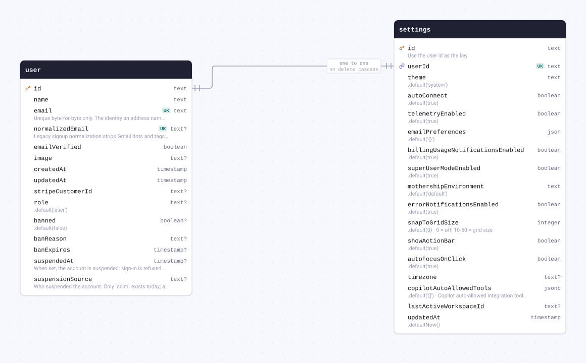

| Column                                                                     | Type        | Constraints                              | Default               | Description                                                                                  |
| -------------------------------------------------------------------------- | ----------- | ---------------------------------------- | --------------------- | -------------------------------------------------------------------------------------------- |
| `id`                                                                       | `text`      | PK NOT NULL                              |                       | Use the user id as the key                                                                   |
| `userId` (`user_id`)                                                       | `text`      | UNIQUE NOT NULL → [user.id](#table-user) |                       |                                                                                              |
| `theme`                                                                    | `text`      | NOT NULL                                 | `.default('system')`  |                                                                                              |
| `autoConnect` (`auto_connect`)                                             | `boolean`   | NOT NULL                                 | `.default(true)`      |                                                                                              |
| `telemetryEnabled` (`telemetry_enabled`)                                   | `boolean`   | NOT NULL                                 | `.default(true)`      |                                                                                              |
| `emailPreferences` (`email_preferences`)                                   | `json`      | NOT NULL                                 | `.default('{}')`      |                                                                                              |
| `billingUsageNotificationsEnabled` (`billing_usage_notifications_enabled`) | `boolean`   | NOT NULL                                 | `.default(true)`      |                                                                                              |
| `superUserModeEnabled` (`super_user_mode_enabled`)                         | `boolean`   | NOT NULL                                 | `.default(true)`      |                                                                                              |
| `mothershipEnvironment` (`mothership_environment`)                         | `text`      | NOT NULL                                 | `.default('default')` |                                                                                              |
| `errorNotificationsEnabled` (`error_notifications_enabled`)                | `boolean`   | NOT NULL                                 | `.default(true)`      |                                                                                              |
| `snapToGridSize` (`snap_to_grid_size`)                                     | `integer`   | NOT NULL                                 | `.default(0)`         | 0 = off, 10-50 = grid size                                                                   |
| `showActionBar` (`show_action_bar`)                                        | `boolean`   | NOT NULL                                 | `.default(true)`      |                                                                                              |
| `autoFocusOnClick` (`auto_focus_on_click`)                                 | `boolean`   | NOT NULL                                 | `.default(true)`      |                                                                                              |
| `timezone`                                                                 | `text`      | NULL                                     |                       |                                                                                              |
| `copilotAutoAllowedTools` (`copilot_auto_allowed_tools`)                   | `jsonb`     | NOT NULL                                 | `.default('[]')`      | Copilot auto-allowed integration tools - array of tool IDs that can run without confirmation |
| `lastActiveWorkspaceId` (`last_active_workspace_id`)                       | `text`      | NULL                                     |                       |                                                                                              |
| `updatedAt` (`updated_at`)                                                 | `timestamp` | NOT NULL                                 | `.defaultNow()`       |                                                                                              |

#### Definition

```sql
CREATE TABLE "settings" (
	"id" text PRIMARY KEY,
	"user_id" text NOT NULL UNIQUE,
	"theme" text DEFAULT 'system' NOT NULL,
	"auto_connect" boolean DEFAULT true NOT NULL,
	"telemetry_enabled" boolean DEFAULT true NOT NULL,
	"email_preferences" json DEFAULT '"{}"' NOT NULL,
	"billing_usage_notifications_enabled" boolean DEFAULT true NOT NULL,
	"super_user_mode_enabled" boolean DEFAULT true NOT NULL,
	"mothership_environment" text DEFAULT 'default' NOT NULL,
	"error_notifications_enabled" boolean DEFAULT true NOT NULL,
	"snap_to_grid_size" integer DEFAULT 0 NOT NULL,
	"show_action_bar" boolean DEFAULT true NOT NULL,
	"auto_focus_on_click" boolean DEFAULT true NOT NULL,
	"timezone" text,
	"copilot_auto_allowed_tools" jsonb DEFAULT '"[]"' NOT NULL,
	"last_active_workspace_id" text,
	"updated_at" timestamp DEFAULT now() NOT NULL
);

ALTER TABLE "settings" ADD CONSTRAINT "settings_user_id_user_id_fkey" FOREIGN KEY ("user_id") REFERENCES "user"("id") ON DELETE CASCADE;
```

#### References

- `userId` → [user.id](#table-user) (one to one, on delete cascade)

<details>
<summary>Queries and their SQL</summary>

**Select**: Every row of settings.

```ts
db.select().from(settings);
```

```sql
select "id", "user_id", "theme", "auto_connect", "telemetry_enabled", "email_preferences", "billing_usage_notifications_enabled", "super_user_mode_enabled", "mothership_environment", "error_notifications_enabled", "snap_to_grid_size", "show_action_bar", "auto_focus_on_click", "timezone", "copilot_auto_allowed_tools", "last_active_workspace_id", "updated_at"
from "settings"
```

**Count**: How many rows settings has.

```ts
db.select({ count: count() }).from(settings);
```

```sql
select count(*)
from "settings"
```

**Find many**: The rows of settings, through the relational query API.

```ts
db.query.settings.findMany();
```

```sql
select "d0"."id" as "id", "d0"."user_id" as "userId", "d0"."theme" as "theme", "d0"."auto_connect" as "autoConnect", "d0"."telemetry_enabled" as "telemetryEnabled", "d0"."email_preferences" as "emailPreferences", "d0"."billing_usage_notifications_enabled" as "billingUsageNotificationsEnabled", "d0"."super_user_mode_enabled" as "superUserModeEnabled", "d0"."mothership_environment" as "mothershipEnvironment", "d0"."error_notifications_enabled" as "errorNotificationsEnabled", "d0"."snap_to_grid_size" as "snapToGridSize", "d0"."show_action_bar" as "showActionBar", "d0"."auto_focus_on_click" as "autoFocusOnClick", "d0"."timezone" as "timezone", "d0"."copilot_auto_allowed_tools" as "copilotAutoAllowedTools", "d0"."last_active_workspace_id" as "lastActiveWorkspaceId", "d0"."updated_at" as "updatedAt"
from "settings" as "d0"
```

**Find by primary key**: One row of settings, through the relational query API.

```ts
db.query.settings.findFirst({ where: { id: "id" } });
```

```sql
select "d0"."id" as "id", "d0"."user_id" as "userId", "d0"."theme" as "theme", "d0"."auto_connect" as "autoConnect", "d0"."telemetry_enabled" as "telemetryEnabled", "d0"."email_preferences" as "emailPreferences", "d0"."billing_usage_notifications_enabled" as "billingUsageNotificationsEnabled", "d0"."super_user_mode_enabled" as "superUserModeEnabled", "d0"."mothership_environment" as "mothershipEnvironment", "d0"."error_notifications_enabled" as "errorNotificationsEnabled", "d0"."snap_to_grid_size" as "snapToGridSize", "d0"."show_action_bar" as "showActionBar", "d0"."auto_focus_on_click" as "autoFocusOnClick", "d0"."timezone" as "timezone", "d0"."copilot_auto_allowed_tools" as "copilotAutoAllowedTools", "d0"."last_active_workspace_id" as "lastActiveWorkspaceId", "d0"."updated_at" as "updatedAt"
from "settings" as "d0"
where "d0"."id" = $1
limit $2
-- params: ["id",1]
```

**Insert**: Adds a row to settings, giving the columns that have no default.

```ts
db.insert(settings).values({ id: "id", userId: "userId" });
```

```sql
insert into "settings" ("id", "user_id", "theme", "auto_connect", "telemetry_enabled", "email_preferences", "billing_usage_notifications_enabled", "super_user_mode_enabled", "mothership_environment", "error_notifications_enabled", "snap_to_grid_size", "show_action_bar", "auto_focus_on_click", "timezone", "copilot_auto_allowed_tools", "last_active_workspace_id", "updated_at")
values ($1, $2, default, default, default, default, default, default, default, default, default, default, default, default, default, default, default)
-- params: ["id","userId"]
```

**Update**: Changes a row of settings, found by its primary key.

```ts
db.update(settings).set({ userId: "userId" }).where(eq(settings.id, "id"));
```

```sql
update "settings"
set "user_id" = $1
where "settings"."id" = $2
-- params: ["userId","id"]
```

**Delete**: Deletes a row of settings, found by its primary key.

```ts
db.delete(settings).where(eq(settings.id, "id"));
```

```sql
delete from "settings"
where "settings"."id" = $1
-- params: ["id"]
```

</details>

<a id="table-workflowSchedule"></a>

### workflowSchedule

Table `workflow_schedule`.

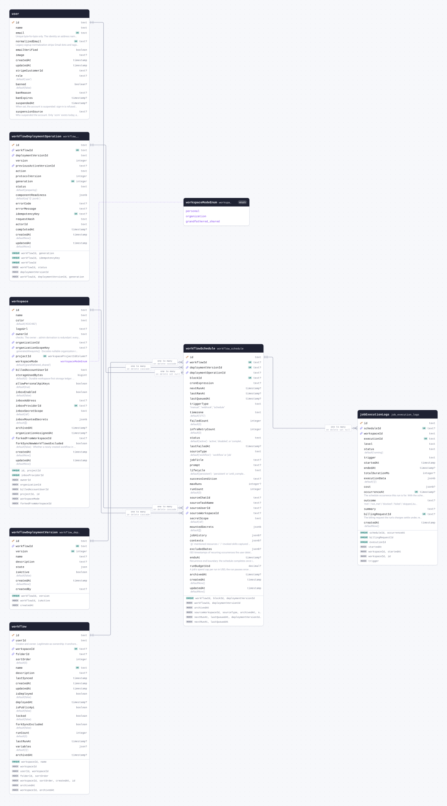

| Column                                              | Type        | Constraints                                                                 | Default                  | Description                                                                                                                                  |
| --------------------------------------------------- | ----------- | --------------------------------------------------------------------------- | ------------------------ | -------------------------------------------------------------------------------------------------------------------------------------------- |
| `id`                                                | `text`      | PK NOT NULL                                                                 |                          |                                                                                                                                              |
| `workflowId` (`workflow_id`)                        | `text`      | NULL → [workflow.id](#table-workflow)                                       |                          |                                                                                                                                              |
| `deploymentVersionId` (`deployment_version_id`)     | `text`      | NULL → [workflowDeploymentVersion.id](#table-workflowDeploymentVersion)     |                          |                                                                                                                                              |
| `deploymentOperationId` (`deployment_operation_id`) | `text`      | NULL → [workflowDeploymentOperation.id](#table-workflowDeploymentOperation) |                          |                                                                                                                                              |
| `blockId` (`block_id`)                              | `text`      | NULL                                                                        |                          |                                                                                                                                              |
| `cronExpression` (`cron_expression`)                | `text`      | NULL                                                                        |                          |                                                                                                                                              |
| `nextRunAt` (`next_run_at`)                         | `timestamp` | NULL                                                                        |                          |                                                                                                                                              |
| `lastRanAt` (`last_ran_at`)                         | `timestamp` | NULL                                                                        |                          |                                                                                                                                              |
| `lastQueuedAt` (`last_queued_at`)                   | `timestamp` | NULL                                                                        |                          |                                                                                                                                              |
| `triggerType` (`trigger_type`)                      | `text`      | NOT NULL                                                                    |                          | "manual", "webhook", "schedule"                                                                                                              |
| `timezone`                                          | `text`      | NOT NULL                                                                    | `.default('UTC')`        |                                                                                                                                              |
| `failedCount` (`failed_count`)                      | `integer`   | NOT NULL                                                                    | `.default(0)`            |                                                                                                                                              |
| `infraRetryCount` (`infra_retry_count`)             | `integer`   | NOT NULL                                                                    | `.default(0)`            |                                                                                                                                              |
| `status`                                            | `text`      | NOT NULL                                                                    | `.default('active')`     | 'active', 'disabled', or 'completed'                                                                                                         |
| `lastFailedAt` (`last_failed_at`)                   | `timestamp` | NULL                                                                        |                          |                                                                                                                                              |
| `sourceType` (`source_type`)                        | `text`      | NOT NULL                                                                    | `.default('workflow')`   | 'workflow' or 'job'                                                                                                                          |
| `jobTitle` (`job_title`)                            | `text`      | NULL                                                                        |                          |                                                                                                                                              |
| `prompt`                                            | `text`      | NULL                                                                        |                          |                                                                                                                                              |
| `lifecycle`                                         | `text`      | NOT NULL                                                                    | `.default('persistent')` | 'persistent' or 'until_complete'                                                                                                             |
| `successCondition` (`success_condition`)            | `text`      | NULL                                                                        |                          |                                                                                                                                              |
| `maxRuns` (`max_runs`)                              | `integer`   | NULL                                                                        |                          |                                                                                                                                              |
| `runCount` (`run_count`)                            | `integer`   | NOT NULL                                                                    | `.default(0)`            |                                                                                                                                              |
| `sourceChatId` (`source_chat_id`)                   | `text`      | NULL                                                                        |                          |                                                                                                                                              |
| `sourceTaskName` (`source_task_name`)               | `text`      | NULL                                                                        |                          |                                                                                                                                              |
| `sourceUserId` (`source_user_id`)                   | `text`      | NULL → [user.id](#table-user)                                               |                          |                                                                                                                                              |
| `sourceWorkspaceId` (`source_workspace_id`)         | `text`      | NULL → [workspace.id](#table-workspace)                                     |                          |                                                                                                                                              |
| `secretScope` (`secret_scope`)                      | `text`      | NOT NULL                                                                    | `.default('all')`        |                                                                                                                                              |
| `mountedSecrets` (`mounted_secrets`)                | `jsonb`     | NOT NULL                                                                    | `.default([])`           |                                                                                                                                              |
| `jobHistory` (`job_history`)                        | `jsonb`     | NULL                                                                        |                          |                                                                                                                                              |
| `contexts`                                          | `jsonb`     | NULL                                                                        |                          | `@`-mentioned resources / `/`-invoked skills captured with the prompt, resolved into the agent run at fire time.                             |
| `excludedDates` (`excluded_dates`)                  | `jsonb`     | NULL                                                                        |                          | ISO timestamps of recurring occurrences the user deleted individually (EXDATE); the executor skips them.                                     |
| `endsAt` (`ends_at`)                                | `timestamp` | NULL                                                                        |                          | Recurrence end boundary: the schedule completes once its next run would fall after this instant.                                             |
| `runBudgetUsd` (`run_budget_usd`)                   | `decimal`   | NULL                                                                        |                          | A job's spend cap per run in USD; the run pauses once its settled cost reaches it. Null takes the default cap. Unused by workflow schedules. |
| `archivedAt` (`archived_at`)                        | `timestamp` | NULL                                                                        |                          |                                                                                                                                              |
| `createdAt` (`created_at`)                          | `timestamp` | NOT NULL                                                                    | `.defaultNow()`          |                                                                                                                                              |
| `updatedAt` (`updated_at`)                          | `timestamp` | NOT NULL                                                                    | `.defaultNow()`          |                                                                                                                                              |

#### Definition

```sql
CREATE TABLE "workflow_schedule" (
	"id" text PRIMARY KEY,
	"workflow_id" text,
	"deployment_version_id" text,
	"deployment_operation_id" text,
	"block_id" text,
	"cron_expression" text,
	"next_run_at" timestamp,
	"last_ran_at" timestamp,
	"last_queued_at" timestamp,
	"trigger_type" text NOT NULL,
	"timezone" text DEFAULT 'UTC' NOT NULL,
	"failed_count" integer DEFAULT 0 NOT NULL,
	"infra_retry_count" integer DEFAULT 0 NOT NULL,
	"status" text DEFAULT 'active' NOT NULL,
	"last_failed_at" timestamp,
	"source_type" text DEFAULT 'workflow' NOT NULL,
	"job_title" text,
	"prompt" text,
	"lifecycle" text DEFAULT 'persistent' NOT NULL,
	"success_condition" text,
	"max_runs" integer,
	"run_count" integer DEFAULT 0 NOT NULL,
	"source_chat_id" text,
	"source_task_name" text,
	"source_user_id" text,
	"source_workspace_id" text,
	"secret_scope" text DEFAULT 'all' NOT NULL,
	"mounted_secrets" jsonb DEFAULT '[]' NOT NULL,
	"job_history" jsonb,
	"contexts" jsonb,
	"excluded_dates" jsonb,
	"ends_at" timestamp,
	"run_budget_usd" numeric(12,4),
	"archived_at" timestamp,
	"created_at" timestamp DEFAULT now() NOT NULL,
	"updated_at" timestamp DEFAULT now() NOT NULL
);

CREATE UNIQUE INDEX "workflow_schedule_workflow_block_deployment_unique" ON "workflow_schedule" ("workflow_id","block_id","deployment_version_id") WHERE "archived_at" IS NULL;

CREATE INDEX "workflow_schedule_workflow_deployment_idx" ON "workflow_schedule" ("workflow_id","deployment_version_id");

CREATE INDEX "workflow_schedule_archived_at_partial_idx" ON "workflow_schedule" ("archived_at") WHERE "archived_at" IS NOT NULL;

CREATE INDEX "idx_workflow_schedule_on_source_workspace_id_source_t_c07f3bba6" ON "workflow_schedule" ("source_workspace_id","source_type","archived_at","status");

CREATE INDEX "workflow_schedule_due_workflow_idx" ON "workflow_schedule" ("next_run_at","last_queued_at","deployment_version_id","workflow_id") WHERE "archived_at" IS NULL AND "status" NOT IN ('disabled', 'completed') AND ("source_type" = 'workflow' OR "source_type" IS NULL);

CREATE INDEX "workflow_schedule_due_job_idx" ON "workflow_schedule" ("next_run_at","last_queued_at") WHERE "archived_at" IS NULL AND "status" NOT IN ('disabled', 'completed') AND "source_type" = 'job';

ALTER TABLE "workflow_schedule" ADD CONSTRAINT "workflow_schedule_workflow_id_workflow_id_fkey" FOREIGN KEY ("workflow_id") REFERENCES "workflow"("id") ON DELETE CASCADE;

ALTER TABLE "workflow_schedule" ADD CONSTRAINT "workflow_schedule_4qEJ3nv5iI1j_fkey" FOREIGN KEY ("deployment_version_id") REFERENCES "workflow_deployment_version"("id") ON DELETE CASCADE;

ALTER TABLE "workflow_schedule" ADD CONSTRAINT "workflow_schedule_ZvKuQvSdwaCD_fkey" FOREIGN KEY ("deployment_operation_id") REFERENCES "workflow_deployment_operation"("id") ON DELETE SET NULL;

ALTER TABLE "workflow_schedule" ADD CONSTRAINT "workflow_schedule_source_user_id_user_id_fkey" FOREIGN KEY ("source_user_id") REFERENCES "user"("id") ON DELETE CASCADE;

ALTER TABLE "workflow_schedule" ADD CONSTRAINT "workflow_schedule_source_workspace_id_workspace_id_fkey" FOREIGN KEY ("source_workspace_id") REFERENCES "workspace"("id") ON DELETE CASCADE;
```

#### Indexes

- UNIQUE `workflowId`, `blockId`, `deploymentVersionId`
- INDEX `workflowId`, `deploymentVersionId`
- INDEX `archivedAt`
- INDEX `sourceWorkspaceId`, `sourceType`, `archivedAt`, `status`
- INDEX `nextRunAt`, `lastQueuedAt`, `deploymentVersionId`, `workflowId`
- INDEX `nextRunAt`, `lastQueuedAt`

#### References

- `workflowId` → [workflow.id](#table-workflow) (many to one, on delete cascade)
- `deploymentVersionId` → [workflowDeploymentVersion.id](#table-workflowDeploymentVersion) (many to one, on delete cascade)
- `deploymentOperationId` → [workflowDeploymentOperation.id](#table-workflowDeploymentOperation) (many to one, on delete set null)
- `sourceUserId` → [user.id](#table-user) (many to one, on delete cascade)
- `sourceWorkspaceId` → [workspace.id](#table-workspace) (many to one, on delete cascade)

#### Referenced by

- `id` → [jobExecutionLogs.scheduleId](#table-jobExecutionLogs) (one to many, on delete set null)

<details>
<summary>Queries and their SQL</summary>

**Select**: Every row of workflowSchedule.

```ts
db.select().from(workflowSchedule);
```

```sql
select "id", "workflow_id", "deployment_version_id", "deployment_operation_id", "block_id", "cron_expression", "next_run_at", "last_ran_at", "last_queued_at", "trigger_type", "timezone", "failed_count", "infra_retry_count", "status", "last_failed_at", "source_type", "job_title", "prompt", "lifecycle", "success_condition", "max_runs", "run_count", "source_chat_id", "source_task_name", "source_user_id", "source_workspace_id", "secret_scope", "mounted_secrets", "job_history", "contexts", "excluded_dates", "ends_at", "run_budget_usd", "archived_at", "created_at", "updated_at"
from "workflow_schedule"
```

**Count**: How many rows workflowSchedule has.

```ts
db.select({ count: count() }).from(workflowSchedule);
```

```sql
select count(*)
from "workflow_schedule"
```

**Find many**: The rows of workflowSchedule, through the relational query API.

```ts
db.query.workflowSchedule.findMany();
```

```sql
select "d0"."id" as "id", "d0"."workflow_id" as "workflowId", "d0"."deployment_version_id" as "deploymentVersionId", "d0"."deployment_operation_id" as "deploymentOperationId", "d0"."block_id" as "blockId", "d0"."cron_expression" as "cronExpression", "d0"."next_run_at" as "nextRunAt", "d0"."last_ran_at" as "lastRanAt", "d0"."last_queued_at" as "lastQueuedAt", "d0"."trigger_type" as "triggerType", "d0"."timezone" as "timezone", "d0"."failed_count" as "failedCount", "d0"."infra_retry_count" as "infraRetryCount", "d0"."status" as "status", "d0"."last_failed_at" as "lastFailedAt", "d0"."source_type" as "sourceType", "d0"."job_title" as "jobTitle", "d0"."prompt" as "prompt", "d0"."lifecycle" as "lifecycle", "d0"."success_condition" as "successCondition", "d0"."max_runs" as "maxRuns", "d0"."run_count" as "runCount", "d0"."source_chat_id" as "sourceChatId", "d0"."source_task_name" as "sourceTaskName", "d0"."source_user_id" as "sourceUserId", "d0"."source_workspace_id" as "sourceWorkspaceId", "d0"."secret_scope" as "secretScope", "d0"."mounted_secrets" as "mountedSecrets", "d0"."job_history" as "jobHistory", "d0"."contexts" as "contexts", "d0"."excluded_dates" as "excludedDates", "d0"."ends_at" as "endsAt", "d0"."run_budget_usd" as "runBudgetUsd", "d0"."archived_at" as "archivedAt", "d0"."created_at" as "createdAt", "d0"."updated_at" as "updatedAt"
from "workflow_schedule" as "d0"
```

**Find by primary key**: One row of workflowSchedule, through the relational query API.

```ts
db.query.workflowSchedule.findFirst({ where: { id: "id" } });
```

```sql
select "d0"."id" as "id", "d0"."workflow_id" as "workflowId", "d0"."deployment_version_id" as "deploymentVersionId", "d0"."deployment_operation_id" as "deploymentOperationId", "d0"."block_id" as "blockId", "d0"."cron_expression" as "cronExpression", "d0"."next_run_at" as "nextRunAt", "d0"."last_ran_at" as "lastRanAt", "d0"."last_queued_at" as "lastQueuedAt", "d0"."trigger_type" as "triggerType", "d0"."timezone" as "timezone", "d0"."failed_count" as "failedCount", "d0"."infra_retry_count" as "infraRetryCount", "d0"."status" as "status", "d0"."last_failed_at" as "lastFailedAt", "d0"."source_type" as "sourceType", "d0"."job_title" as "jobTitle", "d0"."prompt" as "prompt", "d0"."lifecycle" as "lifecycle", "d0"."success_condition" as "successCondition", "d0"."max_runs" as "maxRuns", "d0"."run_count" as "runCount", "d0"."source_chat_id" as "sourceChatId", "d0"."source_task_name" as "sourceTaskName", "d0"."source_user_id" as "sourceUserId", "d0"."source_workspace_id" as "sourceWorkspaceId", "d0"."secret_scope" as "secretScope", "d0"."mounted_secrets" as "mountedSecrets", "d0"."job_history" as "jobHistory", "d0"."contexts" as "contexts", "d0"."excluded_dates" as "excludedDates", "d0"."ends_at" as "endsAt", "d0"."run_budget_usd" as "runBudgetUsd", "d0"."archived_at" as "archivedAt", "d0"."created_at" as "createdAt", "d0"."updated_at" as "updatedAt"
from "workflow_schedule" as "d0"
where "d0"."id" = $1
limit $2
-- params: ["id",1]
```

**Insert**: Adds a row to workflowSchedule, giving the columns that have no default.

```ts
db.insert(workflowSchedule).values({ id: "id", triggerType: "triggerType" });
```

```sql
insert into "workflow_schedule" ("id", "workflow_id", "deployment_version_id", "deployment_operation_id", "block_id", "cron_expression", "next_run_at", "last_ran_at", "last_queued_at", "trigger_type", "timezone", "failed_count", "infra_retry_count", "status", "last_failed_at", "source_type", "job_title", "prompt", "lifecycle", "success_condition", "max_runs", "run_count", "source_chat_id", "source_task_name", "source_user_id", "source_workspace_id", "secret_scope", "mounted_secrets", "job_history", "contexts", "excluded_dates", "ends_at", "run_budget_usd", "archived_at", "created_at", "updated_at")
values ($1, default, default, default, default, default, default, default, default, $2, default, default, default, default, default, default, default, default, default, default, default, default, default, default, default, default, default, default, default, default, default, default, default, default, default, default)
-- params: ["id","triggerType"]
```

**Update**: Changes a row of workflowSchedule, found by its primary key.

```ts
db.update(workflowSchedule).set({ workflowId: "workflowId" }).where(eq(workflowSchedule.id, "id"));
```

```sql
update "workflow_schedule"
set "workflow_id" = $1
where "workflow_schedule"."id" = $2
-- params: ["workflowId","id"]
```

**Delete**: Deletes a row of workflowSchedule, found by its primary key.

```ts
db.delete(workflowSchedule).where(eq(workflowSchedule.id, "id"));
```

```sql
delete from "workflow_schedule"
where "workflow_schedule"."id" = $1
-- params: ["id"]
```

</details>

<a id="table-jobExecutionLogs"></a>

### jobExecutionLogs

Table `job_execution_logs`.

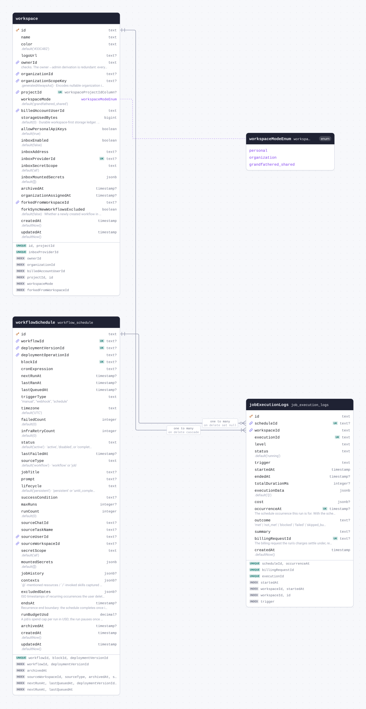

| Column                                    | Type        | Constraints                                           | Default               | Description                                                                                                                                                              |
| ----------------------------------------- | ----------- | ----------------------------------------------------- | --------------------- | ------------------------------------------------------------------------------------------------------------------------------------------------------------------------ |
| `id`                                      | `text`      | PK NOT NULL                                           |                       |                                                                                                                                                                          |
| `scheduleId` (`schedule_id`)              | `text`      | NULL → [workflowSchedule.id](#table-workflowSchedule) |                       |                                                                                                                                                                          |
| `workspaceId` (`workspace_id`)            | `text`      | NOT NULL → [workspace.id](#table-workspace)           |                       |                                                                                                                                                                          |
| `executionId` (`execution_id`)            | `text`      | NOT NULL                                              |                       |                                                                                                                                                                          |
| `level`                                   | `text`      | NOT NULL                                              |                       |                                                                                                                                                                          |
| `status`                                  | `text`      | NOT NULL                                              | `.default('running')` |                                                                                                                                                                          |
| `trigger`                                 | `text`      | NOT NULL                                              |                       |                                                                                                                                                                          |
| `startedAt` (`started_at`)                | `timestamp` | NOT NULL                                              |                       |                                                                                                                                                                          |
| `endedAt` (`ended_at`)                    | `timestamp` | NULL                                                  |                       |                                                                                                                                                                          |
| `totalDurationMs` (`total_duration_ms`)   | `integer`   | NULL                                                  |                       |                                                                                                                                                                          |
| `executionData` (`execution_data`)        | `jsonb`     | NOT NULL                                              | `.default('{}')`      |                                                                                                                                                                          |
| `cost`                                    | `jsonb`     | NULL                                                  |                       |                                                                                                                                                                          |
| `occurrenceAt` (`occurrence_at`)          | `timestamp` | NULL                                                  |                       | The schedule occurrence this run is for. With the schedule it names the run once: `execution_id` is derived from both and is the job turn's run id. Null on legacy rows. |
| `outcome`                                 | `text`      | NULL                                                  |                       | 'met' \| 'not_met' \| 'blocked' \| 'failed' \| 'skipped_busy' \| 'skipped_budget' \| 'interrupted'                                                                       |
| `summary`                                 | `text`      | NULL                                                  |                       |                                                                                                                                                                          |
| `billingRequestId` (`billing_request_id`) | `text`      | NULL                                                  |                       | The billing request the run's charges settle under, recorded when its first leg is admitted.                                                                             |
| `createdAt` (`created_at`)                | `timestamp` | NOT NULL                                              | `.defaultNow()`       |                                                                                                                                                                          |

#### Definition

```sql
CREATE TABLE "job_execution_logs" (
	"id" text PRIMARY KEY,
	"schedule_id" text,
	"workspace_id" text NOT NULL,
	"execution_id" text NOT NULL,
	"level" text NOT NULL,
	"status" text DEFAULT 'running' NOT NULL,
	"trigger" text NOT NULL,
	"started_at" timestamp NOT NULL,
	"ended_at" timestamp,
	"total_duration_ms" integer,
	"execution_data" jsonb DEFAULT '"{}"' NOT NULL,
	"cost" jsonb,
	"occurrence_at" timestamp,
	"outcome" text,
	"summary" text,
	"billing_request_id" text,
	"created_at" timestamp DEFAULT now() NOT NULL
);

CREATE UNIQUE INDEX "job_execution_logs_schedule_occurrence_unique" ON "job_execution_logs" ("schedule_id","occurrence_at");

CREATE UNIQUE INDEX "job_execution_logs_billing_request_unique" ON "job_execution_logs" ("billing_request_id") WHERE "billing_request_id" IS NOT NULL;

CREATE INDEX "job_execution_logs_open_idx" ON "job_execution_logs" ("started_at") WHERE "status" IN ('queued', 'running');

CREATE INDEX "job_execution_logs_workspace_started_at_idx" ON "job_execution_logs" ("workspace_id","started_at");

CREATE INDEX "job_execution_logs_workspace_ended_at_id_idx" ON "job_execution_logs" ("workspace_id",date_trunc('milliseconds', "ended_at"),"id");

CREATE UNIQUE INDEX "job_execution_logs_execution_id_unique" ON "job_execution_logs" ("execution_id");

CREATE INDEX "job_execution_logs_trigger_idx" ON "job_execution_logs" ("trigger");

ALTER TABLE "job_execution_logs" ADD CONSTRAINT "job_execution_logs_schedule_id_workflow_schedule_id_fkey" FOREIGN KEY ("schedule_id") REFERENCES "workflow_schedule"("id") ON DELETE SET NULL;

ALTER TABLE "job_execution_logs" ADD CONSTRAINT "job_execution_logs_workspace_id_workspace_id_fkey" FOREIGN KEY ("workspace_id") REFERENCES "workspace"("id") ON DELETE CASCADE;
```

#### Indexes

- UNIQUE `scheduleId`, `occurrenceAt`
- UNIQUE `billingRequestId`
- INDEX `startedAt`
- INDEX `workspaceId`, `startedAt`
- INDEX `workspaceId`, `id`
- UNIQUE `executionId`
- INDEX `trigger`

#### References

- `scheduleId` → [workflowSchedule.id](#table-workflowSchedule) (many to one, on delete set null)
- `workspaceId` → [workspace.id](#table-workspace) (many to one, on delete cascade)

<details>
<summary>Queries and their SQL</summary>

**Select**: Every row of jobExecutionLogs.

```ts
db.select().from(jobExecutionLogs);
```

```sql
select "id", "schedule_id", "workspace_id", "execution_id", "level", "status", "trigger", "started_at", "ended_at", "total_duration_ms", "execution_data", "cost", "occurrence_at", "outcome", "summary", "billing_request_id", "created_at"
from "job_execution_logs"
```

**Count**: How many rows jobExecutionLogs has.

```ts
db.select({ count: count() }).from(jobExecutionLogs);
```

```sql
select count(*)
from "job_execution_logs"
```

**Find many**: The rows of jobExecutionLogs, through the relational query API.

```ts
db.query.jobExecutionLogs.findMany();
```

```sql
select "d0"."id" as "id", "d0"."schedule_id" as "scheduleId", "d0"."workspace_id" as "workspaceId", "d0"."execution_id" as "executionId", "d0"."level" as "level", "d0"."status" as "status", "d0"."trigger" as "trigger", "d0"."started_at" as "startedAt", "d0"."ended_at" as "endedAt", "d0"."total_duration_ms" as "totalDurationMs", "d0"."execution_data" as "executionData", "d0"."cost" as "cost", "d0"."occurrence_at" as "occurrenceAt", "d0"."outcome" as "outcome", "d0"."summary" as "summary", "d0"."billing_request_id" as "billingRequestId", "d0"."created_at" as "createdAt"
from "job_execution_logs" as "d0"
```

**Find by primary key**: One row of jobExecutionLogs, through the relational query API.

```ts
db.query.jobExecutionLogs.findFirst({ where: { id: "id" } });
```

```sql
select "d0"."id" as "id", "d0"."schedule_id" as "scheduleId", "d0"."workspace_id" as "workspaceId", "d0"."execution_id" as "executionId", "d0"."level" as "level", "d0"."status" as "status", "d0"."trigger" as "trigger", "d0"."started_at" as "startedAt", "d0"."ended_at" as "endedAt", "d0"."total_duration_ms" as "totalDurationMs", "d0"."execution_data" as "executionData", "d0"."cost" as "cost", "d0"."occurrence_at" as "occurrenceAt", "d0"."outcome" as "outcome", "d0"."summary" as "summary", "d0"."billing_request_id" as "billingRequestId", "d0"."created_at" as "createdAt"
from "job_execution_logs" as "d0"
where "d0"."id" = $1
limit $2
-- params: ["id",1]
```

**Insert**: Adds a row to jobExecutionLogs, giving the columns that have no default.

```ts
db.insert(jobExecutionLogs).values({
  id: "id",
  workspaceId: "workspaceId",
  executionId: "executionId",
  level: "level",
  trigger: "trigger",
  startedAt: new Date("2026-01-01T00:00:00.000Z"),
});
```

```sql
insert into "job_execution_logs" ("id", "schedule_id", "workspace_id", "execution_id", "level", "status", "trigger", "started_at", "ended_at", "total_duration_ms", "execution_data", "cost", "occurrence_at", "outcome", "summary", "billing_request_id", "created_at")
values ($1, default, $2, $3, $4, default, $5, $6, default, default, default, default, default, default, default, default, default)
-- params: ["id","workspaceId","executionId","level","trigger","2026-01-01T00:00:00.000Z"]
```

**Update**: Changes a row of jobExecutionLogs, found by its primary key.

```ts
db.update(jobExecutionLogs).set({ scheduleId: "scheduleId" }).where(eq(jobExecutionLogs.id, "id"));
```

```sql
update "job_execution_logs"
set "schedule_id" = $1
where "job_execution_logs"."id" = $2
-- params: ["scheduleId","id"]
```

**Delete**: Deletes a row of jobExecutionLogs, found by its primary key.

```ts
db.delete(jobExecutionLogs).where(eq(jobExecutionLogs.id, "id"));
```

```sql
delete from "job_execution_logs"
where "job_execution_logs"."id" = $1
-- params: ["id"]
```

</details>

<a id="table-webhook"></a>

### webhook

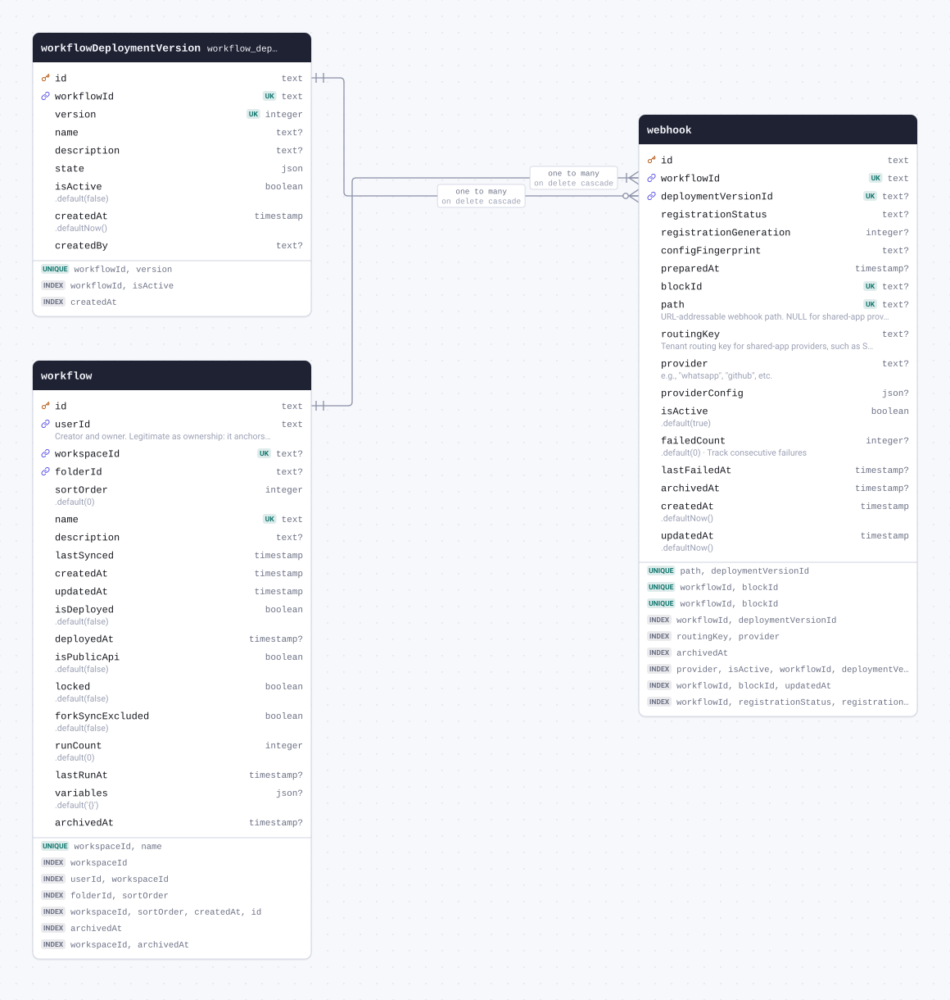

| Column                                               | Type        | Constraints                                                             | Default          | Description                                                                                                                                                                                                                          |
| ---------------------------------------------------- | ----------- | ----------------------------------------------------------------------- | ---------------- | ------------------------------------------------------------------------------------------------------------------------------------------------------------------------------------------------------------------------------------ |
| `id`                                                 | `text`      | PK NOT NULL                                                             |                  |                                                                                                                                                                                                                                      |
| `workflowId` (`workflow_id`)                         | `text`      | NOT NULL → [workflow.id](#table-workflow)                               |                  |                                                                                                                                                                                                                                      |
| `deploymentVersionId` (`deployment_version_id`)      | `text`      | NULL → [workflowDeploymentVersion.id](#table-workflowDeploymentVersion) |                  |                                                                                                                                                                                                                                      |
| `registrationStatus` (`registration_status`)         | `text`      | NULL                                                                    |                  |                                                                                                                                                                                                                                      |
| `registrationGeneration` (`registration_generation`) | `integer`   | NULL                                                                    |                  |                                                                                                                                                                                                                                      |
| `configFingerprint` (`config_fingerprint`)           | `text`      | NULL                                                                    |                  |                                                                                                                                                                                                                                      |
| `preparedAt` (`prepared_at`)                         | `timestamp` | NULL                                                                    |                  |                                                                                                                                                                                                                                      |
| `blockId` (`block_id`)                               | `text`      | NULL                                                                    |                  |                                                                                                                                                                                                                                      |
| `path`                                               | `text`      | NULL                                                                    |                  | URL-addressable webhook path. NULL for shared-app providers (e.g. the native Slack and TikTok triggers) whose events arrive on a single shared endpoint and route by `routingKey` instead of a per-workflow path.                    |
| `routingKey` (`routing_key`)                         | `text`      | NULL                                                                    |                  | Tenant routing key for shared-app providers, such as Slack `team_id` or TikTok `open_id`, derived server-side from the connected credential at deploy time — never user input. Inbound events match on this after HMAC verification. |
| `provider`                                           | `text`      | NULL                                                                    |                  | e.g., "whatsapp", "github", etc.                                                                                                                                                                                                     |
| `providerConfig` (`provider_config`)                 | `json`      | NULL                                                                    |                  |                                                                                                                                                                                                                                      |
| `isActive` (`is_active`)                             | `boolean`   | NOT NULL                                                                | `.default(true)` |                                                                                                                                                                                                                                      |
| `failedCount` (`failed_count`)                       | `integer`   | NULL                                                                    | `.default(0)`    | Track consecutive failures                                                                                                                                                                                                           |
| `lastFailedAt` (`last_failed_at`)                    | `timestamp` | NULL                                                                    |                  |                                                                                                                                                                                                                                      |
| `archivedAt` (`archived_at`)                         | `timestamp` | NULL                                                                    |                  |                                                                                                                                                                                                                                      |
| `createdAt` (`created_at`)                           | `timestamp` | NOT NULL                                                                | `.defaultNow()`  |                                                                                                                                                                                                                                      |
| `updatedAt` (`updated_at`)                           | `timestamp` | NOT NULL                                                                | `.defaultNow()`  |                                                                                                                                                                                                                                      |

#### Definition

```sql
CREATE TABLE "webhook" (
	"id" text PRIMARY KEY,
	"workflow_id" text NOT NULL,
	"deployment_version_id" text,
	"registration_status" text,
	"registration_generation" integer,
	"config_fingerprint" text,
	"prepared_at" timestamp,
	"block_id" text,
	"path" text,
	"routing_key" text,
	"provider" text,
	"provider_config" json,
	"is_active" boolean DEFAULT true NOT NULL,
	"failed_count" integer DEFAULT 0,
	"last_failed_at" timestamp,
	"archived_at" timestamp,
	"created_at" timestamp DEFAULT now() NOT NULL,
	"updated_at" timestamp DEFAULT now() NOT NULL,
	CONSTRAINT "webhook_registration_status_check" CHECK ("registration_status" IS NULL OR "registration_status" IN ('active', 'candidate', 'retired', 'orphaned')),
	CONSTRAINT "webhook_registration_generation_check" CHECK ("registration_generation" IS NULL OR "registration_generation" >= 0)
);

CREATE UNIQUE INDEX "path_deployment_unique" ON "webhook" ("path","deployment_version_id") WHERE "archived_at" IS NULL;

CREATE INDEX "webhook_workflow_deployment_idx" ON "webhook" ("workflow_id","deployment_version_id");

CREATE INDEX "webhook_routing_key_active_idx" ON "webhook" ("routing_key","provider") WHERE "archived_at" IS NULL AND "routing_key" IS NOT NULL;

CREATE INDEX "webhook_archived_at_partial_idx" ON "webhook" ("archived_at") WHERE "archived_at" IS NOT NULL;

CREATE INDEX "idx_webhook_on_provider_is_active_workflow_id_deploym_bdeed5468" ON "webhook" ("provider","is_active","workflow_id","deployment_version_id");

CREATE INDEX "idx_webhook_on_workflow_id_block_id_updated_at_desc" ON "webhook" ("workflow_id","block_id","updated_at" DESC NULLS LAST);

CREATE UNIQUE INDEX "webhook_active_registration_unique" ON "webhook" ("workflow_id","block_id") WHERE "registration_status" = 'active' AND "block_id" IS NOT NULL AND "archived_at" IS NULL;

CREATE UNIQUE INDEX "webhook_candidate_registration_unique" ON "webhook" ("workflow_id","block_id") WHERE "registration_status" = 'candidate' AND "block_id" IS NOT NULL;

CREATE INDEX "webhook_registration_status_generation_idx" ON "webhook" ("workflow_id","registration_status","registration_generation");

ALTER TABLE "webhook" ADD CONSTRAINT "webhook_workflow_id_workflow_id_fkey" FOREIGN KEY ("workflow_id") REFERENCES "workflow"("id") ON DELETE CASCADE;

ALTER TABLE "webhook" ADD CONSTRAINT "webhook_7eeCd11XzWhb_fkey" FOREIGN KEY ("deployment_version_id") REFERENCES "workflow_deployment_version"("id") ON DELETE CASCADE;
```

#### Indexes

- UNIQUE `path`, `deploymentVersionId`
- INDEX `workflowId`, `deploymentVersionId`
- INDEX `routingKey`, `provider`
- INDEX `archivedAt`
- INDEX `provider`, `isActive`, `workflowId`, `deploymentVersionId`
- INDEX `workflowId`, `blockId`, `updatedAt`
- UNIQUE `workflowId`, `blockId`
- UNIQUE `workflowId`, `blockId`
- INDEX `workflowId`, `registrationStatus`, `registrationGeneration`

#### References

- `workflowId` → [workflow.id](#table-workflow) (many to one, on delete cascade)
- `deploymentVersionId` → [workflowDeploymentVersion.id](#table-workflowDeploymentVersion) (many to one, on delete cascade)

<details>
<summary>Queries and their SQL</summary>

**Select**: Every row of webhook.

```ts
db.select().from(webhook);
```

```sql
select "id", "workflow_id", "deployment_version_id", "registration_status", "registration_generation", "config_fingerprint", "prepared_at", "block_id", "path", "routing_key", "provider", "provider_config", "is_active", "failed_count", "last_failed_at", "archived_at", "created_at", "updated_at"
from "webhook"
```

**Count**: How many rows webhook has.

```ts
db.select({ count: count() }).from(webhook);
```

```sql
select count(*)
from "webhook"
```

**Find many**: The rows of webhook, through the relational query API.

```ts
db.query.webhook.findMany();
```

```sql
select "d0"."id" as "id", "d0"."workflow_id" as "workflowId", "d0"."deployment_version_id" as "deploymentVersionId", "d0"."registration_status" as "registrationStatus", "d0"."registration_generation" as "registrationGeneration", "d0"."config_fingerprint" as "configFingerprint", "d0"."prepared_at" as "preparedAt", "d0"."block_id" as "blockId", "d0"."path" as "path", "d0"."routing_key" as "routingKey", "d0"."provider" as "provider", "d0"."provider_config" as "providerConfig", "d0"."is_active" as "isActive", "d0"."failed_count" as "failedCount", "d0"."last_failed_at" as "lastFailedAt", "d0"."archived_at" as "archivedAt", "d0"."created_at" as "createdAt", "d0"."updated_at" as "updatedAt"
from "webhook" as "d0"
```

**Find by primary key**: One row of webhook, through the relational query API.

```ts
db.query.webhook.findFirst({ where: { id: "id" } });
```

```sql
select "d0"."id" as "id", "d0"."workflow_id" as "workflowId", "d0"."deployment_version_id" as "deploymentVersionId", "d0"."registration_status" as "registrationStatus", "d0"."registration_generation" as "registrationGeneration", "d0"."config_fingerprint" as "configFingerprint", "d0"."prepared_at" as "preparedAt", "d0"."block_id" as "blockId", "d0"."path" as "path", "d0"."routing_key" as "routingKey", "d0"."provider" as "provider", "d0"."provider_config" as "providerConfig", "d0"."is_active" as "isActive", "d0"."failed_count" as "failedCount", "d0"."last_failed_at" as "lastFailedAt", "d0"."archived_at" as "archivedAt", "d0"."created_at" as "createdAt", "d0"."updated_at" as "updatedAt"
from "webhook" as "d0"
where "d0"."id" = $1
limit $2
-- params: ["id",1]
```

**Insert**: Adds a row to webhook, giving the columns that have no default.

```ts
db.insert(webhook).values({ id: "id", workflowId: "workflowId" });
```

```sql
insert into "webhook" ("id", "workflow_id", "deployment_version_id", "registration_status", "registration_generation", "config_fingerprint", "prepared_at", "block_id", "path", "routing_key", "provider", "provider_config", "is_active", "failed_count", "last_failed_at", "archived_at", "created_at", "updated_at")
values ($1, $2, default, default, default, default, default, default, default, default, default, default, default, default, default, default, default, default)
-- params: ["id","workflowId"]
```

**Update**: Changes a row of webhook, found by its primary key.

```ts
db.update(webhook).set({ workflowId: "workflowId" }).where(eq(webhook.id, "id"));
```

```sql
update "webhook"
set "workflow_id" = $1
where "webhook"."id" = $2
-- params: ["workflowId","id"]
```

**Delete**: Deletes a row of webhook, found by its primary key.

```ts
db.delete(webhook).where(eq(webhook.id, "id"));
```

```sql
delete from "webhook"
where "webhook"."id" = $1
-- params: ["id"]
```

</details>

<a id="table-webhookPathClaim"></a>

### webhookPathClaim

Table `webhook_path_claim`. Owns a normalized path independently from registration generations.

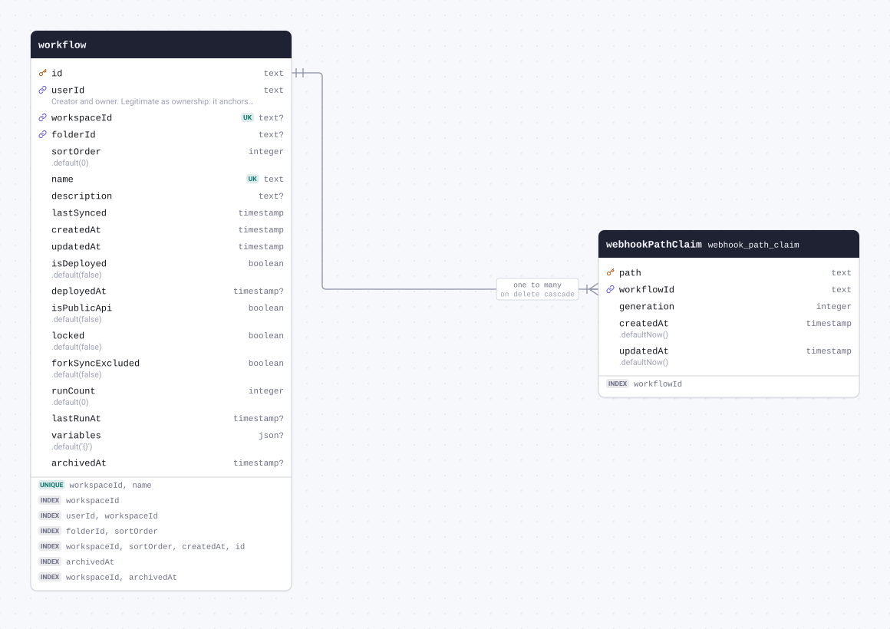

| Column                       | Type        | Constraints                               | Default         | Description |
| ---------------------------- | ----------- | ----------------------------------------- | --------------- | ----------- |
| `path`                       | `text`      | PK NOT NULL                               |                 |             |
| `workflowId` (`workflow_id`) | `text`      | NOT NULL → [workflow.id](#table-workflow) |                 |             |
| `generation`                 | `integer`   | NOT NULL                                  |                 |             |
| `createdAt` (`created_at`)   | `timestamp` | NOT NULL                                  | `.defaultNow()` |             |
| `updatedAt` (`updated_at`)   | `timestamp` | NOT NULL                                  | `.defaultNow()` |             |

#### Definition

```sql
CREATE TABLE "webhook_path_claim" (
	"path" text PRIMARY KEY,
	"workflow_id" text NOT NULL,
	"generation" integer NOT NULL,
	"created_at" timestamp DEFAULT now() NOT NULL,
	"updated_at" timestamp DEFAULT now() NOT NULL,
	CONSTRAINT "webhook_path_claim_generation_check" CHECK ("generation" >= 0)
);

CREATE INDEX "webhook_path_claim_workflow_idx" ON "webhook_path_claim" ("workflow_id");

ALTER TABLE "webhook_path_claim" ADD CONSTRAINT "webhook_path_claim_workflow_id_workflow_id_fkey" FOREIGN KEY ("workflow_id") REFERENCES "workflow"("id") ON DELETE CASCADE;
```

#### Indexes

- INDEX `workflowId`

#### References

- `workflowId` → [workflow.id](#table-workflow) (many to one, on delete cascade)

<details>
<summary>Queries and their SQL</summary>

**Select**: Every row of webhookPathClaim.

```ts
db.select().from(webhookPathClaim);
```

```sql
select "path", "workflow_id", "generation", "created_at", "updated_at"
from "webhook_path_claim"
```

**Count**: How many rows webhookPathClaim has.

```ts
db.select({ count: count() }).from(webhookPathClaim);
```

```sql
select count(*)
from "webhook_path_claim"
```

**Find many**: The rows of webhookPathClaim, through the relational query API.

```ts
db.query.webhookPathClaim.findMany();
```

```sql
select "d0"."path" as "path", "d0"."workflow_id" as "workflowId", "d0"."generation" as "generation", "d0"."created_at" as "createdAt", "d0"."updated_at" as "updatedAt"
from "webhook_path_claim" as "d0"
```

**Find by primary key**: One row of webhookPathClaim, through the relational query API.

```ts
db.query.webhookPathClaim.findFirst({ where: { path: "path" } });
```

```sql
select "d0"."path" as "path", "d0"."workflow_id" as "workflowId", "d0"."generation" as "generation", "d0"."created_at" as "createdAt", "d0"."updated_at" as "updatedAt"
from "webhook_path_claim" as "d0"
where "d0"."path" = $1
limit $2
-- params: ["path",1]
```

**Insert**: Adds a row to webhookPathClaim, giving the columns that have no default.

```ts
db.insert(webhookPathClaim).values({ path: "path", workflowId: "workflowId", generation: 1 });
```

```sql
insert into "webhook_path_claim" ("path", "workflow_id", "generation", "created_at", "updated_at")
values ($1, $2, $3, default, default)
-- params: ["path","workflowId",1]
```

**Update**: Changes a row of webhookPathClaim, found by its primary key.

```ts
db.update(webhookPathClaim)
  .set({ workflowId: "workflowId" })
  .where(eq(webhookPathClaim.path, "path"));
```

```sql
update "webhook_path_claim"
set "workflow_id" = $1
where "webhook_path_claim"."path" = $2
-- params: ["workflowId","path"]
```

**Delete**: Deletes a row of webhookPathClaim, found by its primary key.

```ts
db.delete(webhookPathClaim).where(eq(webhookPathClaim.path, "path"));
```

```sql
delete from "webhook_path_claim"
where "webhook_path_claim"."path" = $1
-- params: ["path"]
```

</details>

<a id="table-simTriggerState"></a>

### simTriggerState

Table `sim_trigger_state`. Cooldown state for Sim workspace-event trigger subscriptions. Keyed by (workflowId, blockId, scopeKey) rather than the webhook row because webhook rows are recreated per deployment version — state stored there would reset on every redeploy. `scopeKey` is '' for subscription-level cooldowns and the source workflow ID for per-source-workflow rules (no_activity).


| Column                          | Type        | Constraints                                  | Default         | Description |
| ------------------------------- | ----------- | -------------------------------------------- | --------------- | ----------- |
| `workflowId` (`workflow_id`)    | `text`      | PK NOT NULL → [workflow.id](#table-workflow) |                 |             |
| `blockId` (`block_id`)          | `text`      | PK NOT NULL                                  |                 |             |
| `scopeKey` (`scope_key`)        | `text`      | PK NOT NULL                                  | `.default('')`  |             |
| `lastFiredAt` (`last_fired_at`) | `timestamp` | NULL                                         |                 |             |
| `updatedAt` (`updated_at`)      | `timestamp` | NOT NULL                                     | `.defaultNow()` |             |

#### Definition

```sql
CREATE TABLE "sim_trigger_state" (
	"workflow_id" text,
	"block_id" text,
	"scope_key" text DEFAULT '',
	"last_fired_at" timestamp,
	"updated_at" timestamp DEFAULT now() NOT NULL,
	CONSTRAINT "sim_trigger_state_pkey" PRIMARY KEY("workflow_id","block_id","scope_key")
);

ALTER TABLE "sim_trigger_state" ADD CONSTRAINT "sim_trigger_state_workflow_id_workflow_id_fkey" FOREIGN KEY ("workflow_id") REFERENCES "workflow"("id") ON DELETE CASCADE;
```

#### Indexes

- PRIMARY KEY `workflowId`, `blockId`, `scopeKey`

#### References

- `workflowId` → [workflow.id](#table-workflow) (many to one, on delete cascade)

<details>
<summary>Queries and their SQL</summary>

**Select**: Every row of simTriggerState.

```ts
db.select().from(simTriggerState);
```

```sql
select "workflow_id", "block_id", "scope_key", "last_fired_at", "updated_at"
from "sim_trigger_state"
```

**Count**: How many rows simTriggerState has.

```ts
db.select({ count: count() }).from(simTriggerState);
```

```sql
select count(*)
from "sim_trigger_state"
```

**Find many**: The rows of simTriggerState, through the relational query API.

```ts
db.query.simTriggerState.findMany();
```

```sql
select "d0"."workflow_id" as "workflowId", "d0"."block_id" as "blockId", "d0"."scope_key" as "scopeKey", "d0"."last_fired_at" as "lastFiredAt", "d0"."updated_at" as "updatedAt"
from "sim_trigger_state" as "d0"
```

**Find by primary key**: One row of simTriggerState, through the relational query API.

```ts
db.query.simTriggerState.findFirst({
  where: { workflowId: "workflowId", blockId: "blockId", scopeKey: "scopeKey" },
});
```

```sql
select "d0"."workflow_id" as "workflowId", "d0"."block_id" as "blockId", "d0"."scope_key" as "scopeKey", "d0"."last_fired_at" as "lastFiredAt", "d0"."updated_at" as "updatedAt"
from "sim_trigger_state" as "d0"
where (("d0"."workflow_id" = $1) and ("d0"."block_id" = $2) and ("d0"."scope_key" = $3))
limit $4
-- params: ["workflowId","blockId","scopeKey",1]
```

**Insert**: Adds a row to simTriggerState, giving the columns that have no default.

```ts
db.insert(simTriggerState).values({ workflowId: "workflowId", blockId: "blockId" });
```

```sql
insert into "sim_trigger_state" ("workflow_id", "block_id", "scope_key", "last_fired_at", "updated_at")
values ($1, $2, default, default, default)
-- params: ["workflowId","blockId"]
```

**Update**: Changes a row of simTriggerState, found by its primary key.

```ts
db.update(simTriggerState)
  .set({ lastFiredAt: new Date("2026-01-01T00:00:00.000Z") })
  .where(
    and(
      eq(simTriggerState.workflowId, "workflowId"),
      eq(simTriggerState.blockId, "blockId"),
      eq(simTriggerState.scopeKey, "scopeKey"),
    ),
  );
```

```sql
update "sim_trigger_state"
set "last_fired_at" = $1
where (("sim_trigger_state"."workflow_id" = $2) and ("sim_trigger_state"."block_id" = $3) and ("sim_trigger_state"."scope_key" = $4))
-- params: ["2026-01-01T00:00:00.000Z","workflowId","blockId","scopeKey"]
```

**Delete**: Deletes a row of simTriggerState, found by its primary key.

```ts
db.delete(simTriggerState).where(
  and(
    eq(simTriggerState.workflowId, "workflowId"),
    eq(simTriggerState.blockId, "blockId"),
    eq(simTriggerState.scopeKey, "scopeKey"),
  ),
);
```

```sql
delete from "sim_trigger_state"
where (("sim_trigger_state"."workflow_id" = $1) and ("sim_trigger_state"."block_id" = $2) and ("sim_trigger_state"."scope_key" = $3))
-- params: ["workflowId","blockId","scopeKey"]
```

</details>

<a id="table-apiKey"></a>

### apiKey

Table `api_key`.

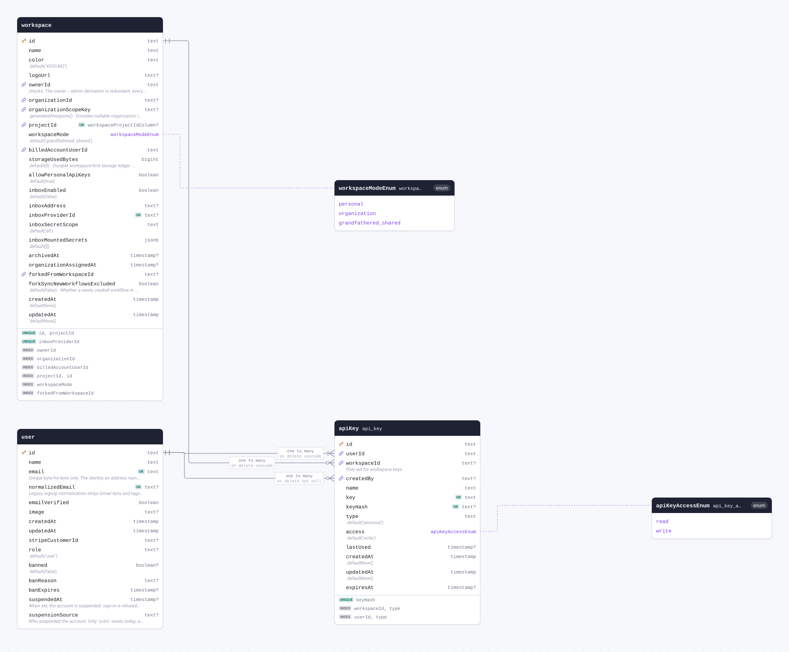

| Column                         | Type                                         | Constraints                             | Default                | Description                 |
| ------------------------------ | -------------------------------------------- | --------------------------------------- | ---------------------- | --------------------------- |
| `id`                           | `text`                                       | PK NOT NULL                             |                        |                             |
| `userId` (`user_id`)           | `text`                                       | NOT NULL → [user.id](#table-user)       |                        |                             |
| `workspaceId` (`workspace_id`) | `text`                                       | NULL → [workspace.id](#table-workspace) |                        | Only set for workspace keys |
| `createdBy` (`created_by`)     | `text`                                       | NULL → [user.id](#table-user)           |                        |                             |
| `name`                         | `text`                                       | NOT NULL                                |                        |                             |
| `key`                          | `text`                                       | UNIQUE NOT NULL                         |                        |                             |
| `keyHash` (`key_hash`)         | `text`                                       | NULL                                    |                        |                             |
| `type`                         | `text`                                       | NOT NULL                                | `.default('personal')` |                             |
| `access`                       | [`apiKeyAccessEnum`](#enum-apiKeyAccessEnum) | NOT NULL                                | `.default('write')`    |                             |
| `lastUsed` (`last_used`)       | `timestamp`                                  | NULL                                    |                        |                             |
| `createdAt` (`created_at`)     | `timestamp`                                  | NOT NULL                                | `.defaultNow()`        |                             |
| `updatedAt` (`updated_at`)     | `timestamp`                                  | NOT NULL                                | `.defaultNow()`        |                             |
| `expiresAt` (`expires_at`)     | `timestamp`                                  | NULL                                    |                        |                             |

#### Definition

```sql
CREATE TABLE "api_key" (
	"id" text PRIMARY KEY,
	"user_id" text NOT NULL,
	"workspace_id" text,
	"created_by" text,
	"name" text NOT NULL,
	"key" text NOT NULL UNIQUE,
	"key_hash" text,
	"type" text DEFAULT 'personal' NOT NULL,
	"access" "api_key_access" DEFAULT 'write'::"api_key_access" NOT NULL,
	"last_used" timestamp,
	"created_at" timestamp DEFAULT now() NOT NULL,
	"updated_at" timestamp DEFAULT now() NOT NULL,
	"expires_at" timestamp,
	CONSTRAINT "workspace_type_check" CHECK ((type = 'workspace' AND workspace_id IS NOT NULL) OR (type = 'personal' AND workspace_id IS NULL))
);

CREATE INDEX "api_key_workspace_type_idx" ON "api_key" ("workspace_id","type");

CREATE INDEX "api_key_user_type_idx" ON "api_key" ("user_id","type");

CREATE UNIQUE INDEX "api_key_key_hash_idx" ON "api_key" ("key_hash");

ALTER TABLE "api_key" ADD CONSTRAINT "api_key_user_id_user_id_fkey" FOREIGN KEY ("user_id") REFERENCES "user"("id") ON DELETE CASCADE;

ALTER TABLE "api_key" ADD CONSTRAINT "api_key_workspace_id_workspace_id_fkey" FOREIGN KEY ("workspace_id") REFERENCES "workspace"("id") ON DELETE CASCADE;

ALTER TABLE "api_key" ADD CONSTRAINT "api_key_created_by_user_id_fkey" FOREIGN KEY ("created_by") REFERENCES "user"("id") ON DELETE SET NULL;
```

#### Indexes

- INDEX `workspaceId`, `type`
- INDEX `userId`, `type`
- UNIQUE `keyHash`

#### References

- `userId` → [user.id](#table-user) (many to one, on delete cascade)
- `workspaceId` → [workspace.id](#table-workspace) (many to one, on delete cascade)
- `createdBy` → [user.id](#table-user) (many to one, on delete set null)

<details>
<summary>Queries and their SQL</summary>

**Select**: Every row of apiKey.

```ts
db.select().from(apiKey);
```

```sql
select "id", "user_id", "workspace_id", "created_by", "name", "key", "key_hash", "type", "access", "last_used", "created_at", "updated_at", "expires_at"
from "api_key"
```

**Count**: How many rows apiKey has.

```ts
db.select({ count: count() }).from(apiKey);
```

```sql
select count(*)
from "api_key"
```

**Find many**: The rows of apiKey, through the relational query API.

```ts
db.query.apiKey.findMany();
```

```sql
select "d0"."id" as "id", "d0"."user_id" as "userId", "d0"."workspace_id" as "workspaceId", "d0"."created_by" as "createdBy", "d0"."name" as "name", "d0"."key" as "key", "d0"."key_hash" as "keyHash", "d0"."type" as "type", "d0"."access" as "access", "d0"."last_used" as "lastUsed", "d0"."created_at" as "createdAt", "d0"."updated_at" as "updatedAt", "d0"."expires_at" as "expiresAt"
from "api_key" as "d0"
```

**Find by primary key**: One row of apiKey, through the relational query API.

```ts
db.query.apiKey.findFirst({ where: { id: "id" } });
```

```sql
select "d0"."id" as "id", "d0"."user_id" as "userId", "d0"."workspace_id" as "workspaceId", "d0"."created_by" as "createdBy", "d0"."name" as "name", "d0"."key" as "key", "d0"."key_hash" as "keyHash", "d0"."type" as "type", "d0"."access" as "access", "d0"."last_used" as "lastUsed", "d0"."created_at" as "createdAt", "d0"."updated_at" as "updatedAt", "d0"."expires_at" as "expiresAt"
from "api_key" as "d0"
where "d0"."id" = $1
limit $2
-- params: ["id",1]
```

**Insert**: Adds a row to apiKey, giving the columns that have no default.

```ts
db.insert(apiKey).values({ id: "id", userId: "userId", name: "name", key: "key" });
```

```sql
insert into "api_key" ("id", "user_id", "workspace_id", "created_by", "name", "key", "key_hash", "type", "access", "last_used", "created_at", "updated_at", "expires_at")
values ($1, $2, default, default, $3, $4, default, default, default, default, default, default, default)
-- params: ["id","userId","name","key"]
```

**Update**: Changes a row of apiKey, found by its primary key.

```ts
db.update(apiKey).set({ userId: "userId" }).where(eq(apiKey.id, "id"));
```

```sql
update "api_key"
set "user_id" = $1
where "api_key"."id" = $2
-- params: ["userId","id"]
```

**Delete**: Deletes a row of apiKey, found by its primary key.

```ts
db.delete(apiKey).where(eq(apiKey.id, "id"));
```

```sql
delete from "api_key"
where "api_key"."id" = $1
-- params: ["id"]
```

</details>

<a id="table-userStats"></a>

### userStats

Table `user_stats`.

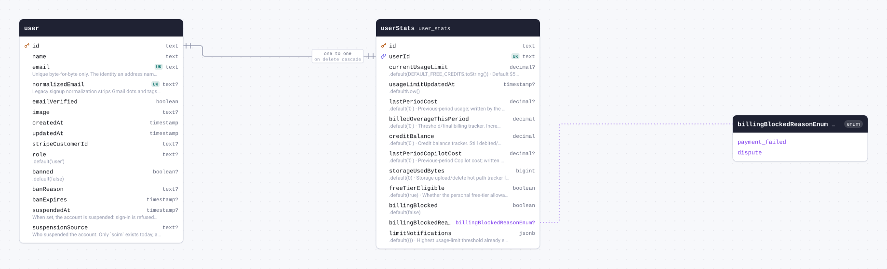

| Column                                                   | Type                                                         | Constraints                              | Default                                     | Description                                                                                                                                                                                                                                                                                                                                                                                                                                                                                                                                                                                                                                                                                                                                                             |
| -------------------------------------------------------- | ------------------------------------------------------------ | ---------------------------------------- | ------------------------------------------- | ----------------------------------------------------------------------------------------------------------------------------------------------------------------------------------------------------------------------------------------------------------------------------------------------------------------------------------------------------------------------------------------------------------------------------------------------------------------------------------------------------------------------------------------------------------------------------------------------------------------------------------------------------------------------------------------------------------------------------------------------------------------------- |
| `id`                                                     | `text`                                                       | PK NOT NULL                              |                                             |                                                                                                                                                                                                                                                                                                                                                                                                                                                                                                                                                                                                                                                                                                                                                                         |
| `userId` (`user_id`)                                     | `text`                                                       | UNIQUE NOT NULL → [user.id](#table-user) |                                             |                                                                                                                                                                                                                                                                                                                                                                                                                                                                                                                                                                                                                                                                                                                                                                         |
| `currentUsageLimit` (`current_usage_limit`)              | `decimal`                                                    | NULL                                     | `.default(DEFAULT_FREE_CREDITS.toString())` | Default $5 (1,000 credits) for free plan, null for team/enterprise                                                                                                                                                                                                                                                                                                                                                                                                                                                                                                                                                                                                                                                                                                      |
| `usageLimitUpdatedAt` (`usage_limit_updated_at`)         | `timestamp`                                                  | NULL                                     | `.defaultNow()`                             |                                                                                                                                                                                                                                                                                                                                                                                                                                                                                                                                                                                                                                                                                                                                                                         |
| `lastPeriodCost` (`last_period_cost`)                    | `decimal`                                                    | NULL                                     | `.default('0')`                             | Previous-period usage; written by the cycle-close sweep from ledger sums.                                                                                                                                                                                                                                                                                                                                                                                                                                                                                                                                                                                                                                                                                               |
| `billedOverageThisPeriod` (`billed_overage_this_period`) | `decimal`                                                    | NOT NULL                                 | `.default('0')`                             | Threshold/final billing tracker. Incremented when threshold billing collects overage mid-period; reset to zero by the cycle-close sweep at period rollover. It is not incremented by the ordinary per-usage ledger write path. Amount of overage already billed via threshold billing                                                                                                                                                                                                                                                                                                                                                                                                                                                                                   |
| `creditBalance` (`credit_balance`)                       | `decimal`                                                    | NOT NULL                                 | `.default('0')`                             | Credit balance tracker. Still debited/credited by billing lifecycle paths and threshold/final overage collection. It is not a per-usage aggregate counter.                                                                                                                                                                                                                                                                                                                                                                                                                                                                                                                                                                                                              |
| `lastPeriodCopilotCost` (`last_period_copilot_cost`)     | `decimal`                                                    | NULL                                     | `.default('0')`                             | Previous-period Copilot cost; written by the cycle-close sweep from copilot-source ledger sums.                                                                                                                                                                                                                                                                                                                                                                                                                                                                                                                                                                                                                                                                         |
| `storageUsedBytes` (`storage_used_bytes`)                | `bigint`                                                     | NOT NULL                                 | `.default(0)`                               | Storage upload/delete hot-path tracker for personal plans. This remains a direct aggregate write for personal file storage changes; org-scoped storage writes update `organization.storageUsedBytes`.                                                                                                                                                                                                                                                                                                                                                                                                                                                                                                                                                                   |
| `freeTierEligible` (`free_tier_eligible`)                | `boolean`                                                    | NOT NULL                                 | `.default(true)`                            | Whether the personal free-tier allowance counts toward this user's limit. False when the account reuses an identity from a recently deleted account (see `deletedAccountIdentity`): the free allowance is granted once per person, not once per account row. Prepaid credit and paid plans are unaffected.                                                                                                                                                                                                                                                                                                                                                                                                                                                              |
| `billingBlocked` (`billing_blocked`)                     | `boolean`                                                    | NOT NULL                                 | `.default(false)`                           |                                                                                                                                                                                                                                                                                                                                                                                                                                                                                                                                                                                                                                                                                                                                                                         |
| `billingBlockedReason` (`billing_blocked_reason`)        | [`billingBlockedReasonEnum`](#enum-billingBlockedReasonEnum) | NULL                                     |                                             |                                                                                                                                                                                                                                                                                                                                                                                                                                                                                                                                                                                                                                                                                                                                                                         |
| `limitNotifications` (`limit_notifications`)             | `jsonb`                                                      | NOT NULL                                 | `.default({})`                              | Highest usage-limit threshold already emailed per category (e.g. `{ storage: 80, tables: 100 }`). Prevents re-spamming the same warning; re-arms when usage drops back below the re-arm band. Keyed by limit category ('storage' \| 'tables'); seats live on `organization`. `credits` instead holds the threshold emailed for the billing period and limit in `creditsPeriod` (start, epoch seconds) and `creditsLimit` (cents), so a new period or a changed limit re-arms it without a reset (see `claimCreditsThreshold`). Dedup granularity is per billing account per category — intentionally NOT per table, so a user hitting the row limit on several tables gets one 'tables' warning, not one per table (the email still names the table that triggered it). |

#### Definition

```sql
CREATE TABLE "user_stats" (
	"id" text PRIMARY KEY,
	"user_id" text NOT NULL UNIQUE,
	"current_usage_limit" numeric DEFAULT '5',
	"usage_limit_updated_at" timestamp DEFAULT now(),
	"last_period_cost" numeric DEFAULT '0',
	"billed_overage_this_period" numeric DEFAULT '0' NOT NULL,
	"credit_balance" numeric DEFAULT '0' NOT NULL,
	"last_period_copilot_cost" numeric DEFAULT '0',
	"storage_used_bytes" bigint DEFAULT 0 NOT NULL,
	"free_tier_eligible" boolean DEFAULT true NOT NULL,
	"billing_blocked" boolean DEFAULT false NOT NULL,
	"billing_blocked_reason" "billing_blocked_reason",
	"limit_notifications" jsonb DEFAULT '{}' NOT NULL
);

ALTER TABLE "user_stats" ADD CONSTRAINT "user_stats_user_id_user_id_fkey" FOREIGN KEY ("user_id") REFERENCES "user"("id") ON DELETE CASCADE;
```

#### References

- `userId` → [user.id](#table-user) (one to one, on delete cascade)

<details>
<summary>Queries and their SQL</summary>

**Select**: Every row of userStats.

```ts
db.select().from(userStats);
```

```sql
select "id", "user_id", "current_usage_limit", "usage_limit_updated_at", "last_period_cost", "billed_overage_this_period", "credit_balance", "last_period_copilot_cost", "storage_used_bytes", "free_tier_eligible", "billing_blocked", "billing_blocked_reason", "limit_notifications"
from "user_stats"
```

**Count**: How many rows userStats has.

```ts
db.select({ count: count() }).from(userStats);
```

```sql
select count(*)
from "user_stats"
```

**Find many**: The rows of userStats, through the relational query API.

```ts
db.query.userStats.findMany();
```

```sql
select "d0"."id" as "id", "d0"."user_id" as "userId", "d0"."current_usage_limit" as "currentUsageLimit", "d0"."usage_limit_updated_at" as "usageLimitUpdatedAt", "d0"."last_period_cost" as "lastPeriodCost", "d0"."billed_overage_this_period" as "billedOverageThisPeriod", "d0"."credit_balance" as "creditBalance", "d0"."last_period_copilot_cost" as "lastPeriodCopilotCost", "d0"."storage_used_bytes" as "storageUsedBytes", "d0"."free_tier_eligible" as "freeTierEligible", "d0"."billing_blocked" as "billingBlocked", "d0"."billing_blocked_reason" as "billingBlockedReason", "d0"."limit_notifications" as "limitNotifications"
from "user_stats" as "d0"
```

**Find by primary key**: One row of userStats, through the relational query API.

```ts
db.query.userStats.findFirst({ where: { id: "id" } });
```

```sql
select "d0"."id" as "id", "d0"."user_id" as "userId", "d0"."current_usage_limit" as "currentUsageLimit", "d0"."usage_limit_updated_at" as "usageLimitUpdatedAt", "d0"."last_period_cost" as "lastPeriodCost", "d0"."billed_overage_this_period" as "billedOverageThisPeriod", "d0"."credit_balance" as "creditBalance", "d0"."last_period_copilot_cost" as "lastPeriodCopilotCost", "d0"."storage_used_bytes" as "storageUsedBytes", "d0"."free_tier_eligible" as "freeTierEligible", "d0"."billing_blocked" as "billingBlocked", "d0"."billing_blocked_reason" as "billingBlockedReason", "d0"."limit_notifications" as "limitNotifications"
from "user_stats" as "d0"
where "d0"."id" = $1
limit $2
-- params: ["id",1]
```

**Insert**: Adds a row to userStats, giving the columns that have no default.

```ts
db.insert(userStats).values({ id: "id", userId: "userId" });
```

```sql
insert into "user_stats" ("id", "user_id", "current_usage_limit", "usage_limit_updated_at", "last_period_cost", "billed_overage_this_period", "credit_balance", "last_period_copilot_cost", "storage_used_bytes", "free_tier_eligible", "billing_blocked", "billing_blocked_reason", "limit_notifications")
values ($1, $2, default, default, default, default, default, default, default, default, default, default, default)
-- params: ["id","userId"]
```

**Update**: Changes a row of userStats, found by its primary key.

```ts
db.update(userStats).set({ userId: "userId" }).where(eq(userStats.id, "id"));
```

```sql
update "user_stats"
set "user_id" = $1
where "user_stats"."id" = $2
-- params: ["userId","id"]
```

**Delete**: Deletes a row of userStats, found by its primary key.

```ts
db.delete(userStats).where(eq(userStats.id, "id"));
```

```sql
delete from "user_stats"
where "user_stats"."id" = $1
-- params: ["id"]
```

</details>

<a id="table-deletedAccountIdentity"></a>

### deletedAccountIdentity

Table `deleted_account_identity`. Keyed one-way digests of the sign-in identities (canonical email, OAuth provider subject) of accounts deleted at their holder's request, kept for a bounded window so a new account on the same identity does not receive a second free-tier allowance. Holds no user id, address, or other profile data. The digests are pseudonymous: the server key (derived from `BETTER_AUTH_SECRET`) can test a candidate identity against them, and rotating that secret orphans them. Rows are purged once `expiresAt` passes.

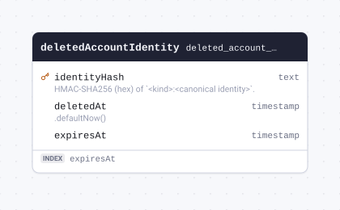

| Column                           | Type        | Constraints | Default         | Description                                         |
| -------------------------------- | ----------- | ----------- | --------------- | --------------------------------------------------- |
| `identityHash` (`identity_hash`) | `text`      | PK NOT NULL |                 | HMAC-SHA256 (hex) of `<kind>:<canonical identity>`. |
| `deletedAt` (`deleted_at`)       | `timestamp` | NOT NULL    | `.defaultNow()` |                                                     |
| `expiresAt` (`expires_at`)       | `timestamp` | NOT NULL    |                 |                                                     |

#### Definition

```sql
CREATE TABLE "deleted_account_identity" (
	"identity_hash" text PRIMARY KEY,
	"deleted_at" timestamp DEFAULT now() NOT NULL,
	"expires_at" timestamp NOT NULL
);

CREATE INDEX "deleted_account_identity_expires_at_idx" ON "deleted_account_identity" ("expires_at");
```

#### Indexes

- INDEX `expiresAt`

<details>
<summary>Queries and their SQL</summary>

**Select**: Every row of deletedAccountIdentity.

```ts
db.select().from(deletedAccountIdentity);
```

```sql
select "identity_hash", "deleted_at", "expires_at"
from "deleted_account_identity"
```

**Count**: How many rows deletedAccountIdentity has.

```ts
db.select({ count: count() }).from(deletedAccountIdentity);
```

```sql
select count(*)
from "deleted_account_identity"
```

**Find many**: The rows of deletedAccountIdentity, through the relational query API.

```ts
db.query.deletedAccountIdentity.findMany();
```

```sql
select "d0"."identity_hash" as "identityHash", "d0"."deleted_at" as "deletedAt", "d0"."expires_at" as "expiresAt"
from "deleted_account_identity" as "d0"
```

**Find by primary key**: One row of deletedAccountIdentity, through the relational query API.

```ts
db.query.deletedAccountIdentity.findFirst({ where: { identityHash: "identityHash" } });
```

```sql
select "d0"."identity_hash" as "identityHash", "d0"."deleted_at" as "deletedAt", "d0"."expires_at" as "expiresAt"
from "deleted_account_identity" as "d0"
where "d0"."identity_hash" = $1
limit $2
-- params: ["identityHash",1]
```

**Insert**: Adds a row to deletedAccountIdentity, giving the columns that have no default.

```ts
db.insert(deletedAccountIdentity).values({
  identityHash: "identityHash",
  expiresAt: new Date("2026-01-01T00:00:00.000Z"),
});
```

```sql
insert into "deleted_account_identity" ("identity_hash", "deleted_at", "expires_at")
values ($1, default, $2)
-- params: ["identityHash","2026-01-01T00:00:00.000Z"]
```

**Update**: Changes a row of deletedAccountIdentity, found by its primary key.

```ts
db.update(deletedAccountIdentity)
  .set({ deletedAt: new Date("2026-01-01T00:00:00.000Z") })
  .where(eq(deletedAccountIdentity.identityHash, "identityHash"));
```

```sql
update "deleted_account_identity"
set "deleted_at" = $1
where "deleted_account_identity"."identity_hash" = $2
-- params: ["2026-01-01T00:00:00.000Z","identityHash"]
```

**Delete**: Deletes a row of deletedAccountIdentity, found by its primary key.

```ts
db.delete(deletedAccountIdentity).where(eq(deletedAccountIdentity.identityHash, "identityHash"));
```

```sql
delete from "deleted_account_identity"
where "deleted_account_identity"."identity_hash" = $1
-- params: ["identityHash"]
```

</details>

<a id="table-customTools"></a>

### customTools

Table `custom_tools`.

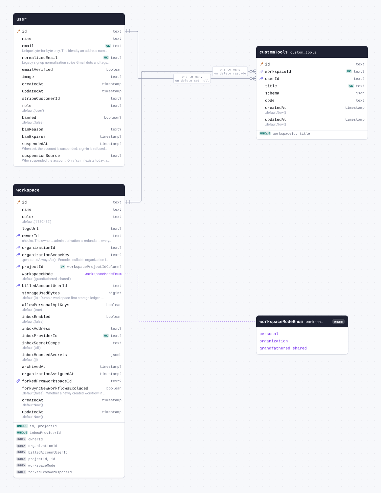

| Column                         | Type        | Constraints                             | Default         | Description |
| ------------------------------ | ----------- | --------------------------------------- | --------------- | ----------- |
| `id`                           | `text`      | PK NOT NULL                             |                 |             |
| `workspaceId` (`workspace_id`) | `text`      | NULL → [workspace.id](#table-workspace) |                 |             |
| `userId` (`user_id`)           | `text`      | NULL → [user.id](#table-user)           |                 |             |
| `title`                        | `text`      | NOT NULL                                |                 |             |
| `schema`                       | `json`      | NOT NULL                                |                 |             |
| `code`                         | `text`      | NOT NULL                                |                 |             |
| `createdAt` (`created_at`)     | `timestamp` | NOT NULL                                | `.defaultNow()` |             |
| `updatedAt` (`updated_at`)     | `timestamp` | NOT NULL                                | `.defaultNow()` |             |

#### Definition

```sql
CREATE TABLE "custom_tools" (
	"id" text PRIMARY KEY,
	"workspace_id" text,
	"user_id" text,
	"title" text NOT NULL,
	"schema" json NOT NULL,
	"code" text NOT NULL,
	"created_at" timestamp DEFAULT now() NOT NULL,
	"updated_at" timestamp DEFAULT now() NOT NULL
);

CREATE UNIQUE INDEX "custom_tools_workspace_title_unique" ON "custom_tools" ("workspace_id","title");

ALTER TABLE "custom_tools" ADD CONSTRAINT "custom_tools_workspace_id_workspace_id_fkey" FOREIGN KEY ("workspace_id") REFERENCES "workspace"("id") ON DELETE CASCADE;

ALTER TABLE "custom_tools" ADD CONSTRAINT "custom_tools_user_id_user_id_fkey" FOREIGN KEY ("user_id") REFERENCES "user"("id") ON DELETE SET NULL;
```

#### Indexes

- UNIQUE `workspaceId`, `title`

#### References

- `workspaceId` → [workspace.id](#table-workspace) (many to one, on delete cascade)
- `userId` → [user.id](#table-user) (many to one, on delete set null)

<details>
<summary>Queries and their SQL</summary>

**Select**: Every row of customTools.

```ts
db.select().from(customTools);
```

```sql
select "id", "workspace_id", "user_id", "title", "schema", "code", "created_at", "updated_at"
from "custom_tools"
```

**Count**: How many rows customTools has.

```ts
db.select({ count: count() }).from(customTools);
```

```sql
select count(*)
from "custom_tools"
```

**Find many**: The rows of customTools, through the relational query API.

```ts
db.query.customTools.findMany();
```

```sql
select "d0"."id" as "id", "d0"."workspace_id" as "workspaceId", "d0"."user_id" as "userId", "d0"."title" as "title", "d0"."schema" as "schema", "d0"."code" as "code", "d0"."created_at" as "createdAt", "d0"."updated_at" as "updatedAt"
from "custom_tools" as "d0"
```

**Find by primary key**: One row of customTools, through the relational query API.

```ts
db.query.customTools.findFirst({ where: { id: "id" } });
```

```sql
select "d0"."id" as "id", "d0"."workspace_id" as "workspaceId", "d0"."user_id" as "userId", "d0"."title" as "title", "d0"."schema" as "schema", "d0"."code" as "code", "d0"."created_at" as "createdAt", "d0"."updated_at" as "updatedAt"
from "custom_tools" as "d0"
where "d0"."id" = $1
limit $2
-- params: ["id",1]
```

**Insert**: Adds a row to customTools, giving the columns that have no default.

```ts
db.insert(customTools).values({ id: "id", title: "title", schema: {}, code: "code" });
```

```sql
insert into "custom_tools" ("id", "workspace_id", "user_id", "title", "schema", "code", "created_at", "updated_at")
values ($1, default, default, $2, $3, $4, default, default)
-- params: ["id","title",{},"code"]
```

**Update**: Changes a row of customTools, found by its primary key.

```ts
db.update(customTools).set({ workspaceId: "workspaceId" }).where(eq(customTools.id, "id"));
```

```sql
update "custom_tools"
set "workspace_id" = $1
where "custom_tools"."id" = $2
-- params: ["workspaceId","id"]
```

**Delete**: Deletes a row of customTools, found by its primary key.

```ts
db.delete(customTools).where(eq(customTools.id, "id"));
```

```sql
delete from "custom_tools"
where "custom_tools"."id" = $1
-- params: ["id"]
```

</details>

<a id="table-skill"></a>

### skill

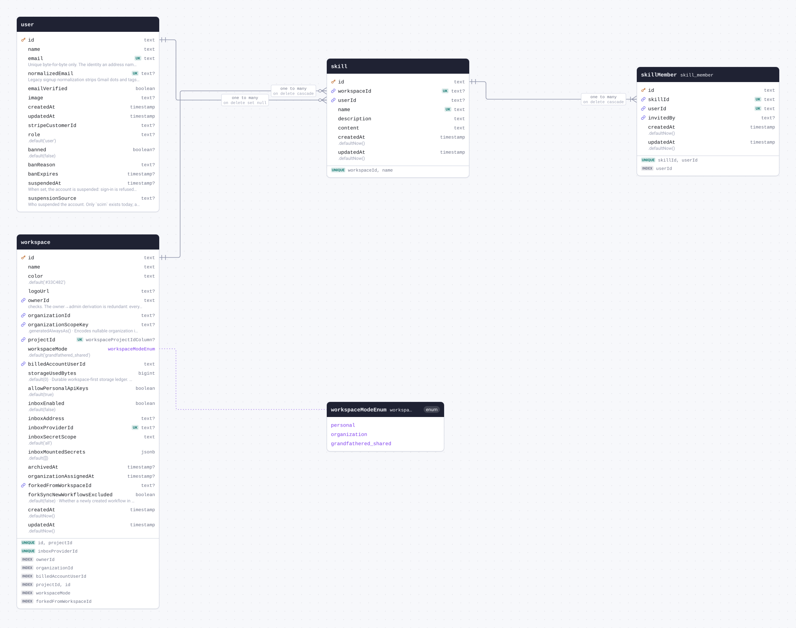

| Column                         | Type        | Constraints                             | Default         | Description |
| ------------------------------ | ----------- | --------------------------------------- | --------------- | ----------- |
| `id`                           | `text`      | PK NOT NULL                             |                 |             |
| `workspaceId` (`workspace_id`) | `text`      | NULL → [workspace.id](#table-workspace) |                 |             |
| `userId` (`user_id`)           | `text`      | NULL → [user.id](#table-user)           |                 |             |
| `name`                         | `text`      | NOT NULL                                |                 |             |
| `description`                  | `text`      | NOT NULL                                |                 |             |
| `content`                      | `text`      | NOT NULL                                |                 |             |
| `createdAt` (`created_at`)     | `timestamp` | NOT NULL                                | `.defaultNow()` |             |
| `updatedAt` (`updated_at`)     | `timestamp` | NOT NULL                                | `.defaultNow()` |             |

#### Definition

```sql
CREATE TABLE "skill" (
	"id" text PRIMARY KEY,
	"workspace_id" text,
	"user_id" text,
	"name" text NOT NULL,
	"description" text NOT NULL,
	"content" text NOT NULL,
	"created_at" timestamp DEFAULT now() NOT NULL,
	"updated_at" timestamp DEFAULT now() NOT NULL
);

CREATE UNIQUE INDEX "skill_workspace_name_unique" ON "skill" ("workspace_id","name");

ALTER TABLE "skill" ADD CONSTRAINT "skill_workspace_id_workspace_id_fkey" FOREIGN KEY ("workspace_id") REFERENCES "workspace"("id") ON DELETE CASCADE;

ALTER TABLE "skill" ADD CONSTRAINT "skill_user_id_user_id_fkey" FOREIGN KEY ("user_id") REFERENCES "user"("id") ON DELETE SET NULL;
```

#### Indexes

- UNIQUE `workspaceId`, `name`

#### References

- `workspaceId` → [workspace.id](#table-workspace) (many to one, on delete cascade)
- `userId` → [user.id](#table-user) (many to one, on delete set null)

#### Referenced by

- `id` → [skillMember.skillId](#table-skillMember) (one to many, on delete cascade)

<details>
<summary>Queries and their SQL</summary>

**Select**: Every row of skill.

```ts
db.select().from(skill);
```

```sql
select "id", "workspace_id", "user_id", "name", "description", "content", "created_at", "updated_at"
from "skill"
```

**Count**: How many rows skill has.

```ts
db.select({ count: count() }).from(skill);
```

```sql
select count(*)
from "skill"
```

**Find many**: The rows of skill, through the relational query API.

```ts
db.query.skill.findMany();
```

```sql
select "d0"."id" as "id", "d0"."workspace_id" as "workspaceId", "d0"."user_id" as "userId", "d0"."name" as "name", "d0"."description" as "description", "d0"."content" as "content", "d0"."created_at" as "createdAt", "d0"."updated_at" as "updatedAt"
from "skill" as "d0"
```

**Find by primary key**: One row of skill, through the relational query API.

```ts
db.query.skill.findFirst({ where: { id: "id" } });
```

```sql
select "d0"."id" as "id", "d0"."workspace_id" as "workspaceId", "d0"."user_id" as "userId", "d0"."name" as "name", "d0"."description" as "description", "d0"."content" as "content", "d0"."created_at" as "createdAt", "d0"."updated_at" as "updatedAt"
from "skill" as "d0"
where "d0"."id" = $1
limit $2
-- params: ["id",1]
```

**Insert**: Adds a row to skill, giving the columns that have no default.

```ts
db.insert(skill).values({ id: "id", name: "name", description: "description", content: "content" });
```

```sql
insert into "skill" ("id", "workspace_id", "user_id", "name", "description", "content", "created_at", "updated_at")
values ($1, default, default, $2, $3, $4, default, default)
-- params: ["id","name","description","content"]
```

**Update**: Changes a row of skill, found by its primary key.

```ts
db.update(skill).set({ workspaceId: "workspaceId" }).where(eq(skill.id, "id"));
```

```sql
update "skill"
set "workspace_id" = $1
where "skill"."id" = $2
-- params: ["workspaceId","id"]
```

**Delete**: Deletes a row of skill, found by its primary key.

```ts
db.delete(skill).where(eq(skill.id, "id"));
```

```sql
delete from "skill"
where "skill"."id" = $1
-- params: ["id"]
```

</details>

<a id="table-skillMember"></a>

### skillMember

Table `skill_member`. Editor grants for a skill. A row makes the user an editor (edit, delete, share); workspace admins are derived editors and need no rows. Everyone with workspace access can see and use every skill regardless of rows.

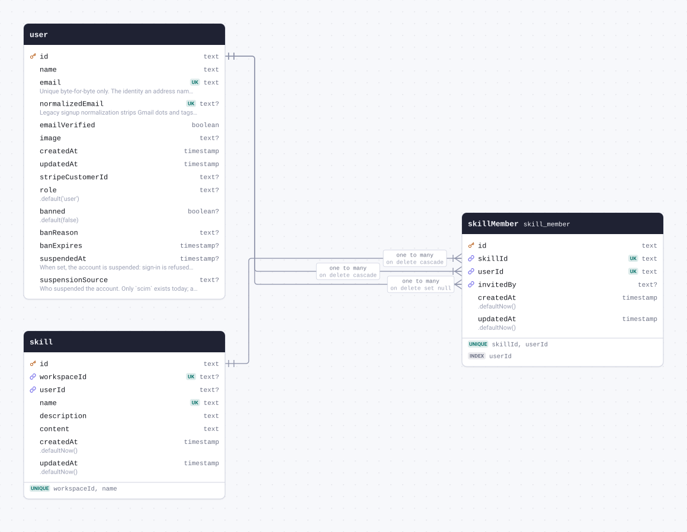

| Column                     | Type        | Constraints                         | Default         | Description |
| -------------------------- | ----------- | ----------------------------------- | --------------- | ----------- |
| `id`                       | `text`      | PK NOT NULL                         |                 |             |
| `skillId` (`skill_id`)     | `text`      | NOT NULL → [skill.id](#table-skill) |                 |             |
| `userId` (`user_id`)       | `text`      | NOT NULL → [user.id](#table-user)   |                 |             |
| `invitedBy` (`invited_by`) | `text`      | NULL → [user.id](#table-user)       |                 |             |
| `createdAt` (`created_at`) | `timestamp` | NOT NULL                            | `.defaultNow()` |             |
| `updatedAt` (`updated_at`) | `timestamp` | NOT NULL                            | `.defaultNow()` |             |

#### Definition

```sql
CREATE TABLE "skill_member" (
	"id" text PRIMARY KEY,
	"skill_id" text NOT NULL,
	"user_id" text NOT NULL,
	"invited_by" text,
	"created_at" timestamp DEFAULT now() NOT NULL,
	"updated_at" timestamp DEFAULT now() NOT NULL
);

CREATE INDEX "skill_member_user_id_idx" ON "skill_member" ("user_id");

CREATE UNIQUE INDEX "skill_member_unique" ON "skill_member" ("skill_id","user_id");

ALTER TABLE "skill_member" ADD CONSTRAINT "skill_member_skill_id_skill_id_fkey" FOREIGN KEY ("skill_id") REFERENCES "skill"("id") ON DELETE CASCADE;

ALTER TABLE "skill_member" ADD CONSTRAINT "skill_member_user_id_user_id_fkey" FOREIGN KEY ("user_id") REFERENCES "user"("id") ON DELETE CASCADE;

ALTER TABLE "skill_member" ADD CONSTRAINT "skill_member_invited_by_user_id_fkey" FOREIGN KEY ("invited_by") REFERENCES "user"("id") ON DELETE SET NULL;
```

#### Indexes

- INDEX `userId`
- UNIQUE `skillId`, `userId`

#### References

- `skillId` → [skill.id](#table-skill) (many to one, on delete cascade)
- `userId` → [user.id](#table-user) (many to one, on delete cascade)
- `invitedBy` → [user.id](#table-user) (many to one, on delete set null)

<details>
<summary>Queries and their SQL</summary>

**Select**: Every row of skillMember.

```ts
db.select().from(skillMember);
```

```sql
select "id", "skill_id", "user_id", "invited_by", "created_at", "updated_at"
from "skill_member"
```

**Count**: How many rows skillMember has.

```ts
db.select({ count: count() }).from(skillMember);
```

```sql
select count(*)
from "skill_member"
```

**Find many**: The rows of skillMember, through the relational query API.

```ts
db.query.skillMember.findMany();
```

```sql
select "d0"."id" as "id", "d0"."skill_id" as "skillId", "d0"."user_id" as "userId", "d0"."invited_by" as "invitedBy", "d0"."created_at" as "createdAt", "d0"."updated_at" as "updatedAt"
from "skill_member" as "d0"
```

**Find by primary key**: One row of skillMember, through the relational query API.

```ts
db.query.skillMember.findFirst({ where: { id: "id" } });
```

```sql
select "d0"."id" as "id", "d0"."skill_id" as "skillId", "d0"."user_id" as "userId", "d0"."invited_by" as "invitedBy", "d0"."created_at" as "createdAt", "d0"."updated_at" as "updatedAt"
from "skill_member" as "d0"
where "d0"."id" = $1
limit $2
-- params: ["id",1]
```

**Insert**: Adds a row to skillMember, giving the columns that have no default.

```ts
db.insert(skillMember).values({ id: "id", skillId: "skillId", userId: "userId" });
```

```sql
insert into "skill_member" ("id", "skill_id", "user_id", "invited_by", "created_at", "updated_at")
values ($1, $2, $3, default, default, default)
-- params: ["id","skillId","userId"]
```

**Update**: Changes a row of skillMember, found by its primary key.

```ts
db.update(skillMember).set({ skillId: "skillId" }).where(eq(skillMember.id, "id"));
```

```sql
update "skill_member"
set "skill_id" = $1
where "skill_member"."id" = $2
-- params: ["skillId","id"]
```

**Delete**: Deletes a row of skillMember, found by its primary key.

```ts
db.delete(skillMember).where(eq(skillMember.id, "id"));
```

```sql
delete from "skill_member"
where "skill_member"."id" = $1
-- params: ["id"]
```

</details>

<a id="table-subscription"></a>

### subscription

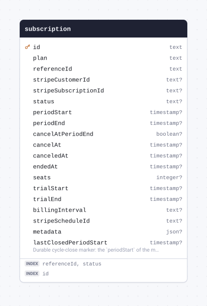

| Column                                               | Type        | Constraints | Default | Description                                                                                                                                                                                                                                                                                                                                                                                                                                                                                                                                                                                                                                            |
| ---------------------------------------------------- | ----------- | ----------- | ------- | ------------------------------------------------------------------------------------------------------------------------------------------------------------------------------------------------------------------------------------------------------------------------------------------------------------------------------------------------------------------------------------------------------------------------------------------------------------------------------------------------------------------------------------------------------------------------------------------------------------------------------------------------------ |
| `id`                                                 | `text`      | PK NOT NULL |         |                                                                                                                                                                                                                                                                                                                                                                                                                                                                                                                                                                                                                                                        |
| `plan`                                               | `text`      | NOT NULL    |         |                                                                                                                                                                                                                                                                                                                                                                                                                                                                                                                                                                                                                                                        |
| `referenceId` (`reference_id`)                       | `text`      | NOT NULL    |         |                                                                                                                                                                                                                                                                                                                                                                                                                                                                                                                                                                                                                                                        |
| `stripeCustomerId` (`stripe_customer_id`)            | `text`      | NULL        |         |                                                                                                                                                                                                                                                                                                                                                                                                                                                                                                                                                                                                                                                        |
| `stripeSubscriptionId` (`stripe_subscription_id`)    | `text`      | NULL        |         |                                                                                                                                                                                                                                                                                                                                                                                                                                                                                                                                                                                                                                                        |
| `status`                                             | `text`      | NULL        |         |                                                                                                                                                                                                                                                                                                                                                                                                                                                                                                                                                                                                                                                        |
| `periodStart` (`period_start`)                       | `timestamp` | NULL        |         |                                                                                                                                                                                                                                                                                                                                                                                                                                                                                                                                                                                                                                                        |
| `periodEnd` (`period_end`)                           | `timestamp` | NULL        |         |                                                                                                                                                                                                                                                                                                                                                                                                                                                                                                                                                                                                                                                        |
| `cancelAtPeriodEnd` (`cancel_at_period_end`)         | `boolean`   | NULL        |         |                                                                                                                                                                                                                                                                                                                                                                                                                                                                                                                                                                                                                                                        |
| `cancelAt` (`cancel_at`)                             | `timestamp` | NULL        |         |                                                                                                                                                                                                                                                                                                                                                                                                                                                                                                                                                                                                                                                        |
| `canceledAt` (`canceled_at`)                         | `timestamp` | NULL        |         |                                                                                                                                                                                                                                                                                                                                                                                                                                                                                                                                                                                                                                                        |
| `endedAt` (`ended_at`)                               | `timestamp` | NULL        |         |                                                                                                                                                                                                                                                                                                                                                                                                                                                                                                                                                                                                                                                        |
| `seats`                                              | `integer`   | NULL        |         |                                                                                                                                                                                                                                                                                                                                                                                                                                                                                                                                                                                                                                                        |
| `trialStart` (`trial_start`)                         | `timestamp` | NULL        |         |                                                                                                                                                                                                                                                                                                                                                                                                                                                                                                                                                                                                                                                        |
| `trialEnd` (`trial_end`)                             | `timestamp` | NULL        |         |                                                                                                                                                                                                                                                                                                                                                                                                                                                                                                                                                                                                                                                        |
| `billingInterval` (`billing_interval`)               | `text`      | NULL        |         |                                                                                                                                                                                                                                                                                                                                                                                                                                                                                                                                                                                                                                                        |
| `stripeScheduleId` (`stripe_schedule_id`)            | `text`      | NULL        |         |                                                                                                                                                                                                                                                                                                                                                                                                                                                                                                                                                                                                                                                        |
| `metadata`                                           | `json`      | NULL        |         |                                                                                                                                                                                                                                                                                                                                                                                                                                                                                                                                                                                                                                                        |
| `lastClosedPeriodStart` (`last_closed_period_start`) | `timestamp` | NULL        |         | Durable cycle-close marker: the `periodStart` of the most recent period whose close (final overage collection, `billedOverageThisPeriod` reset, last-period bookkeeping) has been committed. The daily cycle-close sweep closes the previous period whenever this lags the row's `periodStart`, then advances it. Null = never initialized; the first sweep initializes it to the current `periodStart` without billing so historical periods are never retroactively closed. A deleted subscription's terminal settlement advances it to `periodEnd`: every period ending at or before the marker is settled, and a later charge into one is refused. |

#### Definition

```sql
CREATE TABLE "subscription" (
	"id" text PRIMARY KEY,
	"plan" text NOT NULL,
	"reference_id" text NOT NULL,
	"stripe_customer_id" text,
	"stripe_subscription_id" text,
	"status" text,
	"period_start" timestamp,
	"period_end" timestamp,
	"cancel_at_period_end" boolean,
	"cancel_at" timestamp,
	"canceled_at" timestamp,
	"ended_at" timestamp,
	"seats" integer,
	"trial_start" timestamp,
	"trial_end" timestamp,
	"billing_interval" text,
	"stripe_schedule_id" text,
	"metadata" json,
	"last_closed_period_start" timestamp,
	CONSTRAINT "check_enterprise_metadata" CHECK (plan != 'enterprise' OR metadata IS NOT NULL)
);

CREATE INDEX "subscription_reference_status_idx" ON "subscription" ("reference_id","status");

CREATE INDEX "subscription_cycle_close_lagging_idx" ON "subscription" ("id") WHERE "status" in ('active', 'past_due') and "period_start" is not null and ("last_closed_period_start" is null or "last_closed_period_start" < "period_start");
```

#### Indexes

- INDEX `referenceId`, `status`
- INDEX `id`

<details>
<summary>Queries and their SQL</summary>

**Select**: Every row of subscription.

```ts
db.select().from(subscription);
```

```sql
select "id", "plan", "reference_id", "stripe_customer_id", "stripe_subscription_id", "status", "period_start", "period_end", "cancel_at_period_end", "cancel_at", "canceled_at", "ended_at", "seats", "trial_start", "trial_end", "billing_interval", "stripe_schedule_id", "metadata", "last_closed_period_start"
from "subscription"
```

**Count**: How many rows subscription has.

```ts
db.select({ count: count() }).from(subscription);
```

```sql
select count(*)
from "subscription"
```

**Find many**: The rows of subscription, through the relational query API.

```ts
db.query.subscription.findMany();
```

```sql
select "d0"."id" as "id", "d0"."plan" as "plan", "d0"."reference_id" as "referenceId", "d0"."stripe_customer_id" as "stripeCustomerId", "d0"."stripe_subscription_id" as "stripeSubscriptionId", "d0"."status" as "status", "d0"."period_start" as "periodStart", "d0"."period_end" as "periodEnd", "d0"."cancel_at_period_end" as "cancelAtPeriodEnd", "d0"."cancel_at" as "cancelAt", "d0"."canceled_at" as "canceledAt", "d0"."ended_at" as "endedAt", "d0"."seats" as "seats", "d0"."trial_start" as "trialStart", "d0"."trial_end" as "trialEnd", "d0"."billing_interval" as "billingInterval", "d0"."stripe_schedule_id" as "stripeScheduleId", "d0"."metadata" as "metadata", "d0"."last_closed_period_start" as "lastClosedPeriodStart"
from "subscription" as "d0"
```

**Find by primary key**: One row of subscription, through the relational query API.

```ts
db.query.subscription.findFirst({ where: { id: "id" } });
```

```sql
select "d0"."id" as "id", "d0"."plan" as "plan", "d0"."reference_id" as "referenceId", "d0"."stripe_customer_id" as "stripeCustomerId", "d0"."stripe_subscription_id" as "stripeSubscriptionId", "d0"."status" as "status", "d0"."period_start" as "periodStart", "d0"."period_end" as "periodEnd", "d0"."cancel_at_period_end" as "cancelAtPeriodEnd", "d0"."cancel_at" as "cancelAt", "d0"."canceled_at" as "canceledAt", "d0"."ended_at" as "endedAt", "d0"."seats" as "seats", "d0"."trial_start" as "trialStart", "d0"."trial_end" as "trialEnd", "d0"."billing_interval" as "billingInterval", "d0"."stripe_schedule_id" as "stripeScheduleId", "d0"."metadata" as "metadata", "d0"."last_closed_period_start" as "lastClosedPeriodStart"
from "subscription" as "d0"
where "d0"."id" = $1
limit $2
-- params: ["id",1]
```

**Insert**: Adds a row to subscription, giving the columns that have no default.

```ts
db.insert(subscription).values({ id: "id", plan: "plan", referenceId: "referenceId" });
```

```sql
insert into "subscription" ("id", "plan", "reference_id", "stripe_customer_id", "stripe_subscription_id", "status", "period_start", "period_end", "cancel_at_period_end", "cancel_at", "canceled_at", "ended_at", "seats", "trial_start", "trial_end", "billing_interval", "stripe_schedule_id", "metadata", "last_closed_period_start")
values ($1, $2, $3, default, default, default, default, default, default, default, default, default, default, default, default, default, default, default, default)
-- params: ["id","plan","referenceId"]
```

**Update**: Changes a row of subscription, found by its primary key.

```ts
db.update(subscription).set({ plan: "plan" }).where(eq(subscription.id, "id"));
```

```sql
update "subscription"
set "plan" = $1
where "subscription"."id" = $2
-- params: ["plan","id"]
```

**Delete**: Deletes a row of subscription, found by its primary key.

```ts
db.delete(subscription).where(eq(subscription.id, "id"));
```

```sql
delete from "subscription"
where "subscription"."id" = $1
-- params: ["id"]
```

</details>

<a id="table-rateLimitBucket"></a>

### rateLimitBucket

Table `rate_limit_bucket`.

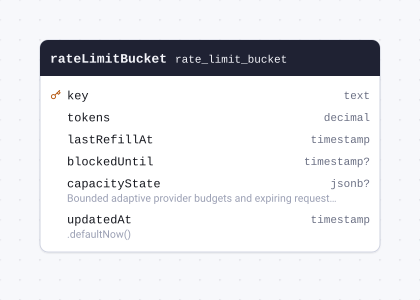

| Column                             | Type        | Constraints | Default         | Description                                                                                    |
| ---------------------------------- | ----------- | ----------- | --------------- | ---------------------------------------------------------------------------------------------- |
| `key`                              | `text`      | PK NOT NULL |                 |                                                                                                |
| `tokens`                           | `decimal`   | NOT NULL    |                 |                                                                                                |
| `lastRefillAt` (`last_refill_at`)  | `timestamp` | NOT NULL    |                 |                                                                                                |
| `blockedUntil` (`blocked_until`)   | `timestamp` | NULL        |                 |                                                                                                |
| `capacityState` (`capacity_state`) | `jsonb`     | NULL        |                 | Bounded adaptive provider budgets and expiring request leases; ordinary buckets leave it null. |
| `updatedAt` (`updated_at`)         | `timestamp` | NOT NULL    | `.defaultNow()` |                                                                                                |

#### Definition

```sql
CREATE TABLE "rate_limit_bucket" (
	"key" text PRIMARY KEY,
	"tokens" numeric NOT NULL,
	"last_refill_at" timestamp NOT NULL,
	"blocked_until" timestamp,
	"capacity_state" jsonb,
	"updated_at" timestamp DEFAULT now() NOT NULL
);
```

<details>
<summary>Queries and their SQL</summary>

**Select**: Every row of rateLimitBucket.

```ts
db.select().from(rateLimitBucket);
```

```sql
select "key", "tokens", "last_refill_at", "blocked_until", "capacity_state", "updated_at"
from "rate_limit_bucket"
```

**Count**: How many rows rateLimitBucket has.

```ts
db.select({ count: count() }).from(rateLimitBucket);
```

```sql
select count(*)
from "rate_limit_bucket"
```

**Find many**: The rows of rateLimitBucket, through the relational query API.

```ts
db.query.rateLimitBucket.findMany();
```

```sql
select "d0"."key" as "key", "d0"."tokens" as "tokens", "d0"."last_refill_at" as "lastRefillAt", "d0"."blocked_until" as "blockedUntil", "d0"."capacity_state" as "capacityState", "d0"."updated_at" as "updatedAt"
from "rate_limit_bucket" as "d0"
```

**Find by primary key**: One row of rateLimitBucket, through the relational query API.

```ts
db.query.rateLimitBucket.findFirst({ where: { key: "key" } });
```

```sql
select "d0"."key" as "key", "d0"."tokens" as "tokens", "d0"."last_refill_at" as "lastRefillAt", "d0"."blocked_until" as "blockedUntil", "d0"."capacity_state" as "capacityState", "d0"."updated_at" as "updatedAt"
from "rate_limit_bucket" as "d0"
where "d0"."key" = $1
limit $2
-- params: ["key",1]
```

**Insert**: Adds a row to rateLimitBucket, giving the columns that have no default.

```ts
db.insert(rateLimitBucket).values({
  key: "key",
  tokens: "1.00",
  lastRefillAt: new Date("2026-01-01T00:00:00.000Z"),
});
```

```sql
insert into "rate_limit_bucket" ("key", "tokens", "last_refill_at", "blocked_until", "capacity_state", "updated_at")
values ($1, $2, $3, default, default, default)
-- params: ["key","1.00","2026-01-01T00:00:00.000Z"]
```

**Update**: Changes a row of rateLimitBucket, found by its primary key.

```ts
db.update(rateLimitBucket).set({ tokens: "1.00" }).where(eq(rateLimitBucket.key, "key"));
```

```sql
update "rate_limit_bucket"
set "tokens" = $1
where "rate_limit_bucket"."key" = $2
-- params: ["1.00","key"]
```

**Delete**: Deletes a row of rateLimitBucket, found by its primary key.

```ts
db.delete(rateLimitBucket).where(eq(rateLimitBucket.key, "key"));
```

```sql
delete from "rate_limit_bucket"
where "rate_limit_bucket"."key" = $1
-- params: ["key"]
```

</details>

<a id="table-chat"></a>

### chat

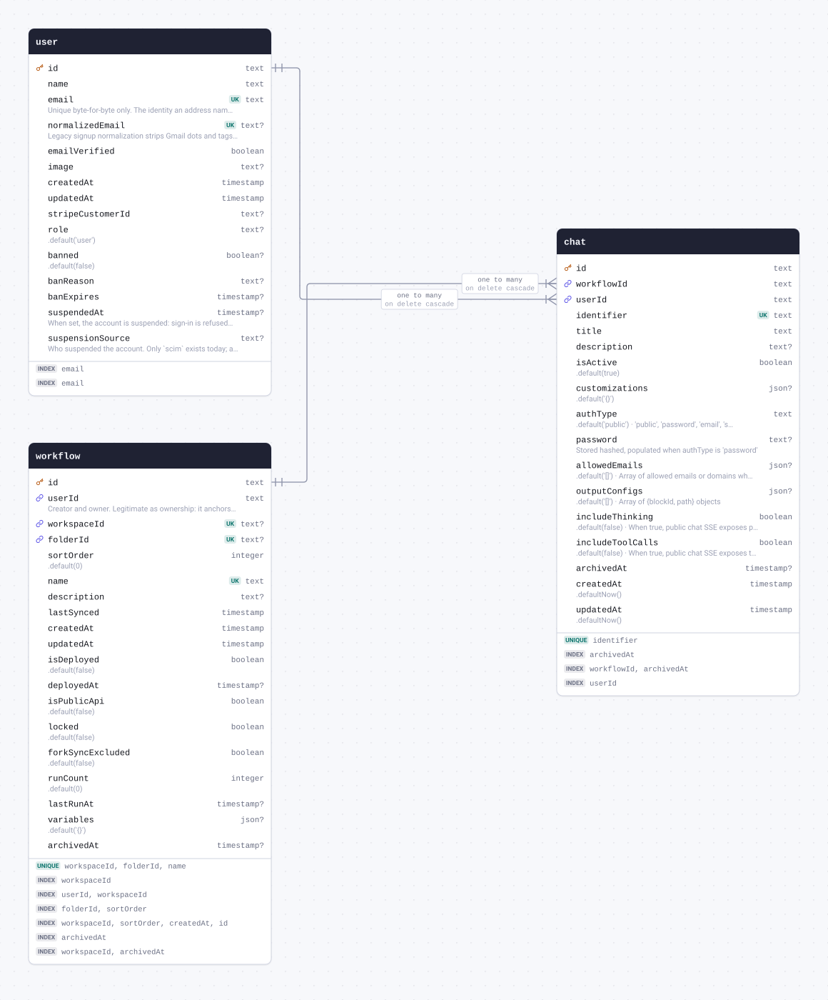

| Column                                    | Type        | Constraints                               | Default              | Description                                                                                                                                                                                                                               |
| ----------------------------------------- | ----------- | ----------------------------------------- | -------------------- | ----------------------------------------------------------------------------------------------------------------------------------------------------------------------------------------------------------------------------------------- |
| `id`                                      | `text`      | PK NOT NULL                               |                      |                                                                                                                                                                                                                                           |
| `workflowId` (`workflow_id`)              | `text`      | NOT NULL → [workflow.id](#table-workflow) |                      |                                                                                                                                                                                                                                           |
| `userId` (`user_id`)                      | `text`      | NOT NULL → [user.id](#table-user)         |                      |                                                                                                                                                                                                                                           |
| `identifier`                              | `text`      | NOT NULL                                  |                      |                                                                                                                                                                                                                                           |
| `title`                                   | `text`      | NOT NULL                                  |                      |                                                                                                                                                                                                                                           |
| `description`                             | `text`      | NULL                                      |                      |                                                                                                                                                                                                                                           |
| `isActive` (`is_active`)                  | `boolean`   | NOT NULL                                  | `.default(true)`     |                                                                                                                                                                                                                                           |
| `customizations`                          | `json`      | NULL                                      | `.default('{}')`     |                                                                                                                                                                                                                                           |
| `authType` (`auth_type`)                  | `text`      | NOT NULL                                  | `.default('public')` | 'public', 'password', 'email', 'sso'                                                                                                                                                                                                      |
| `password`                                | `text`      | NULL                                      |                      | Stored hashed, populated when authType is 'password'                                                                                                                                                                                      |
| `allowedEmails` (`allowed_emails`)        | `json`      | NULL                                      | `.default('[]')`     | Array of allowed emails or domains when authType is 'email' or 'sso'                                                                                                                                                                      |
| `outputConfigs` (`output_configs`)        | `json`      | NULL                                      | `.default('[]')`     | Array of {blockId, path} objects                                                                                                                                                                                                          |
| `includeThinking` (`include_thinking`)    | `boolean`   | NOT NULL                                  | `.default(false)`    | When true, public chat SSE exposes provider thinking events. Independent of the `X-Sim-Stream-Protocol` header, which governs answer-text cadence rather than frame exposure. Default off — never derived from auth type or isSecureMode. |
| `includeToolCalls` (`include_tool_calls`) | `boolean`   | NOT NULL                                  | `.default(false)`    | When true, public chat SSE exposes tool lifecycle events. Independent of includeThinking and of the protocol header.                                                                                                                      |
| `archivedAt` (`archived_at`)              | `timestamp` | NULL                                      |                      |                                                                                                                                                                                                                                           |
| `createdAt` (`created_at`)                | `timestamp` | NOT NULL                                  | `.defaultNow()`      |                                                                                                                                                                                                                                           |
| `updatedAt` (`updated_at`)                | `timestamp` | NOT NULL                                  | `.defaultNow()`      |                                                                                                                                                                                                                                           |

#### Definition

```sql
CREATE TABLE "chat" (
	"id" text PRIMARY KEY,
	"workflow_id" text NOT NULL,
	"user_id" text NOT NULL,
	"identifier" text NOT NULL,
	"title" text NOT NULL,
	"description" text,
	"is_active" boolean DEFAULT true NOT NULL,
	"customizations" json DEFAULT '"{}"',
	"auth_type" text DEFAULT 'public' NOT NULL,
	"password" text,
	"allowed_emails" json DEFAULT '"[]"',
	"output_configs" json DEFAULT '"[]"',
	"include_thinking" boolean DEFAULT false NOT NULL,
	"include_tool_calls" boolean DEFAULT false NOT NULL,
	"archived_at" timestamp,
	"created_at" timestamp DEFAULT now() NOT NULL,
	"updated_at" timestamp DEFAULT now() NOT NULL
);

CREATE UNIQUE INDEX "identifier_idx" ON "chat" ("identifier") WHERE "archived_at" IS NULL;

CREATE INDEX "chat_archived_at_partial_idx" ON "chat" ("archived_at") WHERE "archived_at" IS NOT NULL;

CREATE INDEX "idx_chat_on_workflow_id_archived_at" ON "chat" ("workflow_id","archived_at");

CREATE INDEX CONCURRENTLY "chat_user_id_idx" ON "chat" ("user_id");

ALTER TABLE "chat" ADD CONSTRAINT "chat_workflow_id_workflow_id_fkey" FOREIGN KEY ("workflow_id") REFERENCES "workflow"("id") ON DELETE CASCADE;

ALTER TABLE "chat" ADD CONSTRAINT "chat_user_id_user_id_fkey" FOREIGN KEY ("user_id") REFERENCES "user"("id") ON DELETE CASCADE;
```

#### Indexes

- UNIQUE `identifier`
- INDEX `archivedAt`
- INDEX `workflowId`, `archivedAt`
- INDEX `userId`

#### References

- `workflowId` → [workflow.id](#table-workflow) (many to one, on delete cascade)
- `userId` → [user.id](#table-user) (many to one, on delete cascade)

<details>
<summary>Queries and their SQL</summary>

**Select**: Every row of chat.

```ts
db.select().from(chat);
```

```sql
select "id", "workflow_id", "user_id", "identifier", "title", "description", "is_active", "customizations", "auth_type", "password", "allowed_emails", "output_configs", "include_thinking", "include_tool_calls", "archived_at", "created_at", "updated_at"
from "chat"
```

**Count**: How many rows chat has.

```ts
db.select({ count: count() }).from(chat);
```

```sql
select count(*)
from "chat"
```

**Find many**: The rows of chat, through the relational query API.

```ts
db.query.chat.findMany();
```

```sql
select "d0"."id" as "id", "d0"."workflow_id" as "workflowId", "d0"."user_id" as "userId", "d0"."identifier" as "identifier", "d0"."title" as "title", "d0"."description" as "description", "d0"."is_active" as "isActive", "d0"."customizations" as "customizations", "d0"."auth_type" as "authType", "d0"."password" as "password", "d0"."allowed_emails" as "allowedEmails", "d0"."output_configs" as "outputConfigs", "d0"."include_thinking" as "includeThinking", "d0"."include_tool_calls" as "includeToolCalls", "d0"."archived_at" as "archivedAt", "d0"."created_at" as "createdAt", "d0"."updated_at" as "updatedAt"
from "chat" as "d0"
```

**Find by primary key**: One row of chat, through the relational query API.

```ts
db.query.chat.findFirst({ where: { id: "id" } });
```

```sql
select "d0"."id" as "id", "d0"."workflow_id" as "workflowId", "d0"."user_id" as "userId", "d0"."identifier" as "identifier", "d0"."title" as "title", "d0"."description" as "description", "d0"."is_active" as "isActive", "d0"."customizations" as "customizations", "d0"."auth_type" as "authType", "d0"."password" as "password", "d0"."allowed_emails" as "allowedEmails", "d0"."output_configs" as "outputConfigs", "d0"."include_thinking" as "includeThinking", "d0"."include_tool_calls" as "includeToolCalls", "d0"."archived_at" as "archivedAt", "d0"."created_at" as "createdAt", "d0"."updated_at" as "updatedAt"
from "chat" as "d0"
where "d0"."id" = $1
limit $2
-- params: ["id",1]
```

**Insert**: Adds a row to chat, giving the columns that have no default.

```ts
db.insert(chat).values({
  id: "id",
  workflowId: "workflowId",
  userId: "userId",
  identifier: "identifier",
  title: "title",
});
```

```sql
insert into "chat" ("id", "workflow_id", "user_id", "identifier", "title", "description", "is_active", "customizations", "auth_type", "password", "allowed_emails", "output_configs", "include_thinking", "include_tool_calls", "archived_at", "created_at", "updated_at")
values ($1, $2, $3, $4, $5, default, default, default, default, default, default, default, default, default, default, default, default)
-- params: ["id","workflowId","userId","identifier","title"]
```

**Update**: Changes a row of chat, found by its primary key.

```ts
db.update(chat).set({ workflowId: "workflowId" }).where(eq(chat.id, "id"));
```

```sql
update "chat"
set "workflow_id" = $1
where "chat"."id" = $2
-- params: ["workflowId","id"]
```

**Delete**: Deletes a row of chat, found by its primary key.

```ts
db.delete(chat).where(eq(chat.id, "id"));
```

```sql
delete from "chat"
where "chat"."id" = $1
-- params: ["id"]
```

</details>

<a id="table-organization"></a>

### organization

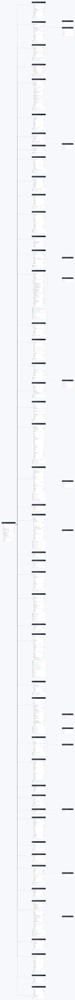

| Column                                              | Type        | Constraints | Default           | Description                                                                                                                                                                                                                                                                                                                                 |
| --------------------------------------------------- | ----------- | ----------- | ----------------- | ------------------------------------------------------------------------------------------------------------------------------------------------------------------------------------------------------------------------------------------------------------------------------------------------------------------------------------------- |
| `id`                                                | `text`      | PK NOT NULL |                   |                                                                                                                                                                                                                                                                                                                                             |
| `name`                                              | `text`      | NOT NULL    |                   |                                                                                                                                                                                                                                                                                                                                             |
| `slug`                                              | `text`      | NOT NULL    |                   |                                                                                                                                                                                                                                                                                                                                             |
| `logo`                                              | `text`      | NULL        |                   |                                                                                                                                                                                                                                                                                                                                             |
| `metadata`                                          | `json`      | NULL        |                   |                                                                                                                                                                                                                                                                                                                                             |
| `sessionPolicySettings` (`session_policy_settings`) | `json`      | NULL        |                   |                                                                                                                                                                                                                                                                                                                                             |
| `securityPolicyVersion` (`security_policy_version`) | `integer`   | NOT NULL    | `.default(1)`     | Monotonic counter embedded in the Better Auth cookie-cache version for this org's members. Bumped on any security-policy change or org-wide session revocation so every cached session cookie in the org is invalidated (falls through to a DB session read) within the policy cache TTL instead of the 24h cookie-cache lifetime.          |
| `requireSso` (`require_sso`)                        | `boolean`   | NOT NULL    | `.default(false)` | Whether members must sign in through this organization's identity provider. Checked only when a session is created, so turning it on ends no session that already exists; signing everyone out stays the separate revoke action. Owners keep password sign-in as a break-glass path for a broken identity provider.                         |
| `whitelabelSettings` (`whitelabel_settings`)        | `json`      | NULL        |                   |                                                                                                                                                                                                                                                                                                                                             |
| `dataRetentionSettings` (`data_retention_settings`) | `json`      | NULL        |                   |                                                                                                                                                                                                                                                                                                                                             |
| `orgUsageLimit` (`org_usage_limit`)                 | `decimal`   | NULL        |                   |                                                                                                                                                                                                                                                                                                                                             |
| `storageUsedBytes` (`storage_used_bytes`)           | `bigint`    | NOT NULL    | `.default(0)`     | Storage upload/delete hot-path tracker for org-scoped plans. This remains a direct aggregate write for organization file storage changes; personal storage writes update `user_stats.storageUsedBytes`.                                                                                                                                     |
| `limitNotifications` (`limit_notifications`)        | `jsonb`     | NOT NULL    | `.default({})`    | Highest usage-limit threshold already emailed per category for this org (e.g. `{ seats: 80, storage: 100 }`). Mirrors `user_stats.limitNotifications` for org-scoped (pooled) limits. Re-arms when usage drops below the re-arm band; `credits` instead re-arms with a new billing period or a changed limit (see `claimCreditsThreshold`). |
| `creditBalance` (`credit_balance`)                  | `decimal`   | NOT NULL    | `.default('0')`   | Organization credit balance tracker. Still debited/credited by billing lifecycle paths and threshold/final overage collection. It is not a per-usage aggregate counter.                                                                                                                                                                     |
| `createdAt` (`created_at`)                          | `timestamp` | NOT NULL    | `.defaultNow()`   |                                                                                                                                                                                                                                                                                                                                             |
| `updatedAt` (`updated_at`)                          | `timestamp` | NOT NULL    | `.defaultNow()`   |                                                                                                                                                                                                                                                                                                                                             |

#### Definition

```sql
CREATE TABLE "organization" (
	"id" text PRIMARY KEY,
	"name" text NOT NULL,
	"slug" text NOT NULL,
	"logo" text,
	"metadata" json,
	"session_policy_settings" json,
	"security_policy_version" integer DEFAULT 1 NOT NULL,
	"require_sso" boolean DEFAULT false NOT NULL,
	"whitelabel_settings" json,
	"data_retention_settings" json,
	"org_usage_limit" numeric,
	"storage_used_bytes" bigint DEFAULT 0 NOT NULL,
	"limit_notifications" jsonb DEFAULT '{}' NOT NULL,
	"credit_balance" numeric DEFAULT '0' NOT NULL,
	"created_at" timestamp DEFAULT now() NOT NULL,
	"updated_at" timestamp DEFAULT now() NOT NULL
);
```

#### Referenced by

- `id` → [session.activeOrganizationId](#table-session) (one to many, on delete set null)
- `id` → [organizationSecretSource.organizationId](#table-organizationSecretSource) (one to one, on delete cascade)
- `id` → [simLink.organizationId](#table-simLink) (one to many, on delete cascade)
- `id` → [organizationBYOKKeys.organizationId](#table-organizationBYOKKeys) (one to many, on delete cascade)
- `id` → [awsMarketplaceLicense.organizationId](#table-awsMarketplaceLicense) (one to many, on delete set null)
- `id` → [awsMarketplaceUsageTally.organizationId](#table-awsMarketplaceUsageTally) (one to many, on delete cascade)
- `id` → [awsMarketplaceUsageReport.organizationId](#table-awsMarketplaceUsageReport) (one to many, on delete set null)
- `id` → [organizationSearchHistory.organizationId](#table-organizationSearchHistory) (one to many, on delete cascade)
- `id` → [member.organizationId](#table-member) (one to many, on delete cascade)
- `id` → [peopleDirectorySync.organizationId](#table-peopleDirectorySync) (one to one, on delete cascade)
- `id` → [peopleDirectoryScimChange.organizationId](#table-peopleDirectoryScimChange) (one to one, on delete cascade)
- `id` → [organizationMemberUsageLimit.organizationId](#table-organizationMemberUsageLimit) (one to many, on delete cascade)
- `id` → [organizationAccessRequestSettings.organizationId](#table-organizationAccessRequestSettings) (one to one, on delete cascade)
- `id` → [permissionAccessRequest.organizationId](#table-permissionAccessRequest) (one to many, on delete cascade)
- `id` → [invitation.organizationId](#table-invitation) (one to many, on delete cascade)
- `id` → [workspace.organizationId](#table-workspace) (one to many, on delete set null)
- `id` → [project.organizationId](#table-project) (one to many, on delete restrict)
- `id` → [workspaceFiles.organizationId](#table-workspaceFiles) (one to many, on delete cascade)
- `id` → [organizationSearchIntegration.organizationId](#table-organizationSearchIntegration) (one to many, on delete cascade)
- `id` → [knowledgeBase.organizationId](#table-knowledgeBase) (one to one, on delete cascade)
- `id` → [mothershipBenchmarks.organizationId](#table-mothershipBenchmarks) (one to many, on delete cascade)
- `id` → [mothershipMemorySpaces.organizationId](#table-mothershipMemorySpaces) (one to many, on delete cascade)
- `id` → [mothershipMemorySelections.organizationId](#table-mothershipMemorySelections) (one to many, on delete cascade)
- `id` → [copilotChats.organizationId](#table-copilotChats) (one to many, on delete cascade)
- `id` → [copilotOrganizationRequestStops.organizationId](#table-copilotOrganizationRequestStops) (one to many, on delete cascade)
- `id` → [copilotRuns.organizationId](#table-copilotRuns) (one to many, on delete cascade)
- `id` → [mcpServers.organizationId](#table-mcpServers) (one to many, on delete cascade)
- `id` → [mcpServerOauth.organizationId](#table-mcpServerOauth) (one to many, on delete cascade)
- `id` → [ssoProvider.organizationId](#table-ssoProvider) (one to many, on delete cascade)
- `id` → [ssoDomain.organizationId](#table-ssoDomain) (one to many, on delete cascade)
- `id` → [customBlock.organizationId](#table-customBlock) (one to many, on delete cascade)
- `id` → [organizationSearchMcpInvocation.organizationId](#table-organizationSearchMcpInvocation) (one to many, on delete cascade)
- `id` → [credential.organizationId](#table-credential) (one to many, on delete cascade)
- `id` → [credentialGroup.organizationId](#table-credentialGroup) (one to one, on delete cascade)
- `id` → [slackApp.organizationId](#table-slackApp) (one to many, on delete cascade)
- `id` → [slackSearchInstallation.organizationId](#table-slackSearchInstallation) (one to many, on delete cascade)
- `id` → [assistantToolPermission.organizationId](#table-assistantToolPermission) (one to many, on delete cascade)
- `id` → [pendingCredentialDraft.organizationId](#table-pendingCredentialDraft) (one to many, on delete cascade)
- `id` → [permissionGroup.organizationId](#table-permissionGroup) (one to one, on delete cascade)
- `id` → [permissionGroupWorkspace.organizationId](#table-permissionGroupWorkspace) (one to many, on delete cascade)
- `id` → [permissionGroupMember.organizationId](#table-permissionGroupMember) (one to many, on delete cascade)
- `id` → [resourcePolicy.organizationId](#table-resourcePolicy) (one to many, on delete cascade)
- `id` → [knowledgeConnectorMember.organizationId](#table-knowledgeConnectorMember) (one to many, on delete cascade)
- `id` → [knowledgeExternalDirectory.organizationId](#table-knowledgeExternalDirectory) (one to many, on delete cascade)
- `id` → [knowledgeExternalGroup.organizationId](#table-knowledgeExternalGroup) (one to many, on delete cascade)
- `id` → [dataDrains.organizationId](#table-dataDrains) (one to many, on delete cascade)
- `id` → [scimConnection.organizationId](#table-scimConnection) (one to one, on delete cascade)

<details>
<summary>Queries and their SQL</summary>

**Select**: Every row of organization.

```ts
db.select().from(organization);
```

```sql
select "id", "name", "slug", "logo", "metadata", "session_policy_settings", "security_policy_version", "require_sso", "whitelabel_settings", "data_retention_settings", "org_usage_limit", "storage_used_bytes", "limit_notifications", "credit_balance", "created_at", "updated_at"
from "organization"
```

**Count**: How many rows organization has.

```ts
db.select({ count: count() }).from(organization);
```

```sql
select count(*)
from "organization"
```

**Find many**: The rows of organization, through the relational query API.

```ts
db.query.organization.findMany();
```

```sql
select "d0"."id" as "id", "d0"."name" as "name", "d0"."slug" as "slug", "d0"."logo" as "logo", "d0"."metadata" as "metadata", "d0"."session_policy_settings" as "sessionPolicySettings", "d0"."security_policy_version" as "securityPolicyVersion", "d0"."require_sso" as "requireSso", "d0"."whitelabel_settings" as "whitelabelSettings", "d0"."data_retention_settings" as "dataRetentionSettings", "d0"."org_usage_limit" as "orgUsageLimit", "d0"."storage_used_bytes" as "storageUsedBytes", "d0"."limit_notifications" as "limitNotifications", "d0"."credit_balance" as "creditBalance", "d0"."created_at" as "createdAt", "d0"."updated_at" as "updatedAt"
from "organization" as "d0"
```

**Find by primary key**: One row of organization, through the relational query API.

```ts
db.query.organization.findFirst({ where: { id: "id" } });
```

```sql
select "d0"."id" as "id", "d0"."name" as "name", "d0"."slug" as "slug", "d0"."logo" as "logo", "d0"."metadata" as "metadata", "d0"."session_policy_settings" as "sessionPolicySettings", "d0"."security_policy_version" as "securityPolicyVersion", "d0"."require_sso" as "requireSso", "d0"."whitelabel_settings" as "whitelabelSettings", "d0"."data_retention_settings" as "dataRetentionSettings", "d0"."org_usage_limit" as "orgUsageLimit", "d0"."storage_used_bytes" as "storageUsedBytes", "d0"."limit_notifications" as "limitNotifications", "d0"."credit_balance" as "creditBalance", "d0"."created_at" as "createdAt", "d0"."updated_at" as "updatedAt"
from "organization" as "d0"
where "d0"."id" = $1
limit $2
-- params: ["id",1]
```

**Insert**: Adds a row to organization, giving the columns that have no default.

```ts
db.insert(organization).values({ id: "id", name: "name", slug: "slug" });
```

```sql
insert into "organization" ("id", "name", "slug", "logo", "metadata", "session_policy_settings", "security_policy_version", "require_sso", "whitelabel_settings", "data_retention_settings", "org_usage_limit", "storage_used_bytes", "limit_notifications", "credit_balance", "created_at", "updated_at")
values ($1, $2, $3, default, default, default, default, default, default, default, default, default, default, default, default, default)
-- params: ["id","name","slug"]
```

**Update**: Changes a row of organization, found by its primary key.

```ts
db.update(organization).set({ name: "name" }).where(eq(organization.id, "id"));
```

```sql
update "organization"
set "name" = $1
where "organization"."id" = $2
-- params: ["name","id"]
```

**Delete**: Deletes a row of organization, found by its primary key.

```ts
db.delete(organization).where(eq(organization.id, "id"));
```

```sql
delete from "organization"
where "organization"."id" = $1
-- params: ["id"]
```

</details>

<a id="table-awsMarketplaceLicense"></a>

### awsMarketplaceLicense

Table `aws_marketplace_license`. An AWS Marketplace SaaS contract license, one row per license ARN: AWS grants a new license with every agreement, so one account can hold several, and the account ID names the buyer but not the license. `status` is the newest Entitlement Service read, never a contract amount; `pending` means AWS has returned no entitlement yet, which `inactive` (lapsed or deprovisioned) is not. While a buyer's setup is open, their browser holds a one-time claim whose hash and expiry live here; a verification recording `inactive` clears it.

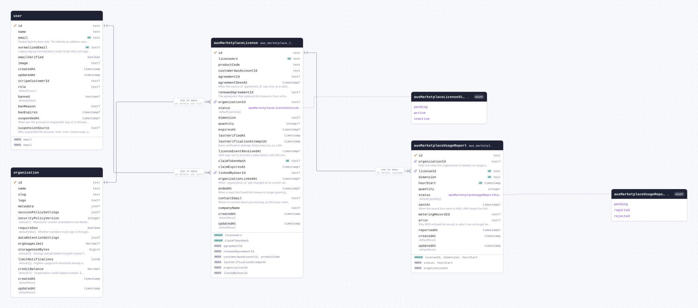

| Column                                                       | Type                                                                       | Constraints                                   | Default               | Description                                                                                 |
| ------------------------------------------------------------ | -------------------------------------------------------------------------- | --------------------------------------------- | --------------------- | ------------------------------------------------------------------------------------------- |
| `id`                                                         | `text`                                                                     | PK NOT NULL                                   |                       |                                                                                             |
| `licenseArn` (`license_arn`)                                 | `text`                                                                     | NOT NULL                                      |                       |                                                                                             |
| `productCode` (`product_code`)                               | `text`                                                                     | NOT NULL                                      |                       |                                                                                             |
| `customerAwsAccountId` (`customer_aws_account_id`)           | `text`                                                                     | NOT NULL                                      |                       |                                                                                             |
| `agreementId` (`agreement_id`)                               | `text`                                                                     | NULL                                          |                       |                                                                                             |
| `agreementSeenAt` (`agreement_seen_at`)                      | `timestamp`                                                                | NULL                                          |                       | When the source of `agreement_id` was true, so a redelivered old event cannot roll it back. |
| `renewedAgreementId` (`renewed_agreement_id`)                | `text`                                                                     | NULL                                          |                       | The agreement that replaced this license's, from a Purchase Agreement Created event.        |
| `organizationId` (`organization_id`)                         | `text`                                                                     | NULL → [organization.id](#table-organization) |                       |                                                                                             |
| `status`                                                     | [`awsMarketplaceLicenseStatusEnum`](#enum-awsMarketplaceLicenseStatusEnum) | NOT NULL                                      | `.default('pending')` |                                                                                             |
| `dimension`                                                  | `text`                                                                     | NULL                                          |                       |                                                                                             |
| `quantity`                                                   | `integer`                                                                  | NULL                                          |                       |                                                                                             |
| `expiresAt` (`expires_at`)                                   | `timestamp`                                                                | NULL                                          |                       |                                                                                             |
| `lastVerifiedAt` (`last_verified_at`)                        | `timestamp`                                                                | NOT NULL                                      |                       |                                                                                             |
| `lastVerificationAttemptAt` (`last_verification_attempt_at`) | `timestamp`                                                                | NOT NULL                                      |                       | Every verification attempt, failed ones too, so a failing license cannot starve the rest.   |
| `licenseEventReceivedAt` (`license_event_received_at`)       | `timestamp`                                                                | NULL                                          |                       | AWS says not to activate a subscription until this event has arrived, so staff can see it.  |
| `claimTokenHash` (`claim_token_hash`)                        | `text`                                                                     | NULL                                          |                       |                                                                                             |
| `claimExpiresAt` (`claim_expires_at`)                        | `timestamp`                                                                | NULL                                          |                       |                                                                                             |
| `linkedByUserId` (`linked_by_user_id`)                       | `text`                                                                     | NULL → [user.id](#table-user)                 |                       |                                                                                             |
| `organizationLinkedAt` (`organization_linked_at`)            | `timestamp`                                                                | NULL                                          |                       | When `organization_id` last changed to its current value; usage counts from here.           |
| `endedAt` (`ended_at`)                                       | `timestamp`                                                                | NULL                                          |                       | When a read first found the license no longer granting access; cleared if it returns.       |
| `contactEmail` (`contact_email`)                             | `text`                                                                     | NULL                                          |                       | Whom to contact about provisioning, as the buyer entered it during setup.                   |
| `companyName` (`company_name`)                               | `text`                                                                     | NULL                                          |                       |                                                                                             |
| `createdAt` (`created_at`)                                   | `timestamp`                                                                | NOT NULL                                      | `.defaultNow()`       |                                                                                             |
| `updatedAt` (`updated_at`)                                   | `timestamp`                                                                | NOT NULL                                      | `.defaultNow()`       |                                                                                             |

#### Definition

```sql
CREATE TABLE "aws_marketplace_license" (
	"id" text PRIMARY KEY,
	"license_arn" text NOT NULL,
	"product_code" text NOT NULL,
	"customer_aws_account_id" text NOT NULL,
	"agreement_id" text,
	"agreement_seen_at" timestamp,
	"renewed_agreement_id" text,
	"organization_id" text,
	"status" "aws_marketplace_license_status" DEFAULT 'pending'::"aws_marketplace_license_status" NOT NULL,
	"dimension" text,
	"quantity" integer,
	"expires_at" timestamp,
	"last_verified_at" timestamp NOT NULL,
	"last_verification_attempt_at" timestamp NOT NULL,
	"license_event_received_at" timestamp,
	"claim_token_hash" text,
	"claim_expires_at" timestamp,
	"linked_by_user_id" text,
	"organization_linked_at" timestamp,
	"ended_at" timestamp,
	"contact_email" text,
	"company_name" text,
	"created_at" timestamp DEFAULT now() NOT NULL,
	"updated_at" timestamp DEFAULT now() NOT NULL
);

CREATE UNIQUE INDEX "aws_marketplace_license_arn_unique" ON "aws_marketplace_license" ("license_arn");

CREATE UNIQUE INDEX "aws_marketplace_license_claim_token_hash_unique" ON "aws_marketplace_license" ("claim_token_hash");

CREATE INDEX "aws_marketplace_license_agreement_id_idx" ON "aws_marketplace_license" ("agreement_id");

CREATE INDEX "aws_marketplace_license_renewed_agreement_id_idx" ON "aws_marketplace_license" ("renewed_agreement_id");

CREATE INDEX "aws_marketplace_license_account_product_idx" ON "aws_marketplace_license" ("customer_aws_account_id","product_code");

CREATE INDEX "aws_marketplace_license_last_attempt_idx" ON "aws_marketplace_license" ("last_verification_attempt_at");

CREATE INDEX "aws_marketplace_license_organization_id_idx" ON "aws_marketplace_license" ("organization_id");

CREATE INDEX "aws_marketplace_license_linked_by_user_id_idx" ON "aws_marketplace_license" ("linked_by_user_id");

ALTER TABLE "aws_marketplace_license" ADD CONSTRAINT "aws_marketplace_license_organization_id_organization_id_fkey" FOREIGN KEY ("organization_id") REFERENCES "organization"("id") ON DELETE SET NULL;

ALTER TABLE "aws_marketplace_license" ADD CONSTRAINT "aws_marketplace_license_linked_by_user_id_user_id_fkey" FOREIGN KEY ("linked_by_user_id") REFERENCES "user"("id") ON DELETE SET NULL;
```

#### Indexes

- UNIQUE `licenseArn`
- UNIQUE `claimTokenHash`
- INDEX `agreementId`
- INDEX `renewedAgreementId`
- INDEX `customerAwsAccountId`, `productCode`
- INDEX `lastVerificationAttemptAt`
- INDEX `organizationId`
- INDEX `linkedByUserId`

#### References

- `organizationId` → [organization.id](#table-organization) (many to one, on delete set null)
- `linkedByUserId` → [user.id](#table-user) (many to one, on delete set null)

#### Referenced by

- `id` → [awsMarketplaceUsageReport.licenseId](#table-awsMarketplaceUsageReport) (one to many, on delete cascade)

<details>
<summary>Queries and their SQL</summary>

**Select**: Every row of awsMarketplaceLicense.

```ts
db.select().from(awsMarketplaceLicense);
```

```sql
select "id", "license_arn", "product_code", "customer_aws_account_id", "agreement_id", "agreement_seen_at", "renewed_agreement_id", "organization_id", "status", "dimension", "quantity", "expires_at", "last_verified_at", "last_verification_attempt_at", "license_event_received_at", "claim_token_hash", "claim_expires_at", "linked_by_user_id", "organization_linked_at", "ended_at", "contact_email", "company_name", "created_at", "updated_at"
from "aws_marketplace_license"
```

**Count**: How many rows awsMarketplaceLicense has.

```ts
db.select({ count: count() }).from(awsMarketplaceLicense);
```

```sql
select count(*)
from "aws_marketplace_license"
```

**Find many**: The rows of awsMarketplaceLicense, through the relational query API.

```ts
db.query.awsMarketplaceLicense.findMany();
```

```sql
select "d0"."id" as "id", "d0"."license_arn" as "licenseArn", "d0"."product_code" as "productCode", "d0"."customer_aws_account_id" as "customerAwsAccountId", "d0"."agreement_id" as "agreementId", "d0"."agreement_seen_at" as "agreementSeenAt", "d0"."renewed_agreement_id" as "renewedAgreementId", "d0"."organization_id" as "organizationId", "d0"."status" as "status", "d0"."dimension" as "dimension", "d0"."quantity" as "quantity", "d0"."expires_at" as "expiresAt", "d0"."last_verified_at" as "lastVerifiedAt", "d0"."last_verification_attempt_at" as "lastVerificationAttemptAt", "d0"."license_event_received_at" as "licenseEventReceivedAt", "d0"."claim_token_hash" as "claimTokenHash", "d0"."claim_expires_at" as "claimExpiresAt", "d0"."linked_by_user_id" as "linkedByUserId", "d0"."organization_linked_at" as "organizationLinkedAt", "d0"."ended_at" as "endedAt", "d0"."contact_email" as "contactEmail", "d0"."company_name" as "companyName", "d0"."created_at" as "createdAt", "d0"."updated_at" as "updatedAt"
from "aws_marketplace_license" as "d0"
```

**Find by primary key**: One row of awsMarketplaceLicense, through the relational query API.

```ts
db.query.awsMarketplaceLicense.findFirst({ where: { id: "id" } });
```

```sql
select "d0"."id" as "id", "d0"."license_arn" as "licenseArn", "d0"."product_code" as "productCode", "d0"."customer_aws_account_id" as "customerAwsAccountId", "d0"."agreement_id" as "agreementId", "d0"."agreement_seen_at" as "agreementSeenAt", "d0"."renewed_agreement_id" as "renewedAgreementId", "d0"."organization_id" as "organizationId", "d0"."status" as "status", "d0"."dimension" as "dimension", "d0"."quantity" as "quantity", "d0"."expires_at" as "expiresAt", "d0"."last_verified_at" as "lastVerifiedAt", "d0"."last_verification_attempt_at" as "lastVerificationAttemptAt", "d0"."license_event_received_at" as "licenseEventReceivedAt", "d0"."claim_token_hash" as "claimTokenHash", "d0"."claim_expires_at" as "claimExpiresAt", "d0"."linked_by_user_id" as "linkedByUserId", "d0"."organization_linked_at" as "organizationLinkedAt", "d0"."ended_at" as "endedAt", "d0"."contact_email" as "contactEmail", "d0"."company_name" as "companyName", "d0"."created_at" as "createdAt", "d0"."updated_at" as "updatedAt"
from "aws_marketplace_license" as "d0"
where "d0"."id" = $1
limit $2
-- params: ["id",1]
```

**Insert**: Adds a row to awsMarketplaceLicense, giving the columns that have no default.

```ts
db.insert(awsMarketplaceLicense).values({
  id: "id",
  licenseArn: "licenseArn",
  productCode: "productCode",
  customerAwsAccountId: "customerAwsAccountId",
  lastVerifiedAt: new Date("2026-01-01T00:00:00.000Z"),
  lastVerificationAttemptAt: new Date("2026-01-01T00:00:00.000Z"),
});
```

```sql
insert into "aws_marketplace_license" ("id", "license_arn", "product_code", "customer_aws_account_id", "agreement_id", "agreement_seen_at", "renewed_agreement_id", "organization_id", "status", "dimension", "quantity", "expires_at", "last_verified_at", "last_verification_attempt_at", "license_event_received_at", "claim_token_hash", "claim_expires_at", "linked_by_user_id", "organization_linked_at", "ended_at", "contact_email", "company_name", "created_at", "updated_at")
values ($1, $2, $3, $4, default, default, default, default, default, default, default, default, $5, $6, default, default, default, default, default, default, default, default, default, default)
-- params: ["id","licenseArn","productCode","customerAwsAccountId","2026-01-01T00:00:00.000Z","2026-01-01T00:00:00.000Z"]
```

**Update**: Changes a row of awsMarketplaceLicense, found by its primary key.

```ts
db.update(awsMarketplaceLicense)
  .set({ licenseArn: "licenseArn" })
  .where(eq(awsMarketplaceLicense.id, "id"));
```

```sql
update "aws_marketplace_license"
set "license_arn" = $1
where "aws_marketplace_license"."id" = $2
-- params: ["licenseArn","id"]
```

**Delete**: Deletes a row of awsMarketplaceLicense, found by its primary key.

```ts
db.delete(awsMarketplaceLicense).where(eq(awsMarketplaceLicense.id, "id"));
```

```sql
delete from "aws_marketplace_license"
where "aws_marketplace_license"."id" = $1
-- params: ["id"]
```

</details>

<a id="table-awsMarketplaceUsageTally"></a>

### awsMarketplaceUsageTally

Table `aws_marketplace_usage_tally`. How much of an organization's billed usage AWS Marketplace has been charged for, per dimension and billing period. Each meter run re-sums the period's usage and charges only the whole units above `units`, so a cost raised in place after it was first counted is still charged, and a fraction of a unit waits in `cost_usd` until it adds up. `counted_from` fixes where the period's sum starts, the moment the organization's billing through AWS began.

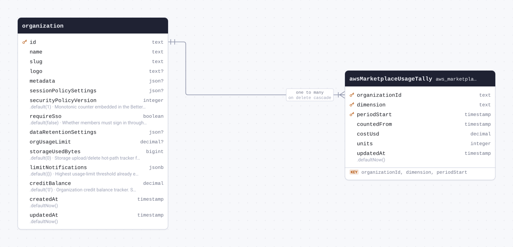

| Column                               | Type        | Constraints                                          | Default         | Description |
| ------------------------------------ | ----------- | ---------------------------------------------------- | --------------- | ----------- |
| `organizationId` (`organization_id`) | `text`      | PK NOT NULL → [organization.id](#table-organization) |                 |             |
| `dimension`                          | `text`      | PK NOT NULL                                          |                 |             |
| `periodStart` (`period_start`)       | `timestamp` | PK NOT NULL                                          |                 |             |
| `countedFrom` (`counted_from`)       | `timestamp` | NOT NULL                                             |                 |             |
| `costUsd` (`cost_usd`)               | `decimal`   | NOT NULL                                             |                 |             |
| `units`                              | `integer`   | NOT NULL                                             |                 |             |
| `updatedAt` (`updated_at`)           | `timestamp` | NOT NULL                                             | `.defaultNow()` |             |

#### Definition

```sql
CREATE TABLE "aws_marketplace_usage_tally" (
	"organization_id" text,
	"dimension" text,
	"period_start" timestamp,
	"counted_from" timestamp NOT NULL,
	"cost_usd" numeric NOT NULL,
	"units" integer NOT NULL,
	"updated_at" timestamp DEFAULT now() NOT NULL,
	CONSTRAINT "aws_marketplace_usage_tally_pkey" PRIMARY KEY("organization_id","dimension","period_start")
);

ALTER TABLE "aws_marketplace_usage_tally" ADD CONSTRAINT "aws_marketplace_usage_tally_p7ZS99JLol5Q_fkey" FOREIGN KEY ("organization_id") REFERENCES "organization"("id") ON DELETE CASCADE;
```

#### Indexes

- PRIMARY KEY `organizationId`, `dimension`, `periodStart`

#### References

- `organizationId` → [organization.id](#table-organization) (many to one, on delete cascade)

<details>
<summary>Queries and their SQL</summary>

**Select**: Every row of awsMarketplaceUsageTally.

```ts
db.select().from(awsMarketplaceUsageTally);
```

```sql
select "organization_id", "dimension", "period_start", "counted_from", "cost_usd", "units", "updated_at"
from "aws_marketplace_usage_tally"
```

**Count**: How many rows awsMarketplaceUsageTally has.

```ts
db.select({ count: count() }).from(awsMarketplaceUsageTally);
```

```sql
select count(*)
from "aws_marketplace_usage_tally"
```

**Find many**: The rows of awsMarketplaceUsageTally, through the relational query API.

```ts
db.query.awsMarketplaceUsageTally.findMany();
```

```sql
select "d0"."organization_id" as "organizationId", "d0"."dimension" as "dimension", "d0"."period_start" as "periodStart", "d0"."counted_from" as "countedFrom", "d0"."cost_usd" as "costUsd", "d0"."units" as "units", "d0"."updated_at" as "updatedAt"
from "aws_marketplace_usage_tally" as "d0"
```

**Find by primary key**: One row of awsMarketplaceUsageTally, through the relational query API.

```ts
db.query.awsMarketplaceUsageTally.findFirst({
  where: {
    organizationId: "organizationId",
    dimension: "dimension",
    periodStart: new Date("2026-01-01T00:00:00.000Z"),
  },
});
```

```sql
select "d0"."organization_id" as "organizationId", "d0"."dimension" as "dimension", "d0"."period_start" as "periodStart", "d0"."counted_from" as "countedFrom", "d0"."cost_usd" as "costUsd", "d0"."units" as "units", "d0"."updated_at" as "updatedAt"
from "aws_marketplace_usage_tally" as "d0"
where (("d0"."organization_id" = $1) and ("d0"."dimension" = $2))
limit $3
-- params: ["organizationId","dimension",1]
```

**Insert**: Adds a row to awsMarketplaceUsageTally, giving the columns that have no default.

```ts
db.insert(awsMarketplaceUsageTally).values({
  organizationId: "organizationId",
  dimension: "dimension",
  periodStart: new Date("2026-01-01T00:00:00.000Z"),
  countedFrom: new Date("2026-01-01T00:00:00.000Z"),
  costUsd: "1.00",
  units: 1,
});
```

```sql
insert into "aws_marketplace_usage_tally" ("organization_id", "dimension", "period_start", "counted_from", "cost_usd", "units", "updated_at")
values ($1, $2, $3, $4, $5, $6, default)
-- params: ["organizationId","dimension","2026-01-01T00:00:00.000Z","2026-01-01T00:00:00.000Z","1.00",1]
```

**Update**: Changes a row of awsMarketplaceUsageTally, found by its primary key.

```ts
db.update(awsMarketplaceUsageTally)
  .set({ countedFrom: new Date("2026-01-01T00:00:00.000Z") })
  .where(
    and(
      eq(awsMarketplaceUsageTally.organizationId, "organizationId"),
      eq(awsMarketplaceUsageTally.dimension, "dimension"),
      eq(awsMarketplaceUsageTally.periodStart, new Date("2026-01-01T00:00:00.000Z")),
    ),
  );
```

```sql
update "aws_marketplace_usage_tally"
set "counted_from" = $1
where (("aws_marketplace_usage_tally"."organization_id" = $2) and ("aws_marketplace_usage_tally"."dimension" = $3) and ("aws_marketplace_usage_tally"."period_start" = $4))
-- params: ["2026-01-01T00:00:00.000Z","organizationId","dimension","2026-01-01T00:00:00.000Z"]
```

**Delete**: Deletes a row of awsMarketplaceUsageTally, found by its primary key.

```ts
db.delete(awsMarketplaceUsageTally).where(
  and(
    eq(awsMarketplaceUsageTally.organizationId, "organizationId"),
    eq(awsMarketplaceUsageTally.dimension, "dimension"),
    eq(awsMarketplaceUsageTally.periodStart, new Date("2026-01-01T00:00:00.000Z")),
  ),
);
```

```sql
delete from "aws_marketplace_usage_tally"
where (("aws_marketplace_usage_tally"."organization_id" = $1) and ("aws_marketplace_usage_tally"."dimension" = $2) and ("aws_marketplace_usage_tally"."period_start" = $3))
-- params: ["organizationId","dimension","2026-01-01T00:00:00.000Z"]
```

</details>

<a id="table-awsMarketplaceUsageReport"></a>

### awsMarketplaceUsageReport

Table `aws_marketplace_usage_report`. The units owed to AWS Marketplace for usage counted during one hour, on one license and dimension: the key AWS deduplicates records on. A row gathers units while its hour is open and is sent once it closes, or at once for a license that has ended.

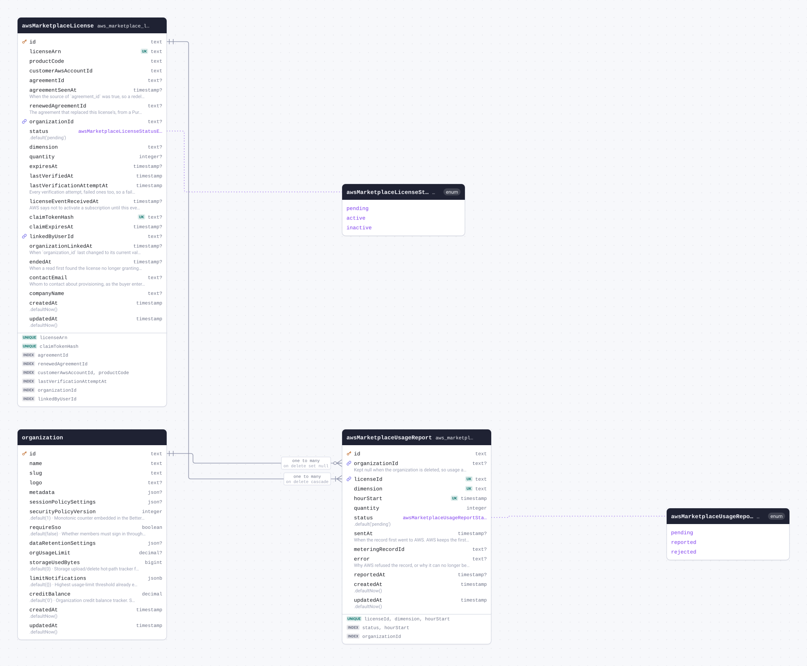

| Column                                    | Type                                                                               | Constraints                                                         | Default               | Description                                                                                                                                        |
| ----------------------------------------- | ---------------------------------------------------------------------------------- | ------------------------------------------------------------------- | --------------------- | -------------------------------------------------------------------------------------------------------------------------------------------------- |
| `id`                                      | `text`                                                                             | PK NOT NULL                                                         |                       |                                                                                                                                                    |
| `organizationId` (`organization_id`)      | `text`                                                                             | NULL → [organization.id](#table-organization)                       |                       | Kept null when the organization is deleted, so usage already charged is still sent.                                                                |
| `licenseId` (`license_id`)                | `text`                                                                             | NOT NULL → [awsMarketplaceLicense.id](#table-awsMarketplaceLicense) |                       |                                                                                                                                                    |
| `dimension`                               | `text`                                                                             | NOT NULL                                                            |                       |                                                                                                                                                    |
| `hourStart` (`hour_start`)                | `timestamp`                                                                        | NOT NULL                                                            |                       |                                                                                                                                                    |
| `quantity`                                | `integer`                                                                          | NOT NULL                                                            |                       |                                                                                                                                                    |
| `status`                                  | [`awsMarketplaceUsageReportStatusEnum`](#enum-awsMarketplaceUsageReportStatusEnum) | NOT NULL                                                            | `.default('pending')` |                                                                                                                                                    |
| `sentAt` (`sent_at`)                      | `timestamp`                                                                        | NULL                                                                |                       | When the record first went to AWS. AWS keeps the first record it accepts for a license, dimension and hour, so the quantity is fixed from then on. |
| `meteringRecordId` (`metering_record_id`) | `text`                                                                             | NULL                                                                |                       |                                                                                                                                                    |
| `error`                                   | `text`                                                                             | NULL                                                                |                       | Why AWS refused the record, or why it can no longer be sent.                                                                                       |
| `reportedAt` (`reported_at`)              | `timestamp`                                                                        | NULL                                                                |                       |                                                                                                                                                    |
| `createdAt` (`created_at`)                | `timestamp`                                                                        | NOT NULL                                                            | `.defaultNow()`       |                                                                                                                                                    |
| `updatedAt` (`updated_at`)                | `timestamp`                                                                        | NOT NULL                                                            | `.defaultNow()`       |                                                                                                                                                    |

#### Definition

```sql
CREATE TABLE "aws_marketplace_usage_report" (
	"id" text PRIMARY KEY,
	"organization_id" text,
	"license_id" text NOT NULL,
	"dimension" text NOT NULL,
	"hour_start" timestamp NOT NULL,
	"quantity" integer NOT NULL,
	"status" "aws_marketplace_usage_report_status" DEFAULT 'pending'::"aws_marketplace_usage_report_status" NOT NULL,
	"sent_at" timestamp,
	"metering_record_id" text,
	"error" text,
	"reported_at" timestamp,
	"created_at" timestamp DEFAULT now() NOT NULL,
	"updated_at" timestamp DEFAULT now() NOT NULL
);

CREATE UNIQUE INDEX "aws_marketplace_usage_report_license_dimension_hour_unique" ON "aws_marketplace_usage_report" ("license_id","dimension","hour_start");

CREATE INDEX "aws_marketplace_usage_report_status_hour_idx" ON "aws_marketplace_usage_report" ("status","hour_start");

CREATE INDEX "aws_marketplace_usage_report_organization_id_idx" ON "aws_marketplace_usage_report" ("organization_id");

ALTER TABLE "aws_marketplace_usage_report" ADD CONSTRAINT "aws_marketplace_usage_report_WGckhC8h3te0_fkey" FOREIGN KEY ("organization_id") REFERENCES "organization"("id") ON DELETE SET NULL;

ALTER TABLE "aws_marketplace_usage_report" ADD CONSTRAINT "aws_marketplace_usage_report_suH71byxJvr8_fkey" FOREIGN KEY ("license_id") REFERENCES "aws_marketplace_license"("id") ON DELETE CASCADE;
```

#### Indexes

- UNIQUE `licenseId`, `dimension`, `hourStart`
- INDEX `status`, `hourStart`
- INDEX `organizationId`

#### References

- `organizationId` → [organization.id](#table-organization) (many to one, on delete set null)
- `licenseId` → [awsMarketplaceLicense.id](#table-awsMarketplaceLicense) (many to one, on delete cascade)

<details>
<summary>Queries and their SQL</summary>

**Select**: Every row of awsMarketplaceUsageReport.

```ts
db.select().from(awsMarketplaceUsageReport);
```

```sql
select "id", "organization_id", "license_id", "dimension", "hour_start", "quantity", "status", "sent_at", "metering_record_id", "error", "reported_at", "created_at", "updated_at"
from "aws_marketplace_usage_report"
```

**Count**: How many rows awsMarketplaceUsageReport has.

```ts
db.select({ count: count() }).from(awsMarketplaceUsageReport);
```

```sql
select count(*)
from "aws_marketplace_usage_report"
```

**Find many**: The rows of awsMarketplaceUsageReport, through the relational query API.

```ts
db.query.awsMarketplaceUsageReport.findMany();
```

```sql
select "d0"."id" as "id", "d0"."organization_id" as "organizationId", "d0"."license_id" as "licenseId", "d0"."dimension" as "dimension", "d0"."hour_start" as "hourStart", "d0"."quantity" as "quantity", "d0"."status" as "status", "d0"."sent_at" as "sentAt", "d0"."metering_record_id" as "meteringRecordId", "d0"."error" as "error", "d0"."reported_at" as "reportedAt", "d0"."created_at" as "createdAt", "d0"."updated_at" as "updatedAt"
from "aws_marketplace_usage_report" as "d0"
```

**Find by primary key**: One row of awsMarketplaceUsageReport, through the relational query API.

```ts
db.query.awsMarketplaceUsageReport.findFirst({ where: { id: "id" } });
```

```sql
select "d0"."id" as "id", "d0"."organization_id" as "organizationId", "d0"."license_id" as "licenseId", "d0"."dimension" as "dimension", "d0"."hour_start" as "hourStart", "d0"."quantity" as "quantity", "d0"."status" as "status", "d0"."sent_at" as "sentAt", "d0"."metering_record_id" as "meteringRecordId", "d0"."error" as "error", "d0"."reported_at" as "reportedAt", "d0"."created_at" as "createdAt", "d0"."updated_at" as "updatedAt"
from "aws_marketplace_usage_report" as "d0"
where "d0"."id" = $1
limit $2
-- params: ["id",1]
```

**Insert**: Adds a row to awsMarketplaceUsageReport, giving the columns that have no default.

```ts
db.insert(awsMarketplaceUsageReport).values({
  id: "id",
  licenseId: "licenseId",
  dimension: "dimension",
  hourStart: new Date("2026-01-01T00:00:00.000Z"),
  quantity: 1,
});
```

```sql
insert into "aws_marketplace_usage_report" ("id", "organization_id", "license_id", "dimension", "hour_start", "quantity", "status", "sent_at", "metering_record_id", "error", "reported_at", "created_at", "updated_at")
values ($1, default, $2, $3, $4, $5, default, default, default, default, default, default, default)
-- params: ["id","licenseId","dimension","2026-01-01T00:00:00.000Z",1]
```

**Update**: Changes a row of awsMarketplaceUsageReport, found by its primary key.

```ts
db.update(awsMarketplaceUsageReport)
  .set({ organizationId: "organizationId" })
  .where(eq(awsMarketplaceUsageReport.id, "id"));
```

```sql
update "aws_marketplace_usage_report"
set "organization_id" = $1
where "aws_marketplace_usage_report"."id" = $2
-- params: ["organizationId","id"]
```

**Delete**: Deletes a row of awsMarketplaceUsageReport, found by its primary key.

```ts
db.delete(awsMarketplaceUsageReport).where(eq(awsMarketplaceUsageReport.id, "id"));
```

```sql
delete from "aws_marketplace_usage_report"
where "aws_marketplace_usage_report"."id" = $1
-- params: ["id"]
```

</details>

<a id="table-organizationSearchHistory"></a>

### organizationSearchHistory

Table `organization_search_history`. Private navigation snapshots, scoped to the person and organization that recorded them.

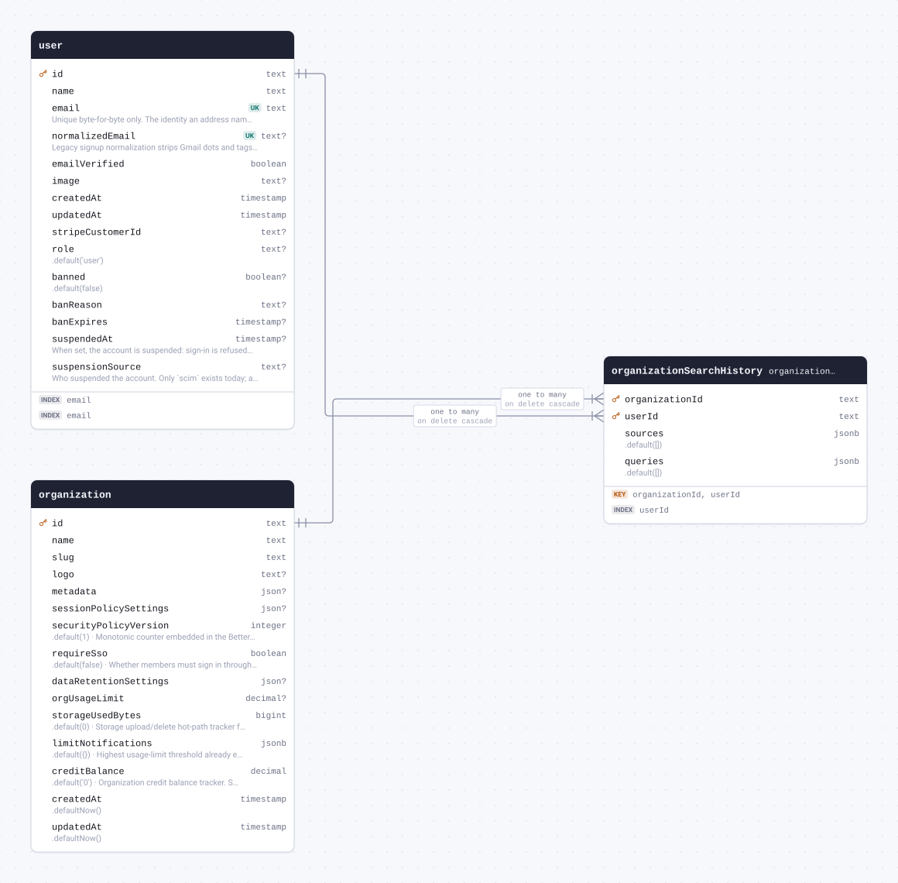

| Column                               | Type    | Constraints                                          | Default        | Description |
| ------------------------------------ | ------- | ---------------------------------------------------- | -------------- | ----------- |
| `organizationId` (`organization_id`) | `text`  | PK NOT NULL → [organization.id](#table-organization) |                |             |
| `userId` (`user_id`)                 | `text`  | PK NOT NULL → [user.id](#table-user)                 |                |             |
| `sources`                            | `jsonb` | NOT NULL                                             | `.default([])` |             |
| `queries`                            | `jsonb` | NOT NULL                                             | `.default([])` |             |

#### Definition

```sql
CREATE TABLE "organization_search_history" (
	"organization_id" text,
	"user_id" text,
	"sources" jsonb DEFAULT '[]' NOT NULL,
	"queries" jsonb DEFAULT '[]' NOT NULL,
	CONSTRAINT "organization_search_history_pkey" PRIMARY KEY("organization_id","user_id")
);

CREATE INDEX "organization_search_history_user_idx" ON "organization_search_history" ("user_id");

ALTER TABLE "organization_search_history" ADD CONSTRAINT "organization_search_history_QlOx3IEKvI0N_fkey" FOREIGN KEY ("organization_id") REFERENCES "organization"("id") ON DELETE CASCADE;

ALTER TABLE "organization_search_history" ADD CONSTRAINT "organization_search_history_user_id_user_id_fkey" FOREIGN KEY ("user_id") REFERENCES "user"("id") ON DELETE CASCADE;
```

#### Indexes

- PRIMARY KEY `organizationId`, `userId`
- INDEX `userId`

#### References

- `organizationId` → [organization.id](#table-organization) (many to one, on delete cascade)
- `userId` → [user.id](#table-user) (many to one, on delete cascade)

<details>
<summary>Queries and their SQL</summary>

**Select**: Every row of organizationSearchHistory.

```ts
db.select().from(organizationSearchHistory);
```

```sql
select "organization_id", "user_id", "sources", "queries"
from "organization_search_history"
```

**Count**: How many rows organizationSearchHistory has.

```ts
db.select({ count: count() }).from(organizationSearchHistory);
```

```sql
select count(*)
from "organization_search_history"
```

**Find many**: The rows of organizationSearchHistory, through the relational query API.

```ts
db.query.organizationSearchHistory.findMany();
```

```sql
select "d0"."organization_id" as "organizationId", "d0"."user_id" as "userId", "d0"."sources" as "sources", "d0"."queries" as "queries"
from "organization_search_history" as "d0"
```

**Find by primary key**: One row of organizationSearchHistory, through the relational query API.

```ts
db.query.organizationSearchHistory.findFirst({
  where: { organizationId: "organizationId", userId: "userId" },
});
```

```sql
select "d0"."organization_id" as "organizationId", "d0"."user_id" as "userId", "d0"."sources" as "sources", "d0"."queries" as "queries"
from "organization_search_history" as "d0"
where (("d0"."organization_id" = $1) and ("d0"."user_id" = $2))
limit $3
-- params: ["organizationId","userId",1]
```

**Insert**: Adds a row to organizationSearchHistory, giving the columns that have no default.

```ts
db.insert(organizationSearchHistory).values({ organizationId: "organizationId", userId: "userId" });
```

```sql
insert into "organization_search_history" ("organization_id", "user_id", "sources", "queries")
values ($1, $2, default, default)
-- params: ["organizationId","userId"]
```

**Update**: Changes a row of organizationSearchHistory, found by its primary key.

```ts
db.update(organizationSearchHistory)
  .set({ sources: {} })
  .where(
    and(
      eq(organizationSearchHistory.organizationId, "organizationId"),
      eq(organizationSearchHistory.userId, "userId"),
    ),
  );
```

```sql
update "organization_search_history"
set "sources" = $1
where (("organization_search_history"."organization_id" = $2) and ("organization_search_history"."user_id" = $3))
-- params: [{},"organizationId","userId"]
```

**Delete**: Deletes a row of organizationSearchHistory, found by its primary key.

```ts
db.delete(organizationSearchHistory).where(
  and(
    eq(organizationSearchHistory.organizationId, "organizationId"),
    eq(organizationSearchHistory.userId, "userId"),
  ),
);
```

```sql
delete from "organization_search_history"
where (("organization_search_history"."organization_id" = $1) and ("organization_search_history"."user_id" = $2))
-- params: ["organizationId","userId"]
```

</details>

<a id="table-member"></a>

### member

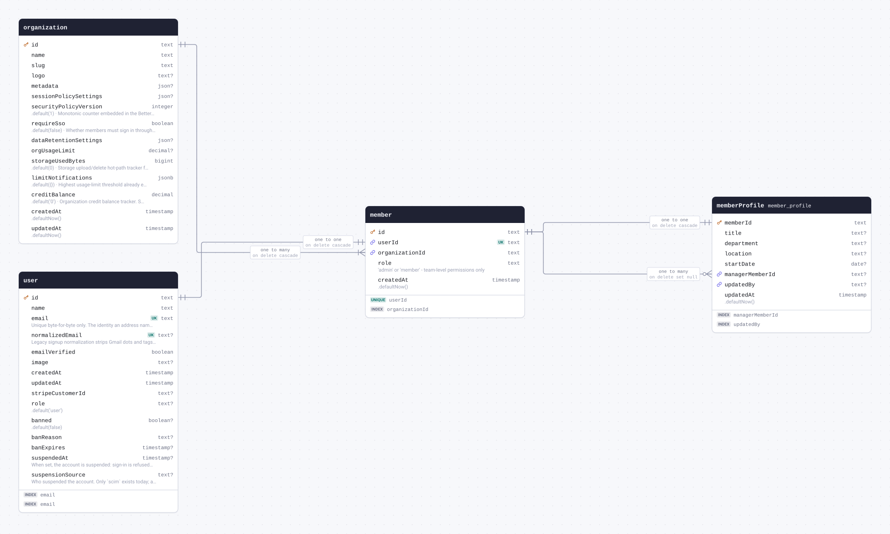

| Column                               | Type        | Constraints                                       | Default         | Description                                       |
| ------------------------------------ | ----------- | ------------------------------------------------- | --------------- | ------------------------------------------------- |
| `id`                                 | `text`      | PK NOT NULL                                       |                 |                                                   |
| `userId` (`user_id`)                 | `text`      | NOT NULL → [user.id](#table-user)                 |                 |                                                   |
| `organizationId` (`organization_id`) | `text`      | NOT NULL → [organization.id](#table-organization) |                 |                                                   |
| `role`                               | `text`      | NOT NULL                                          |                 | 'admin' or 'member' - team-level permissions only |
| `createdAt` (`created_at`)           | `timestamp` | NOT NULL                                          | `.defaultNow()` |                                                   |

#### Definition

```sql
CREATE TABLE "member" (
	"id" text PRIMARY KEY,
	"user_id" text NOT NULL,
	"organization_id" text NOT NULL,
	"role" text NOT NULL,
	"created_at" timestamp DEFAULT now() NOT NULL
);

CREATE UNIQUE INDEX "member_user_id_unique" ON "member" ("user_id");

CREATE INDEX "member_organization_id_idx" ON "member" ("organization_id");

ALTER TABLE "member" ADD CONSTRAINT "member_user_id_user_id_fkey" FOREIGN KEY ("user_id") REFERENCES "user"("id") ON DELETE CASCADE;

ALTER TABLE "member" ADD CONSTRAINT "member_organization_id_organization_id_fkey" FOREIGN KEY ("organization_id") REFERENCES "organization"("id") ON DELETE CASCADE;
```

#### Indexes

- UNIQUE `userId`
- INDEX `organizationId`

#### References

- `userId` → [user.id](#table-user) (one to one, on delete cascade)
- `organizationId` → [organization.id](#table-organization) (many to one, on delete cascade)

#### Referenced by

- `id` → [memberProfile.memberId](#table-memberProfile) (one to one, on delete cascade)
- `id` → [memberProfile.managerMemberId](#table-memberProfile) (one to many, on delete set null)

<details>
<summary>Queries and their SQL</summary>

**Select**: Every row of member.

```ts
db.select().from(member);
```

```sql
select "id", "user_id", "organization_id", "role", "created_at"
from "member"
```

**Count**: How many rows member has.

```ts
db.select({ count: count() }).from(member);
```

```sql
select count(*)
from "member"
```

**Find many**: The rows of member, through the relational query API.

```ts
db.query.member.findMany();
```

```sql
select "d0"."id" as "id", "d0"."user_id" as "userId", "d0"."organization_id" as "organizationId", "d0"."role" as "role", "d0"."created_at" as "createdAt"
from "member" as "d0"
```

**Find by primary key**: One row of member, through the relational query API.

```ts
db.query.member.findFirst({ where: { id: "id" } });
```

```sql
select "d0"."id" as "id", "d0"."user_id" as "userId", "d0"."organization_id" as "organizationId", "d0"."role" as "role", "d0"."created_at" as "createdAt"
from "member" as "d0"
where "d0"."id" = $1
limit $2
-- params: ["id",1]
```

**Insert**: Adds a row to member, giving the columns that have no default.

```ts
db.insert(member).values({
  id: "id",
  userId: "userId",
  organizationId: "organizationId",
  role: "role",
});
```

```sql
insert into "member" ("id", "user_id", "organization_id", "role", "created_at")
values ($1, $2, $3, $4, default)
-- params: ["id","userId","organizationId","role"]
```

**Update**: Changes a row of member, found by its primary key.

```ts
db.update(member).set({ userId: "userId" }).where(eq(member.id, "id"));
```

```sql
update "member"
set "user_id" = $1
where "member"."id" = $2
-- params: ["userId","id"]
```

**Delete**: Deletes a row of member, found by its primary key.

```ts
db.delete(member).where(eq(member.id, "id"));
```

```sql
delete from "member"
where "member"."id" = $1
-- params: ["id"]
```

</details>

<a id="table-memberProfile"></a>

### memberProfile

Table `member_profile`. A member's place in their organization, from an admin's people-data import or edit: the facts behind the People page, profiles and reporting lines. At most one row per member, deleted with the membership; `manager_member_id` is cleared when the manager's membership ends. Both members belong to the same organization, which every writer checks.

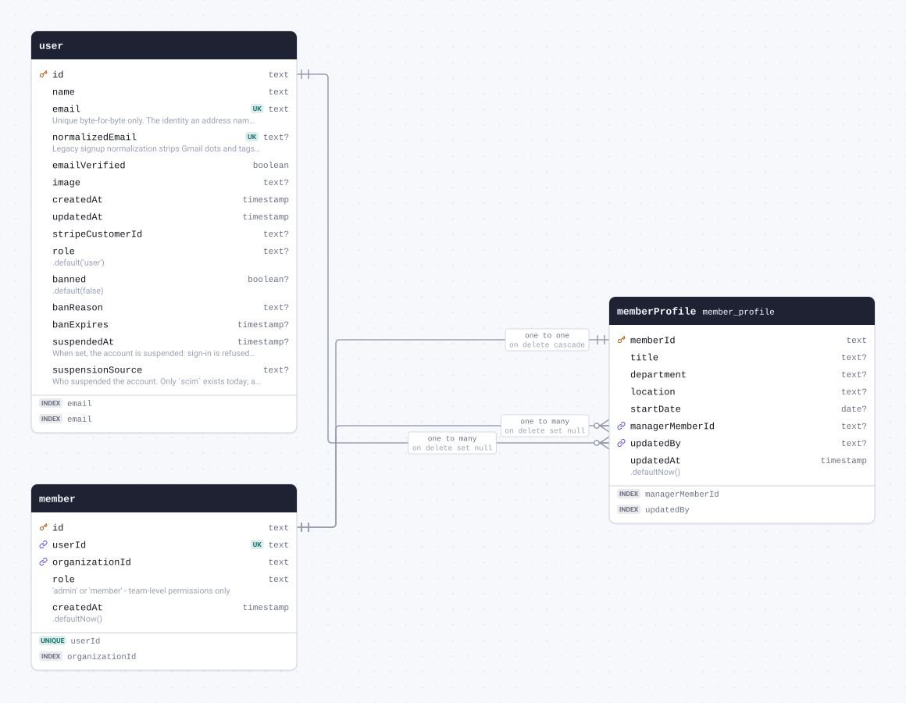

| Column                                  | Type        | Constraints                              | Default         | Description |
| --------------------------------------- | ----------- | ---------------------------------------- | --------------- | ----------- |
| `memberId` (`member_id`)                | `text`      | PK NOT NULL → [member.id](#table-member) |                 |             |
| `title`                                 | `text`      | NULL                                     |                 |             |
| `department`                            | `text`      | NULL                                     |                 |             |
| `location`                              | `text`      | NULL                                     |                 |             |
| `startDate` (`start_date`)              | `date`      | NULL                                     |                 |             |
| `managerMemberId` (`manager_member_id`) | `text`      | NULL → [member.id](#table-member)        |                 |             |
| `updatedBy` (`updated_by`)              | `text`      | NULL → [user.id](#table-user)            |                 |             |
| `updatedAt` (`updated_at`)              | `timestamp` | NOT NULL                                 | `.defaultNow()` |             |

#### Definition

```sql
CREATE TABLE "member_profile" (
	"member_id" text PRIMARY KEY,
	"title" text,
	"department" text,
	"location" text,
	"start_date" date,
	"manager_member_id" text,
	"updated_by" text,
	"updated_at" timestamp DEFAULT now() NOT NULL,
	CONSTRAINT "member_profile_not_own_manager" CHECK ("manager_member_id" <> "member_id")
);

CREATE INDEX "member_profile_manager_member_id_idx" ON "member_profile" ("manager_member_id");

CREATE INDEX "member_profile_updated_by_idx" ON "member_profile" ("updated_by");

ALTER TABLE "member_profile" ADD CONSTRAINT "member_profile_member_id_member_id_fkey" FOREIGN KEY ("member_id") REFERENCES "member"("id") ON DELETE CASCADE;

ALTER TABLE "member_profile" ADD CONSTRAINT "member_profile_manager_member_id_member_id_fkey" FOREIGN KEY ("manager_member_id") REFERENCES "member"("id") ON DELETE SET NULL;

ALTER TABLE "member_profile" ADD CONSTRAINT "member_profile_updated_by_user_id_fkey" FOREIGN KEY ("updated_by") REFERENCES "user"("id") ON DELETE SET NULL;
```

#### Indexes

- INDEX `managerMemberId`
- INDEX `updatedBy`

#### References

- `memberId` → [member.id](#table-member) (one to one, on delete cascade)
- `managerMemberId` → [member.id](#table-member) (many to one, on delete set null)
- `updatedBy` → [user.id](#table-user) (many to one, on delete set null)

<details>
<summary>Queries and their SQL</summary>

**Select**: Every row of memberProfile.

```ts
db.select().from(memberProfile);
```

```sql
select "member_id", "title", "department", "location", "start_date", "manager_member_id", "updated_by", "updated_at"
from "member_profile"
```

**Count**: How many rows memberProfile has.

```ts
db.select({ count: count() }).from(memberProfile);
```

```sql
select count(*)
from "member_profile"
```

**Find many**: The rows of memberProfile, through the relational query API.

```ts
db.query.memberProfile.findMany();
```

```sql
select "d0"."member_id" as "memberId", "d0"."title" as "title", "d0"."department" as "department", "d0"."location" as "location", "d0"."start_date" as "startDate", "d0"."manager_member_id" as "managerMemberId", "d0"."updated_by" as "updatedBy", "d0"."updated_at" as "updatedAt"
from "member_profile" as "d0"
```

**Find by primary key**: One row of memberProfile, through the relational query API.

```ts
db.query.memberProfile.findFirst({ where: { memberId: "memberId" } });
```

```sql
select "d0"."member_id" as "memberId", "d0"."title" as "title", "d0"."department" as "department", "d0"."location" as "location", "d0"."start_date" as "startDate", "d0"."manager_member_id" as "managerMemberId", "d0"."updated_by" as "updatedBy", "d0"."updated_at" as "updatedAt"
from "member_profile" as "d0"
where "d0"."member_id" = $1
limit $2
-- params: ["memberId",1]
```

**Insert**: Adds a row to memberProfile, giving the columns that have no default.

```ts
db.insert(memberProfile).values({ memberId: "memberId" });
```

```sql
insert into "member_profile" ("member_id", "title", "department", "location", "start_date", "manager_member_id", "updated_by", "updated_at")
values ($1, default, default, default, default, default, default, default)
-- params: ["memberId"]
```

**Update**: Changes a row of memberProfile, found by its primary key.

```ts
db.update(memberProfile).set({ title: "title" }).where(eq(memberProfile.memberId, "memberId"));
```

```sql
update "member_profile"
set "title" = $1
where "member_profile"."member_id" = $2
-- params: ["title","memberId"]
```

**Delete**: Deletes a row of memberProfile, found by its primary key.

```ts
db.delete(memberProfile).where(eq(memberProfile.memberId, "memberId"));
```

```sql
delete from "member_profile"
where "member_profile"."member_id" = $1
-- params: ["memberId"]
```

</details>

<a id="table-peopleDirectorySync"></a>

### peopleDirectorySync

Table `people_directory_sync`. The single authoritative People source and its fenced synchronization lease for one organization.

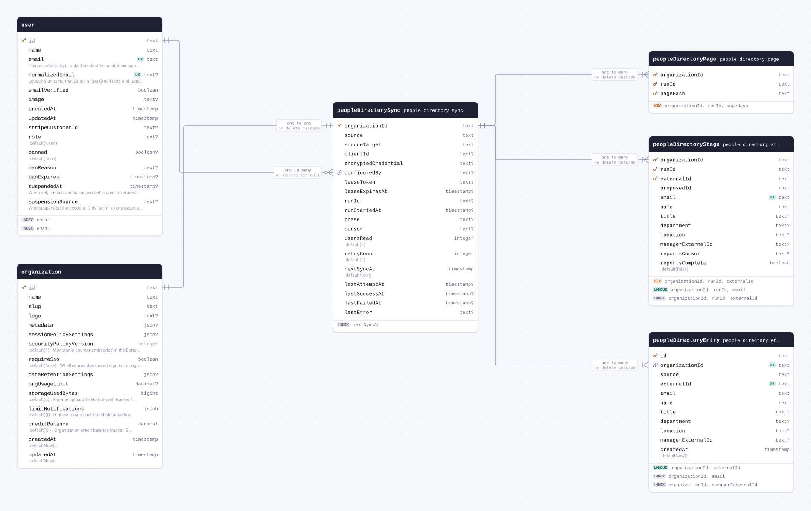

| Column                                         | Type        | Constraints                                          | Default         | Description |
| ---------------------------------------------- | ----------- | ---------------------------------------------------- | --------------- | ----------- |
| `organizationId` (`organization_id`)           | `text`      | PK NOT NULL → [organization.id](#table-organization) |                 |             |
| `source`                                       | `text`      | NOT NULL                                             |                 |             |
| `sourceTarget` (`source_target`)               | `text`      | NOT NULL                                             |                 |             |
| `clientId` (`client_id`)                       | `text`      | NULL                                                 |                 |             |
| `encryptedCredential` (`encrypted_credential`) | `text`      | NULL                                                 |                 |             |
| `configuredBy` (`configured_by`)               | `text`      | NULL → [user.id](#table-user)                        |                 |             |
| `leaseToken` (`lease_token`)                   | `text`      | NULL                                                 |                 |             |
| `leaseExpiresAt` (`lease_expires_at`)          | `timestamp` | NULL                                                 |                 |             |
| `runId` (`run_id`)                             | `text`      | NULL                                                 |                 |             |
| `runStartedAt` (`run_started_at`)              | `timestamp` | NULL                                                 |                 |             |
| `phase`                                        | `text`      | NULL                                                 |                 |             |
| `cursor`                                       | `text`      | NULL                                                 |                 |             |
| `usersRead` (`users_read`)                     | `integer`   | NOT NULL                                             | `.default(0)`   |             |
| `retryCount` (`retry_count`)                   | `integer`   | NOT NULL                                             | `.default(0)`   |             |
| `nextSyncAt` (`next_sync_at`)                  | `timestamp` | NOT NULL                                             | `.defaultNow()` |             |
| `lastAttemptAt` (`last_attempt_at`)            | `timestamp` | NULL                                                 |                 |             |
| `lastSuccessAt` (`last_success_at`)            | `timestamp` | NULL                                                 |                 |             |
| `lastFailedAt` (`last_failed_at`)              | `timestamp` | NULL                                                 |                 |             |
| `lastError` (`last_error`)                     | `text`      | NULL                                                 |                 |             |

#### Definition

```sql
CREATE TABLE "people_directory_sync" (
	"organization_id" text PRIMARY KEY,
	"source" text NOT NULL,
	"source_target" text NOT NULL,
	"client_id" text,
	"encrypted_credential" text,
	"configured_by" text,
	"lease_token" text,
	"lease_expires_at" timestamp,
	"run_id" text,
	"run_started_at" timestamp,
	"phase" text,
	"cursor" text,
	"users_read" integer DEFAULT 0 NOT NULL,
	"retry_count" integer DEFAULT 0 NOT NULL,
	"next_sync_at" timestamp DEFAULT now() NOT NULL,
	"last_attempt_at" timestamp,
	"last_success_at" timestamp,
	"last_failed_at" timestamp,
	"last_error" text
);

CREATE INDEX "people_directory_sync_due_idx" ON "people_directory_sync" ("next_sync_at");

ALTER TABLE "people_directory_sync" ADD CONSTRAINT "people_directory_sync_organization_id_organization_id_fkey" FOREIGN KEY ("organization_id") REFERENCES "organization"("id") ON DELETE CASCADE;

ALTER TABLE "people_directory_sync" ADD CONSTRAINT "people_directory_sync_configured_by_user_id_fkey" FOREIGN KEY ("configured_by") REFERENCES "user"("id") ON DELETE SET NULL;
```

#### Indexes

- INDEX `nextSyncAt`

#### References

- `organizationId` → [organization.id](#table-organization) (one to one, on delete cascade)
- `configuredBy` → [user.id](#table-user) (many to one, on delete set null)

#### Referenced by

- `organizationId` → [peopleDirectoryEntry.organizationId](#table-peopleDirectoryEntry) (one to many, on delete cascade)
- `organizationId` → [peopleDirectoryStage.organizationId](#table-peopleDirectoryStage) (one to many, on delete cascade)
- `organizationId` → [peopleDirectoryPage.organizationId](#table-peopleDirectoryPage) (one to many, on delete cascade)

<details>
<summary>Queries and their SQL</summary>

**Select**: Every row of peopleDirectorySync.

```ts
db.select().from(peopleDirectorySync);
```

```sql
select "organization_id", "source", "source_target", "client_id", "encrypted_credential", "configured_by", "lease_token", "lease_expires_at", "run_id", "run_started_at", "phase", "cursor", "users_read", "retry_count", "next_sync_at", "last_attempt_at", "last_success_at", "last_failed_at", "last_error"
from "people_directory_sync"
```

**Count**: How many rows peopleDirectorySync has.

```ts
db.select({ count: count() }).from(peopleDirectorySync);
```

```sql
select count(*)
from "people_directory_sync"
```

**Find many**: The rows of peopleDirectorySync, through the relational query API.

```ts
db.query.peopleDirectorySync.findMany();
```

```sql
select "d0"."organization_id" as "organizationId", "d0"."source" as "source", "d0"."source_target" as "sourceTarget", "d0"."client_id" as "clientId", "d0"."encrypted_credential" as "encryptedCredential", "d0"."configured_by" as "configuredBy", "d0"."lease_token" as "leaseToken", "d0"."lease_expires_at" as "leaseExpiresAt", "d0"."run_id" as "runId", "d0"."run_started_at" as "runStartedAt", "d0"."phase" as "phase", "d0"."cursor" as "cursor", "d0"."users_read" as "usersRead", "d0"."retry_count" as "retryCount", "d0"."next_sync_at" as "nextSyncAt", "d0"."last_attempt_at" as "lastAttemptAt", "d0"."last_success_at" as "lastSuccessAt", "d0"."last_failed_at" as "lastFailedAt", "d0"."last_error" as "lastError"
from "people_directory_sync" as "d0"
```

**Find by primary key**: One row of peopleDirectorySync, through the relational query API.

```ts
db.query.peopleDirectorySync.findFirst({ where: { organizationId: "organizationId" } });
```

```sql
select "d0"."organization_id" as "organizationId", "d0"."source" as "source", "d0"."source_target" as "sourceTarget", "d0"."client_id" as "clientId", "d0"."encrypted_credential" as "encryptedCredential", "d0"."configured_by" as "configuredBy", "d0"."lease_token" as "leaseToken", "d0"."lease_expires_at" as "leaseExpiresAt", "d0"."run_id" as "runId", "d0"."run_started_at" as "runStartedAt", "d0"."phase" as "phase", "d0"."cursor" as "cursor", "d0"."users_read" as "usersRead", "d0"."retry_count" as "retryCount", "d0"."next_sync_at" as "nextSyncAt", "d0"."last_attempt_at" as "lastAttemptAt", "d0"."last_success_at" as "lastSuccessAt", "d0"."last_failed_at" as "lastFailedAt", "d0"."last_error" as "lastError"
from "people_directory_sync" as "d0"
where "d0"."organization_id" = $1
limit $2
-- params: ["organizationId",1]
```

**Insert**: Adds a row to peopleDirectorySync, giving the columns that have no default.

```ts
db.insert(peopleDirectorySync).values({
  organizationId: "organizationId",
  source: "source",
  sourceTarget: "sourceTarget",
});
```

```sql
insert into "people_directory_sync" ("organization_id", "source", "source_target", "client_id", "encrypted_credential", "configured_by", "lease_token", "lease_expires_at", "run_id", "run_started_at", "phase", "cursor", "users_read", "retry_count", "next_sync_at", "last_attempt_at", "last_success_at", "last_failed_at", "last_error")
values ($1, $2, $3, default, default, default, default, default, default, default, default, default, default, default, default, default, default, default, default)
-- params: ["organizationId","source","sourceTarget"]
```

**Update**: Changes a row of peopleDirectorySync, found by its primary key.

```ts
db.update(peopleDirectorySync)
  .set({ source: "source" })
  .where(eq(peopleDirectorySync.organizationId, "organizationId"));
```

```sql
update "people_directory_sync"
set "source" = $1
where "people_directory_sync"."organization_id" = $2
-- params: ["source","organizationId"]
```

**Delete**: Deletes a row of peopleDirectorySync, found by its primary key.

```ts
db.delete(peopleDirectorySync).where(eq(peopleDirectorySync.organizationId, "organizationId"));
```

```sql
delete from "people_directory_sync"
where "people_directory_sync"."organization_id" = $1
-- params: ["organizationId"]
```

</details>

<a id="table-peopleDirectoryScimChange"></a>

### peopleDirectoryScimChange

Table `people_directory_scim_change`. Coalesces provisioning changes independently of the worker's long-held publication lock.

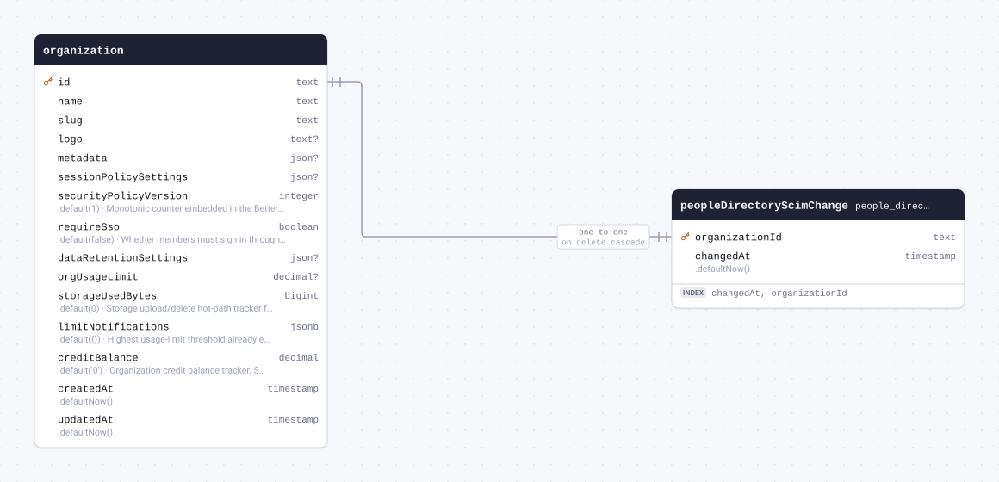

| Column                               | Type        | Constraints                                          | Default         | Description |
| ------------------------------------ | ----------- | ---------------------------------------------------- | --------------- | ----------- |
| `organizationId` (`organization_id`) | `text`      | PK NOT NULL → [organization.id](#table-organization) |                 |             |
| `changedAt` (`changed_at`)           | `timestamp` | NOT NULL                                             | `.defaultNow()` |             |

#### Definition

```sql
CREATE TABLE "people_directory_scim_change" (
	"organization_id" text PRIMARY KEY,
	"changed_at" timestamp DEFAULT now() NOT NULL
);

CREATE INDEX "people_directory_scim_change_due_idx" ON "people_directory_scim_change" ("changed_at","organization_id");

ALTER TABLE "people_directory_scim_change" ADD CONSTRAINT "people_directory_scim_change_OYSqQENLm2TZ_fkey" FOREIGN KEY ("organization_id") REFERENCES "organization"("id") ON DELETE CASCADE;
```

#### Indexes

- INDEX `changedAt`, `organizationId`

#### References

- `organizationId` → [organization.id](#table-organization) (one to one, on delete cascade)

<details>
<summary>Queries and their SQL</summary>

**Select**: Every row of peopleDirectoryScimChange.

```ts
db.select().from(peopleDirectoryScimChange);
```

```sql
select "organization_id", "changed_at"
from "people_directory_scim_change"
```

**Count**: How many rows peopleDirectoryScimChange has.

```ts
db.select({ count: count() }).from(peopleDirectoryScimChange);
```

```sql
select count(*)
from "people_directory_scim_change"
```

**Find many**: The rows of peopleDirectoryScimChange, through the relational query API.

```ts
db.query.peopleDirectoryScimChange.findMany();
```

```sql
select "d0"."organization_id" as "organizationId", "d0"."changed_at" as "changedAt"
from "people_directory_scim_change" as "d0"
```

**Find by primary key**: One row of peopleDirectoryScimChange, through the relational query API.

```ts
db.query.peopleDirectoryScimChange.findFirst({ where: { organizationId: "organizationId" } });
```

```sql
select "d0"."organization_id" as "organizationId", "d0"."changed_at" as "changedAt"
from "people_directory_scim_change" as "d0"
where "d0"."organization_id" = $1
limit $2
-- params: ["organizationId",1]
```

**Insert**: Adds a row to peopleDirectoryScimChange, giving the columns that have no default.

```ts
db.insert(peopleDirectoryScimChange).values({ organizationId: "organizationId" });
```

```sql
insert into "people_directory_scim_change" ("organization_id", "changed_at")
values ($1, default)
-- params: ["organizationId"]
```

**Update**: Changes a row of peopleDirectoryScimChange, found by its primary key.

```ts
db.update(peopleDirectoryScimChange)
  .set({ changedAt: new Date("2026-01-01T00:00:00.000Z") })
  .where(eq(peopleDirectoryScimChange.organizationId, "organizationId"));
```

```sql
update "people_directory_scim_change"
set "changed_at" = $1
where "people_directory_scim_change"."organization_id" = $2
-- params: ["2026-01-01T00:00:00.000Z","organizationId"]
```

**Delete**: Deletes a row of peopleDirectoryScimChange, found by its primary key.

```ts
db.delete(peopleDirectoryScimChange).where(
  eq(peopleDirectoryScimChange.organizationId, "organizationId"),
);
```

```sql
delete from "people_directory_scim_change"
where "people_directory_scim_change"."organization_id" = $1
-- params: ["organizationId"]
```

</details>

<a id="table-peopleDirectoryEntry"></a>

### peopleDirectoryEntry

Table `people_directory_entry`. Source identities live independently of accounts, memberships, seats, and access grants.

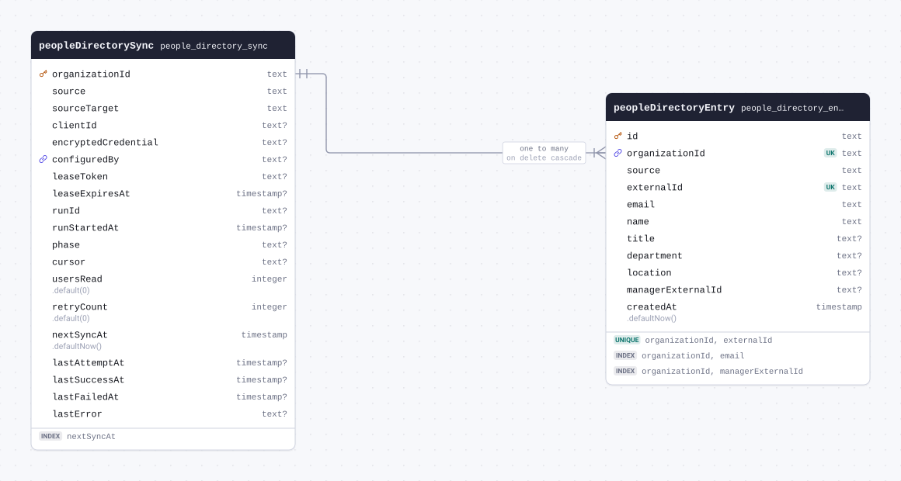

| Column                                      | Type        | Constraints                                                                 | Default         | Description |
| ------------------------------------------- | ----------- | --------------------------------------------------------------------------- | --------------- | ----------- |
| `id`                                        | `text`      | PK NOT NULL                                                                 |                 |             |
| `organizationId` (`organization_id`)        | `text`      | NOT NULL → [peopleDirectorySync.organizationId](#table-peopleDirectorySync) |                 |             |
| `source`                                    | `text`      | NOT NULL                                                                    |                 |             |
| `externalId` (`external_id`)                | `text`      | NOT NULL                                                                    |                 |             |
| `email`                                     | `text`      | NOT NULL                                                                    |                 |             |
| `name`                                      | `text`      | NOT NULL                                                                    |                 |             |
| `title`                                     | `text`      | NULL                                                                        |                 |             |
| `department`                                | `text`      | NULL                                                                        |                 |             |
| `location`                                  | `text`      | NULL                                                                        |                 |             |
| `managerExternalId` (`manager_external_id`) | `text`      | NULL                                                                        |                 |             |
| `createdAt` (`created_at`)                  | `timestamp` | NOT NULL                                                                    | `.defaultNow()` |             |

#### Definition

```sql
CREATE TABLE "people_directory_entry" (
	"id" text PRIMARY KEY,
	"organization_id" text NOT NULL,
	"source" text NOT NULL,
	"external_id" text NOT NULL,
	"email" text NOT NULL,
	"name" text NOT NULL,
	"title" text,
	"department" text,
	"location" text,
	"manager_external_id" text,
	"created_at" timestamp DEFAULT now() NOT NULL
);

CREATE UNIQUE INDEX "people_directory_entry_source_id_idx" ON "people_directory_entry" ("organization_id","external_id");

CREATE INDEX "people_directory_entry_email_idx" ON "people_directory_entry" ("organization_id","email");

CREATE INDEX "people_directory_entry_manager_idx" ON "people_directory_entry" ("organization_id","manager_external_id");

ALTER TABLE "people_directory_entry" ADD CONSTRAINT "people_directory_entry_91Wbxbo2xgAo_fkey" FOREIGN KEY ("organization_id") REFERENCES "people_directory_sync"("organization_id") ON DELETE CASCADE;
```

#### Indexes

- UNIQUE `organizationId`, `externalId`
- INDEX `organizationId`, `email`
- INDEX `organizationId`, `managerExternalId`

#### References

- `organizationId` → [peopleDirectorySync.organizationId](#table-peopleDirectorySync) (many to one, on delete cascade)

<details>
<summary>Queries and their SQL</summary>

**Select**: Every row of peopleDirectoryEntry.

```ts
db.select().from(peopleDirectoryEntry);
```

```sql
select "id", "organization_id", "source", "external_id", "email", "name", "title", "department", "location", "manager_external_id", "created_at"
from "people_directory_entry"
```

**Count**: How many rows peopleDirectoryEntry has.

```ts
db.select({ count: count() }).from(peopleDirectoryEntry);
```

```sql
select count(*)
from "people_directory_entry"
```

**Find many**: The rows of peopleDirectoryEntry, through the relational query API.

```ts
db.query.peopleDirectoryEntry.findMany();
```

```sql
select "d0"."id" as "id", "d0"."organization_id" as "organizationId", "d0"."source" as "source", "d0"."external_id" as "externalId", "d0"."email" as "email", "d0"."name" as "name", "d0"."title" as "title", "d0"."department" as "department", "d0"."location" as "location", "d0"."manager_external_id" as "managerExternalId", "d0"."created_at" as "createdAt"
from "people_directory_entry" as "d0"
```

**Find by primary key**: One row of peopleDirectoryEntry, through the relational query API.

```ts
db.query.peopleDirectoryEntry.findFirst({ where: { id: "id" } });
```

```sql
select "d0"."id" as "id", "d0"."organization_id" as "organizationId", "d0"."source" as "source", "d0"."external_id" as "externalId", "d0"."email" as "email", "d0"."name" as "name", "d0"."title" as "title", "d0"."department" as "department", "d0"."location" as "location", "d0"."manager_external_id" as "managerExternalId", "d0"."created_at" as "createdAt"
from "people_directory_entry" as "d0"
where "d0"."id" = $1
limit $2
-- params: ["id",1]
```

**Insert**: Adds a row to peopleDirectoryEntry, giving the columns that have no default.

```ts
db.insert(peopleDirectoryEntry).values({
  id: "id",
  organizationId: "organizationId",
  source: "source",
  externalId: "externalId",
  email: "email",
  name: "name",
});
```

```sql
insert into "people_directory_entry" ("id", "organization_id", "source", "external_id", "email", "name", "title", "department", "location", "manager_external_id", "created_at")
values ($1, $2, $3, $4, $5, $6, default, default, default, default, default)
-- params: ["id","organizationId","source","externalId","email","name"]
```

**Update**: Changes a row of peopleDirectoryEntry, found by its primary key.

```ts
db.update(peopleDirectoryEntry)
  .set({ organizationId: "organizationId" })
  .where(eq(peopleDirectoryEntry.id, "id"));
```

```sql
update "people_directory_entry"
set "organization_id" = $1
where "people_directory_entry"."id" = $2
-- params: ["organizationId","id"]
```

**Delete**: Deletes a row of peopleDirectoryEntry, found by its primary key.

```ts
db.delete(peopleDirectoryEntry).where(eq(peopleDirectoryEntry.id, "id"));
```

```sql
delete from "people_directory_entry"
where "people_directory_entry"."id" = $1
-- params: ["id"]
```

</details>

<a id="table-peopleDirectoryStage"></a>

### peopleDirectoryStage

Table `people_directory_stage`. A private working generation. Only a complete generation may replace the public People entries.


| Column                                      | Type      | Constraints                                                                    | Default           | Description |
| ------------------------------------------- | --------- | ------------------------------------------------------------------------------ | ----------------- | ----------- |
| `organizationId` (`organization_id`)        | `text`    | PK NOT NULL → [peopleDirectorySync.organizationId](#table-peopleDirectorySync) |                   |             |
| `runId` (`run_id`)                          | `text`    | PK NOT NULL                                                                    |                   |             |
| `externalId` (`external_id`)                | `text`    | PK NOT NULL                                                                    |                   |             |
| `proposedId` (`proposed_id`)                | `text`    | NOT NULL                                                                       |                   |             |
| `email`                                     | `text`    | NOT NULL                                                                       |                   |             |
| `name`                                      | `text`    | NOT NULL                                                                       |                   |             |
| `title`                                     | `text`    | NULL                                                                           |                   |             |
| `department`                                | `text`    | NULL                                                                           |                   |             |
| `location`                                  | `text`    | NULL                                                                           |                   |             |
| `managerExternalId` (`manager_external_id`) | `text`    | NULL                                                                           |                   |             |
| `reportsCursor` (`reports_cursor`)          | `text`    | NULL                                                                           |                   |             |
| `reportsComplete` (`reports_complete`)      | `boolean` | NOT NULL                                                                       | `.default(false)` |             |

#### Definition

```sql
CREATE TABLE "people_directory_stage" (
	"organization_id" text,
	"run_id" text,
	"external_id" text,
	"proposed_id" text NOT NULL,
	"email" text NOT NULL,
	"name" text NOT NULL,
	"title" text,
	"department" text,
	"location" text,
	"manager_external_id" text,
	"reports_cursor" text,
	"reports_complete" boolean DEFAULT false NOT NULL,
	CONSTRAINT "people_directory_stage_pkey" PRIMARY KEY("organization_id","run_id","external_id")
);

CREATE UNIQUE INDEX "people_directory_stage_email_idx" ON "people_directory_stage" ("organization_id","run_id","email");

CREATE INDEX "people_directory_stage_pending_idx" ON "people_directory_stage" ("organization_id","run_id","external_id") WHERE NOT "reports_complete";

ALTER TABLE "people_directory_stage" ADD CONSTRAINT "people_directory_stage_Z403m7UoBy6q_fkey" FOREIGN KEY ("organization_id") REFERENCES "people_directory_sync"("organization_id") ON DELETE CASCADE;
```

#### Indexes

- PRIMARY KEY `organizationId`, `runId`, `externalId`
- UNIQUE `organizationId`, `runId`, `email`
- INDEX `organizationId`, `runId`, `externalId`

#### References

- `organizationId` → [peopleDirectorySync.organizationId](#table-peopleDirectorySync) (many to one, on delete cascade)

<details>
<summary>Queries and their SQL</summary>

**Select**: Every row of peopleDirectoryStage.

```ts
db.select().from(peopleDirectoryStage);
```

```sql
select "organization_id", "run_id", "external_id", "proposed_id", "email", "name", "title", "department", "location", "manager_external_id", "reports_cursor", "reports_complete"
from "people_directory_stage"
```

**Count**: How many rows peopleDirectoryStage has.

```ts
db.select({ count: count() }).from(peopleDirectoryStage);
```

```sql
select count(*)
from "people_directory_stage"
```

**Find many**: The rows of peopleDirectoryStage, through the relational query API.

```ts
db.query.peopleDirectoryStage.findMany();
```

```sql
select "d0"."organization_id" as "organizationId", "d0"."run_id" as "runId", "d0"."external_id" as "externalId", "d0"."proposed_id" as "proposedId", "d0"."email" as "email", "d0"."name" as "name", "d0"."title" as "title", "d0"."department" as "department", "d0"."location" as "location", "d0"."manager_external_id" as "managerExternalId", "d0"."reports_cursor" as "reportsCursor", "d0"."reports_complete" as "reportsComplete"
from "people_directory_stage" as "d0"
```

**Find by primary key**: One row of peopleDirectoryStage, through the relational query API.

```ts
db.query.peopleDirectoryStage.findFirst({
  where: { organizationId: "organizationId", runId: "runId", externalId: "externalId" },
});
```

```sql
select "d0"."organization_id" as "organizationId", "d0"."run_id" as "runId", "d0"."external_id" as "externalId", "d0"."proposed_id" as "proposedId", "d0"."email" as "email", "d0"."name" as "name", "d0"."title" as "title", "d0"."department" as "department", "d0"."location" as "location", "d0"."manager_external_id" as "managerExternalId", "d0"."reports_cursor" as "reportsCursor", "d0"."reports_complete" as "reportsComplete"
from "people_directory_stage" as "d0"
where (("d0"."organization_id" = $1) and ("d0"."run_id" = $2) and ("d0"."external_id" = $3))
limit $4
-- params: ["organizationId","runId","externalId",1]
```

**Insert**: Adds a row to peopleDirectoryStage, giving the columns that have no default.

```ts
db.insert(peopleDirectoryStage).values({
  organizationId: "organizationId",
  runId: "runId",
  externalId: "externalId",
  proposedId: "proposedId",
  email: "email",
  name: "name",
});
```

```sql
insert into "people_directory_stage" ("organization_id", "run_id", "external_id", "proposed_id", "email", "name", "title", "department", "location", "manager_external_id", "reports_cursor", "reports_complete")
values ($1, $2, $3, $4, $5, $6, default, default, default, default, default, default)
-- params: ["organizationId","runId","externalId","proposedId","email","name"]
```

**Update**: Changes a row of peopleDirectoryStage, found by its primary key.

```ts
db.update(peopleDirectoryStage)
  .set({ proposedId: "proposedId" })
  .where(
    and(
      eq(peopleDirectoryStage.organizationId, "organizationId"),
      eq(peopleDirectoryStage.runId, "runId"),
      eq(peopleDirectoryStage.externalId, "externalId"),
    ),
  );
```

```sql
update "people_directory_stage"
set "proposed_id" = $1
where (("people_directory_stage"."organization_id" = $2) and ("people_directory_stage"."run_id" = $3) and ("people_directory_stage"."external_id" = $4))
-- params: ["proposedId","organizationId","runId","externalId"]
```

**Delete**: Deletes a row of peopleDirectoryStage, found by its primary key.

```ts
db.delete(peopleDirectoryStage).where(
  and(
    eq(peopleDirectoryStage.organizationId, "organizationId"),
    eq(peopleDirectoryStage.runId, "runId"),
    eq(peopleDirectoryStage.externalId, "externalId"),
  ),
);
```

```sql
delete from "people_directory_stage"
where (("people_directory_stage"."organization_id" = $1) and ("people_directory_stage"."run_id" = $2) and ("people_directory_stage"."external_id" = $3))
-- params: ["organizationId","runId","externalId"]
```

</details>

<a id="table-peopleDirectoryPage"></a>

### peopleDirectoryPage

Table `people_directory_page`. Stores hashes of processed user-list and direct-report cursors to detect replays.


| Column                               | Type   | Constraints                                                                    | Default | Description |
| ------------------------------------ | ------ | ------------------------------------------------------------------------------ | ------- | ----------- |
| `organizationId` (`organization_id`) | `text` | PK NOT NULL → [peopleDirectorySync.organizationId](#table-peopleDirectorySync) |         |             |
| `runId` (`run_id`)                   | `text` | PK NOT NULL                                                                    |         |             |
| `pageHash` (`page_hash`)             | `text` | PK NOT NULL                                                                    |         |             |

#### Definition

```sql
CREATE TABLE "people_directory_page" (
	"organization_id" text,
	"run_id" text,
	"page_hash" text,
	CONSTRAINT "people_directory_page_pkey" PRIMARY KEY("organization_id","run_id","page_hash")
);

ALTER TABLE "people_directory_page" ADD CONSTRAINT "people_directory_page_wB4QMeGjiPKf_fkey" FOREIGN KEY ("organization_id") REFERENCES "people_directory_sync"("organization_id") ON DELETE CASCADE;
```

#### Indexes

- PRIMARY KEY `organizationId`, `runId`, `pageHash`

#### References

- `organizationId` → [peopleDirectorySync.organizationId](#table-peopleDirectorySync) (many to one, on delete cascade)

<details>
<summary>Queries and their SQL</summary>

**Select**: Every row of peopleDirectoryPage.

```ts
db.select().from(peopleDirectoryPage);
```

```sql
select "organization_id", "run_id", "page_hash"
from "people_directory_page"
```

**Count**: How many rows peopleDirectoryPage has.

```ts
db.select({ count: count() }).from(peopleDirectoryPage);
```

```sql
select count(*)
from "people_directory_page"
```

**Find many**: The rows of peopleDirectoryPage, through the relational query API.

```ts
db.query.peopleDirectoryPage.findMany();
```

```sql
select "d0"."organization_id" as "organizationId", "d0"."run_id" as "runId", "d0"."page_hash" as "pageHash"
from "people_directory_page" as "d0"
```

**Find by primary key**: One row of peopleDirectoryPage, through the relational query API.

```ts
db.query.peopleDirectoryPage.findFirst({
  where: { organizationId: "organizationId", runId: "runId", pageHash: "pageHash" },
});
```

```sql
select "d0"."organization_id" as "organizationId", "d0"."run_id" as "runId", "d0"."page_hash" as "pageHash"
from "people_directory_page" as "d0"
where (("d0"."organization_id" = $1) and ("d0"."run_id" = $2) and ("d0"."page_hash" = $3))
limit $4
-- params: ["organizationId","runId","pageHash",1]
```

**Insert**: Adds a row to peopleDirectoryPage, giving the columns that have no default.

```ts
db.insert(peopleDirectoryPage).values({
  organizationId: "organizationId",
  runId: "runId",
  pageHash: "pageHash",
});
```

```sql
insert into "people_directory_page" ("organization_id", "run_id", "page_hash")
values ($1, $2, $3)
-- params: ["organizationId","runId","pageHash"]
```

**Delete**: Deletes a row of peopleDirectoryPage, found by its primary key.

```ts
db.delete(peopleDirectoryPage).where(
  and(
    eq(peopleDirectoryPage.organizationId, "organizationId"),
    eq(peopleDirectoryPage.runId, "runId"),
    eq(peopleDirectoryPage.pageHash, "pageHash"),
  ),
);
```

```sql
delete from "people_directory_page"
where (("people_directory_page"."organization_id" = $1) and ("people_directory_page"."run_id" = $2) and ("people_directory_page"."page_hash" = $3))
-- params: ["organizationId","runId","pageHash"]
```

</details>

<a id="table-organizationMemberUsageLimit"></a>

### organizationMemberUsageLimit

Table `organization_member_usage_limit`. Per-member usage limit (in dollars) scoped to a single organization. Keyed by `(organizationId, userId)` so it covers both organization members (rows in `member`) and external members (users with workspace permissions in org-owned workspaces but no `member` row). Independent of `user_stats.current_usage_limit`, which is the user's personal subscription cap and is nulled for org-scoped members. An absent row means "no per-member cap" (only the pooled org limit applies). Enforced for usage in org-owned workspaces; hosted-only.


| Column                               | Type        | Constraints                                       | Default         | Description                                                                                                                             |
| ------------------------------------ | ----------- | ------------------------------------------------- | --------------- | --------------------------------------------------------------------------------------------------------------------------------------- |
| `id`                                 | `text`      | PK NOT NULL                                       |                 |                                                                                                                                         |
| `organizationId` (`organization_id`) | `text`      | NOT NULL → [organization.id](#table-organization) |                 |                                                                                                                                         |
| `userId` (`user_id`)                 | `text`      | NOT NULL → [user.id](#table-user)                 |                 |                                                                                                                                         |
| `usageLimit` (`usage_limit`)         | `decimal`   | NOT NULL                                          |                 |                                                                                                                                         |
| `setBy` (`set_by`)                   | `text`      | NULL → [user.id](#table-user)                     |                 | Admin who set the cap (audit only). Soft FK: nulled if that user is deleted so the member's limit row survives — never cascade-deleted. |
| `createdAt` (`created_at`)           | `timestamp` | NOT NULL                                          | `.defaultNow()` |                                                                                                                                         |
| `updatedAt` (`updated_at`)           | `timestamp` | NOT NULL                                          | `.defaultNow()` |                                                                                                                                         |

#### Definition

```sql
CREATE TABLE "organization_member_usage_limit" (
	"id" text PRIMARY KEY,
	"organization_id" text NOT NULL,
	"user_id" text NOT NULL,
	"usage_limit" numeric NOT NULL,
	"set_by" text,
	"created_at" timestamp DEFAULT now() NOT NULL,
	"updated_at" timestamp DEFAULT now() NOT NULL
);

CREATE UNIQUE INDEX "org_member_usage_limit_org_user_unique" ON "organization_member_usage_limit" ("organization_id","user_id");

CREATE INDEX "org_member_usage_limit_organization_id_idx" ON "organization_member_usage_limit" ("organization_id");

ALTER TABLE "organization_member_usage_limit" ADD CONSTRAINT "organization_member_usage_limit_paCWptLl6euE_fkey" FOREIGN KEY ("organization_id") REFERENCES "organization"("id") ON DELETE CASCADE;

ALTER TABLE "organization_member_usage_limit" ADD CONSTRAINT "organization_member_usage_limit_user_id_user_id_fkey" FOREIGN KEY ("user_id") REFERENCES "user"("id") ON DELETE CASCADE;

ALTER TABLE "organization_member_usage_limit" ADD CONSTRAINT "organization_member_usage_limit_set_by_user_id_fkey" FOREIGN KEY ("set_by") REFERENCES "user"("id") ON DELETE SET NULL;
```

#### Indexes

- UNIQUE `organizationId`, `userId`
- INDEX `organizationId`

#### References

- `organizationId` → [organization.id](#table-organization) (many to one, on delete cascade)
- `userId` → [user.id](#table-user) (many to one, on delete cascade)
- `setBy` → [user.id](#table-user) (many to one, on delete set null)

<details>
<summary>Queries and their SQL</summary>

**Select**: Every row of organizationMemberUsageLimit.

```ts
db.select().from(organizationMemberUsageLimit);
```

```sql
select "id", "organization_id", "user_id", "usage_limit", "set_by", "created_at", "updated_at"
from "organization_member_usage_limit"
```

**Count**: How many rows organizationMemberUsageLimit has.

```ts
db.select({ count: count() }).from(organizationMemberUsageLimit);
```

```sql
select count(*)
from "organization_member_usage_limit"
```

**Find many**: The rows of organizationMemberUsageLimit, through the relational query API.

```ts
db.query.organizationMemberUsageLimit.findMany();
```

```sql
select "d0"."id" as "id", "d0"."organization_id" as "organizationId", "d0"."user_id" as "userId", "d0"."usage_limit" as "usageLimit", "d0"."set_by" as "setBy", "d0"."created_at" as "createdAt", "d0"."updated_at" as "updatedAt"
from "organization_member_usage_limit" as "d0"
```

**Find by primary key**: One row of organizationMemberUsageLimit, through the relational query API.

```ts
db.query.organizationMemberUsageLimit.findFirst({ where: { id: "id" } });
```

```sql
select "d0"."id" as "id", "d0"."organization_id" as "organizationId", "d0"."user_id" as "userId", "d0"."usage_limit" as "usageLimit", "d0"."set_by" as "setBy", "d0"."created_at" as "createdAt", "d0"."updated_at" as "updatedAt"
from "organization_member_usage_limit" as "d0"
where "d0"."id" = $1
limit $2
-- params: ["id",1]
```

**Insert**: Adds a row to organizationMemberUsageLimit, giving the columns that have no default.

```ts
db.insert(organizationMemberUsageLimit).values({
  id: "id",
  organizationId: "organizationId",
  userId: "userId",
  usageLimit: "1.00",
});
```

```sql
insert into "organization_member_usage_limit" ("id", "organization_id", "user_id", "usage_limit", "set_by", "created_at", "updated_at")
values ($1, $2, $3, $4, default, default, default)
-- params: ["id","organizationId","userId","1.00"]
```

**Update**: Changes a row of organizationMemberUsageLimit, found by its primary key.

```ts
db.update(organizationMemberUsageLimit)
  .set({ organizationId: "organizationId" })
  .where(eq(organizationMemberUsageLimit.id, "id"));
```

```sql
update "organization_member_usage_limit"
set "organization_id" = $1
where "organization_member_usage_limit"."id" = $2
-- params: ["organizationId","id"]
```

**Delete**: Deletes a row of organizationMemberUsageLimit, found by its primary key.

```ts
db.delete(organizationMemberUsageLimit).where(eq(organizationMemberUsageLimit.id, "id"));
```

```sql
delete from "organization_member_usage_limit"
where "organization_member_usage_limit"."id" = $1
-- params: ["id"]
```

</details>

<a id="table-organizationAccessRequestSettings"></a>

### organizationAccessRequestSettings

Table `organization_access_request_settings`. Organization opt-out; an absent row keeps access requests enabled.


| Column                               | Type        | Constraints                                          | Default          | Description |
| ------------------------------------ | ----------- | ---------------------------------------------------- | ---------------- | ----------- |
| `organizationId` (`organization_id`) | `text`      | PK NOT NULL → [organization.id](#table-organization) |                  |             |
| `allowRequests` (`allow_requests`)   | `boolean`   | NOT NULL                                             | `.default(true)` |             |
| `updatedAt` (`updated_at`)           | `timestamp` | NOT NULL                                             | `.defaultNow()`  |             |
| `updatedBy` (`updated_by`)           | `text`      | NULL → [user.id](#table-user)                        |                  |             |

#### Definition

```sql
CREATE TABLE "organization_access_request_settings" (
	"organization_id" text PRIMARY KEY,
	"allow_requests" boolean DEFAULT true NOT NULL,
	"updated_at" timestamp DEFAULT now() NOT NULL,
	"updated_by" text
);

ALTER TABLE "organization_access_request_settings" ADD CONSTRAINT "organization_access_request_settings_XzSoC8EGNvBS_fkey" FOREIGN KEY ("organization_id") REFERENCES "organization"("id") ON DELETE CASCADE;

ALTER TABLE "organization_access_request_settings" ADD CONSTRAINT "organization_access_request_settings_updated_by_user_id_fkey" FOREIGN KEY ("updated_by") REFERENCES "user"("id") ON DELETE SET NULL;
```

#### References

- `organizationId` → [organization.id](#table-organization) (one to one, on delete cascade)
- `updatedBy` → [user.id](#table-user) (many to one, on delete set null)

<details>
<summary>Queries and their SQL</summary>

**Select**: Every row of organizationAccessRequestSettings.

```ts
db.select().from(organizationAccessRequestSettings);
```

```sql
select "organization_id", "allow_requests", "updated_at", "updated_by"
from "organization_access_request_settings"
```

**Count**: How many rows organizationAccessRequestSettings has.

```ts
db.select({ count: count() }).from(organizationAccessRequestSettings);
```

```sql
select count(*)
from "organization_access_request_settings"
```

**Find many**: The rows of organizationAccessRequestSettings, through the relational query API.

```ts
db.query.organizationAccessRequestSettings.findMany();
```

```sql
select "d0"."organization_id" as "organizationId", "d0"."allow_requests" as "allowRequests", "d0"."updated_at" as "updatedAt", "d0"."updated_by" as "updatedBy"
from "organization_access_request_settings" as "d0"
```

**Find by primary key**: One row of organizationAccessRequestSettings, through the relational query API.

```ts
db.query.organizationAccessRequestSettings.findFirst({
  where: { organizationId: "organizationId" },
});
```

```sql
select "d0"."organization_id" as "organizationId", "d0"."allow_requests" as "allowRequests", "d0"."updated_at" as "updatedAt", "d0"."updated_by" as "updatedBy"
from "organization_access_request_settings" as "d0"
where "d0"."organization_id" = $1
limit $2
-- params: ["organizationId",1]
```

**Insert**: Adds a row to organizationAccessRequestSettings, giving the columns that have no default.

```ts
db.insert(organizationAccessRequestSettings).values({ organizationId: "organizationId" });
```

```sql
insert into "organization_access_request_settings" ("organization_id", "allow_requests", "updated_at", "updated_by")
values ($1, default, default, default)
-- params: ["organizationId"]
```

**Update**: Changes a row of organizationAccessRequestSettings, found by its primary key.

```ts
db.update(organizationAccessRequestSettings)
  .set({ allowRequests: true })
  .where(eq(organizationAccessRequestSettings.organizationId, "organizationId"));
```

```sql
update "organization_access_request_settings"
set "allow_requests" = $1
where "organization_access_request_settings"."organization_id" = $2
-- params: [true,"organizationId"]
```

**Delete**: Deletes a row of organizationAccessRequestSettings, found by its primary key.

```ts
db.delete(organizationAccessRequestSettings).where(
  eq(organizationAccessRequestSettings.organizationId, "organizationId"),
);
```

```sql
delete from "organization_access_request_settings"
where "organization_access_request_settings"."organization_id" = $1
-- params: ["organizationId"]
```

</details>

<a id="table-permissionAccessRequest"></a>

### permissionAccessRequest

Table `permission_access_request`. Durable review history, scoped to the organization that owned the request at creation.


| Column                               | Type        | Constraints                                       | Default               | Description |
| ------------------------------------ | ----------- | ------------------------------------------------- | --------------------- | ----------- |
| `id`                                 | `text`      | PK NOT NULL                                       |                       |             |
| `organizationId` (`organization_id`) | `text`      | NOT NULL → [organization.id](#table-organization) |                       |             |
| `requesterId` (`requester_id`)       | `text`      | NOT NULL → [user.id](#table-user)                 |                       |             |
| `workspaceId` (`workspace_id`)       | `text`      | NULL                                              |                       |             |
| `scopeKey` (`scope_key`)             | `text`      | NOT NULL                                          |                       |             |
| `targetKey` (`target_key`)           | `text`      | NOT NULL                                          |                       |             |
| `target`                             | `jsonb`     | NOT NULL                                          |                       |             |
| `targetLabel` (`target_label`)       | `text`      | NOT NULL                                          |                       |             |
| `membershipId` (`membership_id`)     | `text`      | NOT NULL                                          |                       |             |
| `groupId` (`group_id`)               | `text`      | NULL                                              |                       |             |
| `groupName` (`group_name`)           | `text`      | NULL                                              |                       |             |
| `reason`                             | `text`      | NOT NULL                                          | `.default('')`        |             |
| `status`                             | `text`      | NOT NULL                                          | `.default('pending')` |             |
| `decisionReason` (`decision_reason`) | `text`      | NULL                                              |                       |             |
| `decidedBy` (`decided_by`)           | `text`      | NULL → [user.id](#table-user)                     |                       |             |
| `decision`                           | `jsonb`     | NULL                                              |                       |             |
| `createdAt` (`created_at`)           | `timestamp` | NOT NULL                                          | `.defaultNow()`       |             |
| `updatedAt` (`updated_at`)           | `timestamp` | NOT NULL                                          | `.defaultNow()`       |             |
| `decidedAt` (`decided_at`)           | `timestamp` | NULL                                              |                       |             |

#### Definition

```sql
CREATE TABLE "permission_access_request" (
	"id" text PRIMARY KEY,
	"organization_id" text NOT NULL,
	"requester_id" text NOT NULL,
	"workspace_id" text,
	"scope_key" text NOT NULL,
	"target_key" text NOT NULL,
	"target" jsonb NOT NULL,
	"target_label" text NOT NULL,
	"membership_id" text NOT NULL,
	"group_id" text,
	"group_name" text,
	"reason" text DEFAULT '' NOT NULL,
	"status" text DEFAULT 'pending' NOT NULL,
	"decision_reason" text,
	"decided_by" text,
	"decision" jsonb,
	"created_at" timestamp DEFAULT now() NOT NULL,
	"updated_at" timestamp DEFAULT now() NOT NULL,
	"decided_at" timestamp,
	CONSTRAINT "permission_access_request_status_check" CHECK ("status" in ('pending', 'fulfilled', 'declined', 'cancelled', 'closed'))
);

CREATE UNIQUE INDEX "permission_access_request_pending_unique" ON "permission_access_request" ("organization_id","requester_id","scope_key","target_key") WHERE "status" = 'pending';

CREATE INDEX "permission_access_request_org_queue_idx" ON "permission_access_request" ("organization_id","status","created_at","id");

CREATE INDEX "permission_access_request_requester_idx" ON "permission_access_request" ("organization_id","requester_id","scope_key","created_at","id");

ALTER TABLE "permission_access_request" ADD CONSTRAINT "permission_access_request_organization_id_organization_id_fkey" FOREIGN KEY ("organization_id") REFERENCES "organization"("id") ON DELETE CASCADE;

ALTER TABLE "permission_access_request" ADD CONSTRAINT "permission_access_request_requester_id_user_id_fkey" FOREIGN KEY ("requester_id") REFERENCES "user"("id") ON DELETE CASCADE;

ALTER TABLE "permission_access_request" ADD CONSTRAINT "permission_access_request_decided_by_user_id_fkey" FOREIGN KEY ("decided_by") REFERENCES "user"("id") ON DELETE SET NULL;
```

#### Indexes

- UNIQUE `organizationId`, `requesterId`, `scopeKey`, `targetKey`
- INDEX `organizationId`, `status`, `createdAt`, `id`
- INDEX `organizationId`, `requesterId`, `scopeKey`, `createdAt`, `id`

#### References

- `organizationId` → [organization.id](#table-organization) (many to one, on delete cascade)
- `requesterId` → [user.id](#table-user) (many to one, on delete cascade)
- `decidedBy` → [user.id](#table-user) (many to one, on delete set null)

<details>
<summary>Queries and their SQL</summary>

**Select**: Every row of permissionAccessRequest.

```ts
db.select().from(permissionAccessRequest);
```

```sql
select "id", "organization_id", "requester_id", "workspace_id", "scope_key", "target_key", "target", "target_label", "membership_id", "group_id", "group_name", "reason", "status", "decision_reason", "decided_by", "decision", "created_at", "updated_at", "decided_at"
from "permission_access_request"
```

**Count**: How many rows permissionAccessRequest has.

```ts
db.select({ count: count() }).from(permissionAccessRequest);
```

```sql
select count(*)
from "permission_access_request"
```

**Find many**: The rows of permissionAccessRequest, through the relational query API.

```ts
db.query.permissionAccessRequest.findMany();
```

```sql
select "d0"."id" as "id", "d0"."organization_id" as "organizationId", "d0"."requester_id" as "requesterId", "d0"."workspace_id" as "workspaceId", "d0"."scope_key" as "scopeKey", "d0"."target_key" as "targetKey", "d0"."target" as "target", "d0"."target_label" as "targetLabel", "d0"."membership_id" as "membershipId", "d0"."group_id" as "groupId", "d0"."group_name" as "groupName", "d0"."reason" as "reason", "d0"."status" as "status", "d0"."decision_reason" as "decisionReason", "d0"."decided_by" as "decidedBy", "d0"."decision" as "decision", "d0"."created_at" as "createdAt", "d0"."updated_at" as "updatedAt", "d0"."decided_at" as "decidedAt"
from "permission_access_request" as "d0"
```

**Find by primary key**: One row of permissionAccessRequest, through the relational query API.

```ts
db.query.permissionAccessRequest.findFirst({ where: { id: "id" } });
```

```sql
select "d0"."id" as "id", "d0"."organization_id" as "organizationId", "d0"."requester_id" as "requesterId", "d0"."workspace_id" as "workspaceId", "d0"."scope_key" as "scopeKey", "d0"."target_key" as "targetKey", "d0"."target" as "target", "d0"."target_label" as "targetLabel", "d0"."membership_id" as "membershipId", "d0"."group_id" as "groupId", "d0"."group_name" as "groupName", "d0"."reason" as "reason", "d0"."status" as "status", "d0"."decision_reason" as "decisionReason", "d0"."decided_by" as "decidedBy", "d0"."decision" as "decision", "d0"."created_at" as "createdAt", "d0"."updated_at" as "updatedAt", "d0"."decided_at" as "decidedAt"
from "permission_access_request" as "d0"
where "d0"."id" = $1
limit $2
-- params: ["id",1]
```

**Insert**: Adds a row to permissionAccessRequest, giving the columns that have no default.

```ts
db.insert(permissionAccessRequest).values({
  id: "id",
  organizationId: "organizationId",
  requesterId: "requesterId",
  scopeKey: "scopeKey",
  targetKey: "targetKey",
  target: {},
  targetLabel: "targetLabel",
  membershipId: "membershipId",
});
```

```sql
insert into "permission_access_request" ("id", "organization_id", "requester_id", "workspace_id", "scope_key", "target_key", "target", "target_label", "membership_id", "group_id", "group_name", "reason", "status", "decision_reason", "decided_by", "decision", "created_at", "updated_at", "decided_at")
values ($1, $2, $3, default, $4, $5, $6, $7, $8, default, default, default, default, default, default, default, default, default, default)
-- params: ["id","organizationId","requesterId","scopeKey","targetKey",{},"targetLabel","membershipId"]
```

**Update**: Changes a row of permissionAccessRequest, found by its primary key.

```ts
db.update(permissionAccessRequest)
  .set({ organizationId: "organizationId" })
  .where(eq(permissionAccessRequest.id, "id"));
```

```sql
update "permission_access_request"
set "organization_id" = $1
where "permission_access_request"."id" = $2
-- params: ["organizationId","id"]
```

**Delete**: Deletes a row of permissionAccessRequest, found by its primary key.

```ts
db.delete(permissionAccessRequest).where(eq(permissionAccessRequest.id, "id"));
```

```sql
delete from "permission_access_request"
where "permission_access_request"."id" = $1
-- params: ["id"]
```

</details>

<a id="table-invitation"></a>

### invitation


| Column                                   | Type                                                                     | Constraints                                   | Default                    | Description |
| ---------------------------------------- | ------------------------------------------------------------------------ | --------------------------------------------- | -------------------------- | ----------- |
| `id`                                     | `text`                                                                   | PK NOT NULL                                   |                            |             |
| `kind`                                   | [`invitationKindEnum`](#enum-invitationKindEnum)                         | NOT NULL                                      | `.default('organization')` |             |
| `email`                                  | `text`                                                                   | NOT NULL                                      |                            |             |
| `inviterId` (`inviter_id`)               | `text`                                                                   | NOT NULL → [user.id](#table-user)             |                            |             |
| `organizationId` (`organization_id`)     | `text`                                                                   | NULL → [organization.id](#table-organization) |                            |             |
| `membershipIntent` (`membership_intent`) | [`invitationMembershipIntentEnum`](#enum-invitationMembershipIntentEnum) | NOT NULL                                      | `.default('internal')`     |             |
| `role`                                   | `text`                                                                   | NOT NULL                                      |                            |             |
| `status`                                 | [`invitationStatusEnum`](#enum-invitationStatusEnum)                     | NOT NULL                                      | `.default('pending')`      |             |
| `token`                                  | `text`                                                                   | UNIQUE NOT NULL                               |                            |             |
| `expiresAt` (`expires_at`)               | `timestamp`                                                              | NOT NULL                                      |                            |             |
| `createdAt` (`created_at`)               | `timestamp`                                                              | NOT NULL                                      | `.defaultNow()`            |             |
| `updatedAt` (`updated_at`)               | `timestamp`                                                              | NOT NULL                                      | `.defaultNow()`            |             |

#### Definition

```sql
CREATE TABLE "invitation" (
	"id" text PRIMARY KEY,
	"kind" "invitation_kind" DEFAULT 'organization'::"invitation_kind" NOT NULL,
	"email" text NOT NULL,
	"inviter_id" text NOT NULL,
	"organization_id" text,
	"membership_intent" "invitation_membership_intent" DEFAULT 'internal'::"invitation_membership_intent" NOT NULL,
	"role" text NOT NULL,
	"status" "invitation_status" DEFAULT 'pending'::"invitation_status" NOT NULL,
	"token" text NOT NULL UNIQUE,
	"expires_at" timestamp NOT NULL,
	"created_at" timestamp DEFAULT now() NOT NULL,
	"updated_at" timestamp DEFAULT now() NOT NULL
);

CREATE INDEX "invitation_email_idx" ON "invitation" ("email");

CREATE INDEX "invitation_organization_id_idx" ON "invitation" ("organization_id");

CREATE INDEX "invitation_status_idx" ON "invitation" ("status");

CREATE UNIQUE INDEX "invitation_pending_email_org_unique" ON "invitation" ("email","organization_id") WHERE "status" = 'pending' AND "organization_id" IS NOT NULL;

ALTER TABLE "invitation" ADD CONSTRAINT "invitation_inviter_id_user_id_fkey" FOREIGN KEY ("inviter_id") REFERENCES "user"("id") ON DELETE CASCADE;

ALTER TABLE "invitation" ADD CONSTRAINT "invitation_organization_id_organization_id_fkey" FOREIGN KEY ("organization_id") REFERENCES "organization"("id") ON DELETE CASCADE;
```

#### Indexes

- INDEX `email`
- INDEX `organizationId`
- INDEX `status`
- UNIQUE `email`, `organizationId`

#### References

- `inviterId` → [user.id](#table-user) (many to one, on delete cascade)
- `organizationId` → [organization.id](#table-organization) (many to one, on delete cascade)

#### Referenced by

- `id` → [invitationWorkspaceGrant.invitationId](#table-invitationWorkspaceGrant) (one to many, on delete cascade)

<details>
<summary>Queries and their SQL</summary>

**Select**: Every row of invitation.

```ts
db.select().from(invitation);
```

```sql
select "id", "kind", "email", "inviter_id", "organization_id", "membership_intent", "role", "status", "token", "expires_at", "created_at", "updated_at"
from "invitation"
```

**Count**: How many rows invitation has.

```ts
db.select({ count: count() }).from(invitation);
```

```sql
select count(*)
from "invitation"
```

**Find many**: The rows of invitation, through the relational query API.

```ts
db.query.invitation.findMany();
```

```sql
select "d0"."id" as "id", "d0"."kind" as "kind", "d0"."email" as "email", "d0"."inviter_id" as "inviterId", "d0"."organization_id" as "organizationId", "d0"."membership_intent" as "membershipIntent", "d0"."role" as "role", "d0"."status" as "status", "d0"."token" as "token", "d0"."expires_at" as "expiresAt", "d0"."created_at" as "createdAt", "d0"."updated_at" as "updatedAt"
from "invitation" as "d0"
```

**Find by primary key**: One row of invitation, through the relational query API.

```ts
db.query.invitation.findFirst({ where: { id: "id" } });
```

```sql
select "d0"."id" as "id", "d0"."kind" as "kind", "d0"."email" as "email", "d0"."inviter_id" as "inviterId", "d0"."organization_id" as "organizationId", "d0"."membership_intent" as "membershipIntent", "d0"."role" as "role", "d0"."status" as "status", "d0"."token" as "token", "d0"."expires_at" as "expiresAt", "d0"."created_at" as "createdAt", "d0"."updated_at" as "updatedAt"
from "invitation" as "d0"
where "d0"."id" = $1
limit $2
-- params: ["id",1]
```

**Insert**: Adds a row to invitation, giving the columns that have no default.

```ts
db.insert(invitation).values({
  id: "id",
  email: "email",
  inviterId: "inviterId",
  role: "role",
  token: "token",
  expiresAt: new Date("2026-01-01T00:00:00.000Z"),
});
```

```sql
insert into "invitation" ("id", "kind", "email", "inviter_id", "organization_id", "membership_intent", "role", "status", "token", "expires_at", "created_at", "updated_at")
values ($1, default, $2, $3, default, default, $4, default, $5, $6, default, default)
-- params: ["id","email","inviterId","role","token","2026-01-01T00:00:00.000Z"]
```

**Update**: Changes a row of invitation, found by its primary key.

```ts
db.update(invitation).set({ kind: "organization" }).where(eq(invitation.id, "id"));
```

```sql
update "invitation"
set "kind" = $1
where "invitation"."id" = $2
-- params: ["organization","id"]
```

**Delete**: Deletes a row of invitation, found by its primary key.

```ts
db.delete(invitation).where(eq(invitation.id, "id"));
```

```sql
delete from "invitation"
where "invitation"."id" = $1
-- params: ["id"]
```

</details>

<a id="table-workspace"></a>

### workspace


| Column                                                              | Type                                           | Constraints                                   | Default                            | Description                                                                                                                                                                                                                                                                                                                                                                                                                                                                                                                      |
| ------------------------------------------------------------------- | ---------------------------------------------- | --------------------------------------------- | ---------------------------------- | -------------------------------------------------------------------------------------------------------------------------------------------------------------------------------------------------------------------------------------------------------------------------------------------------------------------------------------------------------------------------------------------------------------------------------------------------------------------------------------------------------------------------------- |
| `id`                                                                | `text`                                         | PK NOT NULL                                   |                                    |                                                                                                                                                                                                                                                                                                                                                                                                                                                                                                                                  |
| `name`                                                              | `text`                                         | NOT NULL                                      |                                    |                                                                                                                                                                                                                                                                                                                                                                                                                                                                                                                                  |
| `color`                                                             | `text`                                         | NOT NULL                                      | `.default('#33C482')`              |                                                                                                                                                                                                                                                                                                                                                                                                                                                                                                                                  |
| `logoUrl` (`logo_url`)                                              | `text`                                         | NULL                                          |                                    |                                                                                                                                                                                                                                                                                                                                                                                                                                                                                                                                  |
| `ownerId` (`owner_id`)                                              | `text`                                         | NOT NULL → [user.id](#table-user)             |                                    | checks. The owner→admin derivation is redundant: every workspace owner already has an explicit `admin` row in `permissions` (verified across all production workspaces) and all creation paths add one. Retained only as the lifecycle anchor — `onDelete: 'cascade'` cleans up a user's workspaces on account deletion — and the ownership-transfer target when an owner is removed. For admin checks use explicit `permissions` rows; for the workspace's principal billing identity use `billedAccountUserId`. DO NOT DELETE. |
| `organizationId` (`organization_id`)                                | `text`                                         | NULL → [organization.id](#table-organization) |                                    |                                                                                                                                                                                                                                                                                                                                                                                                                                                                                                                                  |
| `organizationScopeKey` (`organization_scope_key`)                   | `text`                                         | NULL                                          | `.generatedAlwaysAs()`             | Encodes nullable organization identity for the composite membership foreign key.                                                                                                                                                                                                                                                                                                                                                                                                                                                 |
| `projectId`                                                         | `workspaceProjectIdColumn`                     | NULL → [project.id](#table-project)           |                                    |                                                                                                                                                                                                                                                                                                                                                                                                                                                                                                                                  |
| `workspaceMode` (`workspace_mode`)                                  | [`workspaceModeEnum`](#enum-workspaceModeEnum) | NOT NULL                                      | `.default('grandfathered_shared')` |                                                                                                                                                                                                                                                                                                                                                                                                                                                                                                                                  |
| `billedAccountUserId` (`billed_account_user_id`)                    | `text`                                         | NOT NULL → [user.id](#table-user)             |                                    |                                                                                                                                                                                                                                                                                                                                                                                                                                                                                                                                  |
| `storageUsedBytes` (`storage_used_bytes`)                           | `bigint`                                       | NOT NULL                                      | `.default(0)`                      | Durable workspace-first storage ledger. Invariant: this non-negative total and the currently routed payer aggregate change atomically while the workspace row is locked. A payer identity change moves this entire total old payer -> new payer in the same transaction.                                                                                                                                                                                                                                                         |
| `allowPersonalApiKeys` (`allow_personal_api_keys`)                  | `boolean`                                      | NOT NULL                                      | `.default(true)`                   |                                                                                                                                                                                                                                                                                                                                                                                                                                                                                                                                  |
| `inboxEnabled` (`inbox_enabled`)                                    | `boolean`                                      | NOT NULL                                      | `.default(false)`                  |                                                                                                                                                                                                                                                                                                                                                                                                                                                                                                                                  |
| `inboxAddress` (`inbox_address`)                                    | `text`                                         | NULL                                          |                                    |                                                                                                                                                                                                                                                                                                                                                                                                                                                                                                                                  |
| `inboxProviderId` (`inbox_provider_id`)                             | `text`                                         | NULL                                          |                                    |                                                                                                                                                                                                                                                                                                                                                                                                                                                                                                                                  |
| `inboxSecretScope` (`inbox_secret_scope`)                           | `text`                                         | NOT NULL                                      | `.default('all')`                  |                                                                                                                                                                                                                                                                                                                                                                                                                                                                                                                                  |
| `inboxMountedSecrets` (`inbox_mounted_secrets`)                     | `jsonb`                                        | NOT NULL                                      | `.default([])`                     |                                                                                                                                                                                                                                                                                                                                                                                                                                                                                                                                  |
| `archivedAt` (`archived_at`)                                        | `timestamp`                                    | NULL                                          |                                    |                                                                                                                                                                                                                                                                                                                                                                                                                                                                                                                                  |
| `organizationAssignedAt` (`organization_assigned_at`)               | `timestamp`                                    | NULL                                          |                                    |                                                                                                                                                                                                                                                                                                                                                                                                                                                                                                                                  |
| `forkedFromWorkspaceId` (`forked_from_workspace_id`)                | `text`                                         | NULL → [workspace.id](#table-workspace)       |                                    |                                                                                                                                                                                                                                                                                                                                                                                                                                                                                                                                  |
| `forkSyncNewWorkflowsExcluded` (`fork_sync_new_workflows_excluded`) | `boolean`                                      | NOT NULL                                      | `.default(false)`                  | Whether a newly created workflow in this workspace starts outside fork sync. `false` (default): new workflows join sync once deployed. `true`: they land with `workflow.forkSyncExcluded` set and are opted in on the Forks page. Uniform across a fork lineage (written to every member, inherited by new forks) and forward-only: flipping it never rewrites an existing workflow's `forkSyncExcluded`.                                                                                                                        |
| `createdAt` (`created_at`)                                          | `timestamp`                                    | NOT NULL                                      | `.defaultNow()`                    |                                                                                                                                                                                                                                                                                                                                                                                                                                                                                                                                  |
| `updatedAt` (`updated_at`)                                          | `timestamp`                                    | NOT NULL                                      | `.defaultNow()`                    |                                                                                                                                                                                                                                                                                                                                                                                                                                                                                                                                  |

#### Definition

```sql
CREATE TABLE "workspace" (
	"id" text PRIMARY KEY,
	"name" text NOT NULL,
	"color" text DEFAULT '#33C482' NOT NULL,
	"logo_url" text,
	"owner_id" text NOT NULL,
	"organization_id" text,
	"organization_scope_key" text GENERATED ALWAYS AS (CASE WHEN organization_id IS NULL THEN 'personal' ELSE 'organization:' || organization_id END) STORED,
	"project_id" text NOT NULL,
	"workspace_mode" "workspace_mode" DEFAULT 'grandfathered_shared'::"workspace_mode" NOT NULL,
	"billed_account_user_id" text NOT NULL,
	"storage_used_bytes" bigint DEFAULT 0 NOT NULL,
	"allow_personal_api_keys" boolean DEFAULT true NOT NULL,
	"inbox_enabled" boolean DEFAULT false NOT NULL,
	"inbox_address" text,
	"inbox_provider_id" text,
	"inbox_secret_scope" text DEFAULT 'all' NOT NULL,
	"inbox_mounted_secrets" jsonb DEFAULT '[]' NOT NULL,
	"archived_at" timestamp,
	"organization_assigned_at" timestamp,
	"forked_from_workspace_id" text,
	"fork_sync_new_workflows_excluded" boolean DEFAULT false NOT NULL,
	"created_at" timestamp DEFAULT now() NOT NULL,
	"updated_at" timestamp DEFAULT now() NOT NULL,
	CONSTRAINT "workspace_id_project_unique" UNIQUE("id","project_id"),
	CONSTRAINT "workspace_storage_used_bytes_non_negative" CHECK ("storage_used_bytes" >= 0)
);

CREATE INDEX "workspace_owner_id_idx" ON "workspace" ("owner_id");

CREATE INDEX "workspace_organization_id_idx" ON "workspace" ("organization_id");

CREATE INDEX CONCURRENTLY "workspace_billed_account_user_id_idx" ON "workspace" ("billed_account_user_id");

CREATE INDEX CONCURRENTLY "workspace_project_id_id_idx" ON "workspace" ("project_id","id");

CREATE INDEX "workspace_mode_idx" ON "workspace" ("workspace_mode");

CREATE INDEX "workspace_forked_from_workspace_id_idx" ON "workspace" ("forked_from_workspace_id");

CREATE UNIQUE INDEX "workspace_inbox_provider_id_idx" ON "workspace" ("inbox_provider_id") WHERE "inbox_provider_id" IS NOT NULL;

ALTER TABLE "workspace" ADD CONSTRAINT "workspace_owner_id_user_id_fkey" FOREIGN KEY ("owner_id") REFERENCES "user"("id") ON DELETE CASCADE;

ALTER TABLE "workspace" ADD CONSTRAINT "workspace_organization_id_organization_id_fkey" FOREIGN KEY ("organization_id") REFERENCES "organization"("id") ON DELETE SET NULL;

ALTER TABLE "workspace" ADD CONSTRAINT "workspace_project_id_project_id_fkey" FOREIGN KEY ("project_id") REFERENCES "project"("id") ON DELETE RESTRICT;

ALTER TABLE "workspace" ADD CONSTRAINT "workspace_billed_account_user_id_user_id_fkey" FOREIGN KEY ("billed_account_user_id") REFERENCES "user"("id");

ALTER TABLE "workspace" ADD CONSTRAINT "workspace_forked_from_workspace_id_workspace_id_fkey" FOREIGN KEY ("forked_from_workspace_id") REFERENCES "workspace"("id") ON DELETE SET NULL;

ALTER TABLE "workspace" ADD CONSTRAINT "workspace_project_organization_fk" FOREIGN KEY ("project_id","organization_scope_key") REFERENCES "project"("id","organization_scope_key");

ALTER TABLE "workspace" ADD CONSTRAINT "workspace_fork_project_fk" FOREIGN KEY ("forked_from_workspace_id","project_id") REFERENCES "workspace"("id","project_id");
```

#### Indexes

- UNIQUE `id`, `projectId`
- INDEX `ownerId`
- INDEX `organizationId`
- INDEX `billedAccountUserId`
- INDEX `projectId`, `id`
- INDEX `workspaceMode`
- INDEX `forkedFromWorkspaceId`
- UNIQUE `inboxProviderId`

#### References

- `ownerId` → [user.id](#table-user) (many to one, on delete cascade)
- `organizationId` → [organization.id](#table-organization) (many to one, on delete set null)
- `billedAccountUserId` → [user.id](#table-user) (many to one, on delete no action)
- `forkedFromWorkspaceId` → [workspace.id](#table-workspace) (many to one, on delete set null)
- `projectId` → [project.id](#table-project) (many to one)
- `forkedFromWorkspaceId` → [workspace.id](#table-workspace) (many to one, on delete set null)

#### Referenced by

- `id` → [folder.workspaceId](#table-folder) (one to many, on delete cascade)
- `id` → [pinnedItem.workspaceId](#table-pinnedItem) (one to many, on delete cascade)
- `id` → [workspaceVisit.workspaceId](#table-workspaceVisit) (one to many, on delete cascade)
- `id` → [workflow.workspaceId](#table-workflow) (one to many, on delete cascade)
- `id` → [workflowExecutionLogs.workspaceId](#table-workflowExecutionLogs) (one to many, on delete cascade)
- `id` → [executionLargeValues.workspaceId](#table-executionLargeValues) (one to many, on delete cascade)
- `id` → [executionLargeValueReferences.workspaceId](#table-executionLargeValueReferences) (one to many, on delete cascade)
- `id` → [executionLargeValueDependencies.workspaceId](#table-executionLargeValueDependencies) (one to many, on delete cascade)
- `id` → [workspaceEnvironment.workspaceId](#table-workspaceEnvironment) (one to one, on delete cascade)
- `id` → [secretUsage.workspaceId](#table-secretUsage) (one to many, on delete cascade)
- `id` → [workspaceBYOKKeys.workspaceId](#table-workspaceBYOKKeys) (one to many, on delete cascade)
- `id` → [workflowSchedule.sourceWorkspaceId](#table-workflowSchedule) (one to many, on delete cascade)
- `id` → [jobExecutionLogs.workspaceId](#table-jobExecutionLogs) (one to many, on delete cascade)
- `id` → [apiKey.workspaceId](#table-apiKey) (one to many, on delete cascade)
- `id` → [customTools.workspaceId](#table-customTools) (one to many, on delete cascade)
- `id` → [skill.workspaceId](#table-skill) (one to many, on delete cascade)
- `id` → [workspace.forkedFromWorkspaceId](#table-workspace) (one to many, on delete set null)
- `id` → [workspace.forkedFromWorkspaceId](#table-workspace) (one to many, on delete set null)
- `id` → [workspaceForkResourceMap.childWorkspaceId](#table-workspaceForkResourceMap) (one to many, on delete cascade)
- `id` → [workspaceForkBlockMap.childWorkspaceId](#table-workspaceForkBlockMap) (one to many, on delete cascade)
- `id` → [workspaceForkDependentValue.childWorkspaceId](#table-workspaceForkDependentValue) (one to many, on delete cascade)
- `id` → [workspaceForkPromoteRun.childWorkspaceId](#table-workspaceForkPromoteRun) (one to many, on delete cascade)
- `id` → [workspaceForkWorkflowSync.childWorkspaceId](#table-workspaceForkWorkflowSync) (one to many, on delete cascade)
- `id` → [backgroundWorkStatus.workspaceId](#table-backgroundWorkStatus) (one to many, on delete cascade)
- `id` → [workspaceOperationReceipt.workspaceId](#table-workspaceOperationReceipt) (one to many, on delete cascade)
- `id` → [workspaceFile.workspaceId](#table-workspaceFile) (one to many, on delete cascade)
- `id` → [dashboard.workspaceId](#table-dashboard) (one to one, on delete cascade)
- `id` → [workflowTest.workspaceId](#table-workflowTest) (one to many, on delete cascade)
- `id` → [workflowTestRun.workspaceId](#table-workflowTestRun) (one to many, on delete cascade)
- `id` → [changelogRelease.workspaceId](#table-changelogRelease) (one to many, on delete cascade)
- `id` → [workspaceFiles.workspaceId](#table-workspaceFiles) (one to many, on delete cascade)
- `id` → [workspaceFileSearchIndex.workspaceId](#table-workspaceFileSearchIndex) (one to many, on delete cascade)
- `id` → [workspaceFileSearchDispatchQueue.workspaceId](#table-workspaceFileSearchDispatchQueue) (one to one, on delete cascade)
- `id` → [workspaceFileSearchSegment.workspaceId](#table-workspaceFileSearchSegment) (one to many, on delete cascade)
- `id` → [workspaceFileVersion.workspaceId](#table-workspaceFileVersion) (one to many, on delete cascade)
- `id` → [publicShare.workspaceId](#table-publicShare) (one to many, on delete cascade)
- `id` → [invitationWorkspaceGrant.workspaceId](#table-invitationWorkspaceGrant) (one to many, on delete cascade)
- `id` → [memory.workspaceId](#table-memory) (one to many, on delete cascade)
- `id` → [knowledgeBase.workspaceId](#table-knowledgeBase) (one to one, on delete cascade)
- `id` → [knowledgeBaseImport.workspaceId](#table-knowledgeBaseImport) (one to many, on delete cascade)
- `id` → [mothershipBenchmarks.sourceWorkspaceId](#table-mothershipBenchmarks) (one to many, on delete cascade)
- `id` → [copilotChats.workspaceId](#table-copilotChats) (one to many, on delete cascade)
- `id` → [copilotRequestStops.workspaceId](#table-copilotRequestStops) (one to many, on delete cascade)
- `id` → [copilotRuns.workspaceId](#table-copilotRuns) (one to many, on delete cascade)
- `id` → [mcpServers.workspaceId](#table-mcpServers) (one to many, on delete cascade)
- `id` → [mcpServerOauth.workspaceId](#table-mcpServerOauth) (one to many, on delete cascade)
- `id` → [workflowMcpServer.workspaceId](#table-workflowMcpServer) (one to many, on delete cascade)
- `id` → [auditLog.workspaceId](#table-auditLog) (one to many, on delete set null)
- `id` → [usageLog.workspaceId](#table-usageLog) (one to many, on delete set null)
- `id` → [credential.workspaceId](#table-credential) (one to many, on delete cascade)
- `id` → [workloadIdentityPendingSubject.workspaceId](#table-workloadIdentityPendingSubject) (one to many, on delete cascade)
- `id` → [credentialGroup.workspaceId](#table-credentialGroup) (one to one, on delete cascade)
- `id` → [pendingCredentialDraft.workspaceId](#table-pendingCredentialDraft) (one to many, on delete cascade)
- `id` → [permissionGroupWorkspace.workspaceId](#table-permissionGroupWorkspace) (one to many, on delete cascade)
- `id` → [resourcePolicy.workspaceId](#table-resourcePolicy) (one to many, on delete cascade)
- `id` → [knowledgeConnectorMember.workspaceId](#table-knowledgeConnectorMember) (one to many, on delete cascade)
- `id` → [knowledgeExternalDirectory.workspaceId](#table-knowledgeExternalDirectory) (one to many, on delete cascade)
- `id` → [knowledgeExternalGroup.workspaceId](#table-knowledgeExternalGroup) (one to many, on delete cascade)
- `id` → [userTableDefinitions.workspaceId](#table-userTableDefinitions) (one to many, on delete cascade)
- `id` → [userTableRows.workspaceId](#table-userTableRows) (one to many, on delete cascade)
- `id` → [tableViews.workspaceId](#table-tableViews) (one to many, on delete cascade)
- `id` → [tableJobs.workspaceId](#table-tableJobs) (one to many, on delete cascade)
- `id` → [tableRunDispatches.workspaceId](#table-tableRunDispatches) (one to many, on delete cascade)
- `id` → [mothershipInboxAllowedSender.workspaceId](#table-mothershipInboxAllowedSender) (one to many, on delete cascade)
- `id` → [mothershipInboxTask.workspaceId](#table-mothershipInboxTask) (one to many, on delete cascade)
- `id` → [mothershipInboxWebhook.workspaceId](#table-mothershipInboxWebhook) (one to one, on delete cascade)
- `id` → [workspaceSandbox.workspaceId](#table-workspaceSandbox) (one to many, on delete cascade)
- `id` → [scimGroupMapping.workspaceId](#table-scimGroupMapping) (one to many, on delete cascade)

<details>
<summary>Queries and their SQL</summary>

**Select**: Every row of workspace.

```ts
db.select().from(workspace);
```

```sql
select "id", "name", "color", "logo_url", "owner_id", "organization_id", "organization_scope_key", "project_id", "workspace_mode", "billed_account_user_id", "storage_used_bytes", "allow_personal_api_keys", "inbox_enabled", "inbox_address", "inbox_provider_id", "inbox_secret_scope", "inbox_mounted_secrets", "archived_at", "organization_assigned_at", "forked_from_workspace_id", "fork_sync_new_workflows_excluded", "created_at", "updated_at"
from "workspace"
```

**Count**: How many rows workspace has.

```ts
db.select({ count: count() }).from(workspace);
```

```sql
select count(*)
from "workspace"
```

**Find many**: The rows of workspace, through the relational query API.

```ts
db.query.workspace.findMany();
```

```sql
select "d0"."id" as "id", "d0"."name" as "name", "d0"."color" as "color", "d0"."logo_url" as "logoUrl", "d0"."owner_id" as "ownerId", "d0"."organization_id" as "organizationId", "d0"."organization_scope_key" as "organizationScopeKey", "d0"."project_id" as "projectId", "d0"."workspace_mode" as "workspaceMode", "d0"."billed_account_user_id" as "billedAccountUserId", "d0"."storage_used_bytes" as "storageUsedBytes", "d0"."allow_personal_api_keys" as "allowPersonalApiKeys", "d0"."inbox_enabled" as "inboxEnabled", "d0"."inbox_address" as "inboxAddress", "d0"."inbox_provider_id" as "inboxProviderId", "d0"."inbox_secret_scope" as "inboxSecretScope", "d0"."inbox_mounted_secrets" as "inboxMountedSecrets", "d0"."archived_at" as "archivedAt", "d0"."organization_assigned_at" as "organizationAssignedAt", "d0"."forked_from_workspace_id" as "forkedFromWorkspaceId", "d0"."fork_sync_new_workflows_excluded" as "forkSyncNewWorkflowsExcluded", "d0"."created_at" as "createdAt", "d0"."updated_at" as "updatedAt"
from "workspace" as "d0"
```

**Find by primary key**: One row of workspace, through the relational query API.

```ts
db.query.workspace.findFirst({ where: { id: "id" } });
```

```sql
select "d0"."id" as "id", "d0"."name" as "name", "d0"."color" as "color", "d0"."logo_url" as "logoUrl", "d0"."owner_id" as "ownerId", "d0"."organization_id" as "organizationId", "d0"."organization_scope_key" as "organizationScopeKey", "d0"."project_id" as "projectId", "d0"."workspace_mode" as "workspaceMode", "d0"."billed_account_user_id" as "billedAccountUserId", "d0"."storage_used_bytes" as "storageUsedBytes", "d0"."allow_personal_api_keys" as "allowPersonalApiKeys", "d0"."inbox_enabled" as "inboxEnabled", "d0"."inbox_address" as "inboxAddress", "d0"."inbox_provider_id" as "inboxProviderId", "d0"."inbox_secret_scope" as "inboxSecretScope", "d0"."inbox_mounted_secrets" as "inboxMountedSecrets", "d0"."archived_at" as "archivedAt", "d0"."organization_assigned_at" as "organizationAssignedAt", "d0"."forked_from_workspace_id" as "forkedFromWorkspaceId", "d0"."fork_sync_new_workflows_excluded" as "forkSyncNewWorkflowsExcluded", "d0"."created_at" as "createdAt", "d0"."updated_at" as "updatedAt"
from "workspace" as "d0"
where "d0"."id" = $1
limit $2
-- params: ["id",1]
```

**Insert**: Adds a row to workspace, giving the columns that have no default.

```ts
db.insert(workspace).values({
  id: "id",
  name: "name",
  ownerId: "ownerId",
  billedAccountUserId: "billedAccountUserId",
});
```

```sql
insert into "workspace" ("id", "name", "color", "logo_url", "owner_id", "organization_id", "project_id", "workspace_mode", "billed_account_user_id", "storage_used_bytes", "allow_personal_api_keys", "inbox_enabled", "inbox_address", "inbox_provider_id", "inbox_secret_scope", "inbox_mounted_secrets", "archived_at", "organization_assigned_at", "forked_from_workspace_id", "fork_sync_new_workflows_excluded", "created_at", "updated_at")
values ($1, $2, default, default, $3, default, default, default, $4, default, default, default, default, default, default, default, default, default, default, default, default, default)
-- params: ["id","name","ownerId","billedAccountUserId"]
```

**Update**: Changes a row of workspace, found by its primary key.

```ts
db.update(workspace).set({ name: "name" }).where(eq(workspace.id, "id"));
```

```sql
update "workspace"
set "name" = $1
where "workspace"."id" = $2
-- params: ["name","id"]
```

**Delete**: Deletes a row of workspace, found by its primary key.

```ts
db.delete(workspace).where(eq(workspace.id, "id"));
```

```sql
delete from "workspace"
where "workspace"."id" = $1
-- params: ["id"]
```

</details>

<a id="table-project"></a>

### project

Stable owner of environments and project-wide resources, independent of fork lineage.


| Column                                            | Type        | Constraints                                   | Default                | Description                                                                             |
| ------------------------------------------------- | ----------- | --------------------------------------------- | ---------------------- | --------------------------------------------------------------------------------------- |
| `id`                                              | `text`      | PK NOT NULL                                   |                        |                                                                                         |
| `name`                                            | `text`      | NOT NULL                                      |                        |                                                                                         |
| `organizationId` (`organization_id`)              | `text`      | NULL → [organization.id](#table-organization) |                        |                                                                                         |
| `organizationScopeKey` (`organization_scope_key`) | `text`      | NULL                                          | `.generatedAlwaysAs()` | Encodes nullable organization identity for the composite membership foreign key.        |
| `ownerId` (`owner_id`)                            | `text`      | NOT NULL → [user.id](#table-user)             |                        | Lifecycle owner for personal and organization Projects; never an implicit access grant. |
| `archivedAt` (`archived_at`)                      | `timestamp` | NULL                                          |                        |                                                                                         |
| `createdAt` (`created_at`)                        | `timestamp` | NOT NULL                                      | `.defaultNow()`        |                                                                                         |
| `updatedAt` (`updated_at`)                        | `timestamp` | NOT NULL                                      | `.defaultNow()`        |                                                                                         |

#### Definition

```sql
CREATE TABLE "project" (
	"id" text PRIMARY KEY,
	"name" text NOT NULL,
	"organization_id" text,
	"organization_scope_key" text GENERATED ALWAYS AS (CASE WHEN organization_id IS NULL THEN 'personal' ELSE 'organization:' || organization_id END) STORED,
	"owner_id" text NOT NULL,
	"archived_at" timestamp,
	"created_at" timestamp DEFAULT now() NOT NULL,
	"updated_at" timestamp DEFAULT now() NOT NULL,
	CONSTRAINT "project_id_organization_scope_unique" UNIQUE("id","organization_scope_key"),
	CONSTRAINT "project_name_length" CHECK (char_length(btrim("name")) BETWEEN 1 AND 100)
);

CREATE INDEX "project_organization_archive_id_idx" ON "project" ("organization_id","archived_at","id");

CREATE INDEX "project_owner_archive_id_idx" ON "project" ("owner_id","archived_at","id");

ALTER TABLE "project" ADD CONSTRAINT "project_organization_id_organization_id_fkey" FOREIGN KEY ("organization_id") REFERENCES "organization"("id") ON DELETE RESTRICT;

ALTER TABLE "project" ADD CONSTRAINT "project_owner_id_user_id_fkey" FOREIGN KEY ("owner_id") REFERENCES "user"("id") ON DELETE RESTRICT;
```

#### Indexes

- UNIQUE `id`, `organizationScopeKey`
- INDEX `organizationId`, `archivedAt`, `id`
- INDEX `ownerId`, `archivedAt`, `id`

#### References

- `organizationId` → [organization.id](#table-organization) (many to one, on delete restrict)
- `ownerId` → [user.id](#table-user) (many to one, on delete restrict)

#### Referenced by

- `id` → [folder.projectId](#table-folder) (one to many, on delete restrict)
- `id` → [workspace.projectId](#table-workspace) (one to many)
- `id` → [workspaceFiles.projectId](#table-workspaceFiles) (one to many, on delete restrict)

<details>
<summary>Queries and their SQL</summary>

**Select**: Every row of project.

```ts
db.select().from(project);
```

```sql
select "id", "name", "organization_id", "organization_scope_key", "owner_id", "archived_at", "created_at", "updated_at"
from "project"
```

**Count**: How many rows project has.

```ts
db.select({ count: count() }).from(project);
```

```sql
select count(*)
from "project"
```

**Find many**: The rows of project, through the relational query API.

```ts
db.query.project.findMany();
```

```sql
select "d0"."id" as "id", "d0"."name" as "name", "d0"."organization_id" as "organizationId", "d0"."organization_scope_key" as "organizationScopeKey", "d0"."owner_id" as "ownerId", "d0"."archived_at" as "archivedAt", "d0"."created_at" as "createdAt", "d0"."updated_at" as "updatedAt"
from "project" as "d0"
```

**Find by primary key**: One row of project, through the relational query API.

```ts
db.query.project.findFirst({ where: { id: "id" } });
```

```sql
select "d0"."id" as "id", "d0"."name" as "name", "d0"."organization_id" as "organizationId", "d0"."organization_scope_key" as "organizationScopeKey", "d0"."owner_id" as "ownerId", "d0"."archived_at" as "archivedAt", "d0"."created_at" as "createdAt", "d0"."updated_at" as "updatedAt"
from "project" as "d0"
where "d0"."id" = $1
limit $2
-- params: ["id",1]
```

**Insert**: Adds a row to project, giving the columns that have no default.

```ts
db.insert(project).values({ id: "id", name: "name", ownerId: "ownerId" });
```

```sql
insert into "project" ("id", "name", "organization_id", "owner_id", "archived_at", "created_at", "updated_at")
values ($1, $2, default, $3, default, default, default)
-- params: ["id","name","ownerId"]
```

**Update**: Changes a row of project, found by its primary key.

```ts
db.update(project).set({ name: "name" }).where(eq(project.id, "id"));
```

```sql
update "project"
set "name" = $1
where "project"."id" = $2
-- params: ["name","id"]
```

**Delete**: Deletes a row of project, found by its primary key.

```ts
db.delete(project).where(eq(project.id, "id"));
```

```sql
delete from "project"
where "project"."id" = $1
-- params: ["id"]
```

</details>

<a id="table-workspaceForkResourceMap"></a>

### workspaceForkResourceMap

Table `workspace_fork_resource_map`.


| Column                                    | Type                                                                   | Constraints                                 | Default         | Description                                                                                                                                          |
| ----------------------------------------- | ---------------------------------------------------------------------- | ------------------------------------------- | --------------- | ---------------------------------------------------------------------------------------------------------------------------------------------------- |
| `id`                                      | `text`                                                                 | PK NOT NULL                                 |                 |                                                                                                                                                      |
| `childWorkspaceId` (`child_workspace_id`) | `text`                                                                 | NOT NULL → [workspace.id](#table-workspace) |                 |                                                                                                                                                      |
| `resourceType` (`resource_type`)          | [`workspaceForkResourceTypeEnum`](#enum-workspaceForkResourceTypeEnum) | NOT NULL                                    |                 |                                                                                                                                                      |
| `parentResourceId` (`parent_resource_id`) | `text`                                                                 | NOT NULL                                    |                 |                                                                                                                                                      |
| `childResourceId` (`child_resource_id`)   | `text`                                                                 | NULL                                        |                 |                                                                                                                                                      |
| `createdBy` (`created_by`)                | `text`                                                                 | NULL → [user.id](#table-user)               |                 | SET NULL (not CASCADE): deleting the creating user must not delete the fork's identity mappings, which the edge depends on for every future promote. |
| `createdAt` (`created_at`)                | `timestamp`                                                            | NOT NULL                                    | `.defaultNow()` |                                                                                                                                                      |
| `updatedAt` (`updated_at`)                | `timestamp`                                                            | NOT NULL                                    | `.defaultNow()` |                                                                                                                                                      |

#### Definition

```sql
CREATE TABLE "workspace_fork_resource_map" (
	"id" text PRIMARY KEY,
	"child_workspace_id" text NOT NULL,
	"resource_type" "workspace_fork_resource_type" NOT NULL,
	"parent_resource_id" text NOT NULL,
	"child_resource_id" text,
	"created_by" text,
	"created_at" timestamp DEFAULT now() NOT NULL,
	"updated_at" timestamp DEFAULT now() NOT NULL
);

CREATE UNIQUE INDEX "workspace_fork_resource_map_child_type_parent_unique" ON "workspace_fork_resource_map" ("child_workspace_id","resource_type","parent_resource_id");

ALTER TABLE "workspace_fork_resource_map" ADD CONSTRAINT "workspace_fork_resource_map_idLQE1rcjE1D_fkey" FOREIGN KEY ("child_workspace_id") REFERENCES "workspace"("id") ON DELETE CASCADE;

ALTER TABLE "workspace_fork_resource_map" ADD CONSTRAINT "workspace_fork_resource_map_created_by_user_id_fkey" FOREIGN KEY ("created_by") REFERENCES "user"("id") ON DELETE SET NULL;
```

#### Indexes

- UNIQUE `childWorkspaceId`, `resourceType`, `parentResourceId`

#### References

- `childWorkspaceId` → [workspace.id](#table-workspace) (many to one, on delete cascade)
- `createdBy` → [user.id](#table-user) (many to one, on delete set null)

<details>
<summary>Queries and their SQL</summary>

**Select**: Every row of workspaceForkResourceMap.

```ts
db.select().from(workspaceForkResourceMap);
```

```sql
select "id", "child_workspace_id", "resource_type", "parent_resource_id", "child_resource_id", "created_by", "created_at", "updated_at"
from "workspace_fork_resource_map"
```

**Count**: How many rows workspaceForkResourceMap has.

```ts
db.select({ count: count() }).from(workspaceForkResourceMap);
```

```sql
select count(*)
from "workspace_fork_resource_map"
```

**Find many**: The rows of workspaceForkResourceMap, through the relational query API.

```ts
db.query.workspaceForkResourceMap.findMany();
```

```sql
select "d0"."id" as "id", "d0"."child_workspace_id" as "childWorkspaceId", "d0"."resource_type" as "resourceType", "d0"."parent_resource_id" as "parentResourceId", "d0"."child_resource_id" as "childResourceId", "d0"."created_by" as "createdBy", "d0"."created_at" as "createdAt", "d0"."updated_at" as "updatedAt"
from "workspace_fork_resource_map" as "d0"
```

**Find by primary key**: One row of workspaceForkResourceMap, through the relational query API.

```ts
db.query.workspaceForkResourceMap.findFirst({ where: { id: "id" } });
```

```sql
select "d0"."id" as "id", "d0"."child_workspace_id" as "childWorkspaceId", "d0"."resource_type" as "resourceType", "d0"."parent_resource_id" as "parentResourceId", "d0"."child_resource_id" as "childResourceId", "d0"."created_by" as "createdBy", "d0"."created_at" as "createdAt", "d0"."updated_at" as "updatedAt"
from "workspace_fork_resource_map" as "d0"
where "d0"."id" = $1
limit $2
-- params: ["id",1]
```

**Insert**: Adds a row to workspaceForkResourceMap, giving the columns that have no default.

```ts
db.insert(workspaceForkResourceMap).values({
  id: "id",
  childWorkspaceId: "childWorkspaceId",
  resourceType: "workflow",
  parentResourceId: "parentResourceId",
});
```

```sql
insert into "workspace_fork_resource_map" ("id", "child_workspace_id", "resource_type", "parent_resource_id", "child_resource_id", "created_by", "created_at", "updated_at")
values ($1, $2, $3, $4, default, default, default, default)
-- params: ["id","childWorkspaceId","workflow","parentResourceId"]
```

**Update**: Changes a row of workspaceForkResourceMap, found by its primary key.

```ts
db.update(workspaceForkResourceMap)
  .set({ childWorkspaceId: "childWorkspaceId" })
  .where(eq(workspaceForkResourceMap.id, "id"));
```

```sql
update "workspace_fork_resource_map"
set "child_workspace_id" = $1
where "workspace_fork_resource_map"."id" = $2
-- params: ["childWorkspaceId","id"]
```

**Delete**: Deletes a row of workspaceForkResourceMap, found by its primary key.

```ts
db.delete(workspaceForkResourceMap).where(eq(workspaceForkResourceMap.id, "id"));
```

```sql
delete from "workspace_fork_resource_map"
where "workspace_fork_resource_map"."id" = $1
-- params: ["id"]
```

</details>

<a id="table-workspaceForkBlockMap"></a>

### workspaceForkBlockMap

Table `workspace_fork_block_map`. Stable 1:1 block-identity map between a fork (child) and its parent, per edge. Seeded at fork creation (parent block -> derived child block) and reconciled on every promote. Promote looks a source block up here to reuse its counterpart's EXISTING id instead of re-deriving: without it, pushing a fork's workflow over the parent would re-key the parent's blocks and change their webhook URLs (the path falls back to the block id). Each pair records BOTH workflow ids so a lookup can be scoped to the workflow it belongs to: a target workflow that was archived and re-created gets a fresh id (the pair no longer matches), which avoids reusing an archived workflow's block id and colliding on the global `workflow_blocks` primary key. Block ids are plain text (no FK to `workflow_blocks`, which is rewritten on every deploy); only the edge (`child_workspace_id`) cascades. A parent block can map to different children across sibling forks, so uniqueness is per (edge, parent) and per (edge, child).


| Column                                    | Type        | Constraints                                 | Default         | Description |
| ----------------------------------------- | ----------- | ------------------------------------------- | --------------- | ----------- |
| `id`                                      | `text`      | PK NOT NULL                                 |                 |             |
| `childWorkspaceId` (`child_workspace_id`) | `text`      | NOT NULL → [workspace.id](#table-workspace) |                 |             |
| `parentWorkflowId` (`parent_workflow_id`) | `text`      | NOT NULL                                    |                 |             |
| `parentBlockId` (`parent_block_id`)       | `text`      | NOT NULL                                    |                 |             |
| `childWorkflowId` (`child_workflow_id`)   | `text`      | NOT NULL                                    |                 |             |
| `childBlockId` (`child_block_id`)         | `text`      | NOT NULL                                    |                 |             |
| `createdAt` (`created_at`)                | `timestamp` | NOT NULL                                    | `.defaultNow()` |             |
| `updatedAt` (`updated_at`)                | `timestamp` | NOT NULL                                    | `.defaultNow()` |             |

#### Definition

```sql
CREATE TABLE "workspace_fork_block_map" (
	"id" text PRIMARY KEY,
	"child_workspace_id" text NOT NULL,
	"parent_workflow_id" text NOT NULL,
	"parent_block_id" text NOT NULL,
	"child_workflow_id" text NOT NULL,
	"child_block_id" text NOT NULL,
	"created_at" timestamp DEFAULT now() NOT NULL,
	"updated_at" timestamp DEFAULT now() NOT NULL
);

CREATE UNIQUE INDEX "workspace_fork_block_map_child_ws_parent_unique" ON "workspace_fork_block_map" ("child_workspace_id","parent_block_id");

CREATE UNIQUE INDEX "workspace_fork_block_map_child_ws_child_unique" ON "workspace_fork_block_map" ("child_workspace_id","child_block_id");

CREATE INDEX "workspace_fork_block_map_child_ws_parent_wf_idx" ON "workspace_fork_block_map" ("child_workspace_id","parent_workflow_id");

CREATE INDEX "workspace_fork_block_map_child_ws_child_wf_idx" ON "workspace_fork_block_map" ("child_workspace_id","child_workflow_id");

ALTER TABLE "workspace_fork_block_map" ADD CONSTRAINT "workspace_fork_block_map_child_workspace_id_workspace_id_fkey" FOREIGN KEY ("child_workspace_id") REFERENCES "workspace"("id") ON DELETE CASCADE;
```

#### Indexes

- UNIQUE `childWorkspaceId`, `parentBlockId`
- UNIQUE `childWorkspaceId`, `childBlockId`
- INDEX `childWorkspaceId`, `parentWorkflowId`
- INDEX `childWorkspaceId`, `childWorkflowId`

#### References

- `childWorkspaceId` → [workspace.id](#table-workspace) (many to one, on delete cascade)

<details>
<summary>Queries and their SQL</summary>

**Select**: Every row of workspaceForkBlockMap.

```ts
db.select().from(workspaceForkBlockMap);
```

```sql
select "id", "child_workspace_id", "parent_workflow_id", "parent_block_id", "child_workflow_id", "child_block_id", "created_at", "updated_at"
from "workspace_fork_block_map"
```

**Count**: How many rows workspaceForkBlockMap has.

```ts
db.select({ count: count() }).from(workspaceForkBlockMap);
```

```sql
select count(*)
from "workspace_fork_block_map"
```

**Find many**: The rows of workspaceForkBlockMap, through the relational query API.

```ts
db.query.workspaceForkBlockMap.findMany();
```

```sql
select "d0"."id" as "id", "d0"."child_workspace_id" as "childWorkspaceId", "d0"."parent_workflow_id" as "parentWorkflowId", "d0"."parent_block_id" as "parentBlockId", "d0"."child_workflow_id" as "childWorkflowId", "d0"."child_block_id" as "childBlockId", "d0"."created_at" as "createdAt", "d0"."updated_at" as "updatedAt"
from "workspace_fork_block_map" as "d0"
```

**Find by primary key**: One row of workspaceForkBlockMap, through the relational query API.

```ts
db.query.workspaceForkBlockMap.findFirst({ where: { id: "id" } });
```

```sql
select "d0"."id" as "id", "d0"."child_workspace_id" as "childWorkspaceId", "d0"."parent_workflow_id" as "parentWorkflowId", "d0"."parent_block_id" as "parentBlockId", "d0"."child_workflow_id" as "childWorkflowId", "d0"."child_block_id" as "childBlockId", "d0"."created_at" as "createdAt", "d0"."updated_at" as "updatedAt"
from "workspace_fork_block_map" as "d0"
where "d0"."id" = $1
limit $2
-- params: ["id",1]
```

**Insert**: Adds a row to workspaceForkBlockMap, giving the columns that have no default.

```ts
db.insert(workspaceForkBlockMap).values({
  id: "id",
  childWorkspaceId: "childWorkspaceId",
  parentWorkflowId: "parentWorkflowId",
  parentBlockId: "parentBlockId",
  childWorkflowId: "childWorkflowId",
  childBlockId: "childBlockId",
});
```

```sql
insert into "workspace_fork_block_map" ("id", "child_workspace_id", "parent_workflow_id", "parent_block_id", "child_workflow_id", "child_block_id", "created_at", "updated_at")
values ($1, $2, $3, $4, $5, $6, default, default)
-- params: ["id","childWorkspaceId","parentWorkflowId","parentBlockId","childWorkflowId","childBlockId"]
```

**Update**: Changes a row of workspaceForkBlockMap, found by its primary key.

```ts
db.update(workspaceForkBlockMap)
  .set({ childWorkspaceId: "childWorkspaceId" })
  .where(eq(workspaceForkBlockMap.id, "id"));
```

```sql
update "workspace_fork_block_map"
set "child_workspace_id" = $1
where "workspace_fork_block_map"."id" = $2
-- params: ["childWorkspaceId","id"]
```

**Delete**: Deletes a row of workspaceForkBlockMap, found by its primary key.

```ts
db.delete(workspaceForkBlockMap).where(eq(workspaceForkBlockMap.id, "id"));
```

```sql
delete from "workspace_fork_block_map"
where "workspace_fork_block_map"."id" = $1
-- params: ["id"]
```

</details>

<a id="table-workspaceForkDependentValue"></a>

### workspaceForkDependentValue

Table `workspace_fork_dependent_value`. The user's stored dependent-field re-picks for an edge: a (target workflow, target block, subblock) -> selected value mapping (a Gmail label, a KB document, a sheet tab). The sync modal reads and writes this, and every promote applies it verbatim - it is the single source of truth for dependent values, replacing the old implicit "preserve the target's value if the credential is unchanged" path. Block ids are plain text (no FK to `workflow_blocks`, which is rewritten on every deploy); only the edge (`child_workspace_id`) cascades. The target workflow id encodes direction (push -> parent workflow, pull -> child workflow), so no separate direction column is needed.


| Column                                    | Type        | Constraints                                 | Default         | Description |
| ----------------------------------------- | ----------- | ------------------------------------------- | --------------- | ----------- |
| `id`                                      | `text`      | PK NOT NULL                                 |                 |             |
| `childWorkspaceId` (`child_workspace_id`) | `text`      | NOT NULL → [workspace.id](#table-workspace) |                 |             |
| `targetWorkflowId` (`target_workflow_id`) | `text`      | NOT NULL                                    |                 |             |
| `targetBlockId` (`target_block_id`)       | `text`      | NOT NULL                                    |                 |             |
| `subBlockKey` (`sub_block_key`)           | `text`      | NOT NULL                                    |                 |             |
| `value`                                   | `text`      | NOT NULL                                    |                 |             |
| `createdAt` (`created_at`)                | `timestamp` | NOT NULL                                    | `.defaultNow()` |             |
| `updatedAt` (`updated_at`)                | `timestamp` | NOT NULL                                    | `.defaultNow()` |             |

#### Definition

```sql
CREATE TABLE "workspace_fork_dependent_value" (
	"id" text PRIMARY KEY,
	"child_workspace_id" text NOT NULL,
	"target_workflow_id" text NOT NULL,
	"target_block_id" text NOT NULL,
	"sub_block_key" text NOT NULL,
	"value" text NOT NULL,
	"created_at" timestamp DEFAULT now() NOT NULL,
	"updated_at" timestamp DEFAULT now() NOT NULL
);

CREATE UNIQUE INDEX "workspace_fork_dependent_value_field_unique" ON "workspace_fork_dependent_value" ("child_workspace_id","target_workflow_id","target_block_id","sub_block_key");

ALTER TABLE "workspace_fork_dependent_value" ADD CONSTRAINT "workspace_fork_dependent_value_sFxs6gGdKL5F_fkey" FOREIGN KEY ("child_workspace_id") REFERENCES "workspace"("id") ON DELETE CASCADE;
```

#### Indexes

- UNIQUE `childWorkspaceId`, `targetWorkflowId`, `targetBlockId`, `subBlockKey`

#### References

- `childWorkspaceId` → [workspace.id](#table-workspace) (many to one, on delete cascade)

<details>
<summary>Queries and their SQL</summary>

**Select**: Every row of workspaceForkDependentValue.

```ts
db.select().from(workspaceForkDependentValue);
```

```sql
select "id", "child_workspace_id", "target_workflow_id", "target_block_id", "sub_block_key", "value", "created_at", "updated_at"
from "workspace_fork_dependent_value"
```

**Count**: How many rows workspaceForkDependentValue has.

```ts
db.select({ count: count() }).from(workspaceForkDependentValue);
```

```sql
select count(*)
from "workspace_fork_dependent_value"
```

**Find many**: The rows of workspaceForkDependentValue, through the relational query API.

```ts
db.query.workspaceForkDependentValue.findMany();
```

```sql
select "d0"."id" as "id", "d0"."child_workspace_id" as "childWorkspaceId", "d0"."target_workflow_id" as "targetWorkflowId", "d0"."target_block_id" as "targetBlockId", "d0"."sub_block_key" as "subBlockKey", "d0"."value" as "value", "d0"."created_at" as "createdAt", "d0"."updated_at" as "updatedAt"
from "workspace_fork_dependent_value" as "d0"
```

**Find by primary key**: One row of workspaceForkDependentValue, through the relational query API.

```ts
db.query.workspaceForkDependentValue.findFirst({ where: { id: "id" } });
```

```sql
select "d0"."id" as "id", "d0"."child_workspace_id" as "childWorkspaceId", "d0"."target_workflow_id" as "targetWorkflowId", "d0"."target_block_id" as "targetBlockId", "d0"."sub_block_key" as "subBlockKey", "d0"."value" as "value", "d0"."created_at" as "createdAt", "d0"."updated_at" as "updatedAt"
from "workspace_fork_dependent_value" as "d0"
where "d0"."id" = $1
limit $2
-- params: ["id",1]
```

**Insert**: Adds a row to workspaceForkDependentValue, giving the columns that have no default.

```ts
db.insert(workspaceForkDependentValue).values({
  id: "id",
  childWorkspaceId: "childWorkspaceId",
  targetWorkflowId: "targetWorkflowId",
  targetBlockId: "targetBlockId",
  subBlockKey: "subBlockKey",
  value: "value",
});
```

```sql
insert into "workspace_fork_dependent_value" ("id", "child_workspace_id", "target_workflow_id", "target_block_id", "sub_block_key", "value", "created_at", "updated_at")
values ($1, $2, $3, $4, $5, $6, default, default)
-- params: ["id","childWorkspaceId","targetWorkflowId","targetBlockId","subBlockKey","value"]
```

**Update**: Changes a row of workspaceForkDependentValue, found by its primary key.

```ts
db.update(workspaceForkDependentValue)
  .set({ childWorkspaceId: "childWorkspaceId" })
  .where(eq(workspaceForkDependentValue.id, "id"));
```

```sql
update "workspace_fork_dependent_value"
set "child_workspace_id" = $1
where "workspace_fork_dependent_value"."id" = $2
-- params: ["childWorkspaceId","id"]
```

**Delete**: Deletes a row of workspaceForkDependentValue, found by its primary key.

```ts
db.delete(workspaceForkDependentValue).where(eq(workspaceForkDependentValue.id, "id"));
```

```sql
delete from "workspace_fork_dependent_value"
where "workspace_fork_dependent_value"."id" = $1
-- params: ["id"]
```

</details>

<a id="table-workspaceForkPromoteRun"></a>

### workspaceForkPromoteRun

Table `workspace_fork_promote_run`.


| Column                                      | Type                                                                           | Constraints                                 | Default         | Description                                                                                                     |
| ------------------------------------------- | ------------------------------------------------------------------------------ | ------------------------------------------- | --------------- | --------------------------------------------------------------------------------------------------------------- |
| `id`                                        | `text`                                                                         | PK NOT NULL                                 |                 |                                                                                                                 |
| `childWorkspaceId` (`child_workspace_id`)   | `text`                                                                         | NOT NULL → [workspace.id](#table-workspace) |                 |                                                                                                                 |
| `sourceWorkspaceId` (`source_workspace_id`) | `text`                                                                         | NOT NULL                                    |                 |                                                                                                                 |
| `targetWorkspaceId` (`target_workspace_id`) | `text`                                                                         | NOT NULL                                    |                 |                                                                                                                 |
| `direction`                                 | [`workspaceForkPromoteDirectionEnum`](#enum-workspaceForkPromoteDirectionEnum) | NOT NULL                                    |                 |                                                                                                                 |
| `snapshot`                                  | `jsonb`                                                                        | NOT NULL                                    |                 |                                                                                                                 |
| `createdBy` (`created_by`)                  | `text`                                                                         | NULL → [user.id](#table-user)               |                 | SET NULL (not CASCADE): deleting the creating user must not delete a pending undo point for a target workspace. |
| `createdAt` (`created_at`)                  | `timestamp`                                                                    | NOT NULL                                    | `.defaultNow()` |                                                                                                                 |

#### Definition

```sql
CREATE TABLE "workspace_fork_promote_run" (
	"id" text PRIMARY KEY,
	"child_workspace_id" text NOT NULL,
	"source_workspace_id" text NOT NULL,
	"target_workspace_id" text NOT NULL,
	"direction" "workspace_fork_promote_direction" NOT NULL,
	"snapshot" jsonb NOT NULL,
	"created_by" text,
	"created_at" timestamp DEFAULT now() NOT NULL
);

CREATE UNIQUE INDEX "workspace_fork_promote_run_child_ws_target_unique" ON "workspace_fork_promote_run" ("child_workspace_id","target_workspace_id");

CREATE INDEX "workspace_fork_promote_run_target_ws_idx" ON "workspace_fork_promote_run" ("target_workspace_id");

ALTER TABLE "workspace_fork_promote_run" ADD CONSTRAINT "workspace_fork_promote_run_child_workspace_id_workspace_id_fkey" FOREIGN KEY ("child_workspace_id") REFERENCES "workspace"("id") ON DELETE CASCADE;

ALTER TABLE "workspace_fork_promote_run" ADD CONSTRAINT "workspace_fork_promote_run_created_by_user_id_fkey" FOREIGN KEY ("created_by") REFERENCES "user"("id") ON DELETE SET NULL;
```

#### Indexes

- UNIQUE `childWorkspaceId`, `targetWorkspaceId`
- INDEX `targetWorkspaceId`

#### References

- `childWorkspaceId` → [workspace.id](#table-workspace) (many to one, on delete cascade)
- `createdBy` → [user.id](#table-user) (many to one, on delete set null)

<details>
<summary>Queries and their SQL</summary>

**Select**: Every row of workspaceForkPromoteRun.

```ts
db.select().from(workspaceForkPromoteRun);
```

```sql
select "id", "child_workspace_id", "source_workspace_id", "target_workspace_id", "direction", "snapshot", "created_by", "created_at"
from "workspace_fork_promote_run"
```

**Count**: How many rows workspaceForkPromoteRun has.

```ts
db.select({ count: count() }).from(workspaceForkPromoteRun);
```

```sql
select count(*)
from "workspace_fork_promote_run"
```

**Find many**: The rows of workspaceForkPromoteRun, through the relational query API.

```ts
db.query.workspaceForkPromoteRun.findMany();
```

```sql
select "d0"."id" as "id", "d0"."child_workspace_id" as "childWorkspaceId", "d0"."source_workspace_id" as "sourceWorkspaceId", "d0"."target_workspace_id" as "targetWorkspaceId", "d0"."direction" as "direction", "d0"."snapshot" as "snapshot", "d0"."created_by" as "createdBy", "d0"."created_at" as "createdAt"
from "workspace_fork_promote_run" as "d0"
```

**Find by primary key**: One row of workspaceForkPromoteRun, through the relational query API.

```ts
db.query.workspaceForkPromoteRun.findFirst({ where: { id: "id" } });
```

```sql
select "d0"."id" as "id", "d0"."child_workspace_id" as "childWorkspaceId", "d0"."source_workspace_id" as "sourceWorkspaceId", "d0"."target_workspace_id" as "targetWorkspaceId", "d0"."direction" as "direction", "d0"."snapshot" as "snapshot", "d0"."created_by" as "createdBy", "d0"."created_at" as "createdAt"
from "workspace_fork_promote_run" as "d0"
where "d0"."id" = $1
limit $2
-- params: ["id",1]
```

**Insert**: Adds a row to workspaceForkPromoteRun, giving the columns that have no default.

```ts
db.insert(workspaceForkPromoteRun).values({
  id: "id",
  childWorkspaceId: "childWorkspaceId",
  sourceWorkspaceId: "sourceWorkspaceId",
  targetWorkspaceId: "targetWorkspaceId",
  direction: "push",
  snapshot: {},
});
```

```sql
insert into "workspace_fork_promote_run" ("id", "child_workspace_id", "source_workspace_id", "target_workspace_id", "direction", "snapshot", "created_by", "created_at")
values ($1, $2, $3, $4, $5, $6, default, default)
-- params: ["id","childWorkspaceId","sourceWorkspaceId","targetWorkspaceId","push",{}]
```

**Update**: Changes a row of workspaceForkPromoteRun, found by its primary key.

```ts
db.update(workspaceForkPromoteRun)
  .set({ childWorkspaceId: "childWorkspaceId" })
  .where(eq(workspaceForkPromoteRun.id, "id"));
```

```sql
update "workspace_fork_promote_run"
set "child_workspace_id" = $1
where "workspace_fork_promote_run"."id" = $2
-- params: ["childWorkspaceId","id"]
```

**Delete**: Deletes a row of workspaceForkPromoteRun, found by its primary key.

```ts
db.delete(workspaceForkPromoteRun).where(eq(workspaceForkPromoteRun.id, "id"));
```

```sql
delete from "workspace_fork_promote_run"
where "workspace_fork_promote_run"."id" = $1
-- params: ["id"]
```

</details>

<a id="table-workspaceForkWorkflowSync"></a>

### workspaceForkWorkflowSync

Table `workspace_fork_workflow_sync`. Source provenance survives deployment-operation retention and deleted source snapshots.


| Column                                                       | Type        | Constraints                                 | Default | Description |
| ------------------------------------------------------------ | ----------- | ------------------------------------------- | ------- | ----------- |
| `deploymentOperationId` (`deployment_operation_id`)          | `text`      | PK NOT NULL                                 |         |             |
| `childWorkspaceId` (`child_workspace_id`)                    | `text`      | NOT NULL → [workspace.id](#table-workspace) |         |             |
| `sourceWorkflowId` (`source_workflow_id`)                    | `text`      | NOT NULL → [workflow.id](#table-workflow)   |         |             |
| `targetWorkflowId` (`target_workflow_id`)                    | `text`      | NOT NULL → [workflow.id](#table-workflow)   |         |             |
| `sourceDeploymentVersionId` (`source_deployment_version_id`) | `text`      | NOT NULL                                    |         |             |
| `sequence`                                                   | `bigint`    | NULL                                        |         |             |
| `promoteRunId` (`promote_run_id`)                            | `text`      | NOT NULL                                    |         |             |
| `activatedAt` (`activated_at`)                               | `timestamp` | NULL                                        |         |             |
| `rollbackOperationId` (`rollback_operation_id`)              | `text`      | NULL                                        |         |             |
| `rolledBackAt` (`rolled_back_at`)                            | `timestamp` | NULL                                        |         |             |

#### Definition

```sql
CREATE TABLE "workspace_fork_workflow_sync" (
	"deployment_operation_id" text PRIMARY KEY,
	"child_workspace_id" text NOT NULL,
	"source_workflow_id" text NOT NULL,
	"target_workflow_id" text NOT NULL,
	"source_deployment_version_id" text NOT NULL,
	"sequence" bigint GENERATED ALWAYS AS IDENTITY (sequence name "workspace_fork_workflow_sync_sequence_seq" INCREMENT BY 1 MINVALUE 1 MAXVALUE 9223372036854775807 START WITH 1 CACHE 1),
	"promote_run_id" text NOT NULL,
	"activated_at" timestamp,
	"rollback_operation_id" text,
	"rolled_back_at" timestamp
);

CREATE INDEX "workspace_fork_workflow_sync_baseline_idx" ON "workspace_fork_workflow_sync" ("child_workspace_id","source_workflow_id","target_workflow_id","sequence" DESC NULLS LAST) WHERE "activated_at" IS NOT NULL AND "rolled_back_at" IS NULL;

CREATE INDEX "workspace_fork_workflow_sync_run_idx" ON "workspace_fork_workflow_sync" ("promote_run_id","target_workflow_id");

CREATE INDEX "workspace_fork_workflow_sync_rollback_idx" ON "workspace_fork_workflow_sync" ("rollback_operation_id") WHERE "rollback_operation_id" IS NOT NULL;

CREATE INDEX "workspace_fork_workflow_sync_source_idx" ON "workspace_fork_workflow_sync" ("source_workflow_id");

CREATE INDEX "workspace_fork_workflow_sync_target_idx" ON "workspace_fork_workflow_sync" ("target_workflow_id");

CREATE INDEX "workspace_fork_workflow_sync_child_workspace_idx" ON "workspace_fork_workflow_sync" ("child_workspace_id");

ALTER TABLE "workspace_fork_workflow_sync" ADD CONSTRAINT "workspace_fork_workflow_sync_gWNRXiAX4Fyb_fkey" FOREIGN KEY ("child_workspace_id") REFERENCES "workspace"("id") ON DELETE CASCADE;

ALTER TABLE "workspace_fork_workflow_sync" ADD CONSTRAINT "workspace_fork_workflow_sync_nVTgq3CeBJ1O_fkey" FOREIGN KEY ("source_workflow_id") REFERENCES "workflow"("id") ON DELETE CASCADE;

ALTER TABLE "workspace_fork_workflow_sync" ADD CONSTRAINT "workspace_fork_workflow_sync_DN2snv7HET0m_fkey" FOREIGN KEY ("target_workflow_id") REFERENCES "workflow"("id") ON DELETE CASCADE;
```

#### Indexes

- INDEX `childWorkspaceId`, `sourceWorkflowId`, `targetWorkflowId`, `sequence`
- INDEX `promoteRunId`, `targetWorkflowId`
- INDEX `rollbackOperationId`
- INDEX `sourceWorkflowId`
- INDEX `targetWorkflowId`
- INDEX `childWorkspaceId`

#### References

- `childWorkspaceId` → [workspace.id](#table-workspace) (many to one, on delete cascade)
- `sourceWorkflowId` → [workflow.id](#table-workflow) (many to one, on delete cascade)
- `targetWorkflowId` → [workflow.id](#table-workflow) (many to one, on delete cascade)

<details>
<summary>Queries and their SQL</summary>

**Select**: Every row of workspaceForkWorkflowSync.

```ts
db.select().from(workspaceForkWorkflowSync);
```

```sql
select "deployment_operation_id", "child_workspace_id", "source_workflow_id", "target_workflow_id", "source_deployment_version_id", "sequence", "promote_run_id", "activated_at", "rollback_operation_id", "rolled_back_at"
from "workspace_fork_workflow_sync"
```

**Count**: How many rows workspaceForkWorkflowSync has.

```ts
db.select({ count: count() }).from(workspaceForkWorkflowSync);
```

```sql
select count(*)
from "workspace_fork_workflow_sync"
```

**Find many**: The rows of workspaceForkWorkflowSync, through the relational query API.

```ts
db.query.workspaceForkWorkflowSync.findMany();
```

```sql
select "d0"."deployment_operation_id" as "deploymentOperationId", "d0"."child_workspace_id" as "childWorkspaceId", "d0"."source_workflow_id" as "sourceWorkflowId", "d0"."target_workflow_id" as "targetWorkflowId", "d0"."source_deployment_version_id" as "sourceDeploymentVersionId", "d0"."sequence" as "sequence", "d0"."promote_run_id" as "promoteRunId", "d0"."activated_at" as "activatedAt", "d0"."rollback_operation_id" as "rollbackOperationId", "d0"."rolled_back_at" as "rolledBackAt"
from "workspace_fork_workflow_sync" as "d0"
```

**Find by primary key**: One row of workspaceForkWorkflowSync, through the relational query API.

```ts
db.query.workspaceForkWorkflowSync.findFirst({
  where: { deploymentOperationId: "deploymentOperationId" },
});
```

```sql
select "d0"."deployment_operation_id" as "deploymentOperationId", "d0"."child_workspace_id" as "childWorkspaceId", "d0"."source_workflow_id" as "sourceWorkflowId", "d0"."target_workflow_id" as "targetWorkflowId", "d0"."source_deployment_version_id" as "sourceDeploymentVersionId", "d0"."sequence" as "sequence", "d0"."promote_run_id" as "promoteRunId", "d0"."activated_at" as "activatedAt", "d0"."rollback_operation_id" as "rollbackOperationId", "d0"."rolled_back_at" as "rolledBackAt"
from "workspace_fork_workflow_sync" as "d0"
where "d0"."deployment_operation_id" = $1
limit $2
-- params: ["deploymentOperationId",1]
```

**Insert**: Adds a row to workspaceForkWorkflowSync, giving the columns that have no default.

```ts
db.insert(workspaceForkWorkflowSync).values({
  deploymentOperationId: "deploymentOperationId",
  childWorkspaceId: "childWorkspaceId",
  sourceWorkflowId: "sourceWorkflowId",
  targetWorkflowId: "targetWorkflowId",
  sourceDeploymentVersionId: "sourceDeploymentVersionId",
  promoteRunId: "promoteRunId",
});
```

```sql
insert into "workspace_fork_workflow_sync" ("deployment_operation_id", "child_workspace_id", "source_workflow_id", "target_workflow_id", "source_deployment_version_id", "promote_run_id", "activated_at", "rollback_operation_id", "rolled_back_at")
values ($1, $2, $3, $4, $5, $6, default, default, default)
-- params: ["deploymentOperationId","childWorkspaceId","sourceWorkflowId","targetWorkflowId","sourceDeploymentVersionId","promoteRunId"]
```

**Update**: Changes a row of workspaceForkWorkflowSync, found by its primary key.

```ts
db.update(workspaceForkWorkflowSync)
  .set({ childWorkspaceId: "childWorkspaceId" })
  .where(eq(workspaceForkWorkflowSync.deploymentOperationId, "deploymentOperationId"));
```

```sql
update "workspace_fork_workflow_sync"
set "child_workspace_id" = $1
where "workspace_fork_workflow_sync"."deployment_operation_id" = $2
-- params: ["childWorkspaceId","deploymentOperationId"]
```

**Delete**: Deletes a row of workspaceForkWorkflowSync, found by its primary key.

```ts
db.delete(workspaceForkWorkflowSync).where(
  eq(workspaceForkWorkflowSync.deploymentOperationId, "deploymentOperationId"),
);
```

```sql
delete from "workspace_fork_workflow_sync"
where "workspace_fork_workflow_sync"."deployment_operation_id" = $1
-- params: ["deploymentOperationId"]
```

</details>

<a id="table-backgroundWorkStatus"></a>

### backgroundWorkStatus

Table `background_work_status`. Durable status for asynchronous background work (post-sync/rollback deployment side-effects and fork content copy), so the canvas can show a "work in progress" banner that survives a reload. A row scoped to a single workflow sets `workflowId`; workspace-spanning work (fork content copy) leaves it null.


| Column                         | Type                                                                   | Constraints                                 | Default         | Description |
| ------------------------------ | ---------------------------------------------------------------------- | ------------------------------------------- | --------------- | ----------- |
| `id`                           | `text`                                                                 | PK NOT NULL                                 |                 |             |
| `workspaceId` (`workspace_id`) | `text`                                                                 | NOT NULL → [workspace.id](#table-workspace) |                 |             |
| `workflowId` (`workflow_id`)   | `text`                                                                 | NULL → [workflow.id](#table-workflow)       |                 |             |
| `kind`                         | [`backgroundWorkKindEnum`](#enum-backgroundWorkKindEnum)               | NOT NULL                                    |                 |             |
| `status`                       | [`backgroundWorkStatusValueEnum`](#enum-backgroundWorkStatusValueEnum) | NOT NULL                                    |                 |             |
| `message`                      | `text`                                                                 | NULL                                        |                 |             |
| `error`                        | `text`                                                                 | NULL                                        |                 |             |
| `metadata`                     | `jsonb`                                                                | NULL                                        |                 |             |
| `startedAt` (`started_at`)     | `timestamp`                                                            | NOT NULL                                    | `.defaultNow()` |             |
| `completedAt` (`completed_at`) | `timestamp`                                                            | NULL                                        |                 |             |
| `updatedAt` (`updated_at`)     | `timestamp`                                                            | NOT NULL                                    | `.defaultNow()` |             |

#### Definition

```sql
CREATE TABLE "background_work_status" (
	"id" text PRIMARY KEY,
	"workspace_id" text NOT NULL,
	"workflow_id" text,
	"kind" "background_work_kind" NOT NULL,
	"status" "background_work_status_value" NOT NULL,
	"message" text,
	"error" text,
	"metadata" jsonb,
	"started_at" timestamp DEFAULT now() NOT NULL,
	"completed_at" timestamp,
	"updated_at" timestamp DEFAULT now() NOT NULL
);

CREATE INDEX "background_work_status_workspace_status_idx" ON "background_work_status" ("workspace_id","status");

CREATE INDEX "background_work_status_workflow_status_idx" ON "background_work_status" ("workflow_id","status");

CREATE INDEX "background_work_status_meta_child_ws_idx" ON "background_work_status" (("metadata" ->> 'childWorkspaceId'));

CREATE INDEX "background_work_status_meta_other_ws_idx" ON "background_work_status" (("metadata" ->> 'otherWorkspaceId'));

ALTER TABLE "background_work_status" ADD CONSTRAINT "background_work_status_workspace_id_workspace_id_fkey" FOREIGN KEY ("workspace_id") REFERENCES "workspace"("id") ON DELETE CASCADE;

ALTER TABLE "background_work_status" ADD CONSTRAINT "background_work_status_workflow_id_workflow_id_fkey" FOREIGN KEY ("workflow_id") REFERENCES "workflow"("id") ON DELETE CASCADE;
```

#### Indexes

- INDEX `workspaceId`, `status`
- INDEX `workflowId`, `status`

#### References

- `workspaceId` → [workspace.id](#table-workspace) (many to one, on delete cascade)
- `workflowId` → [workflow.id](#table-workflow) (many to one, on delete cascade)

<details>
<summary>Queries and their SQL</summary>

**Select**: Every row of backgroundWorkStatus.

```ts
db.select().from(backgroundWorkStatus);
```

```sql
select "id", "workspace_id", "workflow_id", "kind", "status", "message", "error", "metadata", "started_at", "completed_at", "updated_at"
from "background_work_status"
```

**Count**: How many rows backgroundWorkStatus has.

```ts
db.select({ count: count() }).from(backgroundWorkStatus);
```

```sql
select count(*)
from "background_work_status"
```

**Find many**: The rows of backgroundWorkStatus, through the relational query API.

```ts
db.query.backgroundWorkStatus.findMany();
```

```sql
select "d0"."id" as "id", "d0"."workspace_id" as "workspaceId", "d0"."workflow_id" as "workflowId", "d0"."kind" as "kind", "d0"."status" as "status", "d0"."message" as "message", "d0"."error" as "error", "d0"."metadata" as "metadata", "d0"."started_at" as "startedAt", "d0"."completed_at" as "completedAt", "d0"."updated_at" as "updatedAt"
from "background_work_status" as "d0"
```

**Find by primary key**: One row of backgroundWorkStatus, through the relational query API.

```ts
db.query.backgroundWorkStatus.findFirst({ where: { id: "id" } });
```

```sql
select "d0"."id" as "id", "d0"."workspace_id" as "workspaceId", "d0"."workflow_id" as "workflowId", "d0"."kind" as "kind", "d0"."status" as "status", "d0"."message" as "message", "d0"."error" as "error", "d0"."metadata" as "metadata", "d0"."started_at" as "startedAt", "d0"."completed_at" as "completedAt", "d0"."updated_at" as "updatedAt"
from "background_work_status" as "d0"
where "d0"."id" = $1
limit $2
-- params: ["id",1]
```

**Insert**: Adds a row to backgroundWorkStatus, giving the columns that have no default.

```ts
db.insert(backgroundWorkStatus).values({
  id: "id",
  workspaceId: "workspaceId",
  kind: "deployment_side_effects",
  status: "pending",
});
```

```sql
insert into "background_work_status" ("id", "workspace_id", "workflow_id", "kind", "status", "message", "error", "metadata", "started_at", "completed_at", "updated_at")
values ($1, $2, default, $3, $4, default, default, default, default, default, default)
-- params: ["id","workspaceId","deployment_side_effects","pending"]
```

**Update**: Changes a row of backgroundWorkStatus, found by its primary key.

```ts
db.update(backgroundWorkStatus)
  .set({ workspaceId: "workspaceId" })
  .where(eq(backgroundWorkStatus.id, "id"));
```

```sql
update "background_work_status"
set "workspace_id" = $1
where "background_work_status"."id" = $2
-- params: ["workspaceId","id"]
```

**Delete**: Deletes a row of backgroundWorkStatus, found by its primary key.

```ts
db.delete(backgroundWorkStatus).where(eq(backgroundWorkStatus.id, "id"));
```

```sql
delete from "background_work_status"
where "background_work_status"."id" = $1
-- params: ["id"]
```

</details>

<a id="table-workspaceOperationReceipt"></a>

### workspaceOperationReceipt

Table `workspace_operation_receipt`. Workspace-lifetime mutation deduplication and bounded, durable operation reports.


| Column                         | Type        | Constraints                                 | Default         | Description |
| ------------------------------ | ----------- | ------------------------------------------- | --------------- | ----------- |
| `id`                           | `text`      | PK NOT NULL                                 |                 |             |
| `workspaceId` (`workspace_id`) | `text`      | NOT NULL → [workspace.id](#table-workspace) |                 |             |
| `requestId` (`request_id`)     | `text`      | NOT NULL                                    |                 |             |
| `requestHash` (`request_hash`) | `text`      | NOT NULL                                    |                 |             |
| `kind`                         | `text`      | NOT NULL                                    |                 |             |
| `report`                       | `jsonb`     | NOT NULL                                    |                 |             |
| `createdAt` (`created_at`)     | `timestamp` | NOT NULL                                    | `.defaultNow()` |             |
| `updatedAt` (`updated_at`)     | `timestamp` | NOT NULL                                    | `.defaultNow()` |             |

#### Definition

```sql
CREATE TABLE "workspace_operation_receipt" (
	"id" text PRIMARY KEY,
	"workspace_id" text NOT NULL,
	"request_id" text NOT NULL,
	"request_hash" text NOT NULL,
	"kind" text NOT NULL,
	"report" jsonb NOT NULL,
	"created_at" timestamp DEFAULT now() NOT NULL,
	"updated_at" timestamp DEFAULT now() NOT NULL
);

CREATE UNIQUE INDEX "workspace_operation_receipt_request_unique" ON "workspace_operation_receipt" ("workspace_id","request_id");

CREATE INDEX "workspace_operation_receipt_workspace_created_idx" ON "workspace_operation_receipt" ("workspace_id","created_at","id");

ALTER TABLE "workspace_operation_receipt" ADD CONSTRAINT "workspace_operation_receipt_workspace_id_workspace_id_fkey" FOREIGN KEY ("workspace_id") REFERENCES "workspace"("id") ON DELETE CASCADE;
```

#### Indexes

- UNIQUE `workspaceId`, `requestId`
- INDEX `workspaceId`, `createdAt`, `id`

#### References

- `workspaceId` → [workspace.id](#table-workspace) (many to one, on delete cascade)

<details>
<summary>Queries and their SQL</summary>

**Select**: Every row of workspaceOperationReceipt.

```ts
db.select().from(workspaceOperationReceipt);
```

```sql
select "id", "workspace_id", "request_id", "request_hash", "kind", "report", "created_at", "updated_at"
from "workspace_operation_receipt"
```

**Count**: How many rows workspaceOperationReceipt has.

```ts
db.select({ count: count() }).from(workspaceOperationReceipt);
```

```sql
select count(*)
from "workspace_operation_receipt"
```

**Find many**: The rows of workspaceOperationReceipt, through the relational query API.

```ts
db.query.workspaceOperationReceipt.findMany();
```

```sql
select "d0"."id" as "id", "d0"."workspace_id" as "workspaceId", "d0"."request_id" as "requestId", "d0"."request_hash" as "requestHash", "d0"."kind" as "kind", "d0"."report" as "report", "d0"."created_at" as "createdAt", "d0"."updated_at" as "updatedAt"
from "workspace_operation_receipt" as "d0"
```

**Find by primary key**: One row of workspaceOperationReceipt, through the relational query API.

```ts
db.query.workspaceOperationReceipt.findFirst({ where: { id: "id" } });
```

```sql
select "d0"."id" as "id", "d0"."workspace_id" as "workspaceId", "d0"."request_id" as "requestId", "d0"."request_hash" as "requestHash", "d0"."kind" as "kind", "d0"."report" as "report", "d0"."created_at" as "createdAt", "d0"."updated_at" as "updatedAt"
from "workspace_operation_receipt" as "d0"
where "d0"."id" = $1
limit $2
-- params: ["id",1]
```

**Insert**: Adds a row to workspaceOperationReceipt, giving the columns that have no default.

```ts
db.insert(workspaceOperationReceipt).values({
  id: "id",
  workspaceId: "workspaceId",
  requestId: "requestId",
  requestHash: "requestHash",
  kind: "kind",
  report: {},
});
```

```sql
insert into "workspace_operation_receipt" ("id", "workspace_id", "request_id", "request_hash", "kind", "report", "created_at", "updated_at")
values ($1, $2, $3, $4, $5, $6, default, default)
-- params: ["id","workspaceId","requestId","requestHash","kind",{}]
```

**Update**: Changes a row of workspaceOperationReceipt, found by its primary key.

```ts
db.update(workspaceOperationReceipt)
  .set({ workspaceId: "workspaceId" })
  .where(eq(workspaceOperationReceipt.id, "id"));
```

```sql
update "workspace_operation_receipt"
set "workspace_id" = $1
where "workspace_operation_receipt"."id" = $2
-- params: ["workspaceId","id"]
```

**Delete**: Deletes a row of workspaceOperationReceipt, found by its primary key.

```ts
db.delete(workspaceOperationReceipt).where(eq(workspaceOperationReceipt.id, "id"));
```

```sql
delete from "workspace_operation_receipt"
where "workspace_operation_receipt"."id" = $1
-- params: ["id"]
```

</details>

<a id="table-workspaceFile"></a>

### workspaceFile

Table `workspace_file`.


| Column                         | Type        | Constraints                                 | Default         | Description |
| ------------------------------ | ----------- | ------------------------------------------- | --------------- | ----------- |
| `id`                           | `text`      | PK NOT NULL                                 |                 |             |
| `workspaceId` (`workspace_id`) | `text`      | NOT NULL → [workspace.id](#table-workspace) |                 |             |
| `name`                         | `text`      | NOT NULL                                    |                 |             |
| `key`                          | `text`      | UNIQUE NOT NULL                             |                 |             |
| `size`                         | `integer`   | NOT NULL                                    |                 |             |
| `type`                         | `text`      | NOT NULL                                    |                 |             |
| `uploadedBy` (`uploaded_by`)   | `text`      | NOT NULL → [user.id](#table-user)           |                 |             |
| `deletedAt` (`deleted_at`)     | `timestamp` | NULL                                        |                 |             |
| `uploadedAt` (`uploaded_at`)   | `timestamp` | NOT NULL                                    | `.defaultNow()` |             |

#### Definition

```sql
CREATE TABLE "workspace_file" (
	"id" text PRIMARY KEY,
	"workspace_id" text NOT NULL,
	"name" text NOT NULL,
	"key" text NOT NULL UNIQUE,
	"size" integer NOT NULL,
	"type" text NOT NULL,
	"uploaded_by" text NOT NULL,
	"deleted_at" timestamp,
	"uploaded_at" timestamp DEFAULT now() NOT NULL
);

CREATE INDEX "workspace_file_workspace_id_idx" ON "workspace_file" ("workspace_id");

CREATE INDEX "workspace_file_deleted_at_idx" ON "workspace_file" ("deleted_at");

CREATE INDEX "workspace_file_workspace_deleted_partial_idx" ON "workspace_file" ("workspace_id","deleted_at") WHERE "deleted_at" IS NOT NULL;

CREATE INDEX CONCURRENTLY "workspace_file_uploaded_by_idx" ON "workspace_file" ("uploaded_by");

ALTER TABLE "workspace_file" ADD CONSTRAINT "workspace_file_workspace_id_workspace_id_fkey" FOREIGN KEY ("workspace_id") REFERENCES "workspace"("id") ON DELETE CASCADE;

ALTER TABLE "workspace_file" ADD CONSTRAINT "workspace_file_uploaded_by_user_id_fkey" FOREIGN KEY ("uploaded_by") REFERENCES "user"("id") ON DELETE CASCADE;
```

#### Indexes

- INDEX `workspaceId`
- INDEX `deletedAt`
- INDEX `workspaceId`, `deletedAt`
- INDEX `uploadedBy`

#### References

- `workspaceId` → [workspace.id](#table-workspace) (many to one, on delete cascade)
- `uploadedBy` → [user.id](#table-user) (many to one, on delete cascade)

<details>
<summary>Queries and their SQL</summary>

**Select**: Every row of workspaceFile.

```ts
db.select().from(workspaceFile);
```

```sql
select "id", "workspace_id", "name", "key", "size", "type", "uploaded_by", "deleted_at", "uploaded_at"
from "workspace_file"
```

**Count**: How many rows workspaceFile has.

```ts
db.select({ count: count() }).from(workspaceFile);
```

```sql
select count(*)
from "workspace_file"
```

**Find many**: The rows of workspaceFile, through the relational query API.

```ts
db.query.workspaceFile.findMany();
```

```sql
select "d0"."id" as "id", "d0"."workspace_id" as "workspaceId", "d0"."name" as "name", "d0"."key" as "key", "d0"."size" as "size", "d0"."type" as "type", "d0"."uploaded_by" as "uploadedBy", "d0"."deleted_at" as "deletedAt", "d0"."uploaded_at" as "uploadedAt"
from "workspace_file" as "d0"
```

**Find by primary key**: One row of workspaceFile, through the relational query API.

```ts
db.query.workspaceFile.findFirst({ where: { id: "id" } });
```

```sql
select "d0"."id" as "id", "d0"."workspace_id" as "workspaceId", "d0"."name" as "name", "d0"."key" as "key", "d0"."size" as "size", "d0"."type" as "type", "d0"."uploaded_by" as "uploadedBy", "d0"."deleted_at" as "deletedAt", "d0"."uploaded_at" as "uploadedAt"
from "workspace_file" as "d0"
where "d0"."id" = $1
limit $2
-- params: ["id",1]
```

**Insert**: Adds a row to workspaceFile, giving the columns that have no default.

```ts
db.insert(workspaceFile).values({
  id: "id",
  workspaceId: "workspaceId",
  name: "name",
  key: "key",
  size: 1,
  type: "type",
  uploadedBy: "uploadedBy",
});
```

```sql
insert into "workspace_file" ("id", "workspace_id", "name", "key", "size", "type", "uploaded_by", "deleted_at", "uploaded_at")
values ($1, $2, $3, $4, $5, $6, $7, default, default)
-- params: ["id","workspaceId","name","key",1,"type","uploadedBy"]
```

**Update**: Changes a row of workspaceFile, found by its primary key.

```ts
db.update(workspaceFile).set({ workspaceId: "workspaceId" }).where(eq(workspaceFile.id, "id"));
```

```sql
update "workspace_file"
set "workspace_id" = $1
where "workspace_file"."id" = $2
-- params: ["workspaceId","id"]
```

**Delete**: Deletes a row of workspaceFile, found by its primary key.

```ts
db.delete(workspaceFile).where(eq(workspaceFile.id, "id"));
```

```sql
delete from "workspace_file"
where "workspace_file"."id" = $1
-- params: ["id"]
```

</details>

<a id="table-dashboard"></a>

### dashboard

A dashboard: YAML over live tables, built by Sim. `revision` guards against lost updates. The unique workspace index keeps one dashboard per workspace; dropping it allows several.


| Column                         | Type        | Constraints                                 | Default         | Description |
| ------------------------------ | ----------- | ------------------------------------------- | --------------- | ----------- |
| `id`                           | `text`      | PK NOT NULL                                 |                 |             |
| `workspaceId` (`workspace_id`) | `text`      | NOT NULL → [workspace.id](#table-workspace) |                 |             |
| `content`                      | `text`      | NOT NULL                                    |                 |             |
| `revision`                     | `integer`   | NOT NULL                                    | `.default(1)`   |             |
| `createdBy` (`created_by`)     | `text`      | NULL → [user.id](#table-user)               |                 |             |
| `updatedBy` (`updated_by`)     | `text`      | NULL → [user.id](#table-user)               |                 |             |
| `createdAt` (`created_at`)     | `timestamp` | NOT NULL                                    | `.defaultNow()` |             |
| `updatedAt` (`updated_at`)     | `timestamp` | NOT NULL                                    | `.defaultNow()` |             |

#### Definition

```sql
CREATE TABLE "dashboard" (
	"id" text PRIMARY KEY,
	"workspace_id" text NOT NULL,
	"content" text NOT NULL,
	"revision" integer DEFAULT 1 NOT NULL,
	"created_by" text,
	"updated_by" text,
	"created_at" timestamp DEFAULT now() NOT NULL,
	"updated_at" timestamp DEFAULT now() NOT NULL
);

CREATE UNIQUE INDEX "dashboard_workspace_id_unique" ON "dashboard" ("workspace_id");

ALTER TABLE "dashboard" ADD CONSTRAINT "dashboard_workspace_id_workspace_id_fkey" FOREIGN KEY ("workspace_id") REFERENCES "workspace"("id") ON DELETE CASCADE;

ALTER TABLE "dashboard" ADD CONSTRAINT "dashboard_created_by_user_id_fkey" FOREIGN KEY ("created_by") REFERENCES "user"("id") ON DELETE SET NULL;

ALTER TABLE "dashboard" ADD CONSTRAINT "dashboard_updated_by_user_id_fkey" FOREIGN KEY ("updated_by") REFERENCES "user"("id") ON DELETE SET NULL;
```

#### Indexes

- UNIQUE `workspaceId`

#### References

- `workspaceId` → [workspace.id](#table-workspace) (one to one, on delete cascade)
- `createdBy` → [user.id](#table-user) (many to one, on delete set null)
- `updatedBy` → [user.id](#table-user) (many to one, on delete set null)

<details>
<summary>Queries and their SQL</summary>

**Select**: Every row of dashboard.

```ts
db.select().from(dashboard);
```

```sql
select "id", "workspace_id", "content", "revision", "created_by", "updated_by", "created_at", "updated_at"
from "dashboard"
```

**Count**: How many rows dashboard has.

```ts
db.select({ count: count() }).from(dashboard);
```

```sql
select count(*)
from "dashboard"
```

**Find many**: The rows of dashboard, through the relational query API.

```ts
db.query.dashboard.findMany();
```

```sql
select "d0"."id" as "id", "d0"."workspace_id" as "workspaceId", "d0"."content" as "content", "d0"."revision" as "revision", "d0"."created_by" as "createdBy", "d0"."updated_by" as "updatedBy", "d0"."created_at" as "createdAt", "d0"."updated_at" as "updatedAt"
from "dashboard" as "d0"
```

**Find by primary key**: One row of dashboard, through the relational query API.

```ts
db.query.dashboard.findFirst({ where: { id: "id" } });
```

```sql
select "d0"."id" as "id", "d0"."workspace_id" as "workspaceId", "d0"."content" as "content", "d0"."revision" as "revision", "d0"."created_by" as "createdBy", "d0"."updated_by" as "updatedBy", "d0"."created_at" as "createdAt", "d0"."updated_at" as "updatedAt"
from "dashboard" as "d0"
where "d0"."id" = $1
limit $2
-- params: ["id",1]
```

**Insert**: Adds a row to dashboard, giving the columns that have no default.

```ts
db.insert(dashboard).values({ id: "id", workspaceId: "workspaceId", content: "content" });
```

```sql
insert into "dashboard" ("id", "workspace_id", "content", "revision", "created_by", "updated_by", "created_at", "updated_at")
values ($1, $2, $3, default, default, default, default, default)
-- params: ["id","workspaceId","content"]
```

**Update**: Changes a row of dashboard, found by its primary key.

```ts
db.update(dashboard).set({ workspaceId: "workspaceId" }).where(eq(dashboard.id, "id"));
```

```sql
update "dashboard"
set "workspace_id" = $1
where "dashboard"."id" = $2
-- params: ["workspaceId","id"]
```

**Delete**: Deletes a row of dashboard, found by its primary key.

```ts
db.delete(dashboard).where(eq(dashboard.id, "id"));
```

```sql
delete from "dashboard"
where "dashboard"."id" = $1
-- params: ["id"]
```

</details>

<a id="table-workflowTest"></a>

### workflowTest

Table `workflow_test`. A workflow test file: one concern, read as `tests/<name>.test.js`. `tests create` sets the name, title, and description; the source is a workspace file with `context = 'test'`, so it keeps versions and Sim's file edits, and `cases` is what its last accepted write declared.


| Column                                   | Type        | Constraints                                           | Default          | Description                                                                        |
| ---------------------------------------- | ----------- | ----------------------------------------------------- | ---------------- | ---------------------------------------------------------------------------------- |
| `id`                                     | `text`      | PK NOT NULL                                           |                  |                                                                                    |
| `workspaceId` (`workspace_id`)           | `text`      | NOT NULL → [workspace.id](#table-workspace)           |                  |                                                                                    |
| `name`                                   | `text`      | NOT NULL                                              |                  |                                                                                    |
| `title`                                  | `text`      | NOT NULL                                              |                  |                                                                                    |
| `description`                            | `text`      | NULL                                                  |                  |                                                                                    |
| `bodyFileId` (`body_file_id`)            | `text`      | NOT NULL → [workspaceFiles.id](#table-workspaceFiles) |                  |                                                                                    |
| `cases`                                  | `jsonb`     | NOT NULL                                              | `.default('[]')` | Every `describe > it` path in the file with its mode (`run`, `only`, `skip`).      |
| `sourceHash` (`source_hash`)             | `text`      | NOT NULL                                              |                  | sha256 of the source `cases` was read from; a run reporting another hash is stale. |
| `createdByUserId` (`created_by_user_id`) | `text`      | NULL → [user.id](#table-user)                         |                  |                                                                                    |
| `deletedAt` (`deleted_at`)               | `timestamp` | NULL                                                  |                  |                                                                                    |
| `createdAt` (`created_at`)               | `timestamp` | NOT NULL                                              | `.defaultNow()`  |                                                                                    |
| `updatedAt` (`updated_at`)               | `timestamp` | NOT NULL                                              | `.defaultNow()`  |                                                                                    |

#### Definition

```sql
CREATE TABLE "workflow_test" (
	"id" text PRIMARY KEY,
	"workspace_id" text NOT NULL,
	"name" text NOT NULL,
	"title" text NOT NULL,
	"description" text,
	"body_file_id" text NOT NULL,
	"cases" jsonb DEFAULT '"[]"' NOT NULL,
	"source_hash" text NOT NULL,
	"created_by_user_id" text,
	"deleted_at" timestamp,
	"created_at" timestamp DEFAULT now() NOT NULL,
	"updated_at" timestamp DEFAULT now() NOT NULL
);

CREATE UNIQUE INDEX "workflow_test_workspace_name_unique" ON "workflow_test" ("workspace_id","name") WHERE "deleted_at" IS NULL;

CREATE UNIQUE INDEX "workflow_test_body_file_unique" ON "workflow_test" ("body_file_id");

ALTER TABLE "workflow_test" ADD CONSTRAINT "workflow_test_workspace_id_workspace_id_fkey" FOREIGN KEY ("workspace_id") REFERENCES "workspace"("id") ON DELETE CASCADE;

ALTER TABLE "workflow_test" ADD CONSTRAINT "workflow_test_body_file_id_workspace_files_id_fkey" FOREIGN KEY ("body_file_id") REFERENCES "workspace_files"("id");

ALTER TABLE "workflow_test" ADD CONSTRAINT "workflow_test_created_by_user_id_user_id_fkey" FOREIGN KEY ("created_by_user_id") REFERENCES "user"("id") ON DELETE SET NULL;
```

#### Indexes

- UNIQUE `workspaceId`, `name`
- UNIQUE `bodyFileId`

#### References

- `workspaceId` → [workspace.id](#table-workspace) (many to one, on delete cascade)
- `bodyFileId` → [workspaceFiles.id](#table-workspaceFiles) (one to one)
- `createdByUserId` → [user.id](#table-user) (many to one, on delete set null)

#### Referenced by

- `id` → [workflowTestRun.testId](#table-workflowTestRun) (one to many, on delete cascade)

<details>
<summary>Queries and their SQL</summary>

**Select**: Every row of workflowTest.

```ts
db.select().from(workflowTest);
```

```sql
select "id", "workspace_id", "name", "title", "description", "body_file_id", "cases", "source_hash", "created_by_user_id", "deleted_at", "created_at", "updated_at"
from "workflow_test"
```

**Count**: How many rows workflowTest has.

```ts
db.select({ count: count() }).from(workflowTest);
```

```sql
select count(*)
from "workflow_test"
```

**Find many**: The rows of workflowTest, through the relational query API.

```ts
db.query.workflowTest.findMany();
```

```sql
select "d0"."id" as "id", "d0"."workspace_id" as "workspaceId", "d0"."name" as "name", "d0"."title" as "title", "d0"."description" as "description", "d0"."body_file_id" as "bodyFileId", "d0"."cases" as "cases", "d0"."source_hash" as "sourceHash", "d0"."created_by_user_id" as "createdByUserId", "d0"."deleted_at" as "deletedAt", "d0"."created_at" as "createdAt", "d0"."updated_at" as "updatedAt"
from "workflow_test" as "d0"
```

**Find by primary key**: One row of workflowTest, through the relational query API.

```ts
db.query.workflowTest.findFirst({ where: { id: "id" } });
```

```sql
select "d0"."id" as "id", "d0"."workspace_id" as "workspaceId", "d0"."name" as "name", "d0"."title" as "title", "d0"."description" as "description", "d0"."body_file_id" as "bodyFileId", "d0"."cases" as "cases", "d0"."source_hash" as "sourceHash", "d0"."created_by_user_id" as "createdByUserId", "d0"."deleted_at" as "deletedAt", "d0"."created_at" as "createdAt", "d0"."updated_at" as "updatedAt"
from "workflow_test" as "d0"
where "d0"."id" = $1
limit $2
-- params: ["id",1]
```

**Insert**: Adds a row to workflowTest, giving the columns that have no default.

```ts
db.insert(workflowTest).values({
  id: "id",
  workspaceId: "workspaceId",
  name: "name",
  title: "title",
  bodyFileId: "bodyFileId",
  sourceHash: "sourceHash",
});
```

```sql
insert into "workflow_test" ("id", "workspace_id", "name", "title", "description", "body_file_id", "cases", "source_hash", "created_by_user_id", "deleted_at", "created_at", "updated_at")
values ($1, $2, $3, $4, default, $5, default, $6, default, default, default, default)
-- params: ["id","workspaceId","name","title","bodyFileId","sourceHash"]
```

**Update**: Changes a row of workflowTest, found by its primary key.

```ts
db.update(workflowTest).set({ workspaceId: "workspaceId" }).where(eq(workflowTest.id, "id"));
```

```sql
update "workflow_test"
set "workspace_id" = $1
where "workflow_test"."id" = $2
-- params: ["workspaceId","id"]
```

**Delete**: Deletes a row of workflowTest, found by its primary key.

```ts
db.delete(workflowTest).where(eq(workflowTest.id, "id"));
```

```sql
delete from "workflow_test"
where "workflow_test"."id" = $1
-- params: ["id"]
```

</details>

<a id="table-workflowTestRun"></a>

### workflowTestRun

Table `workflow_test_run`. One run of a test file against the draft or deployed workflows.


| Column                                       | Type        | Constraints                                       | Default               | Description                                                                                 |
| -------------------------------------------- | ----------- | ------------------------------------------------- | --------------------- | ------------------------------------------------------------------------------------------- |
| `id`                                         | `text`      | PK NOT NULL                                       |                       |                                                                                             |
| `testId` (`test_id`)                         | `text`      | NOT NULL → [workflowTest.id](#table-workflowTest) |                       |                                                                                             |
| `workspaceId` (`workspace_id`)               | `text`      | NOT NULL → [workspace.id](#table-workspace)       |                       |                                                                                             |
| `version`                                    | `text`      | NOT NULL                                          |                       |                                                                                             |
| `status`                                     | `text`      | NOT NULL                                          | `.default('running')` |                                                                                             |
| `passed`                                     | `integer`   | NOT NULL                                          | `.default(0)`         |                                                                                             |
| `failed`                                     | `integer`   | NOT NULL                                          | `.default(0)`         |                                                                                             |
| `skipped`                                    | `integer`   | NOT NULL                                          | `.default(0)`         |                                                                                             |
| `report`                                     | `jsonb`     | NULL                                              |                       | The sandbox report: every case's checks, judge reasons, logs, and executions.               |
| `error`                                      | `text`      | NULL                                              |                       | Why the file produced no report: it did not load, or the run itself failed.                 |
| `sourceHash` (`source_hash`)                 | `text`      | NULL                                              |                       | sha256 of the source this run executed; null when it failed before reading the file.        |
| `ranAgainst` (`ran_against`)                 | `jsonb`     | NULL                                              |                       | `{ workflowId, deploymentVersionId }` for each workflow the run executed; null draft ids.   |
| `progress`                                   | `jsonb`     | NULL                                              |                       | Each case's status (`running`, `pass`, `fail`, `skip`) by `describe > it` path, as it runs. |
| `triggeredByActor` (`triggered_by_actor`)    | `jsonb`     | NOT NULL                                          |                       |                                                                                             |
| `triggeredByUserId` (`triggered_by_user_id`) | `text`      | NULL → [user.id](#table-user)                     |                       |                                                                                             |
| `startedAt` (`started_at`)                   | `timestamp` | NOT NULL                                          | `.defaultNow()`       |                                                                                             |
| `completedAt` (`completed_at`)               | `timestamp` | NULL                                              |                       |                                                                                             |

#### Definition

```sql
CREATE TABLE "workflow_test_run" (
	"id" text PRIMARY KEY,
	"test_id" text NOT NULL,
	"workspace_id" text NOT NULL,
	"version" text NOT NULL,
	"status" text DEFAULT 'running' NOT NULL,
	"passed" integer DEFAULT 0 NOT NULL,
	"failed" integer DEFAULT 0 NOT NULL,
	"skipped" integer DEFAULT 0 NOT NULL,
	"report" jsonb,
	"error" text,
	"source_hash" text,
	"ran_against" jsonb,
	"progress" jsonb,
	"triggered_by_actor" jsonb NOT NULL,
	"triggered_by_user_id" text,
	"started_at" timestamp DEFAULT now() NOT NULL,
	"completed_at" timestamp,
	CONSTRAINT "workflow_test_run_version_check" CHECK ("version" IN ('draft', 'deployed')),
	CONSTRAINT "workflow_test_run_status_check" CHECK ("status" IN ('running', 'passed', 'failed', 'error')),
	CONSTRAINT "workflow_test_run_completed_check" CHECK (("status" = 'running') = ("completed_at" IS NULL))
);

CREATE INDEX "workflow_test_run_test_version_started_idx" ON "workflow_test_run" ("test_id","version","started_at");

ALTER TABLE "workflow_test_run" ADD CONSTRAINT "workflow_test_run_test_id_workflow_test_id_fkey" FOREIGN KEY ("test_id") REFERENCES "workflow_test"("id") ON DELETE CASCADE;

ALTER TABLE "workflow_test_run" ADD CONSTRAINT "workflow_test_run_workspace_id_workspace_id_fkey" FOREIGN KEY ("workspace_id") REFERENCES "workspace"("id") ON DELETE CASCADE;

ALTER TABLE "workflow_test_run" ADD CONSTRAINT "workflow_test_run_triggered_by_user_id_user_id_fkey" FOREIGN KEY ("triggered_by_user_id") REFERENCES "user"("id") ON DELETE SET NULL;
```

#### Indexes

- INDEX `testId`, `version`, `startedAt`

#### References

- `testId` → [workflowTest.id](#table-workflowTest) (many to one, on delete cascade)
- `workspaceId` → [workspace.id](#table-workspace) (many to one, on delete cascade)
- `triggeredByUserId` → [user.id](#table-user) (many to one, on delete set null)

<details>
<summary>Queries and their SQL</summary>

**Select**: Every row of workflowTestRun.

```ts
db.select().from(workflowTestRun);
```

```sql
select "id", "test_id", "workspace_id", "version", "status", "passed", "failed", "skipped", "report", "error", "source_hash", "ran_against", "progress", "triggered_by_actor", "triggered_by_user_id", "started_at", "completed_at"
from "workflow_test_run"
```

**Count**: How many rows workflowTestRun has.

```ts
db.select({ count: count() }).from(workflowTestRun);
```

```sql
select count(*)
from "workflow_test_run"
```

**Find many**: The rows of workflowTestRun, through the relational query API.

```ts
db.query.workflowTestRun.findMany();
```

```sql
select "d0"."id" as "id", "d0"."test_id" as "testId", "d0"."workspace_id" as "workspaceId", "d0"."version" as "version", "d0"."status" as "status", "d0"."passed" as "passed", "d0"."failed" as "failed", "d0"."skipped" as "skipped", "d0"."report" as "report", "d0"."error" as "error", "d0"."source_hash" as "sourceHash", "d0"."ran_against" as "ranAgainst", "d0"."progress" as "progress", "d0"."triggered_by_actor" as "triggeredByActor", "d0"."triggered_by_user_id" as "triggeredByUserId", "d0"."started_at" as "startedAt", "d0"."completed_at" as "completedAt"
from "workflow_test_run" as "d0"
```

**Find by primary key**: One row of workflowTestRun, through the relational query API.

```ts
db.query.workflowTestRun.findFirst({ where: { id: "id" } });
```

```sql
select "d0"."id" as "id", "d0"."test_id" as "testId", "d0"."workspace_id" as "workspaceId", "d0"."version" as "version", "d0"."status" as "status", "d0"."passed" as "passed", "d0"."failed" as "failed", "d0"."skipped" as "skipped", "d0"."report" as "report", "d0"."error" as "error", "d0"."source_hash" as "sourceHash", "d0"."ran_against" as "ranAgainst", "d0"."progress" as "progress", "d0"."triggered_by_actor" as "triggeredByActor", "d0"."triggered_by_user_id" as "triggeredByUserId", "d0"."started_at" as "startedAt", "d0"."completed_at" as "completedAt"
from "workflow_test_run" as "d0"
where "d0"."id" = $1
limit $2
-- params: ["id",1]
```

**Insert**: Adds a row to workflowTestRun, giving the columns that have no default.

```ts
db.insert(workflowTestRun).values({
  id: "id",
  testId: "testId",
  workspaceId: "workspaceId",
  version: "version",
  triggeredByActor: {},
});
```

```sql
insert into "workflow_test_run" ("id", "test_id", "workspace_id", "version", "status", "passed", "failed", "skipped", "report", "error", "source_hash", "ran_against", "progress", "triggered_by_actor", "triggered_by_user_id", "started_at", "completed_at")
values ($1, $2, $3, $4, default, default, default, default, default, default, default, default, default, $5, default, default, default)
-- params: ["id","testId","workspaceId","version",{}]
```

**Update**: Changes a row of workflowTestRun, found by its primary key.

```ts
db.update(workflowTestRun).set({ testId: "testId" }).where(eq(workflowTestRun.id, "id"));
```

```sql
update "workflow_test_run"
set "test_id" = $1
where "workflow_test_run"."id" = $2
-- params: ["testId","id"]
```

**Delete**: Deletes a row of workflowTestRun, found by its primary key.

```ts
db.delete(workflowTestRun).where(eq(workflowTestRun.id, "id"));
```

```sql
delete from "workflow_test_run"
where "workflow_test_run"."id" = $1
-- params: ["id"]
```

</details>

<a id="table-changelogRelease"></a>

### changelogRelease

Table `changelog_release`. A published changelog release, read as `changelog/<id>.md`. The body is a workspace file with `context = 'changelog'`, so it keeps versions and Sim's file edits. The version is a label: Sim picks the bump, the server computes the number, and people may relabel it; links use the id. `revision` guards the release's own fields against lost updates.


| Column                           | Type        | Constraints                                           | Default         | Description |
| -------------------------------- | ----------- | ----------------------------------------------------- | --------------- | ----------- |
| `id`                             | `text`      | PK NOT NULL                                           |                 |             |
| `workspaceId` (`workspace_id`)   | `text`      | NOT NULL → [workspace.id](#table-workspace)           |                 |             |
| `title`                          | `text`      | NOT NULL                                              |                 |             |
| `versionMajor` (`version_major`) | `integer`   | NOT NULL                                              |                 |             |
| `versionMinor` (`version_minor`) | `integer`   | NOT NULL                                              |                 |             |
| `versionPatch` (`version_patch`) | `integer`   | NOT NULL                                              |                 |             |
| `bumpReason` (`bump_reason`)     | `text`      | NOT NULL                                              |                 |             |
| `bodyFileId` (`body_file_id`)    | `text`      | NOT NULL → [workspaceFiles.id](#table-workspaceFiles) |                 |             |
| `revision`                       | `integer`   | NOT NULL                                              | `.default(1)`   |             |
| `publishedAt` (`published_at`)   | `timestamp` | NOT NULL                                              | `.defaultNow()` |             |
| `createdBy` (`created_by`)       | `text`      | NULL → [user.id](#table-user)                         |                 |             |
| `updatedBy` (`updated_by`)       | `text`      | NULL → [user.id](#table-user)                         |                 |             |
| `createdAt` (`created_at`)       | `timestamp` | NOT NULL                                              | `.defaultNow()` |             |
| `updatedAt` (`updated_at`)       | `timestamp` | NOT NULL                                              | `.defaultNow()` |             |

#### Definition

```sql
CREATE TABLE "changelog_release" (
	"id" text PRIMARY KEY,
	"workspace_id" text NOT NULL,
	"title" text NOT NULL,
	"version_major" integer NOT NULL,
	"version_minor" integer NOT NULL,
	"version_patch" integer NOT NULL,
	"bump_reason" text NOT NULL,
	"body_file_id" text NOT NULL,
	"revision" integer DEFAULT 1 NOT NULL,
	"published_at" timestamp(3) DEFAULT now() NOT NULL,
	"created_by" text,
	"updated_by" text,
	"created_at" timestamp DEFAULT now() NOT NULL,
	"updated_at" timestamp DEFAULT now() NOT NULL,
	CONSTRAINT "changelog_release_version_check" CHECK ("version_major" >= 0 AND "version_minor" >= 0 AND "version_patch" >= 0)
);

CREATE UNIQUE INDEX "changelog_release_workspace_version_unique" ON "changelog_release" ("workspace_id","version_major","version_minor","version_patch");

CREATE UNIQUE INDEX "changelog_release_body_file_unique" ON "changelog_release" ("body_file_id");

CREATE INDEX "changelog_release_workspace_published_idx" ON "changelog_release" ("workspace_id","published_at","id");

ALTER TABLE "changelog_release" ADD CONSTRAINT "changelog_release_workspace_id_workspace_id_fkey" FOREIGN KEY ("workspace_id") REFERENCES "workspace"("id") ON DELETE CASCADE;

ALTER TABLE "changelog_release" ADD CONSTRAINT "changelog_release_body_file_id_workspace_files_id_fkey" FOREIGN KEY ("body_file_id") REFERENCES "workspace_files"("id");

ALTER TABLE "changelog_release" ADD CONSTRAINT "changelog_release_created_by_user_id_fkey" FOREIGN KEY ("created_by") REFERENCES "user"("id") ON DELETE SET NULL;

ALTER TABLE "changelog_release" ADD CONSTRAINT "changelog_release_updated_by_user_id_fkey" FOREIGN KEY ("updated_by") REFERENCES "user"("id") ON DELETE SET NULL;
```

#### Indexes

- UNIQUE `workspaceId`, `versionMajor`, `versionMinor`, `versionPatch`
- UNIQUE `bodyFileId`
- INDEX `workspaceId`, `publishedAt`, `id`

#### References

- `workspaceId` → [workspace.id](#table-workspace) (many to one, on delete cascade)
- `bodyFileId` → [workspaceFiles.id](#table-workspaceFiles) (one to one)
- `createdBy` → [user.id](#table-user) (many to one, on delete set null)
- `updatedBy` → [user.id](#table-user) (many to one, on delete set null)

#### Referenced by

- `id` → [changelogChange.releaseId](#table-changelogChange) (one to many, on delete cascade)

<details>
<summary>Queries and their SQL</summary>

**Select**: Every row of changelogRelease.

```ts
db.select().from(changelogRelease);
```

```sql
select "id", "workspace_id", "title", "version_major", "version_minor", "version_patch", "bump_reason", "body_file_id", "revision", "published_at", "created_by", "updated_by", "created_at", "updated_at"
from "changelog_release"
```

**Count**: How many rows changelogRelease has.

```ts
db.select({ count: count() }).from(changelogRelease);
```

```sql
select count(*)
from "changelog_release"
```

**Find many**: The rows of changelogRelease, through the relational query API.

```ts
db.query.changelogRelease.findMany();
```

```sql
select "d0"."id" as "id", "d0"."workspace_id" as "workspaceId", "d0"."title" as "title", "d0"."version_major" as "versionMajor", "d0"."version_minor" as "versionMinor", "d0"."version_patch" as "versionPatch", "d0"."bump_reason" as "bumpReason", "d0"."body_file_id" as "bodyFileId", "d0"."revision" as "revision", "d0"."published_at" as "publishedAt", "d0"."created_by" as "createdBy", "d0"."updated_by" as "updatedBy", "d0"."created_at" as "createdAt", "d0"."updated_at" as "updatedAt"
from "changelog_release" as "d0"
```

**Find by primary key**: One row of changelogRelease, through the relational query API.

```ts
db.query.changelogRelease.findFirst({ where: { id: "id" } });
```

```sql
select "d0"."id" as "id", "d0"."workspace_id" as "workspaceId", "d0"."title" as "title", "d0"."version_major" as "versionMajor", "d0"."version_minor" as "versionMinor", "d0"."version_patch" as "versionPatch", "d0"."bump_reason" as "bumpReason", "d0"."body_file_id" as "bodyFileId", "d0"."revision" as "revision", "d0"."published_at" as "publishedAt", "d0"."created_by" as "createdBy", "d0"."updated_by" as "updatedBy", "d0"."created_at" as "createdAt", "d0"."updated_at" as "updatedAt"
from "changelog_release" as "d0"
where "d0"."id" = $1
limit $2
-- params: ["id",1]
```

**Insert**: Adds a row to changelogRelease, giving the columns that have no default.

```ts
db.insert(changelogRelease).values({
  id: "id",
  workspaceId: "workspaceId",
  title: "title",
  versionMajor: 1,
  versionMinor: 1,
  versionPatch: 1,
  bumpReason: "bumpReason",
  bodyFileId: "bodyFileId",
});
```

```sql
insert into "changelog_release" ("id", "workspace_id", "title", "version_major", "version_minor", "version_patch", "bump_reason", "body_file_id", "revision", "published_at", "created_by", "updated_by", "created_at", "updated_at")
values ($1, $2, $3, $4, $5, $6, $7, $8, default, default, default, default, default, default)
-- params: ["id","workspaceId","title",1,1,1,"bumpReason","bodyFileId"]
```

**Update**: Changes a row of changelogRelease, found by its primary key.

```ts
db.update(changelogRelease)
  .set({ workspaceId: "workspaceId" })
  .where(eq(changelogRelease.id, "id"));
```

```sql
update "changelog_release"
set "workspace_id" = $1
where "changelog_release"."id" = $2
-- params: ["workspaceId","id"]
```

**Delete**: Deletes a row of changelogRelease, found by its primary key.

```ts
db.delete(changelogRelease).where(eq(changelogRelease.id, "id"));
```

```sql
delete from "changelog_release"
where "changelog_release"."id" = $1
-- params: ["id"]
```

</details>

<a id="table-changelogChange"></a>

### changelogChange

Table `changelog_change`. One line of a release: what changed, and where it came from when Sim knows.


| Column                                          | Type      | Constraints                                                             | Default | Description |
| ----------------------------------------------- | --------- | ----------------------------------------------------------------------- | ------- | ----------- |
| `id`                                            | `text`    | PK NOT NULL                                                             |         |             |
| `releaseId` (`release_id`)                      | `text`    | NOT NULL → [changelogRelease.id](#table-changelogRelease)               |         |             |
| `position`                                      | `integer` | NOT NULL                                                                |         |             |
| `text`                                          | `text`    | NOT NULL                                                                |         |             |
| `workflowId` (`workflow_id`)                    | `text`    | NULL → [workflow.id](#table-workflow)                                   |         |             |
| `deploymentVersionId` (`deployment_version_id`) | `text`    | NULL → [workflowDeploymentVersion.id](#table-workflowDeploymentVersion) |         |             |
| `chatId` (`chat_id`)                            | `uuid`    | NULL → [copilotChats.id](#table-copilotChats)                           |         |             |

#### Definition

```sql
CREATE TABLE "changelog_change" (
	"id" text PRIMARY KEY,
	"release_id" text NOT NULL,
	"position" integer NOT NULL,
	"text" text NOT NULL,
	"workflow_id" text,
	"deployment_version_id" text,
	"chat_id" uuid
);

CREATE UNIQUE INDEX "changelog_change_release_position_unique" ON "changelog_change" ("release_id","position");

ALTER TABLE "changelog_change" ADD CONSTRAINT "changelog_change_release_id_changelog_release_id_fkey" FOREIGN KEY ("release_id") REFERENCES "changelog_release"("id") ON DELETE CASCADE;

ALTER TABLE "changelog_change" ADD CONSTRAINT "changelog_change_workflow_id_workflow_id_fkey" FOREIGN KEY ("workflow_id") REFERENCES "workflow"("id") ON DELETE SET NULL;

ALTER TABLE "changelog_change" ADD CONSTRAINT "changelog_change_ncDpRuDb7Xxt_fkey" FOREIGN KEY ("deployment_version_id") REFERENCES "workflow_deployment_version"("id") ON DELETE SET NULL;

ALTER TABLE "changelog_change" ADD CONSTRAINT "changelog_change_chat_id_copilot_chats_id_fkey" FOREIGN KEY ("chat_id") REFERENCES "copilot_chats"("id") ON DELETE SET NULL;
```

#### Indexes

- UNIQUE `releaseId`, `position`

#### References

- `releaseId` → [changelogRelease.id](#table-changelogRelease) (many to one, on delete cascade)
- `workflowId` → [workflow.id](#table-workflow) (many to one, on delete set null)
- `deploymentVersionId` → [workflowDeploymentVersion.id](#table-workflowDeploymentVersion) (many to one, on delete set null)
- `chatId` → [copilotChats.id](#table-copilotChats) (many to one, on delete set null)

<details>
<summary>Queries and their SQL</summary>

**Select**: Every row of changelogChange.

```ts
db.select().from(changelogChange);
```

```sql
select "id", "release_id", "position", "text", "workflow_id", "deployment_version_id", "chat_id"
from "changelog_change"
```

**Count**: How many rows changelogChange has.

```ts
db.select({ count: count() }).from(changelogChange);
```

```sql
select count(*)
from "changelog_change"
```

**Find many**: The rows of changelogChange, through the relational query API.

```ts
db.query.changelogChange.findMany();
```

```sql
select "d0"."id" as "id", "d0"."release_id" as "releaseId", "d0"."position" as "position", "d0"."text" as "text", "d0"."workflow_id" as "workflowId", "d0"."deployment_version_id" as "deploymentVersionId", "d0"."chat_id" as "chatId"
from "changelog_change" as "d0"
```

**Find by primary key**: One row of changelogChange, through the relational query API.

```ts
db.query.changelogChange.findFirst({ where: { id: "id" } });
```

```sql
select "d0"."id" as "id", "d0"."release_id" as "releaseId", "d0"."position" as "position", "d0"."text" as "text", "d0"."workflow_id" as "workflowId", "d0"."deployment_version_id" as "deploymentVersionId", "d0"."chat_id" as "chatId"
from "changelog_change" as "d0"
where "d0"."id" = $1
limit $2
-- params: ["id",1]
```

**Insert**: Adds a row to changelogChange, giving the columns that have no default.

```ts
db.insert(changelogChange).values({ id: "id", releaseId: "releaseId", position: 1, text: "text" });
```

```sql
insert into "changelog_change" ("id", "release_id", "position", "text", "workflow_id", "deployment_version_id", "chat_id")
values ($1, $2, $3, $4, default, default, default)
-- params: ["id","releaseId",1,"text"]
```

**Update**: Changes a row of changelogChange, found by its primary key.

```ts
db.update(changelogChange).set({ releaseId: "releaseId" }).where(eq(changelogChange.id, "id"));
```

```sql
update "changelog_change"
set "release_id" = $1
where "changelog_change"."id" = $2
-- params: ["releaseId","id"]
```

**Delete**: Deletes a row of changelogChange, found by its primary key.

```ts
db.delete(changelogChange).where(eq(changelogChange.id, "id"));
```

```sql
delete from "changelog_change"
where "changelog_change"."id" = $1
-- params: ["id"]
```

</details>

<a id="table-workspaceFiles"></a>

### workspaceFiles

Table `workspace_files`.


| Column                                                  | Type        | Constraints                                   | Default                                              | Description                                                                                                                                                                                                                                                                                                                                                                                                                                                                                                                                                                                                                                                                                                                                                                                                                                                                                                                                                                                                                                                                                                                                                                                                                                                                                                                                                                                                                                                                                                                                                                                                                                                                                                 |
| ------------------------------------------------------- | ----------- | --------------------------------------------- | ---------------------------------------------------- | ----------------------------------------------------------------------------------------------------------------------------------------------------------------------------------------------------------------------------------------------------------------------------------------------------------------------------------------------------------------------------------------------------------------------------------------------------------------------------------------------------------------------------------------------------------------------------------------------------------------------------------------------------------------------------------------------------------------------------------------------------------------------------------------------------------------------------------------------------------------------------------------------------------------------------------------------------------------------------------------------------------------------------------------------------------------------------------------------------------------------------------------------------------------------------------------------------------------------------------------------------------------------------------------------------------------------------------------------------------------------------------------------------------------------------------------------------------------------------------------------------------------------------------------------------------------------------------------------------------------------------------------------------------------------------------------------------------- |
| `id`                                                    | `text`      | PK NOT NULL                                   |                                                      |                                                                                                                                                                                                                                                                                                                                                                                                                                                                                                                                                                                                                                                                                                                                                                                                                                                                                                                                                                                                                                                                                                                                                                                                                                                                                                                                                                                                                                                                                                                                                                                                                                                                                                             |
| `projectId` (`project_id`)                              | `text`      | NULL → [project.id](#table-project)           |                                                      | Direct owner, independent of creator, caller, and billing payer.                                                                                                                                                                                                                                                                                                                                                                                                                                                                                                                                                                                                                                                                                                                                                                                                                                                                                                                                                                                                                                                                                                                                                                                                                                                                                                                                                                                                                                                                                                                                                                                                                                            |
| `key`                                                   | `text`      | NOT NULL                                      |                                                      |                                                                                                                                                                                                                                                                                                                                                                                                                                                                                                                                                                                                                                                                                                                                                                                                                                                                                                                                                                                                                                                                                                                                                                                                                                                                                                                                                                                                                                                                                                                                                                                                                                                                                                             |
| `userId` (`user_id`)                                    | `text`      | NOT NULL → [user.id](#table-user)             |                                                      |                                                                                                                                                                                                                                                                                                                                                                                                                                                                                                                                                                                                                                                                                                                                                                                                                                                                                                                                                                                                                                                                                                                                                                                                                                                                                                                                                                                                                                                                                                                                                                                                                                                                                                             |
| `workspaceId` (`workspace_id`)                          | `text`      | NULL → [workspace.id](#table-workspace)       |                                                      |                                                                                                                                                                                                                                                                                                                                                                                                                                                                                                                                                                                                                                                                                                                                                                                                                                                                                                                                                                                                                                                                                                                                                                                                                                                                                                                                                                                                                                                                                                                                                                                                                                                                                                             |
| `organizationId` (`organization_id`)                    | `text`      | NULL → [organization.id](#table-organization) |                                                      |                                                                                                                                                                                                                                                                                                                                                                                                                                                                                                                                                                                                                                                                                                                                                                                                                                                                                                                                                                                                                                                                                                                                                                                                                                                                                                                                                                                                                                                                                                                                                                                                                                                                                                             |
| `folderId` (`folder_id`)                                | `text`      | NULL → [folder.id](#table-folder)             |                                                      |                                                                                                                                                                                                                                                                                                                                                                                                                                                                                                                                                                                                                                                                                                                                                                                                                                                                                                                                                                                                                                                                                                                                                                                                                                                                                                                                                                                                                                                                                                                                                                                                                                                                                                             |
| `context`                                               | `text`      | NOT NULL                                      |                                                      | 'workspace', 'mothership', 'copilot', 'chat', 'knowledge-base', 'profile-pictures', 'general', 'execution'                                                                                                                                                                                                                                                                                                                                                                                                                                                                                                                                                                                                                                                                                                                                                                                                                                                                                                                                                                                                                                                                                                                                                                                                                                                                                                                                                                                                                                                                                                                                                                                                  |
| `chatId` (`chat_id`)                                    | `uuid`      | NULL → [copilotChats.id](#table-copilotChats) |                                                      |                                                                                                                                                                                                                                                                                                                                                                                                                                                                                                                                                                                                                                                                                                                                                                                                                                                                                                                                                                                                                                                                                                                                                                                                                                                                                                                                                                                                                                                                                                                                                                                                                                                                                                             |
| `messageId` (`message_id`)                              | `text`      | NULL                                          |                                                      | Logical id of the copilot message this file was born in (the user message the upload was attached to). Plain text with no FK: message ids are only unique per chat — the same id legitimately exists in the source chat and every fork of it, which is what lets a fork's "copy files at-or-before this message" cut match rows in both. NULL means "birth unknown / not tracked": rows predating this column and contexts that don't stamp it. Nulled together with chatId when a file is materialized to the workspace.                                                                                                                                                                                                                                                                                                                                                                                                                                                                                                                                                                                                                                                                                                                                                                                                                                                                                                                                                                                                                                                                                                                                                                                   |
| `originalName` (`original_name`)                        | `text`      | NOT NULL                                      |                                                      |                                                                                                                                                                                                                                                                                                                                                                                                                                                                                                                                                                                                                                                                                                                                                                                                                                                                                                                                                                                                                                                                                                                                                                                                                                                                                                                                                                                                                                                                                                                                                                                                                                                                                                             |
| `displayName` (`display_name`)                          | `text`      | NULL                                          |                                                      | Collision-disambiguated name exposed to the copilot VFS as `uploads/<displayName>`. For mothership chat uploads, identical originalNames within a chat get suffixed `(2)`, `(3)`, ... in upload order so the VFS path is unique per chat. NULL on legacy rows that predate this column — readers must coalesce to originalName. Stable for the row's lifetime; the partial unique index below enforces uniqueness for new (non-NULL) rows. NULLs are treated as distinct in PG unique indexes, so legacy collisions remain (acceptable: those uploads have already happened).                                                                                                                                                                                                                                                                                                                                                                                                                                                                                                                                                                                                                                                                                                                                                                                                                                                                                                                                                                                                                                                                                                                               |
| `contentType` (`content_type`)                          | `text`      | NOT NULL                                      |                                                      |                                                                                                                                                                                                                                                                                                                                                                                                                                                                                                                                                                                                                                                                                                                                                                                                                                                                                                                                                                                                                                                                                                                                                                                                                                                                                                                                                                                                                                                                                                                                                                                                                                                                                                             |
| `sizeBytes` (`size_bytes`)                              | `bigint`    | NULL                                          |                                                      | Exact byte size.                                                                                                                                                                                                                                                                                                                                                                                                                                                                                                                                                                                                                                                                                                                                                                                                                                                                                                                                                                                                                                                                                                                                                                                                                                                                                                                                                                                                                                                                                                                                                                                                                                                                                            |
| `width`                                                 | `integer`   | NULL                                          |                                                      | Intrinsic pixel dimensions of an image file, captured lazily on first view (and stored so later views reserve layout space before the image loads, via aspect-ratio). NULL for non-images and for rows not yet backfilled. Purely a rendering hint — never affects stored file content.                                                                                                                                                                                                                                                                                                                                                                                                                                                                                                                                                                                                                                                                                                                                                                                                                                                                                                                                                                                                                                                                                                                                                                                                                                                                                                                                                                                                                     |
| `height`                                                | `integer`   | NULL                                          |                                                      |                                                                                                                                                                                                                                                                                                                                                                                                                                                                                                                                                                                                                                                                                                                                                                                                                                                                                                                                                                                                                                                                                                                                                                                                                                                                                                                                                                                                                                                                                                                                                                                                                                                                                                             |
| `deletedAt` (`deleted_at`)                              | `timestamp` | NULL                                          |                                                      |                                                                                                                                                                                                                                                                                                                                                                                                                                                                                                                                                                                                                                                                                                                                                                                                                                                                                                                                                                                                                                                                                                                                                                                                                                                                                                                                                                                                                                                                                                                                                                                                                                                                                                             |
| `uploadedAt` (`uploaded_at`)                            | `timestamp` | NOT NULL                                      | `.defaultNow()`                                      |                                                                                                                                                                                                                                                                                                                                                                                                                                                                                                                                                                                                                                                                                                                                                                                                                                                                                                                                                                                                                                                                                                                                                                                                                                                                                                                                                                                                                                                                                                                                                                                                                                                                                                             |
| `updatedAt` (`updated_at`)                              | `timestamp` | NOT NULL                                      | `.defaultNow()`                                      |                                                                                                                                                                                                                                                                                                                                                                                                                                                                                                                                                                                                                                                                                                                                                                                                                                                                                                                                                                                                                                                                                                                                                                                                                                                                                                                                                                                                                                                                                                                                                                                                                                                                                                             |
| `contentUpdatedAt` (`content_updated_at`)               | `timestamp` | NOT NULL                                      | ``.default(sql`date_trunc('milliseconds', now())`)`` | Content-scoped version: advances ONLY when the file's CONTENT changes (upload / content overwrite), never on metadata writes (rename, move, soft-delete, restore). It is the optimistic-concurrency validator the collaborative-document persist guards on (RFC 7232 `If-Match` semantics: validate the representation, not the row) — so a rename can't make a racing live-doc persist see a stale token, reconcile stale durable content, and clobber in-flight edits. NOT NULL with a `now()` default: Postgres applies this as a fast-default (no table rewrite), existing rows get a stable timestamp that — like every metadata write — never advances it, and every insert path is covered without per-call plumbing. Only a content write (upload / overwrite) advances it. MILLISECOND precision is an invariant, not an incidental detail. This value is a revision identity that round-trips through JavaScript `Date` and JSON — search-index dispatch payloads, If-Match tokens, realtime versions — all of which truncate to milliseconds, while `now()` stores microseconds. A sub-millisecond value therefore stops comparing equal to its own round-trip, and every SQL equality keyed on it matches zero rows: a file whose `workspace_file_search_index.source_content_updated_at` came from such a round trip can never be claimed, indexed, or cleaned up. The default truncates, and the `workspace_files_content_version_millisecond` trigger enforces it for the writers a default cannot reach — explicit `CURRENT_TIMESTAMP` expressions, raw SQL inserts, and updates that change row data. Relationship fences that only advance the row version preserve an existing revision. |
| `secretProvenanceVersion` (`secret_provenance_version`) | `integer`   | NULL                                          |                                                      | Durable cutover marker for content secret provenance. NULL is reserved for legacy rows and writes from app versions that predate tracking. Provenance-aware writers set version 1 in the same transaction as the matching sidecar. A tracked version without a matching sidecar fails closed.                                                                                                                                                                                                                                                                                                                                                                                                                                                                                                                                                                                                                                                                                                                                                                                                                                                                                                                                                                                                                                                                                                                                                                                                                                                                                                                                                                                                               |

#### Definition

```sql
CREATE TABLE "workspace_files" (
	"id" text PRIMARY KEY,
	"project_id" text,
	"key" text NOT NULL,
	"user_id" text NOT NULL,
	"workspace_id" text,
	"organization_id" text,
	"folder_id" text,
	"context" text NOT NULL,
	"chat_id" uuid,
	"message_id" text,
	"original_name" text NOT NULL,
	"display_name" text,
	"content_type" text NOT NULL,
	"size_bytes" bigint,
	"width" integer,
	"height" integer,
	"deleted_at" timestamp,
	"uploaded_at" timestamp DEFAULT now() NOT NULL,
	"updated_at" timestamp DEFAULT now() NOT NULL,
	"content_updated_at" timestamp DEFAULT date_trunc('milliseconds', now()) NOT NULL,
	"secret_provenance_version" integer,
	CONSTRAINT "workspace_files_owner_check" CHECK (num_nonnulls("workspace_id", "project_id", "organization_id") <= 1),
	CONSTRAINT "workspace_files_workspace_binding_check" CHECK ("context" NOT IN ('workspace', 'chat', 'mothership', 'execution', 'workspace-logos') OR "workspace_id" IS NOT NULL),
	CONSTRAINT "workspace_files_project_binding_check" CHECK (("project_id" IS NOT NULL) = ("context" = 'project') AND ("project_id" IS NULL OR "chat_id" IS NULL)),
	CONSTRAINT "workspace_files_organization_binding_check" CHECK ("organization_id" IS NULL OR ("workspace_id" IS NULL AND "context" = 'knowledge-base' AND "folder_id" IS NULL AND "chat_id" IS NULL))
);

CREATE INDEX CONCURRENTLY "workspace_files_project_id_idx" ON "workspace_files" ("project_id","id");

CREATE UNIQUE INDEX CONCURRENTLY "workspace_files_project_folder_name_active_unique" ON "workspace_files" ("project_id",coalesce("folder_id", ''),"original_name") WHERE "deleted_at" IS NULL AND "project_id" IS NOT NULL;

CREATE UNIQUE INDEX "workspace_files_key_active_unique" ON "workspace_files" ("key") WHERE "deleted_at" IS NULL;

CREATE UNIQUE INDEX "workspace_files_workspace_folder_name_active_unique" ON "workspace_files" ("workspace_id",coalesce("folder_id", ''),"original_name") WHERE "deleted_at" IS NULL AND "context" = 'workspace' AND "workspace_id" IS NOT NULL;

CREATE INDEX CONCURRENTLY "workspace_files_search_owner_keyset_idx" ON "workspace_files" ((CASE WHEN "project_id" IS NOT NULL THEN 'project' ELSE 'workspace' END),coalesce("project_id", "workspace_id"),"id") WHERE "deleted_at" IS NULL AND (("context" = 'workspace' AND "workspace_id" IS NOT NULL) OR ("context" = 'project' AND "project_id" IS NOT NULL));

CREATE INDEX CONCURRENTLY "workspace_files_workspace_active_keyset_idx" ON "workspace_files" ("workspace_id","id") WHERE "deleted_at" IS NULL AND "context" = 'workspace' AND "workspace_id" IS NOT NULL;

CREATE INDEX CONCURRENTLY "workspace_files_workspace_active_uploaded_idx" ON "workspace_files" ("workspace_id","uploaded_at","id") WHERE "deleted_at" IS NULL AND "context" = 'workspace' AND "workspace_id" IS NOT NULL;

CREATE INDEX CONCURRENTLY "workspace_files_workspace_active_updated_idx" ON "workspace_files" ("workspace_id","updated_at","id") WHERE "deleted_at" IS NULL AND "context" = 'workspace' AND "workspace_id" IS NOT NULL;

CREATE INDEX CONCURRENTLY "workspace_files_workspace_folder_uploaded_idx" ON "workspace_files" ("workspace_id",coalesce("folder_id", ''),"uploaded_at","id") WHERE "deleted_at" IS NULL AND "context" = 'workspace' AND "workspace_id" IS NOT NULL;

CREATE INDEX CONCURRENTLY "workspace_files_workspace_name_trgm_idx" ON "workspace_files" USING gin ("workspace_id" text_ops,"original_name" gin_trgm_ops) WITH (fastupdate=off) WHERE "deleted_at" IS NULL AND "context" = 'workspace' AND "workspace_id" IS NOT NULL;

CREATE INDEX CONCURRENTLY "workspace_files_workspace_display_name_idx" ON "workspace_files" ("workspace_id",regexp_replace(regexp_replace(regexp_replace(normalize("original_name", NFC), '^[ \t\n\v\f\r\u00a0\u1680\u2000-\u200a\u2028\u2029\u202f\u205f\u3000\ufeff]+|[ \t\n\v\f\r\u00a0\u1680\u2000-\u200a\u2028\u2029\u202f\u205f\u3000\ufeff]+$', '', 'g'), '[\x01-\x1f\x7f]', '', 'g'), '[ \t\n\v\f\r\u00a0\u1680\u2000-\u200a\u2028\u2029\u202f\u205f\u3000\ufeff]+', ' ', 'g')) WHERE "deleted_at" IS NULL AND "context" = 'workspace' AND "workspace_id" IS NOT NULL;

CREATE UNIQUE INDEX "workspace_files_chat_display_name_unique" ON "workspace_files" ("chat_id","display_name") WHERE "context" = 'mothership' AND "chat_id" IS NOT NULL;

CREATE INDEX "workspace_files_organization_id_idx" ON "workspace_files" ("organization_id");

CREATE INDEX "workspace_files_key_idx" ON "workspace_files" ("key");

CREATE INDEX "workspace_files_user_id_idx" ON "workspace_files" ("user_id");

CREATE INDEX "workspace_files_workspace_id_idx" ON "workspace_files" ("workspace_id");

CREATE INDEX "workspace_files_folder_id_idx" ON "workspace_files" ("folder_id");

CREATE INDEX "workspace_files_context_idx" ON "workspace_files" ("context");

CREATE INDEX "workspace_files_chat_id_idx" ON "workspace_files" ("chat_id");

CREATE INDEX "workspace_files_deleted_at_idx" ON "workspace_files" ("deleted_at");

CREATE INDEX "workspace_files_workspace_deleted_partial_idx" ON "workspace_files" ("workspace_id","deleted_at") WHERE "deleted_at" IS NOT NULL;

ALTER TABLE "workspace_files" ADD CONSTRAINT "workspace_files_project_id_project_id_fkey" FOREIGN KEY ("project_id") REFERENCES "project"("id") ON DELETE RESTRICT;

ALTER TABLE "workspace_files" ADD CONSTRAINT "workspace_files_user_id_user_id_fkey" FOREIGN KEY ("user_id") REFERENCES "user"("id") ON DELETE CASCADE;

ALTER TABLE "workspace_files" ADD CONSTRAINT "workspace_files_workspace_id_workspace_id_fkey" FOREIGN KEY ("workspace_id") REFERENCES "workspace"("id") ON DELETE CASCADE;

ALTER TABLE "workspace_files" ADD CONSTRAINT "workspace_files_organization_id_organization_id_fkey" FOREIGN KEY ("organization_id") REFERENCES "organization"("id") ON DELETE CASCADE;

ALTER TABLE "workspace_files" ADD CONSTRAINT "workspace_files_folder_id_folder_id_fkey" FOREIGN KEY ("folder_id") REFERENCES "folder"("id") ON DELETE SET NULL;

ALTER TABLE "workspace_files" ADD CONSTRAINT "workspace_files_chat_id_copilot_chats_id_fkey" FOREIGN KEY ("chat_id") REFERENCES "copilot_chats"("id") ON DELETE CASCADE;
```

#### Indexes

- INDEX `projectId`, `id`
- UNIQUE `projectId`, `originalName`
- UNIQUE `key`
- UNIQUE `workspaceId`, `originalName`
- INDEX `id`
- INDEX `workspaceId`, `id`
- INDEX `workspaceId`, `uploadedAt`, `id`
- INDEX `workspaceId`, `updatedAt`, `id`
- INDEX `workspaceId`, `uploadedAt`, `id`
- INDEX `workspaceId`, `originalName`
- INDEX `workspaceId`
- UNIQUE `chatId`, `displayName`
- INDEX `organizationId`
- INDEX `key`
- INDEX `userId`
- INDEX `workspaceId`
- INDEX `folderId`
- INDEX `context`
- INDEX `chatId`
- INDEX `deletedAt`
- INDEX `workspaceId`, `deletedAt`

#### References

- `projectId` → [project.id](#table-project) (many to one, on delete restrict)
- `userId` → [user.id](#table-user) (many to one, on delete cascade)
- `workspaceId` → [workspace.id](#table-workspace) (many to one, on delete cascade)
- `organizationId` → [organization.id](#table-organization) (many to one, on delete cascade)
- `folderId` → [folder.id](#table-folder) (many to one, on delete set null)
- `chatId` → [copilotChats.id](#table-copilotChats) (many to one, on delete cascade)

#### Referenced by

- `id` → [workflowTest.bodyFileId](#table-workflowTest) (one to one)
- `id` → [changelogRelease.bodyFileId](#table-changelogRelease) (one to one)
- `id` → [workspaceFileSearchIndex.fileId](#table-workspaceFileSearchIndex) (one to many, on delete cascade)
- `id` → [workspaceFileSearchSegment.fileId](#table-workspaceFileSearchSegment) (one to many, on delete cascade)
- `id` → [workspaceFileSearchRevision.fileId](#table-workspaceFileSearchRevision) (one to one, on delete cascade)
- `id` → [workspaceFileSecretProvenance.fileId](#table-workspaceFileSecretProvenance) (one to one, on delete cascade)
- `id` → [workspaceFileCollabState.fileId](#table-workspaceFileCollabState) (one to one, on delete cascade)
- `id` → [workspaceFileVersion.fileId](#table-workspaceFileVersion) (one to many, on delete cascade)

<details>
<summary>Queries and their SQL</summary>

**Select**: Every row of workspaceFiles.

```ts
db.select().from(workspaceFiles);
```

```sql
select "id", "project_id", "key", "user_id", "workspace_id", "organization_id", "folder_id", "context", "chat_id", "message_id", "original_name", "display_name", "content_type", "size_bytes", "width", "height", "deleted_at", "uploaded_at", "updated_at", "content_updated_at", "secret_provenance_version"
from "workspace_files"
```

**Count**: How many rows workspaceFiles has.

```ts
db.select({ count: count() }).from(workspaceFiles);
```

```sql
select count(*)
from "workspace_files"
```

**Find many**: The rows of workspaceFiles, through the relational query API.

```ts
db.query.workspaceFiles.findMany();
```

```sql
select "d0"."id" as "id", "d0"."project_id" as "projectId", "d0"."key" as "key", "d0"."user_id" as "userId", "d0"."workspace_id" as "workspaceId", "d0"."organization_id" as "organizationId", "d0"."folder_id" as "folderId", "d0"."context" as "context", "d0"."chat_id" as "chatId", "d0"."message_id" as "messageId", "d0"."original_name" as "originalName", "d0"."display_name" as "displayName", "d0"."content_type" as "contentType", "d0"."size_bytes" as "sizeBytes", "d0"."width" as "width", "d0"."height" as "height", "d0"."deleted_at" as "deletedAt", "d0"."uploaded_at" as "uploadedAt", "d0"."updated_at" as "updatedAt", "d0"."content_updated_at" as "contentUpdatedAt", "d0"."secret_provenance_version" as "secretProvenanceVersion"
from "workspace_files" as "d0"
```

**Find by primary key**: One row of workspaceFiles, through the relational query API.

```ts
db.query.workspaceFiles.findFirst({ where: { id: "id" } });
```

```sql
select "d0"."id" as "id", "d0"."project_id" as "projectId", "d0"."key" as "key", "d0"."user_id" as "userId", "d0"."workspace_id" as "workspaceId", "d0"."organization_id" as "organizationId", "d0"."folder_id" as "folderId", "d0"."context" as "context", "d0"."chat_id" as "chatId", "d0"."message_id" as "messageId", "d0"."original_name" as "originalName", "d0"."display_name" as "displayName", "d0"."content_type" as "contentType", "d0"."size_bytes" as "sizeBytes", "d0"."width" as "width", "d0"."height" as "height", "d0"."deleted_at" as "deletedAt", "d0"."uploaded_at" as "uploadedAt", "d0"."updated_at" as "updatedAt", "d0"."content_updated_at" as "contentUpdatedAt", "d0"."secret_provenance_version" as "secretProvenanceVersion"
from "workspace_files" as "d0"
where "d0"."id" = $1
limit $2
-- params: ["id",1]
```

**Insert**: Adds a row to workspaceFiles, giving the columns that have no default.

```ts
db.insert(workspaceFiles).values({
  id: "id",
  key: "key",
  userId: "userId",
  context: "context",
  originalName: "originalName",
  contentType: "contentType",
});
```

```sql
insert into "workspace_files" ("id", "project_id", "key", "user_id", "workspace_id", "organization_id", "folder_id", "context", "chat_id", "message_id", "original_name", "display_name", "content_type", "size_bytes", "width", "height", "deleted_at", "uploaded_at", "updated_at", "content_updated_at", "secret_provenance_version")
values ($1, default, $2, $3, default, default, default, $4, default, default, $5, default, $6, default, default, default, default, default, default, default, default)
-- params: ["id","key","userId","context","originalName","contentType"]
```

**Update**: Changes a row of workspaceFiles, found by its primary key.

```ts
db.update(workspaceFiles).set({ projectId: "projectId" }).where(eq(workspaceFiles.id, "id"));
```

```sql
update "workspace_files"
set "project_id" = $1
where "workspace_files"."id" = $2
-- params: ["projectId","id"]
```

**Delete**: Deletes a row of workspaceFiles, found by its primary key.

```ts
db.delete(workspaceFiles).where(eq(workspaceFiles.id, "id"));
```

```sql
delete from "workspace_files"
where "workspace_files"."id" = $1
-- params: ["id"]
```

</details>

<a id="table-workspaceFileSearchIndex"></a>

### workspaceFileSearchIndex

Table `workspace_file_search_index`. contract-pending(chunk search fully deployed): retire legacy index state and segments after rollback window.


| Column                                                 | Type                                                                             | Constraints                                              | Default               | Description |
| ------------------------------------------------------ | -------------------------------------------------------------------------------- | -------------------------------------------------------- | --------------------- | ----------- |
| `fileId` (`file_id`)                                   | `text`                                                                           | PK NOT NULL → [workspaceFiles.id](#table-workspaceFiles) |                       |             |
| `workspaceId` (`workspace_id`)                         | `text`                                                                           | NOT NULL → [workspace.id](#table-workspace)              |                       |             |
| `sourceContentUpdatedAt` (`source_content_updated_at`) | `timestamp`                                                                      | PK NOT NULL                                              |                       |             |
| `status`                                               | [`workspaceFileSearchIndexStatusEnum`](#enum-workspaceFileSearchIndexStatusEnum) | NOT NULL                                                 | `.default('pending')` |             |
| `partial`                                              | `boolean`                                                                        | NOT NULL                                                 | `.default(false)`     |             |
| `failureReason` (`failure_reason`)                     | `text`                                                                           | NULL                                                     |                       |             |
| `lineCount` (`line_count`)                             | `integer`                                                                        | NOT NULL                                                 | `.default(0)`         |             |
| `indexedBytes` (`indexed_bytes`)                       | `integer`                                                                        | NOT NULL                                                 | `.default(0)`         |             |
| `dispatchedAt` (`dispatched_at`)                       | `timestamp`                                                                      | NULL                                                     |                       |             |
| `createdAt` (`created_at`)                             | `timestamp`                                                                      | NOT NULL                                                 | `.defaultNow()`       |             |
| `updatedAt` (`updated_at`)                             | `timestamp`                                                                      | NOT NULL                                                 | `.defaultNow()`       |             |

#### Definition

```sql
CREATE TABLE "workspace_file_search_index" (
	"file_id" text,
	"workspace_id" text NOT NULL,
	"source_content_updated_at" timestamp,
	"status" "workspace_file_search_index_status" DEFAULT 'pending'::"workspace_file_search_index_status" NOT NULL,
	"partial" boolean DEFAULT false NOT NULL,
	"failure_reason" text,
	"line_count" integer DEFAULT 0 NOT NULL,
	"indexed_bytes" integer DEFAULT 0 NOT NULL,
	"dispatched_at" timestamp,
	"created_at" timestamp DEFAULT now() NOT NULL,
	"updated_at" timestamp DEFAULT now() NOT NULL,
	CONSTRAINT "workspace_file_search_index_pk" PRIMARY KEY("file_id","source_content_updated_at")
);

CREATE INDEX "workspace_file_search_index_workspace_status_idx" ON "workspace_file_search_index" ("workspace_id","status","source_content_updated_at");

CREATE INDEX "workspace_file_search_index_pending_dispatch_idx" ON "workspace_file_search_index" ("workspace_id","updated_at","file_id","source_content_updated_at") WHERE "status" = 'pending' AND "dispatched_at" IS NULL;

CREATE INDEX "workspace_file_search_index_active_dispatch_idx" ON "workspace_file_search_index" ("workspace_id","dispatched_at") WHERE "status" = 'pending' AND "dispatched_at" IS NOT NULL;

ALTER TABLE "workspace_file_search_index" ADD CONSTRAINT "workspace_file_search_index_file_fk" FOREIGN KEY ("file_id") REFERENCES "workspace_files"("id") ON DELETE CASCADE;

ALTER TABLE "workspace_file_search_index" ADD CONSTRAINT "workspace_file_search_index_workspace_fk" FOREIGN KEY ("workspace_id") REFERENCES "workspace"("id") ON DELETE CASCADE;
```

#### Indexes

- PRIMARY KEY `fileId`, `sourceContentUpdatedAt`
- INDEX `workspaceId`, `status`, `sourceContentUpdatedAt`
- INDEX `workspaceId`, `updatedAt`, `fileId`, `sourceContentUpdatedAt`
- INDEX `workspaceId`, `dispatchedAt`

#### References

- `fileId` → [workspaceFiles.id](#table-workspaceFiles) (many to one, on delete cascade)
- `workspaceId` → [workspace.id](#table-workspace) (many to one, on delete cascade)

<details>
<summary>Queries and their SQL</summary>

**Select**: Every row of workspaceFileSearchIndex.

```ts
db.select().from(workspaceFileSearchIndex);
```

```sql
select "file_id", "workspace_id", "source_content_updated_at", "status", "partial", "failure_reason", "line_count", "indexed_bytes", "dispatched_at", "created_at", "updated_at"
from "workspace_file_search_index"
```

**Count**: How many rows workspaceFileSearchIndex has.

```ts
db.select({ count: count() }).from(workspaceFileSearchIndex);
```

```sql
select count(*)
from "workspace_file_search_index"
```

**Find many**: The rows of workspaceFileSearchIndex, through the relational query API.

```ts
db.query.workspaceFileSearchIndex.findMany();
```

```sql
select "d0"."file_id" as "fileId", "d0"."workspace_id" as "workspaceId", "d0"."source_content_updated_at" as "sourceContentUpdatedAt", "d0"."status" as "status", "d0"."partial" as "partial", "d0"."failure_reason" as "failureReason", "d0"."line_count" as "lineCount", "d0"."indexed_bytes" as "indexedBytes", "d0"."dispatched_at" as "dispatchedAt", "d0"."created_at" as "createdAt", "d0"."updated_at" as "updatedAt"
from "workspace_file_search_index" as "d0"
```

**Find by primary key**: One row of workspaceFileSearchIndex, through the relational query API.

```ts
db.query.workspaceFileSearchIndex.findFirst({
  where: { fileId: "fileId", sourceContentUpdatedAt: new Date("2026-01-01T00:00:00.000Z") },
});
```

```sql
select "d0"."file_id" as "fileId", "d0"."workspace_id" as "workspaceId", "d0"."source_content_updated_at" as "sourceContentUpdatedAt", "d0"."status" as "status", "d0"."partial" as "partial", "d0"."failure_reason" as "failureReason", "d0"."line_count" as "lineCount", "d0"."indexed_bytes" as "indexedBytes", "d0"."dispatched_at" as "dispatchedAt", "d0"."created_at" as "createdAt", "d0"."updated_at" as "updatedAt"
from "workspace_file_search_index" as "d0"
where "d0"."file_id" = $1
limit $2
-- params: ["fileId",1]
```

**Insert**: Adds a row to workspaceFileSearchIndex, giving the columns that have no default.

```ts
db.insert(workspaceFileSearchIndex).values({
  fileId: "fileId",
  workspaceId: "workspaceId",
  sourceContentUpdatedAt: new Date("2026-01-01T00:00:00.000Z"),
});
```

```sql
insert into "workspace_file_search_index" ("file_id", "workspace_id", "source_content_updated_at", "status", "partial", "failure_reason", "line_count", "indexed_bytes", "dispatched_at", "created_at", "updated_at")
values ($1, $2, $3, default, default, default, default, default, default, default, default)
-- params: ["fileId","workspaceId","2026-01-01T00:00:00.000Z"]
```

**Update**: Changes a row of workspaceFileSearchIndex, found by its primary key.

```ts
db.update(workspaceFileSearchIndex)
  .set({ workspaceId: "workspaceId" })
  .where(
    and(
      eq(workspaceFileSearchIndex.fileId, "fileId"),
      eq(workspaceFileSearchIndex.sourceContentUpdatedAt, new Date("2026-01-01T00:00:00.000Z")),
    ),
  );
```

```sql
update "workspace_file_search_index"
set "workspace_id" = $1
where (("workspace_file_search_index"."file_id" = $2) and ("workspace_file_search_index"."source_content_updated_at" = $3))
-- params: ["workspaceId","fileId","2026-01-01T00:00:00.000Z"]
```

**Delete**: Deletes a row of workspaceFileSearchIndex, found by its primary key.

```ts
db.delete(workspaceFileSearchIndex).where(
  and(
    eq(workspaceFileSearchIndex.fileId, "fileId"),
    eq(workspaceFileSearchIndex.sourceContentUpdatedAt, new Date("2026-01-01T00:00:00.000Z")),
  ),
);
```

```sql
delete from "workspace_file_search_index"
where (("workspace_file_search_index"."file_id" = $1) and ("workspace_file_search_index"."source_content_updated_at" = $2))
-- params: ["fileId","2026-01-01T00:00:00.000Z"]
```

</details>

<a id="table-workspaceFileSearchDispatchQueue"></a>

### workspaceFileSearchDispatchQueue

Table `workspace_file_search_dispatch_queue`. contract-pending(after owner-aware search workers are fully deployed): retire this queue and dual enqueue after old dispatchers and retries drain.


| Column                                    | Type        | Constraints                                    | Default         | Description |
| ----------------------------------------- | ----------- | ---------------------------------------------- | --------------- | ----------- |
| `workspaceId` (`workspace_id`)            | `text`      | PK NOT NULL → [workspace.id](#table-workspace) |                 |             |
| `enqueuedAt` (`enqueued_at`)              | `timestamp` | NOT NULL                                       | `.defaultNow()` |             |
| `lastDispatchedAt` (`last_dispatched_at`) | `timestamp` | NULL                                           |                 |             |
| `updatedAt` (`updated_at`)                | `timestamp` | NOT NULL                                       | `.defaultNow()` |             |

#### Definition

```sql
CREATE TABLE "workspace_file_search_dispatch_queue" (
	"workspace_id" text PRIMARY KEY,
	"enqueued_at" timestamp DEFAULT now() NOT NULL,
	"last_dispatched_at" timestamp,
	"updated_at" timestamp DEFAULT now() NOT NULL
);

CREATE INDEX "workspace_file_search_dispatch_queue_schedule_idx" ON "workspace_file_search_dispatch_queue" ("last_dispatched_at" NULLS FIRST,"enqueued_at","workspace_id");

ALTER TABLE "workspace_file_search_dispatch_queue" ADD CONSTRAINT "workspace_file_search_queue_workspace_fk" FOREIGN KEY ("workspace_id") REFERENCES "workspace"("id") ON DELETE CASCADE;
```

#### Indexes

- INDEX `lastDispatchedAt`, `enqueuedAt`, `workspaceId`

#### References

- `workspaceId` → [workspace.id](#table-workspace) (one to one, on delete cascade)

<details>
<summary>Queries and their SQL</summary>

**Select**: Every row of workspaceFileSearchDispatchQueue.

```ts
db.select().from(workspaceFileSearchDispatchQueue);
```

```sql
select "workspace_id", "enqueued_at", "last_dispatched_at", "updated_at"
from "workspace_file_search_dispatch_queue"
```

**Count**: How many rows workspaceFileSearchDispatchQueue has.

```ts
db.select({ count: count() }).from(workspaceFileSearchDispatchQueue);
```

```sql
select count(*)
from "workspace_file_search_dispatch_queue"
```

**Find many**: The rows of workspaceFileSearchDispatchQueue, through the relational query API.

```ts
db.query.workspaceFileSearchDispatchQueue.findMany();
```

```sql
select "d0"."workspace_id" as "workspaceId", "d0"."enqueued_at" as "enqueuedAt", "d0"."last_dispatched_at" as "lastDispatchedAt", "d0"."updated_at" as "updatedAt"
from "workspace_file_search_dispatch_queue" as "d0"
```

**Find by primary key**: One row of workspaceFileSearchDispatchQueue, through the relational query API.

```ts
db.query.workspaceFileSearchDispatchQueue.findFirst({ where: { workspaceId: "workspaceId" } });
```

```sql
select "d0"."workspace_id" as "workspaceId", "d0"."enqueued_at" as "enqueuedAt", "d0"."last_dispatched_at" as "lastDispatchedAt", "d0"."updated_at" as "updatedAt"
from "workspace_file_search_dispatch_queue" as "d0"
where "d0"."workspace_id" = $1
limit $2
-- params: ["workspaceId",1]
```

**Insert**: Adds a row to workspaceFileSearchDispatchQueue, giving the columns that have no default.

```ts
db.insert(workspaceFileSearchDispatchQueue).values({ workspaceId: "workspaceId" });
```

```sql
insert into "workspace_file_search_dispatch_queue" ("workspace_id", "enqueued_at", "last_dispatched_at", "updated_at")
values ($1, default, default, default)
-- params: ["workspaceId"]
```

**Update**: Changes a row of workspaceFileSearchDispatchQueue, found by its primary key.

```ts
db.update(workspaceFileSearchDispatchQueue)
  .set({ enqueuedAt: new Date("2026-01-01T00:00:00.000Z") })
  .where(eq(workspaceFileSearchDispatchQueue.workspaceId, "workspaceId"));
```

```sql
update "workspace_file_search_dispatch_queue"
set "enqueued_at" = $1
where "workspace_file_search_dispatch_queue"."workspace_id" = $2
-- params: ["2026-01-01T00:00:00.000Z","workspaceId"]
```

**Delete**: Deletes a row of workspaceFileSearchDispatchQueue, found by its primary key.

```ts
db.delete(workspaceFileSearchDispatchQueue).where(
  eq(workspaceFileSearchDispatchQueue.workspaceId, "workspaceId"),
);
```

```sql
delete from "workspace_file_search_dispatch_queue"
where "workspace_file_search_dispatch_queue"."workspace_id" = $1
-- params: ["workspaceId"]
```

</details>

<a id="table-fileSearchDispatchQueue"></a>

### fileSearchDispatchQueue

Table `file_search_dispatch_queue`. Owner-neutral dispatch replaces the workspace-only queue after older workers drain.


| Column                                    | Type        | Constraints | Default         | Description |
| ----------------------------------------- | ----------- | ----------- | --------------- | ----------- |
| `entityType` (`entity_type`)              | `text`      | PK NOT NULL |                 |             |
| `entityId` (`entity_id`)                  | `text`      | PK NOT NULL |                 |             |
| `enqueuedAt` (`enqueued_at`)              | `timestamp` | NOT NULL    | `.defaultNow()` |             |
| `lastDispatchedAt` (`last_dispatched_at`) | `timestamp` | NULL        |                 |             |
| `updatedAt` (`updated_at`)                | `timestamp` | NOT NULL    | `.defaultNow()` |             |

#### Definition

```sql
CREATE TABLE "file_search_dispatch_queue" (
	"entity_type" text,
	"entity_id" text,
	"enqueued_at" timestamp DEFAULT now() NOT NULL,
	"last_dispatched_at" timestamp,
	"updated_at" timestamp DEFAULT now() NOT NULL,
	CONSTRAINT "file_search_dispatch_queue_pkey" PRIMARY KEY("entity_type","entity_id"),
	CONSTRAINT "file_search_dispatch_owner_check" CHECK ("entity_type" IN ('workspace', 'project') AND length("entity_id") > 0)
);

CREATE INDEX "file_search_dispatch_schedule_idx" ON "file_search_dispatch_queue" ("last_dispatched_at" NULLS FIRST,"enqueued_at","entity_type","entity_id");
```

#### Indexes

- PRIMARY KEY `entityType`, `entityId`
- INDEX `lastDispatchedAt`, `enqueuedAt`, `entityType`, `entityId`

<details>
<summary>Queries and their SQL</summary>

**Select**: Every row of fileSearchDispatchQueue.

```ts
db.select().from(fileSearchDispatchQueue);
```

```sql
select "entity_type", "entity_id", "enqueued_at", "last_dispatched_at", "updated_at"
from "file_search_dispatch_queue"
```

**Count**: How many rows fileSearchDispatchQueue has.

```ts
db.select({ count: count() }).from(fileSearchDispatchQueue);
```

```sql
select count(*)
from "file_search_dispatch_queue"
```

**Find many**: The rows of fileSearchDispatchQueue, through the relational query API.

```ts
db.query.fileSearchDispatchQueue.findMany();
```

```sql
select "d0"."entity_type" as "entityType", "d0"."entity_id" as "entityId", "d0"."enqueued_at" as "enqueuedAt", "d0"."last_dispatched_at" as "lastDispatchedAt", "d0"."updated_at" as "updatedAt"
from "file_search_dispatch_queue" as "d0"
```

**Find by primary key**: One row of fileSearchDispatchQueue, through the relational query API.

```ts
db.query.fileSearchDispatchQueue.findFirst({
  where: { entityType: "entityType", entityId: "entityId" },
});
```

```sql
select "d0"."entity_type" as "entityType", "d0"."entity_id" as "entityId", "d0"."enqueued_at" as "enqueuedAt", "d0"."last_dispatched_at" as "lastDispatchedAt", "d0"."updated_at" as "updatedAt"
from "file_search_dispatch_queue" as "d0"
where (("d0"."entity_type" = $1) and ("d0"."entity_id" = $2))
limit $3
-- params: ["entityType","entityId",1]
```

**Insert**: Adds a row to fileSearchDispatchQueue, giving the columns that have no default.

```ts
db.insert(fileSearchDispatchQueue).values({ entityType: "entityType", entityId: "entityId" });
```

```sql
insert into "file_search_dispatch_queue" ("entity_type", "entity_id", "enqueued_at", "last_dispatched_at", "updated_at")
values ($1, $2, default, default, default)
-- params: ["entityType","entityId"]
```

**Update**: Changes a row of fileSearchDispatchQueue, found by its primary key.

```ts
db.update(fileSearchDispatchQueue)
  .set({ enqueuedAt: new Date("2026-01-01T00:00:00.000Z") })
  .where(
    and(
      eq(fileSearchDispatchQueue.entityType, "entityType"),
      eq(fileSearchDispatchQueue.entityId, "entityId"),
    ),
  );
```

```sql
update "file_search_dispatch_queue"
set "enqueued_at" = $1
where (("file_search_dispatch_queue"."entity_type" = $2) and ("file_search_dispatch_queue"."entity_id" = $3))
-- params: ["2026-01-01T00:00:00.000Z","entityType","entityId"]
```

**Delete**: Deletes a row of fileSearchDispatchQueue, found by its primary key.

```ts
db.delete(fileSearchDispatchQueue).where(
  and(
    eq(fileSearchDispatchQueue.entityType, "entityType"),
    eq(fileSearchDispatchQueue.entityId, "entityId"),
  ),
);
```

```sql
delete from "file_search_dispatch_queue"
where (("file_search_dispatch_queue"."entity_type" = $1) and ("file_search_dispatch_queue"."entity_id" = $2))
-- params: ["entityType","entityId"]
```

</details>

<a id="table-workspaceFileSearchBackfill"></a>

### workspaceFileSearchBackfill

Table `workspace_file_search_backfill`. Singleton keyset cursor for the resumable initial workspace-file search backfill.


| Column                                    | Type        | Constraints | Default         | Description |
| ----------------------------------------- | ----------- | ----------- | --------------- | ----------- |
| `id`                                      | `text`      | PK NOT NULL |                 |             |
| `afterWorkspaceId` (`after_workspace_id`) | `text`      | NULL        |                 |             |
| `afterEntityType` (`after_entity_type`)   | `text`      | NULL        |                 |             |
| `afterEntityId` (`after_entity_id`)       | `text`      | NULL        |                 |             |
| `afterFileId` (`after_file_id`)           | `text`      | NULL        |                 |             |
| `completedAt` (`completed_at`)            | `timestamp` | NULL        |                 |             |
| `updatedAt` (`updated_at`)                | `timestamp` | NOT NULL    | `.defaultNow()` |             |

#### Definition

```sql
CREATE TABLE "workspace_file_search_backfill" (
	"id" text PRIMARY KEY,
	"after_workspace_id" text,
	"after_entity_type" text,
	"after_entity_id" text,
	"after_file_id" text,
	"completed_at" timestamp,
	"updated_at" timestamp DEFAULT now() NOT NULL
);
```

<details>
<summary>Queries and their SQL</summary>

**Select**: Every row of workspaceFileSearchBackfill.

```ts
db.select().from(workspaceFileSearchBackfill);
```

```sql
select "id", "after_workspace_id", "after_entity_type", "after_entity_id", "after_file_id", "completed_at", "updated_at"
from "workspace_file_search_backfill"
```

**Count**: How many rows workspaceFileSearchBackfill has.

```ts
db.select({ count: count() }).from(workspaceFileSearchBackfill);
```

```sql
select count(*)
from "workspace_file_search_backfill"
```

**Find many**: The rows of workspaceFileSearchBackfill, through the relational query API.

```ts
db.query.workspaceFileSearchBackfill.findMany();
```

```sql
select "d0"."id" as "id", "d0"."after_workspace_id" as "afterWorkspaceId", "d0"."after_entity_type" as "afterEntityType", "d0"."after_entity_id" as "afterEntityId", "d0"."after_file_id" as "afterFileId", "d0"."completed_at" as "completedAt", "d0"."updated_at" as "updatedAt"
from "workspace_file_search_backfill" as "d0"
```

**Find by primary key**: One row of workspaceFileSearchBackfill, through the relational query API.

```ts
db.query.workspaceFileSearchBackfill.findFirst({ where: { id: "id" } });
```

```sql
select "d0"."id" as "id", "d0"."after_workspace_id" as "afterWorkspaceId", "d0"."after_entity_type" as "afterEntityType", "d0"."after_entity_id" as "afterEntityId", "d0"."after_file_id" as "afterFileId", "d0"."completed_at" as "completedAt", "d0"."updated_at" as "updatedAt"
from "workspace_file_search_backfill" as "d0"
where "d0"."id" = $1
limit $2
-- params: ["id",1]
```

**Insert**: Adds a row to workspaceFileSearchBackfill, giving the columns that have no default.

```ts
db.insert(workspaceFileSearchBackfill).values({ id: "id" });
```

```sql
insert into "workspace_file_search_backfill" ("id", "after_workspace_id", "after_entity_type", "after_entity_id", "after_file_id", "completed_at", "updated_at")
values ($1, default, default, default, default, default, default)
-- params: ["id"]
```

**Update**: Changes a row of workspaceFileSearchBackfill, found by its primary key.

```ts
db.update(workspaceFileSearchBackfill)
  .set({ afterWorkspaceId: "afterWorkspaceId" })
  .where(eq(workspaceFileSearchBackfill.id, "id"));
```

```sql
update "workspace_file_search_backfill"
set "after_workspace_id" = $1
where "workspace_file_search_backfill"."id" = $2
-- params: ["afterWorkspaceId","id"]
```

**Delete**: Deletes a row of workspaceFileSearchBackfill, found by its primary key.

```ts
db.delete(workspaceFileSearchBackfill).where(eq(workspaceFileSearchBackfill.id, "id"));
```

```sql
delete from "workspace_file_search_backfill"
where "workspace_file_search_backfill"."id" = $1
-- params: ["id"]
```

</details>

<a id="table-workspaceFileSearchSegment"></a>

### workspaceFileSearchSegment

Table `workspace_file_search_segment`. Bounded, overlapping logical-line segments searched through PostgreSQL trigram indexes.


| Column                                                 | Type        | Constraints                                              | Default | Description |
| ------------------------------------------------------ | ----------- | -------------------------------------------------------- | ------- | ----------- |
| `fileId` (`file_id`)                                   | `text`      | PK NOT NULL → [workspaceFiles.id](#table-workspaceFiles) |         |             |
| `workspaceId` (`workspace_id`)                         | `text`      | NOT NULL → [workspace.id](#table-workspace)              |         |             |
| `sourceContentUpdatedAt` (`source_content_updated_at`) | `timestamp` | PK NOT NULL                                              |         |             |
| `lineNumber` (`line_number`)                           | `integer`   | PK NOT NULL                                              |         |             |
| `segmentNumber` (`segment_number`)                     | `integer`   | PK NOT NULL                                              |         |             |
| `segmentStart` (`segment_start`)                       | `integer`   | NOT NULL                                                 |         |             |
| `lineLength` (`line_length`)                           | `integer`   | NOT NULL                                                 |         |             |
| `content`                                              | `text`      | NOT NULL                                                 |         |             |

#### Definition

```sql
CREATE TABLE "workspace_file_search_segment" (
	"file_id" text,
	"workspace_id" text NOT NULL,
	"source_content_updated_at" timestamp,
	"line_number" integer,
	"segment_number" integer,
	"segment_start" integer NOT NULL,
	"line_length" integer NOT NULL,
	"content" text NOT NULL,
	CONSTRAINT "workspace_file_search_segment_pk" PRIMARY KEY("file_id","source_content_updated_at","line_number","segment_number")
);

CREATE INDEX "workspace_file_search_segment_workspace_revision_idx" ON "workspace_file_search_segment" ("workspace_id","file_id","source_content_updated_at");

CREATE INDEX "workspace_file_search_segment_workspace_content_trgm_idx" ON "workspace_file_search_segment" USING gin ("workspace_id" text_ops,"content" gin_trgm_ops);

ALTER TABLE "workspace_file_search_segment" ADD CONSTRAINT "workspace_file_search_segment_file_fk" FOREIGN KEY ("file_id") REFERENCES "workspace_files"("id") ON DELETE CASCADE;

ALTER TABLE "workspace_file_search_segment" ADD CONSTRAINT "workspace_file_search_segment_workspace_fk" FOREIGN KEY ("workspace_id") REFERENCES "workspace"("id") ON DELETE CASCADE;
```

#### Indexes

- PRIMARY KEY `fileId`, `sourceContentUpdatedAt`, `lineNumber`, `segmentNumber`
- INDEX `workspaceId`, `fileId`, `sourceContentUpdatedAt`
- INDEX `workspaceId`, `content`

#### References

- `fileId` → [workspaceFiles.id](#table-workspaceFiles) (many to one, on delete cascade)
- `workspaceId` → [workspace.id](#table-workspace) (many to one, on delete cascade)

<details>
<summary>Queries and their SQL</summary>

**Select**: Every row of workspaceFileSearchSegment.

```ts
db.select().from(workspaceFileSearchSegment);
```

```sql
select "file_id", "workspace_id", "source_content_updated_at", "line_number", "segment_number", "segment_start", "line_length", "content"
from "workspace_file_search_segment"
```

**Count**: How many rows workspaceFileSearchSegment has.

```ts
db.select({ count: count() }).from(workspaceFileSearchSegment);
```

```sql
select count(*)
from "workspace_file_search_segment"
```

**Find many**: The rows of workspaceFileSearchSegment, through the relational query API.

```ts
db.query.workspaceFileSearchSegment.findMany();
```

```sql
select "d0"."file_id" as "fileId", "d0"."workspace_id" as "workspaceId", "d0"."source_content_updated_at" as "sourceContentUpdatedAt", "d0"."line_number" as "lineNumber", "d0"."segment_number" as "segmentNumber", "d0"."segment_start" as "segmentStart", "d0"."line_length" as "lineLength", "d0"."content" as "content"
from "workspace_file_search_segment" as "d0"
```

**Find by primary key**: One row of workspaceFileSearchSegment, through the relational query API.

```ts
db.query.workspaceFileSearchSegment.findFirst({
  where: {
    fileId: "fileId",
    sourceContentUpdatedAt: new Date("2026-01-01T00:00:00.000Z"),
    lineNumber: 1,
    segmentNumber: 1,
  },
});
```

```sql
select "d0"."file_id" as "fileId", "d0"."workspace_id" as "workspaceId", "d0"."source_content_updated_at" as "sourceContentUpdatedAt", "d0"."line_number" as "lineNumber", "d0"."segment_number" as "segmentNumber", "d0"."segment_start" as "segmentStart", "d0"."line_length" as "lineLength", "d0"."content" as "content"
from "workspace_file_search_segment" as "d0"
where (("d0"."file_id" = $1) and ("d0"."line_number" = $2) and ("d0"."segment_number" = $3))
limit $4
-- params: ["fileId",1,1,1]
```

**Insert**: Adds a row to workspaceFileSearchSegment, giving the columns that have no default.

```ts
db.insert(workspaceFileSearchSegment).values({
  fileId: "fileId",
  workspaceId: "workspaceId",
  sourceContentUpdatedAt: new Date("2026-01-01T00:00:00.000Z"),
  lineNumber: 1,
  segmentNumber: 1,
  segmentStart: 1,
  lineLength: 1,
  content: "content",
});
```

```sql
insert into "workspace_file_search_segment" ("file_id", "workspace_id", "source_content_updated_at", "line_number", "segment_number", "segment_start", "line_length", "content")
values ($1, $2, $3, $4, $5, $6, $7, $8)
-- params: ["fileId","workspaceId","2026-01-01T00:00:00.000Z",1,1,1,1,"content"]
```

**Update**: Changes a row of workspaceFileSearchSegment, found by its primary key.

```ts
db.update(workspaceFileSearchSegment)
  .set({ workspaceId: "workspaceId" })
  .where(
    and(
      eq(workspaceFileSearchSegment.fileId, "fileId"),
      eq(workspaceFileSearchSegment.sourceContentUpdatedAt, new Date("2026-01-01T00:00:00.000Z")),
      eq(workspaceFileSearchSegment.lineNumber, 1),
      eq(workspaceFileSearchSegment.segmentNumber, 1),
    ),
  );
```

```sql
update "workspace_file_search_segment"
set "workspace_id" = $1
where (("workspace_file_search_segment"."file_id" = $2) and ("workspace_file_search_segment"."source_content_updated_at" = $3) and ("workspace_file_search_segment"."line_number" = $4) and ("workspace_file_search_segment"."segment_number" = $5))
-- params: ["workspaceId","fileId","2026-01-01T00:00:00.000Z",1,1]
```

**Delete**: Deletes a row of workspaceFileSearchSegment, found by its primary key.

```ts
db.delete(workspaceFileSearchSegment).where(
  and(
    eq(workspaceFileSearchSegment.fileId, "fileId"),
    eq(workspaceFileSearchSegment.sourceContentUpdatedAt, new Date("2026-01-01T00:00:00.000Z")),
    eq(workspaceFileSearchSegment.lineNumber, 1),
    eq(workspaceFileSearchSegment.segmentNumber, 1),
  ),
);
```

```sql
delete from "workspace_file_search_segment"
where (("workspace_file_search_segment"."file_id" = $1) and ("workspace_file_search_segment"."source_content_updated_at" = $2) and ("workspace_file_search_segment"."line_number" = $3) and ("workspace_file_search_segment"."segment_number" = $4))
-- params: ["fileId","2026-01-01T00:00:00.000Z",1,1]
```

</details>

<a id="table-workspaceFileSearchBuild"></a>

### workspaceFileSearchBuild

Table `workspace_file_search_build`. Builds outlive file deletion so their text can be reclaimed in bounded background batches.


| Column                                                 | Type        | Constraints | Default         | Description                                                                         |
| ------------------------------------------------------ | ----------- | ----------- | --------------- | ----------------------------------------------------------------------------------- |
| `id`                                                   | `text`      | PK NOT NULL |                 |                                                                                     |
| `fileId` (`file_id`)                                   | `text`      | NOT NULL    |                 |                                                                                     |
| `workspaceId` (`workspace_id`)                         | `text`      | NULL        |                 |                                                                                     |
| `entityType` (`entity_type`)                           | `text`      | NULL        |                 |                                                                                     |
| `entityId` (`entity_id`)                               | `text`      | NULL        |                 |                                                                                     |
| `artifactKey` (`artifact_key`)                         | `text`      | NULL        |                 |                                                                                     |
| `sourceContentUpdatedAt` (`source_content_updated_at`) | `timestamp` | NOT NULL    |                 |                                                                                     |
| `createdAt` (`created_at`)                             | `timestamp` | NOT NULL    | `.defaultNow()` |                                                                                     |
| `expiresAt` (`expires_at`)                             | `timestamp` | NULL        |                 | Null only for a completely published build; abandoned workers expire automatically. |

#### Definition

```sql
CREATE TABLE "workspace_file_search_build" (
	"id" text PRIMARY KEY,
	"file_id" text NOT NULL,
	"workspace_id" text,
	"entity_type" text,
	"entity_id" text,
	"artifact_key" text,
	"source_content_updated_at" timestamp NOT NULL,
	"created_at" timestamp DEFAULT now() NOT NULL,
	"expires_at" timestamp,
	CONSTRAINT "file_search_build_owner_check" CHECK (("entity_type" IS NULL AND "entity_id" IS NULL AND "workspace_id" IS NOT NULL) OR ("entity_type" = 'workspace' AND "entity_id" = "workspace_id") OR ("entity_type" = 'project' AND length("entity_id") > 0 AND "workspace_id" IS NULL))
);

CREATE INDEX "workspace_file_search_build_file_idx" ON "workspace_file_search_build" ("file_id");

CREATE INDEX "workspace_file_search_build_cleanup_idx" ON "workspace_file_search_build" ("expires_at","id") WHERE "expires_at" IS NOT NULL;
```

#### Indexes

- INDEX `fileId`
- INDEX `expiresAt`, `id`

#### Referenced by

- `id` → [workspaceFileSearchRevision.buildId](#table-workspaceFileSearchRevision) (one to many, on delete set null)
- `id` → [workspaceFileSearchChunk.buildId](#table-workspaceFileSearchChunk) (one to many)
- `id` → [fileSearchDependency.buildId](#table-fileSearchDependency) (one to many, on delete cascade)

<details>
<summary>Queries and their SQL</summary>

**Select**: Every row of workspaceFileSearchBuild.

```ts
db.select().from(workspaceFileSearchBuild);
```

```sql
select "id", "file_id", "workspace_id", "entity_type", "entity_id", "artifact_key", "source_content_updated_at", "created_at", "expires_at"
from "workspace_file_search_build"
```

**Count**: How many rows workspaceFileSearchBuild has.

```ts
db.select({ count: count() }).from(workspaceFileSearchBuild);
```

```sql
select count(*)
from "workspace_file_search_build"
```

**Find many**: The rows of workspaceFileSearchBuild, through the relational query API.

```ts
db.query.workspaceFileSearchBuild.findMany();
```

```sql
select "d0"."id" as "id", "d0"."file_id" as "fileId", "d0"."workspace_id" as "workspaceId", "d0"."entity_type" as "entityType", "d0"."entity_id" as "entityId", "d0"."artifact_key" as "artifactKey", "d0"."source_content_updated_at" as "sourceContentUpdatedAt", "d0"."created_at" as "createdAt", "d0"."expires_at" as "expiresAt"
from "workspace_file_search_build" as "d0"
```

**Find by primary key**: One row of workspaceFileSearchBuild, through the relational query API.

```ts
db.query.workspaceFileSearchBuild.findFirst({ where: { id: "id" } });
```

```sql
select "d0"."id" as "id", "d0"."file_id" as "fileId", "d0"."workspace_id" as "workspaceId", "d0"."entity_type" as "entityType", "d0"."entity_id" as "entityId", "d0"."artifact_key" as "artifactKey", "d0"."source_content_updated_at" as "sourceContentUpdatedAt", "d0"."created_at" as "createdAt", "d0"."expires_at" as "expiresAt"
from "workspace_file_search_build" as "d0"
where "d0"."id" = $1
limit $2
-- params: ["id",1]
```

**Insert**: Adds a row to workspaceFileSearchBuild, giving the columns that have no default.

```ts
db.insert(workspaceFileSearchBuild).values({
  id: "id",
  fileId: "fileId",
  sourceContentUpdatedAt: new Date("2026-01-01T00:00:00.000Z"),
});
```

```sql
insert into "workspace_file_search_build" ("id", "file_id", "workspace_id", "entity_type", "entity_id", "artifact_key", "source_content_updated_at", "created_at", "expires_at")
values ($1, $2, default, default, default, default, $3, default, default)
-- params: ["id","fileId","2026-01-01T00:00:00.000Z"]
```

**Update**: Changes a row of workspaceFileSearchBuild, found by its primary key.

```ts
db.update(workspaceFileSearchBuild)
  .set({ fileId: "fileId" })
  .where(eq(workspaceFileSearchBuild.id, "id"));
```

```sql
update "workspace_file_search_build"
set "file_id" = $1
where "workspace_file_search_build"."id" = $2
-- params: ["fileId","id"]
```

**Delete**: Deletes a row of workspaceFileSearchBuild, found by its primary key.

```ts
db.delete(workspaceFileSearchBuild).where(eq(workspaceFileSearchBuild.id, "id"));
```

```sql
delete from "workspace_file_search_build"
where "workspace_file_search_build"."id" = $1
-- params: ["id"]
```

</details>

<a id="table-workspaceFileSearchRevision"></a>

### workspaceFileSearchRevision

Table `workspace_file_search_revision`. One current revision per file. The build identity fences retries and publishes complete coverage.


| Column                                                 | Type                                                                             | Constraints                                                           | Default               | Description                                                                                                                                                                                                                                                                                                                                                                                                                                                   |
| ------------------------------------------------------ | -------------------------------------------------------------------------------- | --------------------------------------------------------------------- | --------------------- | ------------------------------------------------------------------------------------------------------------------------------------------------------------------------------------------------------------------------------------------------------------------------------------------------------------------------------------------------------------------------------------------------------------------------------------------------------------- |
| `fileId` (`file_id`)                                   | `text`                                                                           | PK NOT NULL → [workspaceFiles.id](#table-workspaceFiles)              |                       |                                                                                                                                                                                                                                                                                                                                                                                                                                                               |
| `workspaceId` (`workspace_id`)                         | `text`                                                                           | NULL                                                                  |                       |                                                                                                                                                                                                                                                                                                                                                                                                                                                               |
| `entityType` (`entity_type`)                           | `text`                                                                           | NULL                                                                  |                       |                                                                                                                                                                                                                                                                                                                                                                                                                                                               |
| `entityId` (`entity_id`)                               | `text`                                                                           | NULL                                                                  |                       |                                                                                                                                                                                                                                                                                                                                                                                                                                                               |
| `sourceContentUpdatedAt` (`source_content_updated_at`) | `timestamp`                                                                      | NOT NULL                                                              |                       |                                                                                                                                                                                                                                                                                                                                                                                                                                                               |
| `status`                                               | [`workspaceFileSearchIndexStatusEnum`](#enum-workspaceFileSearchIndexStatusEnum) | NOT NULL                                                              | `.default('pending')` |                                                                                                                                                                                                                                                                                                                                                                                                                                                               |
| `buildId` (`build_id`)                                 | `text`                                                                           | NULL → [workspaceFileSearchBuild.id](#table-workspaceFileSearchBuild) |                       |                                                                                                                                                                                                                                                                                                                                                                                                                                                               |
| `failureReason` (`failure_reason`)                     | `text`                                                                           | NULL                                                                  |                       |                                                                                                                                                                                                                                                                                                                                                                                                                                                               |
| `lineCount` (`line_count`)                             | `integer`                                                                        | NOT NULL                                                              | `.default(0)`         |                                                                                                                                                                                                                                                                                                                                                                                                                                                               |
| `indexedBytes` (`indexed_bytes`)                       | `integer`                                                                        | NOT NULL                                                              | `.default(0)`         |                                                                                                                                                                                                                                                                                                                                                                                                                                                               |
| `chunkCount` (`chunk_count`)                           | `integer`                                                                        | NOT NULL                                                              | `.default(0)`         |                                                                                                                                                                                                                                                                                                                                                                                                                                                               |
| `dispatchedAt` (`dispatched_at`)                       | `timestamp`                                                                      | NULL                                                                  |                       |                                                                                                                                                                                                                                                                                                                                                                                                                                                               |
| `handoffExpiresAt` (`handoff_expires_at`)              | `timestamp`                                                                      | NULL                                                                  |                       | Deadline for a claim's run to be handed off, in PostgreSQL time. Set with the claim and cleared once a run is known to exist: Trigger.dev accepted it, in-process indexing took it, or it began its build. A claim still carrying an expired deadline has no run known to exist and is released, and its token fences out any run it did get. NULL otherwise, including claims made before this column existed, which fall back to the stale-dispatch window. |
| `updatedAt` (`updated_at`)                             | `timestamp`                                                                      | NOT NULL                                                              | `.defaultNow()`       |                                                                                                                                                                                                                                                                                                                                                                                                                                                               |

#### Definition

```sql
CREATE TABLE "workspace_file_search_revision" (
	"file_id" text PRIMARY KEY,
	"workspace_id" text,
	"entity_type" text,
	"entity_id" text,
	"source_content_updated_at" timestamp NOT NULL,
	"status" "workspace_file_search_index_status" DEFAULT 'pending'::"workspace_file_search_index_status" NOT NULL,
	"build_id" text,
	"failure_reason" text,
	"line_count" integer DEFAULT 0 NOT NULL,
	"indexed_bytes" integer DEFAULT 0 NOT NULL,
	"chunk_count" integer DEFAULT 0 NOT NULL,
	"dispatched_at" timestamp,
	"handoff_expires_at" timestamp,
	"updated_at" timestamp DEFAULT now() NOT NULL,
	CONSTRAINT "file_search_revision_owner_check" CHECK (("entity_type" IS NULL AND "entity_id" IS NULL AND "workspace_id" IS NOT NULL) OR ("entity_type" = 'workspace' AND "entity_id" = "workspace_id") OR ("entity_type" = 'project' AND length("entity_id") > 0 AND "workspace_id" IS NULL))
);

CREATE INDEX CONCURRENTLY "file_search_revision_owner_pending_idx" ON "workspace_file_search_revision" (coalesce("entity_type", 'workspace'),coalesce("entity_id", "workspace_id"),"updated_at","file_id","source_content_updated_at") WHERE "status" = 'pending' AND "dispatched_at" IS NULL;

CREATE INDEX CONCURRENTLY "file_search_revision_owner_status_idx" ON "workspace_file_search_revision" (coalesce("entity_type", 'workspace'),coalesce("entity_id", "workspace_id"),"status","dispatched_at");

CREATE INDEX "workspace_file_search_revision_workspace_status_idx" ON "workspace_file_search_revision" ("workspace_id","status");

CREATE INDEX "workspace_file_search_revision_build_idx" ON "workspace_file_search_revision" ("build_id");

CREATE INDEX "workspace_file_search_revision_pending_idx" ON "workspace_file_search_revision" ("workspace_id","updated_at","file_id","source_content_updated_at") WHERE "status" = 'pending' AND "dispatched_at" IS NULL;

CREATE INDEX "workspace_file_search_revision_active_idx" ON "workspace_file_search_revision" ("dispatched_at","workspace_id") WHERE "status" = 'pending' AND "dispatched_at" IS NOT NULL;

ALTER TABLE "workspace_file_search_revision" ADD CONSTRAINT "workspace_file_search_revision_file_id_workspace_files_id_fkey" FOREIGN KEY ("file_id") REFERENCES "workspace_files"("id") ON DELETE CASCADE;

ALTER TABLE "workspace_file_search_revision" ADD CONSTRAINT "workspace_file_search_revision_dRAYjS17CzyP_fkey" FOREIGN KEY ("build_id") REFERENCES "workspace_file_search_build"("id") ON DELETE SET NULL;
```

#### Indexes

- INDEX `updatedAt`, `fileId`, `sourceContentUpdatedAt`
- INDEX `status`, `dispatchedAt`
- INDEX `workspaceId`, `status`
- INDEX `buildId`
- INDEX `workspaceId`, `updatedAt`, `fileId`, `sourceContentUpdatedAt`
- INDEX `dispatchedAt`, `workspaceId`

#### References

- `fileId` → [workspaceFiles.id](#table-workspaceFiles) (one to one, on delete cascade)
- `buildId` → [workspaceFileSearchBuild.id](#table-workspaceFileSearchBuild) (many to one, on delete set null)

<details>
<summary>Queries and their SQL</summary>

**Select**: Every row of workspaceFileSearchRevision.

```ts
db.select().from(workspaceFileSearchRevision);
```

```sql
select "file_id", "workspace_id", "entity_type", "entity_id", "source_content_updated_at", "status", "build_id", "failure_reason", "line_count", "indexed_bytes", "chunk_count", "dispatched_at", "handoff_expires_at", "updated_at"
from "workspace_file_search_revision"
```

**Count**: How many rows workspaceFileSearchRevision has.

```ts
db.select({ count: count() }).from(workspaceFileSearchRevision);
```

```sql
select count(*)
from "workspace_file_search_revision"
```

**Find many**: The rows of workspaceFileSearchRevision, through the relational query API.

```ts
db.query.workspaceFileSearchRevision.findMany();
```

```sql
select "d0"."file_id" as "fileId", "d0"."workspace_id" as "workspaceId", "d0"."entity_type" as "entityType", "d0"."entity_id" as "entityId", "d0"."source_content_updated_at" as "sourceContentUpdatedAt", "d0"."status" as "status", "d0"."build_id" as "buildId", "d0"."failure_reason" as "failureReason", "d0"."line_count" as "lineCount", "d0"."indexed_bytes" as "indexedBytes", "d0"."chunk_count" as "chunkCount", "d0"."dispatched_at" as "dispatchedAt", "d0"."handoff_expires_at" as "handoffExpiresAt", "d0"."updated_at" as "updatedAt"
from "workspace_file_search_revision" as "d0"
```

**Find by primary key**: One row of workspaceFileSearchRevision, through the relational query API.

```ts
db.query.workspaceFileSearchRevision.findFirst({ where: { fileId: "fileId" } });
```

```sql
select "d0"."file_id" as "fileId", "d0"."workspace_id" as "workspaceId", "d0"."entity_type" as "entityType", "d0"."entity_id" as "entityId", "d0"."source_content_updated_at" as "sourceContentUpdatedAt", "d0"."status" as "status", "d0"."build_id" as "buildId", "d0"."failure_reason" as "failureReason", "d0"."line_count" as "lineCount", "d0"."indexed_bytes" as "indexedBytes", "d0"."chunk_count" as "chunkCount", "d0"."dispatched_at" as "dispatchedAt", "d0"."handoff_expires_at" as "handoffExpiresAt", "d0"."updated_at" as "updatedAt"
from "workspace_file_search_revision" as "d0"
where "d0"."file_id" = $1
limit $2
-- params: ["fileId",1]
```

**Insert**: Adds a row to workspaceFileSearchRevision, giving the columns that have no default.

```ts
db.insert(workspaceFileSearchRevision).values({
  fileId: "fileId",
  sourceContentUpdatedAt: new Date("2026-01-01T00:00:00.000Z"),
});
```

```sql
insert into "workspace_file_search_revision" ("file_id", "workspace_id", "entity_type", "entity_id", "source_content_updated_at", "status", "build_id", "failure_reason", "line_count", "indexed_bytes", "chunk_count", "dispatched_at", "handoff_expires_at", "updated_at")
values ($1, default, default, default, $2, default, default, default, default, default, default, default, default, default)
-- params: ["fileId","2026-01-01T00:00:00.000Z"]
```

**Update**: Changes a row of workspaceFileSearchRevision, found by its primary key.

```ts
db.update(workspaceFileSearchRevision)
  .set({ workspaceId: "workspaceId" })
  .where(eq(workspaceFileSearchRevision.fileId, "fileId"));
```

```sql
update "workspace_file_search_revision"
set "workspace_id" = $1
where "workspace_file_search_revision"."file_id" = $2
-- params: ["workspaceId","fileId"]
```

**Delete**: Deletes a row of workspaceFileSearchRevision, found by its primary key.

```ts
db.delete(workspaceFileSearchRevision).where(eq(workspaceFileSearchRevision.fileId, "fileId"));
```

```sql
delete from "workspace_file_search_revision"
where "workspace_file_search_revision"."file_id" = $1
-- params: ["fileId"]
```

</details>

<a id="table-workspaceFileSearchChunk"></a>

### workspaceFileSearchChunk

Table `workspace_file_search_chunk`. UTF-8 byte-bounded blocks; long-line fragments overlap only for conservative candidate lookup.


| Column                         | Type      | Constraints                                                                  | Default       | Description |
| ------------------------------ | --------- | ---------------------------------------------------------------------------- | ------------- | ----------- |
| `buildId` (`build_id`)         | `text`    | PK NOT NULL → [workspaceFileSearchBuild.id](#table-workspaceFileSearchBuild) |               |             |
| `workspaceId` (`workspace_id`) | `text`    | NULL                                                                         |               |             |
| `entityType` (`entity_type`)   | `text`    | NULL                                                                         |               |             |
| `entityId` (`entity_id`)       | `text`    | NULL                                                                         |               |             |
| `ordinal`                      | `integer` | PK NOT NULL                                                                  |               |             |
| `lineStart` (`line_start`)     | `integer` | NOT NULL                                                                     |               |             |
| `fragment`                     | `boolean` | NOT NULL                                                                     |               |             |
| `overlap`                      | `integer` | NOT NULL                                                                     | `.default(0)` |             |
| `content`                      | `text`    | NOT NULL                                                                     |               |             |

#### Definition

```sql
CREATE TABLE "workspace_file_search_chunk" (
	"build_id" text,
	"workspace_id" text,
	"entity_type" text,
	"entity_id" text,
	"ordinal" integer,
	"line_start" integer NOT NULL,
	"fragment" boolean NOT NULL,
	"overlap" integer DEFAULT 0 NOT NULL,
	"content" text NOT NULL,
	CONSTRAINT "workspace_file_search_chunk_pk" PRIMARY KEY("build_id","ordinal"),
	CONSTRAINT "file_search_chunk_owner_check" CHECK (("entity_type" IS NULL AND "entity_id" IS NULL AND "workspace_id" IS NOT NULL) OR ("entity_type" = 'workspace' AND "entity_id" = "workspace_id") OR ("entity_type" = 'project' AND length("entity_id") > 0 AND "workspace_id" IS NULL)),
	CONSTRAINT "workspace_file_search_chunk_content_size" CHECK (octet_length("content") <= 8192),
	CONSTRAINT "workspace_file_search_chunk_position" CHECK ("ordinal" >= 0 AND "line_start" > 0 AND "overlap" BETWEEN 0 AND 2)
);

CREATE INDEX CONCURRENTLY "file_search_chunk_owner_content_idx" ON "workspace_file_search_chunk" USING gin ("entity_type" text_ops,"entity_id" text_ops,"content" gin_trgm_ops) WITH (fastupdate=off) WHERE "entity_type" = 'project';

CREATE INDEX "workspace_file_search_chunk_line_idx" ON "workspace_file_search_chunk" ("build_id","line_start","ordinal");

CREATE INDEX CONCURRENTLY "workspace_file_search_chunk_content_idx" ON "workspace_file_search_chunk" USING gin ("workspace_id" text_ops,"content" gin_trgm_ops) WITH (fastupdate=off);

ALTER TABLE "workspace_file_search_chunk" ADD CONSTRAINT "workspace_file_search_chunk_IBVYbkzO93Kx_fkey" FOREIGN KEY ("build_id") REFERENCES "workspace_file_search_build"("id");
```

#### Indexes

- INDEX `entityType`, `entityId`, `content`
- PRIMARY KEY `buildId`, `ordinal`
- INDEX `buildId`, `lineStart`, `ordinal`
- INDEX `workspaceId`, `content`

#### References

- `buildId` → [workspaceFileSearchBuild.id](#table-workspaceFileSearchBuild) (many to one)

<details>
<summary>Queries and their SQL</summary>

**Select**: Every row of workspaceFileSearchChunk.

```ts
db.select().from(workspaceFileSearchChunk);
```

```sql
select "build_id", "workspace_id", "entity_type", "entity_id", "ordinal", "line_start", "fragment", "overlap", "content"
from "workspace_file_search_chunk"
```

**Count**: How many rows workspaceFileSearchChunk has.

```ts
db.select({ count: count() }).from(workspaceFileSearchChunk);
```

```sql
select count(*)
from "workspace_file_search_chunk"
```

**Find many**: The rows of workspaceFileSearchChunk, through the relational query API.

```ts
db.query.workspaceFileSearchChunk.findMany();
```

```sql
select "d0"."build_id" as "buildId", "d0"."workspace_id" as "workspaceId", "d0"."entity_type" as "entityType", "d0"."entity_id" as "entityId", "d0"."ordinal" as "ordinal", "d0"."line_start" as "lineStart", "d0"."fragment" as "fragment", "d0"."overlap" as "overlap", "d0"."content" as "content"
from "workspace_file_search_chunk" as "d0"
```

**Find by primary key**: One row of workspaceFileSearchChunk, through the relational query API.

```ts
db.query.workspaceFileSearchChunk.findFirst({ where: { buildId: "buildId", ordinal: 1 } });
```

```sql
select "d0"."build_id" as "buildId", "d0"."workspace_id" as "workspaceId", "d0"."entity_type" as "entityType", "d0"."entity_id" as "entityId", "d0"."ordinal" as "ordinal", "d0"."line_start" as "lineStart", "d0"."fragment" as "fragment", "d0"."overlap" as "overlap", "d0"."content" as "content"
from "workspace_file_search_chunk" as "d0"
where (("d0"."build_id" = $1) and ("d0"."ordinal" = $2))
limit $3
-- params: ["buildId",1,1]
```

**Insert**: Adds a row to workspaceFileSearchChunk, giving the columns that have no default.

```ts
db.insert(workspaceFileSearchChunk).values({
  buildId: "buildId",
  ordinal: 1,
  lineStart: 1,
  fragment: true,
  content: "content",
});
```

```sql
insert into "workspace_file_search_chunk" ("build_id", "workspace_id", "entity_type", "entity_id", "ordinal", "line_start", "fragment", "overlap", "content")
values ($1, default, default, default, $2, $3, $4, default, $5)
-- params: ["buildId",1,1,true,"content"]
```

**Update**: Changes a row of workspaceFileSearchChunk, found by its primary key.

```ts
db.update(workspaceFileSearchChunk)
  .set({ workspaceId: "workspaceId" })
  .where(
    and(eq(workspaceFileSearchChunk.buildId, "buildId"), eq(workspaceFileSearchChunk.ordinal, 1)),
  );
```

```sql
update "workspace_file_search_chunk"
set "workspace_id" = $1
where (("workspace_file_search_chunk"."build_id" = $2) and ("workspace_file_search_chunk"."ordinal" = $3))
-- params: ["workspaceId","buildId",1]
```

**Delete**: Deletes a row of workspaceFileSearchChunk, found by its primary key.

```ts
db.delete(workspaceFileSearchChunk).where(
  and(eq(workspaceFileSearchChunk.buildId, "buildId"), eq(workspaceFileSearchChunk.ordinal, 1)),
);
```

```sql
delete from "workspace_file_search_chunk"
where (("workspace_file_search_chunk"."build_id" = $1) and ("workspace_file_search_chunk"."ordinal" = $2))
-- params: ["buildId",1]
```

</details>

<a id="table-fileSearchDependency"></a>

### fileSearchDependency

Table `file_search_dependency`. A bounded compiled-input manifest outlives input deletion until its build is retired.


| Column                                                 | Type        | Constraints                                                                  | Default | Description                                                                                                                                                                                              |
| ------------------------------------------------------ | ----------- | ---------------------------------------------------------------------------- | ------- | -------------------------------------------------------------------------------------------------------------------------------------------------------------------------------------------------------- |
| `buildId` (`build_id`)                                 | `text`      | PK NOT NULL → [workspaceFileSearchBuild.id](#table-workspaceFileSearchBuild) |         |                                                                                                                                                                                                          |
| `fileId` (`file_id`)                                   | `text`      | PK NOT NULL                                                                  |         |                                                                                                                                                                                                          |
| `key`                                                  | `text`      | NOT NULL                                                                     |         |                                                                                                                                                                                                          |
| `sourceContentUpdatedAt` (`source_content_updated_at`) | `timestamp` | NOT NULL                                                                     |         |                                                                                                                                                                                                          |
| `entityType` (`entity_type`)                           | `text`      | NULL                                                                         |         | The build's canonical owner, always derived from the build by the `file_search_dependency_owner` trigger, so the dispatcher can find an owner's stale dependencies without testing every ready revision. |
| `entityId` (`entity_id`)                               | `text`      | NULL                                                                         |         |                                                                                                                                                                                                          |

#### Definition

```sql
CREATE TABLE "file_search_dependency" (
	"build_id" text,
	"file_id" text,
	"key" text NOT NULL,
	"source_content_updated_at" timestamp NOT NULL,
	"entity_type" text,
	"entity_id" text,
	CONSTRAINT "file_search_dependency_pkey" PRIMARY KEY("build_id","file_id")
);

CREATE INDEX "file_search_dependency_file_idx" ON "file_search_dependency" ("file_id","build_id");

CREATE INDEX CONCURRENTLY "file_search_dependency_owner_idx" ON "file_search_dependency" ("entity_type","entity_id","build_id");

ALTER TABLE "file_search_dependency" ADD CONSTRAINT "file_search_dependency_zqez95sydtnv_fkey" FOREIGN KEY ("build_id") REFERENCES "workspace_file_search_build"("id") ON DELETE CASCADE;
```

#### Indexes

- PRIMARY KEY `buildId`, `fileId`
- INDEX `fileId`, `buildId`
- INDEX `entityType`, `entityId`, `buildId`

#### References

- `buildId` → [workspaceFileSearchBuild.id](#table-workspaceFileSearchBuild) (many to one, on delete cascade)

<details>
<summary>Queries and their SQL</summary>

**Select**: Every row of fileSearchDependency.

```ts
db.select().from(fileSearchDependency);
```

```sql
select "build_id", "file_id", "key", "source_content_updated_at", "entity_type", "entity_id"
from "file_search_dependency"
```

**Count**: How many rows fileSearchDependency has.

```ts
db.select({ count: count() }).from(fileSearchDependency);
```

```sql
select count(*)
from "file_search_dependency"
```

**Find many**: The rows of fileSearchDependency, through the relational query API.

```ts
db.query.fileSearchDependency.findMany();
```

```sql
select "d0"."build_id" as "buildId", "d0"."file_id" as "fileId", "d0"."key" as "key", "d0"."source_content_updated_at" as "sourceContentUpdatedAt", "d0"."entity_type" as "entityType", "d0"."entity_id" as "entityId"
from "file_search_dependency" as "d0"
```

**Find by primary key**: One row of fileSearchDependency, through the relational query API.

```ts
db.query.fileSearchDependency.findFirst({ where: { buildId: "buildId", fileId: "fileId" } });
```

```sql
select "d0"."build_id" as "buildId", "d0"."file_id" as "fileId", "d0"."key" as "key", "d0"."source_content_updated_at" as "sourceContentUpdatedAt", "d0"."entity_type" as "entityType", "d0"."entity_id" as "entityId"
from "file_search_dependency" as "d0"
where (("d0"."build_id" = $1) and ("d0"."file_id" = $2))
limit $3
-- params: ["buildId","fileId",1]
```

**Insert**: Adds a row to fileSearchDependency, giving the columns that have no default.

```ts
db.insert(fileSearchDependency).values({
  buildId: "buildId",
  fileId: "fileId",
  key: "key",
  sourceContentUpdatedAt: new Date("2026-01-01T00:00:00.000Z"),
});
```

```sql
insert into "file_search_dependency" ("build_id", "file_id", "key", "source_content_updated_at", "entity_type", "entity_id")
values ($1, $2, $3, $4, default, default)
-- params: ["buildId","fileId","key","2026-01-01T00:00:00.000Z"]
```

**Update**: Changes a row of fileSearchDependency, found by its primary key.

```ts
db.update(fileSearchDependency)
  .set({ key: "key" })
  .where(
    and(eq(fileSearchDependency.buildId, "buildId"), eq(fileSearchDependency.fileId, "fileId")),
  );
```

```sql
update "file_search_dependency"
set "key" = $1
where (("file_search_dependency"."build_id" = $2) and ("file_search_dependency"."file_id" = $3))
-- params: ["key","buildId","fileId"]
```

**Delete**: Deletes a row of fileSearchDependency, found by its primary key.

```ts
db.delete(fileSearchDependency).where(
  and(eq(fileSearchDependency.buildId, "buildId"), eq(fileSearchDependency.fileId, "fileId")),
);
```

```sql
delete from "file_search_dependency"
where (("file_search_dependency"."build_id" = $1) and ("file_search_dependency"."file_id" = $2))
-- params: ["buildId","fileId"]
```

</details>

<a id="table-uploadSession"></a>

### uploadSession

Table `upload_session`. Durable control-plane state for direct-to-provider PUT and multipart uploads.


| Column                                                     | Type                                                           | Constraints | Default                 | Description |
| ---------------------------------------------------------- | -------------------------------------------------------------- | ----------- | ----------------------- | ----------- |
| `id`                                                       | `text`                                                         | PK NOT NULL |                         |             |
| `tokenHash` (`token_hash`)                                 | `text`                                                         | NOT NULL    |                         |             |
| `userId` (`user_id`)                                       | `text`                                                         | NOT NULL    |                         |             |
| `workspaceId` (`workspace_id`)                             | `text`                                                         | NULL        |                         |             |
| `knowledgeBaseId` (`knowledge_base_id`)                    | `text`                                                         | NULL        |                         |             |
| `workflowId` (`workflow_id`)                               | `text`                                                         | NULL        |                         |             |
| `executionId` (`execution_id`)                             | `text`                                                         | NULL        |                         |             |
| `purpose`                                                  | [`uploadSessionPurposeEnum`](#enum-uploadSessionPurposeEnum)   | NOT NULL    |                         |             |
| `method`                                                   | [`uploadSessionMethodEnum`](#enum-uploadSessionMethodEnum)     | NOT NULL    |                         |             |
| `storageContext` (`storage_context`)                       | `text`                                                         | NOT NULL    |                         |             |
| `finalKey` (`final_key`)                                   | `text`                                                         | NOT NULL    |                         |             |
| `storageProvider` (`storage_provider`)                     | [`uploadSessionProviderEnum`](#enum-uploadSessionProviderEnum) | NOT NULL    |                         |             |
| `providerUploadId` (`provider_upload_id`)                  | `text`                                                         | NULL        |                         |             |
| `providerObjectVersion` (`provider_object_version`)        | `text`                                                         | NULL        |                         |             |
| `fileName` (`file_name`)                                   | `text`                                                         | NOT NULL    |                         |             |
| `contentType` (`content_type`)                             | `text`                                                         | NOT NULL    |                         |             |
| `fileSize` (`file_size`)                                   | `bigint`                                                       | NOT NULL    |                         |             |
| `partSize` (`part_size`)                                   | `integer`                                                      | NULL        |                         |             |
| `partCount` (`part_count`)                                 | `integer`                                                      | NULL        |                         |             |
| `status`                                                   | [`uploadSessionStatusEnum`](#enum-uploadSessionStatusEnum)     | NOT NULL    | `.default('uploading')` |             |
| `metadata`                                                 | `jsonb`                                                        | NOT NULL    | `.default({})`          |             |
| `processingLeaseId` (`processing_lease_id`)                | `text`                                                         | NULL        |                         |             |
| `processingLeaseExpiresAt` (`processing_lease_expires_at`) | `timestamp`                                                    | NULL        |                         |             |
| `completedFileId` (`completed_file_id`)                    | `text`                                                         | NULL        |                         |             |
| `error`                                                    | `text`                                                         | NULL        |                         |             |
| `createdAt` (`created_at`)                                 | `timestamp`                                                    | NOT NULL    | `.defaultNow()`         |             |
| `expiresAt` (`expires_at`)                                 | `timestamp`                                                    | NOT NULL    |                         |             |
| `completedAt` (`completed_at`)                             | `timestamp`                                                    | NULL        |                         |             |
| `updatedAt` (`updated_at`)                                 | `timestamp`                                                    | NOT NULL    | `.defaultNow()`         |             |

#### Definition

```sql
CREATE TABLE "upload_session" (
	"id" text PRIMARY KEY,
	"token_hash" text NOT NULL,
	"user_id" text NOT NULL,
	"workspace_id" text,
	"knowledge_base_id" text,
	"workflow_id" text,
	"execution_id" text,
	"purpose" "upload_session_purpose" NOT NULL,
	"method" "upload_session_method" NOT NULL,
	"storage_context" text NOT NULL,
	"final_key" text NOT NULL,
	"storage_provider" "upload_session_provider" NOT NULL,
	"provider_upload_id" text,
	"provider_object_version" text,
	"file_name" text NOT NULL,
	"content_type" text NOT NULL,
	"file_size" bigint NOT NULL,
	"part_size" integer,
	"part_count" integer,
	"status" "upload_session_status" DEFAULT 'uploading'::"upload_session_status" NOT NULL,
	"metadata" jsonb DEFAULT '{}' NOT NULL,
	"processing_lease_id" text,
	"processing_lease_expires_at" timestamp,
	"completed_file_id" text,
	"error" text,
	"created_at" timestamp DEFAULT now() NOT NULL,
	"expires_at" timestamp NOT NULL,
	"completed_at" timestamp,
	"updated_at" timestamp DEFAULT now() NOT NULL
);

CREATE UNIQUE INDEX "upload_session_token_hash_unique" ON "upload_session" ("token_hash");

CREATE UNIQUE INDEX "upload_session_final_key_unique" ON "upload_session" ("final_key");

CREATE INDEX "upload_session_status_expires_at_idx" ON "upload_session" ("status","expires_at");
```

#### Indexes

- UNIQUE `tokenHash`
- UNIQUE `finalKey`
- INDEX `status`, `expiresAt`

<details>
<summary>Queries and their SQL</summary>

**Select**: Every row of uploadSession.

```ts
db.select().from(uploadSession);
```

```sql
select "id", "token_hash", "user_id", "workspace_id", "knowledge_base_id", "workflow_id", "execution_id", "purpose", "method", "storage_context", "final_key", "storage_provider", "provider_upload_id", "provider_object_version", "file_name", "content_type", "file_size", "part_size", "part_count", "status", "metadata", "processing_lease_id", "processing_lease_expires_at", "completed_file_id", "error", "created_at", "expires_at", "completed_at", "updated_at"
from "upload_session"
```

**Count**: How many rows uploadSession has.

```ts
db.select({ count: count() }).from(uploadSession);
```

```sql
select count(*)
from "upload_session"
```

**Find many**: The rows of uploadSession, through the relational query API.

```ts
db.query.uploadSession.findMany();
```

```sql
select "d0"."id" as "id", "d0"."token_hash" as "tokenHash", "d0"."user_id" as "userId", "d0"."workspace_id" as "workspaceId", "d0"."knowledge_base_id" as "knowledgeBaseId", "d0"."workflow_id" as "workflowId", "d0"."execution_id" as "executionId", "d0"."purpose" as "purpose", "d0"."method" as "method", "d0"."storage_context" as "storageContext", "d0"."final_key" as "finalKey", "d0"."storage_provider" as "storageProvider", "d0"."provider_upload_id" as "providerUploadId", "d0"."provider_object_version" as "providerObjectVersion", "d0"."file_name" as "fileName", "d0"."content_type" as "contentType", "d0"."file_size" as "fileSize", "d0"."part_size" as "partSize", "d0"."part_count" as "partCount", "d0"."status" as "status", "d0"."metadata" as "metadata", "d0"."processing_lease_id" as "processingLeaseId", "d0"."processing_lease_expires_at" as "processingLeaseExpiresAt", "d0"."completed_file_id" as "completedFileId", "d0"."error" as "error", "d0"."created_at" as "createdAt", "d0"."expires_at" as "expiresAt", "d0"."completed_at" as "completedAt", "d0"."updated_at" as "updatedAt"
from "upload_session" as "d0"
```

**Find by primary key**: One row of uploadSession, through the relational query API.

```ts
db.query.uploadSession.findFirst({ where: { id: "id" } });
```

```sql
select "d0"."id" as "id", "d0"."token_hash" as "tokenHash", "d0"."user_id" as "userId", "d0"."workspace_id" as "workspaceId", "d0"."knowledge_base_id" as "knowledgeBaseId", "d0"."workflow_id" as "workflowId", "d0"."execution_id" as "executionId", "d0"."purpose" as "purpose", "d0"."method" as "method", "d0"."storage_context" as "storageContext", "d0"."final_key" as "finalKey", "d0"."storage_provider" as "storageProvider", "d0"."provider_upload_id" as "providerUploadId", "d0"."provider_object_version" as "providerObjectVersion", "d0"."file_name" as "fileName", "d0"."content_type" as "contentType", "d0"."file_size" as "fileSize", "d0"."part_size" as "partSize", "d0"."part_count" as "partCount", "d0"."status" as "status", "d0"."metadata" as "metadata", "d0"."processing_lease_id" as "processingLeaseId", "d0"."processing_lease_expires_at" as "processingLeaseExpiresAt", "d0"."completed_file_id" as "completedFileId", "d0"."error" as "error", "d0"."created_at" as "createdAt", "d0"."expires_at" as "expiresAt", "d0"."completed_at" as "completedAt", "d0"."updated_at" as "updatedAt"
from "upload_session" as "d0"
where "d0"."id" = $1
limit $2
-- params: ["id",1]
```

**Insert**: Adds a row to uploadSession, giving the columns that have no default.

```ts
db.insert(uploadSession).values({
  id: "id",
  tokenHash: "tokenHash",
  userId: "userId",
  purpose: "workspace_file",
  method: "put",
  storageContext: "storageContext",
  finalKey: "finalKey",
  storageProvider: "local",
  fileName: "fileName",
  contentType: "contentType",
  fileSize: 1,
  expiresAt: new Date("2026-01-01T00:00:00.000Z"),
});
```

```sql
insert into "upload_session" ("id", "token_hash", "user_id", "workspace_id", "knowledge_base_id", "workflow_id", "execution_id", "purpose", "method", "storage_context", "final_key", "storage_provider", "provider_upload_id", "provider_object_version", "file_name", "content_type", "file_size", "part_size", "part_count", "status", "metadata", "processing_lease_id", "processing_lease_expires_at", "completed_file_id", "error", "created_at", "expires_at", "completed_at", "updated_at")
values ($1, $2, $3, default, default, default, default, $4, $5, $6, $7, $8, default, default, $9, $10, $11, default, default, default, default, default, default, default, default, default, $12, default, default)
-- params: ["id","tokenHash","userId","workspace_file","put","storageContext","finalKey","local","fileName","contentType",1,"2026-01-01T00:00:00.000Z"]
```

**Update**: Changes a row of uploadSession, found by its primary key.

```ts
db.update(uploadSession).set({ tokenHash: "tokenHash" }).where(eq(uploadSession.id, "id"));
```

```sql
update "upload_session"
set "token_hash" = $1
where "upload_session"."id" = $2
-- params: ["tokenHash","id"]
```

**Delete**: Deletes a row of uploadSession, found by its primary key.

```ts
db.delete(uploadSession).where(eq(uploadSession.id, "id"));
```

```sql
delete from "upload_session"
where "upload_session"."id" = $1
-- params: ["id"]
```

</details>

<a id="table-workspaceFileSecretProvenance"></a>

### workspaceFileSecretProvenance

Table `workspace_file_secret_provenance`. Private, durable provenance for bytes stored in `workspace_files`. Absence is reserved for legacy files that predate provenance tracking. `exact` records carry the encrypted values found in one content version (including an empty set); `unknown` records fail closed at model attachment boundaries. Keeping this one-to-one state outside `workspace_files` prevents private metadata from leaking through broad workspace-file record projections.


| Column                                    | Type        | Constraints                                              | Default         | Description |
| ----------------------------------------- | ----------- | -------------------------------------------------------- | --------------- | ----------- |
| `fileId` (`file_id`)                      | `text`      | PK NOT NULL → [workspaceFiles.id](#table-workspaceFiles) |                 |             |
| `contentUpdatedAt` (`content_updated_at`) | `timestamp` | NOT NULL                                                 |                 |             |
| `status`                                  | `text`      | NOT NULL                                                 |                 |             |
| `entries`                                 | `jsonb`     | NOT NULL                                                 | `.default([])`  |             |
| `updatedAt` (`updated_at`)                | `timestamp` | NOT NULL                                                 | `.defaultNow()` |             |

#### Definition

```sql
CREATE TABLE "workspace_file_secret_provenance" (
	"file_id" text PRIMARY KEY,
	"content_updated_at" timestamp NOT NULL,
	"status" text NOT NULL,
	"entries" jsonb DEFAULT '[]' NOT NULL,
	"updated_at" timestamp DEFAULT now() NOT NULL,
	CONSTRAINT "workspace_file_secret_provenance_status_check" CHECK ("status" IN ('exact', 'unknown', 'unrecorded'))
);

ALTER TABLE "workspace_file_secret_provenance" ADD CONSTRAINT "workspace_file_secret_provenance_XnrnVjC9vDl2_fkey" FOREIGN KEY ("file_id") REFERENCES "workspace_files"("id") ON DELETE CASCADE;
```

#### References

- `fileId` → [workspaceFiles.id](#table-workspaceFiles) (one to one, on delete cascade)

<details>
<summary>Queries and their SQL</summary>

**Select**: Every row of workspaceFileSecretProvenance.

```ts
db.select().from(workspaceFileSecretProvenance);
```

```sql
select "file_id", "content_updated_at", "status", "entries", "updated_at"
from "workspace_file_secret_provenance"
```

**Count**: How many rows workspaceFileSecretProvenance has.

```ts
db.select({ count: count() }).from(workspaceFileSecretProvenance);
```

```sql
select count(*)
from "workspace_file_secret_provenance"
```

**Find many**: The rows of workspaceFileSecretProvenance, through the relational query API.

```ts
db.query.workspaceFileSecretProvenance.findMany();
```

```sql
select "d0"."file_id" as "fileId", "d0"."content_updated_at" as "contentUpdatedAt", "d0"."status" as "status", "d0"."entries" as "entries", "d0"."updated_at" as "updatedAt"
from "workspace_file_secret_provenance" as "d0"
```

**Find by primary key**: One row of workspaceFileSecretProvenance, through the relational query API.

```ts
db.query.workspaceFileSecretProvenance.findFirst({ where: { fileId: "fileId" } });
```

```sql
select "d0"."file_id" as "fileId", "d0"."content_updated_at" as "contentUpdatedAt", "d0"."status" as "status", "d0"."entries" as "entries", "d0"."updated_at" as "updatedAt"
from "workspace_file_secret_provenance" as "d0"
where "d0"."file_id" = $1
limit $2
-- params: ["fileId",1]
```

**Insert**: Adds a row to workspaceFileSecretProvenance, giving the columns that have no default.

```ts
db.insert(workspaceFileSecretProvenance).values({
  fileId: "fileId",
  contentUpdatedAt: new Date("2026-01-01T00:00:00.000Z"),
  status: "status",
});
```

```sql
insert into "workspace_file_secret_provenance" ("file_id", "content_updated_at", "status", "entries", "updated_at")
values ($1, $2, $3, default, default)
-- params: ["fileId","2026-01-01T00:00:00.000Z","status"]
```

**Update**: Changes a row of workspaceFileSecretProvenance, found by its primary key.

```ts
db.update(workspaceFileSecretProvenance)
  .set({ contentUpdatedAt: new Date("2026-01-01T00:00:00.000Z") })
  .where(eq(workspaceFileSecretProvenance.fileId, "fileId"));
```

```sql
update "workspace_file_secret_provenance"
set "content_updated_at" = $1
where "workspace_file_secret_provenance"."file_id" = $2
-- params: ["2026-01-01T00:00:00.000Z","fileId"]
```

**Delete**: Deletes a row of workspaceFileSecretProvenance, found by its primary key.

```ts
db.delete(workspaceFileSecretProvenance).where(eq(workspaceFileSecretProvenance.fileId, "fileId"));
```

```sql
delete from "workspace_file_secret_provenance"
where "workspace_file_secret_provenance"."file_id" = $1
-- params: ["fileId"]
```

</details>

<a id="table-workspaceFileCollabState"></a>

### workspaceFileCollabState

Table `workspace_file_collab_state`. Cached collaborative-document state for a workspace markdown file: the last-persisted Yjs binary and a hash of the markdown it was derived from. On a cold room open the seed loads this binary directly (the Hocuspocus load-document pattern) rather than re-converting markdown → Yjs — which avoids the "recreate the CRDT from a non-binary format" anti-pattern (fresh client ids / content duplication on reconnect) and the server-side headless-editor conversion. The row is STALE, and the seed re-converts from markdown, when `sourceHash` no longer matches the file's current markdown (edited externally by a copilot write or a direct save). One row per file; dropped by FK cascade when the file is deleted.


| Column                       | Type        | Constraints                                              | Default         | Description                                                                                    |
| ---------------------------- | ----------- | -------------------------------------------------------- | --------------- | ---------------------------------------------------------------------------------------------- |
| `fileId` (`file_id`)         | `text`      | PK NOT NULL → [workspaceFiles.id](#table-workspaceFiles) |                 |                                                                                                |
| `docState` (`doc_state`)     | `bytea`     | NOT NULL                                                 |                 | `Y.encodeStateAsUpdate` of the collaborative doc at last persist — apply with `Y.applyUpdate`. |
| `sourceHash` (`source_hash`) | `text`      | NOT NULL                                                 |                 | sha256 (hex) of the markdown `docState` was derived from — the freshness tag for cold-start.   |
| `updatedAt` (`updated_at`)   | `timestamp` | NOT NULL                                                 | `.defaultNow()` |                                                                                                |

#### Definition

```sql
CREATE TABLE "workspace_file_collab_state" (
	"file_id" text PRIMARY KEY,
	"doc_state" bytea NOT NULL,
	"source_hash" text NOT NULL,
	"updated_at" timestamp DEFAULT now() NOT NULL
);

ALTER TABLE "workspace_file_collab_state" ADD CONSTRAINT "workspace_file_collab_state_file_id_workspace_files_id_fkey" FOREIGN KEY ("file_id") REFERENCES "workspace_files"("id") ON DELETE CASCADE;
```

#### References

- `fileId` → [workspaceFiles.id](#table-workspaceFiles) (one to one, on delete cascade)

<details>
<summary>Queries and their SQL</summary>

**Select**: Every row of workspaceFileCollabState.

```ts
db.select().from(workspaceFileCollabState);
```

```sql
select "file_id", "doc_state", "source_hash", "updated_at"
from "workspace_file_collab_state"
```

**Count**: How many rows workspaceFileCollabState has.

```ts
db.select({ count: count() }).from(workspaceFileCollabState);
```

```sql
select count(*)
from "workspace_file_collab_state"
```

**Find many**: The rows of workspaceFileCollabState, through the relational query API.

```ts
db.query.workspaceFileCollabState.findMany();
```

```sql
select "d0"."file_id" as "fileId", "d0"."doc_state" as "docState", "d0"."source_hash" as "sourceHash", "d0"."updated_at" as "updatedAt"
from "workspace_file_collab_state" as "d0"
```

**Find by primary key**: One row of workspaceFileCollabState, through the relational query API.

```ts
db.query.workspaceFileCollabState.findFirst({ where: { fileId: "fileId" } });
```

```sql
select "d0"."file_id" as "fileId", "d0"."doc_state" as "docState", "d0"."source_hash" as "sourceHash", "d0"."updated_at" as "updatedAt"
from "workspace_file_collab_state" as "d0"
where "d0"."file_id" = $1
limit $2
-- params: ["fileId",1]
```

**Insert**: Adds a row to workspaceFileCollabState, giving the columns that have no default.

```ts
db.insert(workspaceFileCollabState).values({
  fileId: "fileId",
  docState: "docState",
  sourceHash: "sourceHash",
});
```

```sql
insert into "workspace_file_collab_state" ("file_id", "doc_state", "source_hash", "updated_at")
values ($1, $2, $3, default)
-- params: ["fileId","docState","sourceHash"]
```

**Update**: Changes a row of workspaceFileCollabState, found by its primary key.

```ts
db.update(workspaceFileCollabState)
  .set({ docState: "docState" })
  .where(eq(workspaceFileCollabState.fileId, "fileId"));
```

```sql
update "workspace_file_collab_state"
set "doc_state" = $1
where "workspace_file_collab_state"."file_id" = $2
-- params: ["docState","fileId"]
```

**Delete**: Deletes a row of workspaceFileCollabState, found by its primary key.

```ts
db.delete(workspaceFileCollabState).where(eq(workspaceFileCollabState.fileId, "fileId"));
```

```sql
delete from "workspace_file_collab_state"
where "workspace_file_collab_state"."file_id" = $1
-- params: ["fileId"]
```

</details>

<a id="table-workspaceFileVersion"></a>

### workspaceFileVersion

Table `workspace_file_version`. One content state of a workspace file. Rows cover every state since versioning began, including the current one (the row whose `key` equals `workspace_files.key`); a file with no rows has an implicit version 1 that the first content write materializes. Each row owns an immutable storage object, so a key referenced here must never be deleted while the row exists. `supersededAt` is NULL only for the current version and is the age retention measures from. `secretProvenanceStatus` NULL means the bytes predate provenance tracking (reads as exact-empty, like `workspace_files.secret_provenance_version` NULL); otherwise the status and entries are a snapshot of the sidecar for exactly these bytes, which a revert must reinstate.


| Column                                                  | Type                                                                     | Constraints                                           | Default                         | Description                                                                                     |
| ------------------------------------------------------- | ------------------------------------------------------------------------ | ----------------------------------------------------- | ------------------------------- | ----------------------------------------------------------------------------------------------- |
| `id`                                                    | `text`                                                                   | PK NOT NULL                                           |                                 |                                                                                                 |
| `fileId` (`file_id`)                                    | `text`                                                                   | NOT NULL → [workspaceFiles.id](#table-workspaceFiles) |                                 |                                                                                                 |
| `workspaceId` (`workspace_id`)                          | `text`                                                                   | NULL → [workspace.id](#table-workspace)               |                                 | Compatibility scope, checked against fileId; Project versions derive their owner from the file. |
| `version`                                               | `integer`                                                                | NOT NULL                                              |                                 |                                                                                                 |
| `key`                                                   | `text`                                                                   | NOT NULL                                              |                                 |                                                                                                 |
| `sizeBytes` (`size_bytes`)                              | `bigint`                                                                 | NOT NULL                                              |                                 |                                                                                                 |
| `contentType` (`content_type`)                          | `text`                                                                   | NOT NULL                                              |                                 |                                                                                                 |
| `contentHash` (`content_hash`)                          | `text`                                                                   | NULL                                                  |                                 | sha256 (hex) of the bytes; NULL for an implicit version materialized without reading them.      |
| `supersededAt` (`superseded_at`)                        | `timestamp`                                                              | NULL                                                  |                                 |                                                                                                 |
| `source`                                                | [`workspaceFileVersionSourceEnum`](#enum-workspaceFileVersionSourceEnum) | NOT NULL                                              |                                 |                                                                                                 |
| `authorUserIds` (`author_user_ids`)                     | `text[]`                                                                 | NOT NULL                                              | ``.default(sql`'{}'::text[]`)`` | Users who wrote these bytes, in first-contribution order; empty when unattributable.            |
| `restoredFromVersion` (`restored_from_version`)         | `integer`                                                                | NULL                                                  |                                 |                                                                                                 |
| `secretProvenanceStatus` (`secret_provenance_status`)   | `text`                                                                   | NULL                                                  |                                 |                                                                                                 |
| `secretProvenanceEntries` (`secret_provenance_entries`) | `jsonb`                                                                  | NOT NULL                                              | `.default([])`                  |                                                                                                 |
| `createdAt` (`created_at`)                              | `timestamp`                                                              | NOT NULL                                              | `.defaultNow()`                 |                                                                                                 |
| `updatedAt` (`updated_at`)                              | `timestamp`                                                              | NOT NULL                                              | `.defaultNow()`                 |                                                                                                 |

#### Definition

```sql
CREATE TABLE "workspace_file_version" (
	"id" text PRIMARY KEY,
	"file_id" text NOT NULL,
	"workspace_id" text,
	"version" integer NOT NULL,
	"key" text NOT NULL,
	"size_bytes" bigint NOT NULL,
	"content_type" text NOT NULL,
	"content_hash" text,
	"superseded_at" timestamp,
	"source" "workspace_file_version_source" NOT NULL,
	"author_user_ids" text[] DEFAULT '{}'::text[] NOT NULL,
	"restored_from_version" integer,
	"secret_provenance_status" text,
	"secret_provenance_entries" jsonb DEFAULT '[]' NOT NULL,
	"created_at" timestamp DEFAULT now() NOT NULL,
	"updated_at" timestamp DEFAULT now() NOT NULL,
	CONSTRAINT "workspace_file_version_provenance_status_check" CHECK ("secret_provenance_status" IS NULL OR "secret_provenance_status" IN ('exact', 'unknown', 'unrecorded'))
);

CREATE UNIQUE INDEX "workspace_file_version_file_version_unique" ON "workspace_file_version" ("file_id","version");

CREATE UNIQUE INDEX "workspace_file_version_key_unique" ON "workspace_file_version" ("key");

CREATE INDEX "workspace_file_version_workspace_id_idx" ON "workspace_file_version" ("workspace_id","id");

CREATE INDEX "workspace_file_version_workspace_superseded_idx" ON "workspace_file_version" ("workspace_id","superseded_at") WHERE "superseded_at" IS NOT NULL;

ALTER TABLE "workspace_file_version" ADD CONSTRAINT "workspace_file_version_file_id_workspace_files_id_fkey" FOREIGN KEY ("file_id") REFERENCES "workspace_files"("id") ON DELETE CASCADE;

ALTER TABLE "workspace_file_version" ADD CONSTRAINT "workspace_file_version_workspace_id_workspace_id_fkey" FOREIGN KEY ("workspace_id") REFERENCES "workspace"("id") ON DELETE CASCADE;
```

#### Indexes

- UNIQUE `fileId`, `version`
- UNIQUE `key`
- INDEX `workspaceId`, `id`
- INDEX `workspaceId`, `supersededAt`

#### References

- `fileId` → [workspaceFiles.id](#table-workspaceFiles) (many to one, on delete cascade)
- `workspaceId` → [workspace.id](#table-workspace) (many to one, on delete cascade)

<details>
<summary>Queries and their SQL</summary>

**Select**: Every row of workspaceFileVersion.

```ts
db.select().from(workspaceFileVersion);
```

```sql
select "id", "file_id", "workspace_id", "version", "key", "size_bytes", "content_type", "content_hash", "superseded_at", "source", "author_user_ids", "restored_from_version", "secret_provenance_status", "secret_provenance_entries", "created_at", "updated_at"
from "workspace_file_version"
```

**Count**: How many rows workspaceFileVersion has.

```ts
db.select({ count: count() }).from(workspaceFileVersion);
```

```sql
select count(*)
from "workspace_file_version"
```

**Find many**: The rows of workspaceFileVersion, through the relational query API.

```ts
db.query.workspaceFileVersion.findMany();
```

```sql
select "d0"."id" as "id", "d0"."file_id" as "fileId", "d0"."workspace_id" as "workspaceId", "d0"."version" as "version", "d0"."key" as "key", "d0"."size_bytes" as "sizeBytes", "d0"."content_type" as "contentType", "d0"."content_hash" as "contentHash", "d0"."superseded_at" as "supersededAt", "d0"."source" as "source", "d0"."author_user_ids" as "authorUserIds", "d0"."restored_from_version" as "restoredFromVersion", "d0"."secret_provenance_status" as "secretProvenanceStatus", "d0"."secret_provenance_entries" as "secretProvenanceEntries", "d0"."created_at" as "createdAt", "d0"."updated_at" as "updatedAt"
from "workspace_file_version" as "d0"
```

**Find by primary key**: One row of workspaceFileVersion, through the relational query API.

```ts
db.query.workspaceFileVersion.findFirst({ where: { id: "id" } });
```

```sql
select "d0"."id" as "id", "d0"."file_id" as "fileId", "d0"."workspace_id" as "workspaceId", "d0"."version" as "version", "d0"."key" as "key", "d0"."size_bytes" as "sizeBytes", "d0"."content_type" as "contentType", "d0"."content_hash" as "contentHash", "d0"."superseded_at" as "supersededAt", "d0"."source" as "source", "d0"."author_user_ids" as "authorUserIds", "d0"."restored_from_version" as "restoredFromVersion", "d0"."secret_provenance_status" as "secretProvenanceStatus", "d0"."secret_provenance_entries" as "secretProvenanceEntries", "d0"."created_at" as "createdAt", "d0"."updated_at" as "updatedAt"
from "workspace_file_version" as "d0"
where "d0"."id" = $1
limit $2
-- params: ["id",1]
```

**Insert**: Adds a row to workspaceFileVersion, giving the columns that have no default.

```ts
db.insert(workspaceFileVersion).values({
  id: "id",
  fileId: "fileId",
  version: 1,
  key: "key",
  sizeBytes: 1,
  contentType: "contentType",
  source: "upload",
});
```

```sql
insert into "workspace_file_version" ("id", "file_id", "workspace_id", "version", "key", "size_bytes", "content_type", "content_hash", "superseded_at", "source", "author_user_ids", "restored_from_version", "secret_provenance_status", "secret_provenance_entries", "created_at", "updated_at")
values ($1, $2, default, $3, $4, $5, $6, default, default, $7, default, default, default, default, default, default)
-- params: ["id","fileId",1,"key",1,"contentType","upload"]
```

**Update**: Changes a row of workspaceFileVersion, found by its primary key.

```ts
db.update(workspaceFileVersion).set({ fileId: "fileId" }).where(eq(workspaceFileVersion.id, "id"));
```

```sql
update "workspace_file_version"
set "file_id" = $1
where "workspace_file_version"."id" = $2
-- params: ["fileId","id"]
```

**Delete**: Deletes a row of workspaceFileVersion, found by its primary key.

```ts
db.delete(workspaceFileVersion).where(eq(workspaceFileVersion.id, "id"));
```

```sql
delete from "workspace_file_version"
where "workspace_file_version"."id" = $1
-- params: ["id"]
```

</details>

<a id="table-publicShare"></a>

### publicShare

Table `public_share`. Public share links for workspace resources. Polymorphic on `resourceType` so a single mechanism serves files now and folders later. One row per resource (disable/re-enable flips `isActive` and keeps the same token).


| Column                             | Type        | Constraints                             | Default              | Description                                                                                                                          |
| ---------------------------------- | ----------- | --------------------------------------- | -------------------- | ------------------------------------------------------------------------------------------------------------------------------------ |
| `id`                               | `text`      | PK NOT NULL                             |                      |                                                                                                                                      |
| `resourceType` (`resource_type`)   | `text`      | NOT NULL                                |                      | 'file' \| 'folder' (folder reserved for future)                                                                                      |
| `resourceId` (`resource_id`)       | `text`      | NOT NULL                                |                      |                                                                                                                                      |
| `entityType` (`entity_type`)       | `text`      | NULL                                    |                      |                                                                                                                                      |
| `entityId` (`entity_id`)           | `text`      | NULL                                    |                      |                                                                                                                                      |
| `workspaceId` (`workspace_id`)     | `text`      | NULL → [workspace.id](#table-workspace) |                      |                                                                                                                                      |
| `createdBy` (`created_by`)         | `text`      | NULL → [user.id](#table-user)           |                      | SET NULL (not CASCADE) so a share — and its public link — outlives the user who created it; the shared file keeps its durable owner. |
| `token`                            | `text`      | NOT NULL                                |                      |                                                                                                                                      |
| `isActive` (`is_active`)           | `boolean`   | NOT NULL                                | `.default(true)`     |                                                                                                                                      |
| `authType` (`auth_type`)           | `text`      | NOT NULL                                | `.default('public')` | 'public' (anyone with the link) \| 'password' \| 'email' (OTP) \| 'sso'.                                                             |
| `password`                         | `text`      | NULL                                    |                      | AES-256-GCM encrypted share password; null unless authType is 'password'.                                                            |
| `allowedEmails` (`allowed_emails`) | `json`      | NULL                                    | `.default('[]')`     | Allowed emails/domains (e.g. '@acme.com') when authType is 'email' or 'sso'.                                                         |
| `createdAt` (`created_at`)         | `timestamp` | NOT NULL                                | `.defaultNow()`      |                                                                                                                                      |
| `updatedAt` (`updated_at`)         | `timestamp` | NOT NULL                                | `.defaultNow()`      |                                                                                                                                      |

#### Definition

```sql
CREATE TABLE "public_share" (
	"id" text PRIMARY KEY,
	"resource_type" text NOT NULL,
	"resource_id" text NOT NULL,
	"entity_type" text,
	"entity_id" text,
	"workspace_id" text,
	"created_by" text,
	"token" text NOT NULL,
	"is_active" boolean DEFAULT true NOT NULL,
	"auth_type" text DEFAULT 'public' NOT NULL,
	"password" text,
	"allowed_emails" json DEFAULT '"[]"',
	"created_at" timestamp DEFAULT now() NOT NULL,
	"updated_at" timestamp DEFAULT now() NOT NULL,
	CONSTRAINT "public_share_entity_binding_check" CHECK (
      ("entity_type" IS NULL AND "entity_id" IS NULL AND "workspace_id" IS NOT NULL)
      OR ("entity_type" IS NOT NULL AND "entity_id" IS NOT NULL AND char_length("entity_id") > 0
        AND (("entity_type" = 'workspace' AND "workspace_id" IS NOT NULL AND "entity_id" = "workspace_id")
          OR ("entity_type" = 'project' AND "workspace_id" IS NULL AND "resource_type" = 'file')))
    )
);

CREATE INDEX "public_share_entity_id_idx" ON "public_share" ("entity_type","entity_id","resource_type");

CREATE UNIQUE INDEX "public_share_token_unique" ON "public_share" ("token");

CREATE UNIQUE INDEX "public_share_resource_unique" ON "public_share" ("resource_type","resource_id");

CREATE INDEX "public_share_resource_id_idx" ON "public_share" ("resource_id");

CREATE INDEX "public_share_workspace_id_idx" ON "public_share" ("workspace_id");

ALTER TABLE "public_share" ADD CONSTRAINT "public_share_workspace_id_workspace_id_fkey" FOREIGN KEY ("workspace_id") REFERENCES "workspace"("id") ON DELETE CASCADE;

ALTER TABLE "public_share" ADD CONSTRAINT "public_share_created_by_user_id_fkey" FOREIGN KEY ("created_by") REFERENCES "user"("id") ON DELETE SET NULL;
```

#### Indexes

- INDEX `entityType`, `entityId`, `resourceType`
- UNIQUE `token`
- UNIQUE `resourceType`, `resourceId`
- INDEX `resourceId`
- INDEX `workspaceId`

#### References

- `workspaceId` → [workspace.id](#table-workspace) (many to one, on delete cascade)
- `createdBy` → [user.id](#table-user) (many to one, on delete set null)

<details>
<summary>Queries and their SQL</summary>

**Select**: Every row of publicShare.

```ts
db.select().from(publicShare);
```

```sql
select "id", "resource_type", "resource_id", "entity_type", "entity_id", "workspace_id", "created_by", "token", "is_active", "auth_type", "password", "allowed_emails", "created_at", "updated_at"
from "public_share"
```

**Count**: How many rows publicShare has.

```ts
db.select({ count: count() }).from(publicShare);
```

```sql
select count(*)
from "public_share"
```

**Find many**: The rows of publicShare, through the relational query API.

```ts
db.query.publicShare.findMany();
```

```sql
select "d0"."id" as "id", "d0"."resource_type" as "resourceType", "d0"."resource_id" as "resourceId", "d0"."entity_type" as "entityType", "d0"."entity_id" as "entityId", "d0"."workspace_id" as "workspaceId", "d0"."created_by" as "createdBy", "d0"."token" as "token", "d0"."is_active" as "isActive", "d0"."auth_type" as "authType", "d0"."password" as "password", "d0"."allowed_emails" as "allowedEmails", "d0"."created_at" as "createdAt", "d0"."updated_at" as "updatedAt"
from "public_share" as "d0"
```

**Find by primary key**: One row of publicShare, through the relational query API.

```ts
db.query.publicShare.findFirst({ where: { id: "id" } });
```

```sql
select "d0"."id" as "id", "d0"."resource_type" as "resourceType", "d0"."resource_id" as "resourceId", "d0"."entity_type" as "entityType", "d0"."entity_id" as "entityId", "d0"."workspace_id" as "workspaceId", "d0"."created_by" as "createdBy", "d0"."token" as "token", "d0"."is_active" as "isActive", "d0"."auth_type" as "authType", "d0"."password" as "password", "d0"."allowed_emails" as "allowedEmails", "d0"."created_at" as "createdAt", "d0"."updated_at" as "updatedAt"
from "public_share" as "d0"
where "d0"."id" = $1
limit $2
-- params: ["id",1]
```

**Insert**: Adds a row to publicShare, giving the columns that have no default.

```ts
db.insert(publicShare).values({
  id: "id",
  resourceType: "resourceType",
  resourceId: "resourceId",
  token: "token",
});
```

```sql
insert into "public_share" ("id", "resource_type", "resource_id", "entity_type", "entity_id", "workspace_id", "created_by", "token", "is_active", "auth_type", "password", "allowed_emails", "created_at", "updated_at")
values ($1, $2, $3, default, default, default, default, $4, default, default, default, default, default, default)
-- params: ["id","resourceType","resourceId","token"]
```

**Update**: Changes a row of publicShare, found by its primary key.

```ts
db.update(publicShare).set({ resourceType: "resourceType" }).where(eq(publicShare.id, "id"));
```

```sql
update "public_share"
set "resource_type" = $1
where "public_share"."id" = $2
-- params: ["resourceType","id"]
```

**Delete**: Deletes a row of publicShare, found by its primary key.

```ts
db.delete(publicShare).where(eq(publicShare.id, "id"));
```

```sql
delete from "public_share"
where "public_share"."id" = $1
-- params: ["id"]
```

</details>

<a id="table-invitationWorkspaceGrant"></a>

### invitationWorkspaceGrant

Table `invitation_workspace_grant`.


| Column                           | Type                                             | Constraints                                   | Default         | Description |
| -------------------------------- | ------------------------------------------------ | --------------------------------------------- | --------------- | ----------- |
| `id`                             | `text`                                           | PK NOT NULL                                   |                 |             |
| `invitationId` (`invitation_id`) | `text`                                           | NOT NULL → [invitation.id](#table-invitation) |                 |             |
| `workspaceId` (`workspace_id`)   | `text`                                           | NOT NULL → [workspace.id](#table-workspace)   |                 |             |
| `permission`                     | [`permissionTypeEnum`](#enum-permissionTypeEnum) | NOT NULL                                      |                 |             |
| `createdAt` (`created_at`)       | `timestamp`                                      | NOT NULL                                      | `.defaultNow()` |             |
| `updatedAt` (`updated_at`)       | `timestamp`                                      | NOT NULL                                      | `.defaultNow()` |             |

#### Definition

```sql
CREATE TABLE "invitation_workspace_grant" (
	"id" text PRIMARY KEY,
	"invitation_id" text NOT NULL,
	"workspace_id" text NOT NULL,
	"permission" "permission_type" NOT NULL,
	"created_at" timestamp DEFAULT now() NOT NULL,
	"updated_at" timestamp DEFAULT now() NOT NULL
);

CREATE UNIQUE INDEX "invitation_workspace_grant_unique" ON "invitation_workspace_grant" ("invitation_id","workspace_id");

CREATE INDEX "invitation_workspace_grant_workspace_id_idx" ON "invitation_workspace_grant" ("workspace_id");

ALTER TABLE "invitation_workspace_grant" ADD CONSTRAINT "invitation_workspace_grant_invitation_id_invitation_id_fkey" FOREIGN KEY ("invitation_id") REFERENCES "invitation"("id") ON DELETE CASCADE;

ALTER TABLE "invitation_workspace_grant" ADD CONSTRAINT "invitation_workspace_grant_workspace_id_workspace_id_fkey" FOREIGN KEY ("workspace_id") REFERENCES "workspace"("id") ON DELETE CASCADE;
```

#### Indexes

- UNIQUE `invitationId`, `workspaceId`
- INDEX `workspaceId`

#### References

- `invitationId` → [invitation.id](#table-invitation) (many to one, on delete cascade)
- `workspaceId` → [workspace.id](#table-workspace) (many to one, on delete cascade)

<details>
<summary>Queries and their SQL</summary>

**Select**: Every row of invitationWorkspaceGrant.

```ts
db.select().from(invitationWorkspaceGrant);
```

```sql
select "id", "invitation_id", "workspace_id", "permission", "created_at", "updated_at"
from "invitation_workspace_grant"
```

**Count**: How many rows invitationWorkspaceGrant has.

```ts
db.select({ count: count() }).from(invitationWorkspaceGrant);
```

```sql
select count(*)
from "invitation_workspace_grant"
```

**Find many**: The rows of invitationWorkspaceGrant, through the relational query API.

```ts
db.query.invitationWorkspaceGrant.findMany();
```

```sql
select "d0"."id" as "id", "d0"."invitation_id" as "invitationId", "d0"."workspace_id" as "workspaceId", "d0"."permission" as "permission", "d0"."created_at" as "createdAt", "d0"."updated_at" as "updatedAt"
from "invitation_workspace_grant" as "d0"
```

**Find by primary key**: One row of invitationWorkspaceGrant, through the relational query API.

```ts
db.query.invitationWorkspaceGrant.findFirst({ where: { id: "id" } });
```

```sql
select "d0"."id" as "id", "d0"."invitation_id" as "invitationId", "d0"."workspace_id" as "workspaceId", "d0"."permission" as "permission", "d0"."created_at" as "createdAt", "d0"."updated_at" as "updatedAt"
from "invitation_workspace_grant" as "d0"
where "d0"."id" = $1
limit $2
-- params: ["id",1]
```

**Insert**: Adds a row to invitationWorkspaceGrant, giving the columns that have no default.

```ts
db.insert(invitationWorkspaceGrant).values({
  id: "id",
  invitationId: "invitationId",
  workspaceId: "workspaceId",
  permission: "admin",
});
```

```sql
insert into "invitation_workspace_grant" ("id", "invitation_id", "workspace_id", "permission", "created_at", "updated_at")
values ($1, $2, $3, $4, default, default)
-- params: ["id","invitationId","workspaceId","admin"]
```

**Update**: Changes a row of invitationWorkspaceGrant, found by its primary key.

```ts
db.update(invitationWorkspaceGrant)
  .set({ invitationId: "invitationId" })
  .where(eq(invitationWorkspaceGrant.id, "id"));
```

```sql
update "invitation_workspace_grant"
set "invitation_id" = $1
where "invitation_workspace_grant"."id" = $2
-- params: ["invitationId","id"]
```

**Delete**: Deletes a row of invitationWorkspaceGrant, found by its primary key.

```ts
db.delete(invitationWorkspaceGrant).where(eq(invitationWorkspaceGrant.id, "id"));
```

```sql
delete from "invitation_workspace_grant"
where "invitation_workspace_grant"."id" = $1
-- params: ["id"]
```

</details>

<a id="table-permissions"></a>

### permissions

Polymorphic access grants: `entityType` + `entityId` reference a workspace, workflow, organization, etc. by id, but `entityId` is **not a foreign key** — so deleting the referenced entity does NOT cascade-delete these rows. Soft deletes (e.g. workspace archive) intentionally keep them: the entity is blocked everywhere by its `archivedAt`, so the rows are harmless, and a future restore would need them. Only a **hard** delete/purge of an entity must remove its grants explicitly — e.g. `DELETE FROM permissions WHERE entity_type = 'workspace' AND entity_id = $id` — or they orphan.


| Column                               | Type                                             | Constraints                       | Default         | Description                                   |
| ------------------------------------ | ------------------------------------------------ | --------------------------------- | --------------- | --------------------------------------------- |
| `id`                                 | `text`                                           | PK NOT NULL                       |                 |                                               |
| `userId` (`user_id`)                 | `text`                                           | NOT NULL → [user.id](#table-user) |                 |                                               |
| `entityType` (`entity_type`)         | `text`                                           | NOT NULL                          |                 | 'workspace', 'workflow', 'organization', etc. |
| `entityId` (`entity_id`)             | `text`                                           | NOT NULL                          |                 |                                               |
| `permissionType` (`permission_type`) | [`permissionTypeEnum`](#enum-permissionTypeEnum) | NOT NULL                          |                 |                                               |
| `createdAt` (`created_at`)           | `timestamp`                                      | NOT NULL                          | `.defaultNow()` |                                               |
| `updatedAt` (`updated_at`)           | `timestamp`                                      | NOT NULL                          | `.defaultNow()` |                                               |

#### Definition

```sql
CREATE TABLE "permissions" (
	"id" text PRIMARY KEY,
	"user_id" text NOT NULL,
	"entity_type" text NOT NULL,
	"entity_id" text NOT NULL,
	"permission_type" "permission_type" NOT NULL,
	"created_at" timestamp DEFAULT now() NOT NULL,
	"updated_at" timestamp DEFAULT now() NOT NULL
);

CREATE INDEX "permissions_entity_idx" ON "permissions" ("entity_type","entity_id");

CREATE INDEX "permissions_user_entity_permission_idx" ON "permissions" ("user_id","entity_type","permission_type");

CREATE UNIQUE INDEX "permissions_unique_constraint" ON "permissions" ("user_id","entity_type","entity_id");

ALTER TABLE "permissions" ADD CONSTRAINT "permissions_user_id_user_id_fkey" FOREIGN KEY ("user_id") REFERENCES "user"("id") ON DELETE CASCADE;
```

#### Indexes

- INDEX `entityType`, `entityId`
- INDEX `userId`, `entityType`, `permissionType`
- UNIQUE `userId`, `entityType`, `entityId`

#### References

- `userId` → [user.id](#table-user) (many to one, on delete cascade)

<details>
<summary>Queries and their SQL</summary>

**Select**: Every row of permissions.

```ts
db.select().from(permissions);
```

```sql
select "id", "user_id", "entity_type", "entity_id", "permission_type", "created_at", "updated_at"
from "permissions"
```

**Count**: How many rows permissions has.

```ts
db.select({ count: count() }).from(permissions);
```

```sql
select count(*)
from "permissions"
```

**Find many**: The rows of permissions, through the relational query API.

```ts
db.query.permissions.findMany();
```

```sql
select "d0"."id" as "id", "d0"."user_id" as "userId", "d0"."entity_type" as "entityType", "d0"."entity_id" as "entityId", "d0"."permission_type" as "permissionType", "d0"."created_at" as "createdAt", "d0"."updated_at" as "updatedAt"
from "permissions" as "d0"
```

**Find by primary key**: One row of permissions, through the relational query API.

```ts
db.query.permissions.findFirst({ where: { id: "id" } });
```

```sql
select "d0"."id" as "id", "d0"."user_id" as "userId", "d0"."entity_type" as "entityType", "d0"."entity_id" as "entityId", "d0"."permission_type" as "permissionType", "d0"."created_at" as "createdAt", "d0"."updated_at" as "updatedAt"
from "permissions" as "d0"
where "d0"."id" = $1
limit $2
-- params: ["id",1]
```

**Insert**: Adds a row to permissions, giving the columns that have no default.

```ts
db.insert(permissions).values({
  id: "id",
  userId: "userId",
  entityType: "entityType",
  entityId: "entityId",
  permissionType: "admin",
});
```

```sql
insert into "permissions" ("id", "user_id", "entity_type", "entity_id", "permission_type", "created_at", "updated_at")
values ($1, $2, $3, $4, $5, default, default)
-- params: ["id","userId","entityType","entityId","admin"]
```

**Update**: Changes a row of permissions, found by its primary key.

```ts
db.update(permissions).set({ userId: "userId" }).where(eq(permissions.id, "id"));
```

```sql
update "permissions"
set "user_id" = $1
where "permissions"."id" = $2
-- params: ["userId","id"]
```

**Delete**: Deletes a row of permissions, found by its primary key.

```ts
db.delete(permissions).where(eq(permissions.id, "id"));
```

```sql
delete from "permissions"
where "permissions"."id" = $1
-- params: ["id"]
```

</details>

<a id="table-memory"></a>

### memory


| Column                                                  | Type        | Constraints                                 | Default         | Description                                                                           |
| ------------------------------------------------------- | ----------- | ------------------------------------------- | --------------- | ------------------------------------------------------------------------------------- |
| `id`                                                    | `text`      | PK NOT NULL                                 |                 |                                                                                       |
| `workspaceId` (`workspace_id`)                          | `text`      | NOT NULL → [workspace.id](#table-workspace) |                 |                                                                                       |
| `key`                                                   | `text`      | NOT NULL                                    |                 |                                                                                       |
| `data`                                                  | `jsonb`     | NOT NULL                                    |                 |                                                                                       |
| `storageVersion` (`storage_version`)                    | `integer`   | NOT NULL                                    | `.default(1)`   | Version 2 keeps data as an immutable prefix and appends ordered memory items.         |
| `encryptedContextSummary` (`encrypted_context_summary`) | `text`      | NULL                                        |                 | One replaceable derived context summary; never part of the public message projection. |
| `secretProvenanceVersion` (`secret_provenance_version`) | `integer`   | NULL                                        |                 | NULL is a legacy/untracked record; version 1 requires a fresh private sidecar.        |
| `createdAt` (`created_at`)                              | `timestamp` | NOT NULL                                    | `.defaultNow()` |                                                                                       |
| `updatedAt` (`updated_at`)                              | `timestamp` | NOT NULL                                    | `.defaultNow()` |                                                                                       |
| `deletedAt` (`deleted_at`)                              | `timestamp` | NULL                                        |                 |                                                                                       |

#### Definition

```sql
CREATE TABLE "memory" (
	"id" text PRIMARY KEY,
	"workspace_id" text NOT NULL,
	"key" text NOT NULL,
	"data" jsonb NOT NULL,
	"storage_version" integer DEFAULT 1 NOT NULL,
	"encrypted_context_summary" text,
	"secret_provenance_version" integer,
	"created_at" timestamp DEFAULT now() NOT NULL,
	"updated_at" timestamp DEFAULT now() NOT NULL,
	"deleted_at" timestamp
);

CREATE INDEX "memory_key_idx" ON "memory" ("key");

CREATE UNIQUE INDEX "memory_workspace_key_idx" ON "memory" ("workspace_id","key");

CREATE INDEX "memory_workspace_deleted_partial_idx" ON "memory" ("workspace_id","deleted_at") WHERE "deleted_at" IS NOT NULL;

ALTER TABLE "memory" ADD CONSTRAINT "memory_workspace_id_workspace_id_fkey" FOREIGN KEY ("workspace_id") REFERENCES "workspace"("id") ON DELETE CASCADE;
```

#### Indexes

- INDEX `key`
- UNIQUE `workspaceId`, `key`
- INDEX `workspaceId`, `deletedAt`

#### References

- `workspaceId` → [workspace.id](#table-workspace) (many to one, on delete cascade)

#### Referenced by

- `id` → [memorySecretProvenance.memoryId](#table-memorySecretProvenance) (one to one, on delete cascade)
- `id` → [memoryItem.memoryId](#table-memoryItem) (one to many, on delete cascade)
- `id` → [agentMemoryTurn.memoryId](#table-agentMemoryTurn) (one to many, on delete cascade)
- `id` → [memoryArtifact.memoryId](#table-memoryArtifact) (one to many, on delete cascade)

<details>
<summary>Queries and their SQL</summary>

**Select**: Every row of memory.

```ts
db.select().from(memory);
```

```sql
select "id", "workspace_id", "key", "data", "storage_version", "encrypted_context_summary", "secret_provenance_version", "created_at", "updated_at", "deleted_at"
from "memory"
```

**Count**: How many rows memory has.

```ts
db.select({ count: count() }).from(memory);
```

```sql
select count(*)
from "memory"
```

**Find many**: The rows of memory, through the relational query API.

```ts
db.query.memory.findMany();
```

```sql
select "d0"."id" as "id", "d0"."workspace_id" as "workspaceId", "d0"."key" as "key", "d0"."data" as "data", "d0"."storage_version" as "storageVersion", "d0"."encrypted_context_summary" as "encryptedContextSummary", "d0"."secret_provenance_version" as "secretProvenanceVersion", "d0"."created_at" as "createdAt", "d0"."updated_at" as "updatedAt", "d0"."deleted_at" as "deletedAt"
from "memory" as "d0"
```

**Find by primary key**: One row of memory, through the relational query API.

```ts
db.query.memory.findFirst({ where: { id: "id" } });
```

```sql
select "d0"."id" as "id", "d0"."workspace_id" as "workspaceId", "d0"."key" as "key", "d0"."data" as "data", "d0"."storage_version" as "storageVersion", "d0"."encrypted_context_summary" as "encryptedContextSummary", "d0"."secret_provenance_version" as "secretProvenanceVersion", "d0"."created_at" as "createdAt", "d0"."updated_at" as "updatedAt", "d0"."deleted_at" as "deletedAt"
from "memory" as "d0"
where "d0"."id" = $1
limit $2
-- params: ["id",1]
```

**Insert**: Adds a row to memory, giving the columns that have no default.

```ts
db.insert(memory).values({ id: "id", workspaceId: "workspaceId", key: "key", data: {} });
```

```sql
insert into "memory" ("id", "workspace_id", "key", "data", "storage_version", "encrypted_context_summary", "secret_provenance_version", "created_at", "updated_at", "deleted_at")
values ($1, $2, $3, $4, default, default, default, default, default, default)
-- params: ["id","workspaceId","key",{}]
```

**Update**: Changes a row of memory, found by its primary key.

```ts
db.update(memory).set({ workspaceId: "workspaceId" }).where(eq(memory.id, "id"));
```

```sql
update "memory"
set "workspace_id" = $1
where "memory"."id" = $2
-- params: ["workspaceId","id"]
```

**Delete**: Deletes a row of memory, found by its primary key.

```ts
db.delete(memory).where(eq(memory.id, "id"));
```

```sql
delete from "memory"
where "memory"."id" = $1
-- params: ["id"]
```

</details>

<a id="table-memorySecretProvenance"></a>

### memorySecretProvenance

Table `memory_secret_provenance`. Private provenance bound to one exact canonical hash of the persisted memory data.


| Column                         | Type        | Constraints                              | Default         | Description |
| ------------------------------ | ----------- | ---------------------------------------- | --------------- | ----------- |
| `memoryId` (`memory_id`)       | `text`      | PK NOT NULL → [memory.id](#table-memory) |                 |             |
| `contentHash` (`content_hash`) | `text`      | NOT NULL                                 |                 |             |
| `status`                       | `text`      | NOT NULL                                 |                 |             |
| `entries`                      | `jsonb`     | NOT NULL                                 | `.default([])`  |             |
| `updatedAt` (`updated_at`)     | `timestamp` | NOT NULL                                 | `.defaultNow()` |             |

#### Definition

```sql
CREATE TABLE "memory_secret_provenance" (
	"memory_id" text PRIMARY KEY,
	"content_hash" text NOT NULL,
	"status" text NOT NULL,
	"entries" jsonb DEFAULT '[]' NOT NULL,
	"updated_at" timestamp DEFAULT now() NOT NULL,
	CONSTRAINT "memory_secret_provenance_status_check" CHECK ("status" IN ('exact', 'unknown'))
);

ALTER TABLE "memory_secret_provenance" ADD CONSTRAINT "memory_secret_provenance_memory_id_memory_id_fkey" FOREIGN KEY ("memory_id") REFERENCES "memory"("id") ON DELETE CASCADE;
```

#### References

- `memoryId` → [memory.id](#table-memory) (one to one, on delete cascade)

<details>
<summary>Queries and their SQL</summary>

**Select**: Every row of memorySecretProvenance.

```ts
db.select().from(memorySecretProvenance);
```

```sql
select "memory_id", "content_hash", "status", "entries", "updated_at"
from "memory_secret_provenance"
```

**Count**: How many rows memorySecretProvenance has.

```ts
db.select({ count: count() }).from(memorySecretProvenance);
```

```sql
select count(*)
from "memory_secret_provenance"
```

**Find many**: The rows of memorySecretProvenance, through the relational query API.

```ts
db.query.memorySecretProvenance.findMany();
```

```sql
select "d0"."memory_id" as "memoryId", "d0"."content_hash" as "contentHash", "d0"."status" as "status", "d0"."entries" as "entries", "d0"."updated_at" as "updatedAt"
from "memory_secret_provenance" as "d0"
```

**Find by primary key**: One row of memorySecretProvenance, through the relational query API.

```ts
db.query.memorySecretProvenance.findFirst({ where: { memoryId: "memoryId" } });
```

```sql
select "d0"."memory_id" as "memoryId", "d0"."content_hash" as "contentHash", "d0"."status" as "status", "d0"."entries" as "entries", "d0"."updated_at" as "updatedAt"
from "memory_secret_provenance" as "d0"
where "d0"."memory_id" = $1
limit $2
-- params: ["memoryId",1]
```

**Insert**: Adds a row to memorySecretProvenance, giving the columns that have no default.

```ts
db.insert(memorySecretProvenance).values({
  memoryId: "memoryId",
  contentHash: "contentHash",
  status: "status",
});
```

```sql
insert into "memory_secret_provenance" ("memory_id", "content_hash", "status", "entries", "updated_at")
values ($1, $2, $3, default, default)
-- params: ["memoryId","contentHash","status"]
```

**Update**: Changes a row of memorySecretProvenance, found by its primary key.

```ts
db.update(memorySecretProvenance)
  .set({ contentHash: "contentHash" })
  .where(eq(memorySecretProvenance.memoryId, "memoryId"));
```

```sql
update "memory_secret_provenance"
set "content_hash" = $1
where "memory_secret_provenance"."memory_id" = $2
-- params: ["contentHash","memoryId"]
```

**Delete**: Deletes a row of memorySecretProvenance, found by its primary key.

```ts
db.delete(memorySecretProvenance).where(eq(memorySecretProvenance.memoryId, "memoryId"));
```

```sql
delete from "memory_secret_provenance"
where "memory_secret_provenance"."memory_id" = $1
-- params: ["memoryId"]
```

</details>

<a id="table-memoryItem"></a>

### memoryItem

Table `memory_item`. Ordered additions to a conversation; exchange payloads remain private to Agent history.


| Column                                     | Type        | Constraints                           | Default         | Description |
| ------------------------------------------ | ----------- | ------------------------------------- | --------------- | ----------- |
| `id`                                       | `text`      | PK NOT NULL                           |                 |             |
| `memoryId` (`memory_id`)                   | `text`      | NOT NULL → [memory.id](#table-memory) |                 |             |
| `sequence`                                 | `bigint`    | NULL                                  |                 |             |
| `appendKey` (`append_key`)                 | `text`      | NOT NULL                              |                 |             |
| `turnId` (`turn_id`)                       | `text`      | NULL                                  |                 |             |
| `kind`                                     | `text`      | NOT NULL                              |                 |             |
| `data`                                     | `jsonb`     | NOT NULL                              |                 |             |
| `contentHash` (`content_hash`)             | `text`      | NOT NULL                              |                 |             |
| `provenanceStatus` (`provenance_status`)   | `text`      | NOT NULL                              |                 |             |
| `provenanceEntries` (`provenance_entries`) | `jsonb`     | NOT NULL                              | `.default([])`  |             |
| `createdAt` (`created_at`)                 | `timestamp` | NOT NULL                              | `.defaultNow()` |             |

#### Definition

```sql
CREATE TABLE "memory_item" (
	"id" text PRIMARY KEY,
	"memory_id" text NOT NULL,
	"sequence" bigint GENERATED ALWAYS AS IDENTITY (sequence name "memory_item_sequence_seq" INCREMENT BY 1 MINVALUE 1 MAXVALUE 9223372036854775807 START WITH 1 CACHE 1),
	"append_key" text NOT NULL,
	"turn_id" text,
	"kind" text NOT NULL,
	"data" jsonb NOT NULL,
	"content_hash" text NOT NULL,
	"provenance_status" text NOT NULL,
	"provenance_entries" jsonb DEFAULT '[]' NOT NULL,
	"created_at" timestamp DEFAULT now() NOT NULL,
	CONSTRAINT "memory_item_kind_check" CHECK ("kind" IN ('message', 'exchange')),
	CONSTRAINT "memory_item_provenance_status_check" CHECK ("provenance_status" IN ('exact', 'unknown'))
);

CREATE UNIQUE INDEX "memory_item_append_unique" ON "memory_item" ("memory_id","append_key");

CREATE INDEX "memory_item_sequence_idx" ON "memory_item" ("memory_id","sequence");

ALTER TABLE "memory_item" ADD CONSTRAINT "memory_item_memory_id_memory_id_fkey" FOREIGN KEY ("memory_id") REFERENCES "memory"("id") ON DELETE CASCADE;
```

#### Indexes

- UNIQUE `memoryId`, `appendKey`
- INDEX `memoryId`, `sequence`

#### References

- `memoryId` → [memory.id](#table-memory) (many to one, on delete cascade)

<details>
<summary>Queries and their SQL</summary>

**Select**: Every row of memoryItem.

```ts
db.select().from(memoryItem);
```

```sql
select "id", "memory_id", "sequence", "append_key", "turn_id", "kind", "data", "content_hash", "provenance_status", "provenance_entries", "created_at"
from "memory_item"
```

**Count**: How many rows memoryItem has.

```ts
db.select({ count: count() }).from(memoryItem);
```

```sql
select count(*)
from "memory_item"
```

**Find many**: The rows of memoryItem, through the relational query API.

```ts
db.query.memoryItem.findMany();
```

```sql
select "d0"."id" as "id", "d0"."memory_id" as "memoryId", "d0"."sequence" as "sequence", "d0"."append_key" as "appendKey", "d0"."turn_id" as "turnId", "d0"."kind" as "kind", "d0"."data" as "data", "d0"."content_hash" as "contentHash", "d0"."provenance_status" as "provenanceStatus", "d0"."provenance_entries" as "provenanceEntries", "d0"."created_at" as "createdAt"
from "memory_item" as "d0"
```

**Find by primary key**: One row of memoryItem, through the relational query API.

```ts
db.query.memoryItem.findFirst({ where: { id: "id" } });
```

```sql
select "d0"."id" as "id", "d0"."memory_id" as "memoryId", "d0"."sequence" as "sequence", "d0"."append_key" as "appendKey", "d0"."turn_id" as "turnId", "d0"."kind" as "kind", "d0"."data" as "data", "d0"."content_hash" as "contentHash", "d0"."provenance_status" as "provenanceStatus", "d0"."provenance_entries" as "provenanceEntries", "d0"."created_at" as "createdAt"
from "memory_item" as "d0"
where "d0"."id" = $1
limit $2
-- params: ["id",1]
```

**Insert**: Adds a row to memoryItem, giving the columns that have no default.

```ts
db.insert(memoryItem).values({
  id: "id",
  memoryId: "memoryId",
  appendKey: "appendKey",
  kind: "kind",
  data: {},
  contentHash: "contentHash",
  provenanceStatus: "provenanceStatus",
});
```

```sql
insert into "memory_item" ("id", "memory_id", "append_key", "turn_id", "kind", "data", "content_hash", "provenance_status", "provenance_entries", "created_at")
values ($1, $2, $3, default, $4, $5, $6, $7, default, default)
-- params: ["id","memoryId","appendKey","kind",{},"contentHash","provenanceStatus"]
```

**Update**: Changes a row of memoryItem, found by its primary key.

```ts
db.update(memoryItem).set({ memoryId: "memoryId" }).where(eq(memoryItem.id, "id"));
```

```sql
update "memory_item"
set "memory_id" = $1
where "memory_item"."id" = $2
-- params: ["memoryId","id"]
```

**Delete**: Deletes a row of memoryItem, found by its primary key.

```ts
db.delete(memoryItem).where(eq(memoryItem.id, "id"));
```

```sql
delete from "memory_item"
where "memory_item"."id" = $1
-- params: ["id"]
```

</details>

<a id="table-agentMemoryTurn"></a>

### agentMemoryTurn

Table `agent_memory_turn`. Recovery journal for one logical Agent invocation; provider state is encrypted by its owner.


| Column                               | Type        | Constraints                               | Default         | Description |
| ------------------------------------ | ----------- | ----------------------------------------- | --------------- | ----------- |
| `id`                                 | `text`      | PK NOT NULL                               |                 |             |
| `memoryId` (`memory_id`)             | `text`      | NOT NULL → [memory.id](#table-memory)     |                 |             |
| `workflowId` (`workflow_id`)         | `text`      | NOT NULL → [workflow.id](#table-workflow) |                 |             |
| `executionId` (`execution_id`)       | `text`      | NOT NULL                                  |                 |             |
| `blockId` (`block_id`)               | `text`      | NOT NULL                                  |                 |             |
| `nodeId` (`node_id`)                 | `text`      | NOT NULL                                  |                 |             |
| `executionOrder` (`execution_order`) | `integer`   | NOT NULL                                  |                 |             |
| `encryptedState` (`encrypted_state`) | `text`      | NULL                                      |                 |             |
| `revision`                           | `integer`   | NOT NULL                                  | `.default(0)`   |             |
| `createdAt` (`created_at`)           | `timestamp` | NOT NULL                                  | `.defaultNow()` |             |
| `updatedAt` (`updated_at`)           | `timestamp` | NOT NULL                                  | `.defaultNow()` |             |

#### Definition

```sql
CREATE TABLE "agent_memory_turn" (
	"id" text PRIMARY KEY,
	"memory_id" text NOT NULL,
	"workflow_id" text NOT NULL,
	"execution_id" text NOT NULL,
	"block_id" text NOT NULL,
	"node_id" text NOT NULL,
	"execution_order" integer NOT NULL,
	"encrypted_state" text,
	"revision" integer DEFAULT 0 NOT NULL,
	"created_at" timestamp DEFAULT now() NOT NULL,
	"updated_at" timestamp DEFAULT now() NOT NULL
);

CREATE UNIQUE INDEX "agent_memory_turn_invocation_unique" ON "agent_memory_turn" ("memory_id","workflow_id","execution_id","block_id","node_id","execution_order");

CREATE INDEX "agent_memory_turn_workflow_idx" ON "agent_memory_turn" ("workflow_id");

ALTER TABLE "agent_memory_turn" ADD CONSTRAINT "agent_memory_turn_memory_id_memory_id_fkey" FOREIGN KEY ("memory_id") REFERENCES "memory"("id") ON DELETE CASCADE;

ALTER TABLE "agent_memory_turn" ADD CONSTRAINT "agent_memory_turn_workflow_id_workflow_id_fkey" FOREIGN KEY ("workflow_id") REFERENCES "workflow"("id") ON DELETE CASCADE;
```

#### Indexes

- UNIQUE `memoryId`, `workflowId`, `executionId`, `blockId`, `nodeId`, `executionOrder`
- INDEX `workflowId`

#### References

- `memoryId` → [memory.id](#table-memory) (many to one, on delete cascade)
- `workflowId` → [workflow.id](#table-workflow) (many to one, on delete cascade)

<details>
<summary>Queries and their SQL</summary>

**Select**: Every row of agentMemoryTurn.

```ts
db.select().from(agentMemoryTurn);
```

```sql
select "id", "memory_id", "workflow_id", "execution_id", "block_id", "node_id", "execution_order", "encrypted_state", "revision", "created_at", "updated_at"
from "agent_memory_turn"
```

**Count**: How many rows agentMemoryTurn has.

```ts
db.select({ count: count() }).from(agentMemoryTurn);
```

```sql
select count(*)
from "agent_memory_turn"
```

**Find many**: The rows of agentMemoryTurn, through the relational query API.

```ts
db.query.agentMemoryTurn.findMany();
```

```sql
select "d0"."id" as "id", "d0"."memory_id" as "memoryId", "d0"."workflow_id" as "workflowId", "d0"."execution_id" as "executionId", "d0"."block_id" as "blockId", "d0"."node_id" as "nodeId", "d0"."execution_order" as "executionOrder", "d0"."encrypted_state" as "encryptedState", "d0"."revision" as "revision", "d0"."created_at" as "createdAt", "d0"."updated_at" as "updatedAt"
from "agent_memory_turn" as "d0"
```

**Find by primary key**: One row of agentMemoryTurn, through the relational query API.

```ts
db.query.agentMemoryTurn.findFirst({ where: { id: "id" } });
```

```sql
select "d0"."id" as "id", "d0"."memory_id" as "memoryId", "d0"."workflow_id" as "workflowId", "d0"."execution_id" as "executionId", "d0"."block_id" as "blockId", "d0"."node_id" as "nodeId", "d0"."execution_order" as "executionOrder", "d0"."encrypted_state" as "encryptedState", "d0"."revision" as "revision", "d0"."created_at" as "createdAt", "d0"."updated_at" as "updatedAt"
from "agent_memory_turn" as "d0"
where "d0"."id" = $1
limit $2
-- params: ["id",1]
```

**Insert**: Adds a row to agentMemoryTurn, giving the columns that have no default.

```ts
db.insert(agentMemoryTurn).values({
  id: "id",
  memoryId: "memoryId",
  workflowId: "workflowId",
  executionId: "executionId",
  blockId: "blockId",
  nodeId: "nodeId",
  executionOrder: 1,
});
```

```sql
insert into "agent_memory_turn" ("id", "memory_id", "workflow_id", "execution_id", "block_id", "node_id", "execution_order", "encrypted_state", "revision", "created_at", "updated_at")
values ($1, $2, $3, $4, $5, $6, $7, default, default, default, default)
-- params: ["id","memoryId","workflowId","executionId","blockId","nodeId",1]
```

**Update**: Changes a row of agentMemoryTurn, found by its primary key.

```ts
db.update(agentMemoryTurn).set({ memoryId: "memoryId" }).where(eq(agentMemoryTurn.id, "id"));
```

```sql
update "agent_memory_turn"
set "memory_id" = $1
where "agent_memory_turn"."id" = $2
-- params: ["memoryId","id"]
```

**Delete**: Deletes a row of agentMemoryTurn, found by its primary key.

```ts
db.delete(agentMemoryTurn).where(eq(agentMemoryTurn.id, "id"));
```

```sql
delete from "agent_memory_turn"
where "agent_memory_turn"."id" = $1
-- params: ["id"]
```

</details>

<a id="table-memoryArtifact"></a>

### memoryArtifact

Table `memory_artifact`. Retains large tool results for the lifetime of their conversation rather than their run log.


| Column                   | Type   | Constraints                                                           | Default | Description |
| ------------------------ | ------ | --------------------------------------------------------------------- | ------- | ----------- |
| `memoryId` (`memory_id`) | `text` | PK NOT NULL → [memory.id](#table-memory)                              |         |             |
| `key`                    | `text` | PK NOT NULL → [executionLargeValues.key](#table-executionLargeValues) |         |             |

#### Definition

```sql
CREATE TABLE "memory_artifact" (
	"memory_id" text,
	"key" text,
	CONSTRAINT "memory_artifact_pkey" PRIMARY KEY("memory_id","key")
);

CREATE INDEX "memory_artifact_key_idx" ON "memory_artifact" ("key");

ALTER TABLE "memory_artifact" ADD CONSTRAINT "memory_artifact_memory_id_memory_id_fkey" FOREIGN KEY ("memory_id") REFERENCES "memory"("id") ON DELETE CASCADE;

ALTER TABLE "memory_artifact" ADD CONSTRAINT "memory_artifact_key_execution_large_values_key_fkey" FOREIGN KEY ("key") REFERENCES "execution_large_values"("key") ON DELETE CASCADE;
```

#### Indexes

- PRIMARY KEY `memoryId`, `key`
- INDEX `key`

#### References

- `memoryId` → [memory.id](#table-memory) (many to one, on delete cascade)
- `key` → [executionLargeValues.key](#table-executionLargeValues) (many to one, on delete cascade)

<details>
<summary>Queries and their SQL</summary>

**Select**: Every row of memoryArtifact.

```ts
db.select().from(memoryArtifact);
```

```sql
select "memory_id", "key"
from "memory_artifact"
```

**Count**: How many rows memoryArtifact has.

```ts
db.select({ count: count() }).from(memoryArtifact);
```

```sql
select count(*)
from "memory_artifact"
```

**Find many**: The rows of memoryArtifact, through the relational query API.

```ts
db.query.memoryArtifact.findMany();
```

```sql
select "d0"."memory_id" as "memoryId", "d0"."key" as "key"
from "memory_artifact" as "d0"
```

**Find by primary key**: One row of memoryArtifact, through the relational query API.

```ts
db.query.memoryArtifact.findFirst({ where: { memoryId: "memoryId", key: "key" } });
```

```sql
select "d0"."memory_id" as "memoryId", "d0"."key" as "key"
from "memory_artifact" as "d0"
where (("d0"."memory_id" = $1) and ("d0"."key" = $2))
limit $3
-- params: ["memoryId","key",1]
```

**Insert**: Adds a row to memoryArtifact, giving the columns that have no default.

```ts
db.insert(memoryArtifact).values({ memoryId: "memoryId", key: "key" });
```

```sql
insert into "memory_artifact" ("memory_id", "key")
values ($1, $2)
-- params: ["memoryId","key"]
```

**Delete**: Deletes a row of memoryArtifact, found by its primary key.

```ts
db.delete(memoryArtifact).where(
  and(eq(memoryArtifact.memoryId, "memoryId"), eq(memoryArtifact.key, "key")),
);
```

```sql
delete from "memory_artifact"
where (("memory_artifact"."memory_id" = $1) and ("memory_artifact"."key" = $2))
-- params: ["memoryId","key"]
```

</details>

<a id="table-organizationSearchIntegration"></a>

### organizationSearchIntegration

Table `organization_search_integration`. Organization Search approval is independent of credentials, sources, and sync status.


| Column                               | Type        | Constraints                                          | Default         | Description |
| ------------------------------------ | ----------- | ---------------------------------------------------- | --------------- | ----------- |
| `organizationId` (`organization_id`) | `text`      | PK NOT NULL → [organization.id](#table-organization) |                 |             |
| `connectorType` (`connector_type`)   | `text`      | PK NOT NULL                                          |                 |             |
| `approved`                           | `boolean`   | NOT NULL                                             |                 |             |
| `updatedAt` (`updated_at`)           | `timestamp` | NOT NULL                                             | `.defaultNow()` |             |

#### Definition

```sql
CREATE TABLE "organization_search_integration" (
	"organization_id" text,
	"connector_type" text,
	"approved" boolean NOT NULL,
	"updated_at" timestamp DEFAULT now() NOT NULL,
	CONSTRAINT "organization_search_integration_pkey" PRIMARY KEY("organization_id","connector_type")
);

ALTER TABLE "organization_search_integration" ADD CONSTRAINT "organization_search_integration_TzndQPgKN6y3_fkey" FOREIGN KEY ("organization_id") REFERENCES "organization"("id") ON DELETE CASCADE;
```

#### Indexes

- PRIMARY KEY `organizationId`, `connectorType`

#### References

- `organizationId` → [organization.id](#table-organization) (many to one, on delete cascade)

<details>
<summary>Queries and their SQL</summary>

**Select**: Every row of organizationSearchIntegration.

```ts
db.select().from(organizationSearchIntegration);
```

```sql
select "organization_id", "connector_type", "approved", "updated_at"
from "organization_search_integration"
```

**Count**: How many rows organizationSearchIntegration has.

```ts
db.select({ count: count() }).from(organizationSearchIntegration);
```

```sql
select count(*)
from "organization_search_integration"
```

**Find many**: The rows of organizationSearchIntegration, through the relational query API.

```ts
db.query.organizationSearchIntegration.findMany();
```

```sql
select "d0"."organization_id" as "organizationId", "d0"."connector_type" as "connectorType", "d0"."approved" as "approved", "d0"."updated_at" as "updatedAt"
from "organization_search_integration" as "d0"
```

**Find by primary key**: One row of organizationSearchIntegration, through the relational query API.

```ts
db.query.organizationSearchIntegration.findFirst({
  where: { organizationId: "organizationId", connectorType: "connectorType" },
});
```

```sql
select "d0"."organization_id" as "organizationId", "d0"."connector_type" as "connectorType", "d0"."approved" as "approved", "d0"."updated_at" as "updatedAt"
from "organization_search_integration" as "d0"
where (("d0"."organization_id" = $1) and ("d0"."connector_type" = $2))
limit $3
-- params: ["organizationId","connectorType",1]
```

**Insert**: Adds a row to organizationSearchIntegration, giving the columns that have no default.

```ts
db.insert(organizationSearchIntegration).values({
  organizationId: "organizationId",
  connectorType: "connectorType",
  approved: true,
});
```

```sql
insert into "organization_search_integration" ("organization_id", "connector_type", "approved", "updated_at")
values ($1, $2, $3, default)
-- params: ["organizationId","connectorType",true]
```

**Update**: Changes a row of organizationSearchIntegration, found by its primary key.

```ts
db.update(organizationSearchIntegration)
  .set({ approved: true })
  .where(
    and(
      eq(organizationSearchIntegration.organizationId, "organizationId"),
      eq(organizationSearchIntegration.connectorType, "connectorType"),
    ),
  );
```

```sql
update "organization_search_integration"
set "approved" = $1
where (("organization_search_integration"."organization_id" = $2) and ("organization_search_integration"."connector_type" = $3))
-- params: [true,"organizationId","connectorType"]
```

**Delete**: Deletes a row of organizationSearchIntegration, found by its primary key.

```ts
db.delete(organizationSearchIntegration).where(
  and(
    eq(organizationSearchIntegration.organizationId, "organizationId"),
    eq(organizationSearchIntegration.connectorType, "connectorType"),
  ),
);
```

```sql
delete from "organization_search_integration"
where (("organization_search_integration"."organization_id" = $1) and ("organization_search_integration"."connector_type" = $2))
-- params: ["organizationId","connectorType"]
```

</details>

<a id="table-knowledgeBase"></a>

### knowledgeBase

Table `knowledge_base`.


| Column                                       | Type        | Constraints                                   | Default                                                       | Description                                                               |
| -------------------------------------------- | ----------- | --------------------------------------------- | ------------------------------------------------------------- | ------------------------------------------------------------------------- |
| `id`                                         | `text`      | PK NOT NULL                                   |                                                               |                                                                           |
| `userId` (`user_id`)                         | `text`      | NOT NULL → [user.id](#table-user)             |                                                               |                                                                           |
| `workspaceId` (`workspace_id`)               | `text`      | NULL → [workspace.id](#table-workspace)       |                                                               |                                                                           |
| `organizationId` (`organization_id`)         | `text`      | NULL → [organization.id](#table-organization) |                                                               |                                                                           |
| `folderId` (`folder_id`)                     | `text`      | NULL → [folder.id](#table-folder)             |                                                               |                                                                           |
| `name`                                       | `text`      | NOT NULL                                      |                                                               |                                                                           |
| `description`                                | `text`      | NULL                                          |                                                               |                                                                           |
| `isSearchIndex` (`is_search_index`)          | `boolean`   | NOT NULL                                      | `.default(false)`                                             | Search indexes retain their identity independently of their display name. |
| `tokenCount` (`token_count`)                 | `integer`   | NOT NULL                                      | `.default(0)`                                                 |                                                                           |
| `embeddingModel` (`embedding_model`)         | `text`      | NOT NULL                                      | `.default('text-embedding-3-small')`                          |                                                                           |
| `embeddingDimension` (`embedding_dimension`) | `integer`   | NOT NULL                                      | `.default(1536)`                                              |                                                                           |
| `chunkingConfig` (`chunking_config`)         | `json`      | NOT NULL                                      | `.default('{"maxSize": 1024, "minSize": 1, "overlap": 200}')` |                                                                           |
| `deletedAt` (`deleted_at`)                   | `timestamp` | NULL                                          |                                                               |                                                                           |
| `createdAt` (`created_at`)                   | `timestamp` | NOT NULL                                      | `.defaultNow()`                                               |                                                                           |
| `updatedAt` (`updated_at`)                   | `timestamp` | NOT NULL                                      | `.defaultNow()`                                               |                                                                           |

#### Definition

```sql
CREATE TABLE "knowledge_base" (
	"id" text PRIMARY KEY,
	"user_id" text NOT NULL,
	"workspace_id" text,
	"organization_id" text,
	"folder_id" text,
	"name" text NOT NULL,
	"description" text,
	"is_search_index" boolean DEFAULT false NOT NULL,
	"token_count" integer DEFAULT 0 NOT NULL,
	"embedding_model" text DEFAULT 'text-embedding-3-small' NOT NULL,
	"embedding_dimension" integer DEFAULT 1536 NOT NULL,
	"chunking_config" json DEFAULT '"{\"maxSize\": 1024, \"minSize\": 1, \"overlap\": 200}"' NOT NULL,
	"deleted_at" timestamp,
	"created_at" timestamp DEFAULT now() NOT NULL,
	"updated_at" timestamp DEFAULT now() NOT NULL,
	CONSTRAINT "kb_owner_check" CHECK (num_nonnulls("workspace_id", "organization_id") = 1),
	CONSTRAINT "kb_organization_search_index_check" CHECK ("organization_id" IS NULL OR "is_search_index"),
	CONSTRAINT "kb_organization_folder_check" CHECK ("organization_id" IS NULL OR "folder_id" IS NULL)
);

CREATE INDEX "kb_organization_id_idx" ON "knowledge_base" ("organization_id");

CREATE UNIQUE INDEX "kb_organization_search_index_unique" ON "knowledge_base" ("organization_id") WHERE "is_search_index" = true AND "deleted_at" IS NULL;

CREATE UNIQUE INDEX "kb_organization_name_active_unique" ON "knowledge_base" ("organization_id","name") WHERE "deleted_at" IS NULL;

CREATE INDEX "kb_workspace_id_idx" ON "knowledge_base" ("workspace_id");

CREATE INDEX "kb_user_workspace_idx" ON "knowledge_base" ("user_id","workspace_id");

CREATE INDEX "kb_folder_id_idx" ON "knowledge_base" ("folder_id");

CREATE INDEX "kb_deleted_at_idx" ON "knowledge_base" ("deleted_at");

CREATE INDEX "kb_workspace_deleted_partial_idx" ON "knowledge_base" ("workspace_id","deleted_at") WHERE "deleted_at" IS NOT NULL;

CREATE UNIQUE INDEX "kb_workspace_name_active_unique" ON "knowledge_base" ("workspace_id","name") WHERE "deleted_at" IS NULL;

CREATE UNIQUE INDEX "kb_workspace_search_index_unique" ON "knowledge_base" ("workspace_id") WHERE "is_search_index" = true AND "deleted_at" IS NULL;

ALTER TABLE "knowledge_base" ADD CONSTRAINT "knowledge_base_user_id_user_id_fkey" FOREIGN KEY ("user_id") REFERENCES "user"("id") ON DELETE CASCADE;

ALTER TABLE "knowledge_base" ADD CONSTRAINT "knowledge_base_workspace_id_workspace_id_fkey" FOREIGN KEY ("workspace_id") REFERENCES "workspace"("id") ON DELETE CASCADE;

ALTER TABLE "knowledge_base" ADD CONSTRAINT "knowledge_base_organization_id_organization_id_fkey" FOREIGN KEY ("organization_id") REFERENCES "organization"("id") ON DELETE CASCADE;

ALTER TABLE "knowledge_base" ADD CONSTRAINT "knowledge_base_folder_id_folder_id_fkey" FOREIGN KEY ("folder_id") REFERENCES "folder"("id") ON DELETE SET NULL;
```

#### Indexes

- INDEX `organizationId`
- UNIQUE `organizationId`
- UNIQUE `organizationId`, `name`
- INDEX `workspaceId`
- INDEX `userId`, `workspaceId`
- INDEX `folderId`
- INDEX `deletedAt`
- INDEX `workspaceId`, `deletedAt`
- UNIQUE `workspaceId`, `name`
- UNIQUE `workspaceId`

#### References

- `userId` → [user.id](#table-user) (many to one, on delete cascade)
- `workspaceId` → [workspace.id](#table-workspace) (one to one, on delete cascade)
- `organizationId` → [organization.id](#table-organization) (one to one, on delete cascade)
- `folderId` → [folder.id](#table-folder) (many to one, on delete set null)

#### Referenced by

- `id` → [knowledgeBaseImport.knowledgeBaseId](#table-knowledgeBaseImport) (one to many, on delete set null)
- `id` → [document.knowledgeBaseId](#table-document) (one to many, on delete cascade)
- `id` → [knowledgeBaseTagDefinitions.knowledgeBaseId](#table-knowledgeBaseTagDefinitions) (one to many, on delete cascade)
- `id` → [embedding.knowledgeBaseId](#table-embedding) (one to many, on delete cascade)
- `id` → [knowledgeConnector.knowledgeBaseId](#table-knowledgeConnector) (one to many, on delete cascade)

<details>
<summary>Queries and their SQL</summary>

**Select**: Every row of knowledgeBase.

```ts
db.select().from(knowledgeBase);
```

```sql
select "id", "user_id", "workspace_id", "organization_id", "folder_id", "name", "description", "is_search_index", "token_count", "embedding_model", "embedding_dimension", "chunking_config", "deleted_at", "created_at", "updated_at"
from "knowledge_base"
```

**Count**: How many rows knowledgeBase has.

```ts
db.select({ count: count() }).from(knowledgeBase);
```

```sql
select count(*)
from "knowledge_base"
```

**Find many**: The rows of knowledgeBase, through the relational query API.

```ts
db.query.knowledgeBase.findMany();
```

```sql
select "d0"."id" as "id", "d0"."user_id" as "userId", "d0"."workspace_id" as "workspaceId", "d0"."organization_id" as "organizationId", "d0"."folder_id" as "folderId", "d0"."name" as "name", "d0"."description" as "description", "d0"."is_search_index" as "isSearchIndex", "d0"."token_count" as "tokenCount", "d0"."embedding_model" as "embeddingModel", "d0"."embedding_dimension" as "embeddingDimension", "d0"."chunking_config" as "chunkingConfig", "d0"."deleted_at" as "deletedAt", "d0"."created_at" as "createdAt", "d0"."updated_at" as "updatedAt"
from "knowledge_base" as "d0"
```

**Find by primary key**: One row of knowledgeBase, through the relational query API.

```ts
db.query.knowledgeBase.findFirst({ where: { id: "id" } });
```

```sql
select "d0"."id" as "id", "d0"."user_id" as "userId", "d0"."workspace_id" as "workspaceId", "d0"."organization_id" as "organizationId", "d0"."folder_id" as "folderId", "d0"."name" as "name", "d0"."description" as "description", "d0"."is_search_index" as "isSearchIndex", "d0"."token_count" as "tokenCount", "d0"."embedding_model" as "embeddingModel", "d0"."embedding_dimension" as "embeddingDimension", "d0"."chunking_config" as "chunkingConfig", "d0"."deleted_at" as "deletedAt", "d0"."created_at" as "createdAt", "d0"."updated_at" as "updatedAt"
from "knowledge_base" as "d0"
where "d0"."id" = $1
limit $2
-- params: ["id",1]
```

**Insert**: Adds a row to knowledgeBase, giving the columns that have no default.

```ts
db.insert(knowledgeBase).values({ id: "id", userId: "userId", name: "name" });
```

```sql
insert into "knowledge_base" ("id", "user_id", "workspace_id", "organization_id", "folder_id", "name", "description", "is_search_index", "token_count", "embedding_model", "embedding_dimension", "chunking_config", "deleted_at", "created_at", "updated_at")
values ($1, $2, default, default, default, $3, default, default, default, default, default, default, default, default, default)
-- params: ["id","userId","name"]
```

**Update**: Changes a row of knowledgeBase, found by its primary key.

```ts
db.update(knowledgeBase).set({ userId: "userId" }).where(eq(knowledgeBase.id, "id"));
```

```sql
update "knowledge_base"
set "user_id" = $1
where "knowledge_base"."id" = $2
-- params: ["userId","id"]
```

**Delete**: Deletes a row of knowledgeBase, found by its primary key.

```ts
db.delete(knowledgeBase).where(eq(knowledgeBase.id, "id"));
```

```sql
delete from "knowledge_base"
where "knowledge_base"."id" = $1
-- params: ["id"]
```

</details>

<a id="table-knowledgeBaseImport"></a>

### knowledgeBaseImport

Table `knowledge_base_import`. One knowledge-base bundle import, from the moment its uploaded archive is complete. The id is the upload session's id, so the resource keeps one id across both halves of its life; the base it creates is linked once it exists.


| Column                                     | Type        | Constraints                                     | Default               | Description                                                                                                                                   |
| ------------------------------------------ | ----------- | ----------------------------------------------- | --------------------- | --------------------------------------------------------------------------------------------------------------------------------------------- |
| `id`                                       | `text`      | PK NOT NULL                                     |                       |                                                                                                                                               |
| `workspaceId` (`workspace_id`)             | `text`      | NOT NULL → [workspace.id](#table-workspace)     |                       |                                                                                                                                               |
| `userId` (`user_id`)                       | `text`      | NOT NULL                                        |                       | Attribution only, with no foreign key: the row is the janitor's handle on the bundle and the base, so it must outlive its importer's account. |
| `sourceKey` (`source_key`)                 | `text`      | NOT NULL                                        |                       | The uploaded archive, deleted once the import settles.                                                                                        |
| `knowledgeBaseId` (`knowledge_base_id`)    | `text`      | NULL → [knowledgeBase.id](#table-knowledgeBase) |                       |                                                                                                                                               |
| `status`                                   | `text`      | NOT NULL                                        | `.default('running')` |                                                                                                                                               |
| `documentsTotal` (`documents_total`)       | `integer`   | NOT NULL                                        | `.default(0)`         |                                                                                                                                               |
| `documentsImported` (`documents_imported`) | `integer`   | NOT NULL                                        | `.default(0)`         |                                                                                                                                               |
| `documentsFailed` (`documents_failed`)     | `integer`   | NOT NULL                                        | `.default(0)`         |                                                                                                                                               |
| `vectorsReused` (`vectors_reused`)         | `boolean`   | NOT NULL                                        | `.default(false)`     | Whether the bundle's vectors matched this deployment's embedding model and were kept.                                                         |
| `failures`                                 | `jsonb`     | NOT NULL                                        | `.default([])`        | The first few documents that could not be imported, as `{ filename, message }`.                                                               |
| `error`                                    | `text`      | NULL                                            |                       |                                                                                                                                               |
| `createdAt` (`created_at`)                 | `timestamp` | NOT NULL                                        | `.defaultNow()`       |                                                                                                                                               |
| `startedAt` (`started_at`)                 | `timestamp` | NULL                                            |                       | When a worker claimed the import; unset, a retried completion dispatches it again.                                                            |
| `updatedAt` (`updated_at`)                 | `timestamp` | NOT NULL                                        | `.defaultNow()`       |                                                                                                                                               |
| `completedAt` (`completed_at`)             | `timestamp` | NULL                                            |                       |                                                                                                                                               |

#### Definition

```sql
CREATE TABLE "knowledge_base_import" (
	"id" text PRIMARY KEY,
	"workspace_id" text NOT NULL,
	"user_id" text NOT NULL,
	"source_key" text NOT NULL,
	"knowledge_base_id" text,
	"status" text DEFAULT 'running' NOT NULL,
	"documents_total" integer DEFAULT 0 NOT NULL,
	"documents_imported" integer DEFAULT 0 NOT NULL,
	"documents_failed" integer DEFAULT 0 NOT NULL,
	"vectors_reused" boolean DEFAULT false NOT NULL,
	"failures" jsonb DEFAULT '[]' NOT NULL,
	"error" text,
	"created_at" timestamp DEFAULT now() NOT NULL,
	"started_at" timestamp,
	"updated_at" timestamp DEFAULT now() NOT NULL,
	"completed_at" timestamp
);

CREATE INDEX "knowledge_base_import_watchdog_idx" ON "knowledge_base_import" ("status","updated_at");

CREATE INDEX "knowledge_base_import_knowledge_base_id_idx" ON "knowledge_base_import" ("knowledge_base_id");

ALTER TABLE "knowledge_base_import" ADD CONSTRAINT "knowledge_base_import_workspace_id_workspace_id_fkey" FOREIGN KEY ("workspace_id") REFERENCES "workspace"("id") ON DELETE CASCADE;

ALTER TABLE "knowledge_base_import" ADD CONSTRAINT "knowledge_base_import_knowledge_base_id_knowledge_base_id_fkey" FOREIGN KEY ("knowledge_base_id") REFERENCES "knowledge_base"("id") ON DELETE SET NULL;
```

#### Indexes

- INDEX `status`, `updatedAt`
- INDEX `knowledgeBaseId`

#### References

- `workspaceId` → [workspace.id](#table-workspace) (many to one, on delete cascade)
- `knowledgeBaseId` → [knowledgeBase.id](#table-knowledgeBase) (many to one, on delete set null)

<details>
<summary>Queries and their SQL</summary>

**Select**: Every row of knowledgeBaseImport.

```ts
db.select().from(knowledgeBaseImport);
```

```sql
select "id", "workspace_id", "user_id", "source_key", "knowledge_base_id", "status", "documents_total", "documents_imported", "documents_failed", "vectors_reused", "failures", "error", "created_at", "started_at", "updated_at", "completed_at"
from "knowledge_base_import"
```

**Count**: How many rows knowledgeBaseImport has.

```ts
db.select({ count: count() }).from(knowledgeBaseImport);
```

```sql
select count(*)
from "knowledge_base_import"
```

**Find many**: The rows of knowledgeBaseImport, through the relational query API.

```ts
db.query.knowledgeBaseImport.findMany();
```

```sql
select "d0"."id" as "id", "d0"."workspace_id" as "workspaceId", "d0"."user_id" as "userId", "d0"."source_key" as "sourceKey", "d0"."knowledge_base_id" as "knowledgeBaseId", "d0"."status" as "status", "d0"."documents_total" as "documentsTotal", "d0"."documents_imported" as "documentsImported", "d0"."documents_failed" as "documentsFailed", "d0"."vectors_reused" as "vectorsReused", "d0"."failures" as "failures", "d0"."error" as "error", "d0"."created_at" as "createdAt", "d0"."started_at" as "startedAt", "d0"."updated_at" as "updatedAt", "d0"."completed_at" as "completedAt"
from "knowledge_base_import" as "d0"
```

**Find by primary key**: One row of knowledgeBaseImport, through the relational query API.

```ts
db.query.knowledgeBaseImport.findFirst({ where: { id: "id" } });
```

```sql
select "d0"."id" as "id", "d0"."workspace_id" as "workspaceId", "d0"."user_id" as "userId", "d0"."source_key" as "sourceKey", "d0"."knowledge_base_id" as "knowledgeBaseId", "d0"."status" as "status", "d0"."documents_total" as "documentsTotal", "d0"."documents_imported" as "documentsImported", "d0"."documents_failed" as "documentsFailed", "d0"."vectors_reused" as "vectorsReused", "d0"."failures" as "failures", "d0"."error" as "error", "d0"."created_at" as "createdAt", "d0"."started_at" as "startedAt", "d0"."updated_at" as "updatedAt", "d0"."completed_at" as "completedAt"
from "knowledge_base_import" as "d0"
where "d0"."id" = $1
limit $2
-- params: ["id",1]
```

**Insert**: Adds a row to knowledgeBaseImport, giving the columns that have no default.

```ts
db.insert(knowledgeBaseImport).values({
  id: "id",
  workspaceId: "workspaceId",
  userId: "userId",
  sourceKey: "sourceKey",
});
```

```sql
insert into "knowledge_base_import" ("id", "workspace_id", "user_id", "source_key", "knowledge_base_id", "status", "documents_total", "documents_imported", "documents_failed", "vectors_reused", "failures", "error", "created_at", "started_at", "updated_at", "completed_at")
values ($1, $2, $3, $4, default, default, default, default, default, default, default, default, default, default, default, default)
-- params: ["id","workspaceId","userId","sourceKey"]
```

**Update**: Changes a row of knowledgeBaseImport, found by its primary key.

```ts
db.update(knowledgeBaseImport)
  .set({ workspaceId: "workspaceId" })
  .where(eq(knowledgeBaseImport.id, "id"));
```

```sql
update "knowledge_base_import"
set "workspace_id" = $1
where "knowledge_base_import"."id" = $2
-- params: ["workspaceId","id"]
```

**Delete**: Deletes a row of knowledgeBaseImport, found by its primary key.

```ts
db.delete(knowledgeBaseImport).where(eq(knowledgeBaseImport.id, "id"));
```

```sql
delete from "knowledge_base_import"
where "knowledge_base_import"."id" = $1
-- params: ["id"]
```

</details>

<a id="table-document"></a>

### document


| Column                                                  | Type              | Constraints                                               | Default                           | Description                                                                                                                                                                                                                                                                                                                                                                                                                                                                                         |
| ------------------------------------------------------- | ----------------- | --------------------------------------------------------- | --------------------------------- | --------------------------------------------------------------------------------------------------------------------------------------------------------------------------------------------------------------------------------------------------------------------------------------------------------------------------------------------------------------------------------------------------------------------------------------------------------------------------------------------------- |
| `id`                                                    | `text`            | PK NOT NULL                                               |                                   |                                                                                                                                                                                                                                                                                                                                                                                                                                                                                                     |
| `knowledgeBaseId` (`knowledge_base_id`)                 | `text`            | NOT NULL → [knowledgeBase.id](#table-knowledgeBase)       |                                   |                                                                                                                                                                                                                                                                                                                                                                                                                                                                                                     |
| `filename`                                              | `text`            | NOT NULL                                                  |                                   |                                                                                                                                                                                                                                                                                                                                                                                                                                                                                                     |
| `fileUrl` (`file_url`)                                  | `text`            | NOT NULL                                                  |                                   |                                                                                                                                                                                                                                                                                                                                                                                                                                                                                                     |
| `storageKey` (`storage_key`)                            | `text`            | NULL                                                      |                                   | Canonical storage key derived from fileUrl at write time (e.g. 'kb/<...>'), or null for external/data: ingestion URLs. KB file authorization matches on this exact key rather than re-parsing the URL at read time.                                                                                                                                                                                                                                                                                 |
| `fileSize` (`file_size`)                                | `integer`         | NOT NULL                                                  |                                   | Size in bytes                                                                                                                                                                                                                                                                                                                                                                                                                                                                                       |
| `mimeType` (`mime_type`)                                | `text`            | NOT NULL                                                  |                                   | e.g., 'application/pdf', 'text/plain'                                                                                                                                                                                                                                                                                                                                                                                                                                                               |
| `chunkCount` (`chunk_count`)                            | `integer`         | NOT NULL                                                  | `.default(0)`                     |                                                                                                                                                                                                                                                                                                                                                                                                                                                                                                     |
| `tokenCount` (`token_count`)                            | `integer`         | NOT NULL                                                  | `.default(0)`                     |                                                                                                                                                                                                                                                                                                                                                                                                                                                                                                     |
| `characterCount` (`character_count`)                    | `integer`         | NOT NULL                                                  | `.default(0)`                     |                                                                                                                                                                                                                                                                                                                                                                                                                                                                                                     |
| `processingStatus` (`processing_status`)                | `text`            | NOT NULL                                                  | `.default('pending')`             | 'pending', 'processing', 'completed', 'failed'                                                                                                                                                                                                                                                                                                                                                                                                                                                      |
| `processingAttempts` (`processing_attempts`)            | `integer`         | NOT NULL                                                  | `.default(0)`                     | Dispatches spent on this document since its last successful pass. A bounded retry budget, not a dispatch generation. The stuck-document sweep re-dispatches a failing document every sync for the whole retry window, and each dispatch re-parses and re-embeds it — so a document that fails deterministically was billed once per sync indefinitely. Past the budget it becomes a dead letter: still visible and still user-retryable, but no longer swept. Reset to 0 whenever a pass completes. |
| `processingQueuedAt` (`processing_queued_at`)           | `timestamp`       | NULL                                                      |                                   | When indexing was last dispatched to a worker, which is not when a worker picked it up — a document sits at `pending` in between. Recovery sweeps measure queue wait from here; `processingStartedAt` is written only once a worker actually starts. NULL means never dispatched, or dispatched before this column existed.                                                                                                                                                                         |
| `processingQueueToken` (`processing_queue_token`)       | `text`            | NULL                                                      |                                   | Opaque dispatch generation; NULL identifies payloads created before token rollout.                                                                                                                                                                                                                                                                                                                                                                                                                  |
| `processingStartedAt` (`processing_started_at`)         | `timestamp`       | NULL                                                      |                                   |                                                                                                                                                                                                                                                                                                                                                                                                                                                                                                     |
| `processingDeferredUntil` (`processing_deferred_until`) | `timestamp`       | NULL                                                      |                                   | Scheduled execution time of an accepted durable quota continuation.                                                                                                                                                                                                                                                                                                                                                                                                                                 |
| `processingCompletedAt` (`processing_completed_at`)     | `timestamp`       | NULL                                                      |                                   |                                                                                                                                                                                                                                                                                                                                                                                                                                                                                                     |
| `processingError` (`processing_error`)                  | `text`            | NULL                                                      |                                   |                                                                                                                                                                                                                                                                                                                                                                                                                                                                                                     |
| `processingRecoveryAfter` (`processing_recovery_after`) | `timestamp`       | NULL                                                      |                                   | Retry admission backoff, separate from an accepted worker continuation.                                                                                                                                                                                                                                                                                                                                                                                                                             |
| `enabled`                                               | `boolean`         | NOT NULL                                                  | `.default(true)`                  |                                                                                                                                                                                                                                                                                                                                                                                                                                                                                                     |
| `archivedAt` (`archived_at`)                            | `timestamp`       | NULL                                                      |                                   | Parent KB/workspace archive marker                                                                                                                                                                                                                                                                                                                                                                                                                                                                  |
| `deletedAt` (`deleted_at`)                              | `timestamp`       | NULL                                                      |                                   |                                                                                                                                                                                                                                                                                                                                                                                                                                                                                                     |
| `userExcluded` (`user_excluded`)                        | `boolean`         | NOT NULL                                                  | `.default(false)`                 | User explicitly excluded — skip on sync                                                                                                                                                                                                                                                                                                                                                                                                                                                             |
| `tag1`                                                  | `text`            | NULL                                                      |                                   | Document tags for filtering (inherited by all chunks) Text tags (7 slots)                                                                                                                                                                                                                                                                                                                                                                                                                           |
| `tag2`                                                  | `text`            | NULL                                                      |                                   |                                                                                                                                                                                                                                                                                                                                                                                                                                                                                                     |
| `tag3`                                                  | `text`            | NULL                                                      |                                   |                                                                                                                                                                                                                                                                                                                                                                                                                                                                                                     |
| `tag4`                                                  | `text`            | NULL                                                      |                                   |                                                                                                                                                                                                                                                                                                                                                                                                                                                                                                     |
| `tag5`                                                  | `text`            | NULL                                                      |                                   |                                                                                                                                                                                                                                                                                                                                                                                                                                                                                                     |
| `tag6`                                                  | `text`            | NULL                                                      |                                   |                                                                                                                                                                                                                                                                                                                                                                                                                                                                                                     |
| `tag7`                                                  | `text`            | NULL                                                      |                                   |                                                                                                                                                                                                                                                                                                                                                                                                                                                                                                     |
| `number1`                                               | `doublePrecision` | NULL                                                      |                                   | Number tags (5 slots)                                                                                                                                                                                                                                                                                                                                                                                                                                                                               |
| `number2`                                               | `doublePrecision` | NULL                                                      |                                   |                                                                                                                                                                                                                                                                                                                                                                                                                                                                                                     |
| `number3`                                               | `doublePrecision` | NULL                                                      |                                   |                                                                                                                                                                                                                                                                                                                                                                                                                                                                                                     |
| `number4`                                               | `doublePrecision` | NULL                                                      |                                   |                                                                                                                                                                                                                                                                                                                                                                                                                                                                                                     |
| `number5`                                               | `doublePrecision` | NULL                                                      |                                   |                                                                                                                                                                                                                                                                                                                                                                                                                                                                                                     |
| `date1`                                                 | `timestamp`       | NULL                                                      |                                   | Date tags (2 slots)                                                                                                                                                                                                                                                                                                                                                                                                                                                                                 |
| `date2`                                                 | `timestamp`       | NULL                                                      |                                   |                                                                                                                                                                                                                                                                                                                                                                                                                                                                                                     |
| `boolean1`                                              | `boolean`         | NULL                                                      |                                   | Boolean tags (3 slots)                                                                                                                                                                                                                                                                                                                                                                                                                                                                              |
| `boolean2`                                              | `boolean`         | NULL                                                      |                                   |                                                                                                                                                                                                                                                                                                                                                                                                                                                                                                     |
| `boolean3`                                              | `boolean`         | NULL                                                      |                                   |                                                                                                                                                                                                                                                                                                                                                                                                                                                                                                     |
| `connectorId` (`connector_id`)                          | `text`            | NULL → [knowledgeConnector.id](#table-knowledgeConnector) |                                   |                                                                                                                                                                                                                                                                                                                                                                                                                                                                                                     |
| `externalId` (`external_id`)                            | `text`            | NULL                                                      |                                   |                                                                                                                                                                                                                                                                                                                                                                                                                                                                                                     |
| `contentHash` (`content_hash`)                          | `text`            | NULL                                                      |                                   |                                                                                                                                                                                                                                                                                                                                                                                                                                                                                                     |
| `sourceUrl` (`source_url`)                              | `text`            | NULL                                                      |                                   |                                                                                                                                                                                                                                                                                                                                                                                                                                                                                                     |
| `secretProvenanceVersion` (`secret_provenance_version`) | `integer`         | NULL                                                      |                                   | NULL is a legacy/untracked source; version 1 requires a matching source sidecar.                                                                                                                                                                                                                                                                                                                                                                                                                    |
| `uploadedBy` (`uploaded_by`)                            | `text`            | NULL → [user.id](#table-user)                             |                                   | User who uploaded the document, for usage attribution. Null for connector/cron-synced docs (and pre-migration rows) → indexing billing falls back to the workspace billed account.                                                                                                                                                                                                                                                                                                                  |
| `acl`                                                   | `text[]`          | NOT NULL                                                  | ``.default(sql`'{ws}'::text[]`)`` | Sorted access-token list applied by every document read; the vocabulary is owned by `apps/sim/lib/knowledge/access/tokens.ts`. `{ws}` (the default) is any workspace member and `{}` is nobody. Uploads, API-created documents, and workspace-mode connectors keep the default; a members-mode connector materialises it from `knowledge_document_observation`.                                                                                                                                     |
| `aclRequirements` (`acl_requirements`)                  | `jsonb`           | NOT NULL                                                  | `.default([])`                    | Additional OR clauses, all of which must match; preserves source permission intersections.                                                                                                                                                                                                                                                                                                                                                                                                          |
| `aclVerifiedAt` (`acl_verified_at`)                     | `timestamp`       | NULL                                                      |                                   | Last authoritative source ACL evidence; NULL fails closed for mirrored permissions.                                                                                                                                                                                                                                                                                                                                                                                                                 |
| `sourceModifiedAt` (`source_modified_at`)               | `timestamp`       | NULL                                                      |                                   | Source last-modified time when the connector reports one; NULL for uploads.                                                                                                                                                                                                                                                                                                                                                                                                                         |
| `sourceSeenAt` (`source_seen_at`)                       | `timestamp`       | NULL                                                      |                                   | Start of the durable source-listing cycle that last observed this document.                                                                                                                                                                                                                                                                                                                                                                                                                         |
| `uploadedAt` (`uploaded_at`)                            | `timestamp`       | NOT NULL                                                  | `.defaultNow()`                   |                                                                                                                                                                                                                                                                                                                                                                                                                                                                                                     |

#### Definition

```sql
CREATE TABLE "document" (
	"id" text PRIMARY KEY,
	"knowledge_base_id" text NOT NULL,
	"filename" text NOT NULL,
	"file_url" text NOT NULL,
	"storage_key" text,
	"file_size" integer NOT NULL,
	"mime_type" text NOT NULL,
	"chunk_count" integer DEFAULT 0 NOT NULL,
	"token_count" integer DEFAULT 0 NOT NULL,
	"character_count" integer DEFAULT 0 NOT NULL,
	"processing_status" text DEFAULT 'pending' NOT NULL,
	"processing_attempts" integer DEFAULT 0 NOT NULL,
	"processing_queued_at" timestamp,
	"processing_queue_token" text,
	"processing_started_at" timestamp,
	"processing_deferred_until" timestamp,
	"processing_completed_at" timestamp,
	"processing_error" text,
	"processing_recovery_after" timestamp,
	"enabled" boolean DEFAULT true NOT NULL,
	"archived_at" timestamp,
	"deleted_at" timestamp,
	"user_excluded" boolean DEFAULT false NOT NULL,
	"tag1" text,
	"tag2" text,
	"tag3" text,
	"tag4" text,
	"tag5" text,
	"tag6" text,
	"tag7" text,
	"number1" double precision,
	"number2" double precision,
	"number3" double precision,
	"number4" double precision,
	"number5" double precision,
	"date1" timestamp,
	"date2" timestamp,
	"boolean1" boolean,
	"boolean2" boolean,
	"boolean3" boolean,
	"connector_id" text,
	"external_id" text,
	"content_hash" text,
	"source_url" text,
	"secret_provenance_version" integer,
	"uploaded_by" text,
	"acl" text[] DEFAULT '{ws}'::text[] NOT NULL,
	"acl_requirements" jsonb DEFAULT '[]' NOT NULL,
	"acl_verified_at" timestamp,
	"source_modified_at" timestamp,
	"source_seen_at" timestamp,
	"uploaded_at" timestamp DEFAULT now() NOT NULL,
	CONSTRAINT "doc_acl_token_shape_check" CHECK (array_position("acl", NULL) IS NULL AND (cardinality("acl") = 0 OR (cardinality("acl") = array_length(string_to_array(array_to_string("acl", E'\n'), E'\n'), 1) AND array_to_string("acl", E'\n') ~ '^((ws|pub|link|u:[^\nA-Z]+@[^\nA-Z]+|[gs]:[^\n:]+:[^\n:]+:[^\n]+)(\n(ws|pub|link|u:[^\nA-Z]+@[^\nA-Z]+|[gs]:[^\n:]+:[^\n:]+:[^\n]+))*)$')))
);

CREATE INDEX CONCURRENTLY "doc_uploaded_by_idx" ON "document" ("uploaded_by") WHERE "uploaded_by" IS NOT NULL;

CREATE INDEX CONCURRENTLY "doc_kb_source_modified_idx" ON "document" ("knowledge_base_id","source_modified_at") WHERE "deleted_at" IS NULL;

CREATE INDEX "doc_acl_gin_idx" ON "document" USING gin ("acl" array_ops) WHERE "deleted_at" IS NULL;

CREATE INDEX "doc_filename_idx" ON "document" ("filename");

CREATE INDEX "doc_processing_status_idx" ON "document" ("knowledge_base_id","processing_status");

CREATE INDEX CONCURRENTLY "doc_connector_processing_recovery_idx" ON "document" ("connector_id","uploaded_at","id") WHERE "processing_status" IN ('pending', 'processing', 'failed') AND "connector_id" IS NOT NULL AND "content_hash" IS NOT NULL AND "storage_key" IS NOT NULL AND "user_excluded" = false AND "archived_at" IS NULL AND "deleted_at" IS NULL;

CREATE INDEX "doc_connector_processing_status_idx" ON "document" ("connector_id","processing_status") WHERE "processing_status" IN ('pending', 'processing', 'failed') AND "connector_id" IS NOT NULL AND "user_excluded" = false AND "archived_at" IS NULL AND "deleted_at" IS NULL;

CREATE UNIQUE INDEX "doc_connector_external_id_idx" ON "document" ("connector_id","external_id") WHERE "deleted_at" IS NULL;

CREATE INDEX "doc_connector_source_lookup_idx" ON "document" ("connector_id","external_id");

CREATE INDEX CONCURRENTLY "doc_connector_reconciliation_v2_idx" ON "document" ("connector_id","id") WHERE "user_excluded" = false AND "archived_at" IS NULL;

CREATE INDEX "doc_active_kb_token_count_idx" ON "document" ("knowledge_base_id","token_count") WHERE "user_excluded" = false AND "archived_at" IS NULL AND "deleted_at" IS NULL;

CREATE INDEX "doc_storage_key_idx" ON "document" ("storage_key") WHERE "storage_key" IS NOT NULL;

CREATE INDEX "doc_archived_at_partial_idx" ON "document" ("archived_at") WHERE "archived_at" IS NOT NULL;

CREATE INDEX "doc_deleted_at_partial_idx" ON "document" ("deleted_at") WHERE "deleted_at" IS NOT NULL;

CREATE INDEX "doc_connector_tombstone_idx" ON "document" ("connector_id") WHERE "archived_at" IS NULL AND ("deleted_at" IS NOT NULL OR "content_hash" IS NULL);

CREATE INDEX "doc_connector_live_idx" ON "document" ("connector_id") WHERE "user_excluded" = false AND "archived_at" IS NULL AND "deleted_at" IS NULL;

CREATE INDEX "doc_kb_tag1_lower_idx" ON "document" ("knowledge_base_id",lower("tag1"));

CREATE INDEX "doc_kb_tag2_lower_idx" ON "document" ("knowledge_base_id",lower("tag2"));

CREATE INDEX "doc_kb_tag3_lower_idx" ON "document" ("knowledge_base_id",lower("tag3"));

CREATE INDEX "doc_kb_tag4_lower_idx" ON "document" ("knowledge_base_id",lower("tag4"));

CREATE INDEX "doc_kb_tag5_lower_idx" ON "document" ("knowledge_base_id",lower("tag5"));

CREATE INDEX "doc_kb_tag6_lower_idx" ON "document" ("knowledge_base_id",lower("tag6"));

CREATE INDEX "doc_kb_tag7_lower_idx" ON "document" ("knowledge_base_id",lower("tag7"));

CREATE INDEX "doc_number1_idx" ON "document" ("number1");

CREATE INDEX "doc_number2_idx" ON "document" ("number2");

CREATE INDEX "doc_number3_idx" ON "document" ("number3");

CREATE INDEX "doc_number4_idx" ON "document" ("number4");

CREATE INDEX "doc_number5_idx" ON "document" ("number5");

CREATE INDEX CONCURRENTLY "doc_date1_idx" ON "document" ("date1");

CREATE INDEX CONCURRENTLY "doc_date2_idx" ON "document" ("date2");

CREATE INDEX "doc_boolean1_idx" ON "document" ("boolean1");

CREATE INDEX "doc_boolean2_idx" ON "document" ("boolean2");

CREATE INDEX "doc_boolean3_idx" ON "document" ("boolean3");

ALTER TABLE "document" ADD CONSTRAINT "document_knowledge_base_id_knowledge_base_id_fkey" FOREIGN KEY ("knowledge_base_id") REFERENCES "knowledge_base"("id") ON DELETE CASCADE;

ALTER TABLE "document" ADD CONSTRAINT "document_connector_id_knowledge_connector_id_fkey" FOREIGN KEY ("connector_id") REFERENCES "knowledge_connector"("id") ON DELETE SET NULL;

ALTER TABLE "document" ADD CONSTRAINT "document_uploaded_by_user_id_fkey" FOREIGN KEY ("uploaded_by") REFERENCES "user"("id") ON DELETE SET NULL;
```

#### Indexes

- INDEX `uploadedBy`
- INDEX `knowledgeBaseId`, `sourceModifiedAt`
- INDEX `acl`
- INDEX `filename`
- INDEX `knowledgeBaseId`, `processingStatus`
- INDEX `connectorId`, `uploadedAt`, `id`
- INDEX `connectorId`, `processingStatus`
- UNIQUE `connectorId`, `externalId`
- INDEX `connectorId`, `externalId`
- INDEX `connectorId`, `id`
- INDEX `knowledgeBaseId`, `tokenCount`
- INDEX `storageKey`
- INDEX `archivedAt`
- INDEX `deletedAt`
- INDEX `connectorId`
- INDEX `connectorId`
- INDEX `knowledgeBaseId`
- INDEX `knowledgeBaseId`
- INDEX `knowledgeBaseId`
- INDEX `knowledgeBaseId`
- INDEX `knowledgeBaseId`
- INDEX `knowledgeBaseId`
- INDEX `knowledgeBaseId`
- INDEX `number1`
- INDEX `number2`
- INDEX `number3`
- INDEX `number4`
- INDEX `number5`
- INDEX `date1`
- INDEX `date2`
- INDEX `boolean1`
- INDEX `boolean2`
- INDEX `boolean3`

#### References

- `knowledgeBaseId` → [knowledgeBase.id](#table-knowledgeBase) (many to one, on delete cascade)
- `connectorId` → [knowledgeConnector.id](#table-knowledgeConnector) (many to one, on delete set null)
- `uploadedBy` → [user.id](#table-user) (many to one, on delete set null)

#### Referenced by

- `id` → [documentSecretProvenance.documentId](#table-documentSecretProvenance) (one to one, on delete cascade)
- `id` → [embedding.documentId](#table-embedding) (one to many, on delete cascade)
- `id` → [knowledgeProjectionDirty.documentId](#table-knowledgeProjectionDirty) (one to one, on delete cascade)
- `id` → [knowledgeDocumentObservation.documentId](#table-knowledgeDocumentObservation) (one to many, on delete cascade)

<details>
<summary>Queries and their SQL</summary>

**Select**: Every row of document.

```ts
db.select().from(document);
```

```sql
select "id", "knowledge_base_id", "filename", "file_url", "storage_key", "file_size", "mime_type", "chunk_count", "token_count", "character_count", "processing_status", "processing_attempts", "processing_queued_at", "processing_queue_token", "processing_started_at", "processing_deferred_until", "processing_completed_at", "processing_error", "processing_recovery_after", "enabled", "archived_at", "deleted_at", "user_excluded", "tag1", "tag2", "tag3", "tag4", "tag5", "tag6", "tag7", "number1", "number2", "number3", "number4", "number5", "date1", "date2", "boolean1", "boolean2", "boolean3", "connector_id", "external_id", "content_hash", "source_url", "secret_provenance_version", "uploaded_by", "acl", "acl_requirements", "acl_verified_at", "source_modified_at", "source_seen_at", "uploaded_at"
from "document"
```

**Count**: How many rows document has.

```ts
db.select({ count: count() }).from(document);
```

```sql
select count(*)
from "document"
```

**Find many**: The rows of document, through the relational query API.

```ts
db.query.document.findMany();
```

```sql
select "d0"."id" as "id", "d0"."knowledge_base_id" as "knowledgeBaseId", "d0"."filename" as "filename", "d0"."file_url" as "fileUrl", "d0"."storage_key" as "storageKey", "d0"."file_size" as "fileSize", "d0"."mime_type" as "mimeType", "d0"."chunk_count" as "chunkCount", "d0"."token_count" as "tokenCount", "d0"."character_count" as "characterCount", "d0"."processing_status" as "processingStatus", "d0"."processing_attempts" as "processingAttempts", "d0"."processing_queued_at" as "processingQueuedAt", "d0"."processing_queue_token" as "processingQueueToken", "d0"."processing_started_at" as "processingStartedAt", "d0"."processing_deferred_until" as "processingDeferredUntil", "d0"."processing_completed_at" as "processingCompletedAt", "d0"."processing_error" as "processingError", "d0"."processing_recovery_after" as "processingRecoveryAfter", "d0"."enabled" as "enabled", "d0"."archived_at" as "archivedAt", "d0"."deleted_at" as "deletedAt", "d0"."user_excluded" as "userExcluded", "d0"."tag1" as "tag1", "d0"."tag2" as "tag2", "d0"."tag3" as "tag3", "d0"."tag4" as "tag4", "d0"."tag5" as "tag5", "d0"."tag6" as "tag6", "d0"."tag7" as "tag7", "d0"."number1" as "number1", "d0"."number2" as "number2", "d0"."number3" as "number3", "d0"."number4" as "number4", "d0"."number5" as "number5", "d0"."date1" as "date1", "d0"."date2" as "date2", "d0"."boolean1" as "boolean1", "d0"."boolean2" as "boolean2", "d0"."boolean3" as "boolean3", "d0"."connector_id" as "connectorId", "d0"."external_id" as "externalId", "d0"."content_hash" as "contentHash", "d0"."source_url" as "sourceUrl", "d0"."secret_provenance_version" as "secretProvenanceVersion", "d0"."uploaded_by" as "uploadedBy", "d0"."acl" as "acl", "d0"."acl_requirements" as "aclRequirements", "d0"."acl_verified_at" as "aclVerifiedAt", "d0"."source_modified_at" as "sourceModifiedAt", "d0"."source_seen_at" as "sourceSeenAt", "d0"."uploaded_at" as "uploadedAt"
from "document" as "d0"
```

**Find by primary key**: One row of document, through the relational query API.

```ts
db.query.document.findFirst({ where: { id: "id" } });
```

```sql
select "d0"."id" as "id", "d0"."knowledge_base_id" as "knowledgeBaseId", "d0"."filename" as "filename", "d0"."file_url" as "fileUrl", "d0"."storage_key" as "storageKey", "d0"."file_size" as "fileSize", "d0"."mime_type" as "mimeType", "d0"."chunk_count" as "chunkCount", "d0"."token_count" as "tokenCount", "d0"."character_count" as "characterCount", "d0"."processing_status" as "processingStatus", "d0"."processing_attempts" as "processingAttempts", "d0"."processing_queued_at" as "processingQueuedAt", "d0"."processing_queue_token" as "processingQueueToken", "d0"."processing_started_at" as "processingStartedAt", "d0"."processing_deferred_until" as "processingDeferredUntil", "d0"."processing_completed_at" as "processingCompletedAt", "d0"."processing_error" as "processingError", "d0"."processing_recovery_after" as "processingRecoveryAfter", "d0"."enabled" as "enabled", "d0"."archived_at" as "archivedAt", "d0"."deleted_at" as "deletedAt", "d0"."user_excluded" as "userExcluded", "d0"."tag1" as "tag1", "d0"."tag2" as "tag2", "d0"."tag3" as "tag3", "d0"."tag4" as "tag4", "d0"."tag5" as "tag5", "d0"."tag6" as "tag6", "d0"."tag7" as "tag7", "d0"."number1" as "number1", "d0"."number2" as "number2", "d0"."number3" as "number3", "d0"."number4" as "number4", "d0"."number5" as "number5", "d0"."date1" as "date1", "d0"."date2" as "date2", "d0"."boolean1" as "boolean1", "d0"."boolean2" as "boolean2", "d0"."boolean3" as "boolean3", "d0"."connector_id" as "connectorId", "d0"."external_id" as "externalId", "d0"."content_hash" as "contentHash", "d0"."source_url" as "sourceUrl", "d0"."secret_provenance_version" as "secretProvenanceVersion", "d0"."uploaded_by" as "uploadedBy", "d0"."acl" as "acl", "d0"."acl_requirements" as "aclRequirements", "d0"."acl_verified_at" as "aclVerifiedAt", "d0"."source_modified_at" as "sourceModifiedAt", "d0"."source_seen_at" as "sourceSeenAt", "d0"."uploaded_at" as "uploadedAt"
from "document" as "d0"
where "d0"."id" = $1
limit $2
-- params: ["id",1]
```

**Insert**: Adds a row to document, giving the columns that have no default.

```ts
db.insert(document).values({
  id: "id",
  knowledgeBaseId: "knowledgeBaseId",
  filename: "filename",
  fileUrl: "fileUrl",
  fileSize: 1,
  mimeType: "mimeType",
});
```

```sql
insert into "document" ("id", "knowledge_base_id", "filename", "file_url", "storage_key", "file_size", "mime_type", "chunk_count", "token_count", "character_count", "processing_status", "processing_attempts", "processing_queued_at", "processing_queue_token", "processing_started_at", "processing_deferred_until", "processing_completed_at", "processing_error", "processing_recovery_after", "enabled", "archived_at", "deleted_at", "user_excluded", "tag1", "tag2", "tag3", "tag4", "tag5", "tag6", "tag7", "number1", "number2", "number3", "number4", "number5", "date1", "date2", "boolean1", "boolean2", "boolean3", "connector_id", "external_id", "content_hash", "source_url", "secret_provenance_version", "uploaded_by", "acl", "acl_requirements", "acl_verified_at", "source_modified_at", "source_seen_at", "uploaded_at")
values ($1, $2, $3, $4, default, $5, $6, default, default, default, default, default, default, default, default, default, default, default, default, default, default, default, default, default, default, default, default, default, default, default, default, default, default, default, default, default, default, default, default, default, default, default, default, default, default, default, default, default, default, default, default, default)
-- params: ["id","knowledgeBaseId","filename","fileUrl",1,"mimeType"]
```

**Update**: Changes a row of document, found by its primary key.

```ts
db.update(document).set({ knowledgeBaseId: "knowledgeBaseId" }).where(eq(document.id, "id"));
```

```sql
update "document"
set "knowledge_base_id" = $1
where "document"."id" = $2
-- params: ["knowledgeBaseId","id"]
```

**Delete**: Deletes a row of document, found by its primary key.

```ts
db.delete(document).where(eq(document.id, "id"));
```

```sql
delete from "document"
where "document"."id" = $1
-- params: ["id"]
```

</details>

<a id="table-documentSecretProvenance"></a>

### documentSecretProvenance

Table `document_secret_provenance`. Private provenance for a document ingestion source, bound by a deterministic source hash.


| Column                       | Type        | Constraints                                  | Default         | Description |
| ---------------------------- | ----------- | -------------------------------------------- | --------------- | ----------- |
| `documentId` (`document_id`) | `text`      | PK NOT NULL → [document.id](#table-document) |                 |             |
| `sourceHash` (`source_hash`) | `text`      | NOT NULL                                     |                 |             |
| `status`                     | `text`      | NOT NULL                                     |                 |             |
| `entries`                    | `jsonb`     | NOT NULL                                     | `.default([])`  |             |
| `updatedAt` (`updated_at`)   | `timestamp` | NOT NULL                                     | `.defaultNow()` |             |

#### Definition

```sql
CREATE TABLE "document_secret_provenance" (
	"document_id" text PRIMARY KEY,
	"source_hash" text NOT NULL,
	"status" text NOT NULL,
	"entries" jsonb DEFAULT '[]' NOT NULL,
	"updated_at" timestamp DEFAULT now() NOT NULL,
	CONSTRAINT "document_secret_provenance_status_check" CHECK ("status" IN ('exact', 'unknown'))
);

ALTER TABLE "document_secret_provenance" ADD CONSTRAINT "document_secret_provenance_document_id_document_id_fkey" FOREIGN KEY ("document_id") REFERENCES "document"("id") ON DELETE CASCADE;
```

#### References

- `documentId` → [document.id](#table-document) (one to one, on delete cascade)

<details>
<summary>Queries and their SQL</summary>

**Select**: Every row of documentSecretProvenance.

```ts
db.select().from(documentSecretProvenance);
```

```sql
select "document_id", "source_hash", "status", "entries", "updated_at"
from "document_secret_provenance"
```

**Count**: How many rows documentSecretProvenance has.

```ts
db.select({ count: count() }).from(documentSecretProvenance);
```

```sql
select count(*)
from "document_secret_provenance"
```

**Find many**: The rows of documentSecretProvenance, through the relational query API.

```ts
db.query.documentSecretProvenance.findMany();
```

```sql
select "d0"."document_id" as "documentId", "d0"."source_hash" as "sourceHash", "d0"."status" as "status", "d0"."entries" as "entries", "d0"."updated_at" as "updatedAt"
from "document_secret_provenance" as "d0"
```

**Find by primary key**: One row of documentSecretProvenance, through the relational query API.

```ts
db.query.documentSecretProvenance.findFirst({ where: { documentId: "documentId" } });
```

```sql
select "d0"."document_id" as "documentId", "d0"."source_hash" as "sourceHash", "d0"."status" as "status", "d0"."entries" as "entries", "d0"."updated_at" as "updatedAt"
from "document_secret_provenance" as "d0"
where "d0"."document_id" = $1
limit $2
-- params: ["documentId",1]
```

**Insert**: Adds a row to documentSecretProvenance, giving the columns that have no default.

```ts
db.insert(documentSecretProvenance).values({
  documentId: "documentId",
  sourceHash: "sourceHash",
  status: "status",
});
```

```sql
insert into "document_secret_provenance" ("document_id", "source_hash", "status", "entries", "updated_at")
values ($1, $2, $3, default, default)
-- params: ["documentId","sourceHash","status"]
```

**Update**: Changes a row of documentSecretProvenance, found by its primary key.

```ts
db.update(documentSecretProvenance)
  .set({ sourceHash: "sourceHash" })
  .where(eq(documentSecretProvenance.documentId, "documentId"));
```

```sql
update "document_secret_provenance"
set "source_hash" = $1
where "document_secret_provenance"."document_id" = $2
-- params: ["sourceHash","documentId"]
```

**Delete**: Deletes a row of documentSecretProvenance, found by its primary key.

```ts
db.delete(documentSecretProvenance).where(eq(documentSecretProvenance.documentId, "documentId"));
```

```sql
delete from "document_secret_provenance"
where "document_secret_provenance"."document_id" = $1
-- params: ["documentId"]
```

</details>

<a id="table-knowledgeBaseTagDefinitions"></a>

### knowledgeBaseTagDefinitions

Table `knowledge_base_tag_definitions`.


| Column                                  | Type        | Constraints                                         | Default            | Description                               |
| --------------------------------------- | ----------- | --------------------------------------------------- | ------------------ | ----------------------------------------- |
| `id`                                    | `text`      | PK NOT NULL                                         |                    |                                           |
| `knowledgeBaseId` (`knowledge_base_id`) | `text`      | NOT NULL → [knowledgeBase.id](#table-knowledgeBase) |                    |                                           |
| `tagSlot` (`tag_slot`)                  | `text`      | NOT NULL                                            |                    |                                           |
| `displayName` (`display_name`)          | `text`      | NOT NULL                                            |                    |                                           |
| `fieldType` (`field_type`)              | `text`      | NOT NULL                                            | `.default('text')` | 'text', future: 'date', 'number', 'range' |
| `createdAt` (`created_at`)              | `timestamp` | NOT NULL                                            | `.defaultNow()`    |                                           |
| `updatedAt` (`updated_at`)              | `timestamp` | NOT NULL                                            | `.defaultNow()`    |                                           |

#### Definition

```sql
CREATE TABLE "knowledge_base_tag_definitions" (
	"id" text PRIMARY KEY,
	"knowledge_base_id" text NOT NULL,
	"tag_slot" text NOT NULL,
	"display_name" text NOT NULL,
	"field_type" text DEFAULT 'text' NOT NULL,
	"created_at" timestamp DEFAULT now() NOT NULL,
	"updated_at" timestamp DEFAULT now() NOT NULL
);

CREATE UNIQUE INDEX "kb_tag_definitions_kb_slot_idx" ON "knowledge_base_tag_definitions" ("knowledge_base_id","tag_slot");

CREATE UNIQUE INDEX "kb_tag_definitions_kb_display_name_idx" ON "knowledge_base_tag_definitions" ("knowledge_base_id","display_name");

ALTER TABLE "knowledge_base_tag_definitions" ADD CONSTRAINT "knowledge_base_tag_definitions_kqd2udvidSbu_fkey" FOREIGN KEY ("knowledge_base_id") REFERENCES "knowledge_base"("id") ON DELETE CASCADE;
```

#### Indexes

- UNIQUE `knowledgeBaseId`, `tagSlot`
- UNIQUE `knowledgeBaseId`, `displayName`

#### References

- `knowledgeBaseId` → [knowledgeBase.id](#table-knowledgeBase) (many to one, on delete cascade)

<details>
<summary>Queries and their SQL</summary>

**Select**: Every row of knowledgeBaseTagDefinitions.

```ts
db.select().from(knowledgeBaseTagDefinitions);
```

```sql
select "id", "knowledge_base_id", "tag_slot", "display_name", "field_type", "created_at", "updated_at"
from "knowledge_base_tag_definitions"
```

**Count**: How many rows knowledgeBaseTagDefinitions has.

```ts
db.select({ count: count() }).from(knowledgeBaseTagDefinitions);
```

```sql
select count(*)
from "knowledge_base_tag_definitions"
```

**Find many**: The rows of knowledgeBaseTagDefinitions, through the relational query API.

```ts
db.query.knowledgeBaseTagDefinitions.findMany();
```

```sql
select "d0"."id" as "id", "d0"."knowledge_base_id" as "knowledgeBaseId", "d0"."tag_slot" as "tagSlot", "d0"."display_name" as "displayName", "d0"."field_type" as "fieldType", "d0"."created_at" as "createdAt", "d0"."updated_at" as "updatedAt"
from "knowledge_base_tag_definitions" as "d0"
```

**Find by primary key**: One row of knowledgeBaseTagDefinitions, through the relational query API.

```ts
db.query.knowledgeBaseTagDefinitions.findFirst({ where: { id: "id" } });
```

```sql
select "d0"."id" as "id", "d0"."knowledge_base_id" as "knowledgeBaseId", "d0"."tag_slot" as "tagSlot", "d0"."display_name" as "displayName", "d0"."field_type" as "fieldType", "d0"."created_at" as "createdAt", "d0"."updated_at" as "updatedAt"
from "knowledge_base_tag_definitions" as "d0"
where "d0"."id" = $1
limit $2
-- params: ["id",1]
```

**Insert**: Adds a row to knowledgeBaseTagDefinitions, giving the columns that have no default.

```ts
db.insert(knowledgeBaseTagDefinitions).values({
  id: "id",
  knowledgeBaseId: "knowledgeBaseId",
  tagSlot: "tagSlot",
  displayName: "displayName",
});
```

```sql
insert into "knowledge_base_tag_definitions" ("id", "knowledge_base_id", "tag_slot", "display_name", "field_type", "created_at", "updated_at")
values ($1, $2, $3, $4, default, default, default)
-- params: ["id","knowledgeBaseId","tagSlot","displayName"]
```

**Update**: Changes a row of knowledgeBaseTagDefinitions, found by its primary key.

```ts
db.update(knowledgeBaseTagDefinitions)
  .set({ knowledgeBaseId: "knowledgeBaseId" })
  .where(eq(knowledgeBaseTagDefinitions.id, "id"));
```

```sql
update "knowledge_base_tag_definitions"
set "knowledge_base_id" = $1
where "knowledge_base_tag_definitions"."id" = $2
-- params: ["knowledgeBaseId","id"]
```

**Delete**: Deletes a row of knowledgeBaseTagDefinitions, found by its primary key.

```ts
db.delete(knowledgeBaseTagDefinitions).where(eq(knowledgeBaseTagDefinitions.id, "id"));
```

```sql
delete from "knowledge_base_tag_definitions"
where "knowledge_base_tag_definitions"."id" = $1
-- params: ["id"]
```

</details>

<a id="table-embedding"></a>

### embedding


| Column                                                  | Type              | Constraints                                         | Default                              | Description                                                                                                                                                                                                                                                                                                                                                                                                                                                                                                                                                                                                                                                                      |
| ------------------------------------------------------- | ----------------- | --------------------------------------------------- | ------------------------------------ | -------------------------------------------------------------------------------------------------------------------------------------------------------------------------------------------------------------------------------------------------------------------------------------------------------------------------------------------------------------------------------------------------------------------------------------------------------------------------------------------------------------------------------------------------------------------------------------------------------------------------------------------------------------------------------- |
| `id`                                                    | `text`            | PK NOT NULL                                         |                                      |                                                                                                                                                                                                                                                                                                                                                                                                                                                                                                                                                                                                                                                                                  |
| `knowledgeBaseId` (`knowledge_base_id`)                 | `text`            | NOT NULL → [knowledgeBase.id](#table-knowledgeBase) |                                      |                                                                                                                                                                                                                                                                                                                                                                                                                                                                                                                                                                                                                                                                                  |
| `documentId` (`document_id`)                            | `text`            | NOT NULL → [document.id](#table-document)           |                                      |                                                                                                                                                                                                                                                                                                                                                                                                                                                                                                                                                                                                                                                                                  |
| `chunkIndex` (`chunk_index`)                            | `integer`         | NOT NULL                                            |                                      |                                                                                                                                                                                                                                                                                                                                                                                                                                                                                                                                                                                                                                                                                  |
| `chunkHash` (`chunk_hash`)                              | `text`            | NOT NULL                                            |                                      |                                                                                                                                                                                                                                                                                                                                                                                                                                                                                                                                                                                                                                                                                  |
| `content`                                               | `text`            | NOT NULL                                            |                                      |                                                                                                                                                                                                                                                                                                                                                                                                                                                                                                                                                                                                                                                                                  |
| `secretProvenanceVersion` (`secret_provenance_version`) | `integer`         | NULL                                                |                                      | NULL is a legacy/untracked chunk; version 1 requires a fresh private sidecar.                                                                                                                                                                                                                                                                                                                                                                                                                                                                                                                                                                                                    |
| `contentLength` (`content_length`)                      | `integer`         | NOT NULL                                            |                                      |                                                                                                                                                                                                                                                                                                                                                                                                                                                                                                                                                                                                                                                                                  |
| `tokenCount` (`token_count`)                            | `integer`         | NOT NULL                                            |                                      |                                                                                                                                                                                                                                                                                                                                                                                                                                                                                                                                                                                                                                                                                  |
| `embedding`                                             | `vector`          | NULL                                                |                                      | Vector embeddings. A chunk populates exactly the one column matching its knowledge base's `embedding_dimension`, and the others stay NULL: pgvector fixes a column's width, so one width per column is the only way to store models that emit different sizes in the same table. The widths cover what the popular embedding models emit — 384 (all-minilm), 768 (nomic-embed-text, embeddinggemma), 1024 (mxbai-embed-large, bge-m3, Voyage), 1536 (OpenAI's small model), 3072 (OpenAI's large model, gemini-embedding-001). `embedding` is the original 1536 column, kept under its bare name so every row written before the other widths existed stays exactly where it is. |
| `embedding384` (`embedding_384`)                        | `vector`          | NULL                                                |                                      |                                                                                                                                                                                                                                                                                                                                                                                                                                                                                                                                                                                                                                                                                  |
| `embedding768` (`embedding_768`)                        | `vector`          | NULL                                                |                                      |                                                                                                                                                                                                                                                                                                                                                                                                                                                                                                                                                                                                                                                                                  |
| `embedding1024` (`embedding_1024`)                      | `vector`          | NULL                                                |                                      |                                                                                                                                                                                                                                                                                                                                                                                                                                                                                                                                                                                                                                                                                  |
| `embedding3072` (`embedding_3072`)                      | `vector`          | NULL                                                |                                      |                                                                                                                                                                                                                                                                                                                                                                                                                                                                                                                                                                                                                                                                                  |
| `embeddingModel` (`embedding_model`)                    | `text`            | NOT NULL                                            | `.default('text-embedding-3-small')` |                                                                                                                                                                                                                                                                                                                                                                                                                                                                                                                                                                                                                                                                                  |
| `startOffset` (`start_offset`)                          | `integer`         | NOT NULL                                            |                                      |                                                                                                                                                                                                                                                                                                                                                                                                                                                                                                                                                                                                                                                                                  |
| `endOffset` (`end_offset`)                              | `integer`         | NOT NULL                                            |                                      |                                                                                                                                                                                                                                                                                                                                                                                                                                                                                                                                                                                                                                                                                  |
| `tag1`                                                  | `text`            | NULL                                                |                                      | Tag columns inherited from document for efficient filtering Text tags (7 slots)                                                                                                                                                                                                                                                                                                                                                                                                                                                                                                                                                                                                  |
| `tag2`                                                  | `text`            | NULL                                                |                                      |                                                                                                                                                                                                                                                                                                                                                                                                                                                                                                                                                                                                                                                                                  |
| `tag3`                                                  | `text`            | NULL                                                |                                      |                                                                                                                                                                                                                                                                                                                                                                                                                                                                                                                                                                                                                                                                                  |
| `tag4`                                                  | `text`            | NULL                                                |                                      |                                                                                                                                                                                                                                                                                                                                                                                                                                                                                                                                                                                                                                                                                  |
| `tag5`                                                  | `text`            | NULL                                                |                                      |                                                                                                                                                                                                                                                                                                                                                                                                                                                                                                                                                                                                                                                                                  |
| `tag6`                                                  | `text`            | NULL                                                |                                      |                                                                                                                                                                                                                                                                                                                                                                                                                                                                                                                                                                                                                                                                                  |
| `tag7`                                                  | `text`            | NULL                                                |                                      |                                                                                                                                                                                                                                                                                                                                                                                                                                                                                                                                                                                                                                                                                  |
| `number1`                                               | `doublePrecision` | NULL                                                |                                      | Number tags (5 slots)                                                                                                                                                                                                                                                                                                                                                                                                                                                                                                                                                                                                                                                            |
| `number2`                                               | `doublePrecision` | NULL                                                |                                      |                                                                                                                                                                                                                                                                                                                                                                                                                                                                                                                                                                                                                                                                                  |
| `number3`                                               | `doublePrecision` | NULL                                                |                                      |                                                                                                                                                                                                                                                                                                                                                                                                                                                                                                                                                                                                                                                                                  |
| `number4`                                               | `doublePrecision` | NULL                                                |                                      |                                                                                                                                                                                                                                                                                                                                                                                                                                                                                                                                                                                                                                                                                  |
| `number5`                                               | `doublePrecision` | NULL                                                |                                      |                                                                                                                                                                                                                                                                                                                                                                                                                                                                                                                                                                                                                                                                                  |
| `date1`                                                 | `timestamp`       | NULL                                                |                                      | Date tags (2 slots)                                                                                                                                                                                                                                                                                                                                                                                                                                                                                                                                                                                                                                                              |
| `date2`                                                 | `timestamp`       | NULL                                                |                                      |                                                                                                                                                                                                                                                                                                                                                                                                                                                                                                                                                                                                                                                                                  |
| `boolean1`                                              | `boolean`         | NULL                                                |                                      | Boolean tags (3 slots)                                                                                                                                                                                                                                                                                                                                                                                                                                                                                                                                                                                                                                                           |
| `boolean2`                                              | `boolean`         | NULL                                                |                                      |                                                                                                                                                                                                                                                                                                                                                                                                                                                                                                                                                                                                                                                                                  |
| `boolean3`                                              | `boolean`         | NULL                                                |                                      |                                                                                                                                                                                                                                                                                                                                                                                                                                                                                                                                                                                                                                                                                  |
| `enabled`                                               | `boolean`         | NOT NULL                                            | `.default(true)`                     |                                                                                                                                                                                                                                                                                                                                                                                                                                                                                                                                                                                                                                                                                  |
| `contentTsv` (`content_tsv`)                            | `tsvector`        | NULL                                                | `.generatedAlwaysAs()`               |                                                                                                                                                                                                                                                                                                                                                                                                                                                                                                                                                                                                                                                                                  |
| `createdAt` (`created_at`)                              | `timestamp`       | NOT NULL                                            | `.defaultNow()`                      |                                                                                                                                                                                                                                                                                                                                                                                                                                                                                                                                                                                                                                                                                  |
| `updatedAt` (`updated_at`)                              | `timestamp`       | NOT NULL                                            | `.defaultNow()`                      |                                                                                                                                                                                                                                                                                                                                                                                                                                                                                                                                                                                                                                                                                  |

#### Definition

```sql
CREATE TABLE "embedding" (
	"id" text PRIMARY KEY,
	"knowledge_base_id" text NOT NULL,
	"document_id" text NOT NULL,
	"chunk_index" integer NOT NULL,
	"chunk_hash" text NOT NULL,
	"content" text NOT NULL,
	"secret_provenance_version" integer,
	"content_length" integer NOT NULL,
	"token_count" integer NOT NULL,
	"embedding" vector(1536),
	"embedding_384" vector(384),
	"embedding_768" vector(768),
	"embedding_1024" vector(1024),
	"embedding_3072" vector(3072),
	"embedding_model" text DEFAULT 'text-embedding-3-small' NOT NULL,
	"start_offset" integer NOT NULL,
	"end_offset" integer NOT NULL,
	"tag1" text,
	"tag2" text,
	"tag3" text,
	"tag4" text,
	"tag5" text,
	"tag6" text,
	"tag7" text,
	"number1" double precision,
	"number2" double precision,
	"number3" double precision,
	"number4" double precision,
	"number5" double precision,
	"date1" timestamp,
	"date2" timestamp,
	"boolean1" boolean,
	"boolean2" boolean,
	"boolean3" boolean,
	"enabled" boolean DEFAULT true NOT NULL,
	"content_tsv" tsvector GENERATED ALWAYS AS (to_tsvector('english', "embedding"."content")) STORED,
	"created_at" timestamp DEFAULT now() NOT NULL,
	"updated_at" timestamp DEFAULT now() NOT NULL,
	CONSTRAINT "embedding_width_check" CHECK (num_nonnulls("embedding", "embedding_384", "embedding_768", "embedding_1024", "embedding_3072") = 1)
);

CREATE UNIQUE INDEX "emb_doc_chunk_idx" ON "embedding" ("document_id","chunk_index");

CREATE INDEX "emb_kb_model_idx" ON "embedding" ("knowledge_base_id","embedding_model");

CREATE INDEX "emb_kb_enabled_idx" ON "embedding" ("knowledge_base_id","enabled");

CREATE INDEX "emb_doc_enabled_idx" ON "embedding" ("document_id","enabled");

CREATE INDEX "emb_kb_tag1_lower_idx" ON "embedding" ("knowledge_base_id",lower("tag1"));

CREATE INDEX "emb_kb_tag2_lower_idx" ON "embedding" ("knowledge_base_id",lower("tag2"));

CREATE INDEX "emb_kb_tag3_lower_idx" ON "embedding" ("knowledge_base_id",lower("tag3"));

CREATE INDEX "emb_kb_tag4_lower_idx" ON "embedding" ("knowledge_base_id",lower("tag4"));

CREATE INDEX "emb_kb_tag5_lower_idx" ON "embedding" ("knowledge_base_id",lower("tag5"));

CREATE INDEX "emb_kb_tag6_lower_idx" ON "embedding" ("knowledge_base_id",lower("tag6"));

CREATE INDEX "emb_kb_tag7_lower_idx" ON "embedding" ("knowledge_base_id",lower("tag7"));

CREATE INDEX "emb_number1_idx" ON "embedding" ("number1");

CREATE INDEX "emb_number2_idx" ON "embedding" ("number2");

CREATE INDEX "emb_number3_idx" ON "embedding" ("number3");

CREATE INDEX "emb_number4_idx" ON "embedding" ("number4");

CREATE INDEX "emb_number5_idx" ON "embedding" ("number5");

CREATE INDEX CONCURRENTLY "emb_date1_idx" ON "embedding" ("date1");

CREATE INDEX CONCURRENTLY "emb_date2_idx" ON "embedding" ("date2");

CREATE INDEX "emb_boolean1_idx" ON "embedding" ("boolean1");

CREATE INDEX "emb_boolean2_idx" ON "embedding" ("boolean2");

CREATE INDEX "emb_boolean3_idx" ON "embedding" ("boolean3");

CREATE INDEX "emb_content_fts_idx" ON "embedding" USING gin ("content_tsv") WITH (fastupdate=off);

ALTER TABLE "embedding" ADD CONSTRAINT "embedding_knowledge_base_id_knowledge_base_id_fkey" FOREIGN KEY ("knowledge_base_id") REFERENCES "knowledge_base"("id") ON DELETE CASCADE;

ALTER TABLE "embedding" ADD CONSTRAINT "embedding_document_id_document_id_fkey" FOREIGN KEY ("document_id") REFERENCES "document"("id") ON DELETE CASCADE;
```

#### Indexes

- UNIQUE `documentId`, `chunkIndex`
- INDEX `knowledgeBaseId`, `embeddingModel`
- INDEX `knowledgeBaseId`, `enabled`
- INDEX `documentId`, `enabled`
- INDEX `knowledgeBaseId`
- INDEX `knowledgeBaseId`
- INDEX `knowledgeBaseId`
- INDEX `knowledgeBaseId`
- INDEX `knowledgeBaseId`
- INDEX `knowledgeBaseId`
- INDEX `knowledgeBaseId`
- INDEX `number1`
- INDEX `number2`
- INDEX `number3`
- INDEX `number4`
- INDEX `number5`
- INDEX `date1`
- INDEX `date2`
- INDEX `boolean1`
- INDEX `boolean2`
- INDEX `boolean3`
- INDEX `contentTsv`

#### References

- `knowledgeBaseId` → [knowledgeBase.id](#table-knowledgeBase) (many to one, on delete cascade)
- `documentId` → [document.id](#table-document) (many to one, on delete cascade)

#### Referenced by

- `id` → [embeddingSearch.id](#table-embeddingSearch) (one to one, on delete cascade)
- `id` → [embeddingSecretProvenance.embeddingId](#table-embeddingSecretProvenance) (one to one, on delete cascade)

<details>
<summary>Queries and their SQL</summary>

**Select**: Every row of embedding.

```ts
db.select().from(embedding);
```

```sql
select "id", "knowledge_base_id", "document_id", "chunk_index", "chunk_hash", "content", "secret_provenance_version", "content_length", "token_count", "embedding", "embedding_384", "embedding_768", "embedding_1024", "embedding_3072", "embedding_model", "start_offset", "end_offset", "tag1", "tag2", "tag3", "tag4", "tag5", "tag6", "tag7", "number1", "number2", "number3", "number4", "number5", "date1", "date2", "boolean1", "boolean2", "boolean3", "enabled", "content_tsv", "created_at", "updated_at"
from "embedding"
```

**Count**: How many rows embedding has.

```ts
db.select({ count: count() }).from(embedding);
```

```sql
select count(*)
from "embedding"
```

**Find many**: The rows of embedding, through the relational query API.

```ts
db.query.embedding.findMany();
```

```sql
select "d0"."id" as "id", "d0"."knowledge_base_id" as "knowledgeBaseId", "d0"."document_id" as "documentId", "d0"."chunk_index" as "chunkIndex", "d0"."chunk_hash" as "chunkHash", "d0"."content" as "content", "d0"."secret_provenance_version" as "secretProvenanceVersion", "d0"."content_length" as "contentLength", "d0"."token_count" as "tokenCount", "d0"."embedding" as "embedding", "d0"."embedding_384" as "embedding384", "d0"."embedding_768" as "embedding768", "d0"."embedding_1024" as "embedding1024", "d0"."embedding_3072" as "embedding3072", "d0"."embedding_model" as "embeddingModel", "d0"."start_offset" as "startOffset", "d0"."end_offset" as "endOffset", "d0"."tag1" as "tag1", "d0"."tag2" as "tag2", "d0"."tag3" as "tag3", "d0"."tag4" as "tag4", "d0"."tag5" as "tag5", "d0"."tag6" as "tag6", "d0"."tag7" as "tag7", "d0"."number1" as "number1", "d0"."number2" as "number2", "d0"."number3" as "number3", "d0"."number4" as "number4", "d0"."number5" as "number5", "d0"."date1" as "date1", "d0"."date2" as "date2", "d0"."boolean1" as "boolean1", "d0"."boolean2" as "boolean2", "d0"."boolean3" as "boolean3", "d0"."enabled" as "enabled", "d0"."content_tsv" as "contentTsv", "d0"."created_at" as "createdAt", "d0"."updated_at" as "updatedAt"
from "embedding" as "d0"
```

**Find by primary key**: One row of embedding, through the relational query API.

```ts
db.query.embedding.findFirst({ where: { id: "id" } });
```

```sql
select "d0"."id" as "id", "d0"."knowledge_base_id" as "knowledgeBaseId", "d0"."document_id" as "documentId", "d0"."chunk_index" as "chunkIndex", "d0"."chunk_hash" as "chunkHash", "d0"."content" as "content", "d0"."secret_provenance_version" as "secretProvenanceVersion", "d0"."content_length" as "contentLength", "d0"."token_count" as "tokenCount", "d0"."embedding" as "embedding", "d0"."embedding_384" as "embedding384", "d0"."embedding_768" as "embedding768", "d0"."embedding_1024" as "embedding1024", "d0"."embedding_3072" as "embedding3072", "d0"."embedding_model" as "embeddingModel", "d0"."start_offset" as "startOffset", "d0"."end_offset" as "endOffset", "d0"."tag1" as "tag1", "d0"."tag2" as "tag2", "d0"."tag3" as "tag3", "d0"."tag4" as "tag4", "d0"."tag5" as "tag5", "d0"."tag6" as "tag6", "d0"."tag7" as "tag7", "d0"."number1" as "number1", "d0"."number2" as "number2", "d0"."number3" as "number3", "d0"."number4" as "number4", "d0"."number5" as "number5", "d0"."date1" as "date1", "d0"."date2" as "date2", "d0"."boolean1" as "boolean1", "d0"."boolean2" as "boolean2", "d0"."boolean3" as "boolean3", "d0"."enabled" as "enabled", "d0"."content_tsv" as "contentTsv", "d0"."created_at" as "createdAt", "d0"."updated_at" as "updatedAt"
from "embedding" as "d0"
where "d0"."id" = $1
limit $2
-- params: ["id",1]
```

**Insert**: Adds a row to embedding, giving the columns that have no default.

```ts
db.insert(embedding).values({
  id: "id",
  knowledgeBaseId: "knowledgeBaseId",
  documentId: "documentId",
  chunkIndex: 1,
  chunkHash: "chunkHash",
  content: "content",
  contentLength: 1,
  tokenCount: 1,
  startOffset: 1,
  endOffset: 1,
});
```

```sql
insert into "embedding" ("id", "knowledge_base_id", "document_id", "chunk_index", "chunk_hash", "content", "secret_provenance_version", "content_length", "token_count", "embedding", "embedding_384", "embedding_768", "embedding_1024", "embedding_3072", "embedding_model", "start_offset", "end_offset", "tag1", "tag2", "tag3", "tag4", "tag5", "tag6", "tag7", "number1", "number2", "number3", "number4", "number5", "date1", "date2", "boolean1", "boolean2", "boolean3", "enabled", "created_at", "updated_at")
values ($1, $2, $3, $4, $5, $6, default, $7, $8, default, default, default, default, default, default, $9, $10, default, default, default, default, default, default, default, default, default, default, default, default, default, default, default, default, default, default, default, default)
-- params: ["id","knowledgeBaseId","documentId",1,"chunkHash","content",1,1,1,1]
```

**Update**: Changes a row of embedding, found by its primary key.

```ts
db.update(embedding).set({ knowledgeBaseId: "knowledgeBaseId" }).where(eq(embedding.id, "id"));
```

```sql
update "embedding"
set "knowledge_base_id" = $1
where "embedding"."id" = $2
-- params: ["knowledgeBaseId","id"]
```

**Delete**: Deletes a row of embedding, found by its primary key.

```ts
db.delete(embedding).where(eq(embedding.id, "id"));
```

```sql
delete from "embedding"
where "embedding"."id" = $1
-- params: ["id"]
```

</details>

<a id="table-embeddingSearch"></a>

### embeddingSearch

Table `embedding_search`. Candidate projection. Keeping identities and half-precision vectors apart from content prevents candidate scans from fetching full-precision TOAST values. Application writers only change `embedding`: its trigger writes this projection in the writer's transaction, and deletes the row instead for a chunk of a retired Search knowledge base (`isSearchIndex`). A chunk write that skipped the trigger, as releases that deferred projection did, is written by the knowledge projector after the commit (see {@link knowledgeProjectionDirty}).


| Column                                  | Type      | Constraints                                    | Default | Description                                                                                                                                                                                                                   |
| --------------------------------------- | --------- | ---------------------------------------------- | ------- | ----------------------------------------------------------------------------------------------------------------------------------------------------------------------------------------------------------------------------- |
| `id`                                    | `text`    | PK NOT NULL → [embedding.id](#table-embedding) |         |                                                                                                                                                                                                                               |
| `knowledgeBaseId` (`knowledge_base_id`) | `text`    | NOT NULL                                       |         |                                                                                                                                                                                                                               |
| `documentId` (`document_id`)            | `text`    | NOT NULL                                       |         |                                                                                                                                                                                                                               |
| `enabled`                               | `boolean` | NOT NULL                                       |         |                                                                                                                                                                                                                               |
| `connectorId` (`connector_id`)          | `text`    | NULL                                           |         | contract-pending(after #8528 is fully deployed and source/ACL projection writers have drained): drop connector_id — regular KB retrieval checks the parent document.                                                          |
| `acl`                                   | `text[]`  | NULL                                           |         | contract-pending(after #8528 is fully deployed and source/ACL projection writers have drained): drop acl — regular KB retrieval retains document-level access checks.                                                         |
| `binary`                                | `bit`     | NULL                                           |         | contract-pending(after vector writers stop computing binary projections and embedding_search_width_check is replaced): drop binary and all binary_* columns — their ANN indexes were dropped in 0372 and no reader uses them. |
| `binary384` (`binary_384`)              | `bit`     | NULL                                           |         |                                                                                                                                                                                                                               |
| `binary768` (`binary_768`)              | `bit`     | NULL                                           |         |                                                                                                                                                                                                                               |
| `binary1024` (`binary_1024`)            | `bit`     | NULL                                           |         |                                                                                                                                                                                                                               |
| `binary3072` (`binary_3072`)            | `bit`     | NULL                                           |         |                                                                                                                                                                                                                               |
| `vector`                                | `halfvec` | NULL                                           |         |                                                                                                                                                                                                                               |
| `vector384` (`vector_384`)              | `halfvec` | NULL                                           |         |                                                                                                                                                                                                                               |
| `vector512` (`vector_512`)              | `halfvec` | NULL                                           |         |                                                                                                                                                                                                                               |
| `vector768` (`vector_768`)              | `halfvec` | NULL                                           |         |                                                                                                                                                                                                                               |
| `vector1024` (`vector_1024`)            | `halfvec` | NULL                                           |         |                                                                                                                                                                                                                               |
| `vector3072` (`vector_3072`)            | `halfvec` | NULL                                           |         |                                                                                                                                                                                                                               |

#### Definition

```sql
CREATE TABLE "embedding_search" (
	"id" text PRIMARY KEY,
	"knowledge_base_id" text NOT NULL,
	"document_id" text NOT NULL,
	"enabled" boolean NOT NULL,
	"connector_id" text,
	"acl" text[],
	"binary" bit(1536),
	"binary_384" bit(384),
	"binary_768" bit(768),
	"binary_1024" bit(1024),
	"binary_3072" bit(3072),
	"vector" halfvec(1536),
	"vector_384" halfvec(384),
	"vector_512" halfvec(512),
	"vector_768" halfvec(768),
	"vector_1024" halfvec(1024),
	"vector_3072" halfvec(3072),
	CONSTRAINT "embedding_search_width_check" CHECK (num_nonnulls("binary", "binary_384", "binary_768", "binary_1024", "binary_3072") = 1)
);

CREATE INDEX "embedding_search_kb_idx" ON "embedding_search" ("knowledge_base_id");

CREATE INDEX CONCURRENTLY "embedding_search_document_lookup_idx" ON "embedding_search" ("document_id","knowledge_base_id","id") WHERE "enabled";

CREATE INDEX "embedding_search_cosine_hnsw_idx" ON "embedding_search" USING hnsw ("vector" halfvec_cosine_ops) WITH (m=16, ef_construction=64);

CREATE INDEX "embedding_search_512_cosine_hnsw_idx" ON "embedding_search" USING hnsw ("vector_512" halfvec_cosine_ops) WITH (m=16, ef_construction=64);

CREATE INDEX "embedding_search_384_cosine_hnsw_idx" ON "embedding_search" USING hnsw ("vector_384" halfvec_cosine_ops) WITH (m=16, ef_construction=64);

CREATE INDEX "embedding_search_768_cosine_hnsw_idx" ON "embedding_search" USING hnsw ("vector_768" halfvec_cosine_ops) WITH (m=16, ef_construction=64);

CREATE INDEX "embedding_search_1024_cosine_hnsw_idx" ON "embedding_search" USING hnsw ("vector_1024" halfvec_cosine_ops) WITH (m=16, ef_construction=64);

CREATE INDEX "embedding_search_3072_cosine_hnsw_idx" ON "embedding_search" USING hnsw ("vector_3072" halfvec_cosine_ops) WITH (m=16, ef_construction=64);

ALTER TABLE "embedding_search" ADD CONSTRAINT "embedding_search_id_embedding_id_fkey" FOREIGN KEY ("id") REFERENCES "embedding"("id") ON DELETE CASCADE;
```

#### Indexes

- INDEX `knowledgeBaseId`
- INDEX `documentId`, `knowledgeBaseId`, `id`
- INDEX `vector`
- INDEX `vector512`
- INDEX `vector384`
- INDEX `vector768`
- INDEX `vector1024`
- INDEX `vector3072`

#### References

- `id` → [embedding.id](#table-embedding) (one to one, on delete cascade)

<details>
<summary>Queries and their SQL</summary>

**Select**: Every row of embeddingSearch.

```ts
db.select().from(embeddingSearch);
```

```sql
select "id", "knowledge_base_id", "document_id", "enabled", "connector_id", "acl", "binary", "binary_384", "binary_768", "binary_1024", "binary_3072", "vector", "vector_384", "vector_512", "vector_768", "vector_1024", "vector_3072"
from "embedding_search"
```

**Count**: How many rows embeddingSearch has.

```ts
db.select({ count: count() }).from(embeddingSearch);
```

```sql
select count(*)
from "embedding_search"
```

**Find many**: The rows of embeddingSearch, through the relational query API.

```ts
db.query.embeddingSearch.findMany();
```

```sql
select "d0"."id" as "id", "d0"."knowledge_base_id" as "knowledgeBaseId", "d0"."document_id" as "documentId", "d0"."enabled" as "enabled", "d0"."connector_id" as "connectorId", "d0"."acl" as "acl", "d0"."binary" as "binary", "d0"."binary_384" as "binary384", "d0"."binary_768" as "binary768", "d0"."binary_1024" as "binary1024", "d0"."binary_3072" as "binary3072", "d0"."vector" as "vector", "d0"."vector_384" as "vector384", "d0"."vector_512" as "vector512", "d0"."vector_768" as "vector768", "d0"."vector_1024" as "vector1024", "d0"."vector_3072" as "vector3072"
from "embedding_search" as "d0"
```

**Find by primary key**: One row of embeddingSearch, through the relational query API.

```ts
db.query.embeddingSearch.findFirst({ where: { id: "id" } });
```

```sql
select "d0"."id" as "id", "d0"."knowledge_base_id" as "knowledgeBaseId", "d0"."document_id" as "documentId", "d0"."enabled" as "enabled", "d0"."connector_id" as "connectorId", "d0"."acl" as "acl", "d0"."binary" as "binary", "d0"."binary_384" as "binary384", "d0"."binary_768" as "binary768", "d0"."binary_1024" as "binary1024", "d0"."binary_3072" as "binary3072", "d0"."vector" as "vector", "d0"."vector_384" as "vector384", "d0"."vector_512" as "vector512", "d0"."vector_768" as "vector768", "d0"."vector_1024" as "vector1024", "d0"."vector_3072" as "vector3072"
from "embedding_search" as "d0"
where "d0"."id" = $1
limit $2
-- params: ["id",1]
```

**Insert**: Adds a row to embeddingSearch, giving the columns that have no default.

```ts
db.insert(embeddingSearch).values({
  id: "id",
  knowledgeBaseId: "knowledgeBaseId",
  documentId: "documentId",
  enabled: true,
});
```

```sql
insert into "embedding_search" ("id", "knowledge_base_id", "document_id", "enabled", "connector_id", "acl", "binary", "binary_384", "binary_768", "binary_1024", "binary_3072", "vector", "vector_384", "vector_512", "vector_768", "vector_1024", "vector_3072")
values ($1, $2, $3, $4, default, default, default, default, default, default, default, default, default, default, default, default, default)
-- params: ["id","knowledgeBaseId","documentId",true]
```

**Update**: Changes a row of embeddingSearch, found by its primary key.

```ts
db.update(embeddingSearch)
  .set({ knowledgeBaseId: "knowledgeBaseId" })
  .where(eq(embeddingSearch.id, "id"));
```

```sql
update "embedding_search"
set "knowledge_base_id" = $1
where "embedding_search"."id" = $2
-- params: ["knowledgeBaseId","id"]
```

**Delete**: Deletes a row of embeddingSearch, found by its primary key.

```ts
db.delete(embeddingSearch).where(eq(embeddingSearch.id, "id"));
```

```sql
delete from "embedding_search"
where "embedding_search"."id" = $1
-- params: ["id"]
```

</details>

<a id="table-knowledgeProjectionDirty"></a>

### knowledgeProjectionDirty

Table `knowledge_projection_dirty`. Documents whose search projection rows may lag their source rows. The `document` and `embedding` triggers mark a document here whenever they change what its projection rows carry, in the writer's transaction; the projector rewrites the rows and then removes the mark, but only on the generation it read, so a change made while it ran leaves the mark in place. A workspace document's mark with no content to project is removed without a pass: its writer already wrote the rows its searches read. Search-index search decides a marked document's rows on the document itself, so a mark never widens what a reader sees. A side table rather than a column on `document`: a mark is written by the writer that already holds the document row, but clearing it would otherwise take that row again, and readers probe this small table instead of joining `document` per ranked row. contract-pending(after deferred vector content is repaired and projection mark writers/workers are retired): drop knowledge_projection_dirty — legacy ACL copies need no repair, but unfinished vector repairs must survive retirement.


| Column                       | Type        | Constraints                                  | Default           | Description                                                                         |
| ---------------------------- | ----------- | -------------------------------------------- | ----------------- | ----------------------------------------------------------------------------------- |
| `documentId` (`document_id`) | `text`      | PK NOT NULL → [document.id](#table-document) |                   |                                                                                     |
| `generation`                 | `bigint`    | NOT NULL                                     | `.default(1)`     | Bumped by every mark; the projector removes the row only on the generation it read. |
| `content`                    | `boolean`   | NOT NULL                                     | `.default(false)` | Whether chunk content changed, not only the document's source or ACL.               |
| `markedAt` (`marked_at`)     | `timestamp` | NOT NULL                                     | `.defaultNow()`   |                                                                                     |

#### Definition

```sql
CREATE TABLE "knowledge_projection_dirty" (
	"document_id" text PRIMARY KEY,
	"generation" bigint DEFAULT 1 NOT NULL,
	"content" boolean DEFAULT false NOT NULL,
	"marked_at" timestamp with time zone DEFAULT now() NOT NULL
);

CREATE INDEX "knowledge_projection_dirty_marked_at_idx" ON "knowledge_projection_dirty" ("marked_at");

ALTER TABLE "knowledge_projection_dirty" ADD CONSTRAINT "knowledge_projection_dirty_document_id_document_id_fkey" FOREIGN KEY ("document_id") REFERENCES "document"("id") ON DELETE CASCADE;
```

#### Indexes

- INDEX `markedAt`

#### References

- `documentId` → [document.id](#table-document) (one to one, on delete cascade)

<details>
<summary>Queries and their SQL</summary>

**Select**: Every row of knowledgeProjectionDirty.

```ts
db.select().from(knowledgeProjectionDirty);
```

```sql
select "document_id", "generation", "content", "marked_at"
from "knowledge_projection_dirty"
```

**Count**: How many rows knowledgeProjectionDirty has.

```ts
db.select({ count: count() }).from(knowledgeProjectionDirty);
```

```sql
select count(*)
from "knowledge_projection_dirty"
```

**Find many**: The rows of knowledgeProjectionDirty, through the relational query API.

```ts
db.query.knowledgeProjectionDirty.findMany();
```

```sql
select "d0"."document_id" as "documentId", "d0"."generation" as "generation", "d0"."content" as "content", "d0"."marked_at" as "markedAt"
from "knowledge_projection_dirty" as "d0"
```

**Find by primary key**: One row of knowledgeProjectionDirty, through the relational query API.

```ts
db.query.knowledgeProjectionDirty.findFirst({ where: { documentId: "documentId" } });
```

```sql
select "d0"."document_id" as "documentId", "d0"."generation" as "generation", "d0"."content" as "content", "d0"."marked_at" as "markedAt"
from "knowledge_projection_dirty" as "d0"
where "d0"."document_id" = $1
limit $2
-- params: ["documentId",1]
```

**Insert**: Adds a row to knowledgeProjectionDirty, giving the columns that have no default.

```ts
db.insert(knowledgeProjectionDirty).values({ documentId: "documentId" });
```

```sql
insert into "knowledge_projection_dirty" ("document_id", "generation", "content", "marked_at")
values ($1, default, default, default)
-- params: ["documentId"]
```

**Update**: Changes a row of knowledgeProjectionDirty, found by its primary key.

```ts
db.update(knowledgeProjectionDirty)
  .set({ generation: 1 })
  .where(eq(knowledgeProjectionDirty.documentId, "documentId"));
```

```sql
update "knowledge_projection_dirty"
set "generation" = $1
where "knowledge_projection_dirty"."document_id" = $2
-- params: [1,"documentId"]
```

**Delete**: Deletes a row of knowledgeProjectionDirty, found by its primary key.

```ts
db.delete(knowledgeProjectionDirty).where(eq(knowledgeProjectionDirty.documentId, "documentId"));
```

```sql
delete from "knowledge_projection_dirty"
where "knowledge_projection_dirty"."document_id" = $1
-- params: ["documentId"]
```

</details>

<a id="table-embeddingSecretProvenance"></a>

### embeddingSecretProvenance

Table `embedding_secret_provenance`. Private provenance bound to one exact SHA-256 hash of the persisted chunk content.


| Column                         | Type        | Constraints                                    | Default         | Description |
| ------------------------------ | ----------- | ---------------------------------------------- | --------------- | ----------- |
| `embeddingId` (`embedding_id`) | `text`      | PK NOT NULL → [embedding.id](#table-embedding) |                 |             |
| `contentHash` (`content_hash`) | `text`      | NOT NULL                                       |                 |             |
| `status`                       | `text`      | NOT NULL                                       |                 |             |
| `entries`                      | `jsonb`     | NOT NULL                                       | `.default([])`  |             |
| `updatedAt` (`updated_at`)     | `timestamp` | NOT NULL                                       | `.defaultNow()` |             |

#### Definition

```sql
CREATE TABLE "embedding_secret_provenance" (
	"embedding_id" text PRIMARY KEY,
	"content_hash" text NOT NULL,
	"status" text NOT NULL,
	"entries" jsonb DEFAULT '[]' NOT NULL,
	"updated_at" timestamp DEFAULT now() NOT NULL,
	CONSTRAINT "embedding_secret_provenance_status_check" CHECK ("status" IN ('exact', 'unknown'))
);

ALTER TABLE "embedding_secret_provenance" ADD CONSTRAINT "embedding_secret_provenance_embedding_id_embedding_id_fkey" FOREIGN KEY ("embedding_id") REFERENCES "embedding"("id") ON DELETE CASCADE;
```

#### References

- `embeddingId` → [embedding.id](#table-embedding) (one to one, on delete cascade)

<details>
<summary>Queries and their SQL</summary>

**Select**: Every row of embeddingSecretProvenance.

```ts
db.select().from(embeddingSecretProvenance);
```

```sql
select "embedding_id", "content_hash", "status", "entries", "updated_at"
from "embedding_secret_provenance"
```

**Count**: How many rows embeddingSecretProvenance has.

```ts
db.select({ count: count() }).from(embeddingSecretProvenance);
```

```sql
select count(*)
from "embedding_secret_provenance"
```

**Find many**: The rows of embeddingSecretProvenance, through the relational query API.

```ts
db.query.embeddingSecretProvenance.findMany();
```

```sql
select "d0"."embedding_id" as "embeddingId", "d0"."content_hash" as "contentHash", "d0"."status" as "status", "d0"."entries" as "entries", "d0"."updated_at" as "updatedAt"
from "embedding_secret_provenance" as "d0"
```

**Find by primary key**: One row of embeddingSecretProvenance, through the relational query API.

```ts
db.query.embeddingSecretProvenance.findFirst({ where: { embeddingId: "embeddingId" } });
```

```sql
select "d0"."embedding_id" as "embeddingId", "d0"."content_hash" as "contentHash", "d0"."status" as "status", "d0"."entries" as "entries", "d0"."updated_at" as "updatedAt"
from "embedding_secret_provenance" as "d0"
where "d0"."embedding_id" = $1
limit $2
-- params: ["embeddingId",1]
```

**Insert**: Adds a row to embeddingSecretProvenance, giving the columns that have no default.

```ts
db.insert(embeddingSecretProvenance).values({
  embeddingId: "embeddingId",
  contentHash: "contentHash",
  status: "status",
});
```

```sql
insert into "embedding_secret_provenance" ("embedding_id", "content_hash", "status", "entries", "updated_at")
values ($1, $2, $3, default, default)
-- params: ["embeddingId","contentHash","status"]
```

**Update**: Changes a row of embeddingSecretProvenance, found by its primary key.

```ts
db.update(embeddingSecretProvenance)
  .set({ contentHash: "contentHash" })
  .where(eq(embeddingSecretProvenance.embeddingId, "embeddingId"));
```

```sql
update "embedding_secret_provenance"
set "content_hash" = $1
where "embedding_secret_provenance"."embedding_id" = $2
-- params: ["contentHash","embeddingId"]
```

**Delete**: Deletes a row of embeddingSecretProvenance, found by its primary key.

```ts
db.delete(embeddingSecretProvenance).where(
  eq(embeddingSecretProvenance.embeddingId, "embeddingId"),
);
```

```sql
delete from "embedding_secret_provenance"
where "embedding_secret_provenance"."embedding_id" = $1
-- params: ["embeddingId"]
```

</details>

<a id="table-docsEmbeddings"></a>

### docsEmbeddings

Table `docs_embeddings`.


| Column                               | Type        | Constraints | Default                              | Description                                                               |
| ------------------------------------ | ----------- | ----------- | ------------------------------------ | ------------------------------------------------------------------------- |
| `chunkId` (`chunk_id`)               | `uuid`      | PK NOT NULL | `.defaultRandom()`                   |                                                                           |
| `chunkText` (`chunk_text`)           | `text`      | NOT NULL    |                                      |                                                                           |
| `sourceDocument` (`source_document`) | `text`      | NOT NULL    |                                      |                                                                           |
| `sourceLink` (`source_link`)         | `text`      | NOT NULL    |                                      |                                                                           |
| `headerText` (`header_text`)         | `text`      | NOT NULL    |                                      |                                                                           |
| `headerLevel` (`header_level`)       | `integer`   | NOT NULL    |                                      |                                                                           |
| `tokenCount` (`token_count`)         | `integer`   | NOT NULL    |                                      |                                                                           |
| `embedding`                          | `vector`    | NOT NULL    |                                      | Vector embedding - optimized for text-embedding-3-small with HNSW support |
| `embeddingModel` (`embedding_model`) | `text`      | NOT NULL    | `.default('text-embedding-3-small')` |                                                                           |
| `metadata`                           | `jsonb`     | NOT NULL    | `.default('{}')`                     |                                                                           |
| `chunkTextTsv` (`chunk_text_tsv`)    | `tsvector`  | NULL        | `.generatedAlwaysAs()`               |                                                                           |
| `createdAt` (`created_at`)           | `timestamp` | NOT NULL    | `.defaultNow()`                      |                                                                           |
| `updatedAt` (`updated_at`)           | `timestamp` | NOT NULL    | `.defaultNow()`                      |                                                                           |

#### Definition

```sql
CREATE TABLE "docs_embeddings" (
	"chunk_id" uuid PRIMARY KEY DEFAULT gen_random_uuid(),
	"chunk_text" text NOT NULL,
	"source_document" text NOT NULL,
	"source_link" text NOT NULL,
	"header_text" text NOT NULL,
	"header_level" integer NOT NULL,
	"token_count" integer NOT NULL,
	"embedding" vector(1536) NOT NULL,
	"embedding_model" text DEFAULT 'text-embedding-3-small' NOT NULL,
	"metadata" jsonb DEFAULT '"{}"' NOT NULL,
	"chunk_text_tsv" tsvector GENERATED ALWAYS AS (to_tsvector('english', "docs_embeddings"."chunk_text")) STORED,
	"created_at" timestamp DEFAULT now() NOT NULL,
	"updated_at" timestamp DEFAULT now() NOT NULL,
	CONSTRAINT "docs_embedding_not_null_check" CHECK ("embedding" IS NOT NULL),
	CONSTRAINT "docs_header_level_check" CHECK ("header_level" >= 1 AND "header_level" <= 6)
);

CREATE INDEX "docs_emb_source_document_idx" ON "docs_embeddings" ("source_document");

CREATE INDEX "docs_emb_header_level_idx" ON "docs_embeddings" ("header_level");

CREATE INDEX "docs_emb_source_header_idx" ON "docs_embeddings" ("source_document","header_level");

CREATE INDEX "docs_emb_model_idx" ON "docs_embeddings" ("embedding_model");

CREATE INDEX "docs_emb_created_at_idx" ON "docs_embeddings" ("created_at");

CREATE INDEX "docs_embedding_vector_hnsw_idx" ON "docs_embeddings" USING hnsw ("embedding" vector_cosine_ops) WITH (m=16, ef_construction=64);

CREATE INDEX "docs_emb_metadata_gin_idx" ON "docs_embeddings" USING gin ("metadata");

CREATE INDEX "docs_emb_chunk_text_fts_idx" ON "docs_embeddings" USING gin ("chunk_text_tsv");
```

#### Indexes

- INDEX `sourceDocument`
- INDEX `headerLevel`
- INDEX `sourceDocument`, `headerLevel`
- INDEX `embeddingModel`
- INDEX `createdAt`
- INDEX `embedding`
- INDEX `metadata`
- INDEX `chunkTextTsv`

<details>
<summary>Queries and their SQL</summary>

**Select**: Every row of docsEmbeddings.

```ts
db.select().from(docsEmbeddings);
```

```sql
select "chunk_id", "chunk_text", "source_document", "source_link", "header_text", "header_level", "token_count", "embedding", "embedding_model", "metadata", "chunk_text_tsv", "created_at", "updated_at"
from "docs_embeddings"
```

**Count**: How many rows docsEmbeddings has.

```ts
db.select({ count: count() }).from(docsEmbeddings);
```

```sql
select count(*)
from "docs_embeddings"
```

**Find many**: The rows of docsEmbeddings, through the relational query API.

```ts
db.query.docsEmbeddings.findMany();
```

```sql
select "d0"."chunk_id" as "chunkId", "d0"."chunk_text" as "chunkText", "d0"."source_document" as "sourceDocument", "d0"."source_link" as "sourceLink", "d0"."header_text" as "headerText", "d0"."header_level" as "headerLevel", "d0"."token_count" as "tokenCount", "d0"."embedding" as "embedding", "d0"."embedding_model" as "embeddingModel", "d0"."metadata" as "metadata", "d0"."chunk_text_tsv" as "chunkTextTsv", "d0"."created_at" as "createdAt", "d0"."updated_at" as "updatedAt"
from "docs_embeddings" as "d0"
```

**Find by primary key**: One row of docsEmbeddings, through the relational query API.

```ts
db.query.docsEmbeddings.findFirst({ where: { chunkId: "00000000-0000-0000-0000-000000000000" } });
```

```sql
select "d0"."chunk_id" as "chunkId", "d0"."chunk_text" as "chunkText", "d0"."source_document" as "sourceDocument", "d0"."source_link" as "sourceLink", "d0"."header_text" as "headerText", "d0"."header_level" as "headerLevel", "d0"."token_count" as "tokenCount", "d0"."embedding" as "embedding", "d0"."embedding_model" as "embeddingModel", "d0"."metadata" as "metadata", "d0"."chunk_text_tsv" as "chunkTextTsv", "d0"."created_at" as "createdAt", "d0"."updated_at" as "updatedAt"
from "docs_embeddings" as "d0"
where "d0"."chunk_id" = $1
limit $2
-- params: ["00000000-0000-0000-0000-000000000000",1]
```

**Insert**: Adds a row to docsEmbeddings, giving the columns that have no default.

```ts
db.insert(docsEmbeddings).values({
  chunkText: "chunkText",
  sourceDocument: "sourceDocument",
  sourceLink: "sourceLink",
  headerText: "headerText",
  headerLevel: 1,
  tokenCount: 1,
  embedding: "embedding",
});
```

```sql
insert into "docs_embeddings" ("chunk_id", "chunk_text", "source_document", "source_link", "header_text", "header_level", "token_count", "embedding", "embedding_model", "metadata", "created_at", "updated_at")
values (default, $1, $2, $3, $4, $5, $6, $7, default, default, default, default)
-- params: ["chunkText","sourceDocument","sourceLink","headerText",1,1,"\"embedding\""]
```

**Update**: Changes a row of docsEmbeddings, found by its primary key.

```ts
db.update(docsEmbeddings)
  .set({ chunkText: "chunkText" })
  .where(eq(docsEmbeddings.chunkId, "00000000-0000-0000-0000-000000000000"));
```

```sql
update "docs_embeddings"
set "chunk_text" = $1
where "docs_embeddings"."chunk_id" = $2
-- params: ["chunkText","00000000-0000-0000-0000-000000000000"]
```

**Delete**: Deletes a row of docsEmbeddings, found by its primary key.

```ts
db.delete(docsEmbeddings).where(eq(docsEmbeddings.chunkId, "00000000-0000-0000-0000-000000000000"));
```

```sql
delete from "docs_embeddings"
where "docs_embeddings"."chunk_id" = $1
-- params: ["00000000-0000-0000-0000-000000000000"]
```

</details>

<a id="table-mothershipBenchmarks"></a>

### mothershipBenchmarks

Table `mothership_benchmarks`. Private benchmark artifacts retain their source scope and fence each asynchronous attempt.


| Column                                      | Type        | Constraints                                       | Default         | Description                                                                |
| ------------------------------------------- | ----------- | ------------------------------------------------- | --------------- | -------------------------------------------------------------------------- |
| `id`                                        | `text`      | PK NOT NULL                                       |                 |                                                                            |
| `organizationId` (`organization_id`)        | `text`      | NOT NULL → [organization.id](#table-organization) |                 |                                                                            |
| `userId` (`user_id`)                        | `text`      | NOT NULL → [user.id](#table-user)                 |                 |                                                                            |
| `runAsUserId` (`run_as_user_id`)            | `text`      | NULL → [user.id](#table-user)                     |                 | Null preserves the original owner's execution identity for existing cases. |
| `sourceWorkspaceId` (`source_workspace_id`) | `text`      | NOT NULL → [workspace.id](#table-workspace)       |                 |                                                                            |
| `name`                                      | `text`      | NOT NULL                                          |                 |                                                                            |
| `artifacts`                                 | `jsonb`     | NOT NULL                                          |                 |                                                                            |
| `version`                                   | `integer`   | NOT NULL                                          | `.default(1)`   |                                                                            |
| `runningStage` (`running_stage`)            | `text`      | NULL                                              |                 |                                                                            |
| `attemptId` (`attempt_id`)                  | `text`      | NULL                                              |                 |                                                                            |
| `leaseExpiresAt` (`lease_expires_at`)       | `timestamp` | NULL                                              |                 |                                                                            |
| `plannerChatId` (`planner_chat_id`)         | `text`      | NULL                                              |                 |                                                                            |
| `error`                                     | `text`      | NULL                                              |                 |                                                                            |
| `createdAt` (`created_at`)                  | `timestamp` | NOT NULL                                          | `.defaultNow()` |                                                                            |
| `updatedAt` (`updated_at`)                  | `timestamp` | NOT NULL                                          | `.defaultNow()` |                                                                            |

#### Definition

```sql
CREATE TABLE "mothership_benchmarks" (
	"id" text PRIMARY KEY,
	"organization_id" text NOT NULL,
	"user_id" text NOT NULL,
	"run_as_user_id" text,
	"source_workspace_id" text NOT NULL,
	"name" text NOT NULL,
	"artifacts" jsonb NOT NULL,
	"version" integer DEFAULT 1 NOT NULL,
	"running_stage" text,
	"attempt_id" text,
	"lease_expires_at" timestamp,
	"planner_chat_id" text,
	"error" text,
	"created_at" timestamp DEFAULT now() NOT NULL,
	"updated_at" timestamp DEFAULT now() NOT NULL,
	CONSTRAINT "mothership_benchmarks_version_check" CHECK ("version" > 0),
	CONSTRAINT "mothership_benchmarks_attempt_check" CHECK (("running_stage" IS NULL AND "attempt_id" IS NULL AND "lease_expires_at" IS NULL) OR ("running_stage" IS NOT NULL AND "running_stage" IN ('distill', 'redact', 'plan', 'reconstruct', 'grade') AND "attempt_id" IS NOT NULL AND "lease_expires_at" IS NOT NULL))
);

CREATE INDEX "mothership_benchmarks_owner_created_idx" ON "mothership_benchmarks" ("organization_id","user_id","created_at","id");

CREATE INDEX "mothership_benchmarks_workspace_idx" ON "mothership_benchmarks" ("source_workspace_id");

ALTER TABLE "mothership_benchmarks" ADD CONSTRAINT "mothership_benchmarks_organization_id_organization_id_fkey" FOREIGN KEY ("organization_id") REFERENCES "organization"("id") ON DELETE CASCADE;

ALTER TABLE "mothership_benchmarks" ADD CONSTRAINT "mothership_benchmarks_user_id_user_id_fkey" FOREIGN KEY ("user_id") REFERENCES "user"("id") ON DELETE CASCADE;

ALTER TABLE "mothership_benchmarks" ADD CONSTRAINT "mothership_benchmarks_run_as_user_id_user_id_fkey" FOREIGN KEY ("run_as_user_id") REFERENCES "user"("id") ON DELETE CASCADE;

ALTER TABLE "mothership_benchmarks" ADD CONSTRAINT "mothership_benchmarks_source_workspace_id_workspace_id_fkey" FOREIGN KEY ("source_workspace_id") REFERENCES "workspace"("id") ON DELETE CASCADE;
```

#### Indexes

- INDEX `organizationId`, `userId`, `createdAt`, `id`
- INDEX `sourceWorkspaceId`

#### References

- `organizationId` → [organization.id](#table-organization) (many to one, on delete cascade)
- `userId` → [user.id](#table-user) (many to one, on delete cascade)
- `runAsUserId` → [user.id](#table-user) (many to one, on delete cascade)
- `sourceWorkspaceId` → [workspace.id](#table-workspace) (many to one, on delete cascade)

#### Referenced by

- `id` → [mothershipBenchmarkRuns.benchmarkId](#table-mothershipBenchmarkRuns) (one to many, on delete cascade)

<details>
<summary>Queries and their SQL</summary>

**Select**: Every row of mothershipBenchmarks.

```ts
db.select().from(mothershipBenchmarks);
```

```sql
select "id", "organization_id", "user_id", "run_as_user_id", "source_workspace_id", "name", "artifacts", "version", "running_stage", "attempt_id", "lease_expires_at", "planner_chat_id", "error", "created_at", "updated_at"
from "mothership_benchmarks"
```

**Count**: How many rows mothershipBenchmarks has.

```ts
db.select({ count: count() }).from(mothershipBenchmarks);
```

```sql
select count(*)
from "mothership_benchmarks"
```

**Find many**: The rows of mothershipBenchmarks, through the relational query API.

```ts
db.query.mothershipBenchmarks.findMany();
```

```sql
select "d0"."id" as "id", "d0"."organization_id" as "organizationId", "d0"."user_id" as "userId", "d0"."run_as_user_id" as "runAsUserId", "d0"."source_workspace_id" as "sourceWorkspaceId", "d0"."name" as "name", "d0"."artifacts" as "artifacts", "d0"."version" as "version", "d0"."running_stage" as "runningStage", "d0"."attempt_id" as "attemptId", "d0"."lease_expires_at" as "leaseExpiresAt", "d0"."planner_chat_id" as "plannerChatId", "d0"."error" as "error", "d0"."created_at" as "createdAt", "d0"."updated_at" as "updatedAt"
from "mothership_benchmarks" as "d0"
```

**Find by primary key**: One row of mothershipBenchmarks, through the relational query API.

```ts
db.query.mothershipBenchmarks.findFirst({ where: { id: "id" } });
```

```sql
select "d0"."id" as "id", "d0"."organization_id" as "organizationId", "d0"."user_id" as "userId", "d0"."run_as_user_id" as "runAsUserId", "d0"."source_workspace_id" as "sourceWorkspaceId", "d0"."name" as "name", "d0"."artifacts" as "artifacts", "d0"."version" as "version", "d0"."running_stage" as "runningStage", "d0"."attempt_id" as "attemptId", "d0"."lease_expires_at" as "leaseExpiresAt", "d0"."planner_chat_id" as "plannerChatId", "d0"."error" as "error", "d0"."created_at" as "createdAt", "d0"."updated_at" as "updatedAt"
from "mothership_benchmarks" as "d0"
where "d0"."id" = $1
limit $2
-- params: ["id",1]
```

**Insert**: Adds a row to mothershipBenchmarks, giving the columns that have no default.

```ts
db.insert(mothershipBenchmarks).values({
  id: "id",
  organizationId: "organizationId",
  userId: "userId",
  sourceWorkspaceId: "sourceWorkspaceId",
  name: "name",
  artifacts: {},
});
```

```sql
insert into "mothership_benchmarks" ("id", "organization_id", "user_id", "run_as_user_id", "source_workspace_id", "name", "artifacts", "version", "running_stage", "attempt_id", "lease_expires_at", "planner_chat_id", "error", "created_at", "updated_at")
values ($1, $2, $3, default, $4, $5, $6, default, default, default, default, default, default, default, default)
-- params: ["id","organizationId","userId","sourceWorkspaceId","name",{}]
```

**Update**: Changes a row of mothershipBenchmarks, found by its primary key.

```ts
db.update(mothershipBenchmarks)
  .set({ organizationId: "organizationId" })
  .where(eq(mothershipBenchmarks.id, "id"));
```

```sql
update "mothership_benchmarks"
set "organization_id" = $1
where "mothership_benchmarks"."id" = $2
-- params: ["organizationId","id"]
```

**Delete**: Deletes a row of mothershipBenchmarks, found by its primary key.

```ts
db.delete(mothershipBenchmarks).where(eq(mothershipBenchmarks.id, "id"));
```

```sql
delete from "mothership_benchmarks"
where "mothership_benchmarks"."id" = $1
-- params: ["id"]
```

</details>

<a id="table-mothershipBenchmarkRuns"></a>

### mothershipBenchmarkRuns

Table `mothership_benchmark_runs`. Immutable artifacts with separate human reviews; the parent owns access and deletion.


| Column                                   | Type        | Constraints                                                       | Default         | Description |
| ---------------------------------------- | ----------- | ----------------------------------------------------------------- | --------------- | ----------- |
| `id`                                     | `text`      | PK NOT NULL                                                       |                 |             |
| `benchmarkId` (`benchmark_id`)           | `text`      | NOT NULL → [mothershipBenchmarks.id](#table-mothershipBenchmarks) |                 |             |
| `label`                                  | `text`      | NOT NULL                                                          | `.default('')`  |             |
| `evaluationKey` (`evaluation_key`)       | `text`      | NOT NULL                                                          |                 |             |
| `reviews`                                | `jsonb`     | NOT NULL                                                          | `.default([])`  |             |
| `version`                                | `integer`   | NOT NULL                                                          | `.default(1)`   |             |
| `reviewedAt` (`reviewed_at`)             | `timestamp` | NULL                                                              |                 |             |
| `correct`                                | `integer`   | NOT NULL                                                          |                 |             |
| `automaticCorrect` (`automatic_correct`) | `integer`   | NOT NULL                                                          |                 |             |
| `total`                                  | `integer`   | NOT NULL                                                          |                 |             |
| `artifacts`                              | `jsonb`     | NOT NULL                                                          |                 |             |
| `createdAt` (`created_at`)               | `timestamp` | NOT NULL                                                          | `.defaultNow()` |             |

#### Definition

```sql
CREATE TABLE "mothership_benchmark_runs" (
	"id" text PRIMARY KEY,
	"benchmark_id" text NOT NULL,
	"label" text DEFAULT '' NOT NULL,
	"evaluation_key" text NOT NULL,
	"reviews" jsonb DEFAULT '[]' NOT NULL,
	"version" integer DEFAULT 1 NOT NULL,
	"reviewed_at" timestamp,
	"correct" integer NOT NULL,
	"automatic_correct" integer NOT NULL,
	"total" integer NOT NULL,
	"artifacts" jsonb NOT NULL,
	"created_at" timestamp DEFAULT now() NOT NULL,
	CONSTRAINT "mothership_benchmark_runs_score_check" CHECK ("total" > 0 AND "correct" >= 0 AND "correct" <= "total"),
	CONSTRAINT "mothership_benchmark_runs_version_check" CHECK ("version" > 0),
	CONSTRAINT "mothership_benchmark_runs_automatic_score_check" CHECK ("automatic_correct" >= 0 AND "automatic_correct" <= "total")
);

CREATE INDEX "mothership_benchmark_runs_benchmark_created_idx" ON "mothership_benchmark_runs" ("benchmark_id","created_at","id");

ALTER TABLE "mothership_benchmark_runs" ADD CONSTRAINT "mothership_benchmark_runs_87VflmVC0mbl_fkey" FOREIGN KEY ("benchmark_id") REFERENCES "mothership_benchmarks"("id") ON DELETE CASCADE;
```

#### Indexes

- INDEX `benchmarkId`, `createdAt`, `id`

#### References

- `benchmarkId` → [mothershipBenchmarks.id](#table-mothershipBenchmarks) (many to one, on delete cascade)

<details>
<summary>Queries and their SQL</summary>

**Select**: Every row of mothershipBenchmarkRuns.

```ts
db.select().from(mothershipBenchmarkRuns);
```

```sql
select "id", "benchmark_id", "label", "evaluation_key", "reviews", "version", "reviewed_at", "correct", "automatic_correct", "total", "artifacts", "created_at"
from "mothership_benchmark_runs"
```

**Count**: How many rows mothershipBenchmarkRuns has.

```ts
db.select({ count: count() }).from(mothershipBenchmarkRuns);
```

```sql
select count(*)
from "mothership_benchmark_runs"
```

**Find many**: The rows of mothershipBenchmarkRuns, through the relational query API.

```ts
db.query.mothershipBenchmarkRuns.findMany();
```

```sql
select "d0"."id" as "id", "d0"."benchmark_id" as "benchmarkId", "d0"."label" as "label", "d0"."evaluation_key" as "evaluationKey", "d0"."reviews" as "reviews", "d0"."version" as "version", "d0"."reviewed_at" as "reviewedAt", "d0"."correct" as "correct", "d0"."automatic_correct" as "automaticCorrect", "d0"."total" as "total", "d0"."artifacts" as "artifacts", "d0"."created_at" as "createdAt"
from "mothership_benchmark_runs" as "d0"
```

**Find by primary key**: One row of mothershipBenchmarkRuns, through the relational query API.

```ts
db.query.mothershipBenchmarkRuns.findFirst({ where: { id: "id" } });
```

```sql
select "d0"."id" as "id", "d0"."benchmark_id" as "benchmarkId", "d0"."label" as "label", "d0"."evaluation_key" as "evaluationKey", "d0"."reviews" as "reviews", "d0"."version" as "version", "d0"."reviewed_at" as "reviewedAt", "d0"."correct" as "correct", "d0"."automatic_correct" as "automaticCorrect", "d0"."total" as "total", "d0"."artifacts" as "artifacts", "d0"."created_at" as "createdAt"
from "mothership_benchmark_runs" as "d0"
where "d0"."id" = $1
limit $2
-- params: ["id",1]
```

**Insert**: Adds a row to mothershipBenchmarkRuns, giving the columns that have no default.

```ts
db.insert(mothershipBenchmarkRuns).values({
  id: "id",
  benchmarkId: "benchmarkId",
  evaluationKey: "evaluationKey",
  correct: 1,
  automaticCorrect: 1,
  total: 1,
  artifacts: {},
});
```

```sql
insert into "mothership_benchmark_runs" ("id", "benchmark_id", "label", "evaluation_key", "reviews", "version", "reviewed_at", "correct", "automatic_correct", "total", "artifacts", "created_at")
values ($1, $2, default, $3, default, default, default, $4, $5, $6, $7, default)
-- params: ["id","benchmarkId","evaluationKey",1,1,1,{}]
```

**Update**: Changes a row of mothershipBenchmarkRuns, found by its primary key.

```ts
db.update(mothershipBenchmarkRuns)
  .set({ benchmarkId: "benchmarkId" })
  .where(eq(mothershipBenchmarkRuns.id, "id"));
```

```sql
update "mothership_benchmark_runs"
set "benchmark_id" = $1
where "mothership_benchmark_runs"."id" = $2
-- params: ["benchmarkId","id"]
```

**Delete**: Deletes a row of mothershipBenchmarkRuns, found by its primary key.

```ts
db.delete(mothershipBenchmarkRuns).where(eq(mothershipBenchmarkRuns.id, "id"));
```

```sql
delete from "mothership_benchmark_runs"
where "mothership_benchmark_runs"."id" = $1
-- params: ["id"]
```

</details>

<a id="table-mothershipMemorySpaces"></a>

### mothershipMemorySpaces

Table `mothership_memory_spaces`. Private graph names; memory content stays in the memory service.


| Column                               | Type        | Constraints                                       | Default         | Description |
| ------------------------------------ | ----------- | ------------------------------------------------- | --------------- | ----------- |
| `id`                                 | `uuid`      | PK NOT NULL                                       |                 |             |
| `userId` (`user_id`)                 | `text`      | NOT NULL → [user.id](#table-user)                 |                 |             |
| `organizationId` (`organization_id`) | `text`      | NOT NULL → [organization.id](#table-organization) |                 |             |
| `name`                               | `text`      | NOT NULL                                          |                 |             |
| `createdAt` (`created_at`)           | `timestamp` | NOT NULL                                          | `.defaultNow()` |             |

#### Definition

```sql
CREATE TABLE "mothership_memory_spaces" (
	"id" uuid PRIMARY KEY,
	"user_id" text NOT NULL,
	"organization_id" text NOT NULL,
	"name" text NOT NULL,
	"created_at" timestamp DEFAULT now() NOT NULL
);

CREATE INDEX "mothership_memory_spaces_owner_idx" ON "mothership_memory_spaces" ("user_id","organization_id");

ALTER TABLE "mothership_memory_spaces" ADD CONSTRAINT "mothership_memory_spaces_user_id_user_id_fkey" FOREIGN KEY ("user_id") REFERENCES "user"("id") ON DELETE CASCADE;

ALTER TABLE "mothership_memory_spaces" ADD CONSTRAINT "mothership_memory_spaces_organization_id_organization_id_fkey" FOREIGN KEY ("organization_id") REFERENCES "organization"("id") ON DELETE CASCADE;
```

#### Indexes

- INDEX `userId`, `organizationId`

#### References

- `userId` → [user.id](#table-user) (many to one, on delete cascade)
- `organizationId` → [organization.id](#table-organization) (many to one, on delete cascade)

#### Referenced by

- `id` → [mothershipMemorySelections.spaceId](#table-mothershipMemorySelections) (one to many, on delete no action)

<details>
<summary>Queries and their SQL</summary>

**Select**: Every row of mothershipMemorySpaces.

```ts
db.select().from(mothershipMemorySpaces);
```

```sql
select "id", "user_id", "organization_id", "name", "created_at"
from "mothership_memory_spaces"
```

**Count**: How many rows mothershipMemorySpaces has.

```ts
db.select({ count: count() }).from(mothershipMemorySpaces);
```

```sql
select count(*)
from "mothership_memory_spaces"
```

**Find many**: The rows of mothershipMemorySpaces, through the relational query API.

```ts
db.query.mothershipMemorySpaces.findMany();
```

```sql
select "d0"."id" as "id", "d0"."user_id" as "userId", "d0"."organization_id" as "organizationId", "d0"."name" as "name", "d0"."created_at" as "createdAt"
from "mothership_memory_spaces" as "d0"
```

**Find by primary key**: One row of mothershipMemorySpaces, through the relational query API.

```ts
db.query.mothershipMemorySpaces.findFirst({
  where: { id: "00000000-0000-0000-0000-000000000000" },
});
```

```sql
select "d0"."id" as "id", "d0"."user_id" as "userId", "d0"."organization_id" as "organizationId", "d0"."name" as "name", "d0"."created_at" as "createdAt"
from "mothership_memory_spaces" as "d0"
where "d0"."id" = $1
limit $2
-- params: ["00000000-0000-0000-0000-000000000000",1]
```

**Insert**: Adds a row to mothershipMemorySpaces, giving the columns that have no default.

```ts
db.insert(mothershipMemorySpaces).values({
  id: "00000000-0000-0000-0000-000000000000",
  userId: "userId",
  organizationId: "organizationId",
  name: "name",
});
```

```sql
insert into "mothership_memory_spaces" ("id", "user_id", "organization_id", "name", "created_at")
values ($1, $2, $3, $4, default)
-- params: ["00000000-0000-0000-0000-000000000000","userId","organizationId","name"]
```

**Update**: Changes a row of mothershipMemorySpaces, found by its primary key.

```ts
db.update(mothershipMemorySpaces)
  .set({ userId: "userId" })
  .where(eq(mothershipMemorySpaces.id, "00000000-0000-0000-0000-000000000000"));
```

```sql
update "mothership_memory_spaces"
set "user_id" = $1
where "mothership_memory_spaces"."id" = $2
-- params: ["userId","00000000-0000-0000-0000-000000000000"]
```

**Delete**: Deletes a row of mothershipMemorySpaces, found by its primary key.

```ts
db.delete(mothershipMemorySpaces).where(
  eq(mothershipMemorySpaces.id, "00000000-0000-0000-0000-000000000000"),
);
```

```sql
delete from "mothership_memory_spaces"
where "mothership_memory_spaces"."id" = $1
-- params: ["00000000-0000-0000-0000-000000000000"]
```

</details>

<a id="table-mothershipMemorySelections"></a>

### mothershipMemorySelections

Table `mothership_memory_selections`. Null selects the implicit Default, whose original namespace never changes.


| Column                               | Type   | Constraints                                                       | Default | Description |
| ------------------------------------ | ------ | ----------------------------------------------------------------- | ------- | ----------- |
| `userId` (`user_id`)                 | `text` | PK NOT NULL → [user.id](#table-user)                              |         |             |
| `organizationId` (`organization_id`) | `text` | PK NOT NULL → [organization.id](#table-organization)              |         |             |
| `spaceId` (`space_id`)               | `uuid` | NULL → [mothershipMemorySpaces.id](#table-mothershipMemorySpaces) |         |             |

#### Definition

```sql
CREATE TABLE "mothership_memory_selections" (
	"user_id" text,
	"organization_id" text,
	"space_id" uuid,
	CONSTRAINT "mothership_memory_selections_pkey" PRIMARY KEY("user_id","organization_id")
);

ALTER TABLE "mothership_memory_selections" ADD CONSTRAINT "mothership_memory_selections_user_id_user_id_fkey" FOREIGN KEY ("user_id") REFERENCES "user"("id") ON DELETE CASCADE;

ALTER TABLE "mothership_memory_selections" ADD CONSTRAINT "mothership_memory_selections_Kb97AEFuxj5z_fkey" FOREIGN KEY ("organization_id") REFERENCES "organization"("id") ON DELETE CASCADE;

ALTER TABLE "mothership_memory_selections" ADD CONSTRAINT "mothership_memory_selections_mzP5cUrhe3aw_fkey" FOREIGN KEY ("space_id") REFERENCES "mothership_memory_spaces"("id");
```

#### Indexes

- PRIMARY KEY `userId`, `organizationId`

#### References

- `userId` → [user.id](#table-user) (many to one, on delete cascade)
- `organizationId` → [organization.id](#table-organization) (many to one, on delete cascade)
- `spaceId` → [mothershipMemorySpaces.id](#table-mothershipMemorySpaces) (many to one, on delete no action)

<details>
<summary>Queries and their SQL</summary>

**Select**: Every row of mothershipMemorySelections.

```ts
db.select().from(mothershipMemorySelections);
```

```sql
select "user_id", "organization_id", "space_id"
from "mothership_memory_selections"
```

**Count**: How many rows mothershipMemorySelections has.

```ts
db.select({ count: count() }).from(mothershipMemorySelections);
```

```sql
select count(*)
from "mothership_memory_selections"
```

**Find many**: The rows of mothershipMemorySelections, through the relational query API.

```ts
db.query.mothershipMemorySelections.findMany();
```

```sql
select "d0"."user_id" as "userId", "d0"."organization_id" as "organizationId", "d0"."space_id" as "spaceId"
from "mothership_memory_selections" as "d0"
```

**Find by primary key**: One row of mothershipMemorySelections, through the relational query API.

```ts
db.query.mothershipMemorySelections.findFirst({
  where: { userId: "userId", organizationId: "organizationId" },
});
```

```sql
select "d0"."user_id" as "userId", "d0"."organization_id" as "organizationId", "d0"."space_id" as "spaceId"
from "mothership_memory_selections" as "d0"
where (("d0"."user_id" = $1) and ("d0"."organization_id" = $2))
limit $3
-- params: ["userId","organizationId",1]
```

**Insert**: Adds a row to mothershipMemorySelections, giving the columns that have no default.

```ts
db.insert(mothershipMemorySelections).values({
  userId: "userId",
  organizationId: "organizationId",
});
```

```sql
insert into "mothership_memory_selections" ("user_id", "organization_id", "space_id")
values ($1, $2, default)
-- params: ["userId","organizationId"]
```

**Update**: Changes a row of mothershipMemorySelections, found by its primary key.

```ts
db.update(mothershipMemorySelections)
  .set({ spaceId: "00000000-0000-0000-0000-000000000000" })
  .where(
    and(
      eq(mothershipMemorySelections.userId, "userId"),
      eq(mothershipMemorySelections.organizationId, "organizationId"),
    ),
  );
```

```sql
update "mothership_memory_selections"
set "space_id" = $1
where (("mothership_memory_selections"."user_id" = $2) and ("mothership_memory_selections"."organization_id" = $3))
-- params: ["00000000-0000-0000-0000-000000000000","userId","organizationId"]
```

**Delete**: Deletes a row of mothershipMemorySelections, found by its primary key.

```ts
db.delete(mothershipMemorySelections).where(
  and(
    eq(mothershipMemorySelections.userId, "userId"),
    eq(mothershipMemorySelections.organizationId, "organizationId"),
  ),
);
```

```sql
delete from "mothership_memory_selections"
where (("mothership_memory_selections"."user_id" = $1) and ("mothership_memory_selections"."organization_id" = $2))
-- params: ["userId","organizationId"]
```

</details>

<a id="table-copilotChats"></a>

### copilotChats

Table `copilot_chats`. contract-pending(after the release that stops declaring plan_artifact is deployed): drop copilot_chats.plan_artifact — the plan artifact moved into the message transcript; safe once no deployed release declares the column.


| Column                                                            | Type                                 | Constraints                                   | Default                                | Description                                                                                                                                  |
| ----------------------------------------------------------------- | ------------------------------------ | --------------------------------------------- | -------------------------------------- | -------------------------------------------------------------------------------------------------------------------------------------------- |
| `id`                                                              | `uuid`                               | PK NOT NULL                                   | `.defaultRandom()`                     |                                                                                                                                              |
| `userId` (`user_id`)                                              | `text`                               | NOT NULL → [user.id](#table-user)             |                                        |                                                                                                                                              |
| `workflowId` (`workflow_id`)                                      | `text`                               | NULL → [workflow.id](#table-workflow)         |                                        |                                                                                                                                              |
| `workspaceId` (`workspace_id`)                                    | `text`                               | NULL → [workspace.id](#table-workspace)       |                                        |                                                                                                                                              |
| `organizationId` (`organization_id`)                              | `text`                               | NULL → [organization.id](#table-organization) |                                        |                                                                                                                                              |
| `memorySpaceId` (`memory_space_id`)                               | `uuid`                               | NULL                                          |                                        | Bound once, without an FK: workspace chats can outlive their organization; missing graph ownership fails closed.                             |
| `type`                                                            | [`chatTypeEnum`](#enum-chatTypeEnum) | NOT NULL                                      | `.default('copilot')`                  |                                                                                                                                              |
| `title`                                                           | `text`                               | NULL                                          |                                        |                                                                                                                                              |
| `model`                                                           | `text`                               | NOT NULL                                      | `.default('claude-3-7-sonnet-latest')` |                                                                                                                                              |
| `conversationId` (`conversation_id`)                              | `text`                               | NULL                                          |                                        |                                                                                                                                              |
| `externalConversationKey` (`external_conversation_key`)           | `text`                               | NULL                                          |                                        | Stable provider conversation identity; only trusted ingress can bind it to this private chat.                                                |
| `externalConversationMetadata` (`external_conversation_metadata`) | `jsonb`                              | NULL                                          |                                        |                                                                                                                                              |
| `previewYaml` (`preview_yaml`)                                    | `text`                               | NULL                                          |                                        |                                                                                                                                              |
| `config`                                                          | `jsonb`                              | NULL                                          |                                        |                                                                                                                                              |
| `resources`                                                       | `jsonb`                              | NOT NULL                                      | `.default('[]')`                       |                                                                                                                                              |
| `autoAllowedTools` (`auto_allowed_tools`)                         | `jsonb`                              | NOT NULL                                      | `.default('[]')`                       | Copilot tool ids the user allowed for the rest of this chat only, as opposed to the account-wide list on `settings.copilotAutoAllowedTools`. |
| `lastSeenAt` (`last_seen_at`)                                     | `timestamp`                          | NULL                                          |                                        |                                                                                                                                              |
| `pinned`                                                          | `boolean`                            | NOT NULL                                      | `.default(false)`                      |                                                                                                                                              |
| `deletedAt` (`deleted_at`)                                        | `timestamp`                          | NULL                                          |                                        |                                                                                                                                              |
| `createdAt` (`created_at`)                                        | `timestamp`                          | NOT NULL                                      | `.defaultNow()`                        |                                                                                                                                              |
| `updatedAt` (`updated_at`)                                        | `timestamp`                          | NOT NULL                                      | `.defaultNow()`                        |                                                                                                                                              |

#### Definition

```sql
CREATE TABLE "copilot_chats" (
	"id" uuid PRIMARY KEY DEFAULT gen_random_uuid(),
	"user_id" text NOT NULL,
	"workflow_id" text,
	"workspace_id" text,
	"organization_id" text,
	"memory_space_id" uuid,
	"type" "chat_type" DEFAULT 'copilot'::"chat_type" NOT NULL,
	"title" text,
	"model" text DEFAULT 'claude-3-7-sonnet-latest' NOT NULL,
	"conversation_id" text,
	"external_conversation_key" text,
	"external_conversation_metadata" jsonb,
	"preview_yaml" text,
	"config" jsonb,
	"resources" jsonb DEFAULT '"[]"' NOT NULL,
	"auto_allowed_tools" jsonb DEFAULT '"[]"' NOT NULL,
	"last_seen_at" timestamp,
	"pinned" boolean DEFAULT false NOT NULL,
	"deleted_at" timestamp,
	"created_at" timestamp DEFAULT now() NOT NULL,
	"updated_at" timestamp DEFAULT now() NOT NULL,
	CONSTRAINT "copilot_chats_owner_check" CHECK (num_nonnulls("workspace_id", "organization_id") <= 1),
	CONSTRAINT "copilot_chats_organization_workflow_check" CHECK ("organization_id" IS NULL OR "workflow_id" IS NULL)
);

CREATE INDEX "copilot_chats_organization_id_idx" ON "copilot_chats" ("organization_id");

CREATE UNIQUE INDEX "copilot_chats_external_conversation_unique" ON "copilot_chats" ("external_conversation_key") WHERE "external_conversation_key" IS NOT NULL;

CREATE INDEX "copilot_chats_user_org_created_idx" ON "copilot_chats" ("user_id","organization_id","created_at","id");

CREATE INDEX "copilot_chats_workflow_id_idx" ON "copilot_chats" ("workflow_id");

CREATE INDEX "copilot_chats_user_workflow_idx" ON "copilot_chats" ("user_id","workflow_id");

CREATE INDEX "copilot_chats_user_workspace_idx" ON "copilot_chats" ("user_id","workspace_id");

CREATE INDEX "copilot_chats_created_at_idx" ON "copilot_chats" ("created_at");

CREATE INDEX "copilot_chats_updated_at_idx" ON "copilot_chats" ("updated_at");

CREATE INDEX "copilot_chats_workspace_created_at_id_idx" ON "copilot_chats" ("workspace_id",date_trunc('milliseconds', "created_at"),"id");

CREATE INDEX "copilot_chats_user_workspace_deleted_partial_idx" ON "copilot_chats" ("user_id","workspace_id") WHERE "deleted_at" IS NOT NULL;

ALTER TABLE "copilot_chats" ADD CONSTRAINT "copilot_chats_user_id_user_id_fkey" FOREIGN KEY ("user_id") REFERENCES "user"("id") ON DELETE CASCADE;

ALTER TABLE "copilot_chats" ADD CONSTRAINT "copilot_chats_workflow_id_workflow_id_fkey" FOREIGN KEY ("workflow_id") REFERENCES "workflow"("id") ON DELETE CASCADE;

ALTER TABLE "copilot_chats" ADD CONSTRAINT "copilot_chats_workspace_id_workspace_id_fkey" FOREIGN KEY ("workspace_id") REFERENCES "workspace"("id") ON DELETE CASCADE;

ALTER TABLE "copilot_chats" ADD CONSTRAINT "copilot_chats_organization_id_organization_id_fkey" FOREIGN KEY ("organization_id") REFERENCES "organization"("id") ON DELETE CASCADE;
```

#### Indexes

- INDEX `organizationId`
- UNIQUE `externalConversationKey`
- INDEX `userId`, `organizationId`, `createdAt`, `id`
- INDEX `workflowId`
- INDEX `userId`, `workflowId`
- INDEX `userId`, `workspaceId`
- INDEX `createdAt`
- INDEX `updatedAt`
- INDEX `workspaceId`, `id`
- INDEX `userId`, `workspaceId`

#### References

- `userId` → [user.id](#table-user) (many to one, on delete cascade)
- `workflowId` → [workflow.id](#table-workflow) (many to one, on delete cascade)
- `workspaceId` → [workspace.id](#table-workspace) (many to one, on delete cascade)
- `organizationId` → [organization.id](#table-organization) (many to one, on delete cascade)

#### Referenced by

- `id` → [changelogChange.chatId](#table-changelogChange) (one to many, on delete set null)
- `id` → [workspaceFiles.chatId](#table-workspaceFiles) (one to many, on delete cascade)
- `id` → [mothershipResourceEffects.chatId](#table-mothershipResourceEffects) (one to many, on delete cascade)
- `id` → [copilotMessages.chatId](#table-copilotMessages) (one to many, on delete cascade)
- `id` → [workflowCheckpoints.chatId](#table-workflowCheckpoints) (one to many, on delete cascade)
- `id` → [copilotRuns.chatId](#table-copilotRuns) (one to many, on delete cascade)
- `id` → [copilotFeedback.chatId](#table-copilotFeedback) (one to many, on delete cascade)
- `id` → [mothershipInboxTask.chatId](#table-mothershipInboxTask) (one to many, on delete set null)

<details>
<summary>Queries and their SQL</summary>

**Select**: Every row of copilotChats.

```ts
db.select().from(copilotChats);
```

```sql
select "id", "user_id", "workflow_id", "workspace_id", "organization_id", "memory_space_id", "type", "title", "model", "conversation_id", "external_conversation_key", "external_conversation_metadata", "preview_yaml", "config", "resources", "auto_allowed_tools", "last_seen_at", "pinned", "deleted_at", "created_at", "updated_at"
from "copilot_chats"
```

**Count**: How many rows copilotChats has.

```ts
db.select({ count: count() }).from(copilotChats);
```

```sql
select count(*)
from "copilot_chats"
```

**Find many**: The rows of copilotChats, through the relational query API.

```ts
db.query.copilotChats.findMany();
```

```sql
select "d0"."id" as "id", "d0"."user_id" as "userId", "d0"."workflow_id" as "workflowId", "d0"."workspace_id" as "workspaceId", "d0"."organization_id" as "organizationId", "d0"."memory_space_id" as "memorySpaceId", "d0"."type" as "type", "d0"."title" as "title", "d0"."model" as "model", "d0"."conversation_id" as "conversationId", "d0"."external_conversation_key" as "externalConversationKey", "d0"."external_conversation_metadata" as "externalConversationMetadata", "d0"."preview_yaml" as "previewYaml", "d0"."config" as "config", "d0"."resources" as "resources", "d0"."auto_allowed_tools" as "autoAllowedTools", "d0"."last_seen_at" as "lastSeenAt", "d0"."pinned" as "pinned", "d0"."deleted_at" as "deletedAt", "d0"."created_at" as "createdAt", "d0"."updated_at" as "updatedAt"
from "copilot_chats" as "d0"
```

**Find by primary key**: One row of copilotChats, through the relational query API.

```ts
db.query.copilotChats.findFirst({ where: { id: "00000000-0000-0000-0000-000000000000" } });
```

```sql
select "d0"."id" as "id", "d0"."user_id" as "userId", "d0"."workflow_id" as "workflowId", "d0"."workspace_id" as "workspaceId", "d0"."organization_id" as "organizationId", "d0"."memory_space_id" as "memorySpaceId", "d0"."type" as "type", "d0"."title" as "title", "d0"."model" as "model", "d0"."conversation_id" as "conversationId", "d0"."external_conversation_key" as "externalConversationKey", "d0"."external_conversation_metadata" as "externalConversationMetadata", "d0"."preview_yaml" as "previewYaml", "d0"."config" as "config", "d0"."resources" as "resources", "d0"."auto_allowed_tools" as "autoAllowedTools", "d0"."last_seen_at" as "lastSeenAt", "d0"."pinned" as "pinned", "d0"."deleted_at" as "deletedAt", "d0"."created_at" as "createdAt", "d0"."updated_at" as "updatedAt"
from "copilot_chats" as "d0"
where "d0"."id" = $1
limit $2
-- params: ["00000000-0000-0000-0000-000000000000",1]
```

**Insert**: Adds a row to copilotChats, giving the columns that have no default.

```ts
db.insert(copilotChats).values({ userId: "userId" });
```

```sql
insert into "copilot_chats" ("id", "user_id", "workflow_id", "workspace_id", "organization_id", "memory_space_id", "type", "title", "model", "conversation_id", "external_conversation_key", "external_conversation_metadata", "preview_yaml", "config", "resources", "auto_allowed_tools", "last_seen_at", "pinned", "deleted_at", "created_at", "updated_at")
values (default, $1, default, default, default, default, default, default, default, default, default, default, default, default, default, default, default, default, default, default, default)
-- params: ["userId"]
```

**Update**: Changes a row of copilotChats, found by its primary key.

```ts
db.update(copilotChats)
  .set({ userId: "userId" })
  .where(eq(copilotChats.id, "00000000-0000-0000-0000-000000000000"));
```

```sql
update "copilot_chats"
set "user_id" = $1
where "copilot_chats"."id" = $2
-- params: ["userId","00000000-0000-0000-0000-000000000000"]
```

**Delete**: Deletes a row of copilotChats, found by its primary key.

```ts
db.delete(copilotChats).where(eq(copilotChats.id, "00000000-0000-0000-0000-000000000000"));
```

```sql
delete from "copilot_chats"
where "copilot_chats"."id" = $1
-- params: ["00000000-0000-0000-0000-000000000000"]
```

</details>

<a id="table-mothershipResourceEffects"></a>

### mothershipResourceEffects

Table `mothership_resource_effects`. Resource effects and panel state commit together; replay cannot undo a later user edit.


| Column                     | Type        | Constraints                                          | Default         | Description |
| -------------------------- | ----------- | ---------------------------------------------------- | --------------- | ----------- |
| `chatId` (`chat_id`)       | `uuid`      | PK NOT NULL → [copilotChats.id](#table-copilotChats) |                 |             |
| `effectId` (`effect_id`)   | `text`      | PK NOT NULL                                          |                 |             |
| `createdAt` (`created_at`) | `timestamp` | NOT NULL                                             | `.defaultNow()` |             |

#### Definition

```sql
CREATE TABLE "mothership_resource_effects" (
	"chat_id" uuid,
	"effect_id" text,
	"created_at" timestamp DEFAULT now() NOT NULL,
	CONSTRAINT "mothership_resource_effects_pkey" PRIMARY KEY("chat_id","effect_id")
);

ALTER TABLE "mothership_resource_effects" ADD CONSTRAINT "mothership_resource_effects_chat_id_copilot_chats_id_fkey" FOREIGN KEY ("chat_id") REFERENCES "copilot_chats"("id") ON DELETE CASCADE;
```

#### Indexes

- PRIMARY KEY `chatId`, `effectId`

#### References

- `chatId` → [copilotChats.id](#table-copilotChats) (many to one, on delete cascade)

<details>
<summary>Queries and their SQL</summary>

**Select**: Every row of mothershipResourceEffects.

```ts
db.select().from(mothershipResourceEffects);
```

```sql
select "chat_id", "effect_id", "created_at"
from "mothership_resource_effects"
```

**Count**: How many rows mothershipResourceEffects has.

```ts
db.select({ count: count() }).from(mothershipResourceEffects);
```

```sql
select count(*)
from "mothership_resource_effects"
```

**Find many**: The rows of mothershipResourceEffects, through the relational query API.

```ts
db.query.mothershipResourceEffects.findMany();
```

```sql
select "d0"."chat_id" as "chatId", "d0"."effect_id" as "effectId", "d0"."created_at" as "createdAt"
from "mothership_resource_effects" as "d0"
```

**Find by primary key**: One row of mothershipResourceEffects, through the relational query API.

```ts
db.query.mothershipResourceEffects.findFirst({
  where: { chatId: "00000000-0000-0000-0000-000000000000", effectId: "effectId" },
});
```

```sql
select "d0"."chat_id" as "chatId", "d0"."effect_id" as "effectId", "d0"."created_at" as "createdAt"
from "mothership_resource_effects" as "d0"
where (("d0"."chat_id" = $1) and ("d0"."effect_id" = $2))
limit $3
-- params: ["00000000-0000-0000-0000-000000000000","effectId",1]
```

**Insert**: Adds a row to mothershipResourceEffects, giving the columns that have no default.

```ts
db.insert(mothershipResourceEffects).values({
  chatId: "00000000-0000-0000-0000-000000000000",
  effectId: "effectId",
});
```

```sql
insert into "mothership_resource_effects" ("chat_id", "effect_id", "created_at")
values ($1, $2, default)
-- params: ["00000000-0000-0000-0000-000000000000","effectId"]
```

**Update**: Changes a row of mothershipResourceEffects, found by its primary key.

```ts
db.update(mothershipResourceEffects)
  .set({ createdAt: new Date("2026-01-01T00:00:00.000Z") })
  .where(
    and(
      eq(mothershipResourceEffects.chatId, "00000000-0000-0000-0000-000000000000"),
      eq(mothershipResourceEffects.effectId, "effectId"),
    ),
  );
```

```sql
update "mothership_resource_effects"
set "created_at" = $1
where (("mothership_resource_effects"."chat_id" = $2) and ("mothership_resource_effects"."effect_id" = $3))
-- params: ["2026-01-01T00:00:00.000Z","00000000-0000-0000-0000-000000000000","effectId"]
```

**Delete**: Deletes a row of mothershipResourceEffects, found by its primary key.

```ts
db.delete(mothershipResourceEffects).where(
  and(
    eq(mothershipResourceEffects.chatId, "00000000-0000-0000-0000-000000000000"),
    eq(mothershipResourceEffects.effectId, "effectId"),
  ),
);
```

```sql
delete from "mothership_resource_effects"
where (("mothership_resource_effects"."chat_id" = $1) and ("mothership_resource_effects"."effect_id" = $2))
-- params: ["00000000-0000-0000-0000-000000000000","effectId"]
```

</details>

<a id="table-copilotMessages"></a>

### copilotMessages

Table `copilot_messages`. contract-pending(after the release that stops declaring them is deployed): drop copilot_messages.parent_message_id, tokens_in, and tokens_out — no code has read or written them since they were added; safe once no deployed release declares them.


| Column                               | Type        | Constraints                                       | Default            | Description                                                                                                                                                                                                                                     |
| ------------------------------------ | ----------- | ------------------------------------------------- | ------------------ | ----------------------------------------------------------------------------------------------------------------------------------------------------------------------------------------------------------------------------------------------- |
| `id`                                 | `uuid`      | PK NOT NULL                                       | `.defaultRandom()` |                                                                                                                                                                                                                                                 |
| `chatId` (`chat_id`)                 | `uuid`      | NOT NULL → [copilotChats.id](#table-copilotChats) |                    |                                                                                                                                                                                                                                                 |
| `messageId` (`message_id`)           | `text`      | NOT NULL                                          |                    |                                                                                                                                                                                                                                                 |
| `role`                               | `text`      | NOT NULL                                          |                    |                                                                                                                                                                                                                                                 |
| `content`                            | `jsonb`     | NOT NULL                                          |                    |                                                                                                                                                                                                                                                 |
| `displayContent` (`display_content`) | `jsonb`     | NULL                                              |                    | The chat UI's projection of `content` (tool-call params truncated), or null when it equals `content` or has not been backfilled. Transcript reads for the UI select `coalesce(display_content, content)` so they never detoast the full params. |
| `streamId` (`stream_id`)             | `text`      | NULL                                              |                    |                                                                                                                                                                                                                                                 |
| `model`                              | `text`      | NULL                                              |                    |                                                                                                                                                                                                                                                 |
| `seq`                                | `integer`   | NULL                                              |                    |                                                                                                                                                                                                                                                 |
| `deletedAt` (`deleted_at`)           | `timestamp` | NULL                                              |                    |                                                                                                                                                                                                                                                 |
| `createdAt` (`created_at`)           | `timestamp` | NOT NULL                                          | `.defaultNow()`    |                                                                                                                                                                                                                                                 |
| `updatedAt` (`updated_at`)           | `timestamp` | NOT NULL                                          | `.defaultNow()`    |                                                                                                                                                                                                                                                 |

#### Definition

```sql
CREATE TABLE "copilot_messages" (
	"id" uuid PRIMARY KEY DEFAULT gen_random_uuid(),
	"chat_id" uuid NOT NULL,
	"message_id" text NOT NULL,
	"role" text NOT NULL,
	"content" jsonb NOT NULL,
	"display_content" jsonb,
	"stream_id" text,
	"model" text,
	"seq" integer,
	"deleted_at" timestamp,
	"created_at" timestamp DEFAULT now() NOT NULL,
	"updated_at" timestamp DEFAULT now() NOT NULL
);

CREATE UNIQUE INDEX "copilot_messages_chat_message_unique" ON "copilot_messages" ("chat_id","message_id");

CREATE INDEX "copilot_messages_chat_created_at_idx" ON "copilot_messages" ("chat_id","created_at","id") WHERE "deleted_at" IS NULL;

CREATE INDEX "copilot_messages_chat_seq_idx" ON "copilot_messages" ("chat_id","seq") WHERE "deleted_at" IS NULL;

CREATE INDEX "copilot_messages_chat_stream_idx" ON "copilot_messages" ("chat_id","stream_id") WHERE "stream_id" IS NOT NULL;

CREATE INDEX "copilot_messages_user_created_at_idx" ON "copilot_messages" ("created_at","chat_id","message_id") WHERE "role" = 'user' AND "deleted_at" IS NULL;

ALTER TABLE "copilot_messages" ADD CONSTRAINT "copilot_messages_chat_id_copilot_chats_id_fkey" FOREIGN KEY ("chat_id") REFERENCES "copilot_chats"("id") ON DELETE CASCADE;
```

#### Indexes

- UNIQUE `chatId`, `messageId`
- INDEX `chatId`, `createdAt`, `id`
- INDEX `chatId`, `seq`
- INDEX `chatId`, `streamId`
- INDEX `createdAt`, `chatId`, `messageId`

#### References

- `chatId` → [copilotChats.id](#table-copilotChats) (many to one, on delete cascade)

<details>
<summary>Queries and their SQL</summary>

**Select**: Every row of copilotMessages.

```ts
db.select().from(copilotMessages);
```

```sql
select "id", "chat_id", "message_id", "role", "content", "display_content", "stream_id", "model", "seq", "deleted_at", "created_at", "updated_at"
from "copilot_messages"
```

**Count**: How many rows copilotMessages has.

```ts
db.select({ count: count() }).from(copilotMessages);
```

```sql
select count(*)
from "copilot_messages"
```

**Find many**: The rows of copilotMessages, through the relational query API.

```ts
db.query.copilotMessages.findMany();
```

```sql
select "d0"."id" as "id", "d0"."chat_id" as "chatId", "d0"."message_id" as "messageId", "d0"."role" as "role", "d0"."content" as "content", "d0"."display_content" as "displayContent", "d0"."stream_id" as "streamId", "d0"."model" as "model", "d0"."seq" as "seq", "d0"."deleted_at" as "deletedAt", "d0"."created_at" as "createdAt", "d0"."updated_at" as "updatedAt"
from "copilot_messages" as "d0"
```

**Find by primary key**: One row of copilotMessages, through the relational query API.

```ts
db.query.copilotMessages.findFirst({ where: { id: "00000000-0000-0000-0000-000000000000" } });
```

```sql
select "d0"."id" as "id", "d0"."chat_id" as "chatId", "d0"."message_id" as "messageId", "d0"."role" as "role", "d0"."content" as "content", "d0"."display_content" as "displayContent", "d0"."stream_id" as "streamId", "d0"."model" as "model", "d0"."seq" as "seq", "d0"."deleted_at" as "deletedAt", "d0"."created_at" as "createdAt", "d0"."updated_at" as "updatedAt"
from "copilot_messages" as "d0"
where "d0"."id" = $1
limit $2
-- params: ["00000000-0000-0000-0000-000000000000",1]
```

**Insert**: Adds a row to copilotMessages, giving the columns that have no default.

```ts
db.insert(copilotMessages).values({
  chatId: "00000000-0000-0000-0000-000000000000",
  messageId: "messageId",
  role: "role",
  content: {},
});
```

```sql
insert into "copilot_messages" ("id", "chat_id", "message_id", "role", "content", "display_content", "stream_id", "model", "seq", "deleted_at", "created_at", "updated_at")
values (default, $1, $2, $3, $4, default, default, default, default, default, default, default)
-- params: ["00000000-0000-0000-0000-000000000000","messageId","role",{}]
```

**Update**: Changes a row of copilotMessages, found by its primary key.

```ts
db.update(copilotMessages)
  .set({ chatId: "00000000-0000-0000-0000-000000000000" })
  .where(eq(copilotMessages.id, "00000000-0000-0000-0000-000000000000"));
```

```sql
update "copilot_messages"
set "chat_id" = $1
where "copilot_messages"."id" = $2
-- params: ["00000000-0000-0000-0000-000000000000","00000000-0000-0000-0000-000000000000"]
```

**Delete**: Deletes a row of copilotMessages, found by its primary key.

```ts
db.delete(copilotMessages).where(eq(copilotMessages.id, "00000000-0000-0000-0000-000000000000"));
```

```sql
delete from "copilot_messages"
where "copilot_messages"."id" = $1
-- params: ["00000000-0000-0000-0000-000000000000"]
```

</details>

<a id="table-workflowCheckpoints"></a>

### workflowCheckpoints

Table `workflow_checkpoints`.


| Column                             | Type        | Constraints                                       | Default            | Description                                           |
| ---------------------------------- | ----------- | ------------------------------------------------- | ------------------ | ----------------------------------------------------- |
| `id`                               | `uuid`      | PK NOT NULL                                       | `.defaultRandom()` |                                                       |
| `userId` (`user_id`)               | `text`      | NOT NULL → [user.id](#table-user)                 |                    |                                                       |
| `workflowId` (`workflow_id`)       | `text`      | NOT NULL → [workflow.id](#table-workflow)         |                    |                                                       |
| `chatId` (`chat_id`)               | `uuid`      | NOT NULL → [copilotChats.id](#table-copilotChats) |                    |                                                       |
| `messageId` (`message_id`)         | `text`      | NULL                                              |                    | ID of the user message that triggered this checkpoint |
| `workflowState` (`workflow_state`) | `json`      | NOT NULL                                          |                    |                                                       |
| `createdAt` (`created_at`)         | `timestamp` | NOT NULL                                          | `.defaultNow()`    |                                                       |
| `updatedAt` (`updated_at`)         | `timestamp` | NOT NULL                                          | `.defaultNow()`    |                                                       |

#### Definition

```sql
CREATE TABLE "workflow_checkpoints" (
	"id" uuid PRIMARY KEY DEFAULT gen_random_uuid(),
	"user_id" text NOT NULL,
	"workflow_id" text NOT NULL,
	"chat_id" uuid NOT NULL,
	"message_id" text,
	"workflow_state" json NOT NULL,
	"created_at" timestamp DEFAULT now() NOT NULL,
	"updated_at" timestamp DEFAULT now() NOT NULL
);

CREATE INDEX "workflow_checkpoints_chat_id_idx" ON "workflow_checkpoints" ("chat_id");

CREATE INDEX "workflow_checkpoints_message_id_idx" ON "workflow_checkpoints" ("message_id");

CREATE INDEX "workflow_checkpoints_user_workflow_idx" ON "workflow_checkpoints" ("user_id","workflow_id");

CREATE INDEX "workflow_checkpoints_workflow_chat_idx" ON "workflow_checkpoints" ("workflow_id","chat_id");

CREATE INDEX "workflow_checkpoints_created_at_idx" ON "workflow_checkpoints" ("created_at");

CREATE INDEX "workflow_checkpoints_chat_created_at_idx" ON "workflow_checkpoints" ("chat_id","created_at");

ALTER TABLE "workflow_checkpoints" ADD CONSTRAINT "workflow_checkpoints_user_id_user_id_fkey" FOREIGN KEY ("user_id") REFERENCES "user"("id") ON DELETE CASCADE;

ALTER TABLE "workflow_checkpoints" ADD CONSTRAINT "workflow_checkpoints_workflow_id_workflow_id_fkey" FOREIGN KEY ("workflow_id") REFERENCES "workflow"("id") ON DELETE CASCADE;

ALTER TABLE "workflow_checkpoints" ADD CONSTRAINT "workflow_checkpoints_chat_id_copilot_chats_id_fkey" FOREIGN KEY ("chat_id") REFERENCES "copilot_chats"("id") ON DELETE CASCADE;
```

#### Indexes

- INDEX `chatId`
- INDEX `messageId`
- INDEX `userId`, `workflowId`
- INDEX `workflowId`, `chatId`
- INDEX `createdAt`
- INDEX `chatId`, `createdAt`

#### References

- `userId` → [user.id](#table-user) (many to one, on delete cascade)
- `workflowId` → [workflow.id](#table-workflow) (many to one, on delete cascade)
- `chatId` → [copilotChats.id](#table-copilotChats) (many to one, on delete cascade)

<details>
<summary>Queries and their SQL</summary>

**Select**: Every row of workflowCheckpoints.

```ts
db.select().from(workflowCheckpoints);
```

```sql
select "id", "user_id", "workflow_id", "chat_id", "message_id", "workflow_state", "created_at", "updated_at"
from "workflow_checkpoints"
```

**Count**: How many rows workflowCheckpoints has.

```ts
db.select({ count: count() }).from(workflowCheckpoints);
```

```sql
select count(*)
from "workflow_checkpoints"
```

**Find many**: The rows of workflowCheckpoints, through the relational query API.

```ts
db.query.workflowCheckpoints.findMany();
```

```sql
select "d0"."id" as "id", "d0"."user_id" as "userId", "d0"."workflow_id" as "workflowId", "d0"."chat_id" as "chatId", "d0"."message_id" as "messageId", "d0"."workflow_state" as "workflowState", "d0"."created_at" as "createdAt", "d0"."updated_at" as "updatedAt"
from "workflow_checkpoints" as "d0"
```

**Find by primary key**: One row of workflowCheckpoints, through the relational query API.

```ts
db.query.workflowCheckpoints.findFirst({ where: { id: "00000000-0000-0000-0000-000000000000" } });
```

```sql
select "d0"."id" as "id", "d0"."user_id" as "userId", "d0"."workflow_id" as "workflowId", "d0"."chat_id" as "chatId", "d0"."message_id" as "messageId", "d0"."workflow_state" as "workflowState", "d0"."created_at" as "createdAt", "d0"."updated_at" as "updatedAt"
from "workflow_checkpoints" as "d0"
where "d0"."id" = $1
limit $2
-- params: ["00000000-0000-0000-0000-000000000000",1]
```

**Insert**: Adds a row to workflowCheckpoints, giving the columns that have no default.

```ts
db.insert(workflowCheckpoints).values({
  userId: "userId",
  workflowId: "workflowId",
  chatId: "00000000-0000-0000-0000-000000000000",
  workflowState: {},
});
```

```sql
insert into "workflow_checkpoints" ("id", "user_id", "workflow_id", "chat_id", "message_id", "workflow_state", "created_at", "updated_at")
values (default, $1, $2, $3, default, $4, default, default)
-- params: ["userId","workflowId","00000000-0000-0000-0000-000000000000",{}]
```

**Update**: Changes a row of workflowCheckpoints, found by its primary key.

```ts
db.update(workflowCheckpoints)
  .set({ userId: "userId" })
  .where(eq(workflowCheckpoints.id, "00000000-0000-0000-0000-000000000000"));
```

```sql
update "workflow_checkpoints"
set "user_id" = $1
where "workflow_checkpoints"."id" = $2
-- params: ["userId","00000000-0000-0000-0000-000000000000"]
```

**Delete**: Deletes a row of workflowCheckpoints, found by its primary key.

```ts
db.delete(workflowCheckpoints).where(
  eq(workflowCheckpoints.id, "00000000-0000-0000-0000-000000000000"),
);
```

```sql
delete from "workflow_checkpoints"
where "workflow_checkpoints"."id" = $1
-- params: ["00000000-0000-0000-0000-000000000000"]
```

</details>

<a id="table-copilotRequestStops"></a>

### copilotRequestStops

Table `copilot_request_stops`. Stop may arrive before chat creation. Its actor/workspace scope cannot cancel another request.


| Column                         | Type        | Constraints                                    | Default         | Description |
| ------------------------------ | ----------- | ---------------------------------------------- | --------------- | ----------- |
| `userId` (`user_id`)           | `text`      | PK NOT NULL → [user.id](#table-user)           |                 |             |
| `workspaceId` (`workspace_id`) | `text`      | PK NOT NULL → [workspace.id](#table-workspace) |                 |             |
| `streamId` (`stream_id`)       | `text`      | PK NOT NULL                                    |                 |             |
| `stoppedAt` (`stopped_at`)     | `timestamp` | NOT NULL                                       | `.defaultNow()` |             |

#### Definition

```sql
CREATE TABLE "copilot_request_stops" (
	"user_id" text,
	"workspace_id" text,
	"stream_id" text,
	"stopped_at" timestamp with time zone DEFAULT now() NOT NULL,
	CONSTRAINT "copilot_request_stops_pkey" PRIMARY KEY("user_id","workspace_id","stream_id")
);

ALTER TABLE "copilot_request_stops" ADD CONSTRAINT "copilot_request_stops_user_id_user_id_fkey" FOREIGN KEY ("user_id") REFERENCES "user"("id") ON DELETE CASCADE;

ALTER TABLE "copilot_request_stops" ADD CONSTRAINT "copilot_request_stops_workspace_id_workspace_id_fkey" FOREIGN KEY ("workspace_id") REFERENCES "workspace"("id") ON DELETE CASCADE;
```

#### Indexes

- PRIMARY KEY `userId`, `workspaceId`, `streamId`

#### References

- `userId` → [user.id](#table-user) (many to one, on delete cascade)
- `workspaceId` → [workspace.id](#table-workspace) (many to one, on delete cascade)

<details>
<summary>Queries and their SQL</summary>

**Select**: Every row of copilotRequestStops.

```ts
db.select().from(copilotRequestStops);
```

```sql
select "user_id", "workspace_id", "stream_id", "stopped_at"
from "copilot_request_stops"
```

**Count**: How many rows copilotRequestStops has.

```ts
db.select({ count: count() }).from(copilotRequestStops);
```

```sql
select count(*)
from "copilot_request_stops"
```

**Find many**: The rows of copilotRequestStops, through the relational query API.

```ts
db.query.copilotRequestStops.findMany();
```

```sql
select "d0"."user_id" as "userId", "d0"."workspace_id" as "workspaceId", "d0"."stream_id" as "streamId", "d0"."stopped_at" as "stoppedAt"
from "copilot_request_stops" as "d0"
```

**Find by primary key**: One row of copilotRequestStops, through the relational query API.

```ts
db.query.copilotRequestStops.findFirst({
  where: { userId: "userId", workspaceId: "workspaceId", streamId: "streamId" },
});
```

```sql
select "d0"."user_id" as "userId", "d0"."workspace_id" as "workspaceId", "d0"."stream_id" as "streamId", "d0"."stopped_at" as "stoppedAt"
from "copilot_request_stops" as "d0"
where (("d0"."user_id" = $1) and ("d0"."workspace_id" = $2) and ("d0"."stream_id" = $3))
limit $4
-- params: ["userId","workspaceId","streamId",1]
```

**Insert**: Adds a row to copilotRequestStops, giving the columns that have no default.

```ts
db.insert(copilotRequestStops).values({
  userId: "userId",
  workspaceId: "workspaceId",
  streamId: "streamId",
});
```

```sql
insert into "copilot_request_stops" ("user_id", "workspace_id", "stream_id", "stopped_at")
values ($1, $2, $3, default)
-- params: ["userId","workspaceId","streamId"]
```

**Update**: Changes a row of copilotRequestStops, found by its primary key.

```ts
db.update(copilotRequestStops)
  .set({ stoppedAt: new Date("2026-01-01T00:00:00.000Z") })
  .where(
    and(
      eq(copilotRequestStops.userId, "userId"),
      eq(copilotRequestStops.workspaceId, "workspaceId"),
      eq(copilotRequestStops.streamId, "streamId"),
    ),
  );
```

```sql
update "copilot_request_stops"
set "stopped_at" = $1
where (("copilot_request_stops"."user_id" = $2) and ("copilot_request_stops"."workspace_id" = $3) and ("copilot_request_stops"."stream_id" = $4))
-- params: ["2026-01-01T00:00:00.000Z","userId","workspaceId","streamId"]
```

**Delete**: Deletes a row of copilotRequestStops, found by its primary key.

```ts
db.delete(copilotRequestStops).where(
  and(
    eq(copilotRequestStops.userId, "userId"),
    eq(copilotRequestStops.workspaceId, "workspaceId"),
    eq(copilotRequestStops.streamId, "streamId"),
  ),
);
```

```sql
delete from "copilot_request_stops"
where (("copilot_request_stops"."user_id" = $1) and ("copilot_request_stops"."workspace_id" = $2) and ("copilot_request_stops"."stream_id" = $3))
-- params: ["userId","workspaceId","streamId"]
```

</details>

<a id="table-copilotOrganizationRequestStops"></a>

### copilotOrganizationRequestStops

Table `copilot_organization_request_stops`. Organization Stop intents preserve the workspace table's deployed key and write contract.


| Column                               | Type        | Constraints                                          | Default         | Description |
| ------------------------------------ | ----------- | ---------------------------------------------------- | --------------- | ----------- |
| `userId` (`user_id`)                 | `text`      | PK NOT NULL → [user.id](#table-user)                 |                 |             |
| `organizationId` (`organization_id`) | `text`      | PK NOT NULL → [organization.id](#table-organization) |                 |             |
| `streamId` (`stream_id`)             | `text`      | PK NOT NULL                                          |                 |             |
| `stoppedAt` (`stopped_at`)           | `timestamp` | NOT NULL                                             | `.defaultNow()` |             |

#### Definition

```sql
CREATE TABLE "copilot_organization_request_stops" (
	"user_id" text,
	"organization_id" text,
	"stream_id" text,
	"stopped_at" timestamp with time zone DEFAULT now() NOT NULL,
	CONSTRAINT "copilot_organization_request_stops_pkey" PRIMARY KEY("user_id","organization_id","stream_id")
);

ALTER TABLE "copilot_organization_request_stops" ADD CONSTRAINT "copilot_organization_request_stops_user_id_user_id_fkey" FOREIGN KEY ("user_id") REFERENCES "user"("id") ON DELETE CASCADE;

ALTER TABLE "copilot_organization_request_stops" ADD CONSTRAINT "copilot_organization_request_stops_oylP0v7YFPVi_fkey" FOREIGN KEY ("organization_id") REFERENCES "organization"("id") ON DELETE CASCADE;
```

#### Indexes

- PRIMARY KEY `userId`, `organizationId`, `streamId`

#### References

- `userId` → [user.id](#table-user) (many to one, on delete cascade)
- `organizationId` → [organization.id](#table-organization) (many to one, on delete cascade)

<details>
<summary>Queries and their SQL</summary>

**Select**: Every row of copilotOrganizationRequestStops.

```ts
db.select().from(copilotOrganizationRequestStops);
```

```sql
select "user_id", "organization_id", "stream_id", "stopped_at"
from "copilot_organization_request_stops"
```

**Count**: How many rows copilotOrganizationRequestStops has.

```ts
db.select({ count: count() }).from(copilotOrganizationRequestStops);
```

```sql
select count(*)
from "copilot_organization_request_stops"
```

**Find many**: The rows of copilotOrganizationRequestStops, through the relational query API.

```ts
db.query.copilotOrganizationRequestStops.findMany();
```

```sql
select "d0"."user_id" as "userId", "d0"."organization_id" as "organizationId", "d0"."stream_id" as "streamId", "d0"."stopped_at" as "stoppedAt"
from "copilot_organization_request_stops" as "d0"
```

**Find by primary key**: One row of copilotOrganizationRequestStops, through the relational query API.

```ts
db.query.copilotOrganizationRequestStops.findFirst({
  where: { userId: "userId", organizationId: "organizationId", streamId: "streamId" },
});
```

```sql
select "d0"."user_id" as "userId", "d0"."organization_id" as "organizationId", "d0"."stream_id" as "streamId", "d0"."stopped_at" as "stoppedAt"
from "copilot_organization_request_stops" as "d0"
where (("d0"."user_id" = $1) and ("d0"."organization_id" = $2) and ("d0"."stream_id" = $3))
limit $4
-- params: ["userId","organizationId","streamId",1]
```

**Insert**: Adds a row to copilotOrganizationRequestStops, giving the columns that have no default.

```ts
db.insert(copilotOrganizationRequestStops).values({
  userId: "userId",
  organizationId: "organizationId",
  streamId: "streamId",
});
```

```sql
insert into "copilot_organization_request_stops" ("user_id", "organization_id", "stream_id", "stopped_at")
values ($1, $2, $3, default)
-- params: ["userId","organizationId","streamId"]
```

**Update**: Changes a row of copilotOrganizationRequestStops, found by its primary key.

```ts
db.update(copilotOrganizationRequestStops)
  .set({ stoppedAt: new Date("2026-01-01T00:00:00.000Z") })
  .where(
    and(
      eq(copilotOrganizationRequestStops.userId, "userId"),
      eq(copilotOrganizationRequestStops.organizationId, "organizationId"),
      eq(copilotOrganizationRequestStops.streamId, "streamId"),
    ),
  );
```

```sql
update "copilot_organization_request_stops"
set "stopped_at" = $1
where (("copilot_organization_request_stops"."user_id" = $2) and ("copilot_organization_request_stops"."organization_id" = $3) and ("copilot_organization_request_stops"."stream_id" = $4))
-- params: ["2026-01-01T00:00:00.000Z","userId","organizationId","streamId"]
```

**Delete**: Deletes a row of copilotOrganizationRequestStops, found by its primary key.

```ts
db.delete(copilotOrganizationRequestStops).where(
  and(
    eq(copilotOrganizationRequestStops.userId, "userId"),
    eq(copilotOrganizationRequestStops.organizationId, "organizationId"),
    eq(copilotOrganizationRequestStops.streamId, "streamId"),
  ),
);
```

```sql
delete from "copilot_organization_request_stops"
where (("copilot_organization_request_stops"."user_id" = $1) and ("copilot_organization_request_stops"."organization_id" = $2) and ("copilot_organization_request_stops"."stream_id" = $3))
-- params: ["userId","organizationId","streamId"]
```

</details>

<a id="table-desktopDevices"></a>

### desktopDevices

Table `desktop_devices`. A Sim desktop install that can run a user's desktop tools while no chat view is open. The id is the install's own identifier; the row binds it to one user and to the Better Auth session that registered it, so signing out (which deletes that session) disconnects the device.


| Column                        | Type        | Constraints                         | Default         | Description |
| ----------------------------- | ----------- | ----------------------------------- | --------------- | ----------- |
| `id`                          | `text`      | PK NOT NULL                         |                 |             |
| `userId` (`user_id`)          | `text`      | NOT NULL → [user.id](#table-user)   |                 |             |
| `sessionId` (`session_id`)    | `text`      | NULL → [session.id](#table-session) |                 |             |
| `name`                        | `text`      | NOT NULL                            |                 |             |
| `appVersion` (`app_version`)  | `text`      | NOT NULL                            |                 |             |
| `platform`                    | `text`      | NOT NULL                            |                 |             |
| `capabilities`                | `jsonb`     | NOT NULL                            |                 |             |
| `lastSeenAt` (`last_seen_at`) | `timestamp` | NOT NULL                            | `.defaultNow()` |             |
| `revokedAt` (`revoked_at`)    | `timestamp` | NULL                                |                 |             |
| `createdAt` (`created_at`)    | `timestamp` | NOT NULL                            | `.defaultNow()` |             |
| `updatedAt` (`updated_at`)    | `timestamp` | NOT NULL                            | `.defaultNow()` |             |

#### Definition

```sql
CREATE TABLE "desktop_devices" (
	"id" text PRIMARY KEY,
	"user_id" text NOT NULL,
	"session_id" text,
	"name" text NOT NULL,
	"app_version" text NOT NULL,
	"platform" text NOT NULL,
	"capabilities" jsonb NOT NULL,
	"last_seen_at" timestamp with time zone DEFAULT now() NOT NULL,
	"revoked_at" timestamp with time zone,
	"created_at" timestamp with time zone DEFAULT now() NOT NULL,
	"updated_at" timestamp with time zone DEFAULT now() NOT NULL
);

CREATE INDEX "desktop_devices_user_id_idx" ON "desktop_devices" ("user_id");

CREATE INDEX "desktop_devices_session_id_idx" ON "desktop_devices" ("session_id");

ALTER TABLE "desktop_devices" ADD CONSTRAINT "desktop_devices_user_id_user_id_fkey" FOREIGN KEY ("user_id") REFERENCES "user"("id") ON DELETE CASCADE;

ALTER TABLE "desktop_devices" ADD CONSTRAINT "desktop_devices_session_id_session_id_fkey" FOREIGN KEY ("session_id") REFERENCES "session"("id") ON DELETE SET NULL;
```

#### Indexes

- INDEX `userId`
- INDEX `sessionId`

#### References

- `userId` → [user.id](#table-user) (many to one, on delete cascade)
- `sessionId` → [session.id](#table-session) (many to one, on delete set null)

#### Referenced by

- `id` → [copilotRuns.desktopDeviceId](#table-copilotRuns) (one to many, on delete set null)

<details>
<summary>Queries and their SQL</summary>

**Select**: Every row of desktopDevices.

```ts
db.select().from(desktopDevices);
```

```sql
select "id", "user_id", "session_id", "name", "app_version", "platform", "capabilities", "last_seen_at", "revoked_at", "created_at", "updated_at"
from "desktop_devices"
```

**Count**: How many rows desktopDevices has.

```ts
db.select({ count: count() }).from(desktopDevices);
```

```sql
select count(*)
from "desktop_devices"
```

**Find many**: The rows of desktopDevices, through the relational query API.

```ts
db.query.desktopDevices.findMany();
```

```sql
select "d0"."id" as "id", "d0"."user_id" as "userId", "d0"."session_id" as "sessionId", "d0"."name" as "name", "d0"."app_version" as "appVersion", "d0"."platform" as "platform", "d0"."capabilities" as "capabilities", "d0"."last_seen_at" as "lastSeenAt", "d0"."revoked_at" as "revokedAt", "d0"."created_at" as "createdAt", "d0"."updated_at" as "updatedAt"
from "desktop_devices" as "d0"
```

**Find by primary key**: One row of desktopDevices, through the relational query API.

```ts
db.query.desktopDevices.findFirst({ where: { id: "id" } });
```

```sql
select "d0"."id" as "id", "d0"."user_id" as "userId", "d0"."session_id" as "sessionId", "d0"."name" as "name", "d0"."app_version" as "appVersion", "d0"."platform" as "platform", "d0"."capabilities" as "capabilities", "d0"."last_seen_at" as "lastSeenAt", "d0"."revoked_at" as "revokedAt", "d0"."created_at" as "createdAt", "d0"."updated_at" as "updatedAt"
from "desktop_devices" as "d0"
where "d0"."id" = $1
limit $2
-- params: ["id",1]
```

**Insert**: Adds a row to desktopDevices, giving the columns that have no default.

```ts
db.insert(desktopDevices).values({
  id: "id",
  userId: "userId",
  name: "name",
  appVersion: "appVersion",
  platform: "platform",
  capabilities: {},
});
```

```sql
insert into "desktop_devices" ("id", "user_id", "session_id", "name", "app_version", "platform", "capabilities", "last_seen_at", "revoked_at", "created_at", "updated_at")
values ($1, $2, default, $3, $4, $5, $6, default, default, default, default)
-- params: ["id","userId","name","appVersion","platform",{}]
```

**Update**: Changes a row of desktopDevices, found by its primary key.

```ts
db.update(desktopDevices).set({ userId: "userId" }).where(eq(desktopDevices.id, "id"));
```

```sql
update "desktop_devices"
set "user_id" = $1
where "desktop_devices"."id" = $2
-- params: ["userId","id"]
```

**Delete**: Deletes a row of desktopDevices, found by its primary key.

```ts
db.delete(desktopDevices).where(eq(desktopDevices.id, "id"));
```

```sql
delete from "desktop_devices"
where "desktop_devices"."id" = $1
-- params: ["id"]
```

</details>

<a id="table-copilotRuns"></a>

### copilotRuns

Table `copilot_runs`.


| Column                                               | Type                                                 | Constraints                                       | Default              | Description                                                                         |
| ---------------------------------------------------- | ---------------------------------------------------- | ------------------------------------------------- | -------------------- | ----------------------------------------------------------------------------------- |
| `id`                                                 | `uuid`                                               | PK NOT NULL                                       | `.defaultRandom()`   |                                                                                     |
| `executionId` (`execution_id`)                       | `text`                                               | NOT NULL                                          |                      |                                                                                     |
| `toolExecutionVersion` (`tool_execution_version`)    | `integer`                                            | NOT NULL                                          | `.default(0)`        | Rows predating the active ownership protocol cannot certify tool settlement.        |
| `toolAdmissionClosedAt` (`tool_admission_closed_at`) | `timestamp`                                          | NULL                                              |                      |                                                                                     |
| `parentRunId` (`parent_run_id`)                      | `uuid`                                               | NULL                                              |                      |                                                                                     |
| `chatId` (`chat_id`)                                 | `uuid`                                               | NOT NULL → [copilotChats.id](#table-copilotChats) |                      |                                                                                     |
| `userId` (`user_id`)                                 | `text`                                               | NOT NULL → [user.id](#table-user)                 |                      |                                                                                     |
| `workflowId` (`workflow_id`)                         | `text`                                               | NULL → [workflow.id](#table-workflow)             |                      |                                                                                     |
| `workspaceId` (`workspace_id`)                       | `text`                                               | NULL → [workspace.id](#table-workspace)           |                      |                                                                                     |
| `streamId` (`stream_id`)                             | `text`                                               | NOT NULL                                          |                      |                                                                                     |
| `organizationId` (`organization_id`)                 | `text`                                               | NULL → [organization.id](#table-organization)     |                      |                                                                                     |
| `agent`                                              | `text`                                               | NULL                                              |                      |                                                                                     |
| `model`                                              | `text`                                               | NULL                                              |                      |                                                                                     |
| `provider`                                           | `text`                                               | NULL                                              |                      |                                                                                     |
| `status`                                             | [`copilotRunStatusEnum`](#enum-copilotRunStatusEnum) | NOT NULL                                          | `.default('active')` |                                                                                     |
| `requestContext` (`request_context`)                 | `jsonb`                                              | NOT NULL                                          | `.default('{}')`     |                                                                                     |
| `desktopDeviceId` (`desktop_device_id`)              | `text`                                               | NULL → [desktopDevices.id](#table-desktopDevices) |                      | Set at admission when the turn's desktop runs its tools in the background executor. |
| `startedAt` (`started_at`)                           | `timestamp`                                          | NOT NULL                                          | `.defaultNow()`      |                                                                                     |
| `completedAt` (`completed_at`)                       | `timestamp`                                          | NULL                                              |                      |                                                                                     |
| `createdAt` (`created_at`)                           | `timestamp`                                          | NOT NULL                                          | `.defaultNow()`      |                                                                                     |
| `updatedAt` (`updated_at`)                           | `timestamp`                                          | NOT NULL                                          | `.defaultNow()`      |                                                                                     |
| `error`                                              | `text`                                               | NULL                                              |                      |                                                                                     |

#### Definition

```sql
CREATE TABLE "copilot_runs" (
	"id" uuid PRIMARY KEY DEFAULT gen_random_uuid(),
	"execution_id" text NOT NULL,
	"tool_execution_version" integer DEFAULT 0 NOT NULL,
	"tool_admission_closed_at" timestamp,
	"parent_run_id" uuid,
	"chat_id" uuid NOT NULL,
	"user_id" text NOT NULL,
	"workflow_id" text,
	"workspace_id" text,
	"stream_id" text NOT NULL,
	"organization_id" text,
	"agent" text,
	"model" text,
	"provider" text,
	"status" "copilot_run_status" DEFAULT 'active'::"copilot_run_status" NOT NULL,
	"request_context" jsonb DEFAULT '"{}"' NOT NULL,
	"desktop_device_id" text,
	"started_at" timestamp DEFAULT now() NOT NULL,
	"completed_at" timestamp,
	"created_at" timestamp DEFAULT now() NOT NULL,
	"updated_at" timestamp DEFAULT now() NOT NULL,
	"error" text
);

CREATE INDEX "copilot_runs_parent_run_id_idx" ON "copilot_runs" ("parent_run_id");

CREATE INDEX "copilot_runs_chat_started_at_idx" ON "copilot_runs" ("chat_id","started_at");

CREATE INDEX "copilot_runs_user_id_idx" ON "copilot_runs" ("user_id");

CREATE INDEX "copilot_runs_workflow_id_idx" ON "copilot_runs" ("workflow_id");

CREATE INDEX "copilot_runs_status_idx" ON "copilot_runs" ("status");

CREATE INDEX "copilot_runs_chat_execution_idx" ON "copilot_runs" ("chat_id","execution_id");

CREATE INDEX "copilot_runs_execution_started_at_idx" ON "copilot_runs" ("execution_id","started_at");

CREATE INDEX "copilot_runs_workspace_completed_at_id_idx" ON "copilot_runs" ("workspace_id",date_trunc('milliseconds', "completed_at"),"id");

CREATE UNIQUE INDEX "copilot_runs_stream_id_unique" ON "copilot_runs" ("stream_id");

CREATE INDEX CONCURRENTLY "copilot_runs_desktop_device_started_at_idx" ON "copilot_runs" ("desktop_device_id","started_at") WHERE "desktop_device_id" IS NOT NULL;

ALTER TABLE "copilot_runs" ADD CONSTRAINT "copilot_runs_chat_id_copilot_chats_id_fkey" FOREIGN KEY ("chat_id") REFERENCES "copilot_chats"("id") ON DELETE CASCADE;

ALTER TABLE "copilot_runs" ADD CONSTRAINT "copilot_runs_user_id_user_id_fkey" FOREIGN KEY ("user_id") REFERENCES "user"("id") ON DELETE CASCADE;

ALTER TABLE "copilot_runs" ADD CONSTRAINT "copilot_runs_workflow_id_workflow_id_fkey" FOREIGN KEY ("workflow_id") REFERENCES "workflow"("id") ON DELETE CASCADE;

ALTER TABLE "copilot_runs" ADD CONSTRAINT "copilot_runs_workspace_id_workspace_id_fkey" FOREIGN KEY ("workspace_id") REFERENCES "workspace"("id") ON DELETE CASCADE;

ALTER TABLE "copilot_runs" ADD CONSTRAINT "copilot_runs_organization_id_organization_id_fkey" FOREIGN KEY ("organization_id") REFERENCES "organization"("id") ON DELETE CASCADE;

ALTER TABLE "copilot_runs" ADD CONSTRAINT "copilot_runs_desktop_device_id_desktop_devices_id_fkey" FOREIGN KEY ("desktop_device_id") REFERENCES "desktop_devices"("id") ON DELETE SET NULL;
```

#### Indexes

- INDEX `parentRunId`
- INDEX `chatId`, `startedAt`
- INDEX `userId`
- INDEX `workflowId`
- INDEX `status`
- INDEX `chatId`, `executionId`
- INDEX `executionId`, `startedAt`
- INDEX `workspaceId`, `id`
- UNIQUE `streamId`
- INDEX `desktopDeviceId`, `startedAt`

#### References

- `chatId` → [copilotChats.id](#table-copilotChats) (many to one, on delete cascade)
- `userId` → [user.id](#table-user) (many to one, on delete cascade)
- `workflowId` → [workflow.id](#table-workflow) (many to one, on delete cascade)
- `workspaceId` → [workspace.id](#table-workspace) (many to one, on delete cascade)
- `organizationId` → [organization.id](#table-organization) (many to one, on delete cascade)
- `desktopDeviceId` → [desktopDevices.id](#table-desktopDevices) (many to one, on delete set null)

#### Referenced by

- `id` → [copilotRunCheckpoints.runId](#table-copilotRunCheckpoints) (one to many, on delete cascade)
- `id` → [copilotAsyncToolCalls.runId](#table-copilotAsyncToolCalls) (one to many, on delete cascade)

<details>
<summary>Queries and their SQL</summary>

**Select**: Every row of copilotRuns.

```ts
db.select().from(copilotRuns);
```

```sql
select "id", "execution_id", "tool_execution_version", "tool_admission_closed_at", "parent_run_id", "chat_id", "user_id", "workflow_id", "workspace_id", "stream_id", "organization_id", "agent", "model", "provider", "status", "request_context", "desktop_device_id", "started_at", "completed_at", "created_at", "updated_at", "error"
from "copilot_runs"
```

**Count**: How many rows copilotRuns has.

```ts
db.select({ count: count() }).from(copilotRuns);
```

```sql
select count(*)
from "copilot_runs"
```

**Find many**: The rows of copilotRuns, through the relational query API.

```ts
db.query.copilotRuns.findMany();
```

```sql
select "d0"."id" as "id", "d0"."execution_id" as "executionId", "d0"."tool_execution_version" as "toolExecutionVersion", "d0"."tool_admission_closed_at" as "toolAdmissionClosedAt", "d0"."parent_run_id" as "parentRunId", "d0"."chat_id" as "chatId", "d0"."user_id" as "userId", "d0"."workflow_id" as "workflowId", "d0"."workspace_id" as "workspaceId", "d0"."stream_id" as "streamId", "d0"."organization_id" as "organizationId", "d0"."agent" as "agent", "d0"."model" as "model", "d0"."provider" as "provider", "d0"."status" as "status", "d0"."request_context" as "requestContext", "d0"."desktop_device_id" as "desktopDeviceId", "d0"."started_at" as "startedAt", "d0"."completed_at" as "completedAt", "d0"."created_at" as "createdAt", "d0"."updated_at" as "updatedAt", "d0"."error" as "error"
from "copilot_runs" as "d0"
```

**Find by primary key**: One row of copilotRuns, through the relational query API.

```ts
db.query.copilotRuns.findFirst({ where: { id: "00000000-0000-0000-0000-000000000000" } });
```

```sql
select "d0"."id" as "id", "d0"."execution_id" as "executionId", "d0"."tool_execution_version" as "toolExecutionVersion", "d0"."tool_admission_closed_at" as "toolAdmissionClosedAt", "d0"."parent_run_id" as "parentRunId", "d0"."chat_id" as "chatId", "d0"."user_id" as "userId", "d0"."workflow_id" as "workflowId", "d0"."workspace_id" as "workspaceId", "d0"."stream_id" as "streamId", "d0"."organization_id" as "organizationId", "d0"."agent" as "agent", "d0"."model" as "model", "d0"."provider" as "provider", "d0"."status" as "status", "d0"."request_context" as "requestContext", "d0"."desktop_device_id" as "desktopDeviceId", "d0"."started_at" as "startedAt", "d0"."completed_at" as "completedAt", "d0"."created_at" as "createdAt", "d0"."updated_at" as "updatedAt", "d0"."error" as "error"
from "copilot_runs" as "d0"
where "d0"."id" = $1
limit $2
-- params: ["00000000-0000-0000-0000-000000000000",1]
```

**Insert**: Adds a row to copilotRuns, giving the columns that have no default.

```ts
db.insert(copilotRuns).values({
  executionId: "executionId",
  chatId: "00000000-0000-0000-0000-000000000000",
  userId: "userId",
  streamId: "streamId",
});
```

```sql
insert into "copilot_runs" ("id", "execution_id", "tool_execution_version", "tool_admission_closed_at", "parent_run_id", "chat_id", "user_id", "workflow_id", "workspace_id", "stream_id", "organization_id", "agent", "model", "provider", "status", "request_context", "desktop_device_id", "started_at", "completed_at", "created_at", "updated_at", "error")
values (default, $1, default, default, default, $2, $3, default, default, $4, default, default, default, default, default, default, default, default, default, default, default, default)
-- params: ["executionId","00000000-0000-0000-0000-000000000000","userId","streamId"]
```

**Update**: Changes a row of copilotRuns, found by its primary key.

```ts
db.update(copilotRuns)
  .set({ executionId: "executionId" })
  .where(eq(copilotRuns.id, "00000000-0000-0000-0000-000000000000"));
```

```sql
update "copilot_runs"
set "execution_id" = $1
where "copilot_runs"."id" = $2
-- params: ["executionId","00000000-0000-0000-0000-000000000000"]
```

**Delete**: Deletes a row of copilotRuns, found by its primary key.

```ts
db.delete(copilotRuns).where(eq(copilotRuns.id, "00000000-0000-0000-0000-000000000000"));
```

```sql
delete from "copilot_runs"
where "copilot_runs"."id" = $1
-- params: ["00000000-0000-0000-0000-000000000000"]
```

</details>

<a id="table-copilotRunCheckpoints"></a>

### copilotRunCheckpoints

Table `copilot_run_checkpoints`.


| Column                                           | Type        | Constraints                                     | Default            | Description |
| ------------------------------------------------ | ----------- | ----------------------------------------------- | ------------------ | ----------- |
| `id`                                             | `uuid`      | PK NOT NULL                                     | `.defaultRandom()` |             |
| `runId` (`run_id`)                               | `uuid`      | NOT NULL → [copilotRuns.id](#table-copilotRuns) |                    |             |
| `pendingToolCallId` (`pending_tool_call_id`)     | `text`      | NOT NULL                                        |                    |             |
| `conversationSnapshot` (`conversation_snapshot`) | `jsonb`     | NOT NULL                                        | `.default('{}')`   |             |
| `agentState` (`agent_state`)                     | `jsonb`     | NOT NULL                                        | `.default('{}')`   |             |
| `providerRequest` (`provider_request`)           | `jsonb`     | NOT NULL                                        | `.default('{}')`   |             |
| `createdAt` (`created_at`)                       | `timestamp` | NOT NULL                                        | `.defaultNow()`    |             |
| `updatedAt` (`updated_at`)                       | `timestamp` | NOT NULL                                        | `.defaultNow()`    |             |

#### Definition

```sql
CREATE TABLE "copilot_run_checkpoints" (
	"id" uuid PRIMARY KEY DEFAULT gen_random_uuid(),
	"run_id" uuid NOT NULL,
	"pending_tool_call_id" text NOT NULL,
	"conversation_snapshot" jsonb DEFAULT '"{}"' NOT NULL,
	"agent_state" jsonb DEFAULT '"{}"' NOT NULL,
	"provider_request" jsonb DEFAULT '"{}"' NOT NULL,
	"created_at" timestamp DEFAULT now() NOT NULL,
	"updated_at" timestamp DEFAULT now() NOT NULL
);

CREATE INDEX "copilot_run_checkpoints_pending_tool_call_id_idx" ON "copilot_run_checkpoints" ("pending_tool_call_id");

CREATE UNIQUE INDEX "copilot_run_checkpoints_run_pending_tool_unique" ON "copilot_run_checkpoints" ("run_id","pending_tool_call_id");

ALTER TABLE "copilot_run_checkpoints" ADD CONSTRAINT "copilot_run_checkpoints_run_id_copilot_runs_id_fkey" FOREIGN KEY ("run_id") REFERENCES "copilot_runs"("id") ON DELETE CASCADE;
```

#### Indexes

- INDEX `pendingToolCallId`
- UNIQUE `runId`, `pendingToolCallId`

#### References

- `runId` → [copilotRuns.id](#table-copilotRuns) (many to one, on delete cascade)

#### Referenced by

- `id` → [copilotAsyncToolCalls.checkpointId](#table-copilotAsyncToolCalls) (one to many, on delete cascade)

<details>
<summary>Queries and their SQL</summary>

**Select**: Every row of copilotRunCheckpoints.

```ts
db.select().from(copilotRunCheckpoints);
```

```sql
select "id", "run_id", "pending_tool_call_id", "conversation_snapshot", "agent_state", "provider_request", "created_at", "updated_at"
from "copilot_run_checkpoints"
```

**Count**: How many rows copilotRunCheckpoints has.

```ts
db.select({ count: count() }).from(copilotRunCheckpoints);
```

```sql
select count(*)
from "copilot_run_checkpoints"
```

**Find many**: The rows of copilotRunCheckpoints, through the relational query API.

```ts
db.query.copilotRunCheckpoints.findMany();
```

```sql
select "d0"."id" as "id", "d0"."run_id" as "runId", "d0"."pending_tool_call_id" as "pendingToolCallId", "d0"."conversation_snapshot" as "conversationSnapshot", "d0"."agent_state" as "agentState", "d0"."provider_request" as "providerRequest", "d0"."created_at" as "createdAt", "d0"."updated_at" as "updatedAt"
from "copilot_run_checkpoints" as "d0"
```

**Find by primary key**: One row of copilotRunCheckpoints, through the relational query API.

```ts
db.query.copilotRunCheckpoints.findFirst({ where: { id: "00000000-0000-0000-0000-000000000000" } });
```

```sql
select "d0"."id" as "id", "d0"."run_id" as "runId", "d0"."pending_tool_call_id" as "pendingToolCallId", "d0"."conversation_snapshot" as "conversationSnapshot", "d0"."agent_state" as "agentState", "d0"."provider_request" as "providerRequest", "d0"."created_at" as "createdAt", "d0"."updated_at" as "updatedAt"
from "copilot_run_checkpoints" as "d0"
where "d0"."id" = $1
limit $2
-- params: ["00000000-0000-0000-0000-000000000000",1]
```

**Insert**: Adds a row to copilotRunCheckpoints, giving the columns that have no default.

```ts
db.insert(copilotRunCheckpoints).values({
  runId: "00000000-0000-0000-0000-000000000000",
  pendingToolCallId: "pendingToolCallId",
});
```

```sql
insert into "copilot_run_checkpoints" ("id", "run_id", "pending_tool_call_id", "conversation_snapshot", "agent_state", "provider_request", "created_at", "updated_at")
values (default, $1, $2, default, default, default, default, default)
-- params: ["00000000-0000-0000-0000-000000000000","pendingToolCallId"]
```

**Update**: Changes a row of copilotRunCheckpoints, found by its primary key.

```ts
db.update(copilotRunCheckpoints)
  .set({ runId: "00000000-0000-0000-0000-000000000000" })
  .where(eq(copilotRunCheckpoints.id, "00000000-0000-0000-0000-000000000000"));
```

```sql
update "copilot_run_checkpoints"
set "run_id" = $1
where "copilot_run_checkpoints"."id" = $2
-- params: ["00000000-0000-0000-0000-000000000000","00000000-0000-0000-0000-000000000000"]
```

**Delete**: Deletes a row of copilotRunCheckpoints, found by its primary key.

```ts
db.delete(copilotRunCheckpoints).where(
  eq(copilotRunCheckpoints.id, "00000000-0000-0000-0000-000000000000"),
);
```

```sql
delete from "copilot_run_checkpoints"
where "copilot_run_checkpoints"."id" = $1
-- params: ["00000000-0000-0000-0000-000000000000"]
```

</details>

<a id="table-copilotAsyncToolCalls"></a>

### copilotAsyncToolCalls

Table `copilot_async_tool_calls`.


| Column                                                       | Type                                                                           | Constraints                                                     | Default                                                            | Description                                                                                                                                                                                                                                                                |
| ------------------------------------------------------------ | ------------------------------------------------------------------------------ | --------------------------------------------------------------- | ------------------------------------------------------------------ | -------------------------------------------------------------------------------------------------------------------------------------------------------------------------------------------------------------------------------------------------------------------------- |
| `id`                                                         | `uuid`                                                                         | PK NOT NULL                                                     | `.defaultRandom()`                                                 |                                                                                                                                                                                                                                                                            |
| `runId` (`run_id`)                                           | `uuid`                                                                         | NOT NULL → [copilotRuns.id](#table-copilotRuns)                 |                                                                    |                                                                                                                                                                                                                                                                            |
| `checkpointId` (`checkpoint_id`)                             | `uuid`                                                                         | NULL → [copilotRunCheckpoints.id](#table-copilotRunCheckpoints) |                                                                    |                                                                                                                                                                                                                                                                            |
| `toolCallId` (`tool_call_id`)                                | `text`                                                                         | NOT NULL                                                        |                                                                    |                                                                                                                                                                                                                                                                            |
| `toolName` (`tool_name`)                                     | `text`                                                                         | NOT NULL                                                        |                                                                    |                                                                                                                                                                                                                                                                            |
| `args`                                                       | `jsonb`                                                                        | NOT NULL                                                        | `.default('{}')`                                                   |                                                                                                                                                                                                                                                                            |
| `executableName` (`executable_name`)                         | `text`                                                                         | NULL                                                            |                                                                    | Canonical dispatch identity; null only on calls recorded before invocation binding.                                                                                                                                                                                        |
| `targetWorkspaceId` (`target_workspace_id`)                  | `text`                                                                         | NULL                                                            |                                                                    |                                                                                                                                                                                                                                                                            |
| `approvedArgs` (`approved_args`)                             | `jsonb`                                                                        | NULL                                                            |                                                                    | Validated user edits, committed once with the decision; original args stay immutable.                                                                                                                                                                                      |
| `assistantAction` (`assistant_action`)                       | `jsonb`                                                                        | NULL                                                            |                                                                    | Server-resolved authority sealed with the original proposal, never supplied by the worker.                                                                                                                                                                                 |
| `executionRetryable` (`execution_retryable`)                 | `boolean`                                                                      | NOT NULL                                                        | `.default(true)`                                                   | External writes without a provider idempotency key must never be replayed after a crash.                                                                                                                                                                                   |
| `status`                                                     | [`copilotAsyncToolStatusEnum`](#enum-copilotAsyncToolStatusEnum)               | NOT NULL                                                        | `.default('pending')`                                              |                                                                                                                                                                                                                                                                            |
| `result`                                                     | `jsonb`                                                                        | NULL                                                            |                                                                    |                                                                                                                                                                                                                                                                            |
| `error`                                                      | `text`                                                                         | NULL                                                            |                                                                    |                                                                                                                                                                                                                                                                            |
| `permissionDecision` (`permission_decision`)                 | [`copilotToolPermissionDecisionEnum`](#enum-copilotToolPermissionDecisionEnum) | NULL                                                            |                                                                    | A null decision on a gated call means its prompt is still outstanding after a reload.                                                                                                                                                                                      |
| `permissionDecidedAt` (`permission_decided_at`)              | `timestamp`                                                                    | NULL                                                            |                                                                    |                                                                                                                                                                                                                                                                            |
| `permissionRequestedAt` (`permission_requested_at`)          | `timestamp`                                                                    | NULL                                                            |                                                                    | Set when this call was held for the user's decision. Whether a call is gated depends on the turn (the feature flag, the tool's arguments, the user's allow lists), so the row records it: every execution claim refuses a gated call until `permissionDecision` allows it. |
| `pickupDeadlineAt` (`pickup_deadline_at`)                    | `timestamp`                                                                    | NULL                                                            |                                                                    | When a desktop call on a device-bound run must be claimed by: set once the call may run and is offered to its device. A call still unclaimed after it fails as never started.                                                                                              |
| `persistSeq` (`persist_seq`)                                 | `bigint`                                                                       | NULL                                                            | ``.default(sql`nextval('copilot_async_tool_calls_persist_seq')`)`` | When this call was persisted, as a strictly increasing number: calls from one turn can share a millisecond, and a device must run them in the order the model emitted them. Null on rows persisted before the column existed.                                              |
| `claimedAt` (`claimed_at`)                                   | `timestamp`                                                                    | NULL                                                            |                                                                    |                                                                                                                                                                                                                                                                            |
| `claimedBy` (`claimed_by`)                                   | `text`                                                                         | NULL                                                            |                                                                    |                                                                                                                                                                                                                                                                            |
| `browserDownloadStartedAt` (`browser_download_started_at`)   | `timestamp`                                                                    | NULL                                                            |                                                                    | One-use download-save admission; never released after an uncertain storage outcome.                                                                                                                                                                                        |
| `executionStartedAt` (`execution_started_at`)                | `timestamp`                                                                    | NULL                                                            |                                                                    | Separate from the model-facing terminal result, which can precede cleanup.                                                                                                                                                                                                 |
| `executionSettledAt` (`execution_settled_at`)                | `timestamp`                                                                    | NULL                                                            |                                                                    |                                                                                                                                                                                                                                                                            |
| `executionOwnerToken` (`execution_owner_token`)              | `text`                                                                         | NULL                                                            |                                                                    | Independent of stream ownership and terminal result delivery.                                                                                                                                                                                                              |
| `executionLeaseExpiresAt` (`execution_lease_expires_at`)     | `timestamp`                                                                    | NULL                                                            |                                                                    |                                                                                                                                                                                                                                                                            |
| `executionRevokedAt` (`execution_revoked_at`)                | `timestamp`                                                                    | NULL                                                            |                                                                    |                                                                                                                                                                                                                                                                            |
| `executionAttempts` (`execution_attempts`)                   | `integer`                                                                      | NOT NULL                                                        | `.default(0)`                                                      | Sim executions started for this call, counting each re-run after its owner died.                                                                                                                                                                                           |
| `executionDeadlineAt` (`execution_deadline_at`)              | `timestamp`                                                                    | NULL                                                            |                                                                    | When Sim must have settled this call: the worker's wait from the frame, less the settle margin, fixed at first receipt. Every wait, execution and re-run of the call ends by it. Null when the frame named no deadline.                                                    |
| `clientWorkflowExecutionId` (`client_workflow_execution_id`) | `text`                                                                         | NULL                                                            |                                                                    | Assigned only after the workflow HTTP executor has reserved this execution identity.                                                                                                                                                                                       |
| `sandboxProcesses` (`sandbox_processes`)                     | `jsonb`                                                                        | NOT NULL                                                        | `.default({})`                                                     |                                                                                                                                                                                                                                                                            |
| `completedAt` (`completed_at`)                               | `timestamp`                                                                    | NULL                                                            |                                                                    |                                                                                                                                                                                                                                                                            |
| `createdAt` (`created_at`)                                   | `timestamp`                                                                    | NOT NULL                                                        | `.defaultNow()`                                                    |                                                                                                                                                                                                                                                                            |
| `updatedAt` (`updated_at`)                                   | `timestamp`                                                                    | NOT NULL                                                        | `.defaultNow()`                                                    |                                                                                                                                                                                                                                                                            |

#### Definition

```sql
CREATE TABLE "copilot_async_tool_calls" (
	"id" uuid PRIMARY KEY DEFAULT gen_random_uuid(),
	"run_id" uuid NOT NULL,
	"checkpoint_id" uuid,
	"tool_call_id" text NOT NULL,
	"tool_name" text NOT NULL,
	"args" jsonb DEFAULT '"{}"' NOT NULL,
	"executable_name" text,
	"target_workspace_id" text,
	"approved_args" jsonb,
	"assistant_action" jsonb,
	"execution_retryable" boolean DEFAULT true NOT NULL,
	"status" "copilot_async_tool_status" DEFAULT 'pending'::"copilot_async_tool_status" NOT NULL,
	"result" jsonb,
	"error" text,
	"permission_decision" "copilot_tool_permission_decision",
	"permission_decided_at" timestamp,
	"permission_requested_at" timestamp,
	"pickup_deadline_at" timestamp with time zone,
	"persist_seq" bigint DEFAULT nextval('copilot_async_tool_calls_persist_seq'),
	"claimed_at" timestamp,
	"claimed_by" text,
	"browser_download_started_at" timestamp,
	"execution_started_at" timestamp,
	"execution_settled_at" timestamp,
	"execution_owner_token" text,
	"execution_lease_expires_at" timestamp with time zone,
	"execution_revoked_at" timestamp with time zone,
	"execution_attempts" integer DEFAULT 0 NOT NULL,
	"execution_deadline_at" timestamp with time zone,
	"client_workflow_execution_id" text,
	"sandbox_processes" jsonb DEFAULT '{}' NOT NULL,
	"completed_at" timestamp,
	"created_at" timestamp DEFAULT now() NOT NULL,
	"updated_at" timestamp DEFAULT now() NOT NULL
);

CREATE INDEX "copilot_async_tool_calls_checkpoint_id_idx" ON "copilot_async_tool_calls" ("checkpoint_id");

CREATE INDEX "copilot_async_tool_calls_status_idx" ON "copilot_async_tool_calls" ("status");

CREATE INDEX "copilot_async_tool_calls_run_status_idx" ON "copilot_async_tool_calls" ("run_id","status");

CREATE UNIQUE INDEX "copilot_async_tool_calls_tool_call_id_unique" ON "copilot_async_tool_calls" ("tool_call_id");

ALTER TABLE "copilot_async_tool_calls" ADD CONSTRAINT "copilot_async_tool_calls_run_id_copilot_runs_id_fkey" FOREIGN KEY ("run_id") REFERENCES "copilot_runs"("id") ON DELETE CASCADE;

ALTER TABLE "copilot_async_tool_calls" ADD CONSTRAINT "copilot_async_tool_calls_zGnigStkJxOu_fkey" FOREIGN KEY ("checkpoint_id") REFERENCES "copilot_run_checkpoints"("id") ON DELETE CASCADE;
```

#### Indexes

- INDEX `checkpointId`
- INDEX `status`
- INDEX `runId`, `status`
- UNIQUE `toolCallId`

#### References

- `runId` → [copilotRuns.id](#table-copilotRuns) (many to one, on delete cascade)
- `checkpointId` → [copilotRunCheckpoints.id](#table-copilotRunCheckpoints) (many to one, on delete cascade)

<details>
<summary>Queries and their SQL</summary>

**Select**: Every row of copilotAsyncToolCalls.

```ts
db.select().from(copilotAsyncToolCalls);
```

```sql
select "id", "run_id", "checkpoint_id", "tool_call_id", "tool_name", "args", "executable_name", "target_workspace_id", "approved_args", "assistant_action", "execution_retryable", "status", "result", "error", "permission_decision", "permission_decided_at", "permission_requested_at", "pickup_deadline_at", "persist_seq", "claimed_at", "claimed_by", "browser_download_started_at", "execution_started_at", "execution_settled_at", "execution_owner_token", "execution_lease_expires_at", "execution_revoked_at", "execution_attempts", "execution_deadline_at", "client_workflow_execution_id", "sandbox_processes", "completed_at", "created_at", "updated_at"
from "copilot_async_tool_calls"
```

**Count**: How many rows copilotAsyncToolCalls has.

```ts
db.select({ count: count() }).from(copilotAsyncToolCalls);
```

```sql
select count(*)
from "copilot_async_tool_calls"
```

**Find many**: The rows of copilotAsyncToolCalls, through the relational query API.

```ts
db.query.copilotAsyncToolCalls.findMany();
```

```sql
select "d0"."id" as "id", "d0"."run_id" as "runId", "d0"."checkpoint_id" as "checkpointId", "d0"."tool_call_id" as "toolCallId", "d0"."tool_name" as "toolName", "d0"."args" as "args", "d0"."executable_name" as "executableName", "d0"."target_workspace_id" as "targetWorkspaceId", "d0"."approved_args" as "approvedArgs", "d0"."assistant_action" as "assistantAction", "d0"."execution_retryable" as "executionRetryable", "d0"."status" as "status", "d0"."result" as "result", "d0"."error" as "error", "d0"."permission_decision" as "permissionDecision", "d0"."permission_decided_at" as "permissionDecidedAt", "d0"."permission_requested_at" as "permissionRequestedAt", "d0"."pickup_deadline_at" as "pickupDeadlineAt", "d0"."persist_seq" as "persistSeq", "d0"."claimed_at" as "claimedAt", "d0"."claimed_by" as "claimedBy", "d0"."browser_download_started_at" as "browserDownloadStartedAt", "d0"."execution_started_at" as "executionStartedAt", "d0"."execution_settled_at" as "executionSettledAt", "d0"."execution_owner_token" as "executionOwnerToken", "d0"."execution_lease_expires_at" as "executionLeaseExpiresAt", "d0"."execution_revoked_at" as "executionRevokedAt", "d0"."execution_attempts" as "executionAttempts", "d0"."execution_deadline_at" as "executionDeadlineAt", "d0"."client_workflow_execution_id" as "clientWorkflowExecutionId", "d0"."sandbox_processes" as "sandboxProcesses", "d0"."completed_at" as "completedAt", "d0"."created_at" as "createdAt", "d0"."updated_at" as "updatedAt"
from "copilot_async_tool_calls" as "d0"
```

**Find by primary key**: One row of copilotAsyncToolCalls, through the relational query API.

```ts
db.query.copilotAsyncToolCalls.findFirst({ where: { id: "00000000-0000-0000-0000-000000000000" } });
```

```sql
select "d0"."id" as "id", "d0"."run_id" as "runId", "d0"."checkpoint_id" as "checkpointId", "d0"."tool_call_id" as "toolCallId", "d0"."tool_name" as "toolName", "d0"."args" as "args", "d0"."executable_name" as "executableName", "d0"."target_workspace_id" as "targetWorkspaceId", "d0"."approved_args" as "approvedArgs", "d0"."assistant_action" as "assistantAction", "d0"."execution_retryable" as "executionRetryable", "d0"."status" as "status", "d0"."result" as "result", "d0"."error" as "error", "d0"."permission_decision" as "permissionDecision", "d0"."permission_decided_at" as "permissionDecidedAt", "d0"."permission_requested_at" as "permissionRequestedAt", "d0"."pickup_deadline_at" as "pickupDeadlineAt", "d0"."persist_seq" as "persistSeq", "d0"."claimed_at" as "claimedAt", "d0"."claimed_by" as "claimedBy", "d0"."browser_download_started_at" as "browserDownloadStartedAt", "d0"."execution_started_at" as "executionStartedAt", "d0"."execution_settled_at" as "executionSettledAt", "d0"."execution_owner_token" as "executionOwnerToken", "d0"."execution_lease_expires_at" as "executionLeaseExpiresAt", "d0"."execution_revoked_at" as "executionRevokedAt", "d0"."execution_attempts" as "executionAttempts", "d0"."execution_deadline_at" as "executionDeadlineAt", "d0"."client_workflow_execution_id" as "clientWorkflowExecutionId", "d0"."sandbox_processes" as "sandboxProcesses", "d0"."completed_at" as "completedAt", "d0"."created_at" as "createdAt", "d0"."updated_at" as "updatedAt"
from "copilot_async_tool_calls" as "d0"
where "d0"."id" = $1
limit $2
-- params: ["00000000-0000-0000-0000-000000000000",1]
```

**Insert**: Adds a row to copilotAsyncToolCalls, giving the columns that have no default.

```ts
db.insert(copilotAsyncToolCalls).values({
  runId: "00000000-0000-0000-0000-000000000000",
  toolCallId: "toolCallId",
  toolName: "toolName",
});
```

```sql
insert into "copilot_async_tool_calls" ("id", "run_id", "checkpoint_id", "tool_call_id", "tool_name", "args", "executable_name", "target_workspace_id", "approved_args", "assistant_action", "execution_retryable", "status", "result", "error", "permission_decision", "permission_decided_at", "permission_requested_at", "pickup_deadline_at", "persist_seq", "claimed_at", "claimed_by", "browser_download_started_at", "execution_started_at", "execution_settled_at", "execution_owner_token", "execution_lease_expires_at", "execution_revoked_at", "execution_attempts", "execution_deadline_at", "client_workflow_execution_id", "sandbox_processes", "completed_at", "created_at", "updated_at")
values (default, $1, default, $2, $3, default, default, default, default, default, default, default, default, default, default, default, default, default, default, default, default, default, default, default, default, default, default, default, default, default, default, default, default, default)
-- params: ["00000000-0000-0000-0000-000000000000","toolCallId","toolName"]
```

**Update**: Changes a row of copilotAsyncToolCalls, found by its primary key.

```ts
db.update(copilotAsyncToolCalls)
  .set({ runId: "00000000-0000-0000-0000-000000000000" })
  .where(eq(copilotAsyncToolCalls.id, "00000000-0000-0000-0000-000000000000"));
```

```sql
update "copilot_async_tool_calls"
set "run_id" = $1
where "copilot_async_tool_calls"."id" = $2
-- params: ["00000000-0000-0000-0000-000000000000","00000000-0000-0000-0000-000000000000"]
```

**Delete**: Deletes a row of copilotAsyncToolCalls, found by its primary key.

```ts
db.delete(copilotAsyncToolCalls).where(
  eq(copilotAsyncToolCalls.id, "00000000-0000-0000-0000-000000000000"),
);
```

```sql
delete from "copilot_async_tool_calls"
where "copilot_async_tool_calls"."id" = $1
-- params: ["00000000-0000-0000-0000-000000000000"]
```

</details>

<a id="table-copilotFeedback"></a>

### copilotFeedback

Table `copilot_feedback`.


| Column                             | Type        | Constraints                                       | Default            | Description                                                 |
| ---------------------------------- | ----------- | ------------------------------------------------- | ------------------ | ----------------------------------------------------------- |
| `feedbackId` (`feedback_id`)       | `uuid`      | PK NOT NULL                                       | `.defaultRandom()` |                                                             |
| `userId` (`user_id`)               | `text`      | NOT NULL → [user.id](#table-user)                 |                    |                                                             |
| `chatId` (`chat_id`)               | `uuid`      | NOT NULL → [copilotChats.id](#table-copilotChats) |                    |                                                             |
| `userQuery` (`user_query`)         | `text`      | NOT NULL                                          |                    |                                                             |
| `agentResponse` (`agent_response`) | `text`      | NOT NULL                                          |                    |                                                             |
| `isPositive` (`is_positive`)       | `boolean`   | NOT NULL                                          |                    |                                                             |
| `feedback`                         | `text`      | NULL                                              |                    |                                                             |
| `workflowYaml` (`workflow_yaml`)   | `text`      | NULL                                              |                    | Optional workflow YAML if edit/build workflow was triggered |
| `createdAt` (`created_at`)         | `timestamp` | NOT NULL                                          | `.defaultNow()`    |                                                             |
| `updatedAt` (`updated_at`)         | `timestamp` | NOT NULL                                          | `.defaultNow()`    |                                                             |

#### Definition

```sql
CREATE TABLE "copilot_feedback" (
	"feedback_id" uuid PRIMARY KEY DEFAULT gen_random_uuid(),
	"user_id" text NOT NULL,
	"chat_id" uuid NOT NULL,
	"user_query" text NOT NULL,
	"agent_response" text NOT NULL,
	"is_positive" boolean NOT NULL,
	"feedback" text,
	"workflow_yaml" text,
	"created_at" timestamp DEFAULT now() NOT NULL,
	"updated_at" timestamp DEFAULT now() NOT NULL
);

CREATE INDEX "copilot_feedback_user_id_idx" ON "copilot_feedback" ("user_id");

CREATE INDEX "copilot_feedback_chat_id_idx" ON "copilot_feedback" ("chat_id");

CREATE INDEX "copilot_feedback_user_chat_idx" ON "copilot_feedback" ("user_id","chat_id");

CREATE INDEX "copilot_feedback_is_positive_idx" ON "copilot_feedback" ("is_positive");

CREATE INDEX "copilot_feedback_created_at_idx" ON "copilot_feedback" ("created_at");

ALTER TABLE "copilot_feedback" ADD CONSTRAINT "copilot_feedback_user_id_user_id_fkey" FOREIGN KEY ("user_id") REFERENCES "user"("id") ON DELETE CASCADE;

ALTER TABLE "copilot_feedback" ADD CONSTRAINT "copilot_feedback_chat_id_copilot_chats_id_fkey" FOREIGN KEY ("chat_id") REFERENCES "copilot_chats"("id") ON DELETE CASCADE;
```

#### Indexes

- INDEX `userId`
- INDEX `chatId`
- INDEX `userId`, `chatId`
- INDEX `isPositive`
- INDEX `createdAt`

#### References

- `userId` → [user.id](#table-user) (many to one, on delete cascade)
- `chatId` → [copilotChats.id](#table-copilotChats) (many to one, on delete cascade)

<details>
<summary>Queries and their SQL</summary>

**Select**: Every row of copilotFeedback.

```ts
db.select().from(copilotFeedback);
```

```sql
select "feedback_id", "user_id", "chat_id", "user_query", "agent_response", "is_positive", "feedback", "workflow_yaml", "created_at", "updated_at"
from "copilot_feedback"
```

**Count**: How many rows copilotFeedback has.

```ts
db.select({ count: count() }).from(copilotFeedback);
```

```sql
select count(*)
from "copilot_feedback"
```

**Find many**: The rows of copilotFeedback, through the relational query API.

```ts
db.query.copilotFeedback.findMany();
```

```sql
select "d0"."feedback_id" as "feedbackId", "d0"."user_id" as "userId", "d0"."chat_id" as "chatId", "d0"."user_query" as "userQuery", "d0"."agent_response" as "agentResponse", "d0"."is_positive" as "isPositive", "d0"."feedback" as "feedback", "d0"."workflow_yaml" as "workflowYaml", "d0"."created_at" as "createdAt", "d0"."updated_at" as "updatedAt"
from "copilot_feedback" as "d0"
```

**Find by primary key**: One row of copilotFeedback, through the relational query API.

```ts
db.query.copilotFeedback.findFirst({
  where: { feedbackId: "00000000-0000-0000-0000-000000000000" },
});
```

```sql
select "d0"."feedback_id" as "feedbackId", "d0"."user_id" as "userId", "d0"."chat_id" as "chatId", "d0"."user_query" as "userQuery", "d0"."agent_response" as "agentResponse", "d0"."is_positive" as "isPositive", "d0"."feedback" as "feedback", "d0"."workflow_yaml" as "workflowYaml", "d0"."created_at" as "createdAt", "d0"."updated_at" as "updatedAt"
from "copilot_feedback" as "d0"
where "d0"."feedback_id" = $1
limit $2
-- params: ["00000000-0000-0000-0000-000000000000",1]
```

**Insert**: Adds a row to copilotFeedback, giving the columns that have no default.

```ts
db.insert(copilotFeedback).values({
  userId: "userId",
  chatId: "00000000-0000-0000-0000-000000000000",
  userQuery: "userQuery",
  agentResponse: "agentResponse",
  isPositive: true,
});
```

```sql
insert into "copilot_feedback" ("feedback_id", "user_id", "chat_id", "user_query", "agent_response", "is_positive", "feedback", "workflow_yaml", "created_at", "updated_at")
values (default, $1, $2, $3, $4, $5, default, default, default, default)
-- params: ["userId","00000000-0000-0000-0000-000000000000","userQuery","agentResponse",true]
```

**Update**: Changes a row of copilotFeedback, found by its primary key.

```ts
db.update(copilotFeedback)
  .set({ userId: "userId" })
  .where(eq(copilotFeedback.feedbackId, "00000000-0000-0000-0000-000000000000"));
```

```sql
update "copilot_feedback"
set "user_id" = $1
where "copilot_feedback"."feedback_id" = $2
-- params: ["userId","00000000-0000-0000-0000-000000000000"]
```

**Delete**: Deletes a row of copilotFeedback, found by its primary key.

```ts
db.delete(copilotFeedback).where(
  eq(copilotFeedback.feedbackId, "00000000-0000-0000-0000-000000000000"),
);
```

```sql
delete from "copilot_feedback"
where "copilot_feedback"."feedback_id" = $1
-- params: ["00000000-0000-0000-0000-000000000000"]
```

</details>

<a id="table-workflowDeploymentVersion"></a>

### workflowDeploymentVersion

Table `workflow_deployment_version`. Tracks immutable deployment versions for each workflow


| Column                       | Type        | Constraints                               | Default           | Description |
| ---------------------------- | ----------- | ----------------------------------------- | ----------------- | ----------- |
| `id`                         | `text`      | PK NOT NULL                               |                   |             |
| `workflowId` (`workflow_id`) | `text`      | NOT NULL → [workflow.id](#table-workflow) |                   |             |
| `version`                    | `integer`   | NOT NULL                                  |                   |             |
| `name`                       | `text`      | NULL                                      |                   |             |
| `description`                | `text`      | NULL                                      |                   |             |
| `state`                      | `json`      | NOT NULL                                  |                   |             |
| `isActive` (`is_active`)     | `boolean`   | NOT NULL                                  | `.default(false)` |             |
| `createdAt` (`created_at`)   | `timestamp` | NOT NULL                                  | `.defaultNow()`   |             |
| `createdBy` (`created_by`)   | `text`      | NULL                                      |                   |             |

#### Definition

```sql
CREATE TABLE "workflow_deployment_version" (
	"id" text PRIMARY KEY,
	"workflow_id" text NOT NULL,
	"version" integer NOT NULL,
	"name" text,
	"description" text,
	"state" json NOT NULL,
	"is_active" boolean DEFAULT false NOT NULL,
	"created_at" timestamp DEFAULT now() NOT NULL,
	"created_by" text
);

CREATE UNIQUE INDEX "workflow_deployment_version_workflow_version_unique" ON "workflow_deployment_version" ("workflow_id","version");

CREATE INDEX "workflow_deployment_version_workflow_active_idx" ON "workflow_deployment_version" ("workflow_id","is_active");

CREATE INDEX "workflow_deployment_version_created_at_idx" ON "workflow_deployment_version" ("created_at");

ALTER TABLE "workflow_deployment_version" ADD CONSTRAINT "workflow_deployment_version_workflow_id_workflow_id_fkey" FOREIGN KEY ("workflow_id") REFERENCES "workflow"("id") ON DELETE CASCADE;
```

#### Indexes

- UNIQUE `workflowId`, `version`
- INDEX `workflowId`, `isActive`
- INDEX `createdAt`

#### References

- `workflowId` → [workflow.id](#table-workflow) (many to one, on delete cascade)

#### Referenced by

- `id` → [workflowExecutionLogs.deploymentVersionId](#table-workflowExecutionLogs) (one to many, on delete set null)
- `id` → [workflowSchedule.deploymentVersionId](#table-workflowSchedule) (one to many, on delete cascade)
- `id` → [webhook.deploymentVersionId](#table-webhook) (one to many, on delete cascade)
- `id` → [changelogChange.deploymentVersionId](#table-changelogChange) (one to many, on delete set null)
- `id` → [workflowDeploymentOperation.deploymentVersionId](#table-workflowDeploymentOperation) (one to many, on delete cascade)
- `id` → [workflowDeploymentOperation.previousActiveVersionId](#table-workflowDeploymentOperation) (one to many, on delete set null)

<details>
<summary>Queries and their SQL</summary>

**Select**: Every row of workflowDeploymentVersion.

```ts
db.select().from(workflowDeploymentVersion);
```

```sql
select "id", "workflow_id", "version", "name", "description", "state", "is_active", "created_at", "created_by"
from "workflow_deployment_version"
```

**Count**: How many rows workflowDeploymentVersion has.

```ts
db.select({ count: count() }).from(workflowDeploymentVersion);
```

```sql
select count(*)
from "workflow_deployment_version"
```

**Find many**: The rows of workflowDeploymentVersion, through the relational query API.

```ts
db.query.workflowDeploymentVersion.findMany();
```

```sql
select "d0"."id" as "id", "d0"."workflow_id" as "workflowId", "d0"."version" as "version", "d0"."name" as "name", "d0"."description" as "description", "d0"."state" as "state", "d0"."is_active" as "isActive", "d0"."created_at" as "createdAt", "d0"."created_by" as "createdBy"
from "workflow_deployment_version" as "d0"
```

**Find by primary key**: One row of workflowDeploymentVersion, through the relational query API.

```ts
db.query.workflowDeploymentVersion.findFirst({ where: { id: "id" } });
```

```sql
select "d0"."id" as "id", "d0"."workflow_id" as "workflowId", "d0"."version" as "version", "d0"."name" as "name", "d0"."description" as "description", "d0"."state" as "state", "d0"."is_active" as "isActive", "d0"."created_at" as "createdAt", "d0"."created_by" as "createdBy"
from "workflow_deployment_version" as "d0"
where "d0"."id" = $1
limit $2
-- params: ["id",1]
```

**Insert**: Adds a row to workflowDeploymentVersion, giving the columns that have no default.

```ts
db.insert(workflowDeploymentVersion).values({
  id: "id",
  workflowId: "workflowId",
  version: 1,
  state: {},
});
```

```sql
insert into "workflow_deployment_version" ("id", "workflow_id", "version", "name", "description", "state", "is_active", "created_at", "created_by")
values ($1, $2, $3, default, default, $4, default, default, default)
-- params: ["id","workflowId",1,{}]
```

**Update**: Changes a row of workflowDeploymentVersion, found by its primary key.

```ts
db.update(workflowDeploymentVersion)
  .set({ workflowId: "workflowId" })
  .where(eq(workflowDeploymentVersion.id, "id"));
```

```sql
update "workflow_deployment_version"
set "workflow_id" = $1
where "workflow_deployment_version"."id" = $2
-- params: ["workflowId","id"]
```

**Delete**: Deletes a row of workflowDeploymentVersion, found by its primary key.

```ts
db.delete(workflowDeploymentVersion).where(eq(workflowDeploymentVersion.id, "id"));
```

```sql
delete from "workflow_deployment_version"
where "workflow_deployment_version"."id" = $1
-- params: ["id"]
```

</details>

<a id="table-workflowDeploymentOperation"></a>

### workflowDeploymentOperation

Table `workflow_deployment_operation`. Tracks mutable deployment attempts separately from immutable version snapshots.


| Column                                                   | Type        | Constraints                                                                 | Default                        | Description |
| -------------------------------------------------------- | ----------- | --------------------------------------------------------------------------- | ------------------------------ | ----------- |
| `id`                                                     | `text`      | PK NOT NULL                                                                 |                                |             |
| `workflowId` (`workflow_id`)                             | `text`      | NOT NULL → [workflow.id](#table-workflow)                                   |                                |             |
| `deploymentVersionId` (`deployment_version_id`)          | `text`      | NOT NULL → [workflowDeploymentVersion.id](#table-workflowDeploymentVersion) |                                |             |
| `version`                                                | `integer`   | NOT NULL                                                                    |                                |             |
| `previousActiveVersionId` (`previous_active_version_id`) | `text`      | NULL → [workflowDeploymentVersion.id](#table-workflowDeploymentVersion)     |                                |             |
| `action`                                                 | `text`      | NOT NULL                                                                    |                                |             |
| `protocolVersion` (`protocol_version`)                   | `integer`   | NOT NULL                                                                    |                                |             |
| `generation`                                             | `integer`   | NOT NULL                                                                    |                                |             |
| `status`                                                 | `text`      | NOT NULL                                                                    | `.default('preparing')`        |             |
| `componentReadiness` (`component_readiness`)             | `jsonb`     | NOT NULL                                                                    | ``.default(sql`'{}'::jsonb`)`` |             |
| `errorCode` (`error_code`)                               | `text`      | NULL                                                                        |                                |             |
| `errorMessage` (`error_message`)                         | `text`      | NULL                                                                        |                                |             |
| `idempotencyKey` (`idempotency_key`)                     | `text`      | NULL                                                                        |                                |             |
| `requestHash` (`request_hash`)                           | `text`      | NOT NULL                                                                    |                                |             |
| `actorId` (`actor_id`)                                   | `text`      | NOT NULL                                                                    |                                |             |
| `completedAt` (`completed_at`)                           | `timestamp` | NULL                                                                        |                                |             |
| `createdAt` (`created_at`)                               | `timestamp` | NOT NULL                                                                    | `.defaultNow()`                |             |
| `updatedAt` (`updated_at`)                               | `timestamp` | NOT NULL                                                                    | `.defaultNow()`                |             |

#### Definition

```sql
CREATE TABLE "workflow_deployment_operation" (
	"id" text PRIMARY KEY,
	"workflow_id" text NOT NULL,
	"deployment_version_id" text NOT NULL,
	"version" integer NOT NULL,
	"previous_active_version_id" text,
	"action" text NOT NULL,
	"protocol_version" integer NOT NULL,
	"generation" integer NOT NULL,
	"status" text DEFAULT 'preparing' NOT NULL,
	"component_readiness" jsonb DEFAULT '{}' NOT NULL,
	"error_code" text,
	"error_message" text,
	"idempotency_key" text,
	"request_hash" text NOT NULL,
	"actor_id" text NOT NULL,
	"completed_at" timestamp,
	"created_at" timestamp DEFAULT now() NOT NULL,
	"updated_at" timestamp DEFAULT now() NOT NULL,
	CONSTRAINT "workflow_deployment_operation_action_check" CHECK ("action" IN ('deploy', 'activate')),
	CONSTRAINT "workflow_deployment_operation_status_check" CHECK ("status" IN ('preparing', 'activating', 'active', 'failed', 'superseded')),
	CONSTRAINT "workflow_deployment_operation_generation_check" CHECK ("generation" > 0),
	CONSTRAINT "workflow_deployment_operation_protocol_version_check" CHECK ("protocol_version" > 0)
);

CREATE UNIQUE INDEX "workflow_deployment_operation_workflow_generation_unique" ON "workflow_deployment_operation" ("workflow_id","generation");

CREATE UNIQUE INDEX "workflow_deployment_operation_workflow_idempotency_unique" ON "workflow_deployment_operation" ("workflow_id","idempotency_key") WHERE "idempotency_key" IS NOT NULL;

CREATE UNIQUE INDEX "workflow_deployment_operation_workflow_in_flight_unique" ON "workflow_deployment_operation" ("workflow_id") WHERE "status" IN ('preparing', 'activating');

CREATE INDEX "workflow_deployment_operation_workflow_status_idx" ON "workflow_deployment_operation" ("workflow_id","status");

CREATE INDEX "workflow_deployment_operation_deployment_version_idx" ON "workflow_deployment_operation" ("deployment_version_id");

CREATE INDEX "workflow_deployment_operation_workflow_version_generation_idx" ON "workflow_deployment_operation" ("workflow_id","deployment_version_id","generation" DESC NULLS LAST);

ALTER TABLE "workflow_deployment_operation" ADD CONSTRAINT "workflow_deployment_operation_workflow_id_workflow_id_fkey" FOREIGN KEY ("workflow_id") REFERENCES "workflow"("id") ON DELETE CASCADE;

ALTER TABLE "workflow_deployment_operation" ADD CONSTRAINT "workflow_deployment_operation_FAiQNYy0CmH7_fkey" FOREIGN KEY ("deployment_version_id") REFERENCES "workflow_deployment_version"("id") ON DELETE CASCADE;

ALTER TABLE "workflow_deployment_operation" ADD CONSTRAINT "workflow_deployment_operation_XguzjTz4QzFm_fkey" FOREIGN KEY ("previous_active_version_id") REFERENCES "workflow_deployment_version"("id") ON DELETE SET NULL;
```

#### Indexes

- UNIQUE `workflowId`, `generation`
- UNIQUE `workflowId`, `idempotencyKey`
- UNIQUE `workflowId`
- INDEX `workflowId`, `status`
- INDEX `deploymentVersionId`
- INDEX `workflowId`, `deploymentVersionId`, `generation`

#### References

- `workflowId` → [workflow.id](#table-workflow) (one to one, on delete cascade)
- `deploymentVersionId` → [workflowDeploymentVersion.id](#table-workflowDeploymentVersion) (many to one, on delete cascade)
- `previousActiveVersionId` → [workflowDeploymentVersion.id](#table-workflowDeploymentVersion) (many to one, on delete set null)

#### Referenced by

- `id` → [workflowSchedule.deploymentOperationId](#table-workflowSchedule) (one to many, on delete set null)

<details>
<summary>Queries and their SQL</summary>

**Select**: Every row of workflowDeploymentOperation.

```ts
db.select().from(workflowDeploymentOperation);
```

```sql
select "id", "workflow_id", "deployment_version_id", "version", "previous_active_version_id", "action", "protocol_version", "generation", "status", "component_readiness", "error_code", "error_message", "idempotency_key", "request_hash", "actor_id", "completed_at", "created_at", "updated_at"
from "workflow_deployment_operation"
```

**Count**: How many rows workflowDeploymentOperation has.

```ts
db.select({ count: count() }).from(workflowDeploymentOperation);
```

```sql
select count(*)
from "workflow_deployment_operation"
```

**Find many**: The rows of workflowDeploymentOperation, through the relational query API.

```ts
db.query.workflowDeploymentOperation.findMany();
```

```sql
select "d0"."id" as "id", "d0"."workflow_id" as "workflowId", "d0"."deployment_version_id" as "deploymentVersionId", "d0"."version" as "version", "d0"."previous_active_version_id" as "previousActiveVersionId", "d0"."action" as "action", "d0"."protocol_version" as "protocolVersion", "d0"."generation" as "generation", "d0"."status" as "status", "d0"."component_readiness" as "componentReadiness", "d0"."error_code" as "errorCode", "d0"."error_message" as "errorMessage", "d0"."idempotency_key" as "idempotencyKey", "d0"."request_hash" as "requestHash", "d0"."actor_id" as "actorId", "d0"."completed_at" as "completedAt", "d0"."created_at" as "createdAt", "d0"."updated_at" as "updatedAt"
from "workflow_deployment_operation" as "d0"
```

**Find by primary key**: One row of workflowDeploymentOperation, through the relational query API.

```ts
db.query.workflowDeploymentOperation.findFirst({ where: { id: "id" } });
```

```sql
select "d0"."id" as "id", "d0"."workflow_id" as "workflowId", "d0"."deployment_version_id" as "deploymentVersionId", "d0"."version" as "version", "d0"."previous_active_version_id" as "previousActiveVersionId", "d0"."action" as "action", "d0"."protocol_version" as "protocolVersion", "d0"."generation" as "generation", "d0"."status" as "status", "d0"."component_readiness" as "componentReadiness", "d0"."error_code" as "errorCode", "d0"."error_message" as "errorMessage", "d0"."idempotency_key" as "idempotencyKey", "d0"."request_hash" as "requestHash", "d0"."actor_id" as "actorId", "d0"."completed_at" as "completedAt", "d0"."created_at" as "createdAt", "d0"."updated_at" as "updatedAt"
from "workflow_deployment_operation" as "d0"
where "d0"."id" = $1
limit $2
-- params: ["id",1]
```

**Insert**: Adds a row to workflowDeploymentOperation, giving the columns that have no default.

```ts
db.insert(workflowDeploymentOperation).values({
  id: "id",
  workflowId: "workflowId",
  deploymentVersionId: "deploymentVersionId",
  version: 1,
  action: "action",
  protocolVersion: 1,
  generation: 1,
  requestHash: "requestHash",
  actorId: "actorId",
});
```

```sql
insert into "workflow_deployment_operation" ("id", "workflow_id", "deployment_version_id", "version", "previous_active_version_id", "action", "protocol_version", "generation", "status", "component_readiness", "error_code", "error_message", "idempotency_key", "request_hash", "actor_id", "completed_at", "created_at", "updated_at")
values ($1, $2, $3, $4, default, $5, $6, $7, default, default, default, default, default, $8, $9, default, default, default)
-- params: ["id","workflowId","deploymentVersionId",1,"action",1,1,"requestHash","actorId"]
```

**Update**: Changes a row of workflowDeploymentOperation, found by its primary key.

```ts
db.update(workflowDeploymentOperation)
  .set({ workflowId: "workflowId" })
  .where(eq(workflowDeploymentOperation.id, "id"));
```

```sql
update "workflow_deployment_operation"
set "workflow_id" = $1
where "workflow_deployment_operation"."id" = $2
-- params: ["workflowId","id"]
```

**Delete**: Deletes a row of workflowDeploymentOperation, found by its primary key.

```ts
db.delete(workflowDeploymentOperation).where(eq(workflowDeploymentOperation.id, "id"));
```

```sql
delete from "workflow_deployment_operation"
where "workflow_deployment_operation"."id" = $1
-- params: ["id"]
```

</details>

<a id="table-idempotencyKey"></a>

### idempotencyKey

Table `idempotency_key`. Idempotency keys for preventing duplicate processing across all webhooks and triggers


| Column                     | Type        | Constraints | Default         | Description |
| -------------------------- | ----------- | ----------- | --------------- | ----------- |
| `key`                      | `text`      | PK NOT NULL |                 |             |
| `result`                   | `json`      | NOT NULL    |                 |             |
| `createdAt` (`created_at`) | `timestamp` | NOT NULL    | `.defaultNow()` |             |

#### Definition

```sql
CREATE TABLE "idempotency_key" (
	"key" text PRIMARY KEY,
	"result" json NOT NULL,
	"created_at" timestamp DEFAULT now() NOT NULL
);

CREATE INDEX "idempotency_key_created_at_idx" ON "idempotency_key" ("created_at");
```

#### Indexes

- INDEX `createdAt`

<details>
<summary>Queries and their SQL</summary>

**Select**: Every row of idempotencyKey.

```ts
db.select().from(idempotencyKey);
```

```sql
select "key", "result", "created_at"
from "idempotency_key"
```

**Count**: How many rows idempotencyKey has.

```ts
db.select({ count: count() }).from(idempotencyKey);
```

```sql
select count(*)
from "idempotency_key"
```

**Find many**: The rows of idempotencyKey, through the relational query API.

```ts
db.query.idempotencyKey.findMany();
```

```sql
select "d0"."key" as "key", "d0"."result" as "result", "d0"."created_at" as "createdAt"
from "idempotency_key" as "d0"
```

**Find by primary key**: One row of idempotencyKey, through the relational query API.

```ts
db.query.idempotencyKey.findFirst({ where: { key: "key" } });
```

```sql
select "d0"."key" as "key", "d0"."result" as "result", "d0"."created_at" as "createdAt"
from "idempotency_key" as "d0"
where "d0"."key" = $1
limit $2
-- params: ["key",1]
```

**Insert**: Adds a row to idempotencyKey, giving the columns that have no default.

```ts
db.insert(idempotencyKey).values({ key: "key", result: {} });
```

```sql
insert into "idempotency_key" ("key", "result", "created_at")
values ($1, $2, default)
-- params: ["key",{}]
```

**Update**: Changes a row of idempotencyKey, found by its primary key.

```ts
db.update(idempotencyKey).set({ result: {} }).where(eq(idempotencyKey.key, "key"));
```

```sql
update "idempotency_key"
set "result" = $1
where "idempotency_key"."key" = $2
-- params: [{},"key"]
```

**Delete**: Deletes a row of idempotencyKey, found by its primary key.

```ts
db.delete(idempotencyKey).where(eq(idempotencyKey.key, "key"));
```

```sql
delete from "idempotency_key"
where "idempotency_key"."key" = $1
-- params: ["key"]
```

</details>

<a id="table-outboxEvent"></a>

### outboxEvent

Table `outbox_event`.


| Column                         | Type        | Constraints | Default               | Description |
| ------------------------------ | ----------- | ----------- | --------------------- | ----------- |
| `id`                           | `text`      | PK NOT NULL |                       |             |
| `eventType` (`event_type`)     | `text`      | NOT NULL    |                       |             |
| `payload`                      | `json`      | NOT NULL    |                       |             |
| `status`                       | `text`      | NOT NULL    | `.default('pending')` |             |
| `attempts`                     | `integer`   | NOT NULL    | `.default(0)`         |             |
| `maxAttempts` (`max_attempts`) | `integer`   | NOT NULL    | `.default(10)`        |             |
| `availableAt` (`available_at`) | `timestamp` | NOT NULL    | `.defaultNow()`       |             |
| `lockedAt` (`locked_at`)       | `timestamp` | NULL        |                       |             |
| `lastError` (`last_error`)     | `text`      | NULL        |                       |             |
| `createdAt` (`created_at`)     | `timestamp` | NOT NULL    | `.defaultNow()`       |             |
| `processedAt` (`processed_at`) | `timestamp` | NULL        |                       |             |

#### Definition

```sql
CREATE TABLE "outbox_event" (
	"id" text PRIMARY KEY,
	"event_type" text NOT NULL,
	"payload" json NOT NULL,
	"status" text DEFAULT 'pending' NOT NULL,
	"attempts" integer DEFAULT 0 NOT NULL,
	"max_attempts" integer DEFAULT 10 NOT NULL,
	"available_at" timestamp DEFAULT now() NOT NULL,
	"locked_at" timestamp,
	"last_error" text,
	"created_at" timestamp DEFAULT now() NOT NULL,
	"processed_at" timestamp
);

CREATE INDEX "outbox_event_status_available_idx" ON "outbox_event" ("status","available_at");

CREATE INDEX "outbox_event_pending_type_available_idx" ON "outbox_event" ("event_type","available_at","created_at","id") WHERE "status" = 'pending';

CREATE INDEX "outbox_event_locked_at_idx" ON "outbox_event" ("locked_at");

CREATE INDEX "outbox_event_type_created_idx" ON "outbox_event" ("event_type","created_at");
```

#### Indexes

- INDEX `status`, `availableAt`
- INDEX `eventType`, `availableAt`, `createdAt`, `id`
- INDEX `lockedAt`
- INDEX `eventType`, `createdAt`

<details>
<summary>Queries and their SQL</summary>

**Select**: Every row of outboxEvent.

```ts
db.select().from(outboxEvent);
```

```sql
select "id", "event_type", "payload", "status", "attempts", "max_attempts", "available_at", "locked_at", "last_error", "created_at", "processed_at"
from "outbox_event"
```

**Count**: How many rows outboxEvent has.

```ts
db.select({ count: count() }).from(outboxEvent);
```

```sql
select count(*)
from "outbox_event"
```

**Find many**: The rows of outboxEvent, through the relational query API.

```ts
db.query.outboxEvent.findMany();
```

```sql
select "d0"."id" as "id", "d0"."event_type" as "eventType", "d0"."payload" as "payload", "d0"."status" as "status", "d0"."attempts" as "attempts", "d0"."max_attempts" as "maxAttempts", "d0"."available_at" as "availableAt", "d0"."locked_at" as "lockedAt", "d0"."last_error" as "lastError", "d0"."created_at" as "createdAt", "d0"."processed_at" as "processedAt"
from "outbox_event" as "d0"
```

**Find by primary key**: One row of outboxEvent, through the relational query API.

```ts
db.query.outboxEvent.findFirst({ where: { id: "id" } });
```

```sql
select "d0"."id" as "id", "d0"."event_type" as "eventType", "d0"."payload" as "payload", "d0"."status" as "status", "d0"."attempts" as "attempts", "d0"."max_attempts" as "maxAttempts", "d0"."available_at" as "availableAt", "d0"."locked_at" as "lockedAt", "d0"."last_error" as "lastError", "d0"."created_at" as "createdAt", "d0"."processed_at" as "processedAt"
from "outbox_event" as "d0"
where "d0"."id" = $1
limit $2
-- params: ["id",1]
```

**Insert**: Adds a row to outboxEvent, giving the columns that have no default.

```ts
db.insert(outboxEvent).values({ id: "id", eventType: "eventType", payload: {} });
```

```sql
insert into "outbox_event" ("id", "event_type", "payload", "status", "attempts", "max_attempts", "available_at", "locked_at", "last_error", "created_at", "processed_at")
values ($1, $2, $3, default, default, default, default, default, default, default, default)
-- params: ["id","eventType",{}]
```

**Update**: Changes a row of outboxEvent, found by its primary key.

```ts
db.update(outboxEvent).set({ eventType: "eventType" }).where(eq(outboxEvent.id, "id"));
```

```sql
update "outbox_event"
set "event_type" = $1
where "outbox_event"."id" = $2
-- params: ["eventType","id"]
```

**Delete**: Deletes a row of outboxEvent, found by its primary key.

```ts
db.delete(outboxEvent).where(eq(outboxEvent.id, "id"));
```

```sql
delete from "outbox_event"
where "outbox_event"."id" = $1
-- params: ["id"]
```

</details>

<a id="table-mcpServers"></a>

### mcpServers

Table `mcp_servers`.


| Column                                        | Type        | Constraints                                         | Default                    | Description                                                                                                                                                                                     |
| --------------------------------------------- | ----------- | --------------------------------------------------- | -------------------------- | ----------------------------------------------------------------------------------------------------------------------------------------------------------------------------------------------- |
| `id`                                          | `text`      | PK NOT NULL                                         |                            |                                                                                                                                                                                                 |
| `workspaceId` (`workspace_id`)                | `text`      | NULL → [workspace.id](#table-workspace)             |                            |                                                                                                                                                                                                 |
| `organizationId` (`organization_id`)          | `text`      | NULL → [organization.id](#table-organization)       |                            |                                                                                                                                                                                                 |
| `credentialGroupId` (`credential_group_id`)   | `text`      | NULL → [credentialGroup.id](#table-credentialGroup) |                            |                                                                                                                                                                                                 |
| `managedConnectorId` (`managed_connector_id`) | `text`      | NULL                                                |                            |                                                                                                                                                                                                 |
| `oauthConfigVersion` (`oauth_config_version`) | `integer`   | NOT NULL                                            | `.default(1)`              |                                                                                                                                                                                                 |
| `createdBy` (`created_by`)                    | `text`      | NULL → [user.id](#table-user)                       |                            | Track who created the server, but workspace owns it                                                                                                                                             |
| `name`                                        | `text`      | NOT NULL                                            |                            |                                                                                                                                                                                                 |
| `description`                                 | `text`      | NULL                                                |                            |                                                                                                                                                                                                 |
| `transport`                                   | `text`      | NOT NULL                                            |                            |                                                                                                                                                                                                 |
| `url`                                         | `text`      | NULL                                                |                            |                                                                                                                                                                                                 |
| `authType` (`auth_type`)                      | `text`      | NOT NULL                                            | `.default('headers')`      |                                                                                                                                                                                                 |
| `oauthClientId` (`oauth_client_id`)           | `text`      | NULL                                                |                            | Optional pre-registered OAuth credentials for servers that don't support Dynamic Client Registration (RFC 7591). When set, these shortcut the SDK's DCR step. `oauthClientSecret` is encrypted. |
| `oauthClientSecret` (`oauth_client_secret`)   | `text`      | NULL                                                |                            |                                                                                                                                                                                                 |
| `headers`                                     | `json`      | NULL                                                | `.default('{}')`           |                                                                                                                                                                                                 |
| `timeout`                                     | `integer`   | NULL                                                | `.default(30000)`          |                                                                                                                                                                                                 |
| `retries`                                     | `integer`   | NULL                                                | `.default(3)`              |                                                                                                                                                                                                 |
| `enabled`                                     | `boolean`   | NOT NULL                                            | `.default(true)`           |                                                                                                                                                                                                 |
| `lastConnected` (`last_connected`)            | `timestamp` | NULL                                                |                            |                                                                                                                                                                                                 |
| `connectionStatus` (`connection_status`)      | `text`      | NULL                                                | `.default('disconnected')` |                                                                                                                                                                                                 |
| `lastError` (`last_error`)                    | `text`      | NULL                                                |                            |                                                                                                                                                                                                 |
| `statusConfig` (`status_config`)              | `jsonb`     | NULL                                                | `.default('{}')`           |                                                                                                                                                                                                 |
| `toolCount` (`tool_count`)                    | `integer`   | NULL                                                | `.default(0)`              |                                                                                                                                                                                                 |
| `lastToolsRefresh` (`last_tools_refresh`)     | `timestamp` | NULL                                                |                            |                                                                                                                                                                                                 |
| `totalRequests` (`total_requests`)            | `integer`   | NULL                                                | `.default(0)`              |                                                                                                                                                                                                 |
| `lastUsed` (`last_used`)                      | `timestamp` | NULL                                                |                            |                                                                                                                                                                                                 |
| `deletedAt` (`deleted_at`)                    | `timestamp` | NULL                                                |                            |                                                                                                                                                                                                 |
| `createdAt` (`created_at`)                    | `timestamp` | NOT NULL                                            | `.defaultNow()`            |                                                                                                                                                                                                 |
| `updatedAt` (`updated_at`)                    | `timestamp` | NOT NULL                                            | `.defaultNow()`            |                                                                                                                                                                                                 |

#### Definition

```sql
CREATE TABLE "mcp_servers" (
	"id" text PRIMARY KEY,
	"workspace_id" text,
	"organization_id" text,
	"credential_group_id" text,
	"managed_connector_id" text,
	"oauth_config_version" integer DEFAULT 1 NOT NULL,
	"created_by" text,
	"name" text NOT NULL,
	"description" text,
	"transport" text NOT NULL,
	"url" text,
	"auth_type" text DEFAULT 'headers' NOT NULL,
	"oauth_client_id" text,
	"oauth_client_secret" text,
	"headers" json DEFAULT '"{}"',
	"timeout" integer DEFAULT 30000,
	"retries" integer DEFAULT 3,
	"enabled" boolean DEFAULT true NOT NULL,
	"last_connected" timestamp,
	"connection_status" text DEFAULT 'disconnected',
	"last_error" text,
	"status_config" jsonb DEFAULT '"{}"',
	"tool_count" integer DEFAULT 0,
	"last_tools_refresh" timestamp,
	"total_requests" integer DEFAULT 0,
	"last_used" timestamp,
	"deleted_at" timestamp,
	"created_at" timestamp DEFAULT now() NOT NULL,
	"updated_at" timestamp DEFAULT now() NOT NULL,
	CONSTRAINT "mcp_servers_owner_check" CHECK (num_nonnulls("workspace_id", "organization_id") = 1),
	CONSTRAINT "mcp_servers_organization_managed_check" CHECK ("organization_id" IS NULL OR "credential_group_id" IS NOT NULL),
	CONSTRAINT "mcp_servers_credential_group_managed_connector_check" CHECK ("credential_group_id" IS NULL OR "managed_connector_id" IS NOT NULL),
	CONSTRAINT "mcp_servers_managed_connector_oauth_check" CHECK ("managed_connector_id" IS NULL OR "auth_type" = 'oauth')
);

CREATE INDEX "mcp_servers_organization_id_idx" ON "mcp_servers" ("organization_id");

CREATE INDEX "mcp_servers_workspace_enabled_idx" ON "mcp_servers" ("workspace_id","enabled");

CREATE INDEX "mcp_servers_credential_group_idx" ON "mcp_servers" ("credential_group_id");

CREATE UNIQUE INDEX "mcp_servers_credential_group_managed_connector_unique" ON "mcp_servers" ("credential_group_id","managed_connector_id") WHERE "credential_group_id" IS NOT NULL AND "managed_connector_id" IS NOT NULL AND "deleted_at" IS NULL;

CREATE INDEX "mcp_servers_workspace_deleted_partial_idx" ON "mcp_servers" ("workspace_id","deleted_at") WHERE "deleted_at" IS NOT NULL;

ALTER TABLE "mcp_servers" ADD CONSTRAINT "mcp_servers_workspace_id_workspace_id_fkey" FOREIGN KEY ("workspace_id") REFERENCES "workspace"("id") ON DELETE CASCADE;

ALTER TABLE "mcp_servers" ADD CONSTRAINT "mcp_servers_organization_id_organization_id_fkey" FOREIGN KEY ("organization_id") REFERENCES "organization"("id") ON DELETE CASCADE;

ALTER TABLE "mcp_servers" ADD CONSTRAINT "mcp_servers_credential_group_id_credential_group_id_fkey" FOREIGN KEY ("credential_group_id") REFERENCES "credential_group"("id") ON DELETE SET NULL;

ALTER TABLE "mcp_servers" ADD CONSTRAINT "mcp_servers_created_by_user_id_fkey" FOREIGN KEY ("created_by") REFERENCES "user"("id") ON DELETE SET NULL;
```

#### Indexes

- INDEX `organizationId`
- INDEX `workspaceId`, `enabled`
- INDEX `credentialGroupId`
- UNIQUE `credentialGroupId`, `managedConnectorId`
- INDEX `workspaceId`, `deletedAt`

#### References

- `workspaceId` → [workspace.id](#table-workspace) (many to one, on delete cascade)
- `organizationId` → [organization.id](#table-organization) (many to one, on delete cascade)
- `credentialGroupId` → [credentialGroup.id](#table-credentialGroup) (many to one, on delete set null)
- `createdBy` → [user.id](#table-user) (many to one, on delete set null)

#### Referenced by

- `id` → [mcpServerOauth.mcpServerId](#table-mcpServerOauth) (one to one, on delete cascade)
- `id` → [credential.mcpServerId](#table-credential) (one to many, on delete cascade)

<details>
<summary>Queries and their SQL</summary>

**Select**: Every row of mcpServers.

```ts
db.select().from(mcpServers);
```

```sql
select "id", "workspace_id", "organization_id", "credential_group_id", "managed_connector_id", "oauth_config_version", "created_by", "name", "description", "transport", "url", "auth_type", "oauth_client_id", "oauth_client_secret", "headers", "timeout", "retries", "enabled", "last_connected", "connection_status", "last_error", "status_config", "tool_count", "last_tools_refresh", "total_requests", "last_used", "deleted_at", "created_at", "updated_at"
from "mcp_servers"
```

**Count**: How many rows mcpServers has.

```ts
db.select({ count: count() }).from(mcpServers);
```

```sql
select count(*)
from "mcp_servers"
```

**Find many**: The rows of mcpServers, through the relational query API.

```ts
db.query.mcpServers.findMany();
```

```sql
select "d0"."id" as "id", "d0"."workspace_id" as "workspaceId", "d0"."organization_id" as "organizationId", "d0"."credential_group_id" as "credentialGroupId", "d0"."managed_connector_id" as "managedConnectorId", "d0"."oauth_config_version" as "oauthConfigVersion", "d0"."created_by" as "createdBy", "d0"."name" as "name", "d0"."description" as "description", "d0"."transport" as "transport", "d0"."url" as "url", "d0"."auth_type" as "authType", "d0"."oauth_client_id" as "oauthClientId", "d0"."oauth_client_secret" as "oauthClientSecret", "d0"."headers" as "headers", "d0"."timeout" as "timeout", "d0"."retries" as "retries", "d0"."enabled" as "enabled", "d0"."last_connected" as "lastConnected", "d0"."connection_status" as "connectionStatus", "d0"."last_error" as "lastError", "d0"."status_config" as "statusConfig", "d0"."tool_count" as "toolCount", "d0"."last_tools_refresh" as "lastToolsRefresh", "d0"."total_requests" as "totalRequests", "d0"."last_used" as "lastUsed", "d0"."deleted_at" as "deletedAt", "d0"."created_at" as "createdAt", "d0"."updated_at" as "updatedAt"
from "mcp_servers" as "d0"
```

**Find by primary key**: One row of mcpServers, through the relational query API.

```ts
db.query.mcpServers.findFirst({ where: { id: "id" } });
```

```sql
select "d0"."id" as "id", "d0"."workspace_id" as "workspaceId", "d0"."organization_id" as "organizationId", "d0"."credential_group_id" as "credentialGroupId", "d0"."managed_connector_id" as "managedConnectorId", "d0"."oauth_config_version" as "oauthConfigVersion", "d0"."created_by" as "createdBy", "d0"."name" as "name", "d0"."description" as "description", "d0"."transport" as "transport", "d0"."url" as "url", "d0"."auth_type" as "authType", "d0"."oauth_client_id" as "oauthClientId", "d0"."oauth_client_secret" as "oauthClientSecret", "d0"."headers" as "headers", "d0"."timeout" as "timeout", "d0"."retries" as "retries", "d0"."enabled" as "enabled", "d0"."last_connected" as "lastConnected", "d0"."connection_status" as "connectionStatus", "d0"."last_error" as "lastError", "d0"."status_config" as "statusConfig", "d0"."tool_count" as "toolCount", "d0"."last_tools_refresh" as "lastToolsRefresh", "d0"."total_requests" as "totalRequests", "d0"."last_used" as "lastUsed", "d0"."deleted_at" as "deletedAt", "d0"."created_at" as "createdAt", "d0"."updated_at" as "updatedAt"
from "mcp_servers" as "d0"
where "d0"."id" = $1
limit $2
-- params: ["id",1]
```

**Insert**: Adds a row to mcpServers, giving the columns that have no default.

```ts
db.insert(mcpServers).values({ id: "id", name: "name", transport: "transport" });
```

```sql
insert into "mcp_servers" ("id", "workspace_id", "organization_id", "credential_group_id", "managed_connector_id", "oauth_config_version", "created_by", "name", "description", "transport", "url", "auth_type", "oauth_client_id", "oauth_client_secret", "headers", "timeout", "retries", "enabled", "last_connected", "connection_status", "last_error", "status_config", "tool_count", "last_tools_refresh", "total_requests", "last_used", "deleted_at", "created_at", "updated_at")
values ($1, default, default, default, default, default, default, $2, default, $3, default, default, default, default, default, default, default, default, default, default, default, default, default, default, default, default, default, default, default)
-- params: ["id","name","transport"]
```

**Update**: Changes a row of mcpServers, found by its primary key.

```ts
db.update(mcpServers).set({ workspaceId: "workspaceId" }).where(eq(mcpServers.id, "id"));
```

```sql
update "mcp_servers"
set "workspace_id" = $1
where "mcp_servers"."id" = $2
-- params: ["workspaceId","id"]
```

**Delete**: Deletes a row of mcpServers, found by its primary key.

```ts
db.delete(mcpServers).where(eq(mcpServers.id, "id"));
```

```sql
delete from "mcp_servers"
where "mcp_servers"."id" = $1
-- params: ["id"]
```

</details>

<a id="table-mcpServerOauth"></a>

### mcpServerOauth

Table `mcp_server_oauth`. Workspace-scoped OAuth state for an outbound MCP server. Holds the SDK-managed OAuth artifacts needed to drive the standard MCP OAuth 2.1 + PKCE + dynamic-client-registration flow against a remote MCP server. One row per MCP server; workspace members share the authorized connection just like they share the MCP server definition.


| Column                                     | Type        | Constraints                                   | Default         | Description                                                                                                                                                                                                  |
| ------------------------------------------ | ----------- | --------------------------------------------- | --------------- | ------------------------------------------------------------------------------------------------------------------------------------------------------------------------------------------------------------ |
| `id`                                       | `text`      | PK NOT NULL                                   |                 |                                                                                                                                                                                                              |
| `mcpServerId` (`mcp_server_id`)            | `text`      | NOT NULL → [mcpServers.id](#table-mcpServers) |                 |                                                                                                                                                                                                              |
| `userId` (`user_id`)                       | `text`      | NULL → [user.id](#table-user)                 |                 | Last workspace user who initiated/completed authorization.                                                                                                                                                   |
| `workspaceId` (`workspace_id`)             | `text`      | NULL → [workspace.id](#table-workspace)       |                 |                                                                                                                                                                                                              |
| `organizationId` (`organization_id`)       | `text`      | NULL → [organization.id](#table-organization) |                 |                                                                                                                                                                                                              |
| `clientInformation` (`client_information`) | `text`      | NULL                                          |                 | Encrypted JSON of the RFC 7591 dynamic client registration result. Encrypted because some authorization servers may issue a client_secret even for clients advertising `token_endpoint_auth_method: 'none'`. |
| `tokens`                                   | `text`      | NULL                                          |                 | Encrypted JSON of the OAuth tokens (access + refresh).                                                                                                                                                       |
| `codeVerifier` (`code_verifier`)           | `text`      | NULL                                          |                 | PKCE verifier held only between /authorize and /callback.                                                                                                                                                    |
| `state`                                    | `text`      | NULL                                          |                 | Opaque state mint to correlate the callback.                                                                                                                                                                 |
| `stateCreatedAt` (`state_created_at`)      | `timestamp` | NULL                                          |                 | When `state` was minted. Used to expire the active-flow window and the state replay window independently of `updatedAt`, which is touched by token refreshes and other writes.                               |
| `lastRefreshedAt` (`last_refreshed_at`)    | `timestamp` | NULL                                          |                 |                                                                                                                                                                                                              |
| `createdAt` (`created_at`)                 | `timestamp` | NOT NULL                                      | `.defaultNow()` |                                                                                                                                                                                                              |
| `updatedAt` (`updated_at`)                 | `timestamp` | NOT NULL                                      | `.defaultNow()` |                                                                                                                                                                                                              |

#### Definition

```sql
CREATE TABLE "mcp_server_oauth" (
	"id" text PRIMARY KEY,
	"mcp_server_id" text NOT NULL,
	"user_id" text,
	"workspace_id" text,
	"organization_id" text,
	"client_information" text,
	"tokens" text,
	"code_verifier" text,
	"state" text,
	"state_created_at" timestamp,
	"last_refreshed_at" timestamp,
	"created_at" timestamp DEFAULT now() NOT NULL,
	"updated_at" timestamp DEFAULT now() NOT NULL,
	CONSTRAINT "mcp_server_oauth_owner_check" CHECK (num_nonnulls("workspace_id", "organization_id") = 1)
);

CREATE UNIQUE INDEX "mcp_server_oauth_server_unique" ON "mcp_server_oauth" ("mcp_server_id");

CREATE INDEX "mcp_server_oauth_state_idx" ON "mcp_server_oauth" ("state");

ALTER TABLE "mcp_server_oauth" ADD CONSTRAINT "mcp_server_oauth_mcp_server_id_mcp_servers_id_fkey" FOREIGN KEY ("mcp_server_id") REFERENCES "mcp_servers"("id") ON DELETE CASCADE;

ALTER TABLE "mcp_server_oauth" ADD CONSTRAINT "mcp_server_oauth_user_id_user_id_fkey" FOREIGN KEY ("user_id") REFERENCES "user"("id") ON DELETE SET NULL;

ALTER TABLE "mcp_server_oauth" ADD CONSTRAINT "mcp_server_oauth_workspace_id_workspace_id_fkey" FOREIGN KEY ("workspace_id") REFERENCES "workspace"("id") ON DELETE CASCADE;

ALTER TABLE "mcp_server_oauth" ADD CONSTRAINT "mcp_server_oauth_organization_id_organization_id_fkey" FOREIGN KEY ("organization_id") REFERENCES "organization"("id") ON DELETE CASCADE;
```

#### Indexes

- UNIQUE `mcpServerId`
- INDEX `state`

#### References

- `mcpServerId` → [mcpServers.id](#table-mcpServers) (one to one, on delete cascade)
- `userId` → [user.id](#table-user) (many to one, on delete set null)
- `workspaceId` → [workspace.id](#table-workspace) (many to one, on delete cascade)
- `organizationId` → [organization.id](#table-organization) (many to one, on delete cascade)

<details>
<summary>Queries and their SQL</summary>

**Select**: Every row of mcpServerOauth.

```ts
db.select().from(mcpServerOauth);
```

```sql
select "id", "mcp_server_id", "user_id", "workspace_id", "organization_id", "client_information", "tokens", "code_verifier", "state", "state_created_at", "last_refreshed_at", "created_at", "updated_at"
from "mcp_server_oauth"
```

**Count**: How many rows mcpServerOauth has.

```ts
db.select({ count: count() }).from(mcpServerOauth);
```

```sql
select count(*)
from "mcp_server_oauth"
```

**Find many**: The rows of mcpServerOauth, through the relational query API.

```ts
db.query.mcpServerOauth.findMany();
```

```sql
select "d0"."id" as "id", "d0"."mcp_server_id" as "mcpServerId", "d0"."user_id" as "userId", "d0"."workspace_id" as "workspaceId", "d0"."organization_id" as "organizationId", "d0"."client_information" as "clientInformation", "d0"."tokens" as "tokens", "d0"."code_verifier" as "codeVerifier", "d0"."state" as "state", "d0"."state_created_at" as "stateCreatedAt", "d0"."last_refreshed_at" as "lastRefreshedAt", "d0"."created_at" as "createdAt", "d0"."updated_at" as "updatedAt"
from "mcp_server_oauth" as "d0"
```

**Find by primary key**: One row of mcpServerOauth, through the relational query API.

```ts
db.query.mcpServerOauth.findFirst({ where: { id: "id" } });
```

```sql
select "d0"."id" as "id", "d0"."mcp_server_id" as "mcpServerId", "d0"."user_id" as "userId", "d0"."workspace_id" as "workspaceId", "d0"."organization_id" as "organizationId", "d0"."client_information" as "clientInformation", "d0"."tokens" as "tokens", "d0"."code_verifier" as "codeVerifier", "d0"."state" as "state", "d0"."state_created_at" as "stateCreatedAt", "d0"."last_refreshed_at" as "lastRefreshedAt", "d0"."created_at" as "createdAt", "d0"."updated_at" as "updatedAt"
from "mcp_server_oauth" as "d0"
where "d0"."id" = $1
limit $2
-- params: ["id",1]
```

**Insert**: Adds a row to mcpServerOauth, giving the columns that have no default.

```ts
db.insert(mcpServerOauth).values({ id: "id", mcpServerId: "mcpServerId" });
```

```sql
insert into "mcp_server_oauth" ("id", "mcp_server_id", "user_id", "workspace_id", "organization_id", "client_information", "tokens", "code_verifier", "state", "state_created_at", "last_refreshed_at", "created_at", "updated_at")
values ($1, $2, default, default, default, default, default, default, default, default, default, default, default)
-- params: ["id","mcpServerId"]
```

**Update**: Changes a row of mcpServerOauth, found by its primary key.

```ts
db.update(mcpServerOauth).set({ mcpServerId: "mcpServerId" }).where(eq(mcpServerOauth.id, "id"));
```

```sql
update "mcp_server_oauth"
set "mcp_server_id" = $1
where "mcp_server_oauth"."id" = $2
-- params: ["mcpServerId","id"]
```

**Delete**: Deletes a row of mcpServerOauth, found by its primary key.

```ts
db.delete(mcpServerOauth).where(eq(mcpServerOauth.id, "id"));
```

```sql
delete from "mcp_server_oauth"
where "mcp_server_oauth"."id" = $1
-- params: ["id"]
```

</details>

<a id="table-ssoProvider"></a>

### ssoProvider

Table `sso_provider`.


| Column                                                | Type      | Constraints                                   | Default          | Description                                                                                                                                                                                                                                                                                                                                                                                                                                              |
| ----------------------------------------------------- | --------- | --------------------------------------------- | ---------------- | -------------------------------------------------------------------------------------------------------------------------------------------------------------------------------------------------------------------------------------------------------------------------------------------------------------------------------------------------------------------------------------------------------------------------------------------------------- |
| `id`                                                  | `text`    | PK NOT NULL                                   |                  |                                                                                                                                                                                                                                                                                                                                                                                                                                                          |
| `issuer`                                              | `text`    | NOT NULL                                      |                  |                                                                                                                                                                                                                                                                                                                                                                                                                                                          |
| `domain`                                              | `text`    | NOT NULL                                      |                  |                                                                                                                                                                                                                                                                                                                                                                                                                                                          |
| `oidcConfig` (`oidc_config`)                          | `text`    | NULL                                          |                  |                                                                                                                                                                                                                                                                                                                                                                                                                                                          |
| `samlConfig` (`saml_config`)                          | `text`    | NULL                                          |                  |                                                                                                                                                                                                                                                                                                                                                                                                                                                          |
| `userId` (`user_id`)                                  | `text`    | NOT NULL → [user.id](#table-user)             |                  |                                                                                                                                                                                                                                                                                                                                                                                                                                                          |
| `providerId` (`provider_id`)                          | `text`    | NOT NULL                                      |                  |                                                                                                                                                                                                                                                                                                                                                                                                                                                          |
| `organizationId` (`organization_id`)                  | `text`    | NULL → [organization.id](#table-organization) |                  |                                                                                                                                                                                                                                                                                                                                                                                                                                                          |
| `domainVerified` (`domain_verified`)                  | `boolean` | NOT NULL                                      | `.default(true)` | Better Auth's SSO `domainVerification` flag. Sim proves ownership itself via {@link ssoDomain} before registration, so this mirrors that decision rather than driving a second flow. It makes Better Auth treat the provider as authoritative for its domain and auto-link same-email accounts; without it, IdPs omitting `email_verified` (notably Entra) strand those users. Defaults to true so pre-existing providers keep signing in across deploy. |
| `jitProvisioningEnabled` (`jit_provisioning_enabled`) | `boolean` | NOT NULL                                      | `.default(true)` | Whether a successful SSO sign-in may provision a new organization membership. Sim owns this admission path so seat checks, billing effects, session policy, and audit all use the same transaction as every other join. Defaults to true to preserve existing providers during a rolling deploy.                                                                                                                                                         |

#### Definition

```sql
CREATE TABLE "sso_provider" (
	"id" text PRIMARY KEY,
	"issuer" text NOT NULL,
	"domain" text NOT NULL,
	"oidc_config" text,
	"saml_config" text,
	"user_id" text NOT NULL,
	"provider_id" text NOT NULL,
	"organization_id" text,
	"domain_verified" boolean DEFAULT true NOT NULL,
	"jit_provisioning_enabled" boolean DEFAULT true NOT NULL
);

CREATE UNIQUE INDEX "sso_provider_provider_id_unique" ON "sso_provider" ("provider_id");

CREATE INDEX "sso_provider_domain_idx" ON "sso_provider" ("domain");

CREATE INDEX "sso_provider_user_id_idx" ON "sso_provider" ("user_id");

CREATE INDEX "sso_provider_organization_id_idx" ON "sso_provider" ("organization_id");

ALTER TABLE "sso_provider" ADD CONSTRAINT "sso_provider_user_id_user_id_fkey" FOREIGN KEY ("user_id") REFERENCES "user"("id") ON DELETE CASCADE;

ALTER TABLE "sso_provider" ADD CONSTRAINT "sso_provider_organization_id_organization_id_fkey" FOREIGN KEY ("organization_id") REFERENCES "organization"("id") ON DELETE CASCADE;
```

#### Indexes

- UNIQUE `providerId`
- INDEX `domain`
- INDEX `userId`
- INDEX `organizationId`

#### References

- `userId` → [user.id](#table-user) (many to one, on delete cascade)
- `organizationId` → [organization.id](#table-organization) (many to one, on delete cascade)

<details>
<summary>Queries and their SQL</summary>

**Select**: Every row of ssoProvider.

```ts
db.select().from(ssoProvider);
```

```sql
select "id", "issuer", "domain", "oidc_config", "saml_config", "user_id", "provider_id", "organization_id", "domain_verified", "jit_provisioning_enabled"
from "sso_provider"
```

**Count**: How many rows ssoProvider has.

```ts
db.select({ count: count() }).from(ssoProvider);
```

```sql
select count(*)
from "sso_provider"
```

**Find many**: The rows of ssoProvider, through the relational query API.

```ts
db.query.ssoProvider.findMany();
```

```sql
select "d0"."id" as "id", "d0"."issuer" as "issuer", "d0"."domain" as "domain", "d0"."oidc_config" as "oidcConfig", "d0"."saml_config" as "samlConfig", "d0"."user_id" as "userId", "d0"."provider_id" as "providerId", "d0"."organization_id" as "organizationId", "d0"."domain_verified" as "domainVerified", "d0"."jit_provisioning_enabled" as "jitProvisioningEnabled"
from "sso_provider" as "d0"
```

**Find by primary key**: One row of ssoProvider, through the relational query API.

```ts
db.query.ssoProvider.findFirst({ where: { id: "id" } });
```

```sql
select "d0"."id" as "id", "d0"."issuer" as "issuer", "d0"."domain" as "domain", "d0"."oidc_config" as "oidcConfig", "d0"."saml_config" as "samlConfig", "d0"."user_id" as "userId", "d0"."provider_id" as "providerId", "d0"."organization_id" as "organizationId", "d0"."domain_verified" as "domainVerified", "d0"."jit_provisioning_enabled" as "jitProvisioningEnabled"
from "sso_provider" as "d0"
where "d0"."id" = $1
limit $2
-- params: ["id",1]
```

**Insert**: Adds a row to ssoProvider, giving the columns that have no default.

```ts
db.insert(ssoProvider).values({
  id: "id",
  issuer: "issuer",
  domain: "domain",
  userId: "userId",
  providerId: "providerId",
});
```

```sql
insert into "sso_provider" ("id", "issuer", "domain", "oidc_config", "saml_config", "user_id", "provider_id", "organization_id", "domain_verified", "jit_provisioning_enabled")
values ($1, $2, $3, default, default, $4, $5, default, default, default)
-- params: ["id","issuer","domain","userId","providerId"]
```

**Update**: Changes a row of ssoProvider, found by its primary key.

```ts
db.update(ssoProvider).set({ issuer: "issuer" }).where(eq(ssoProvider.id, "id"));
```

```sql
update "sso_provider"
set "issuer" = $1
where "sso_provider"."id" = $2
-- params: ["issuer","id"]
```

**Delete**: Deletes a row of ssoProvider, found by its primary key.

```ts
db.delete(ssoProvider).where(eq(ssoProvider.id, "id"));
```

```sql
delete from "sso_provider"
where "sso_provider"."id" = $1
-- params: ["id"]
```

</details>

<a id="table-ssoDomain"></a>

### ssoDomain

Table `sso_domain`. An email domain an organization has claimed, and its verification state. A domain must be **verified** (via a DNS TXT challenge — the org places `verificationToken` in a `_sim-challenge.<domain>` record) before it can be configured for single sign-on: verifying proves the org controls the domain, which is the security precondition for wiring it to an identity provider. Existing `sso_provider` domains are grandfathered as `verified` by the backfill in migration 0266.


| Column                                      | Type        | Constraints                                       | Default               | Description                                                                                                                                                                                                                                                                                                                                                                                                                                                                    |
| ------------------------------------------- | ----------- | ------------------------------------------------- | --------------------- | ------------------------------------------------------------------------------------------------------------------------------------------------------------------------------------------------------------------------------------------------------------------------------------------------------------------------------------------------------------------------------------------------------------------------------------------------------------------------------ |
| `id`                                        | `text`      | PK NOT NULL                                       |                       |                                                                                                                                                                                                                                                                                                                                                                                                                                                                                |
| `organizationId` (`organization_id`)        | `text`      | NOT NULL → [organization.id](#table-organization) |                       |                                                                                                                                                                                                                                                                                                                                                                                                                                                                                |
| `domain`                                    | `text`      | NOT NULL                                          |                       | Normalized (lowercase, registrable) domain — see `normalizeSSODomain`.                                                                                                                                                                                                                                                                                                                                                                                                         |
| `status`                                    | `text`      | NOT NULL                                          | `.default('pending')` | `'pending'` until the DNS TXT record is observed, then `'verified'`.                                                                                                                                                                                                                                                                                                                                                                                                           |
| `verificationToken` (`verification_token`)  | `text`      | NOT NULL                                          |                       | High-entropy token placed in the domain's `_sim-challenge` TXT record.                                                                                                                                                                                                                                                                                                                                                                                                         |
| `verifiedAt` (`verified_at`)                | `timestamp` | NULL                                              |                       |                                                                                                                                                                                                                                                                                                                                                                                                                                                                                |
| `primaryProviderId` (`primary_provider_id`) | `text`      | NULL                                              |                       | The provider sign-in uses for this domain when the organization has more than one on it, such as while moving from one identity provider to another. Holds the provider id, not a foreign key: it is honored only while that provider still belongs to this organization and serves this domain, and deleting the provider clears it. Null means the domain's first verified provider by id, which is also the only one when there is just one. See `sso-primary-provider.ts`. |
| `createdBy` (`created_by`)                  | `text`      | NULL → [user.id](#table-user)                     |                       |                                                                                                                                                                                                                                                                                                                                                                                                                                                                                |
| `createdAt` (`created_at`)                  | `timestamp` | NOT NULL                                          | `.defaultNow()`       |                                                                                                                                                                                                                                                                                                                                                                                                                                                                                |
| `updatedAt` (`updated_at`)                  | `timestamp` | NOT NULL                                          | `.defaultNow()`       |                                                                                                                                                                                                                                                                                                                                                                                                                                                                                |

#### Definition

```sql
CREATE TABLE "sso_domain" (
	"id" text PRIMARY KEY,
	"organization_id" text NOT NULL,
	"domain" text NOT NULL,
	"status" text DEFAULT 'pending' NOT NULL,
	"verification_token" text NOT NULL,
	"verified_at" timestamp,
	"primary_provider_id" text,
	"created_by" text,
	"created_at" timestamp DEFAULT now() NOT NULL,
	"updated_at" timestamp DEFAULT now() NOT NULL
);

CREATE INDEX "sso_domain_domain_idx" ON "sso_domain" ("domain");

CREATE UNIQUE INDEX "sso_domain_org_domain_unique" ON "sso_domain" ("organization_id","domain");

CREATE UNIQUE INDEX "sso_domain_verified_unique" ON "sso_domain" ("domain") WHERE status = 'verified';

ALTER TABLE "sso_domain" ADD CONSTRAINT "sso_domain_organization_id_organization_id_fkey" FOREIGN KEY ("organization_id") REFERENCES "organization"("id") ON DELETE CASCADE;

ALTER TABLE "sso_domain" ADD CONSTRAINT "sso_domain_created_by_user_id_fkey" FOREIGN KEY ("created_by") REFERENCES "user"("id") ON DELETE SET NULL;
```

#### Indexes

- INDEX `domain`
- UNIQUE `organizationId`, `domain`
- UNIQUE `domain`

#### References

- `organizationId` → [organization.id](#table-organization) (many to one, on delete cascade)
- `createdBy` → [user.id](#table-user) (many to one, on delete set null)

<details>
<summary>Queries and their SQL</summary>

**Select**: Every row of ssoDomain.

```ts
db.select().from(ssoDomain);
```

```sql
select "id", "organization_id", "domain", "status", "verification_token", "verified_at", "primary_provider_id", "created_by", "created_at", "updated_at"
from "sso_domain"
```

**Count**: How many rows ssoDomain has.

```ts
db.select({ count: count() }).from(ssoDomain);
```

```sql
select count(*)
from "sso_domain"
```

**Find many**: The rows of ssoDomain, through the relational query API.

```ts
db.query.ssoDomain.findMany();
```

```sql
select "d0"."id" as "id", "d0"."organization_id" as "organizationId", "d0"."domain" as "domain", "d0"."status" as "status", "d0"."verification_token" as "verificationToken", "d0"."verified_at" as "verifiedAt", "d0"."primary_provider_id" as "primaryProviderId", "d0"."created_by" as "createdBy", "d0"."created_at" as "createdAt", "d0"."updated_at" as "updatedAt"
from "sso_domain" as "d0"
```

**Find by primary key**: One row of ssoDomain, through the relational query API.

```ts
db.query.ssoDomain.findFirst({ where: { id: "id" } });
```

```sql
select "d0"."id" as "id", "d0"."organization_id" as "organizationId", "d0"."domain" as "domain", "d0"."status" as "status", "d0"."verification_token" as "verificationToken", "d0"."verified_at" as "verifiedAt", "d0"."primary_provider_id" as "primaryProviderId", "d0"."created_by" as "createdBy", "d0"."created_at" as "createdAt", "d0"."updated_at" as "updatedAt"
from "sso_domain" as "d0"
where "d0"."id" = $1
limit $2
-- params: ["id",1]
```

**Insert**: Adds a row to ssoDomain, giving the columns that have no default.

```ts
db.insert(ssoDomain).values({
  id: "id",
  organizationId: "organizationId",
  domain: "domain",
  verificationToken: "verificationToken",
});
```

```sql
insert into "sso_domain" ("id", "organization_id", "domain", "status", "verification_token", "verified_at", "primary_provider_id", "created_by", "created_at", "updated_at")
values ($1, $2, $3, default, $4, default, default, default, default, default)
-- params: ["id","organizationId","domain","verificationToken"]
```

**Update**: Changes a row of ssoDomain, found by its primary key.

```ts
db.update(ssoDomain).set({ organizationId: "organizationId" }).where(eq(ssoDomain.id, "id"));
```

```sql
update "sso_domain"
set "organization_id" = $1
where "sso_domain"."id" = $2
-- params: ["organizationId","id"]
```

**Delete**: Deletes a row of ssoDomain, found by its primary key.

```ts
db.delete(ssoDomain).where(eq(ssoDomain.id, "id"));
```

```sql
delete from "sso_domain"
where "sso_domain"."id" = $1
-- params: ["id"]
```

</details>

<a id="table-oauthClient"></a>

### oauthClient

Table `oauth_client`. OAuth 2.0 provider tables (Better Auth `@better-auth/oauth-provider`). Sim is the authorization server: a registered client (the Sim CLI, or an admin-created third-party app) sends a user through `/api/auth/oauth2/authorize`, the user consents, and the client redeems a code for an opaque access token and a rotating refresh token. Tokens are stored hashed; the plaintext exists only in the client. Column keys follow the plugin's model fields so the Better Auth drizzle adapter maps them without a per-field `fieldName` override.


| Column                                                   | Type        | Constraints                   | Default           | Description |
| -------------------------------------------------------- | ----------- | ----------------------------- | ----------------- | ----------- |
| `id`                                                     | `text`      | PK NOT NULL                   |                   |             |
| `clientId` (`client_id`)                                 | `text`      | UNIQUE NOT NULL               |                   |             |
| `clientSecret` (`client_secret`)                         | `text`      | NULL                          |                   |             |
| `disabled`                                               | `boolean`   | NOT NULL                      | `.default(false)` |             |
| `skipConsent` (`skip_consent`)                           | `boolean`   | NULL                          |                   |             |
| `enableEndSession` (`enable_end_session`)                | `boolean`   | NULL                          |                   |             |
| `subjectType` (`subject_type`)                           | `text`      | NULL                          |                   |             |
| `scopes`                                                 | `text[]`    | NULL                          |                   |             |
| `userId` (`user_id`)                                     | `text`      | NULL → [user.id](#table-user) |                   |             |
| `createdAt` (`created_at`)                               | `timestamp` | NULL                          |                   |             |
| `updatedAt` (`updated_at`)                               | `timestamp` | NULL                          |                   |             |
| `name`                                                   | `text`      | NULL                          |                   |             |
| `uri`                                                    | `text`      | NULL                          |                   |             |
| `icon`                                                   | `text`      | NULL                          |                   |             |
| `contacts`                                               | `text[]`    | NULL                          |                   |             |
| `tos`                                                    | `text`      | NULL                          |                   |             |
| `policy`                                                 | `text`      | NULL                          |                   |             |
| `softwareId` (`software_id`)                             | `text`      | NULL                          |                   |             |
| `softwareVersion` (`software_version`)                   | `text`      | NULL                          |                   |             |
| `softwareStatement` (`software_statement`)               | `text`      | NULL                          |                   |             |
| `redirectUris` (`redirect_uris`)                         | `text[]`    | NOT NULL                      |                   |             |
| `postLogoutRedirectUris` (`post_logout_redirect_uris`)   | `text[]`    | NULL                          |                   |             |
| `tokenEndpointAuthMethod` (`token_endpoint_auth_method`) | `text`      | NULL                          |                   |             |
| `grantTypes` (`grant_types`)                             | `text[]`    | NULL                          |                   |             |
| `responseTypes` (`response_types`)                       | `text[]`    | NULL                          |                   |             |
| `public`                                                 | `boolean`   | NULL                          |                   |             |
| `type`                                                   | `text`      | NULL                          |                   |             |
| `requirePKCE` (`require_pkce`)                           | `boolean`   | NULL                          |                   |             |
| `referenceId` (`reference_id`)                           | `text`      | NULL                          |                   |             |
| `metadata`                                               | `jsonb`     | NULL                          |                   |             |

#### Definition

```sql
CREATE TABLE "oauth_client" (
	"id" text PRIMARY KEY,
	"client_id" text NOT NULL UNIQUE,
	"client_secret" text,
	"disabled" boolean DEFAULT false NOT NULL,
	"skip_consent" boolean,
	"enable_end_session" boolean,
	"subject_type" text,
	"scopes" text[],
	"user_id" text,
	"created_at" timestamp,
	"updated_at" timestamp,
	"name" text,
	"uri" text,
	"icon" text,
	"contacts" text[],
	"tos" text,
	"policy" text,
	"software_id" text,
	"software_version" text,
	"software_statement" text,
	"redirect_uris" text[] NOT NULL,
	"post_logout_redirect_uris" text[],
	"token_endpoint_auth_method" text,
	"grant_types" text[],
	"response_types" text[],
	"public" boolean,
	"type" text,
	"require_pkce" boolean,
	"reference_id" text,
	"metadata" jsonb
);

CREATE INDEX "oauth_client_user_id_idx" ON "oauth_client" ("user_id");

ALTER TABLE "oauth_client" ADD CONSTRAINT "oauth_client_user_id_user_id_fkey" FOREIGN KEY ("user_id") REFERENCES "user"("id") ON DELETE CASCADE;
```

#### Indexes

- INDEX `userId`

#### References

- `userId` → [user.id](#table-user) (many to one, on delete cascade)

#### Referenced by

- `clientId` → [oauthConsent.clientId](#table-oauthConsent) (one to many, on delete cascade)
- `clientId` → [oauthTokenFamily.clientId](#table-oauthTokenFamily) (one to many, on delete cascade)
- `clientId` → [oauthRefreshToken.clientId](#table-oauthRefreshToken) (one to many, on delete cascade)
- `clientId` → [oauthAccessToken.clientId](#table-oauthAccessToken) (one to many, on delete cascade)

<details>
<summary>Queries and their SQL</summary>

**Select**: Every row of oauthClient.

```ts
db.select().from(oauthClient);
```

```sql
select "id", "client_id", "client_secret", "disabled", "skip_consent", "enable_end_session", "subject_type", "scopes", "user_id", "created_at", "updated_at", "name", "uri", "icon", "contacts", "tos", "policy", "software_id", "software_version", "software_statement", "redirect_uris", "post_logout_redirect_uris", "token_endpoint_auth_method", "grant_types", "response_types", "public", "type", "require_pkce", "reference_id", "metadata"
from "oauth_client"
```

**Count**: How many rows oauthClient has.

```ts
db.select({ count: count() }).from(oauthClient);
```

```sql
select count(*)
from "oauth_client"
```

**Find many**: The rows of oauthClient, through the relational query API.

```ts
db.query.oauthClient.findMany();
```

```sql
select "d0"."id" as "id", "d0"."client_id" as "clientId", "d0"."client_secret" as "clientSecret", "d0"."disabled" as "disabled", "d0"."skip_consent" as "skipConsent", "d0"."enable_end_session" as "enableEndSession", "d0"."subject_type" as "subjectType", "d0"."scopes" as "scopes", "d0"."user_id" as "userId", "d0"."created_at" as "createdAt", "d0"."updated_at" as "updatedAt", "d0"."name" as "name", "d0"."uri" as "uri", "d0"."icon" as "icon", "d0"."contacts" as "contacts", "d0"."tos" as "tos", "d0"."policy" as "policy", "d0"."software_id" as "softwareId", "d0"."software_version" as "softwareVersion", "d0"."software_statement" as "softwareStatement", "d0"."redirect_uris" as "redirectUris", "d0"."post_logout_redirect_uris" as "postLogoutRedirectUris", "d0"."token_endpoint_auth_method" as "tokenEndpointAuthMethod", "d0"."grant_types" as "grantTypes", "d0"."response_types" as "responseTypes", "d0"."public" as "public", "d0"."type" as "type", "d0"."require_pkce" as "requirePKCE", "d0"."reference_id" as "referenceId", "d0"."metadata" as "metadata"
from "oauth_client" as "d0"
```

**Find by primary key**: One row of oauthClient, through the relational query API.

```ts
db.query.oauthClient.findFirst({ where: { id: "id" } });
```

```sql
select "d0"."id" as "id", "d0"."client_id" as "clientId", "d0"."client_secret" as "clientSecret", "d0"."disabled" as "disabled", "d0"."skip_consent" as "skipConsent", "d0"."enable_end_session" as "enableEndSession", "d0"."subject_type" as "subjectType", "d0"."scopes" as "scopes", "d0"."user_id" as "userId", "d0"."created_at" as "createdAt", "d0"."updated_at" as "updatedAt", "d0"."name" as "name", "d0"."uri" as "uri", "d0"."icon" as "icon", "d0"."contacts" as "contacts", "d0"."tos" as "tos", "d0"."policy" as "policy", "d0"."software_id" as "softwareId", "d0"."software_version" as "softwareVersion", "d0"."software_statement" as "softwareStatement", "d0"."redirect_uris" as "redirectUris", "d0"."post_logout_redirect_uris" as "postLogoutRedirectUris", "d0"."token_endpoint_auth_method" as "tokenEndpointAuthMethod", "d0"."grant_types" as "grantTypes", "d0"."response_types" as "responseTypes", "d0"."public" as "public", "d0"."type" as "type", "d0"."require_pkce" as "requirePKCE", "d0"."reference_id" as "referenceId", "d0"."metadata" as "metadata"
from "oauth_client" as "d0"
where "d0"."id" = $1
limit $2
-- params: ["id",1]
```

**Insert**: Adds a row to oauthClient, giving the columns that have no default.

```ts
db.insert(oauthClient).values({ id: "id", clientId: "clientId", redirectUris: "redirectUris" });
```

```sql
insert into "oauth_client" ("id", "client_id", "client_secret", "disabled", "skip_consent", "enable_end_session", "subject_type", "scopes", "user_id", "created_at", "updated_at", "name", "uri", "icon", "contacts", "tos", "policy", "software_id", "software_version", "software_statement", "redirect_uris", "post_logout_redirect_uris", "token_endpoint_auth_method", "grant_types", "response_types", "public", "type", "require_pkce", "reference_id", "metadata")
values ($1, $2, default, default, default, default, default, default, default, default, default, default, default, default, default, default, default, default, default, default, $3, default, default, default, default, default, default, default, default, default)
-- params: ["id","clientId","redirectUris"]
```

**Update**: Changes a row of oauthClient, found by its primary key.

```ts
db.update(oauthClient).set({ clientId: "clientId" }).where(eq(oauthClient.id, "id"));
```

```sql
update "oauth_client"
set "client_id" = $1
where "oauth_client"."id" = $2
-- params: ["clientId","id"]
```

**Delete**: Deletes a row of oauthClient, found by its primary key.

```ts
db.delete(oauthClient).where(eq(oauthClient.id, "id"));
```

```sql
delete from "oauth_client"
where "oauth_client"."id" = $1
-- params: ["id"]
```

</details>

<a id="table-oauthConsent"></a>

### oauthConsent

Table `oauth_consent`. The scopes a user has granted a client; deleted when the user revokes the app.


| Column                         | Type        | Constraints                                           | Default | Description |
| ------------------------------ | ----------- | ----------------------------------------------------- | ------- | ----------- |
| `id`                           | `text`      | PK NOT NULL                                           |         |             |
| `clientId` (`client_id`)       | `text`      | NOT NULL → [oauthClient.clientId](#table-oauthClient) |         |             |
| `userId` (`user_id`)           | `text`      | NULL → [user.id](#table-user)                         |         |             |
| `referenceId` (`reference_id`) | `text`      | NULL                                                  |         |             |
| `scopes`                       | `text[]`    | NOT NULL                                              |         |             |
| `createdAt` (`created_at`)     | `timestamp` | NOT NULL                                              |         |             |
| `updatedAt` (`updated_at`)     | `timestamp` | NOT NULL                                              |         |             |

#### Definition

```sql
CREATE TABLE "oauth_consent" (
	"id" text PRIMARY KEY,
	"client_id" text NOT NULL,
	"user_id" text,
	"reference_id" text,
	"scopes" text[] NOT NULL,
	"created_at" timestamp NOT NULL,
	"updated_at" timestamp NOT NULL,
	CONSTRAINT "oauth_consent_user_client_reference_unique" UNIQUE NULLS NOT DISTINCT("user_id","client_id","reference_id")
);

CREATE INDEX "oauth_consent_client_id_idx" ON "oauth_consent" ("client_id");

ALTER TABLE "oauth_consent" ADD CONSTRAINT "oauth_consent_client_id_oauth_client_client_id_fkey" FOREIGN KEY ("client_id") REFERENCES "oauth_client"("client_id") ON DELETE CASCADE;

ALTER TABLE "oauth_consent" ADD CONSTRAINT "oauth_consent_user_id_user_id_fkey" FOREIGN KEY ("user_id") REFERENCES "user"("id") ON DELETE CASCADE;
```

#### Indexes

- INDEX `clientId`
- UNIQUE `userId`, `clientId`, `referenceId`

#### References

- `clientId` → [oauthClient.clientId](#table-oauthClient) (many to one, on delete cascade)
- `userId` → [user.id](#table-user) (many to one, on delete cascade)

#### Referenced by

- `id` → [oauthTokenFamily.consentId](#table-oauthTokenFamily) (one to many, on delete cascade)

<details>
<summary>Queries and their SQL</summary>

**Select**: Every row of oauthConsent.

```ts
db.select().from(oauthConsent);
```

```sql
select "id", "client_id", "user_id", "reference_id", "scopes", "created_at", "updated_at"
from "oauth_consent"
```

**Count**: How many rows oauthConsent has.

```ts
db.select({ count: count() }).from(oauthConsent);
```

```sql
select count(*)
from "oauth_consent"
```

**Find many**: The rows of oauthConsent, through the relational query API.

```ts
db.query.oauthConsent.findMany();
```

```sql
select "d0"."id" as "id", "d0"."client_id" as "clientId", "d0"."user_id" as "userId", "d0"."reference_id" as "referenceId", "d0"."scopes" as "scopes", "d0"."created_at" as "createdAt", "d0"."updated_at" as "updatedAt"
from "oauth_consent" as "d0"
```

**Find by primary key**: One row of oauthConsent, through the relational query API.

```ts
db.query.oauthConsent.findFirst({ where: { id: "id" } });
```

```sql
select "d0"."id" as "id", "d0"."client_id" as "clientId", "d0"."user_id" as "userId", "d0"."reference_id" as "referenceId", "d0"."scopes" as "scopes", "d0"."created_at" as "createdAt", "d0"."updated_at" as "updatedAt"
from "oauth_consent" as "d0"
where "d0"."id" = $1
limit $2
-- params: ["id",1]
```

**Insert**: Adds a row to oauthConsent, giving the columns that have no default.

```ts
db.insert(oauthConsent).values({
  id: "id",
  clientId: "clientId",
  scopes: "scopes",
  createdAt: new Date("2026-01-01T00:00:00.000Z"),
  updatedAt: new Date("2026-01-01T00:00:00.000Z"),
});
```

```sql
insert into "oauth_consent" ("id", "client_id", "user_id", "reference_id", "scopes", "created_at", "updated_at")
values ($1, $2, default, default, $3, $4, $5)
-- params: ["id","clientId","scopes","2026-01-01T00:00:00.000Z","2026-01-01T00:00:00.000Z"]
```

**Update**: Changes a row of oauthConsent, found by its primary key.

```ts
db.update(oauthConsent).set({ clientId: "clientId" }).where(eq(oauthConsent.id, "id"));
```

```sql
update "oauth_consent"
set "client_id" = $1
where "oauth_consent"."id" = $2
-- params: ["clientId","id"]
```

**Delete**: Deletes a row of oauthConsent, found by its primary key.

```ts
db.delete(oauthConsent).where(eq(oauthConsent.id, "id"));
```

```sql
delete from "oauth_consent"
where "oauth_consent"."id" = $1
-- params: ["id"]
```

</details>

<a id="table-oauthTokenFamily"></a>

### oauthTokenFamily

Table `oauth_token_family`. One independently revocable login. Every rotating refresh token belongs to a stable family so replay and logout can atomically remove all descendants.


| Column                                     | Type        | Constraints                                           | Default       | Description |
| ------------------------------------------ | ----------- | ----------------------------------------------------- | ------------- | ----------- |
| `id`                                       | `text`      | PK NOT NULL                                           |               |             |
| `clientId` (`client_id`)                   | `text`      | NOT NULL → [oauthClient.clientId](#table-oauthClient) |               |             |
| `sessionId` (`session_id`)                 | `text`      | NULL → [session.id](#table-session)                   |               |             |
| `userId` (`user_id`)                       | `text`      | NOT NULL → [user.id](#table-user)                     |               |             |
| `referenceId` (`reference_id`)             | `text`      | NULL                                                  |               |             |
| `consentId` (`consent_id`)                 | `text`      | NULL → [oauthConsent.id](#table-oauthConsent)         |               |             |
| `currentGeneration` (`current_generation`) | `integer`   | NOT NULL                                              | `.default(0)` |             |
| `createdAt` (`created_at`)                 | `timestamp` | NOT NULL                                              |               |             |
| `expiresAt` (`expires_at`)                 | `timestamp` | NOT NULL                                              |               |             |

#### Definition

```sql
CREATE TABLE "oauth_token_family" (
	"id" text PRIMARY KEY,
	"client_id" text NOT NULL,
	"session_id" text,
	"user_id" text NOT NULL,
	"reference_id" text,
	"consent_id" text,
	"current_generation" integer DEFAULT 0 NOT NULL,
	"created_at" timestamp NOT NULL,
	"expires_at" timestamp NOT NULL,
	CONSTRAINT "oauth_token_family_generation_check" CHECK ("current_generation" BETWEEN 0 AND 1000)
);

CREATE INDEX "oauth_token_family_client_id_idx" ON "oauth_token_family" ("client_id");

CREATE INDEX "oauth_token_family_session_id_idx" ON "oauth_token_family" ("session_id");

CREATE INDEX "oauth_token_family_user_client_idx" ON "oauth_token_family" ("user_id","client_id");

CREATE INDEX "oauth_token_family_consent_id_idx" ON "oauth_token_family" ("consent_id");

CREATE INDEX "oauth_token_family_expires_at_idx" ON "oauth_token_family" ("expires_at");

ALTER TABLE "oauth_token_family" ADD CONSTRAINT "oauth_token_family_client_id_oauth_client_client_id_fkey" FOREIGN KEY ("client_id") REFERENCES "oauth_client"("client_id") ON DELETE CASCADE;

ALTER TABLE "oauth_token_family" ADD CONSTRAINT "oauth_token_family_session_id_session_id_fkey" FOREIGN KEY ("session_id") REFERENCES "session"("id") ON DELETE SET NULL;

ALTER TABLE "oauth_token_family" ADD CONSTRAINT "oauth_token_family_user_id_user_id_fkey" FOREIGN KEY ("user_id") REFERENCES "user"("id") ON DELETE CASCADE;

ALTER TABLE "oauth_token_family" ADD CONSTRAINT "oauth_token_family_consent_id_oauth_consent_id_fkey" FOREIGN KEY ("consent_id") REFERENCES "oauth_consent"("id") ON DELETE CASCADE;
```

#### Indexes

- INDEX `clientId`
- INDEX `sessionId`
- INDEX `userId`, `clientId`
- INDEX `consentId`
- INDEX `expiresAt`

#### References

- `clientId` → [oauthClient.clientId](#table-oauthClient) (many to one, on delete cascade)
- `sessionId` → [session.id](#table-session) (many to one, on delete set null)
- `userId` → [user.id](#table-user) (many to one, on delete cascade)
- `consentId` → [oauthConsent.id](#table-oauthConsent) (many to one, on delete cascade)

#### Referenced by

- `id` → [oauthRefreshToken.familyId](#table-oauthRefreshToken) (one to many, on delete cascade)

<details>
<summary>Queries and their SQL</summary>

**Select**: Every row of oauthTokenFamily.

```ts
db.select().from(oauthTokenFamily);
```

```sql
select "id", "client_id", "session_id", "user_id", "reference_id", "consent_id", "current_generation", "created_at", "expires_at"
from "oauth_token_family"
```

**Count**: How many rows oauthTokenFamily has.

```ts
db.select({ count: count() }).from(oauthTokenFamily);
```

```sql
select count(*)
from "oauth_token_family"
```

**Find many**: The rows of oauthTokenFamily, through the relational query API.

```ts
db.query.oauthTokenFamily.findMany();
```

```sql
select "d0"."id" as "id", "d0"."client_id" as "clientId", "d0"."session_id" as "sessionId", "d0"."user_id" as "userId", "d0"."reference_id" as "referenceId", "d0"."consent_id" as "consentId", "d0"."current_generation" as "currentGeneration", "d0"."created_at" as "createdAt", "d0"."expires_at" as "expiresAt"
from "oauth_token_family" as "d0"
```

**Find by primary key**: One row of oauthTokenFamily, through the relational query API.

```ts
db.query.oauthTokenFamily.findFirst({ where: { id: "id" } });
```

```sql
select "d0"."id" as "id", "d0"."client_id" as "clientId", "d0"."session_id" as "sessionId", "d0"."user_id" as "userId", "d0"."reference_id" as "referenceId", "d0"."consent_id" as "consentId", "d0"."current_generation" as "currentGeneration", "d0"."created_at" as "createdAt", "d0"."expires_at" as "expiresAt"
from "oauth_token_family" as "d0"
where "d0"."id" = $1
limit $2
-- params: ["id",1]
```

**Insert**: Adds a row to oauthTokenFamily, giving the columns that have no default.

```ts
db.insert(oauthTokenFamily).values({
  id: "id",
  clientId: "clientId",
  userId: "userId",
  createdAt: new Date("2026-01-01T00:00:00.000Z"),
  expiresAt: new Date("2026-01-01T00:00:00.000Z"),
});
```

```sql
insert into "oauth_token_family" ("id", "client_id", "session_id", "user_id", "reference_id", "consent_id", "current_generation", "created_at", "expires_at")
values ($1, $2, default, $3, default, default, default, $4, $5)
-- params: ["id","clientId","userId","2026-01-01T00:00:00.000Z","2026-01-01T00:00:00.000Z"]
```

**Update**: Changes a row of oauthTokenFamily, found by its primary key.

```ts
db.update(oauthTokenFamily).set({ clientId: "clientId" }).where(eq(oauthTokenFamily.id, "id"));
```

```sql
update "oauth_token_family"
set "client_id" = $1
where "oauth_token_family"."id" = $2
-- params: ["clientId","id"]
```

**Delete**: Deletes a row of oauthTokenFamily, found by its primary key.

```ts
db.delete(oauthTokenFamily).where(eq(oauthTokenFamily.id, "id"));
```

```sql
delete from "oauth_token_family"
where "oauth_token_family"."id" = $1
-- params: ["id"]
```

</details>

<a id="table-oauthRefreshToken"></a>

### oauthRefreshToken

Table `oauth_refresh_token`. A member of a rotating refresh-token family.


| Column                         | Type        | Constraints                                               | Default | Description |
| ------------------------------ | ----------- | --------------------------------------------------------- | ------- | ----------- |
| `id`                           | `text`      | PK NOT NULL                                               |         |             |
| `token`                        | `text`      | UNIQUE NOT NULL                                           |         |             |
| `clientId` (`client_id`)       | `text`      | NOT NULL → [oauthClient.clientId](#table-oauthClient)     |         |             |
| `sessionId` (`session_id`)     | `text`      | NULL → [session.id](#table-session)                       |         |             |
| `userId` (`user_id`)           | `text`      | NOT NULL → [user.id](#table-user)                         |         |             |
| `referenceId` (`reference_id`) | `text`      | NULL                                                      |         |             |
| `expiresAt` (`expires_at`)     | `timestamp` | NOT NULL                                                  |         |             |
| `createdAt` (`created_at`)     | `timestamp` | NOT NULL                                                  |         |             |
| `revoked`                      | `timestamp` | NULL                                                      |         |             |
| `authTime` (`auth_time`)       | `timestamp` | NULL                                                      |         |             |
| `scopes`                       | `text[]`    | NOT NULL                                                  |         |             |
| `resource`                     | `text`      | NULL                                                      |         |             |
| `familyId` (`family_id`)       | `text`      | NOT NULL → [oauthTokenFamily.id](#table-oauthTokenFamily) |         |             |
| `generation`                   | `integer`   | NOT NULL                                                  |         |             |

#### Definition

```sql
CREATE TABLE "oauth_refresh_token" (
	"id" text PRIMARY KEY,
	"token" text NOT NULL UNIQUE,
	"client_id" text NOT NULL,
	"session_id" text,
	"user_id" text NOT NULL,
	"reference_id" text,
	"expires_at" timestamp NOT NULL,
	"created_at" timestamp NOT NULL,
	"revoked" timestamp,
	"auth_time" timestamp,
	"scopes" text[] NOT NULL,
	"resource" text,
	"family_id" text NOT NULL,
	"generation" integer NOT NULL,
	CONSTRAINT "oauth_refresh_token_family_generation_unique" UNIQUE("family_id","generation"),
	CONSTRAINT "oauth_refresh_token_generation_check" CHECK ("generation" BETWEEN 0 AND 1000),
	CONSTRAINT "oauth_refresh_token_search_resource_check" CHECK (NOT ('search:read' = ANY("scopes")) OR "resource" IS NOT NULL)
);

CREATE INDEX "oauth_refresh_token_client_id_idx" ON "oauth_refresh_token" ("client_id");

CREATE INDEX "oauth_refresh_token_session_id_idx" ON "oauth_refresh_token" ("session_id");

CREATE INDEX "oauth_refresh_token_user_client_idx" ON "oauth_refresh_token" ("user_id","client_id");

CREATE INDEX "oauth_refresh_token_expires_at_idx" ON "oauth_refresh_token" ("expires_at");

ALTER TABLE "oauth_refresh_token" ADD CONSTRAINT "oauth_refresh_token_client_id_oauth_client_client_id_fkey" FOREIGN KEY ("client_id") REFERENCES "oauth_client"("client_id") ON DELETE CASCADE;

ALTER TABLE "oauth_refresh_token" ADD CONSTRAINT "oauth_refresh_token_session_id_session_id_fkey" FOREIGN KEY ("session_id") REFERENCES "session"("id") ON DELETE SET NULL;

ALTER TABLE "oauth_refresh_token" ADD CONSTRAINT "oauth_refresh_token_user_id_user_id_fkey" FOREIGN KEY ("user_id") REFERENCES "user"("id") ON DELETE CASCADE;

ALTER TABLE "oauth_refresh_token" ADD CONSTRAINT "oauth_refresh_token_family_id_oauth_token_family_id_fkey" FOREIGN KEY ("family_id") REFERENCES "oauth_token_family"("id") ON DELETE CASCADE;
```

#### Indexes

- INDEX `clientId`
- INDEX `sessionId`
- INDEX `userId`, `clientId`
- INDEX `expiresAt`
- UNIQUE `familyId`, `generation`

#### References

- `clientId` → [oauthClient.clientId](#table-oauthClient) (many to one, on delete cascade)
- `sessionId` → [session.id](#table-session) (many to one, on delete set null)
- `userId` → [user.id](#table-user) (many to one, on delete cascade)
- `familyId` → [oauthTokenFamily.id](#table-oauthTokenFamily) (many to one, on delete cascade)

#### Referenced by

- `id` → [oauthAccessToken.refreshId](#table-oauthAccessToken) (one to many, on delete cascade)

<details>
<summary>Queries and their SQL</summary>

**Select**: Every row of oauthRefreshToken.

```ts
db.select().from(oauthRefreshToken);
```

```sql
select "id", "token", "client_id", "session_id", "user_id", "reference_id", "expires_at", "created_at", "revoked", "auth_time", "scopes", "resource", "family_id", "generation"
from "oauth_refresh_token"
```

**Count**: How many rows oauthRefreshToken has.

```ts
db.select({ count: count() }).from(oauthRefreshToken);
```

```sql
select count(*)
from "oauth_refresh_token"
```

**Find many**: The rows of oauthRefreshToken, through the relational query API.

```ts
db.query.oauthRefreshToken.findMany();
```

```sql
select "d0"."id" as "id", "d0"."token" as "token", "d0"."client_id" as "clientId", "d0"."session_id" as "sessionId", "d0"."user_id" as "userId", "d0"."reference_id" as "referenceId", "d0"."expires_at" as "expiresAt", "d0"."created_at" as "createdAt", "d0"."revoked" as "revoked", "d0"."auth_time" as "authTime", "d0"."scopes" as "scopes", "d0"."resource" as "resource", "d0"."family_id" as "familyId", "d0"."generation" as "generation"
from "oauth_refresh_token" as "d0"
```

**Find by primary key**: One row of oauthRefreshToken, through the relational query API.

```ts
db.query.oauthRefreshToken.findFirst({ where: { id: "id" } });
```

```sql
select "d0"."id" as "id", "d0"."token" as "token", "d0"."client_id" as "clientId", "d0"."session_id" as "sessionId", "d0"."user_id" as "userId", "d0"."reference_id" as "referenceId", "d0"."expires_at" as "expiresAt", "d0"."created_at" as "createdAt", "d0"."revoked" as "revoked", "d0"."auth_time" as "authTime", "d0"."scopes" as "scopes", "d0"."resource" as "resource", "d0"."family_id" as "familyId", "d0"."generation" as "generation"
from "oauth_refresh_token" as "d0"
where "d0"."id" = $1
limit $2
-- params: ["id",1]
```

**Insert**: Adds a row to oauthRefreshToken, giving the columns that have no default.

```ts
db.insert(oauthRefreshToken).values({
  id: "id",
  token: "token",
  clientId: "clientId",
  userId: "userId",
  expiresAt: new Date("2026-01-01T00:00:00.000Z"),
  createdAt: new Date("2026-01-01T00:00:00.000Z"),
  scopes: "scopes",
  familyId: "familyId",
  generation: 1,
});
```

```sql
insert into "oauth_refresh_token" ("id", "token", "client_id", "session_id", "user_id", "reference_id", "expires_at", "created_at", "revoked", "auth_time", "scopes", "resource", "family_id", "generation")
values ($1, $2, $3, default, $4, default, $5, $6, default, default, $7, default, $8, $9)
-- params: ["id","token","clientId","userId","2026-01-01T00:00:00.000Z","2026-01-01T00:00:00.000Z","scopes","familyId",1]
```

**Update**: Changes a row of oauthRefreshToken, found by its primary key.

```ts
db.update(oauthRefreshToken).set({ token: "token" }).where(eq(oauthRefreshToken.id, "id"));
```

```sql
update "oauth_refresh_token"
set "token" = $1
where "oauth_refresh_token"."id" = $2
-- params: ["token","id"]
```

**Delete**: Deletes a row of oauthRefreshToken, found by its primary key.

```ts
db.delete(oauthRefreshToken).where(eq(oauthRefreshToken.id, "id"));
```

```sql
delete from "oauth_refresh_token"
where "oauth_refresh_token"."id" = $1
-- params: ["id"]
```

</details>

<a id="table-oauthAccessToken"></a>

### oauthAccessToken

Table `oauth_access_token`. An opaque access token, looked up by hash on every bearer-authenticated request.


| Column                         | Type        | Constraints                                             | Default | Description |
| ------------------------------ | ----------- | ------------------------------------------------------- | ------- | ----------- |
| `id`                           | `text`      | PK NOT NULL                                             |         |             |
| `token`                        | `text`      | UNIQUE NOT NULL                                         |         |             |
| `clientId` (`client_id`)       | `text`      | NOT NULL → [oauthClient.clientId](#table-oauthClient)   |         |             |
| `sessionId` (`session_id`)     | `text`      | NULL → [session.id](#table-session)                     |         |             |
| `userId` (`user_id`)           | `text`      | NULL → [user.id](#table-user)                           |         |             |
| `referenceId` (`reference_id`) | `text`      | NULL                                                    |         |             |
| `refreshId` (`refresh_id`)     | `text`      | NULL → [oauthRefreshToken.id](#table-oauthRefreshToken) |         |             |
| `expiresAt` (`expires_at`)     | `timestamp` | NOT NULL                                                |         |             |
| `createdAt` (`created_at`)     | `timestamp` | NOT NULL                                                |         |             |
| `scopes`                       | `text[]`    | NOT NULL                                                |         |             |
| `resource`                     | `text`      | NULL                                                    |         |             |

#### Definition

```sql
CREATE TABLE "oauth_access_token" (
	"id" text PRIMARY KEY,
	"token" text NOT NULL UNIQUE,
	"client_id" text NOT NULL,
	"session_id" text,
	"user_id" text,
	"reference_id" text,
	"refresh_id" text,
	"expires_at" timestamp NOT NULL,
	"created_at" timestamp NOT NULL,
	"scopes" text[] NOT NULL,
	"resource" text,
	CONSTRAINT "oauth_access_token_search_resource_check" CHECK (NOT ('search:read' = ANY("scopes")) OR "resource" IS NOT NULL)
);

CREATE INDEX "oauth_access_token_client_id_idx" ON "oauth_access_token" ("client_id");

CREATE INDEX "oauth_access_token_session_id_idx" ON "oauth_access_token" ("session_id");

CREATE INDEX "oauth_access_token_refresh_id_idx" ON "oauth_access_token" ("refresh_id");

CREATE INDEX "oauth_access_token_user_client_idx" ON "oauth_access_token" ("user_id","client_id");

CREATE INDEX "oauth_access_token_expires_at_idx" ON "oauth_access_token" ("expires_at");

ALTER TABLE "oauth_access_token" ADD CONSTRAINT "oauth_access_token_client_id_oauth_client_client_id_fkey" FOREIGN KEY ("client_id") REFERENCES "oauth_client"("client_id") ON DELETE CASCADE;

ALTER TABLE "oauth_access_token" ADD CONSTRAINT "oauth_access_token_session_id_session_id_fkey" FOREIGN KEY ("session_id") REFERENCES "session"("id") ON DELETE SET NULL;

ALTER TABLE "oauth_access_token" ADD CONSTRAINT "oauth_access_token_user_id_user_id_fkey" FOREIGN KEY ("user_id") REFERENCES "user"("id") ON DELETE CASCADE;

ALTER TABLE "oauth_access_token" ADD CONSTRAINT "oauth_access_token_refresh_id_oauth_refresh_token_id_fkey" FOREIGN KEY ("refresh_id") REFERENCES "oauth_refresh_token"("id") ON DELETE CASCADE;
```

#### Indexes

- INDEX `clientId`
- INDEX `sessionId`
- INDEX `refreshId`
- INDEX `userId`, `clientId`
- INDEX `expiresAt`

#### References

- `clientId` → [oauthClient.clientId](#table-oauthClient) (many to one, on delete cascade)
- `sessionId` → [session.id](#table-session) (many to one, on delete set null)
- `userId` → [user.id](#table-user) (many to one, on delete cascade)
- `refreshId` → [oauthRefreshToken.id](#table-oauthRefreshToken) (many to one, on delete cascade)

<details>
<summary>Queries and their SQL</summary>

**Select**: Every row of oauthAccessToken.

```ts
db.select().from(oauthAccessToken);
```

```sql
select "id", "token", "client_id", "session_id", "user_id", "reference_id", "refresh_id", "expires_at", "created_at", "scopes", "resource"
from "oauth_access_token"
```

**Count**: How many rows oauthAccessToken has.

```ts
db.select({ count: count() }).from(oauthAccessToken);
```

```sql
select count(*)
from "oauth_access_token"
```

**Find many**: The rows of oauthAccessToken, through the relational query API.

```ts
db.query.oauthAccessToken.findMany();
```

```sql
select "d0"."id" as "id", "d0"."token" as "token", "d0"."client_id" as "clientId", "d0"."session_id" as "sessionId", "d0"."user_id" as "userId", "d0"."reference_id" as "referenceId", "d0"."refresh_id" as "refreshId", "d0"."expires_at" as "expiresAt", "d0"."created_at" as "createdAt", "d0"."scopes" as "scopes", "d0"."resource" as "resource"
from "oauth_access_token" as "d0"
```

**Find by primary key**: One row of oauthAccessToken, through the relational query API.

```ts
db.query.oauthAccessToken.findFirst({ where: { id: "id" } });
```

```sql
select "d0"."id" as "id", "d0"."token" as "token", "d0"."client_id" as "clientId", "d0"."session_id" as "sessionId", "d0"."user_id" as "userId", "d0"."reference_id" as "referenceId", "d0"."refresh_id" as "refreshId", "d0"."expires_at" as "expiresAt", "d0"."created_at" as "createdAt", "d0"."scopes" as "scopes", "d0"."resource" as "resource"
from "oauth_access_token" as "d0"
where "d0"."id" = $1
limit $2
-- params: ["id",1]
```

**Insert**: Adds a row to oauthAccessToken, giving the columns that have no default.

```ts
db.insert(oauthAccessToken).values({
  id: "id",
  token: "token",
  clientId: "clientId",
  expiresAt: new Date("2026-01-01T00:00:00.000Z"),
  createdAt: new Date("2026-01-01T00:00:00.000Z"),
  scopes: "scopes",
});
```

```sql
insert into "oauth_access_token" ("id", "token", "client_id", "session_id", "user_id", "reference_id", "refresh_id", "expires_at", "created_at", "scopes", "resource")
values ($1, $2, $3, default, default, default, default, $4, $5, $6, default)
-- params: ["id","token","clientId","2026-01-01T00:00:00.000Z","2026-01-01T00:00:00.000Z","scopes"]
```

**Update**: Changes a row of oauthAccessToken, found by its primary key.

```ts
db.update(oauthAccessToken).set({ token: "token" }).where(eq(oauthAccessToken.id, "id"));
```

```sql
update "oauth_access_token"
set "token" = $1
where "oauth_access_token"."id" = $2
-- params: ["token","id"]
```

**Delete**: Deletes a row of oauthAccessToken, found by its primary key.

```ts
db.delete(oauthAccessToken).where(eq(oauthAccessToken.id, "id"));
```

```sql
delete from "oauth_access_token"
where "oauth_access_token"."id" = $1
-- params: ["id"]
```

</details>

<a id="table-workflowMcpServer"></a>

### workflowMcpServer

Table `workflow_mcp_server`. Workflow MCP Servers - User-created MCP servers that expose workflows as tools. These servers are accessible by external MCP clients via API key authentication, or publicly if isPublic is set to true.


| Column                         | Type        | Constraints                                 | Default           | Description |
| ------------------------------ | ----------- | ------------------------------------------- | ----------------- | ----------- |
| `id`                           | `text`      | PK NOT NULL                                 |                   |             |
| `workspaceId` (`workspace_id`) | `text`      | NOT NULL → [workspace.id](#table-workspace) |                   |             |
| `createdBy` (`created_by`)     | `text`      | NOT NULL → [user.id](#table-user)           |                   |             |
| `name`                         | `text`      | NOT NULL                                    |                   |             |
| `description`                  | `text`      | NULL                                        |                   |             |
| `isPublic` (`is_public`)       | `boolean`   | NOT NULL                                    | `.default(false)` |             |
| `deletedAt` (`deleted_at`)     | `timestamp` | NULL                                        |                   |             |
| `createdAt` (`created_at`)     | `timestamp` | NOT NULL                                    | `.defaultNow()`   |             |
| `updatedAt` (`updated_at`)     | `timestamp` | NOT NULL                                    | `.defaultNow()`   |             |

#### Definition

```sql
CREATE TABLE "workflow_mcp_server" (
	"id" text PRIMARY KEY,
	"workspace_id" text NOT NULL,
	"created_by" text NOT NULL,
	"name" text NOT NULL,
	"description" text,
	"is_public" boolean DEFAULT false NOT NULL,
	"deleted_at" timestamp,
	"created_at" timestamp DEFAULT now() NOT NULL,
	"updated_at" timestamp DEFAULT now() NOT NULL
);

CREATE INDEX "workflow_mcp_server_workspace_id_idx" ON "workflow_mcp_server" ("workspace_id");

CREATE INDEX "workflow_mcp_server_created_by_idx" ON "workflow_mcp_server" ("created_by");

CREATE INDEX "workflow_mcp_server_deleted_at_idx" ON "workflow_mcp_server" ("deleted_at");

CREATE INDEX "workflow_mcp_server_workspace_deleted_partial_idx" ON "workflow_mcp_server" ("workspace_id","deleted_at") WHERE "deleted_at" IS NOT NULL;

ALTER TABLE "workflow_mcp_server" ADD CONSTRAINT "workflow_mcp_server_workspace_id_workspace_id_fkey" FOREIGN KEY ("workspace_id") REFERENCES "workspace"("id") ON DELETE CASCADE;

ALTER TABLE "workflow_mcp_server" ADD CONSTRAINT "workflow_mcp_server_created_by_user_id_fkey" FOREIGN KEY ("created_by") REFERENCES "user"("id") ON DELETE CASCADE;
```

#### Indexes

- INDEX `workspaceId`
- INDEX `createdBy`
- INDEX `deletedAt`
- INDEX `workspaceId`, `deletedAt`

#### References

- `workspaceId` → [workspace.id](#table-workspace) (many to one, on delete cascade)
- `createdBy` → [user.id](#table-user) (many to one, on delete cascade)

#### Referenced by

- `id` → [workflowMcpTool.serverId](#table-workflowMcpTool) (one to many, on delete cascade)

<details>
<summary>Queries and their SQL</summary>

**Select**: Every row of workflowMcpServer.

```ts
db.select().from(workflowMcpServer);
```

```sql
select "id", "workspace_id", "created_by", "name", "description", "is_public", "deleted_at", "created_at", "updated_at"
from "workflow_mcp_server"
```

**Count**: How many rows workflowMcpServer has.

```ts
db.select({ count: count() }).from(workflowMcpServer);
```

```sql
select count(*)
from "workflow_mcp_server"
```

**Find many**: The rows of workflowMcpServer, through the relational query API.

```ts
db.query.workflowMcpServer.findMany();
```

```sql
select "d0"."id" as "id", "d0"."workspace_id" as "workspaceId", "d0"."created_by" as "createdBy", "d0"."name" as "name", "d0"."description" as "description", "d0"."is_public" as "isPublic", "d0"."deleted_at" as "deletedAt", "d0"."created_at" as "createdAt", "d0"."updated_at" as "updatedAt"
from "workflow_mcp_server" as "d0"
```

**Find by primary key**: One row of workflowMcpServer, through the relational query API.

```ts
db.query.workflowMcpServer.findFirst({ where: { id: "id" } });
```

```sql
select "d0"."id" as "id", "d0"."workspace_id" as "workspaceId", "d0"."created_by" as "createdBy", "d0"."name" as "name", "d0"."description" as "description", "d0"."is_public" as "isPublic", "d0"."deleted_at" as "deletedAt", "d0"."created_at" as "createdAt", "d0"."updated_at" as "updatedAt"
from "workflow_mcp_server" as "d0"
where "d0"."id" = $1
limit $2
-- params: ["id",1]
```

**Insert**: Adds a row to workflowMcpServer, giving the columns that have no default.

```ts
db.insert(workflowMcpServer).values({
  id: "id",
  workspaceId: "workspaceId",
  createdBy: "createdBy",
  name: "name",
});
```

```sql
insert into "workflow_mcp_server" ("id", "workspace_id", "created_by", "name", "description", "is_public", "deleted_at", "created_at", "updated_at")
values ($1, $2, $3, $4, default, default, default, default, default)
-- params: ["id","workspaceId","createdBy","name"]
```

**Update**: Changes a row of workflowMcpServer, found by its primary key.

```ts
db.update(workflowMcpServer)
  .set({ workspaceId: "workspaceId" })
  .where(eq(workflowMcpServer.id, "id"));
```

```sql
update "workflow_mcp_server"
set "workspace_id" = $1
where "workflow_mcp_server"."id" = $2
-- params: ["workspaceId","id"]
```

**Delete**: Deletes a row of workflowMcpServer, found by its primary key.

```ts
db.delete(workflowMcpServer).where(eq(workflowMcpServer.id, "id"));
```

```sql
delete from "workflow_mcp_server"
where "workflow_mcp_server"."id" = $1
-- params: ["id"]
```

</details>

<a id="table-workflowMcpTool"></a>

### workflowMcpTool

Table `workflow_mcp_tool`. Workflow MCP Tools - Workflows registered as tools within a Workflow MCP Server. Each tool maps to a deployed workflow's execute endpoint.


| Column                                                              | Type        | Constraints                                                 | Default                       | Description |
| ------------------------------------------------------------------- | ----------- | ----------------------------------------------------------- | ----------------------------- | ----------- |
| `id`                                                                | `text`      | PK NOT NULL                                                 |                               |             |
| `serverId` (`server_id`)                                            | `text`      | NOT NULL → [workflowMcpServer.id](#table-workflowMcpServer) |                               |             |
| `workflowId` (`workflow_id`)                                        | `text`      | NOT NULL → [workflow.id](#table-workflow)                   |                               |             |
| `toolName` (`tool_name`)                                            | `text`      | NOT NULL                                                    |                               |             |
| `toolDescription` (`tool_description`)                              | `text`      | NULL                                                        |                               |             |
| `parameterSchema` (`parameter_schema`)                              | `json`      | NOT NULL                                                    | `.default('{}')`              |             |
| `parameterDescriptionOverrides` (`parameter_description_overrides`) | `json`      | NOT NULL                                                    | ``.default(sql`'{}'::json`)`` |             |
| `archivedAt` (`archived_at`)                                        | `timestamp` | NULL                                                        |                               |             |
| `createdAt` (`created_at`)                                          | `timestamp` | NOT NULL                                                    | `.defaultNow()`               |             |
| `updatedAt` (`updated_at`)                                          | `timestamp` | NOT NULL                                                    | `.defaultNow()`               |             |

#### Definition

```sql
CREATE TABLE "workflow_mcp_tool" (
	"id" text PRIMARY KEY,
	"server_id" text NOT NULL,
	"workflow_id" text NOT NULL,
	"tool_name" text NOT NULL,
	"tool_description" text,
	"parameter_schema" json DEFAULT '"{}"' NOT NULL,
	"parameter_description_overrides" json DEFAULT '{}' NOT NULL,
	"archived_at" timestamp,
	"created_at" timestamp DEFAULT now() NOT NULL,
	"updated_at" timestamp DEFAULT now() NOT NULL
);

CREATE INDEX "workflow_mcp_tool_server_id_idx" ON "workflow_mcp_tool" ("server_id");

CREATE INDEX "workflow_mcp_tool_workflow_id_idx" ON "workflow_mcp_tool" ("workflow_id");

CREATE UNIQUE INDEX "workflow_mcp_tool_server_workflow_unique" ON "workflow_mcp_tool" ("server_id","workflow_id") WHERE "archived_at" IS NULL;

CREATE INDEX "workflow_mcp_tool_archived_at_partial_idx" ON "workflow_mcp_tool" ("archived_at") WHERE "archived_at" IS NOT NULL;

ALTER TABLE "workflow_mcp_tool" ADD CONSTRAINT "workflow_mcp_tool_server_id_workflow_mcp_server_id_fkey" FOREIGN KEY ("server_id") REFERENCES "workflow_mcp_server"("id") ON DELETE CASCADE;

ALTER TABLE "workflow_mcp_tool" ADD CONSTRAINT "workflow_mcp_tool_workflow_id_workflow_id_fkey" FOREIGN KEY ("workflow_id") REFERENCES "workflow"("id") ON DELETE CASCADE;
```

#### Indexes

- INDEX `serverId`
- INDEX `workflowId`
- UNIQUE `serverId`, `workflowId`
- INDEX `archivedAt`

#### References

- `serverId` → [workflowMcpServer.id](#table-workflowMcpServer) (many to one, on delete cascade)
- `workflowId` → [workflow.id](#table-workflow) (many to one, on delete cascade)

<details>
<summary>Queries and their SQL</summary>

**Select**: Every row of workflowMcpTool.

```ts
db.select().from(workflowMcpTool);
```

```sql
select "id", "server_id", "workflow_id", "tool_name", "tool_description", "parameter_schema", "parameter_description_overrides", "archived_at", "created_at", "updated_at"
from "workflow_mcp_tool"
```

**Count**: How many rows workflowMcpTool has.

```ts
db.select({ count: count() }).from(workflowMcpTool);
```

```sql
select count(*)
from "workflow_mcp_tool"
```

**Find many**: The rows of workflowMcpTool, through the relational query API.

```ts
db.query.workflowMcpTool.findMany();
```

```sql
select "d0"."id" as "id", "d0"."server_id" as "serverId", "d0"."workflow_id" as "workflowId", "d0"."tool_name" as "toolName", "d0"."tool_description" as "toolDescription", "d0"."parameter_schema" as "parameterSchema", "d0"."parameter_description_overrides" as "parameterDescriptionOverrides", "d0"."archived_at" as "archivedAt", "d0"."created_at" as "createdAt", "d0"."updated_at" as "updatedAt"
from "workflow_mcp_tool" as "d0"
```

**Find by primary key**: One row of workflowMcpTool, through the relational query API.

```ts
db.query.workflowMcpTool.findFirst({ where: { id: "id" } });
```

```sql
select "d0"."id" as "id", "d0"."server_id" as "serverId", "d0"."workflow_id" as "workflowId", "d0"."tool_name" as "toolName", "d0"."tool_description" as "toolDescription", "d0"."parameter_schema" as "parameterSchema", "d0"."parameter_description_overrides" as "parameterDescriptionOverrides", "d0"."archived_at" as "archivedAt", "d0"."created_at" as "createdAt", "d0"."updated_at" as "updatedAt"
from "workflow_mcp_tool" as "d0"
where "d0"."id" = $1
limit $2
-- params: ["id",1]
```

**Insert**: Adds a row to workflowMcpTool, giving the columns that have no default.

```ts
db.insert(workflowMcpTool).values({
  id: "id",
  serverId: "serverId",
  workflowId: "workflowId",
  toolName: "toolName",
});
```

```sql
insert into "workflow_mcp_tool" ("id", "server_id", "workflow_id", "tool_name", "tool_description", "parameter_schema", "parameter_description_overrides", "archived_at", "created_at", "updated_at")
values ($1, $2, $3, $4, default, default, default, default, default, default)
-- params: ["id","serverId","workflowId","toolName"]
```

**Update**: Changes a row of workflowMcpTool, found by its primary key.

```ts
db.update(workflowMcpTool).set({ serverId: "serverId" }).where(eq(workflowMcpTool.id, "id"));
```

```sql
update "workflow_mcp_tool"
set "server_id" = $1
where "workflow_mcp_tool"."id" = $2
-- params: ["serverId","id"]
```

**Delete**: Deletes a row of workflowMcpTool, found by its primary key.

```ts
db.delete(workflowMcpTool).where(eq(workflowMcpTool.id, "id"));
```

```sql
delete from "workflow_mcp_tool"
where "workflow_mcp_tool"."id" = $1
-- params: ["id"]
```

</details>

<a id="table-customBlock"></a>

### customBlock

Table `custom_block`. Custom Blocks - a deployed workflow published as a reusable, org-wide block. Scoped to an organization: available across every workspace in the org. Bound to a source `workflowId` and always executes that workflow's latest deployment. Start input fields are derived live (not snapshotted). `type` is the stable lowercase block-type slug (`custom_block_<shortId>`) that flows into the block registry overlay, the palette, and permission-group `allowedIntegrations` access control.


| Column                                | Type        | Constraints                                       | Default           | Description                                                                                                                                                                                                                                                                                                                                                                                                                                                                                                                                                                                                   |
| ------------------------------------- | ----------- | ------------------------------------------------- | ----------------- | ------------------------------------------------------------------------------------------------------------------------------------------------------------------------------------------------------------------------------------------------------------------------------------------------------------------------------------------------------------------------------------------------------------------------------------------------------------------------------------------------------------------------------------------------------------------------------------------------------------- |
| `id`                                  | `text`      | PK NOT NULL                                       |                   |                                                                                                                                                                                                                                                                                                                                                                                                                                                                                                                                                                                                               |
| `organizationId` (`organization_id`)  | `text`      | NOT NULL → [organization.id](#table-organization) |                   |                                                                                                                                                                                                                                                                                                                                                                                                                                                                                                                                                                                                               |
| `workflowId` (`workflow_id`)          | `text`      | NOT NULL → [workflow.id](#table-workflow)         |                   |                                                                                                                                                                                                                                                                                                                                                                                                                                                                                                                                                                                                               |
| `type`                                | `text`      | NOT NULL                                          |                   |                                                                                                                                                                                                                                                                                                                                                                                                                                                                                                                                                                                                               |
| `name`                                | `text`      | NOT NULL                                          |                   |                                                                                                                                                                                                                                                                                                                                                                                                                                                                                                                                                                                                               |
| `description`                         | `text`      | NOT NULL                                          | `.default('')`    |                                                                                                                                                                                                                                                                                                                                                                                                                                                                                                                                                                                                               |
| `iconUrl` (`icon_url`)                | `text`      | NULL                                              |                   | Uploaded icon image URL (workspace storage), or null for the default icon.                                                                                                                                                                                                                                                                                                                                                                                                                                                                                                                                    |
| `inputs`                              | `json`      | NULL                                              |                   | Per-input authored overrides keyed by the source Start field's stable `id`: `Array<{ id, placeholder?, required? }>`. Only the placeholder and required flag are authored — the input field set and its name/type/description are always derived live from the deployed Start (so they can never go stale); an override whose field was removed is ignored. Absent/empty → no overrides; every deployed Start input is still exposed.                                                                                                                                                                         |
| `outputs`                             | `json`      | NULL                                              |                   | Curated outputs exposed to consumers: `Array<{ blockId, path, name }>`. Each maps a child-workflow block output (blockId + dot-path) to a friendly output name on the block. Empty/absent → expose the child's whole `result`. Internal plumbing (child workflow id, trace spans) is never exposed.                                                                                                                                                                                                                                                                                                           |
| `enabled`                             | `boolean`   | NOT NULL                                          | `.default(true)`  |                                                                                                                                                                                                                                                                                                                                                                                                                                                                                                                                                                                                               |
| `traceChildRuns` (`trace_child_runs`) | `boolean`   | NOT NULL                                          | `.default(false)` | The publisher's org-wide decision on whether this block's runs are joined into a consumer's trace. It is the ONLY policy — no viewer check runs downstream — so turning it on publishes the source workflow's block names, inputs, outputs, and prompts to anyone who can read a consuming workflow's logs, including consumers with no access to the source workspace. Defaults false because of that: this is the same boundary curated outputs and redacted errors exist to hold, and it may only open by an affirmative act of the publisher, never by a column default applied to rows nobody revisited. |
| `createdBy` (`created_by`)            | `text`      | NULL → [user.id](#table-user)                     |                   |                                                                                                                                                                                                                                                                                                                                                                                                                                                                                                                                                                                                               |
| `createdAt` (`created_at`)            | `timestamp` | NOT NULL                                          | `.defaultNow()`   |                                                                                                                                                                                                                                                                                                                                                                                                                                                                                                                                                                                                               |
| `updatedAt` (`updated_at`)            | `timestamp` | NOT NULL                                          | `.defaultNow()`   |                                                                                                                                                                                                                                                                                                                                                                                                                                                                                                                                                                                                               |

#### Definition

```sql
CREATE TABLE "custom_block" (
	"id" text PRIMARY KEY,
	"organization_id" text NOT NULL,
	"workflow_id" text NOT NULL,
	"type" text NOT NULL,
	"name" text NOT NULL,
	"description" text DEFAULT '' NOT NULL,
	"icon_url" text,
	"inputs" json,
	"outputs" json,
	"enabled" boolean DEFAULT true NOT NULL,
	"trace_child_runs" boolean DEFAULT false NOT NULL,
	"created_by" text,
	"created_at" timestamp DEFAULT now() NOT NULL,
	"updated_at" timestamp DEFAULT now() NOT NULL
);

CREATE INDEX "custom_block_workflow_id_idx" ON "custom_block" ("workflow_id");

CREATE UNIQUE INDEX "custom_block_organization_type_unique" ON "custom_block" ("organization_id","type");

ALTER TABLE "custom_block" ADD CONSTRAINT "custom_block_organization_id_organization_id_fkey" FOREIGN KEY ("organization_id") REFERENCES "organization"("id") ON DELETE CASCADE;

ALTER TABLE "custom_block" ADD CONSTRAINT "custom_block_workflow_id_workflow_id_fkey" FOREIGN KEY ("workflow_id") REFERENCES "workflow"("id") ON DELETE CASCADE;

ALTER TABLE "custom_block" ADD CONSTRAINT "custom_block_created_by_user_id_fkey" FOREIGN KEY ("created_by") REFERENCES "user"("id") ON DELETE SET NULL;
```

#### Indexes

- INDEX `workflowId`
- UNIQUE `organizationId`, `type`

#### References

- `organizationId` → [organization.id](#table-organization) (many to one, on delete cascade)
- `workflowId` → [workflow.id](#table-workflow) (many to one, on delete cascade)
- `createdBy` → [user.id](#table-user) (many to one, on delete set null)

<details>
<summary>Queries and their SQL</summary>

**Select**: Every row of customBlock.

```ts
db.select().from(customBlock);
```

```sql
select "id", "organization_id", "workflow_id", "type", "name", "description", "icon_url", "inputs", "outputs", "enabled", "trace_child_runs", "created_by", "created_at", "updated_at"
from "custom_block"
```

**Count**: How many rows customBlock has.

```ts
db.select({ count: count() }).from(customBlock);
```

```sql
select count(*)
from "custom_block"
```

**Find many**: The rows of customBlock, through the relational query API.

```ts
db.query.customBlock.findMany();
```

```sql
select "d0"."id" as "id", "d0"."organization_id" as "organizationId", "d0"."workflow_id" as "workflowId", "d0"."type" as "type", "d0"."name" as "name", "d0"."description" as "description", "d0"."icon_url" as "iconUrl", "d0"."inputs" as "inputs", "d0"."outputs" as "outputs", "d0"."enabled" as "enabled", "d0"."trace_child_runs" as "traceChildRuns", "d0"."created_by" as "createdBy", "d0"."created_at" as "createdAt", "d0"."updated_at" as "updatedAt"
from "custom_block" as "d0"
```

**Find by primary key**: One row of customBlock, through the relational query API.

```ts
db.query.customBlock.findFirst({ where: { id: "id" } });
```

```sql
select "d0"."id" as "id", "d0"."organization_id" as "organizationId", "d0"."workflow_id" as "workflowId", "d0"."type" as "type", "d0"."name" as "name", "d0"."description" as "description", "d0"."icon_url" as "iconUrl", "d0"."inputs" as "inputs", "d0"."outputs" as "outputs", "d0"."enabled" as "enabled", "d0"."trace_child_runs" as "traceChildRuns", "d0"."created_by" as "createdBy", "d0"."created_at" as "createdAt", "d0"."updated_at" as "updatedAt"
from "custom_block" as "d0"
where "d0"."id" = $1
limit $2
-- params: ["id",1]
```

**Insert**: Adds a row to customBlock, giving the columns that have no default.

```ts
db.insert(customBlock).values({
  id: "id",
  organizationId: "organizationId",
  workflowId: "workflowId",
  type: "type",
  name: "name",
});
```

```sql
insert into "custom_block" ("id", "organization_id", "workflow_id", "type", "name", "description", "icon_url", "inputs", "outputs", "enabled", "trace_child_runs", "created_by", "created_at", "updated_at")
values ($1, $2, $3, $4, $5, default, default, default, default, default, default, default, default, default)
-- params: ["id","organizationId","workflowId","type","name"]
```

**Update**: Changes a row of customBlock, found by its primary key.

```ts
db.update(customBlock).set({ organizationId: "organizationId" }).where(eq(customBlock.id, "id"));
```

```sql
update "custom_block"
set "organization_id" = $1
where "custom_block"."id" = $2
-- params: ["organizationId","id"]
```

**Delete**: Deletes a row of customBlock, found by its primary key.

```ts
db.delete(customBlock).where(eq(customBlock.id, "id"));
```

```sql
delete from "custom_block"
where "custom_block"."id" = $1
-- params: ["id"]
```

</details>

<a id="table-auditLog"></a>

### auditLog

Table `audit_log`.


| Column                           | Type        | Constraints                             | Default          | Description                                                                                                                                                                                              |
| -------------------------------- | ----------- | --------------------------------------- | ---------------- | -------------------------------------------------------------------------------------------------------------------------------------------------------------------------------------------------------- |
| `id`                             | `text`      | PK NOT NULL                             |                  |                                                                                                                                                                                                          |
| `workspaceId` (`workspace_id`)   | `text`      | NULL → [workspace.id](#table-workspace) |                  |                                                                                                                                                                                                          |
| `actorId` (`actor_id`)           | `text`      | NULL → [user.id](#table-user)           |                  |                                                                                                                                                                                                          |
| `action`                         | `text`      | NOT NULL                                |                  |                                                                                                                                                                                                          |
| `resourceType` (`resource_type`) | `text`      | NOT NULL                                |                  |                                                                                                                                                                                                          |
| `resourceId` (`resource_id`)     | `text`      | NULL                                    |                  |                                                                                                                                                                                                          |
| `actorName` (`actor_name`)       | `text`      | NULL                                    |                  |                                                                                                                                                                                                          |
| `actorEmail` (`actor_email`)     | `text`      | NULL                                    |                  |                                                                                                                                                                                                          |
| `resourceName` (`resource_name`) | `text`      | NULL                                    |                  |                                                                                                                                                                                                          |
| `description`                    | `text`      | NULL                                    |                  |                                                                                                                                                                                                          |
| `metadata`                       | `jsonb`     | NULL                                    | `.default('{}')` |                                                                                                                                                                                                          |
| `ipAddress` (`ip_address`)       | `text`      | NULL                                    |                  |                                                                                                                                                                                                          |
| `userAgent` (`user_agent`)       | `text`      | NULL                                    |                  |                                                                                                                                                                                                          |
| `surface`                        | `text`      | NULL                                    |                  | The official client the request came from (`web`, `desktop`, `cli`, `sdk-js`, `sdk-python`), as resolved from `X-Sim-Client-Info`. Null for background work and callers that do not identify themselves. |
| `createdAt` (`created_at`)       | `timestamp` | NOT NULL                                | `.defaultNow()`  |                                                                                                                                                                                                          |

#### Definition

```sql
CREATE TABLE "audit_log" (
	"id" text PRIMARY KEY,
	"workspace_id" text,
	"actor_id" text,
	"action" text NOT NULL,
	"resource_type" text NOT NULL,
	"resource_id" text,
	"actor_name" text,
	"actor_email" text,
	"resource_name" text,
	"description" text,
	"metadata" jsonb DEFAULT '"{}"',
	"ip_address" text,
	"user_agent" text,
	"surface" text,
	"created_at" timestamp DEFAULT now() NOT NULL
);

CREATE INDEX "audit_log_workspace_created_idx" ON "audit_log" ("workspace_id","created_at");

CREATE INDEX "audit_log_workspace_created_at_id_idx" ON "audit_log" ("workspace_id",date_trunc('milliseconds', "created_at"),"id");

CREATE INDEX "audit_log_actor_created_idx" ON "audit_log" ("actor_id","created_at");

CREATE INDEX CONCURRENTLY "audit_log_org_level_created_at_id_idx" ON "audit_log" (("metadata"->>'organizationId'),date_trunc('milliseconds', "created_at"),"id") WHERE "workspace_id" IS NULL AND ("metadata"->>'organizationId') IS NOT NULL;

CREATE INDEX "audit_log_resource_idx" ON "audit_log" ("resource_type","resource_id");

CREATE INDEX "audit_log_action_idx" ON "audit_log" ("action");

ALTER TABLE "audit_log" ADD CONSTRAINT "audit_log_workspace_id_workspace_id_fkey" FOREIGN KEY ("workspace_id") REFERENCES "workspace"("id") ON DELETE SET NULL;

ALTER TABLE "audit_log" ADD CONSTRAINT "audit_log_actor_id_user_id_fkey" FOREIGN KEY ("actor_id") REFERENCES "user"("id") ON DELETE SET NULL;
```

#### Indexes

- INDEX `workspaceId`, `createdAt`
- INDEX `workspaceId`, `id`
- INDEX `actorId`, `createdAt`
- INDEX `id`
- INDEX `resourceType`, `resourceId`
- INDEX `action`

#### References

- `workspaceId` → [workspace.id](#table-workspace) (many to one, on delete set null)
- `actorId` → [user.id](#table-user) (many to one, on delete set null)

<details>
<summary>Queries and their SQL</summary>

**Select**: Every row of auditLog.

```ts
db.select().from(auditLog);
```

```sql
select "id", "workspace_id", "actor_id", "action", "resource_type", "resource_id", "actor_name", "actor_email", "resource_name", "description", "metadata", "ip_address", "user_agent", "surface", "created_at"
from "audit_log"
```

**Count**: How many rows auditLog has.

```ts
db.select({ count: count() }).from(auditLog);
```

```sql
select count(*)
from "audit_log"
```

**Find many**: The rows of auditLog, through the relational query API.

```ts
db.query.auditLog.findMany();
```

```sql
select "d0"."id" as "id", "d0"."workspace_id" as "workspaceId", "d0"."actor_id" as "actorId", "d0"."action" as "action", "d0"."resource_type" as "resourceType", "d0"."resource_id" as "resourceId", "d0"."actor_name" as "actorName", "d0"."actor_email" as "actorEmail", "d0"."resource_name" as "resourceName", "d0"."description" as "description", "d0"."metadata" as "metadata", "d0"."ip_address" as "ipAddress", "d0"."user_agent" as "userAgent", "d0"."surface" as "surface", "d0"."created_at" as "createdAt"
from "audit_log" as "d0"
```

**Find by primary key**: One row of auditLog, through the relational query API.

```ts
db.query.auditLog.findFirst({ where: { id: "id" } });
```

```sql
select "d0"."id" as "id", "d0"."workspace_id" as "workspaceId", "d0"."actor_id" as "actorId", "d0"."action" as "action", "d0"."resource_type" as "resourceType", "d0"."resource_id" as "resourceId", "d0"."actor_name" as "actorName", "d0"."actor_email" as "actorEmail", "d0"."resource_name" as "resourceName", "d0"."description" as "description", "d0"."metadata" as "metadata", "d0"."ip_address" as "ipAddress", "d0"."user_agent" as "userAgent", "d0"."surface" as "surface", "d0"."created_at" as "createdAt"
from "audit_log" as "d0"
where "d0"."id" = $1
limit $2
-- params: ["id",1]
```

**Insert**: Adds a row to auditLog, giving the columns that have no default.

```ts
db.insert(auditLog).values({ id: "id", action: "action", resourceType: "resourceType" });
```

```sql
insert into "audit_log" ("id", "workspace_id", "actor_id", "action", "resource_type", "resource_id", "actor_name", "actor_email", "resource_name", "description", "metadata", "ip_address", "user_agent", "surface", "created_at")
values ($1, default, default, $2, $3, default, default, default, default, default, default, default, default, default, default)
-- params: ["id","action","resourceType"]
```

**Update**: Changes a row of auditLog, found by its primary key.

```ts
db.update(auditLog).set({ workspaceId: "workspaceId" }).where(eq(auditLog.id, "id"));
```

```sql
update "audit_log"
set "workspace_id" = $1
where "audit_log"."id" = $2
-- params: ["workspaceId","id"]
```

**Delete**: Deletes a row of auditLog, found by its primary key.

```ts
db.delete(auditLog).where(eq(auditLog.id, "id"));
```

```sql
delete from "audit_log"
where "audit_log"."id" = $1
-- params: ["id"]
```

</details>

<a id="table-organizationSearchMcpInvocation"></a>

### organizationSearchMcpInvocation

Table `organization_search_mcp_invocation`. MCP tool attempts, separate from successful Search invocations and billable usage.


| Column                               | Type        | Constraints                                       | Default         | Description                                                                                |
| ------------------------------------ | ----------- | ------------------------------------------------- | --------------- | ------------------------------------------------------------------------------------------ |
| `id`                                 | `text`      | PK NOT NULL                                       |                 |                                                                                            |
| `organizationId` (`organization_id`) | `text`      | NOT NULL → [organization.id](#table-organization) |                 |                                                                                            |
| `userId` (`user_id`)                 | `text`      | NULL → [user.id](#table-user)                     |                 |                                                                                            |
| `authKind` (`auth_kind`)             | `text`      | NOT NULL                                          |                 |                                                                                            |
| `oauthClientId` (`oauth_client_id`)  | `text`      | NULL                                              |                 | Snapshots survive OAuth client deletion; names are client-declared, not verified branding. |
| `clientName` (`client_name`)         | `text`      | NULL                                              |                 |                                                                                            |
| `toolName` (`tool_name`)             | `text`      | NOT NULL                                          |                 |                                                                                            |
| `outcome`                            | `text`      | NOT NULL                                          |                 |                                                                                            |
| `durationMs` (`duration_ms`)         | `integer`   | NOT NULL                                          |                 |                                                                                            |
| `createdAt` (`created_at`)           | `timestamp` | NOT NULL                                          | `.defaultNow()` |                                                                                            |

#### Definition

```sql
CREATE TABLE "organization_search_mcp_invocation" (
	"id" text PRIMARY KEY,
	"organization_id" text NOT NULL,
	"user_id" text,
	"auth_kind" text NOT NULL,
	"oauth_client_id" text,
	"client_name" text,
	"tool_name" text NOT NULL,
	"outcome" text NOT NULL,
	"duration_ms" integer NOT NULL,
	"created_at" timestamp with time zone DEFAULT now() NOT NULL,
	CONSTRAINT "organization_search_mcp_invocation_tool_check" CHECK ("tool_name" IN ('search', 'read_document', 'chat')),
	CONSTRAINT "organization_search_mcp_invocation_outcome_check" CHECK ("outcome" IN ('success', 'error', 'cancelled', 'rate_limited')),
	CONSTRAINT "organization_search_mcp_invocation_duration_check" CHECK ("duration_ms" >= 0),
	CONSTRAINT "organization_search_mcp_invocation_client_name_check" CHECK (length("client_name") <= 256),
	CONSTRAINT "organization_search_mcp_invocation_auth_check" CHECK (("auth_kind" = 'oauth_access_token' AND "oauth_client_id" IS NOT NULL)
        OR ("auth_kind" IN ('personal_api_key', 'workspace_api_key') AND "oauth_client_id" IS NULL AND "client_name" IS NULL))
);

CREATE INDEX "organization_search_mcp_invocation_org_created_idx" ON "organization_search_mcp_invocation" ("organization_id","created_at");

CREATE INDEX "organization_search_mcp_invocation_user_idx" ON "organization_search_mcp_invocation" ("user_id");

ALTER TABLE "organization_search_mcp_invocation" ADD CONSTRAINT "org_search_mcp_invocation_org_fk" FOREIGN KEY ("organization_id") REFERENCES "organization"("id") ON DELETE CASCADE;

ALTER TABLE "organization_search_mcp_invocation" ADD CONSTRAINT "org_search_mcp_invocation_user_fk" FOREIGN KEY ("user_id") REFERENCES "user"("id") ON DELETE SET NULL;
```

#### Indexes

- INDEX `organizationId`, `createdAt`
- INDEX `userId`

#### References

- `organizationId` → [organization.id](#table-organization) (many to one, on delete cascade)
- `userId` → [user.id](#table-user) (many to one, on delete set null)

<details>
<summary>Queries and their SQL</summary>

**Select**: Every row of organizationSearchMcpInvocation.

```ts
db.select().from(organizationSearchMcpInvocation);
```

```sql
select "id", "organization_id", "user_id", "auth_kind", "oauth_client_id", "client_name", "tool_name", "outcome", "duration_ms", "created_at"
from "organization_search_mcp_invocation"
```

**Count**: How many rows organizationSearchMcpInvocation has.

```ts
db.select({ count: count() }).from(organizationSearchMcpInvocation);
```

```sql
select count(*)
from "organization_search_mcp_invocation"
```

**Find many**: The rows of organizationSearchMcpInvocation, through the relational query API.

```ts
db.query.organizationSearchMcpInvocation.findMany();
```

```sql
select "d0"."id" as "id", "d0"."organization_id" as "organizationId", "d0"."user_id" as "userId", "d0"."auth_kind" as "authKind", "d0"."oauth_client_id" as "oauthClientId", "d0"."client_name" as "clientName", "d0"."tool_name" as "toolName", "d0"."outcome" as "outcome", "d0"."duration_ms" as "durationMs", "d0"."created_at" as "createdAt"
from "organization_search_mcp_invocation" as "d0"
```

**Find by primary key**: One row of organizationSearchMcpInvocation, through the relational query API.

```ts
db.query.organizationSearchMcpInvocation.findFirst({ where: { id: "id" } });
```

```sql
select "d0"."id" as "id", "d0"."organization_id" as "organizationId", "d0"."user_id" as "userId", "d0"."auth_kind" as "authKind", "d0"."oauth_client_id" as "oauthClientId", "d0"."client_name" as "clientName", "d0"."tool_name" as "toolName", "d0"."outcome" as "outcome", "d0"."duration_ms" as "durationMs", "d0"."created_at" as "createdAt"
from "organization_search_mcp_invocation" as "d0"
where "d0"."id" = $1
limit $2
-- params: ["id",1]
```

**Insert**: Adds a row to organizationSearchMcpInvocation, giving the columns that have no default.

```ts
db.insert(organizationSearchMcpInvocation).values({
  id: "id",
  organizationId: "organizationId",
  authKind: "authKind",
  toolName: "toolName",
  outcome: "outcome",
  durationMs: 1,
});
```

```sql
insert into "organization_search_mcp_invocation" ("id", "organization_id", "user_id", "auth_kind", "oauth_client_id", "client_name", "tool_name", "outcome", "duration_ms", "created_at")
values ($1, $2, default, $3, default, default, $4, $5, $6, default)
-- params: ["id","organizationId","authKind","toolName","outcome",1]
```

**Update**: Changes a row of organizationSearchMcpInvocation, found by its primary key.

```ts
db.update(organizationSearchMcpInvocation)
  .set({ organizationId: "organizationId" })
  .where(eq(organizationSearchMcpInvocation.id, "id"));
```

```sql
update "organization_search_mcp_invocation"
set "organization_id" = $1
where "organization_search_mcp_invocation"."id" = $2
-- params: ["organizationId","id"]
```

**Delete**: Deletes a row of organizationSearchMcpInvocation, found by its primary key.

```ts
db.delete(organizationSearchMcpInvocation).where(eq(organizationSearchMcpInvocation.id, "id"));
```

```sql
delete from "organization_search_mcp_invocation"
where "organization_search_mcp_invocation"."id" = $1
-- params: ["id"]
```

</details>

<a id="table-usageLog"></a>

### usageLog

Table `usage_log`.


| Column                                        | Type                                                   | Constraints                             | Default         | Description |
| --------------------------------------------- | ------------------------------------------------------ | --------------------------------------- | --------------- | ----------- |
| `id`                                          | `text`                                                 | PK NOT NULL                             |                 |             |
| `userId` (`user_id`)                          | `text`                                                 | NOT NULL → [user.id](#table-user)       |                 |             |
| `category`                                    | [`usageLogCategoryEnum`](#enum-usageLogCategoryEnum)   | NOT NULL                                |                 |             |
| `source`                                      | [`usageLogSourceEnum`](#enum-usageLogSourceEnum)       | NOT NULL                                |                 |             |
| `description`                                 | `text`                                                 | NOT NULL                                |                 |             |
| `metadata`                                    | `jsonb`                                                | NULL                                    |                 |             |
| `cost`                                        | `decimal`                                              | NOT NULL                                |                 |             |
| `eventKey` (`event_key`)                      | `text`                                                 | NULL                                    |                 |             |
| `billingEntityType` (`billing_entity_type`)   | [`billingEntityTypeEnum`](#enum-billingEntityTypeEnum) | NULL                                    |                 |             |
| `billingEntityId` (`billing_entity_id`)       | `text`                                                 | NULL                                    |                 |             |
| `billingPeriodStart` (`billing_period_start`) | `timestamp`                                            | NULL                                    |                 |             |
| `billingPeriodEnd` (`billing_period_end`)     | `timestamp`                                            | NULL                                    |                 |             |
| `workspaceId` (`workspace_id`)                | `text`                                                 | NULL → [workspace.id](#table-workspace) |                 |             |
| `workflowId` (`workflow_id`)                  | `text`                                                 | NULL → [workflow.id](#table-workflow)   |                 |             |
| `executionId` (`execution_id`)                | `text`                                                 | NULL                                    |                 |             |
| `createdAt` (`created_at`)                    | `timestamp`                                            | NOT NULL                                | `.defaultNow()` |             |

#### Definition

```sql
CREATE TABLE "usage_log" (
	"id" text PRIMARY KEY,
	"user_id" text NOT NULL,
	"category" "usage_log_category" NOT NULL,
	"source" "usage_log_source" NOT NULL,
	"description" text NOT NULL,
	"metadata" jsonb,
	"cost" numeric NOT NULL,
	"event_key" text,
	"billing_entity_type" "billing_entity_type",
	"billing_entity_id" text,
	"billing_period_start" timestamp,
	"billing_period_end" timestamp,
	"workspace_id" text,
	"workflow_id" text,
	"execution_id" text,
	"created_at" timestamp DEFAULT now() NOT NULL,
	CONSTRAINT "usage_log_billing_scope_all_or_none" CHECK ((
        ("billing_entity_type" IS NULL AND "billing_entity_id" IS NULL AND "billing_period_start" IS NULL AND "billing_period_end" IS NULL)
        OR
        ("billing_entity_type" IS NOT NULL AND "billing_entity_id" IS NOT NULL AND "billing_period_start" IS NOT NULL AND "billing_period_end" IS NOT NULL AND "billing_period_start" < "billing_period_end")
      ))
);

CREATE INDEX "usage_log_user_created_at_idx" ON "usage_log" ("user_id","created_at");

CREATE INDEX "usage_log_source_idx" ON "usage_log" ("source");

CREATE INDEX "usage_log_workflow_id_idx" ON "usage_log" ("workflow_id");

CREATE UNIQUE INDEX "usage_log_event_key_unique" ON "usage_log" ("event_key") WHERE "event_key" IS NOT NULL;

CREATE INDEX "usage_log_billing_entity_period_cost_idx" ON "usage_log" ("billing_entity_type","billing_entity_id","billing_period_start","billing_period_end","user_id","created_at","source","cost") WHERE "billing_entity_type" IS NOT NULL;

CREATE INDEX "usage_log_billing_entity_created_at_cost_idx" ON "usage_log" ("billing_entity_type","billing_entity_id","created_at","user_id","source","cost") WHERE "billing_entity_type" IS NOT NULL;

CREATE INDEX "usage_log_workspace_created_at_cost_idx" ON "usage_log" ("workspace_id","created_at","billing_entity_type","billing_entity_id","user_id","source","cost","workflow_id");

CREATE INDEX "usage_log_execution_id_idx" ON "usage_log" ("execution_id");

ALTER TABLE "usage_log" ADD CONSTRAINT "usage_log_user_id_user_id_fkey" FOREIGN KEY ("user_id") REFERENCES "user"("id") ON DELETE CASCADE;

ALTER TABLE "usage_log" ADD CONSTRAINT "usage_log_workspace_id_workspace_id_fkey" FOREIGN KEY ("workspace_id") REFERENCES "workspace"("id") ON DELETE SET NULL;

ALTER TABLE "usage_log" ADD CONSTRAINT "usage_log_workflow_id_workflow_id_fkey" FOREIGN KEY ("workflow_id") REFERENCES "workflow"("id") ON DELETE SET NULL;
```

#### Indexes

- INDEX `userId`, `createdAt`
- INDEX `source`
- INDEX `workflowId`
- UNIQUE `eventKey`
- INDEX `billingEntityType`, `billingEntityId`, `billingPeriodStart`, `billingPeriodEnd`, `userId`, `createdAt`, `source`, `cost`
- INDEX `billingEntityType`, `billingEntityId`, `createdAt`, `userId`, `source`, `cost`
- INDEX `workspaceId`, `createdAt`, `billingEntityType`, `billingEntityId`, `userId`, `source`, `cost`, `workflowId`
- INDEX `executionId`

#### References

- `userId` → [user.id](#table-user) (many to one, on delete cascade)
- `workspaceId` → [workspace.id](#table-workspace) (many to one, on delete set null)
- `workflowId` → [workflow.id](#table-workflow) (many to one, on delete set null)

<details>
<summary>Queries and their SQL</summary>

**Select**: Every row of usageLog.

```ts
db.select().from(usageLog);
```

```sql
select "id", "user_id", "category", "source", "description", "metadata", "cost", "event_key", "billing_entity_type", "billing_entity_id", "billing_period_start", "billing_period_end", "workspace_id", "workflow_id", "execution_id", "created_at"
from "usage_log"
```

**Count**: How many rows usageLog has.

```ts
db.select({ count: count() }).from(usageLog);
```

```sql
select count(*)
from "usage_log"
```

**Find many**: The rows of usageLog, through the relational query API.

```ts
db.query.usageLog.findMany();
```

```sql
select "d0"."id" as "id", "d0"."user_id" as "userId", "d0"."category" as "category", "d0"."source" as "source", "d0"."description" as "description", "d0"."metadata" as "metadata", "d0"."cost" as "cost", "d0"."event_key" as "eventKey", "d0"."billing_entity_type" as "billingEntityType", "d0"."billing_entity_id" as "billingEntityId", "d0"."billing_period_start" as "billingPeriodStart", "d0"."billing_period_end" as "billingPeriodEnd", "d0"."workspace_id" as "workspaceId", "d0"."workflow_id" as "workflowId", "d0"."execution_id" as "executionId", "d0"."created_at" as "createdAt"
from "usage_log" as "d0"
```

**Find by primary key**: One row of usageLog, through the relational query API.

```ts
db.query.usageLog.findFirst({ where: { id: "id" } });
```

```sql
select "d0"."id" as "id", "d0"."user_id" as "userId", "d0"."category" as "category", "d0"."source" as "source", "d0"."description" as "description", "d0"."metadata" as "metadata", "d0"."cost" as "cost", "d0"."event_key" as "eventKey", "d0"."billing_entity_type" as "billingEntityType", "d0"."billing_entity_id" as "billingEntityId", "d0"."billing_period_start" as "billingPeriodStart", "d0"."billing_period_end" as "billingPeriodEnd", "d0"."workspace_id" as "workspaceId", "d0"."workflow_id" as "workflowId", "d0"."execution_id" as "executionId", "d0"."created_at" as "createdAt"
from "usage_log" as "d0"
where "d0"."id" = $1
limit $2
-- params: ["id",1]
```

**Insert**: Adds a row to usageLog, giving the columns that have no default.

```ts
db.insert(usageLog).values({
  id: "id",
  userId: "userId",
  category: "model",
  source: "workflow",
  description: "description",
  cost: "1.00",
});
```

```sql
insert into "usage_log" ("id", "user_id", "category", "source", "description", "metadata", "cost", "event_key", "billing_entity_type", "billing_entity_id", "billing_period_start", "billing_period_end", "workspace_id", "workflow_id", "execution_id", "created_at")
values ($1, $2, $3, $4, $5, default, $6, default, default, default, default, default, default, default, default, default)
-- params: ["id","userId","model","workflow","description","1.00"]
```

**Update**: Changes a row of usageLog, found by its primary key.

```ts
db.update(usageLog).set({ userId: "userId" }).where(eq(usageLog.id, "id"));
```

```sql
update "usage_log"
set "user_id" = $1
where "usage_log"."id" = $2
-- params: ["userId","id"]
```

**Delete**: Deletes a row of usageLog, found by its primary key.

```ts
db.delete(usageLog).where(eq(usageLog.id, "id"));
```

```sql
delete from "usage_log"
where "usage_log"."id" = $1
-- params: ["id"]
```

</details>

<a id="table-credential"></a>

### credential

contract-pending(after all GitLab tokens migrate and workspace-token writers are retired): drop credential_personal_token_identity_unique; only the index is retired.


| Column                                                           | Type                                                                         | Constraints                                                             | Default           | Description                                                                                                                                                                                                                                                                                                                                       |
| ---------------------------------------------------------------- | ---------------------------------------------------------------------------- | ----------------------------------------------------------------------- | ----------------- | ------------------------------------------------------------------------------------------------------------------------------------------------------------------------------------------------------------------------------------------------------------------------------------------------------------------------------------------------- |
| `id`                                                             | `text`                                                                       | PK NOT NULL                                                             |                   |                                                                                                                                                                                                                                                                                                                                                   |
| `workspaceId` (`workspace_id`)                                   | `text`                                                                       | NULL → [workspace.id](#table-workspace)                                 |                   |                                                                                                                                                                                                                                                                                                                                                   |
| `organizationId` (`organization_id`)                             | `text`                                                                       | NULL → [organization.id](#table-organization)                           |                   |                                                                                                                                                                                                                                                                                                                                                   |
| `slackAppId` (`slack_app_id`)                                    | `text`                                                                       | NULL → [slackApp.id](#table-slackApp)                                   |                   |                                                                                                                                                                                                                                                                                                                                                   |
| `type`                                                           | [`credentialTypeEnum`](#enum-credentialTypeEnum)                             | NOT NULL                                                                |                   |                                                                                                                                                                                                                                                                                                                                                   |
| `displayName` (`display_name`)                                   | `text`                                                                       | NOT NULL                                                                |                   |                                                                                                                                                                                                                                                                                                                                                   |
| `description`                                                    | `text`                                                                       | NULL                                                                    |                   |                                                                                                                                                                                                                                                                                                                                                   |
| `unredacted`                                                     | `boolean`                                                                    | NOT NULL                                                                | `.default(false)` | Opts an env_workspace secret out of resolved-secret redaction: its value renders in plaintext across surfaces (logs, model-visible content, sandbox file exports) instead of `{{NAME}}`, and is not recorded into durable provenance. Meaningful only for type = 'env_workspace'; writes for other types are rejected in the orchestration layer. |
| `providerId` (`provider_id`)                                     | `text`                                                                       | NULL                                                                    |                   |                                                                                                                                                                                                                                                                                                                                                   |
| `accountId` (`account_id`)                                       | `text`                                                                       | NULL → [account.id](#table-account)                                     |                   |                                                                                                                                                                                                                                                                                                                                                   |
| `envKey` (`env_key`)                                             | `text`                                                                       | NULL                                                                    |                   |                                                                                                                                                                                                                                                                                                                                                   |
| `envOwnerUserId` (`env_owner_user_id`)                           | `text`                                                                       | NULL → [user.id](#table-user)                                           |                   |                                                                                                                                                                                                                                                                                                                                                   |
| `encryptedServiceAccountKey` (`encrypted_service_account_key`)   | `text`                                                                       | NULL                                                                    |                   |                                                                                                                                                                                                                                                                                                                                                   |
| `encryptedPersonalToken` (`encrypted_personal_token`)            | `text`                                                                       | NULL                                                                    |                   | Encrypted provider token bound immutably to createdBy, providerSubjectId, and providerTenantId.                                                                                                                                                                                                                                                   |
| `authorizationAppId` (`authorization_app_id`)                    | `text`                                                                       | NULL                                                                    |                   |                                                                                                                                                                                                                                                                                                                                                   |
| `credentialGroupEnrollmentId` (`credential_group_enrollment_id`) | `text`                                                                       | NULL → [credentialGroupEnrollment.id](#table-credentialGroupEnrollment) |                   |                                                                                                                                                                                                                                                                                                                                                   |
| `credentialGroupOptionId` (`credential_group_option_id`)         | `text`                                                                       | NULL                                                                    |                   |                                                                                                                                                                                                                                                                                                                                                   |
| `mcpServerId` (`mcp_server_id`)                                  | `text`                                                                       | NULL → [mcpServers.id](#table-mcpServers)                               |                   |                                                                                                                                                                                                                                                                                                                                                   |
| `mcpOauthConfigVersion` (`mcp_oauth_config_version`)             | `integer`                                                                    | NULL                                                                    |                   |                                                                                                                                                                                                                                                                                                                                                   |
| `managedOauthScopeVersion` (`managed_oauth_scope_version`)       | `integer`                                                                    | NULL                                                                    |                   |                                                                                                                                                                                                                                                                                                                                                   |
| `providerSubjectId` (`provider_subject_id`)                      | `text`                                                                       | NULL                                                                    |                   |                                                                                                                                                                                                                                                                                                                                                   |
| `providerTenantId` (`provider_tenant_id`)                        | `text`                                                                       | NULL                                                                    |                   |                                                                                                                                                                                                                                                                                                                                                   |
| `managedOauthStatus` (`managed_oauth_status`)                    | [`managedOauthCredentialStatusEnum`](#enum-managedOauthCredentialStatusEnum) | NULL                                                                    |                   |                                                                                                                                                                                                                                                                                                                                                   |
| `grantedScopes` (`granted_scopes`)                               | `text[]`                                                                     | NULL                                                                    |                   |                                                                                                                                                                                                                                                                                                                                                   |
| `providerMetadata` (`provider_metadata`)                         | `jsonb`                                                                      | NULL                                                                    |                   |                                                                                                                                                                                                                                                                                                                                                   |
| `encryptedOauthTokenSet` (`encrypted_oauth_token_set`)           | `text`                                                                       | NULL                                                                    |                   |                                                                                                                                                                                                                                                                                                                                                   |
| `mcpTools` (`mcp_tools`)                                         | `jsonb`                                                                      | NULL                                                                    |                   |                                                                                                                                                                                                                                                                                                                                                   |
| `mcpToolsRefreshedAt` (`mcp_tools_refreshed_at`)                 | `timestamp`                                                                  | NULL                                                                    |                   |                                                                                                                                                                                                                                                                                                                                                   |
| `grantedAt` (`granted_at`)                                       | `timestamp`                                                                  | NULL                                                                    |                   |                                                                                                                                                                                                                                                                                                                                                   |
| `revokedAt` (`revoked_at`)                                       | `timestamp`                                                                  | NULL                                                                    |                   |                                                                                                                                                                                                                                                                                                                                                   |
| `accessTokenExpiresAt` (`access_token_expires_at`)               | `timestamp`                                                                  | NULL                                                                    |                   |                                                                                                                                                                                                                                                                                                                                                   |
| `refreshTokenExpiresAt` (`refresh_token_expires_at`)             | `timestamp`                                                                  | NULL                                                                    |                   |                                                                                                                                                                                                                                                                                                                                                   |
| `lastRefreshedAt` (`last_refreshed_at`)                          | `timestamp`                                                                  | NULL                                                                    |                   |                                                                                                                                                                                                                                                                                                                                                   |
| `createdBy` (`created_by`)                                       | `text`                                                                       | NULL → [user.id](#table-user)                                           |                   |                                                                                                                                                                                                                                                                                                                                                   |
| `createdAt` (`created_at`)                                       | `timestamp`                                                                  | NOT NULL                                                                | `.defaultNow()`   |                                                                                                                                                                                                                                                                                                                                                   |
| `updatedAt` (`updated_at`)                                       | `timestamp`                                                                  | NOT NULL                                                                | `.defaultNow()`   |                                                                                                                                                                                                                                                                                                                                                   |

#### Definition

```sql
CREATE TABLE "credential" (
	"id" text PRIMARY KEY,
	"workspace_id" text,
	"organization_id" text,
	"slack_app_id" text,
	"type" "credential_type" NOT NULL,
	"display_name" text NOT NULL,
	"description" text,
	"unredacted" boolean DEFAULT false NOT NULL,
	"provider_id" text,
	"account_id" text,
	"env_key" text,
	"env_owner_user_id" text,
	"encrypted_service_account_key" text,
	"encrypted_personal_token" text,
	"authorization_app_id" text,
	"credential_group_enrollment_id" text,
	"credential_group_option_id" text,
	"mcp_server_id" text,
	"mcp_oauth_config_version" integer,
	"managed_oauth_scope_version" integer,
	"provider_subject_id" text,
	"provider_tenant_id" text,
	"managed_oauth_status" "managed_oauth_credential_status",
	"granted_scopes" text[],
	"provider_metadata" jsonb,
	"encrypted_oauth_token_set" text,
	"mcp_tools" jsonb,
	"mcp_tools_refreshed_at" timestamp,
	"granted_at" timestamp,
	"revoked_at" timestamp,
	"access_token_expires_at" timestamp,
	"refresh_token_expires_at" timestamp,
	"last_refreshed_at" timestamp,
	"created_by" text,
	"created_at" timestamp DEFAULT now() NOT NULL,
	"updated_at" timestamp DEFAULT now() NOT NULL,
	CONSTRAINT "credential_owner_check" CHECK (num_nonnulls("workspace_id", "organization_id") = 1),
	CONSTRAINT "credential_organization_type_check" CHECK ("organization_id" IS NULL OR "type" IN ('oauth', 'managed_oauth', 'managed_mcp', 'service_account', 'personal_token')),
	CONSTRAINT "credential_personal_token_source_check" CHECK ((type::text <> 'personal_token') OR (
        created_by IS NOT NULL
        AND provider_id IS NOT NULL
        AND provider_id = 'gitlab'
        AND provider_subject_id IS NOT NULL
        AND provider_tenant_id IS NOT NULL
        AND encrypted_personal_token IS NOT NULL
        AND granted_scopes IS NOT NULL
        AND cardinality(granted_scopes) > 0
        AND account_id IS NULL
        AND env_key IS NULL
        AND env_owner_user_id IS NULL
        AND authorization_app_id IS NULL
        AND encrypted_oauth_token_set IS NULL
        AND encrypted_service_account_key IS NULL
        AND unredacted = false
      )),
	CONSTRAINT "credential_oauth_source_check" CHECK ((type <> 'oauth') OR (account_id IS NOT NULL AND provider_id IS NOT NULL)),
	CONSTRAINT "credential_managed_oauth_source_check" CHECK ((type::text <> 'managed_oauth') OR (
        account_id IS NULL
        AND provider_id IS NOT NULL
        AND authorization_app_id IS NOT NULL
        AND provider_subject_id IS NOT NULL
        AND managed_oauth_status IS NOT NULL
        AND granted_scopes IS NOT NULL
        AND encrypted_oauth_token_set IS NOT NULL
        AND granted_at IS NOT NULL
      )),
	CONSTRAINT "credential_managed_oauth_group_binding_check" CHECK ((type::text <> 'managed_oauth') OR (
        credential_group_enrollment_id IS NOT NULL
        AND credential_group_option_id IS NOT NULL
        AND managed_oauth_scope_version IS NOT NULL
        AND managed_oauth_scope_version > 0
      )),
	CONSTRAINT "credential_managed_mcp_source_check" CHECK ((type::text <> 'managed_mcp') OR (
        id LIKE 'mcp-cg-%'
        AND account_id IS NULL
        AND provider_id IS NULL
        AND authorization_app_id IS NULL
        AND credential_group_enrollment_id IS NOT NULL
        AND credential_group_option_id IS NULL
        AND mcp_server_id IS NOT NULL
        AND managed_oauth_status IS NOT NULL
        AND (managed_oauth_status <> 'active' OR (
          encrypted_oauth_token_set IS NOT NULL
          AND mcp_tools IS NOT NULL
        ))
        AND granted_at IS NOT NULL
        AND managed_oauth_scope_version IS NULL
        AND granted_scopes IS NULL
        AND provider_metadata IS NULL
        AND created_by IS NULL
        AND env_key IS NULL
        AND env_owner_user_id IS NULL
        AND encrypted_service_account_key IS NULL
        AND unredacted = false
      )),
	CONSTRAINT "credential_creator_source_check" CHECK ((type::text = 'managed_mcp') OR created_by IS NOT NULL),
	CONSTRAINT "credential_workspace_env_source_check" CHECK ((type <> 'env_workspace') OR (env_key IS NOT NULL AND env_owner_user_id IS NULL)),
	CONSTRAINT "credential_personal_env_source_check" CHECK ((type <> 'env_personal') OR (env_key IS NOT NULL AND env_owner_user_id IS NOT NULL))
);

CREATE INDEX "credential_organization_id_idx" ON "credential" ("organization_id");

CREATE UNIQUE INDEX "credential_organization_account_unique" ON "credential" ("organization_id","account_id") WHERE "account_id" IS NOT NULL;

CREATE UNIQUE INDEX "credential_org_personal_token_unique" ON "credential" ("organization_id","created_by","provider_id","provider_tenant_id","provider_subject_id") WHERE "type" = 'personal_token';

CREATE INDEX "credential_workspace_id_idx" ON "credential" ("workspace_id");

CREATE INDEX "credential_type_idx" ON "credential" ("type");

CREATE INDEX "credential_provider_id_idx" ON "credential" ("provider_id");

CREATE INDEX "credential_account_id_idx" ON "credential" ("account_id");

CREATE INDEX "credential_env_owner_user_id_idx" ON "credential" ("env_owner_user_id");

CREATE INDEX "credential_group_enrollment_idx" ON "credential" ("credential_group_enrollment_id");

CREATE INDEX "credential_mcp_server_idx" ON "credential" ("mcp_server_id");

CREATE UNIQUE INDEX "credential_group_option_identity_unique" ON "credential" ("credential_group_enrollment_id","credential_group_option_id","provider_subject_id",coalesce("provider_tenant_id", '')) WHERE "type" = 'managed_oauth';

CREATE UNIQUE INDEX "credential_managed_mcp_enrollment_server_identity_unique" ON "credential" ("credential_group_enrollment_id","mcp_server_id",coalesce("provider_subject_id", ''),coalesce("provider_tenant_id", '')) WHERE "type" = 'managed_mcp';

CREATE UNIQUE INDEX "credential_workspace_account_unique" ON "credential" ("workspace_id","account_id") WHERE account_id IS NOT NULL;

CREATE UNIQUE INDEX "credential_workspace_env_unique" ON "credential" ("workspace_id","type","env_key") WHERE type = 'env_workspace';

CREATE UNIQUE INDEX "credential_workspace_personal_env_unique" ON "credential" ("workspace_id","type","env_key","env_owner_user_id") WHERE type = 'env_personal';

CREATE UNIQUE INDEX "credential_personal_token_identity_unique" ON "credential" ("workspace_id","created_by","provider_id","provider_tenant_id","provider_subject_id") WHERE type = 'personal_token';

ALTER TABLE "credential" ADD CONSTRAINT "credential_workspace_id_workspace_id_fkey" FOREIGN KEY ("workspace_id") REFERENCES "workspace"("id") ON DELETE CASCADE;

ALTER TABLE "credential" ADD CONSTRAINT "credential_organization_id_organization_id_fkey" FOREIGN KEY ("organization_id") REFERENCES "organization"("id") ON DELETE CASCADE;

ALTER TABLE "credential" ADD CONSTRAINT "credential_slack_app_id_slack_app_id_fkey" FOREIGN KEY ("slack_app_id") REFERENCES "slack_app"("id");

ALTER TABLE "credential" ADD CONSTRAINT "credential_account_id_account_id_fkey" FOREIGN KEY ("account_id") REFERENCES "account"("id") ON DELETE CASCADE;

ALTER TABLE "credential" ADD CONSTRAINT "credential_env_owner_user_id_user_id_fkey" FOREIGN KEY ("env_owner_user_id") REFERENCES "user"("id") ON DELETE CASCADE;

ALTER TABLE "credential" ADD CONSTRAINT "credential_Mj3v1yq2npTF_fkey" FOREIGN KEY ("credential_group_enrollment_id") REFERENCES "credential_group_enrollment"("id") ON DELETE CASCADE;

ALTER TABLE "credential" ADD CONSTRAINT "credential_mcp_server_id_mcp_servers_id_fkey" FOREIGN KEY ("mcp_server_id") REFERENCES "mcp_servers"("id") ON DELETE CASCADE;

ALTER TABLE "credential" ADD CONSTRAINT "credential_created_by_user_id_fkey" FOREIGN KEY ("created_by") REFERENCES "user"("id") ON DELETE CASCADE;
```

#### Indexes

- INDEX `organizationId`
- UNIQUE `organizationId`, `accountId`
- UNIQUE `organizationId`, `createdBy`, `providerId`, `providerTenantId`, `providerSubjectId`
- INDEX `workspaceId`
- INDEX `type`
- INDEX `providerId`
- INDEX `accountId`
- INDEX `envOwnerUserId`
- INDEX `credentialGroupEnrollmentId`
- INDEX `mcpServerId`
- UNIQUE `credentialGroupEnrollmentId`, `credentialGroupOptionId`, `providerSubjectId`
- UNIQUE `credentialGroupEnrollmentId`, `mcpServerId`
- UNIQUE `workspaceId`, `accountId`
- UNIQUE `workspaceId`, `type`, `envKey`
- UNIQUE `workspaceId`, `type`, `envKey`, `envOwnerUserId`
- UNIQUE `workspaceId`, `createdBy`, `providerId`, `providerTenantId`, `providerSubjectId`

#### References

- `workspaceId` → [workspace.id](#table-workspace) (many to one, on delete cascade)
- `organizationId` → [organization.id](#table-organization) (many to one, on delete cascade)
- `slackAppId` → [slackApp.id](#table-slackApp) (many to one)
- `accountId` → [account.id](#table-account) (many to one, on delete cascade)
- `envOwnerUserId` → [user.id](#table-user) (many to one, on delete cascade)
- `credentialGroupEnrollmentId` → [credentialGroupEnrollment.id](#table-credentialGroupEnrollment) (many to one, on delete cascade)
- `mcpServerId` → [mcpServers.id](#table-mcpServers) (many to one, on delete cascade)
- `createdBy` → [user.id](#table-user) (many to one, on delete cascade)

#### Referenced by

- `id` → [slackSearchInstallation.credentialId](#table-slackSearchInstallation) (one to one, on delete cascade)
- `id` → [assistantToolPermission.credentialId](#table-assistantToolPermission) (one to many, on delete cascade)
- `id` → [credentialMember.credentialId](#table-credentialMember) (one to many, on delete cascade)
- `id` → [pendingCredentialDraft.credentialId](#table-pendingCredentialDraft) (one to many, on delete cascade)
- `id` → [knowledgeConnectorMember.credentialId](#table-knowledgeConnectorMember) (one to many, on delete cascade)

<details>
<summary>Queries and their SQL</summary>

**Select**: Every row of credential.

```ts
db.select().from(credential);
```

```sql
select "id", "workspace_id", "organization_id", "slack_app_id", "type", "display_name", "description", "unredacted", "provider_id", "account_id", "env_key", "env_owner_user_id", "encrypted_service_account_key", "encrypted_personal_token", "authorization_app_id", "credential_group_enrollment_id", "credential_group_option_id", "mcp_server_id", "mcp_oauth_config_version", "managed_oauth_scope_version", "provider_subject_id", "provider_tenant_id", "managed_oauth_status", "granted_scopes", "provider_metadata", "encrypted_oauth_token_set", "mcp_tools", "mcp_tools_refreshed_at", "granted_at", "revoked_at", "access_token_expires_at", "refresh_token_expires_at", "last_refreshed_at", "created_by", "created_at", "updated_at"
from "credential"
```

**Count**: How many rows credential has.

```ts
db.select({ count: count() }).from(credential);
```

```sql
select count(*)
from "credential"
```

**Find many**: The rows of credential, through the relational query API.

```ts
db.query.credential.findMany();
```

```sql
select "d0"."id" as "id", "d0"."workspace_id" as "workspaceId", "d0"."organization_id" as "organizationId", "d0"."slack_app_id" as "slackAppId", "d0"."type" as "type", "d0"."display_name" as "displayName", "d0"."description" as "description", "d0"."unredacted" as "unredacted", "d0"."provider_id" as "providerId", "d0"."account_id" as "accountId", "d0"."env_key" as "envKey", "d0"."env_owner_user_id" as "envOwnerUserId", "d0"."encrypted_service_account_key" as "encryptedServiceAccountKey", "d0"."encrypted_personal_token" as "encryptedPersonalToken", "d0"."authorization_app_id" as "authorizationAppId", "d0"."credential_group_enrollment_id" as "credentialGroupEnrollmentId", "d0"."credential_group_option_id" as "credentialGroupOptionId", "d0"."mcp_server_id" as "mcpServerId", "d0"."mcp_oauth_config_version" as "mcpOauthConfigVersion", "d0"."managed_oauth_scope_version" as "managedOauthScopeVersion", "d0"."provider_subject_id" as "providerSubjectId", "d0"."provider_tenant_id" as "providerTenantId", "d0"."managed_oauth_status" as "managedOauthStatus", "d0"."granted_scopes" as "grantedScopes", "d0"."provider_metadata" as "providerMetadata", "d0"."encrypted_oauth_token_set" as "encryptedOauthTokenSet", "d0"."mcp_tools" as "mcpTools", "d0"."mcp_tools_refreshed_at" as "mcpToolsRefreshedAt", "d0"."granted_at" as "grantedAt", "d0"."revoked_at" as "revokedAt", "d0"."access_token_expires_at" as "accessTokenExpiresAt", "d0"."refresh_token_expires_at" as "refreshTokenExpiresAt", "d0"."last_refreshed_at" as "lastRefreshedAt", "d0"."created_by" as "createdBy", "d0"."created_at" as "createdAt", "d0"."updated_at" as "updatedAt"
from "credential" as "d0"
```

**Find by primary key**: One row of credential, through the relational query API.

```ts
db.query.credential.findFirst({ where: { id: "id" } });
```

```sql
select "d0"."id" as "id", "d0"."workspace_id" as "workspaceId", "d0"."organization_id" as "organizationId", "d0"."slack_app_id" as "slackAppId", "d0"."type" as "type", "d0"."display_name" as "displayName", "d0"."description" as "description", "d0"."unredacted" as "unredacted", "d0"."provider_id" as "providerId", "d0"."account_id" as "accountId", "d0"."env_key" as "envKey", "d0"."env_owner_user_id" as "envOwnerUserId", "d0"."encrypted_service_account_key" as "encryptedServiceAccountKey", "d0"."encrypted_personal_token" as "encryptedPersonalToken", "d0"."authorization_app_id" as "authorizationAppId", "d0"."credential_group_enrollment_id" as "credentialGroupEnrollmentId", "d0"."credential_group_option_id" as "credentialGroupOptionId", "d0"."mcp_server_id" as "mcpServerId", "d0"."mcp_oauth_config_version" as "mcpOauthConfigVersion", "d0"."managed_oauth_scope_version" as "managedOauthScopeVersion", "d0"."provider_subject_id" as "providerSubjectId", "d0"."provider_tenant_id" as "providerTenantId", "d0"."managed_oauth_status" as "managedOauthStatus", "d0"."granted_scopes" as "grantedScopes", "d0"."provider_metadata" as "providerMetadata", "d0"."encrypted_oauth_token_set" as "encryptedOauthTokenSet", "d0"."mcp_tools" as "mcpTools", "d0"."mcp_tools_refreshed_at" as "mcpToolsRefreshedAt", "d0"."granted_at" as "grantedAt", "d0"."revoked_at" as "revokedAt", "d0"."access_token_expires_at" as "accessTokenExpiresAt", "d0"."refresh_token_expires_at" as "refreshTokenExpiresAt", "d0"."last_refreshed_at" as "lastRefreshedAt", "d0"."created_by" as "createdBy", "d0"."created_at" as "createdAt", "d0"."updated_at" as "updatedAt"
from "credential" as "d0"
where "d0"."id" = $1
limit $2
-- params: ["id",1]
```

**Insert**: Adds a row to credential, giving the columns that have no default.

```ts
db.insert(credential).values({ id: "id", type: "oauth", displayName: "displayName" });
```

```sql
insert into "credential" ("id", "workspace_id", "organization_id", "slack_app_id", "type", "display_name", "description", "unredacted", "provider_id", "account_id", "env_key", "env_owner_user_id", "encrypted_service_account_key", "encrypted_personal_token", "authorization_app_id", "credential_group_enrollment_id", "credential_group_option_id", "mcp_server_id", "mcp_oauth_config_version", "managed_oauth_scope_version", "provider_subject_id", "provider_tenant_id", "managed_oauth_status", "granted_scopes", "provider_metadata", "encrypted_oauth_token_set", "mcp_tools", "mcp_tools_refreshed_at", "granted_at", "revoked_at", "access_token_expires_at", "refresh_token_expires_at", "last_refreshed_at", "created_by", "created_at", "updated_at")
values ($1, default, default, default, $2, $3, default, default, default, default, default, default, default, default, default, default, default, default, default, default, default, default, default, default, default, default, default, default, default, default, default, default, default, default, default, default)
-- params: ["id","oauth","displayName"]
```

**Update**: Changes a row of credential, found by its primary key.

```ts
db.update(credential).set({ workspaceId: "workspaceId" }).where(eq(credential.id, "id"));
```

```sql
update "credential"
set "workspace_id" = $1
where "credential"."id" = $2
-- params: ["workspaceId","id"]
```

**Delete**: Deletes a row of credential, found by its primary key.

```ts
db.delete(credential).where(eq(credential.id, "id"));
```

```sql
delete from "credential"
where "credential"."id" = $1
-- params: ["id"]
```

</details>

<a id="table-workloadIdentityPendingSubject"></a>

### workloadIdentityPendingSubject

Table `workload_identity_pending_subject`. Keyless trust subjects Sim issued that no credential holds yet. A customer pins the subject in a trust policy that can take days to apply, so the subject outlives the connect dialog: reopening it shows the same subject, and its issuer can renew the proof that attaches it to a new credential. The row is deleted once a credential saves the subject, so a subject is never offered again after it has been used.


| Column                         | Type        | Constraints                                 | Default         | Description                                                                                    |
| ------------------------------ | ----------- | ------------------------------------------- | --------------- | ---------------------------------------------------------------------------------------------- |
| `id`                           | `text`      | PK NOT NULL                                 |                 |                                                                                                |
| `workspaceId` (`workspace_id`) | `text`      | NOT NULL → [workspace.id](#table-workspace) |                 |                                                                                                |
| `userId` (`user_id`)           | `text`      | NOT NULL → [user.id](#table-user)           |                 | Who the subject was issued to; only they can attach it to a credential.                        |
| `provider`                     | `text`      | NOT NULL                                    |                 | The keyless provider family (`aws`, `databricks`, …) the subject was issued for.               |
| `subject`                      | `text`      | NOT NULL                                    |                 |                                                                                                |
| `createdAt` (`created_at`)     | `timestamp` | NOT NULL                                    | `.defaultNow()` |                                                                                                |
| `expiresAt` (`expires_at`)     | `timestamp` | NOT NULL                                    |                 | Renewed whenever the subject is shown again; once it passes, the subject is no longer offered. |

#### Definition

```sql
CREATE TABLE "workload_identity_pending_subject" (
	"id" text PRIMARY KEY,
	"workspace_id" text NOT NULL,
	"user_id" text NOT NULL,
	"provider" text NOT NULL,
	"subject" text NOT NULL,
	"created_at" timestamp DEFAULT now() NOT NULL,
	"expires_at" timestamp NOT NULL
);

CREATE UNIQUE INDEX "workload_identity_pending_subject_subject_unique" ON "workload_identity_pending_subject" ("subject");

CREATE INDEX "workload_identity_pending_subject_issuer_idx" ON "workload_identity_pending_subject" ("workspace_id","user_id","provider","created_at");

CREATE INDEX "workload_identity_pending_subject_user_id_idx" ON "workload_identity_pending_subject" ("user_id");

ALTER TABLE "workload_identity_pending_subject" ADD CONSTRAINT "workload_identity_pending_subject_zfptNrqrghUF_fkey" FOREIGN KEY ("workspace_id") REFERENCES "workspace"("id") ON DELETE CASCADE;

ALTER TABLE "workload_identity_pending_subject" ADD CONSTRAINT "workload_identity_pending_subject_user_id_user_id_fkey" FOREIGN KEY ("user_id") REFERENCES "user"("id") ON DELETE CASCADE;
```

#### Indexes

- UNIQUE `subject`
- INDEX `workspaceId`, `userId`, `provider`, `createdAt`
- INDEX `userId`

#### References

- `workspaceId` → [workspace.id](#table-workspace) (many to one, on delete cascade)
- `userId` → [user.id](#table-user) (many to one, on delete cascade)

<details>
<summary>Queries and their SQL</summary>

**Select**: Every row of workloadIdentityPendingSubject.

```ts
db.select().from(workloadIdentityPendingSubject);
```

```sql
select "id", "workspace_id", "user_id", "provider", "subject", "created_at", "expires_at"
from "workload_identity_pending_subject"
```

**Count**: How many rows workloadIdentityPendingSubject has.

```ts
db.select({ count: count() }).from(workloadIdentityPendingSubject);
```

```sql
select count(*)
from "workload_identity_pending_subject"
```

**Find many**: The rows of workloadIdentityPendingSubject, through the relational query API.

```ts
db.query.workloadIdentityPendingSubject.findMany();
```

```sql
select "d0"."id" as "id", "d0"."workspace_id" as "workspaceId", "d0"."user_id" as "userId", "d0"."provider" as "provider", "d0"."subject" as "subject", "d0"."created_at" as "createdAt", "d0"."expires_at" as "expiresAt"
from "workload_identity_pending_subject" as "d0"
```

**Find by primary key**: One row of workloadIdentityPendingSubject, through the relational query API.

```ts
db.query.workloadIdentityPendingSubject.findFirst({ where: { id: "id" } });
```

```sql
select "d0"."id" as "id", "d0"."workspace_id" as "workspaceId", "d0"."user_id" as "userId", "d0"."provider" as "provider", "d0"."subject" as "subject", "d0"."created_at" as "createdAt", "d0"."expires_at" as "expiresAt"
from "workload_identity_pending_subject" as "d0"
where "d0"."id" = $1
limit $2
-- params: ["id",1]
```

**Insert**: Adds a row to workloadIdentityPendingSubject, giving the columns that have no default.

```ts
db.insert(workloadIdentityPendingSubject).values({
  id: "id",
  workspaceId: "workspaceId",
  userId: "userId",
  provider: "provider",
  subject: "subject",
  expiresAt: new Date("2026-01-01T00:00:00.000Z"),
});
```

```sql
insert into "workload_identity_pending_subject" ("id", "workspace_id", "user_id", "provider", "subject", "created_at", "expires_at")
values ($1, $2, $3, $4, $5, default, $6)
-- params: ["id","workspaceId","userId","provider","subject","2026-01-01T00:00:00.000Z"]
```

**Update**: Changes a row of workloadIdentityPendingSubject, found by its primary key.

```ts
db.update(workloadIdentityPendingSubject)
  .set({ workspaceId: "workspaceId" })
  .where(eq(workloadIdentityPendingSubject.id, "id"));
```

```sql
update "workload_identity_pending_subject"
set "workspace_id" = $1
where "workload_identity_pending_subject"."id" = $2
-- params: ["workspaceId","id"]
```

**Delete**: Deletes a row of workloadIdentityPendingSubject, found by its primary key.

```ts
db.delete(workloadIdentityPendingSubject).where(eq(workloadIdentityPendingSubject.id, "id"));
```

```sql
delete from "workload_identity_pending_subject"
where "workload_identity_pending_subject"."id" = $1
-- params: ["id"]
```

</details>

<a id="table-credentialGroup"></a>

### credentialGroup

Table `credential_group`. Singleton configuration for collecting an organization's connected accounts.


| Column                                                                | Type                                                           | Constraints                                   | Default              | Description                                                                                                     |
| --------------------------------------------------------------------- | -------------------------------------------------------------- | --------------------------------------------- | -------------------- | --------------------------------------------------------------------------------------------------------------- |
| `id`                                                                  | `text`                                                         | PK NOT NULL                                   |                      |                                                                                                                 |
| `workspaceId` (`workspace_id`)                                        | `text`                                                         | NULL → [workspace.id](#table-workspace)       |                      | contract-pending(org connected accounts fully deployed and legacy Search migrated): remove workspace ownership. |
| `organizationId` (`organization_id`)                                  | `text`                                                         | NULL → [organization.id](#table-organization) |                      |                                                                                                                 |
| `publicId` (`public_id`)                                              | `text`                                                         | NOT NULL                                      |                      |                                                                                                                 |
| `name`                                                                | `text`                                                         | NOT NULL                                      |                      |                                                                                                                 |
| `description`                                                         | `text`                                                         | NULL                                          |                      |                                                                                                                 |
| `options`                                                             | `jsonb`                                                        | NOT NULL                                      |                      |                                                                                                                 |
| `encryptedProviderConfiguration` (`encrypted_provider_configuration`) | `text`                                                         | NULL                                          |                      |                                                                                                                 |
| `status`                                                              | [`credentialGroupStatusEnum`](#enum-credentialGroupStatusEnum) | NOT NULL                                      | `.default('active')` |                                                                                                                 |
| `createdBy` (`created_by`)                                            | `text`                                                         | NULL → [user.id](#table-user)                 |                      |                                                                                                                 |
| `createdAt` (`created_at`)                                            | `timestamp`                                                    | NOT NULL                                      | `.defaultNow()`      |                                                                                                                 |
| `updatedAt` (`updated_at`)                                            | `timestamp`                                                    | NOT NULL                                      | `.defaultNow()`      |                                                                                                                 |

#### Definition

```sql
CREATE TABLE "credential_group" (
	"id" text PRIMARY KEY,
	"workspace_id" text,
	"organization_id" text,
	"public_id" text NOT NULL,
	"name" text NOT NULL,
	"description" text,
	"options" jsonb NOT NULL,
	"encrypted_provider_configuration" text,
	"status" "credential_group_status" DEFAULT 'active'::"credential_group_status" NOT NULL,
	"created_by" text,
	"created_at" timestamp DEFAULT now() NOT NULL,
	"updated_at" timestamp DEFAULT now() NOT NULL,
	CONSTRAINT "credential_group_owner_check" CHECK (num_nonnulls("workspace_id", "organization_id") = 1)
);

CREATE UNIQUE INDEX "credential_group_organization_unique" ON "credential_group" ("organization_id");

CREATE UNIQUE INDEX "credential_group_public_id_unique" ON "credential_group" ("public_id");

CREATE UNIQUE INDEX "credential_group_workspace_unique" ON "credential_group" ("workspace_id");

ALTER TABLE "credential_group" ADD CONSTRAINT "credential_group_workspace_id_workspace_id_fkey" FOREIGN KEY ("workspace_id") REFERENCES "workspace"("id") ON DELETE CASCADE;

ALTER TABLE "credential_group" ADD CONSTRAINT "credential_group_organization_id_organization_id_fkey" FOREIGN KEY ("organization_id") REFERENCES "organization"("id") ON DELETE CASCADE;

ALTER TABLE "credential_group" ADD CONSTRAINT "credential_group_created_by_user_id_fkey" FOREIGN KEY ("created_by") REFERENCES "user"("id") ON DELETE SET NULL;
```

#### Indexes

- UNIQUE `organizationId`
- UNIQUE `publicId`
- UNIQUE `workspaceId`

#### References

- `workspaceId` → [workspace.id](#table-workspace) (one to one, on delete cascade)
- `organizationId` → [organization.id](#table-organization) (one to one, on delete cascade)
- `createdBy` → [user.id](#table-user) (many to one, on delete set null)

#### Referenced by

- `id` → [mcpServers.credentialGroupId](#table-mcpServers) (one to many, on delete set null)
- `id` → [credentialGroupEnrollment.credentialGroupId](#table-credentialGroupEnrollment) (one to many, on delete cascade)
- `id` → [knowledgeConnector.credentialGroupId](#table-knowledgeConnector) (one to many, on delete set null)

<details>
<summary>Queries and their SQL</summary>

**Select**: Every row of credentialGroup.

```ts
db.select().from(credentialGroup);
```

```sql
select "id", "workspace_id", "organization_id", "public_id", "name", "description", "options", "encrypted_provider_configuration", "status", "created_by", "created_at", "updated_at"
from "credential_group"
```

**Count**: How many rows credentialGroup has.

```ts
db.select({ count: count() }).from(credentialGroup);
```

```sql
select count(*)
from "credential_group"
```

**Find many**: The rows of credentialGroup, through the relational query API.

```ts
db.query.credentialGroup.findMany();
```

```sql
select "d0"."id" as "id", "d0"."workspace_id" as "workspaceId", "d0"."organization_id" as "organizationId", "d0"."public_id" as "publicId", "d0"."name" as "name", "d0"."description" as "description", "d0"."options" as "options", "d0"."encrypted_provider_configuration" as "encryptedProviderConfiguration", "d0"."status" as "status", "d0"."created_by" as "createdBy", "d0"."created_at" as "createdAt", "d0"."updated_at" as "updatedAt"
from "credential_group" as "d0"
```

**Find by primary key**: One row of credentialGroup, through the relational query API.

```ts
db.query.credentialGroup.findFirst({ where: { id: "id" } });
```

```sql
select "d0"."id" as "id", "d0"."workspace_id" as "workspaceId", "d0"."organization_id" as "organizationId", "d0"."public_id" as "publicId", "d0"."name" as "name", "d0"."description" as "description", "d0"."options" as "options", "d0"."encrypted_provider_configuration" as "encryptedProviderConfiguration", "d0"."status" as "status", "d0"."created_by" as "createdBy", "d0"."created_at" as "createdAt", "d0"."updated_at" as "updatedAt"
from "credential_group" as "d0"
where "d0"."id" = $1
limit $2
-- params: ["id",1]
```

**Insert**: Adds a row to credentialGroup, giving the columns that have no default.

```ts
db.insert(credentialGroup).values({ id: "id", publicId: "publicId", name: "name", options: {} });
```

```sql
insert into "credential_group" ("id", "workspace_id", "organization_id", "public_id", "name", "description", "options", "encrypted_provider_configuration", "status", "created_by", "created_at", "updated_at")
values ($1, default, default, $2, $3, default, $4, default, default, default, default, default)
-- params: ["id","publicId","name",{}]
```

**Update**: Changes a row of credentialGroup, found by its primary key.

```ts
db.update(credentialGroup).set({ workspaceId: "workspaceId" }).where(eq(credentialGroup.id, "id"));
```

```sql
update "credential_group"
set "workspace_id" = $1
where "credential_group"."id" = $2
-- params: ["workspaceId","id"]
```

**Delete**: Deletes a row of credentialGroup, found by its primary key.

```ts
db.delete(credentialGroup).where(eq(credentialGroup.id, "id"));
```

```sql
delete from "credential_group"
where "credential_group"."id" = $1
-- params: ["id"]
```

</details>

<a id="table-slackApp"></a>

### slackApp

Table `slack_app`. App-wide configuration, shared by every installation of the same Slack app.


| Column                                                | Type        | Constraints                                   | Default         | Description                                                                           |
| ----------------------------------------------------- | ----------- | --------------------------------------------- | --------------- | ------------------------------------------------------------------------------------- |
| `id`                                                  | `text`      | PK NOT NULL                                   |                 |                                                                                       |
| `organizationId` (`organization_id`)                  | `text`      | NULL → [organization.id](#table-organization) |                 |                                                                                       |
| `kind`                                                | `text`      | NOT NULL                                      |                 |                                                                                       |
| `clientId` (`client_id`)                              | `text`      | NULL                                          |                 | Custom app credentials; company app credentials come from the deployment environment. |
| `encryptedClientSecret` (`encrypted_client_secret`)   | `text`      | NULL                                          |                 |                                                                                       |
| `encryptedSigningSecret` (`encrypted_signing_secret`) | `text`      | NULL                                          |                 |                                                                                       |
| `revision`                                            | `text`      | NOT NULL                                      |                 |                                                                                       |
| `createdAt` (`created_at`)                            | `timestamp` | NOT NULL                                      | `.defaultNow()` |                                                                                       |
| `updatedAt` (`updated_at`)                            | `timestamp` | NOT NULL                                      | `.defaultNow()` |                                                                                       |

#### Definition

```sql
CREATE TABLE "slack_app" (
	"id" text PRIMARY KEY,
	"organization_id" text,
	"kind" text NOT NULL,
	"client_id" text,
	"encrypted_client_secret" text,
	"encrypted_signing_secret" text,
	"revision" text NOT NULL,
	"created_at" timestamp DEFAULT now() NOT NULL,
	"updated_at" timestamp DEFAULT now() NOT NULL,
	CONSTRAINT "slack_app_owner_check" CHECK (("kind" = 'custom' AND "organization_id" IS NOT NULL) OR ("kind" = 'shared' AND "organization_id" IS NULL)),
	CONSTRAINT "slack_app_custom_credentials_check" CHECK ("kind" = 'shared' OR ("client_id" IS NOT NULL AND "encrypted_client_secret" IS NOT NULL AND "encrypted_signing_secret" IS NOT NULL))
);

ALTER TABLE "slack_app" ADD CONSTRAINT "slack_app_organization_id_organization_id_fkey" FOREIGN KEY ("organization_id") REFERENCES "organization"("id") ON DELETE CASCADE;
```

#### References

- `organizationId` → [organization.id](#table-organization) (many to one, on delete cascade)

#### Referenced by

- `id` → [credential.slackAppId](#table-credential) (one to many)
- `id` → [slackSearchInstallation.slackAppId](#table-slackSearchInstallation) (one to many)

<details>
<summary>Queries and their SQL</summary>

**Select**: Every row of slackApp.

```ts
db.select().from(slackApp);
```

```sql
select "id", "organization_id", "kind", "client_id", "encrypted_client_secret", "encrypted_signing_secret", "revision", "created_at", "updated_at"
from "slack_app"
```

**Count**: How many rows slackApp has.

```ts
db.select({ count: count() }).from(slackApp);
```

```sql
select count(*)
from "slack_app"
```

**Find many**: The rows of slackApp, through the relational query API.

```ts
db.query.slackApp.findMany();
```

```sql
select "d0"."id" as "id", "d0"."organization_id" as "organizationId", "d0"."kind" as "kind", "d0"."client_id" as "clientId", "d0"."encrypted_client_secret" as "encryptedClientSecret", "d0"."encrypted_signing_secret" as "encryptedSigningSecret", "d0"."revision" as "revision", "d0"."created_at" as "createdAt", "d0"."updated_at" as "updatedAt"
from "slack_app" as "d0"
```

**Find by primary key**: One row of slackApp, through the relational query API.

```ts
db.query.slackApp.findFirst({ where: { id: "id" } });
```

```sql
select "d0"."id" as "id", "d0"."organization_id" as "organizationId", "d0"."kind" as "kind", "d0"."client_id" as "clientId", "d0"."encrypted_client_secret" as "encryptedClientSecret", "d0"."encrypted_signing_secret" as "encryptedSigningSecret", "d0"."revision" as "revision", "d0"."created_at" as "createdAt", "d0"."updated_at" as "updatedAt"
from "slack_app" as "d0"
where "d0"."id" = $1
limit $2
-- params: ["id",1]
```

**Insert**: Adds a row to slackApp, giving the columns that have no default.

```ts
db.insert(slackApp).values({ id: "id", kind: "kind", revision: "revision" });
```

```sql
insert into "slack_app" ("id", "organization_id", "kind", "client_id", "encrypted_client_secret", "encrypted_signing_secret", "revision", "created_at", "updated_at")
values ($1, default, $2, default, default, default, $3, default, default)
-- params: ["id","kind","revision"]
```

**Update**: Changes a row of slackApp, found by its primary key.

```ts
db.update(slackApp).set({ organizationId: "organizationId" }).where(eq(slackApp.id, "id"));
```

```sql
update "slack_app"
set "organization_id" = $1
where "slack_app"."id" = $2
-- params: ["organizationId","id"]
```

**Delete**: Deletes a row of slackApp, found by its primary key.

```ts
db.delete(slackApp).where(eq(slackApp.id, "id"));
```

```sql
delete from "slack_app"
where "slack_app"."id" = $1
-- params: ["id"]
```

</details>

<a id="table-slackSearchInstallation"></a>

### slackSearchInstallation

Table `slack_search_installation`. An opt-in organization Search binding with an installation-specific bot credential.


| Column                                     | Type        | Constraints                                       | Default           | Description |
| ------------------------------------------ | ----------- | ------------------------------------------------- | ----------------- | ----------- |
| `id`                                       | `text`      | PK NOT NULL                                       |                   |             |
| `organizationId` (`organization_id`)       | `text`      | NOT NULL → [organization.id](#table-organization) |                   |             |
| `credentialId` (`credential_id`)           | `text`      | NOT NULL → [credential.id](#table-credential)     |                   |             |
| `appId` (`app_id`)                         | `text`      | NOT NULL                                          |                   |             |
| `slackAppId` (`slack_app_id`)              | `text`      | NULL → [slackApp.id](#table-slackApp)             |                   |             |
| `teamId` (`team_id`)                       | `text`      | NOT NULL                                          |                   |             |
| `teamName` (`team_name`)                   | `text`      | NOT NULL                                          |                   |             |
| `botUserId` (`bot_user_id`)                | `text`      | NOT NULL                                          |                   |             |
| `enterpriseId` (`enterprise_id`)           | `text`      | NULL                                              |                   |             |
| `enabled`                                  | `boolean`   | NOT NULL                                          | `.default(false)` |             |
| `credentialVersion` (`credential_version`) | `text`      | NOT NULL                                          |                   |             |
| `revision`                                 | `text`      | NOT NULL                                          |                   |             |
| `lastOutcome` (`last_outcome`)             | `text`      | NULL                                              |                   |             |
| `lastEventAt` (`last_event_at`)            | `timestamp` | NULL                                              |                   |             |
| `createdAt` (`created_at`)                 | `timestamp` | NOT NULL                                          | `.defaultNow()`   |             |
| `updatedAt` (`updated_at`)                 | `timestamp` | NOT NULL                                          | `.defaultNow()`   |             |

#### Definition

```sql
CREATE TABLE "slack_search_installation" (
	"id" text PRIMARY KEY,
	"organization_id" text NOT NULL,
	"credential_id" text NOT NULL,
	"app_id" text NOT NULL,
	"slack_app_id" text,
	"team_id" text NOT NULL,
	"team_name" text NOT NULL,
	"bot_user_id" text NOT NULL,
	"enterprise_id" text,
	"enabled" boolean DEFAULT false NOT NULL,
	"credential_version" text NOT NULL,
	"revision" text NOT NULL,
	"last_outcome" text,
	"last_event_at" timestamp,
	"created_at" timestamp DEFAULT now() NOT NULL,
	"updated_at" timestamp DEFAULT now() NOT NULL
);

CREATE INDEX "slack_search_installation_organization_idx" ON "slack_search_installation" ("organization_id");

CREATE UNIQUE INDEX "slack_search_installation_credential_unique" ON "slack_search_installation" ("credential_id");

CREATE UNIQUE INDEX "slack_search_installation_app_team_unique" ON "slack_search_installation" ("app_id","team_id");

CREATE UNIQUE INDEX "slack_search_installation_active_team_unique" ON "slack_search_installation" ("team_id") WHERE "enabled" = true;

ALTER TABLE "slack_search_installation" ADD CONSTRAINT "slack_search_installation_organization_id_organization_id_fkey" FOREIGN KEY ("organization_id") REFERENCES "organization"("id") ON DELETE CASCADE;

ALTER TABLE "slack_search_installation" ADD CONSTRAINT "slack_search_installation_credential_id_credential_id_fkey" FOREIGN KEY ("credential_id") REFERENCES "credential"("id") ON DELETE CASCADE;

ALTER TABLE "slack_search_installation" ADD CONSTRAINT "slack_search_installation_slack_app_id_slack_app_id_fkey" FOREIGN KEY ("slack_app_id") REFERENCES "slack_app"("id");
```

#### Indexes

- INDEX `organizationId`
- UNIQUE `credentialId`
- UNIQUE `appId`, `teamId`
- UNIQUE `teamId`

#### References

- `organizationId` → [organization.id](#table-organization) (many to one, on delete cascade)
- `credentialId` → [credential.id](#table-credential) (one to one, on delete cascade)
- `slackAppId` → [slackApp.id](#table-slackApp) (many to one)

#### Referenced by

- `id` → [slackSearchTurn.installationId](#table-slackSearchTurn) (one to many, on delete cascade)

<details>
<summary>Queries and their SQL</summary>

**Select**: Every row of slackSearchInstallation.

```ts
db.select().from(slackSearchInstallation);
```

```sql
select "id", "organization_id", "credential_id", "app_id", "slack_app_id", "team_id", "team_name", "bot_user_id", "enterprise_id", "enabled", "credential_version", "revision", "last_outcome", "last_event_at", "created_at", "updated_at"
from "slack_search_installation"
```

**Count**: How many rows slackSearchInstallation has.

```ts
db.select({ count: count() }).from(slackSearchInstallation);
```

```sql
select count(*)
from "slack_search_installation"
```

**Find many**: The rows of slackSearchInstallation, through the relational query API.

```ts
db.query.slackSearchInstallation.findMany();
```

```sql
select "d0"."id" as "id", "d0"."organization_id" as "organizationId", "d0"."credential_id" as "credentialId", "d0"."app_id" as "appId", "d0"."slack_app_id" as "slackAppId", "d0"."team_id" as "teamId", "d0"."team_name" as "teamName", "d0"."bot_user_id" as "botUserId", "d0"."enterprise_id" as "enterpriseId", "d0"."enabled" as "enabled", "d0"."credential_version" as "credentialVersion", "d0"."revision" as "revision", "d0"."last_outcome" as "lastOutcome", "d0"."last_event_at" as "lastEventAt", "d0"."created_at" as "createdAt", "d0"."updated_at" as "updatedAt"
from "slack_search_installation" as "d0"
```

**Find by primary key**: One row of slackSearchInstallation, through the relational query API.

```ts
db.query.slackSearchInstallation.findFirst({ where: { id: "id" } });
```

```sql
select "d0"."id" as "id", "d0"."organization_id" as "organizationId", "d0"."credential_id" as "credentialId", "d0"."app_id" as "appId", "d0"."slack_app_id" as "slackAppId", "d0"."team_id" as "teamId", "d0"."team_name" as "teamName", "d0"."bot_user_id" as "botUserId", "d0"."enterprise_id" as "enterpriseId", "d0"."enabled" as "enabled", "d0"."credential_version" as "credentialVersion", "d0"."revision" as "revision", "d0"."last_outcome" as "lastOutcome", "d0"."last_event_at" as "lastEventAt", "d0"."created_at" as "createdAt", "d0"."updated_at" as "updatedAt"
from "slack_search_installation" as "d0"
where "d0"."id" = $1
limit $2
-- params: ["id",1]
```

**Insert**: Adds a row to slackSearchInstallation, giving the columns that have no default.

```ts
db.insert(slackSearchInstallation).values({
  id: "id",
  organizationId: "organizationId",
  credentialId: "credentialId",
  appId: "appId",
  teamId: "teamId",
  teamName: "teamName",
  botUserId: "botUserId",
  credentialVersion: "credentialVersion",
  revision: "revision",
});
```

```sql
insert into "slack_search_installation" ("id", "organization_id", "credential_id", "app_id", "slack_app_id", "team_id", "team_name", "bot_user_id", "enterprise_id", "enabled", "credential_version", "revision", "last_outcome", "last_event_at", "created_at", "updated_at")
values ($1, $2, $3, $4, default, $5, $6, $7, default, default, $8, $9, default, default, default, default)
-- params: ["id","organizationId","credentialId","appId","teamId","teamName","botUserId","credentialVersion","revision"]
```

**Update**: Changes a row of slackSearchInstallation, found by its primary key.

```ts
db.update(slackSearchInstallation)
  .set({ organizationId: "organizationId" })
  .where(eq(slackSearchInstallation.id, "id"));
```

```sql
update "slack_search_installation"
set "organization_id" = $1
where "slack_search_installation"."id" = $2
-- params: ["organizationId","id"]
```

**Delete**: Deletes a row of slackSearchInstallation, found by its primary key.

```ts
db.delete(slackSearchInstallation).where(eq(slackSearchInstallation.id, "id"));
```

```sql
delete from "slack_search_installation"
where "slack_search_installation"."id" = $1
-- params: ["id"]
```

</details>

<a id="table-slackSearchTurn"></a>

### slackSearchTurn

Table `slack_search_turn`. Durable, deduplicated turns; a running turn is never replayed after its lease expires.


| Column                                 | Type        | Constraints                                                             | Default               | Description |
| -------------------------------------- | ----------- | ----------------------------------------------------------------------- | --------------------- | ----------- |
| `id`                                   | `text`      | PK NOT NULL                                                             |                       |             |
| `ordinal`                              | `integer`   | NULL                                                                    |                       |             |
| `installationId` (`installation_id`)   | `text`      | NOT NULL → [slackSearchInstallation.id](#table-slackSearchInstallation) |                       |             |
| `conversationKey` (`conversation_key`) | `text`      | NOT NULL                                                                |                       |             |
| `eventId` (`event_id`)                 | `text`      | NOT NULL                                                                |                       |             |
| `payload`                              | `jsonb`     | NOT NULL                                                                |                       |             |
| `status`                               | `text`      | NOT NULL                                                                | `.default('pending')` |             |
| `leaseId` (`lease_id`)                 | `text`      | NULL                                                                    |                       |             |
| `leaseExpiresAt` (`lease_expires_at`)  | `timestamp` | NULL                                                                    |                       |             |
| `outcome`                              | `text`      | NULL                                                                    |                       |             |
| `createdAt` (`created_at`)             | `timestamp` | NOT NULL                                                                | `.defaultNow()`       |             |
| `updatedAt` (`updated_at`)             | `timestamp` | NOT NULL                                                                | `.defaultNow()`       |             |

#### Definition

```sql
CREATE TABLE "slack_search_turn" (
	"id" text PRIMARY KEY,
	"ordinal" integer GENERATED ALWAYS AS IDENTITY (sequence name "slack_search_turn_ordinal_seq" INCREMENT BY 1 MINVALUE 1 MAXVALUE 2147483647 START WITH 1 CACHE 1),
	"installation_id" text NOT NULL,
	"conversation_key" text NOT NULL,
	"event_id" text NOT NULL,
	"payload" jsonb NOT NULL,
	"status" text DEFAULT 'pending' NOT NULL,
	"lease_id" text,
	"lease_expires_at" timestamp,
	"outcome" text,
	"created_at" timestamp DEFAULT now() NOT NULL,
	"updated_at" timestamp DEFAULT now() NOT NULL
);

CREATE UNIQUE INDEX "slack_search_turn_event_unique" ON "slack_search_turn" ("installation_id","event_id");

CREATE INDEX "slack_search_turn_pending_idx" ON "slack_search_turn" ("installation_id","status","created_at");

CREATE INDEX "slack_search_turn_thread_idx" ON "slack_search_turn" ("conversation_key","status");

CREATE UNIQUE INDEX "slack_search_turn_active_thread_unique" ON "slack_search_turn" ("conversation_key") WHERE "status" = 'running';

ALTER TABLE "slack_search_turn" ADD CONSTRAINT "slack_search_turn_ow2L7A5Ots9X_fkey" FOREIGN KEY ("installation_id") REFERENCES "slack_search_installation"("id") ON DELETE CASCADE;
```

#### Indexes

- UNIQUE `installationId`, `eventId`
- INDEX `installationId`, `status`, `createdAt`
- INDEX `conversationKey`, `status`
- UNIQUE `conversationKey`

#### References

- `installationId` → [slackSearchInstallation.id](#table-slackSearchInstallation) (many to one, on delete cascade)

<details>
<summary>Queries and their SQL</summary>

**Select**: Every row of slackSearchTurn.

```ts
db.select().from(slackSearchTurn);
```

```sql
select "id", "ordinal", "installation_id", "conversation_key", "event_id", "payload", "status", "lease_id", "lease_expires_at", "outcome", "created_at", "updated_at"
from "slack_search_turn"
```

**Count**: How many rows slackSearchTurn has.

```ts
db.select({ count: count() }).from(slackSearchTurn);
```

```sql
select count(*)
from "slack_search_turn"
```

**Find many**: The rows of slackSearchTurn, through the relational query API.

```ts
db.query.slackSearchTurn.findMany();
```

```sql
select "d0"."id" as "id", "d0"."ordinal" as "ordinal", "d0"."installation_id" as "installationId", "d0"."conversation_key" as "conversationKey", "d0"."event_id" as "eventId", "d0"."payload" as "payload", "d0"."status" as "status", "d0"."lease_id" as "leaseId", "d0"."lease_expires_at" as "leaseExpiresAt", "d0"."outcome" as "outcome", "d0"."created_at" as "createdAt", "d0"."updated_at" as "updatedAt"
from "slack_search_turn" as "d0"
```

**Find by primary key**: One row of slackSearchTurn, through the relational query API.

```ts
db.query.slackSearchTurn.findFirst({ where: { id: "id" } });
```

```sql
select "d0"."id" as "id", "d0"."ordinal" as "ordinal", "d0"."installation_id" as "installationId", "d0"."conversation_key" as "conversationKey", "d0"."event_id" as "eventId", "d0"."payload" as "payload", "d0"."status" as "status", "d0"."lease_id" as "leaseId", "d0"."lease_expires_at" as "leaseExpiresAt", "d0"."outcome" as "outcome", "d0"."created_at" as "createdAt", "d0"."updated_at" as "updatedAt"
from "slack_search_turn" as "d0"
where "d0"."id" = $1
limit $2
-- params: ["id",1]
```

**Insert**: Adds a row to slackSearchTurn, giving the columns that have no default.

```ts
db.insert(slackSearchTurn).values({
  id: "id",
  installationId: "installationId",
  conversationKey: "conversationKey",
  eventId: "eventId",
  payload: {},
});
```

```sql
insert into "slack_search_turn" ("id", "installation_id", "conversation_key", "event_id", "payload", "status", "lease_id", "lease_expires_at", "outcome", "created_at", "updated_at")
values ($1, $2, $3, $4, $5, default, default, default, default, default, default)
-- params: ["id","installationId","conversationKey","eventId",{}]
```

**Update**: Changes a row of slackSearchTurn, found by its primary key.

```ts
db.update(slackSearchTurn).set({ ordinal: 1 }).where(eq(slackSearchTurn.id, "id"));
```

```sql
update "slack_search_turn"
set "ordinal" = $1
where "slack_search_turn"."id" = $2
-- params: [1,"id"]
```

**Delete**: Deletes a row of slackSearchTurn, found by its primary key.

```ts
db.delete(slackSearchTurn).where(eq(slackSearchTurn.id, "id"));
```

```sql
delete from "slack_search_turn"
where "slack_search_turn"."id" = $1
-- params: ["id"]
```

</details>

<a id="table-credentialGroupEnrollment"></a>

### credentialGroupEnrollment

Table `credential_group_enrollment`. Email-bound invitation and resumable progress for one credential-group recipient.


| Column                                          | Type                                                                               | Constraints                                             | Default               | Description                                                               |
| ----------------------------------------------- | ---------------------------------------------------------------------------------- | ------------------------------------------------------- | --------------------- | ------------------------------------------------------------------------- |
| `id`                                            | `text`                                                                             | PK NOT NULL                                             |                       |                                                                           |
| `credentialGroupId` (`credential_group_id`)     | `text`                                                                             | NOT NULL → [credentialGroup.id](#table-credentialGroup) |                       |                                                                           |
| `email`                                         | `text`                                                                             | NOT NULL                                                |                       |                                                                           |
| `userId` (`user_id`)                            | `text`                                                                             | NULL → [user.id](#table-user)                           |                       | Bound once after the invitee signs in with the verified invitation email. |
| `status`                                        | [`credentialGroupEnrollmentStatusEnum`](#enum-credentialGroupEnrollmentStatusEnum) | NOT NULL                                                | `.default('invited')` |                                                                           |
| `invitationTokenHash` (`invitation_token_hash`) | `text`                                                                             | NOT NULL                                                |                       |                                                                           |
| `invitationExpiresAt` (`invitation_expires_at`) | `timestamp`                                                                        | NOT NULL                                                |                       |                                                                           |
| `invitedAt` (`invited_at`)                      | `timestamp`                                                                        | NOT NULL                                                |                       |                                                                           |
| `sentAt` (`sent_at`)                            | `timestamp`                                                                        | NULL                                                    |                       |                                                                           |
| `completedAt` (`completed_at`)                  | `timestamp`                                                                        | NULL                                                    |                       |                                                                           |
| `revokedAt` (`revoked_at`)                      | `timestamp`                                                                        | NULL                                                    |                       |                                                                           |
| `lastDeliveryError` (`last_delivery_error`)     | `text`                                                                             | NULL                                                    |                       |                                                                           |
| `createdBy` (`created_by`)                      | `text`                                                                             | NULL → [user.id](#table-user)                           |                       |                                                                           |
| `createdAt` (`created_at`)                      | `timestamp`                                                                        | NOT NULL                                                | `.defaultNow()`       |                                                                           |
| `updatedAt` (`updated_at`)                      | `timestamp`                                                                        | NOT NULL                                                | `.defaultNow()`       |                                                                           |

#### Definition

```sql
CREATE TABLE "credential_group_enrollment" (
	"id" text PRIMARY KEY,
	"credential_group_id" text NOT NULL,
	"email" text NOT NULL,
	"user_id" text,
	"status" "credential_group_enrollment_status" DEFAULT 'invited'::"credential_group_enrollment_status" NOT NULL,
	"invitation_token_hash" text NOT NULL,
	"invitation_expires_at" timestamp NOT NULL,
	"invited_at" timestamp NOT NULL,
	"sent_at" timestamp,
	"completed_at" timestamp,
	"revoked_at" timestamp,
	"last_delivery_error" text,
	"created_by" text,
	"created_at" timestamp DEFAULT now() NOT NULL,
	"updated_at" timestamp DEFAULT now() NOT NULL,
	CONSTRAINT "credential_group_enrollment_normalized_email_check" CHECK ("email" = lower(btrim("email")) AND length("email") BETWEEN 3 AND 320),
	CONSTRAINT "credential_group_enrollment_invitation_token_hash_length_check" CHECK (length("invitation_token_hash") = 64)
);

CREATE UNIQUE INDEX "credential_group_enrollment_group_user_unique" ON "credential_group_enrollment" ("credential_group_id","user_id") WHERE "user_id" IS NOT NULL;

CREATE INDEX "credential_group_enrollment_user_id_idx" ON "credential_group_enrollment" ("user_id");

CREATE UNIQUE INDEX "credential_group_enrollment_group_email_unique" ON "credential_group_enrollment" ("credential_group_id","email");

CREATE UNIQUE INDEX "credential_group_enrollment_invitation_token_hash_unique" ON "credential_group_enrollment" ("invitation_token_hash");

CREATE INDEX "credential_group_enrollment_group_status_idx" ON "credential_group_enrollment" ("credential_group_id","status");

CREATE INDEX "credential_group_enrollment_group_invited_at_id_idx" ON "credential_group_enrollment" ("credential_group_id","invited_at","id");

ALTER TABLE "credential_group_enrollment" ADD CONSTRAINT "credential_group_enrollment_GV0G7svPFl1K_fkey" FOREIGN KEY ("credential_group_id") REFERENCES "credential_group"("id") ON DELETE CASCADE;

ALTER TABLE "credential_group_enrollment" ADD CONSTRAINT "credential_group_enrollment_user_id_user_id_fkey" FOREIGN KEY ("user_id") REFERENCES "user"("id") ON DELETE CASCADE;

ALTER TABLE "credential_group_enrollment" ADD CONSTRAINT "credential_group_enrollment_created_by_user_id_fkey" FOREIGN KEY ("created_by") REFERENCES "user"("id") ON DELETE SET NULL;
```

#### Indexes

- UNIQUE `credentialGroupId`, `userId`
- INDEX `userId`
- UNIQUE `credentialGroupId`, `email`
- UNIQUE `invitationTokenHash`
- INDEX `credentialGroupId`, `status`
- INDEX `credentialGroupId`, `invitedAt`, `id`

#### References

- `credentialGroupId` → [credentialGroup.id](#table-credentialGroup) (many to one, on delete cascade)
- `userId` → [user.id](#table-user) (many to one, on delete cascade)
- `createdBy` → [user.id](#table-user) (many to one, on delete set null)

#### Referenced by

- `id` → [credential.credentialGroupEnrollmentId](#table-credential) (one to many, on delete cascade)

<details>
<summary>Queries and their SQL</summary>

**Select**: Every row of credentialGroupEnrollment.

```ts
db.select().from(credentialGroupEnrollment);
```

```sql
select "id", "credential_group_id", "email", "user_id", "status", "invitation_token_hash", "invitation_expires_at", "invited_at", "sent_at", "completed_at", "revoked_at", "last_delivery_error", "created_by", "created_at", "updated_at"
from "credential_group_enrollment"
```

**Count**: How many rows credentialGroupEnrollment has.

```ts
db.select({ count: count() }).from(credentialGroupEnrollment);
```

```sql
select count(*)
from "credential_group_enrollment"
```

**Find many**: The rows of credentialGroupEnrollment, through the relational query API.

```ts
db.query.credentialGroupEnrollment.findMany();
```

```sql
select "d0"."id" as "id", "d0"."credential_group_id" as "credentialGroupId", "d0"."email" as "email", "d0"."user_id" as "userId", "d0"."status" as "status", "d0"."invitation_token_hash" as "invitationTokenHash", "d0"."invitation_expires_at" as "invitationExpiresAt", "d0"."invited_at" as "invitedAt", "d0"."sent_at" as "sentAt", "d0"."completed_at" as "completedAt", "d0"."revoked_at" as "revokedAt", "d0"."last_delivery_error" as "lastDeliveryError", "d0"."created_by" as "createdBy", "d0"."created_at" as "createdAt", "d0"."updated_at" as "updatedAt"
from "credential_group_enrollment" as "d0"
```

**Find by primary key**: One row of credentialGroupEnrollment, through the relational query API.

```ts
db.query.credentialGroupEnrollment.findFirst({ where: { id: "id" } });
```

```sql
select "d0"."id" as "id", "d0"."credential_group_id" as "credentialGroupId", "d0"."email" as "email", "d0"."user_id" as "userId", "d0"."status" as "status", "d0"."invitation_token_hash" as "invitationTokenHash", "d0"."invitation_expires_at" as "invitationExpiresAt", "d0"."invited_at" as "invitedAt", "d0"."sent_at" as "sentAt", "d0"."completed_at" as "completedAt", "d0"."revoked_at" as "revokedAt", "d0"."last_delivery_error" as "lastDeliveryError", "d0"."created_by" as "createdBy", "d0"."created_at" as "createdAt", "d0"."updated_at" as "updatedAt"
from "credential_group_enrollment" as "d0"
where "d0"."id" = $1
limit $2
-- params: ["id",1]
```

**Insert**: Adds a row to credentialGroupEnrollment, giving the columns that have no default.

```ts
db.insert(credentialGroupEnrollment).values({
  id: "id",
  credentialGroupId: "credentialGroupId",
  email: "email",
  invitationTokenHash: "invitationTokenHash",
  invitationExpiresAt: new Date("2026-01-01T00:00:00.000Z"),
  invitedAt: new Date("2026-01-01T00:00:00.000Z"),
});
```

```sql
insert into "credential_group_enrollment" ("id", "credential_group_id", "email", "user_id", "status", "invitation_token_hash", "invitation_expires_at", "invited_at", "sent_at", "completed_at", "revoked_at", "last_delivery_error", "created_by", "created_at", "updated_at")
values ($1, $2, $3, default, default, $4, $5, $6, default, default, default, default, default, default, default)
-- params: ["id","credentialGroupId","email","invitationTokenHash","2026-01-01T00:00:00.000Z","2026-01-01T00:00:00.000Z"]
```

**Update**: Changes a row of credentialGroupEnrollment, found by its primary key.

```ts
db.update(credentialGroupEnrollment)
  .set({ credentialGroupId: "credentialGroupId" })
  .where(eq(credentialGroupEnrollment.id, "id"));
```

```sql
update "credential_group_enrollment"
set "credential_group_id" = $1
where "credential_group_enrollment"."id" = $2
-- params: ["credentialGroupId","id"]
```

**Delete**: Deletes a row of credentialGroupEnrollment, found by its primary key.

```ts
db.delete(credentialGroupEnrollment).where(eq(credentialGroupEnrollment.id, "id"));
```

```sql
delete from "credential_group_enrollment"
where "credential_group_enrollment"."id" = $1
-- params: ["id"]
```

</details>

<a id="table-assistantToolPermission"></a>

### assistantToolPermission

Table `assistant_tool_permission`. Personal Assistant preferences never confer access to another account or override organization policy.


| Column                               | Type        | Constraints                                          | Default             | Description |
| ------------------------------------ | ----------- | ---------------------------------------------------- | ------------------- | ----------- |
| `organizationId` (`organization_id`) | `text`      | PK NOT NULL → [organization.id](#table-organization) |                     |             |
| `userId` (`user_id`)                 | `text`      | PK NOT NULL → [user.id](#table-user)                 |                     |             |
| `credentialId` (`credential_id`)     | `text`      | PK NOT NULL → [credential.id](#table-credential)     |                     |             |
| `revision`                           | `integer`   | NOT NULL                                             | `.default(1)`       |             |
| `readPolicy` (`read_policy`)         | `text`      | NOT NULL                                             | `.default('allow')` |             |
| `writePolicy` (`write_policy`)       | `text`      | NOT NULL                                             | `.default('ask')`   |             |
| `overrides`                          | `jsonb`     | NOT NULL                                             | `.default({})`      |             |
| `updatedAt` (`updated_at`)           | `timestamp` | NOT NULL                                             | `.defaultNow()`     |             |

#### Definition

```sql
CREATE TABLE "assistant_tool_permission" (
	"organization_id" text,
	"user_id" text,
	"credential_id" text,
	"revision" integer DEFAULT 1 NOT NULL,
	"read_policy" text DEFAULT 'allow' NOT NULL,
	"write_policy" text DEFAULT 'ask' NOT NULL,
	"overrides" jsonb DEFAULT '{}' NOT NULL,
	"updated_at" timestamp DEFAULT now() NOT NULL,
	CONSTRAINT "assistant_tool_permission_pkey" PRIMARY KEY("organization_id","user_id","credential_id"),
	CONSTRAINT "assistant_tool_permission_policy_check" CHECK ("read_policy" IN ('allow', 'ask', 'block') AND "write_policy" IN ('allow', 'ask', 'block')),
	CONSTRAINT "assistant_tool_permission_revision_check" CHECK ("revision" > 0)
);

CREATE INDEX "assistant_tool_permission_credential_idx" ON "assistant_tool_permission" ("credential_id");

CREATE INDEX "assistant_tool_permission_user_idx" ON "assistant_tool_permission" ("user_id");

ALTER TABLE "assistant_tool_permission" ADD CONSTRAINT "assistant_tool_permission_organization_id_organization_id_fkey" FOREIGN KEY ("organization_id") REFERENCES "organization"("id") ON DELETE CASCADE;

ALTER TABLE "assistant_tool_permission" ADD CONSTRAINT "assistant_tool_permission_user_id_user_id_fkey" FOREIGN KEY ("user_id") REFERENCES "user"("id") ON DELETE CASCADE;

ALTER TABLE "assistant_tool_permission" ADD CONSTRAINT "assistant_tool_permission_credential_id_credential_id_fkey" FOREIGN KEY ("credential_id") REFERENCES "credential"("id") ON DELETE CASCADE;
```

#### Indexes

- PRIMARY KEY `organizationId`, `userId`, `credentialId`
- INDEX `credentialId`
- INDEX `userId`

#### References

- `organizationId` → [organization.id](#table-organization) (many to one, on delete cascade)
- `userId` → [user.id](#table-user) (many to one, on delete cascade)
- `credentialId` → [credential.id](#table-credential) (many to one, on delete cascade)

<details>
<summary>Queries and their SQL</summary>

**Select**: Every row of assistantToolPermission.

```ts
db.select().from(assistantToolPermission);
```

```sql
select "organization_id", "user_id", "credential_id", "revision", "read_policy", "write_policy", "overrides", "updated_at"
from "assistant_tool_permission"
```

**Count**: How many rows assistantToolPermission has.

```ts
db.select({ count: count() }).from(assistantToolPermission);
```

```sql
select count(*)
from "assistant_tool_permission"
```

**Find many**: The rows of assistantToolPermission, through the relational query API.

```ts
db.query.assistantToolPermission.findMany();
```

```sql
select "d0"."organization_id" as "organizationId", "d0"."user_id" as "userId", "d0"."credential_id" as "credentialId", "d0"."revision" as "revision", "d0"."read_policy" as "readPolicy", "d0"."write_policy" as "writePolicy", "d0"."overrides" as "overrides", "d0"."updated_at" as "updatedAt"
from "assistant_tool_permission" as "d0"
```

**Find by primary key**: One row of assistantToolPermission, through the relational query API.

```ts
db.query.assistantToolPermission.findFirst({
  where: { organizationId: "organizationId", userId: "userId", credentialId: "credentialId" },
});
```

```sql
select "d0"."organization_id" as "organizationId", "d0"."user_id" as "userId", "d0"."credential_id" as "credentialId", "d0"."revision" as "revision", "d0"."read_policy" as "readPolicy", "d0"."write_policy" as "writePolicy", "d0"."overrides" as "overrides", "d0"."updated_at" as "updatedAt"
from "assistant_tool_permission" as "d0"
where (("d0"."organization_id" = $1) and ("d0"."user_id" = $2) and ("d0"."credential_id" = $3))
limit $4
-- params: ["organizationId","userId","credentialId",1]
```

**Insert**: Adds a row to assistantToolPermission, giving the columns that have no default.

```ts
db.insert(assistantToolPermission).values({
  organizationId: "organizationId",
  userId: "userId",
  credentialId: "credentialId",
});
```

```sql
insert into "assistant_tool_permission" ("organization_id", "user_id", "credential_id", "revision", "read_policy", "write_policy", "overrides", "updated_at")
values ($1, $2, $3, default, default, default, default, default)
-- params: ["organizationId","userId","credentialId"]
```

**Update**: Changes a row of assistantToolPermission, found by its primary key.

```ts
db.update(assistantToolPermission)
  .set({ revision: 1 })
  .where(
    and(
      eq(assistantToolPermission.organizationId, "organizationId"),
      eq(assistantToolPermission.userId, "userId"),
      eq(assistantToolPermission.credentialId, "credentialId"),
    ),
  );
```

```sql
update "assistant_tool_permission"
set "revision" = $1
where (("assistant_tool_permission"."organization_id" = $2) and ("assistant_tool_permission"."user_id" = $3) and ("assistant_tool_permission"."credential_id" = $4))
-- params: [1,"organizationId","userId","credentialId"]
```

**Delete**: Deletes a row of assistantToolPermission, found by its primary key.

```ts
db.delete(assistantToolPermission).where(
  and(
    eq(assistantToolPermission.organizationId, "organizationId"),
    eq(assistantToolPermission.userId, "userId"),
    eq(assistantToolPermission.credentialId, "credentialId"),
  ),
);
```

```sql
delete from "assistant_tool_permission"
where (("assistant_tool_permission"."organization_id" = $1) and ("assistant_tool_permission"."user_id" = $2) and ("assistant_tool_permission"."credential_id" = $3))
-- params: ["organizationId","userId","credentialId"]
```

</details>

<a id="table-credentialMember"></a>

### credentialMember

Table `credential_member`.


| Column                           | Type                                                             | Constraints                                   | Default              | Description |
| -------------------------------- | ---------------------------------------------------------------- | --------------------------------------------- | -------------------- | ----------- |
| `id`                             | `text`                                                           | PK NOT NULL                                   |                      |             |
| `credentialId` (`credential_id`) | `text`                                                           | NOT NULL → [credential.id](#table-credential) |                      |             |
| `userId` (`user_id`)             | `text`                                                           | NOT NULL → [user.id](#table-user)             |                      |             |
| `role`                           | [`credentialMemberRoleEnum`](#enum-credentialMemberRoleEnum)     | NOT NULL                                      | `.default('member')` |             |
| `status`                         | [`credentialMemberStatusEnum`](#enum-credentialMemberStatusEnum) | NOT NULL                                      | `.default('active')` |             |
| `joinedAt` (`joined_at`)         | `timestamp`                                                      | NULL                                          |                      |             |
| `invitedBy` (`invited_by`)       | `text`                                                           | NULL → [user.id](#table-user)                 |                      |             |
| `createdAt` (`created_at`)       | `timestamp`                                                      | NOT NULL                                      | `.defaultNow()`      |             |
| `updatedAt` (`updated_at`)       | `timestamp`                                                      | NOT NULL                                      | `.defaultNow()`      |             |

#### Definition

```sql
CREATE TABLE "credential_member" (
	"id" text PRIMARY KEY,
	"credential_id" text NOT NULL,
	"user_id" text NOT NULL,
	"role" "credential_member_role" DEFAULT 'member'::"credential_member_role" NOT NULL,
	"status" "credential_member_status" DEFAULT 'active'::"credential_member_status" NOT NULL,
	"joined_at" timestamp,
	"invited_by" text,
	"created_at" timestamp DEFAULT now() NOT NULL,
	"updated_at" timestamp DEFAULT now() NOT NULL
);

CREATE INDEX "credential_member_user_id_idx" ON "credential_member" ("user_id");

CREATE INDEX "credential_member_role_idx" ON "credential_member" ("role");

CREATE INDEX "credential_member_status_idx" ON "credential_member" ("status");

CREATE UNIQUE INDEX "credential_member_unique" ON "credential_member" ("credential_id","user_id");

ALTER TABLE "credential_member" ADD CONSTRAINT "credential_member_credential_id_credential_id_fkey" FOREIGN KEY ("credential_id") REFERENCES "credential"("id") ON DELETE CASCADE;

ALTER TABLE "credential_member" ADD CONSTRAINT "credential_member_user_id_user_id_fkey" FOREIGN KEY ("user_id") REFERENCES "user"("id") ON DELETE CASCADE;

ALTER TABLE "credential_member" ADD CONSTRAINT "credential_member_invited_by_user_id_fkey" FOREIGN KEY ("invited_by") REFERENCES "user"("id") ON DELETE SET NULL;
```

#### Indexes

- INDEX `userId`
- INDEX `role`
- INDEX `status`
- UNIQUE `credentialId`, `userId`

#### References

- `credentialId` → [credential.id](#table-credential) (many to one, on delete cascade)
- `userId` → [user.id](#table-user) (many to one, on delete cascade)
- `invitedBy` → [user.id](#table-user) (many to one, on delete set null)

<details>
<summary>Queries and their SQL</summary>

**Select**: Every row of credentialMember.

```ts
db.select().from(credentialMember);
```

```sql
select "id", "credential_id", "user_id", "role", "status", "joined_at", "invited_by", "created_at", "updated_at"
from "credential_member"
```

**Count**: How many rows credentialMember has.

```ts
db.select({ count: count() }).from(credentialMember);
```

```sql
select count(*)
from "credential_member"
```

**Find many**: The rows of credentialMember, through the relational query API.

```ts
db.query.credentialMember.findMany();
```

```sql
select "d0"."id" as "id", "d0"."credential_id" as "credentialId", "d0"."user_id" as "userId", "d0"."role" as "role", "d0"."status" as "status", "d0"."joined_at" as "joinedAt", "d0"."invited_by" as "invitedBy", "d0"."created_at" as "createdAt", "d0"."updated_at" as "updatedAt"
from "credential_member" as "d0"
```

**Find by primary key**: One row of credentialMember, through the relational query API.

```ts
db.query.credentialMember.findFirst({ where: { id: "id" } });
```

```sql
select "d0"."id" as "id", "d0"."credential_id" as "credentialId", "d0"."user_id" as "userId", "d0"."role" as "role", "d0"."status" as "status", "d0"."joined_at" as "joinedAt", "d0"."invited_by" as "invitedBy", "d0"."created_at" as "createdAt", "d0"."updated_at" as "updatedAt"
from "credential_member" as "d0"
where "d0"."id" = $1
limit $2
-- params: ["id",1]
```

**Insert**: Adds a row to credentialMember, giving the columns that have no default.

```ts
db.insert(credentialMember).values({ id: "id", credentialId: "credentialId", userId: "userId" });
```

```sql
insert into "credential_member" ("id", "credential_id", "user_id", "role", "status", "joined_at", "invited_by", "created_at", "updated_at")
values ($1, $2, $3, default, default, default, default, default, default)
-- params: ["id","credentialId","userId"]
```

**Update**: Changes a row of credentialMember, found by its primary key.

```ts
db.update(credentialMember)
  .set({ credentialId: "credentialId" })
  .where(eq(credentialMember.id, "id"));
```

```sql
update "credential_member"
set "credential_id" = $1
where "credential_member"."id" = $2
-- params: ["credentialId","id"]
```

**Delete**: Deletes a row of credentialMember, found by its primary key.

```ts
db.delete(credentialMember).where(eq(credentialMember.id, "id"));
```

```sql
delete from "credential_member"
where "credential_member"."id" = $1
-- params: ["id"]
```

</details>

<a id="table-pendingCredentialDraft"></a>

### pendingCredentialDraft

Table `pending_credential_draft`.


| Column                               | Type        | Constraints                                   | Default         | Description |
| ------------------------------------ | ----------- | --------------------------------------------- | --------------- | ----------- |
| `id`                                 | `text`      | PK NOT NULL                                   |                 |             |
| `userId` (`user_id`)                 | `text`      | NOT NULL → [user.id](#table-user)             |                 |             |
| `workspaceId` (`workspace_id`)       | `text`      | NULL → [workspace.id](#table-workspace)       |                 |             |
| `organizationId` (`organization_id`) | `text`      | NULL → [organization.id](#table-organization) |                 |             |
| `providerId` (`provider_id`)         | `text`      | NOT NULL                                      |                 |             |
| `displayName` (`display_name`)       | `text`      | NOT NULL                                      |                 |             |
| `description`                        | `text`      | NULL                                          |                 |             |
| `credentialId` (`credential_id`)     | `text`      | NULL → [credential.id](#table-credential)     |                 |             |
| `oauthConfig` (`oauth_config`)       | `text`      | NULL                                          |                 |             |
| `expiresAt` (`expires_at`)           | `timestamp` | NOT NULL                                      |                 |             |
| `createdAt` (`created_at`)           | `timestamp` | NOT NULL                                      | `.defaultNow()` |             |

#### Definition

```sql
CREATE TABLE "pending_credential_draft" (
	"id" text PRIMARY KEY,
	"user_id" text NOT NULL,
	"workspace_id" text,
	"organization_id" text,
	"provider_id" text NOT NULL,
	"display_name" text NOT NULL,
	"description" text,
	"credential_id" text,
	"oauth_config" text,
	"expires_at" timestamp NOT NULL,
	"created_at" timestamp DEFAULT now() NOT NULL,
	CONSTRAINT "pending_draft_owner_check" CHECK (num_nonnulls("workspace_id", "organization_id") = 1)
);

CREATE INDEX "pending_draft_organization_id_idx" ON "pending_credential_draft" ("organization_id");

CREATE UNIQUE INDEX "pending_draft_user_provider_org" ON "pending_credential_draft" ("user_id","provider_id","organization_id");

CREATE UNIQUE INDEX "pending_draft_user_provider_ws" ON "pending_credential_draft" ("user_id","provider_id","workspace_id");

ALTER TABLE "pending_credential_draft" ADD CONSTRAINT "pending_credential_draft_user_id_user_id_fkey" FOREIGN KEY ("user_id") REFERENCES "user"("id") ON DELETE CASCADE;

ALTER TABLE "pending_credential_draft" ADD CONSTRAINT "pending_credential_draft_workspace_id_workspace_id_fkey" FOREIGN KEY ("workspace_id") REFERENCES "workspace"("id") ON DELETE CASCADE;

ALTER TABLE "pending_credential_draft" ADD CONSTRAINT "pending_credential_draft_organization_id_organization_id_fkey" FOREIGN KEY ("organization_id") REFERENCES "organization"("id") ON DELETE CASCADE;

ALTER TABLE "pending_credential_draft" ADD CONSTRAINT "pending_credential_draft_credential_id_credential_id_fkey" FOREIGN KEY ("credential_id") REFERENCES "credential"("id") ON DELETE CASCADE;
```

#### Indexes

- INDEX `organizationId`
- UNIQUE `userId`, `providerId`, `organizationId`
- UNIQUE `userId`, `providerId`, `workspaceId`

#### References

- `userId` → [user.id](#table-user) (many to one, on delete cascade)
- `workspaceId` → [workspace.id](#table-workspace) (many to one, on delete cascade)
- `organizationId` → [organization.id](#table-organization) (many to one, on delete cascade)
- `credentialId` → [credential.id](#table-credential) (many to one, on delete cascade)

<details>
<summary>Queries and their SQL</summary>

**Select**: Every row of pendingCredentialDraft.

```ts
db.select().from(pendingCredentialDraft);
```

```sql
select "id", "user_id", "workspace_id", "organization_id", "provider_id", "display_name", "description", "credential_id", "oauth_config", "expires_at", "created_at"
from "pending_credential_draft"
```

**Count**: How many rows pendingCredentialDraft has.

```ts
db.select({ count: count() }).from(pendingCredentialDraft);
```

```sql
select count(*)
from "pending_credential_draft"
```

**Find many**: The rows of pendingCredentialDraft, through the relational query API.

```ts
db.query.pendingCredentialDraft.findMany();
```

```sql
select "d0"."id" as "id", "d0"."user_id" as "userId", "d0"."workspace_id" as "workspaceId", "d0"."organization_id" as "organizationId", "d0"."provider_id" as "providerId", "d0"."display_name" as "displayName", "d0"."description" as "description", "d0"."credential_id" as "credentialId", "d0"."oauth_config" as "oauthConfig", "d0"."expires_at" as "expiresAt", "d0"."created_at" as "createdAt"
from "pending_credential_draft" as "d0"
```

**Find by primary key**: One row of pendingCredentialDraft, through the relational query API.

```ts
db.query.pendingCredentialDraft.findFirst({ where: { id: "id" } });
```

```sql
select "d0"."id" as "id", "d0"."user_id" as "userId", "d0"."workspace_id" as "workspaceId", "d0"."organization_id" as "organizationId", "d0"."provider_id" as "providerId", "d0"."display_name" as "displayName", "d0"."description" as "description", "d0"."credential_id" as "credentialId", "d0"."oauth_config" as "oauthConfig", "d0"."expires_at" as "expiresAt", "d0"."created_at" as "createdAt"
from "pending_credential_draft" as "d0"
where "d0"."id" = $1
limit $2
-- params: ["id",1]
```

**Insert**: Adds a row to pendingCredentialDraft, giving the columns that have no default.

```ts
db.insert(pendingCredentialDraft).values({
  id: "id",
  userId: "userId",
  providerId: "providerId",
  displayName: "displayName",
  expiresAt: new Date("2026-01-01T00:00:00.000Z"),
});
```

```sql
insert into "pending_credential_draft" ("id", "user_id", "workspace_id", "organization_id", "provider_id", "display_name", "description", "credential_id", "oauth_config", "expires_at", "created_at")
values ($1, $2, default, default, $3, $4, default, default, default, $5, default)
-- params: ["id","userId","providerId","displayName","2026-01-01T00:00:00.000Z"]
```

**Update**: Changes a row of pendingCredentialDraft, found by its primary key.

```ts
db.update(pendingCredentialDraft)
  .set({ userId: "userId" })
  .where(eq(pendingCredentialDraft.id, "id"));
```

```sql
update "pending_credential_draft"
set "user_id" = $1
where "pending_credential_draft"."id" = $2
-- params: ["userId","id"]
```

**Delete**: Deletes a row of pendingCredentialDraft, found by its primary key.

```ts
db.delete(pendingCredentialDraft).where(eq(pendingCredentialDraft.id, "id"));
```

```sql
delete from "pending_credential_draft"
where "pending_credential_draft"."id" = $1
-- params: ["id"]
```

</details>

<a id="table-permissionGroup"></a>

### permissionGroup

Table `permission_group`. A named set of access-control restrictions (`config`) governing users within an organization. Scope invariant: the organization's single default group (`isDefault`) is org-wide and governs everyone not covered by another group. Every non-default group targets specific workspaces (rows in `permission_group_workspace`), and a non-default group with no rows governs nothing. Being org-wide is definitionally `isDefault` — there is no separate flag. Enforced by the API contracts/routes. Member invariant: a non-default group with no `permission_group_member` rows governs every member of its workspaces (including external members); adding members narrows it to only those users. The default group ignores membership.


| Column                               | Type        | Constraints                                       | Default               | Description                                                                                                                                                                                                                                                                                                                                                                                                                                                                                                                                                           |
| ------------------------------------ | ----------- | ------------------------------------------------- | --------------------- | --------------------------------------------------------------------------------------------------------------------------------------------------------------------------------------------------------------------------------------------------------------------------------------------------------------------------------------------------------------------------------------------------------------------------------------------------------------------------------------------------------------------------------------------------------------------- |
| `id`                                 | `text`      | PK NOT NULL                                       |                       |                                                                                                                                                                                                                                                                                                                                                                                                                                                                                                                                                                       |
| `organizationId` (`organization_id`) | `text`      | NOT NULL → [organization.id](#table-organization) |                       |                                                                                                                                                                                                                                                                                                                                                                                                                                                                                                                                                                       |
| `name`                               | `text`      | NOT NULL                                          |                       |                                                                                                                                                                                                                                                                                                                                                                                                                                                                                                                                                                       |
| `description`                        | `text`      | NULL                                              |                       |                                                                                                                                                                                                                                                                                                                                                                                                                                                                                                                                                                       |
| `config`                             | `jsonb`     | NOT NULL                                          | `.default('{}')`      |                                                                                                                                                                                                                                                                                                                                                                                                                                                                                                                                                                       |
| `createdBy` (`created_by`)           | `text`      | NOT NULL → [user.id](#table-user)                 |                       |                                                                                                                                                                                                                                                                                                                                                                                                                                                                                                                                                                       |
| `createdAt` (`created_at`)           | `timestamp` | NOT NULL                                          | `.defaultNow()`       |                                                                                                                                                                                                                                                                                                                                                                                                                                                                                                                                                                       |
| `updatedAt` (`updated_at`)           | `timestamp` | NOT NULL                                          | `.defaultNow()`       |                                                                                                                                                                                                                                                                                                                                                                                                                                                                                                                                                                       |
| `isDefault` (`is_default`)           | `boolean`   | NOT NULL                                          | `.default(false)`     |                                                                                                                                                                                                                                                                                                                                                                                                                                                                                                                                                                       |
| `membershipMode` (`membership_mode`) | `text`      | NOT NULL                                          | `.default('inherit')` | How an empty non-default group behaves. `inherit` (the default, and every pre-existing group) keeps the member invariant above: no member rows means the group governs every member of its workspaces. `explicit` means the group governs exactly its member rows and therefore governs nobody when empty. Directory-managed groups must be `explicit`. Under `inherit`, an identity provider removing the last member would silently widen the group from "these three people" to "everyone in these workspaces" — the opposite of what the administrator asked for. |

#### Definition

```sql
CREATE TABLE "permission_group" (
	"id" text PRIMARY KEY,
	"organization_id" text NOT NULL,
	"name" text NOT NULL,
	"description" text,
	"config" jsonb DEFAULT '"{}"' NOT NULL,
	"created_by" text NOT NULL,
	"created_at" timestamp DEFAULT now() NOT NULL,
	"updated_at" timestamp DEFAULT now() NOT NULL,
	"is_default" boolean DEFAULT false NOT NULL,
	"membership_mode" text DEFAULT 'inherit' NOT NULL
);

CREATE INDEX "permission_group_created_by_idx" ON "permission_group" ("created_by");

CREATE UNIQUE INDEX "permission_group_organization_name_unique" ON "permission_group" ("organization_id","name");

CREATE UNIQUE INDEX "permission_group_organization_default_unique" ON "permission_group" ("organization_id") WHERE is_default = true;

ALTER TABLE "permission_group" ADD CONSTRAINT "permission_group_organization_id_organization_id_fkey" FOREIGN KEY ("organization_id") REFERENCES "organization"("id") ON DELETE CASCADE;

ALTER TABLE "permission_group" ADD CONSTRAINT "permission_group_created_by_user_id_fkey" FOREIGN KEY ("created_by") REFERENCES "user"("id") ON DELETE CASCADE;
```

#### Indexes

- INDEX `createdBy`
- UNIQUE `organizationId`, `name`
- UNIQUE `organizationId`

#### References

- `organizationId` → [organization.id](#table-organization) (one to one, on delete cascade)
- `createdBy` → [user.id](#table-user) (many to one, on delete cascade)

#### Referenced by

- `id` → [permissionGroupWorkspace.permissionGroupId](#table-permissionGroupWorkspace) (one to many, on delete cascade)
- `id` → [permissionGroupMember.permissionGroupId](#table-permissionGroupMember) (one to many, on delete cascade)
- `id` → [scimGroupMapping.permissionGroupId](#table-scimGroupMapping) (one to many, on delete cascade)

<details>
<summary>Queries and their SQL</summary>

**Select**: Every row of permissionGroup.

```ts
db.select().from(permissionGroup);
```

```sql
select "id", "organization_id", "name", "description", "config", "created_by", "created_at", "updated_at", "is_default", "membership_mode"
from "permission_group"
```

**Count**: How many rows permissionGroup has.

```ts
db.select({ count: count() }).from(permissionGroup);
```

```sql
select count(*)
from "permission_group"
```

**Find many**: The rows of permissionGroup, through the relational query API.

```ts
db.query.permissionGroup.findMany();
```

```sql
select "d0"."id" as "id", "d0"."organization_id" as "organizationId", "d0"."name" as "name", "d0"."description" as "description", "d0"."config" as "config", "d0"."created_by" as "createdBy", "d0"."created_at" as "createdAt", "d0"."updated_at" as "updatedAt", "d0"."is_default" as "isDefault", "d0"."membership_mode" as "membershipMode"
from "permission_group" as "d0"
```

**Find by primary key**: One row of permissionGroup, through the relational query API.

```ts
db.query.permissionGroup.findFirst({ where: { id: "id" } });
```

```sql
select "d0"."id" as "id", "d0"."organization_id" as "organizationId", "d0"."name" as "name", "d0"."description" as "description", "d0"."config" as "config", "d0"."created_by" as "createdBy", "d0"."created_at" as "createdAt", "d0"."updated_at" as "updatedAt", "d0"."is_default" as "isDefault", "d0"."membership_mode" as "membershipMode"
from "permission_group" as "d0"
where "d0"."id" = $1
limit $2
-- params: ["id",1]
```

**Insert**: Adds a row to permissionGroup, giving the columns that have no default.

```ts
db.insert(permissionGroup).values({
  id: "id",
  organizationId: "organizationId",
  name: "name",
  createdBy: "createdBy",
});
```

```sql
insert into "permission_group" ("id", "organization_id", "name", "description", "config", "created_by", "created_at", "updated_at", "is_default", "membership_mode")
values ($1, $2, $3, default, default, $4, default, default, default, default)
-- params: ["id","organizationId","name","createdBy"]
```

**Update**: Changes a row of permissionGroup, found by its primary key.

```ts
db.update(permissionGroup)
  .set({ organizationId: "organizationId" })
  .where(eq(permissionGroup.id, "id"));
```

```sql
update "permission_group"
set "organization_id" = $1
where "permission_group"."id" = $2
-- params: ["organizationId","id"]
```

**Delete**: Deletes a row of permissionGroup, found by its primary key.

```ts
db.delete(permissionGroup).where(eq(permissionGroup.id, "id"));
```

```sql
delete from "permission_group"
where "permission_group"."id" = $1
-- params: ["id"]
```

</details>

<a id="table-permissionGroupWorkspace"></a>

### permissionGroupWorkspace

Table `permission_group_workspace`. Workspaces a non-default `permission_group` targets. Rows are absent for the organization-wide default group; a non-default group with zero rows governs no workspace.


| Column                                      | Type        | Constraints                                             | Default         | Description |
| ------------------------------------------- | ----------- | ------------------------------------------------------- | --------------- | ----------- |
| `id`                                        | `text`      | PK NOT NULL                                             |                 |             |
| `permissionGroupId` (`permission_group_id`) | `text`      | NOT NULL → [permissionGroup.id](#table-permissionGroup) |                 |             |
| `workspaceId` (`workspace_id`)              | `text`      | NOT NULL → [workspace.id](#table-workspace)             |                 |             |
| `organizationId` (`organization_id`)        | `text`      | NOT NULL → [organization.id](#table-organization)       |                 |             |
| `createdAt` (`created_at`)                  | `timestamp` | NOT NULL                                                | `.defaultNow()` |             |

#### Definition

```sql
CREATE TABLE "permission_group_workspace" (
	"id" text PRIMARY KEY,
	"permission_group_id" text NOT NULL,
	"workspace_id" text NOT NULL,
	"organization_id" text NOT NULL,
	"created_at" timestamp DEFAULT now() NOT NULL
);

CREATE INDEX "permission_group_workspace_workspace_id_idx" ON "permission_group_workspace" ("workspace_id");

CREATE UNIQUE INDEX "permission_group_workspace_group_workspace_unique" ON "permission_group_workspace" ("permission_group_id","workspace_id");

ALTER TABLE "permission_group_workspace" ADD CONSTRAINT "permission_group_workspace_MLC43TNUosep_fkey" FOREIGN KEY ("permission_group_id") REFERENCES "permission_group"("id") ON DELETE CASCADE;

ALTER TABLE "permission_group_workspace" ADD CONSTRAINT "permission_group_workspace_workspace_id_workspace_id_fkey" FOREIGN KEY ("workspace_id") REFERENCES "workspace"("id") ON DELETE CASCADE;

ALTER TABLE "permission_group_workspace" ADD CONSTRAINT "permission_group_workspace_organization_id_organization_id_fkey" FOREIGN KEY ("organization_id") REFERENCES "organization"("id") ON DELETE CASCADE;
```

#### Indexes

- INDEX `workspaceId`
- UNIQUE `permissionGroupId`, `workspaceId`

#### References

- `permissionGroupId` → [permissionGroup.id](#table-permissionGroup) (many to one, on delete cascade)
- `workspaceId` → [workspace.id](#table-workspace) (many to one, on delete cascade)
- `organizationId` → [organization.id](#table-organization) (many to one, on delete cascade)

<details>
<summary>Queries and their SQL</summary>

**Select**: Every row of permissionGroupWorkspace.

```ts
db.select().from(permissionGroupWorkspace);
```

```sql
select "id", "permission_group_id", "workspace_id", "organization_id", "created_at"
from "permission_group_workspace"
```

**Count**: How many rows permissionGroupWorkspace has.

```ts
db.select({ count: count() }).from(permissionGroupWorkspace);
```

```sql
select count(*)
from "permission_group_workspace"
```

**Find many**: The rows of permissionGroupWorkspace, through the relational query API.

```ts
db.query.permissionGroupWorkspace.findMany();
```

```sql
select "d0"."id" as "id", "d0"."permission_group_id" as "permissionGroupId", "d0"."workspace_id" as "workspaceId", "d0"."organization_id" as "organizationId", "d0"."created_at" as "createdAt"
from "permission_group_workspace" as "d0"
```

**Find by primary key**: One row of permissionGroupWorkspace, through the relational query API.

```ts
db.query.permissionGroupWorkspace.findFirst({ where: { id: "id" } });
```

```sql
select "d0"."id" as "id", "d0"."permission_group_id" as "permissionGroupId", "d0"."workspace_id" as "workspaceId", "d0"."organization_id" as "organizationId", "d0"."created_at" as "createdAt"
from "permission_group_workspace" as "d0"
where "d0"."id" = $1
limit $2
-- params: ["id",1]
```

**Insert**: Adds a row to permissionGroupWorkspace, giving the columns that have no default.

```ts
db.insert(permissionGroupWorkspace).values({
  id: "id",
  permissionGroupId: "permissionGroupId",
  workspaceId: "workspaceId",
  organizationId: "organizationId",
});
```

```sql
insert into "permission_group_workspace" ("id", "permission_group_id", "workspace_id", "organization_id", "created_at")
values ($1, $2, $3, $4, default)
-- params: ["id","permissionGroupId","workspaceId","organizationId"]
```

**Update**: Changes a row of permissionGroupWorkspace, found by its primary key.

```ts
db.update(permissionGroupWorkspace)
  .set({ permissionGroupId: "permissionGroupId" })
  .where(eq(permissionGroupWorkspace.id, "id"));
```

```sql
update "permission_group_workspace"
set "permission_group_id" = $1
where "permission_group_workspace"."id" = $2
-- params: ["permissionGroupId","id"]
```

**Delete**: Deletes a row of permissionGroupWorkspace, found by its primary key.

```ts
db.delete(permissionGroupWorkspace).where(eq(permissionGroupWorkspace.id, "id"));
```

```sql
delete from "permission_group_workspace"
where "permission_group_workspace"."id" = $1
-- params: ["id"]
```

</details>

<a id="table-permissionGroupMember"></a>

### permissionGroupMember

Table `permission_group_member`. Explicit members of a `permission_group`. Membership narrows a non-default group to only these users; a non-default group with no rows here governs every member of its workspaces (including external members). The default group ignores these rows.


| Column                                      | Type        | Constraints                                             | Default         | Description |
| ------------------------------------------- | ----------- | ------------------------------------------------------- | --------------- | ----------- |
| `id`                                        | `text`      | PK NOT NULL                                             |                 |             |
| `permissionGroupId` (`permission_group_id`) | `text`      | NOT NULL → [permissionGroup.id](#table-permissionGroup) |                 |             |
| `organizationId` (`organization_id`)        | `text`      | NOT NULL → [organization.id](#table-organization)       |                 |             |
| `userId` (`user_id`)                        | `text`      | NOT NULL → [user.id](#table-user)                       |                 |             |
| `assignedBy` (`assigned_by`)                | `text`      | NULL → [user.id](#table-user)                           |                 |             |
| `assignedAt` (`assigned_at`)                | `timestamp` | NOT NULL                                                | `.defaultNow()` |             |

#### Definition

```sql
CREATE TABLE "permission_group_member" (
	"id" text PRIMARY KEY,
	"permission_group_id" text NOT NULL,
	"organization_id" text NOT NULL,
	"user_id" text NOT NULL,
	"assigned_by" text,
	"assigned_at" timestamp DEFAULT now() NOT NULL
);

CREATE UNIQUE INDEX "permission_group_member_group_user_unique" ON "permission_group_member" ("permission_group_id","user_id");

CREATE INDEX "permission_group_member_organization_user_idx" ON "permission_group_member" ("organization_id","user_id");

ALTER TABLE "permission_group_member" ADD CONSTRAINT "permission_group_member_8xhjr19CpLWi_fkey" FOREIGN KEY ("permission_group_id") REFERENCES "permission_group"("id") ON DELETE CASCADE;

ALTER TABLE "permission_group_member" ADD CONSTRAINT "permission_group_member_organization_id_organization_id_fkey" FOREIGN KEY ("organization_id") REFERENCES "organization"("id") ON DELETE CASCADE;

ALTER TABLE "permission_group_member" ADD CONSTRAINT "permission_group_member_user_id_user_id_fkey" FOREIGN KEY ("user_id") REFERENCES "user"("id") ON DELETE CASCADE;

ALTER TABLE "permission_group_member" ADD CONSTRAINT "permission_group_member_assigned_by_user_id_fkey" FOREIGN KEY ("assigned_by") REFERENCES "user"("id") ON DELETE SET NULL;
```

#### Indexes

- UNIQUE `permissionGroupId`, `userId`
- INDEX `organizationId`, `userId`

#### References

- `permissionGroupId` → [permissionGroup.id](#table-permissionGroup) (many to one, on delete cascade)
- `organizationId` → [organization.id](#table-organization) (many to one, on delete cascade)
- `userId` → [user.id](#table-user) (many to one, on delete cascade)
- `assignedBy` → [user.id](#table-user) (many to one, on delete set null)

<details>
<summary>Queries and their SQL</summary>

**Select**: Every row of permissionGroupMember.

```ts
db.select().from(permissionGroupMember);
```

```sql
select "id", "permission_group_id", "organization_id", "user_id", "assigned_by", "assigned_at"
from "permission_group_member"
```

**Count**: How many rows permissionGroupMember has.

```ts
db.select({ count: count() }).from(permissionGroupMember);
```

```sql
select count(*)
from "permission_group_member"
```

**Find many**: The rows of permissionGroupMember, through the relational query API.

```ts
db.query.permissionGroupMember.findMany();
```

```sql
select "d0"."id" as "id", "d0"."permission_group_id" as "permissionGroupId", "d0"."organization_id" as "organizationId", "d0"."user_id" as "userId", "d0"."assigned_by" as "assignedBy", "d0"."assigned_at" as "assignedAt"
from "permission_group_member" as "d0"
```

**Find by primary key**: One row of permissionGroupMember, through the relational query API.

```ts
db.query.permissionGroupMember.findFirst({ where: { id: "id" } });
```

```sql
select "d0"."id" as "id", "d0"."permission_group_id" as "permissionGroupId", "d0"."organization_id" as "organizationId", "d0"."user_id" as "userId", "d0"."assigned_by" as "assignedBy", "d0"."assigned_at" as "assignedAt"
from "permission_group_member" as "d0"
where "d0"."id" = $1
limit $2
-- params: ["id",1]
```

**Insert**: Adds a row to permissionGroupMember, giving the columns that have no default.

```ts
db.insert(permissionGroupMember).values({
  id: "id",
  permissionGroupId: "permissionGroupId",
  organizationId: "organizationId",
  userId: "userId",
});
```

```sql
insert into "permission_group_member" ("id", "permission_group_id", "organization_id", "user_id", "assigned_by", "assigned_at")
values ($1, $2, $3, $4, default, default)
-- params: ["id","permissionGroupId","organizationId","userId"]
```

**Update**: Changes a row of permissionGroupMember, found by its primary key.

```ts
db.update(permissionGroupMember)
  .set({ permissionGroupId: "permissionGroupId" })
  .where(eq(permissionGroupMember.id, "id"));
```

```sql
update "permission_group_member"
set "permission_group_id" = $1
where "permission_group_member"."id" = $2
-- params: ["permissionGroupId","id"]
```

**Delete**: Deletes a row of permissionGroupMember, found by its primary key.

```ts
db.delete(permissionGroupMember).where(eq(permissionGroupMember.id, "id"));
```

```sql
delete from "permission_group_member"
where "permission_group_member"."id" = $1
-- params: ["id"]
```

</details>

<a id="table-resourcePolicy"></a>

### resourcePolicy

Table `resource_policy`. Versioned statement policy attached to one canonical workspace or organization resource.


| Column                               | Type        | Constraints                                   | Default         | Description |
| ------------------------------------ | ----------- | --------------------------------------------- | --------------- | ----------- |
| `id`                                 | `text`      | PK NOT NULL                                   |                 |             |
| `workspaceId` (`workspace_id`)       | `text`      | NULL → [workspace.id](#table-workspace)       |                 |             |
| `organizationId` (`organization_id`) | `text`      | NULL → [organization.id](#table-organization) |                 |             |
| `resourceType` (`resource_type`)     | `text`      | NOT NULL                                      |                 |             |
| `resourceId` (`resource_id`)         | `text`      | NOT NULL                                      |                 |             |
| `revision`                           | `integer`   | NOT NULL                                      | `.default(1)`   |             |
| `document`                           | `jsonb`     | NOT NULL                                      |                 |             |
| `createdBy` (`created_by`)           | `text`      | NULL → [user.id](#table-user)                 |                 |             |
| `updatedBy` (`updated_by`)           | `text`      | NULL → [user.id](#table-user)                 |                 |             |
| `createdAt` (`created_at`)           | `timestamp` | NOT NULL                                      | `.defaultNow()` |             |
| `updatedAt` (`updated_at`)           | `timestamp` | NOT NULL                                      | `.defaultNow()` |             |

#### Definition

```sql
CREATE TABLE "resource_policy" (
	"id" text PRIMARY KEY,
	"workspace_id" text,
	"organization_id" text,
	"resource_type" text NOT NULL,
	"resource_id" text NOT NULL,
	"revision" integer DEFAULT 1 NOT NULL,
	"document" jsonb NOT NULL,
	"created_by" text,
	"updated_by" text,
	"created_at" timestamp DEFAULT now() NOT NULL,
	"updated_at" timestamp DEFAULT now() NOT NULL,
	CONSTRAINT "resource_policy_owner_check" CHECK (num_nonnulls("workspace_id", "organization_id") = 1)
);

CREATE INDEX "resource_policy_organization_id_idx" ON "resource_policy" ("organization_id");

CREATE UNIQUE INDEX "resource_policy_resource_unique" ON "resource_policy" ("resource_type","resource_id");

CREATE INDEX "resource_policy_workspace_id_idx" ON "resource_policy" ("workspace_id");

ALTER TABLE "resource_policy" ADD CONSTRAINT "resource_policy_workspace_id_workspace_id_fkey" FOREIGN KEY ("workspace_id") REFERENCES "workspace"("id") ON DELETE CASCADE;

ALTER TABLE "resource_policy" ADD CONSTRAINT "resource_policy_organization_id_organization_id_fkey" FOREIGN KEY ("organization_id") REFERENCES "organization"("id") ON DELETE CASCADE;

ALTER TABLE "resource_policy" ADD CONSTRAINT "resource_policy_created_by_user_id_fkey" FOREIGN KEY ("created_by") REFERENCES "user"("id") ON DELETE SET NULL;

ALTER TABLE "resource_policy" ADD CONSTRAINT "resource_policy_updated_by_user_id_fkey" FOREIGN KEY ("updated_by") REFERENCES "user"("id") ON DELETE SET NULL;
```

#### Indexes

- INDEX `organizationId`
- UNIQUE `resourceType`, `resourceId`
- INDEX `workspaceId`

#### References

- `workspaceId` → [workspace.id](#table-workspace) (many to one, on delete cascade)
- `organizationId` → [organization.id](#table-organization) (many to one, on delete cascade)
- `createdBy` → [user.id](#table-user) (many to one, on delete set null)
- `updatedBy` → [user.id](#table-user) (many to one, on delete set null)

<details>
<summary>Queries and their SQL</summary>

**Select**: Every row of resourcePolicy.

```ts
db.select().from(resourcePolicy);
```

```sql
select "id", "workspace_id", "organization_id", "resource_type", "resource_id", "revision", "document", "created_by", "updated_by", "created_at", "updated_at"
from "resource_policy"
```

**Count**: How many rows resourcePolicy has.

```ts
db.select({ count: count() }).from(resourcePolicy);
```

```sql
select count(*)
from "resource_policy"
```

**Find many**: The rows of resourcePolicy, through the relational query API.

```ts
db.query.resourcePolicy.findMany();
```

```sql
select "d0"."id" as "id", "d0"."workspace_id" as "workspaceId", "d0"."organization_id" as "organizationId", "d0"."resource_type" as "resourceType", "d0"."resource_id" as "resourceId", "d0"."revision" as "revision", "d0"."document" as "document", "d0"."created_by" as "createdBy", "d0"."updated_by" as "updatedBy", "d0"."created_at" as "createdAt", "d0"."updated_at" as "updatedAt"
from "resource_policy" as "d0"
```

**Find by primary key**: One row of resourcePolicy, through the relational query API.

```ts
db.query.resourcePolicy.findFirst({ where: { id: "id" } });
```

```sql
select "d0"."id" as "id", "d0"."workspace_id" as "workspaceId", "d0"."organization_id" as "organizationId", "d0"."resource_type" as "resourceType", "d0"."resource_id" as "resourceId", "d0"."revision" as "revision", "d0"."document" as "document", "d0"."created_by" as "createdBy", "d0"."updated_by" as "updatedBy", "d0"."created_at" as "createdAt", "d0"."updated_at" as "updatedAt"
from "resource_policy" as "d0"
where "d0"."id" = $1
limit $2
-- params: ["id",1]
```

**Insert**: Adds a row to resourcePolicy, giving the columns that have no default.

```ts
db.insert(resourcePolicy).values({
  id: "id",
  resourceType: "resourceType",
  resourceId: "resourceId",
  document: {},
});
```

```sql
insert into "resource_policy" ("id", "workspace_id", "organization_id", "resource_type", "resource_id", "revision", "document", "created_by", "updated_by", "created_at", "updated_at")
values ($1, default, default, $2, $3, default, $4, default, default, default, default)
-- params: ["id","resourceType","resourceId",{}]
```

**Update**: Changes a row of resourcePolicy, found by its primary key.

```ts
db.update(resourcePolicy).set({ workspaceId: "workspaceId" }).where(eq(resourcePolicy.id, "id"));
```

```sql
update "resource_policy"
set "workspace_id" = $1
where "resource_policy"."id" = $2
-- params: ["workspaceId","id"]
```

**Delete**: Deletes a row of resourcePolicy, found by its primary key.

```ts
db.delete(resourcePolicy).where(eq(resourcePolicy.id, "id"));
```

```sql
delete from "resource_policy"
where "resource_policy"."id" = $1
-- params: ["id"]
```

</details>

<a id="table-asyncJobs"></a>

### asyncJobs

Table `async_jobs`. Async Jobs - Queue for background job processing (Redis/DB backends) Used when trigger.dev is not available for async workflow executions


| Column                         | Type        | Constraints | Default               | Description |
| ------------------------------ | ----------- | ----------- | --------------------- | ----------- |
| `id`                           | `text`      | PK NOT NULL |                       |             |
| `type`                         | `text`      | NOT NULL    |                       |             |
| `payload`                      | `jsonb`     | NOT NULL    |                       |             |
| `status`                       | `text`      | NOT NULL    | `.default('pending')` |             |
| `createdAt` (`created_at`)     | `timestamp` | NOT NULL    | `.defaultNow()`       |             |
| `startedAt` (`started_at`)     | `timestamp` | NULL        |                       |             |
| `completedAt` (`completed_at`) | `timestamp` | NULL        |                       |             |
| `runAt` (`run_at`)             | `timestamp` | NULL        |                       |             |
| `attempts`                     | `integer`   | NOT NULL    | `.default(0)`         |             |
| `maxAttempts` (`max_attempts`) | `integer`   | NOT NULL    | `.default(3)`         |             |
| `error`                        | `text`      | NULL        |                       |             |
| `output`                       | `jsonb`     | NULL        |                       |             |
| `metadata`                     | `jsonb`     | NOT NULL    | `.default('{}')`      |             |
| `updatedAt` (`updated_at`)     | `timestamp` | NOT NULL    | `.defaultNow()`       |             |

#### Definition

```sql
CREATE TABLE "async_jobs" (
	"id" text PRIMARY KEY,
	"type" text NOT NULL,
	"payload" jsonb NOT NULL,
	"status" text DEFAULT 'pending' NOT NULL,
	"created_at" timestamp DEFAULT now() NOT NULL,
	"started_at" timestamp,
	"completed_at" timestamp,
	"run_at" timestamp,
	"attempts" integer DEFAULT 0 NOT NULL,
	"max_attempts" integer DEFAULT 3 NOT NULL,
	"error" text,
	"output" jsonb,
	"metadata" jsonb DEFAULT '"{}"' NOT NULL,
	"updated_at" timestamp DEFAULT now() NOT NULL
);

CREATE INDEX "async_jobs_status_started_at_idx" ON "async_jobs" ("status","started_at");

CREATE INDEX "async_jobs_status_completed_at_idx" ON "async_jobs" ("status","completed_at");

CREATE INDEX "async_jobs_schedule_pending_run_at_idx" ON "async_jobs" ("run_at","created_at","id") WHERE "type" = 'schedule-execution' AND "status" = 'pending';

CREATE INDEX "async_jobs_schedule_processing_started_at_idx" ON "async_jobs" ("started_at","id") WHERE "type" = 'schedule-execution' AND "status" = 'processing';

CREATE INDEX "async_jobs_schedule_unreconciled_terminal_idx" ON "async_jobs" ("updated_at","id") WHERE "type" = 'schedule-execution' AND "status" IN ('completed', 'failed', 'cancelled') AND COALESCE("metadata" ->> 'scheduleReconciled', 'false') <> 'true';
```

#### Indexes

- INDEX `status`, `startedAt`
- INDEX `status`, `completedAt`
- INDEX `runAt`, `createdAt`, `id`
- INDEX `startedAt`, `id`
- INDEX `updatedAt`, `id`

<details>
<summary>Queries and their SQL</summary>

**Select**: Every row of asyncJobs.

```ts
db.select().from(asyncJobs);
```

```sql
select "id", "type", "payload", "status", "created_at", "started_at", "completed_at", "run_at", "attempts", "max_attempts", "error", "output", "metadata", "updated_at"
from "async_jobs"
```

**Count**: How many rows asyncJobs has.

```ts
db.select({ count: count() }).from(asyncJobs);
```

```sql
select count(*)
from "async_jobs"
```

**Find many**: The rows of asyncJobs, through the relational query API.

```ts
db.query.asyncJobs.findMany();
```

```sql
select "d0"."id" as "id", "d0"."type" as "type", "d0"."payload" as "payload", "d0"."status" as "status", "d0"."created_at" as "createdAt", "d0"."started_at" as "startedAt", "d0"."completed_at" as "completedAt", "d0"."run_at" as "runAt", "d0"."attempts" as "attempts", "d0"."max_attempts" as "maxAttempts", "d0"."error" as "error", "d0"."output" as "output", "d0"."metadata" as "metadata", "d0"."updated_at" as "updatedAt"
from "async_jobs" as "d0"
```

**Find by primary key**: One row of asyncJobs, through the relational query API.

```ts
db.query.asyncJobs.findFirst({ where: { id: "id" } });
```

```sql
select "d0"."id" as "id", "d0"."type" as "type", "d0"."payload" as "payload", "d0"."status" as "status", "d0"."created_at" as "createdAt", "d0"."started_at" as "startedAt", "d0"."completed_at" as "completedAt", "d0"."run_at" as "runAt", "d0"."attempts" as "attempts", "d0"."max_attempts" as "maxAttempts", "d0"."error" as "error", "d0"."output" as "output", "d0"."metadata" as "metadata", "d0"."updated_at" as "updatedAt"
from "async_jobs" as "d0"
where "d0"."id" = $1
limit $2
-- params: ["id",1]
```

**Insert**: Adds a row to asyncJobs, giving the columns that have no default.

```ts
db.insert(asyncJobs).values({ id: "id", type: "type", payload: {} });
```

```sql
insert into "async_jobs" ("id", "type", "payload", "status", "created_at", "started_at", "completed_at", "run_at", "attempts", "max_attempts", "error", "output", "metadata", "updated_at")
values ($1, $2, $3, default, default, default, default, default, default, default, default, default, default, default)
-- params: ["id","type",{}]
```

**Update**: Changes a row of asyncJobs, found by its primary key.

```ts
db.update(asyncJobs).set({ type: "type" }).where(eq(asyncJobs.id, "id"));
```

```sql
update "async_jobs"
set "type" = $1
where "async_jobs"."id" = $2
-- params: ["type","id"]
```

**Delete**: Deletes a row of asyncJobs, found by its primary key.

```ts
db.delete(asyncJobs).where(eq(asyncJobs.id, "id"));
```

```sql
delete from "async_jobs"
where "async_jobs"."id" = $1
-- params: ["id"]
```

</details>

<a id="table-knowledgeConnector"></a>

### knowledgeConnector

Table `knowledge_connector`. Knowledge Connector - persistent link to an external source (Confluence, Google Drive, etc.) that syncs documents into a knowledge base.


| Column                                                               | Type        | Constraints                                         | Default                 | Description                                                                                                                                                                                                                                                                                                                                                                                                                                                                                                                                                                                                                                                                                                                                      |
| -------------------------------------------------------------------- | ----------- | --------------------------------------------------- | ----------------------- | ------------------------------------------------------------------------------------------------------------------------------------------------------------------------------------------------------------------------------------------------------------------------------------------------------------------------------------------------------------------------------------------------------------------------------------------------------------------------------------------------------------------------------------------------------------------------------------------------------------------------------------------------------------------------------------------------------------------------------------------------ |
| `id`                                                                 | `text`      | PK NOT NULL                                         |                         |                                                                                                                                                                                                                                                                                                                                                                                                                                                                                                                                                                                                                                                                                                                                                  |
| `knowledgeBaseId` (`knowledge_base_id`)                              | `text`      | NOT NULL → [knowledgeBase.id](#table-knowledgeBase) |                         |                                                                                                                                                                                                                                                                                                                                                                                                                                                                                                                                                                                                                                                                                                                                                  |
| `connectorType` (`connector_type`)                                   | `text`      | NOT NULL                                            |                         |                                                                                                                                                                                                                                                                                                                                                                                                                                                                                                                                                                                                                                                                                                                                                  |
| `credentialId` (`credential_id`)                                     | `text`      | NULL                                                |                         | The credential used to index content. In members mode it is optional: NULL indexes the union of members' listings; a dedicated credential indexes content while members only establish document visibility. Not yet a foreign key: rows written before the `credential` table existed may still hold a raw `account.id`, which script migration 0011 remaps. contract-pending(after 0011 has run in production): add the reference to `credential.id` with ON DELETE SET NULL and remove the raw account-id fallback in lib/oauth/credential-service.ts.                                                                                                                                                                                         |
| `encryptedApiKey` (`encrypted_api_key`)                              | `text`      | NULL                                                |                         |                                                                                                                                                                                                                                                                                                                                                                                                                                                                                                                                                                                                                                                                                                                                                  |
| `sourceConfig` (`source_config`)                                     | `json`      | NOT NULL                                            |                         |                                                                                                                                                                                                                                                                                                                                                                                                                                                                                                                                                                                                                                                                                                                                                  |
| `syncMode` (`sync_mode`)                                             | `text`      | NOT NULL                                            | `.default('full')`      |                                                                                                                                                                                                                                                                                                                                                                                                                                                                                                                                                                                                                                                                                                                                                  |
| `syncIntervalMinutes` (`sync_interval_minutes`)                      | `integer`   | NOT NULL                                            | `.default(1440)`        |                                                                                                                                                                                                                                                                                                                                                                                                                                                                                                                                                                                                                                                                                                                                                  |
| `accessMode` (`access_mode`)                                         | `text`      | NOT NULL                                            | `.default('workspace')` | How document access is derived. `workspace`: every synced document is `{ws}`. `members`: a document's ACL is the members whose own listing returned it, optionally with a dedicated credential for content. `admin`: source permissions and identity groups are mirrored independently of content changes.                                                                                                                                                                                                                                                                                                                                                                                                                                       |
| `credentialGroupId` (`credential_group_id`)                          | `text`      | NULL → [credentialGroup.id](#table-credentialGroup) |                         | Members mode: the credential group whose option supplies the member credentials.                                                                                                                                                                                                                                                                                                                                                                                                                                                                                                                                                                                                                                                                 |
| `credentialGroupOptionId` (`credential_group_option_id`)             | `text`      | NULL                                                |                         | Members mode: the option within the group; must map to this connector's provider.                                                                                                                                                                                                                                                                                                                                                                                                                                                                                                                                                                                                                                                                |
| `memberSyncStatus` (`member_sync_status`)                            | `text`      | NOT NULL                                            | `.default('idle')`      | Members-mode run state. Mirrors `status` for the content engine but is independent of it: the two engines never run for the same connector (`kc_sync_lock_exclusive_check`), yet share no columns so neither can misread the other's lease.                                                                                                                                                                                                                                                                                                                                                                                                                                                                                                      |
| `memberSyncLockToken` (`member_sync_lock_token`)                     | `text`      | NULL                                                |                         |                                                                                                                                                                                                                                                                                                                                                                                                                                                                                                                                                                                                                                                                                                                                                  |
| `memberSyncLockLeaseAt` (`member_sync_lock_lease_at`)                | `timestamp` | NULL                                                |                         |                                                                                                                                                                                                                                                                                                                                                                                                                                                                                                                                                                                                                                                                                                                                                  |
| `nextMemberSyncAt` (`next_member_sync_at`)                           | `timestamp` | NULL                                                |                         | Millisecond precision: the scheduler round-trips this through a JavaScript `Date` and claims the run by equality, so stored microseconds from a SQL writer could never be matched back. Any column compared that way has to stay within what a `Date` can carry.                                                                                                                                                                                                                                                                                                                                                                                                                                                                                 |
| `lastMemberSyncAt` (`last_member_sync_at`)                           | `timestamp` | NULL                                                |                         |                                                                                                                                                                                                                                                                                                                                                                                                                                                                                                                                                                                                                                                                                                                                                  |
| `lastMemberSyncError` (`last_member_sync_error`)                     | `text`      | NULL                                                |                         |                                                                                                                                                                                                                                                                                                                                                                                                                                                                                                                                                                                                                                                                                                                                                  |
| `memberSyncConsecutiveFailures` (`member_sync_consecutive_failures`) | `integer`   | NOT NULL                                            | `.default(0)`           |                                                                                                                                                                                                                                                                                                                                                                                                                                                                                                                                                                                                                                                                                                                                                  |
| `accessRewritePending` (`access_rewrite_pending`)                    | `boolean`   | NOT NULL                                            | `.default(false)`       | Set by a mode switch whose ACL rewrite exceeded the request budget; the member-sync job finishes the rewrite before the mode takes effect.                                                                                                                                                                                                                                                                                                                                                                                                                                                                                                                                                                                                       |
| `imageRemovalPending` (`image_removal_pending`)                      | `boolean`   | NOT NULL                                            | `.default(false)`       | Set when a settings change stops indexing images the connector already indexed; the next sync removes them and clears it.                                                                                                                                                                                                                                                                                                                                                                                                                                                                                                                                                                                                                        |
| `memberTombstoneCursor` (`member_tombstone_cursor`)                  | `jsonb`     | NULL                                                |                         | Where the members-mode absence reconcile resumes: the external id of the last live document it checked, in `doc_connector_external_id_idx` order. NULL starts a new pass from the beginning.                                                                                                                                                                                                                                                                                                                                                                                                                                                                                                                                                     |
| `memberResurrectionCursor` (`member_resurrection_cursor`)            | `text`      | NULL                                                |                         | Where the members-mode resurrection walk resumes: the last document id it covered. NULL starts a new walk from the connector's first document.                                                                                                                                                                                                                                                                                                                                                                                                                                                                                                                                                                                                   |
| `status`                                                             | `text`      | NOT NULL                                            | `.default('active')`    | One of `active`, `pending`, `syncing`, `error`, `paused`, `disabled`. `pending` and `syncing` are the two halves of a sync in flight: `pending` is written as the sync is handed to the queue, `syncing` when a worker takes the lock. The split exists because the queue depth between them is unbounded — without `pending` the row is indistinguishable from idle for as long as the hand-off takes, which is what forced readers to guess from `created_at`. A row left `pending` past the lock TTL is reclaimed by the scheduler, which is the only thing that ever observes a lost hand-off.                                                                                                                                               |
| `lastSyncAt` (`last_sync_at`)                                        | `timestamp` | NULL                                                |                         |                                                                                                                                                                                                                                                                                                                                                                                                                                                                                                                                                                                                                                                                                                                                                  |
| `lastSyncError` (`last_sync_error`)                                  | `text`      | NULL                                                |                         |                                                                                                                                                                                                                                                                                                                                                                                                                                                                                                                                                                                                                                                                                                                                                  |
| `lastSyncDocCount` (`last_sync_doc_count`)                           | `integer`   | NULL                                                |                         |                                                                                                                                                                                                                                                                                                                                                                                                                                                                                                                                                                                                                                                                                                                                                  |
| `listingCheckpoint` (`listing_checkpoint`)                           | `jsonb`     | NULL                                                |                         | Durable content-listing progress; contains cursors and counters, never credentials.                                                                                                                                                                                                                                                                                                                                                                                                                                                                                                                                                                                                                                                              |
| `directoryCheckpoint` (`directory_checkpoint`)                       | `jsonb`     | NULL                                                |                         | Member account enumeration resumes independently of the content listing.                                                                                                                                                                                                                                                                                                                                                                                                                                                                                                                                                                                                                                                                         |
| `nextSyncAt` (`next_sync_at`)                                        | `timestamp` | NULL                                                |                         | Millisecond precision for the same round-trip reason as `next_member_sync_at`.                                                                                                                                                                                                                                                                                                                                                                                                                                                                                                                                                                                                                                                                   |
| `nextDirectorySyncAt` (`next_directory_sync_at`)                     | `timestamp` | NOT NULL                                            | `.defaultNow()`         |                                                                                                                                                                                                                                                                                                                                                                                                                                                                                                                                                                                                                                                                                                                                                  |
| `consecutiveFailures` (`consecutive_failures`)                       | `integer`   | NOT NULL                                            | `.default(0)`           |                                                                                                                                                                                                                                                                                                                                                                                                                                                                                                                                                                                                                                                                                                                                                  |
| `syncLockToken` (`sync_lock_token`)                                  | `text`      | NULL                                                |                         | Identifies the sync run that currently holds this connector's lock. `status = 'syncing'` only says _a_ run holds it. After the scheduler reclaims a stale lock and dispatches a replacement, the original run would still see `syncing` and overwrite the replacement's state. Terminal writes match this token so a run can prove the lock is still _its own_.                                                                                                                                                                                                                                                                                                                                                                                  |
| `syncLockLeaseAt` (`sync_lock_lease_at`)                             | `timestamp` | NULL                                                |                         | When the run holding this connector's lock last proved it was alive. Split off `updated_at`, which the stale-lock reaper used to read as a lease. `updated_at` is the row's modification time, so every unrelated write — a config edit, a status change — renewed the lease of a wedged run and pushed its recovery out by another full TTL. Only lock acquisition and the heartbeat write this column; both terminal helpers clear it alongside `sync_lock_token`. NULL on a row locked before this column existed, and on any future writer that forgets it, so every reader compares `COALESCE(lease, updated_at)` rather than the lease alone — a `lease <= cutoff` test is NULL-false and would make such a row permanently unreclaimable. |
| `createdAt` (`created_at`)                                           | `timestamp` | NOT NULL                                            | `.defaultNow()`         |                                                                                                                                                                                                                                                                                                                                                                                                                                                                                                                                                                                                                                                                                                                                                  |
| `updatedAt` (`updated_at`)                                           | `timestamp` | NOT NULL                                            | `.defaultNow()`         |                                                                                                                                                                                                                                                                                                                                                                                                                                                                                                                                                                                                                                                                                                                                                  |
| `archivedAt` (`archived_at`)                                         | `timestamp` | NULL                                                |                         |                                                                                                                                                                                                                                                                                                                                                                                                                                                                                                                                                                                                                                                                                                                                                  |
| `deletedAt` (`deleted_at`)                                           | `timestamp` | NULL                                                |                         |                                                                                                                                                                                                                                                                                                                                                                                                                                                                                                                                                                                                                                                                                                                                                  |
| `detachedAt` (`detached_at`)                                         | `timestamp` | NULL                                                |                         | Set when the connector is removed but its documents are kept. The connector stops syncing and leaves every management surface at once, while its documents stay readable; a background job releases them as standalone entries in bounded pages and then deletes the row. Releasing a document rewrites every search projection row of it, so the release cannot run inside the removal request.                                                                                                                                                                                                                                                                                                                                                 |
| `detachReservedBytes` (`detach_reserved_bytes`)                      | `bigint`    | NOT NULL                                            | `.default(0)`           | Storage admitted and charged when the connector was detached but not yet matched by a released document. Each released page consumes its bytes; whatever remains when the row is deleted, such as a document deleted before its release, is settled then. Billing recomputations count it alongside standalone documents, since the workspace ledger already includes it.                                                                                                                                                                                                                                                                                                                                                                        |

#### Definition

```sql
CREATE TABLE "knowledge_connector" (
	"id" text PRIMARY KEY,
	"knowledge_base_id" text NOT NULL,
	"connector_type" text NOT NULL,
	"credential_id" text,
	"encrypted_api_key" text,
	"source_config" json NOT NULL,
	"sync_mode" text DEFAULT 'full' NOT NULL,
	"sync_interval_minutes" integer DEFAULT 1440 NOT NULL,
	"access_mode" text DEFAULT 'workspace' NOT NULL,
	"credential_group_id" text,
	"credential_group_option_id" text,
	"member_sync_status" text DEFAULT 'idle' NOT NULL,
	"member_sync_lock_token" text,
	"member_sync_lock_lease_at" timestamp,
	"next_member_sync_at" timestamp(3),
	"last_member_sync_at" timestamp,
	"last_member_sync_error" text,
	"member_sync_consecutive_failures" integer DEFAULT 0 NOT NULL,
	"access_rewrite_pending" boolean DEFAULT false NOT NULL,
	"image_removal_pending" boolean DEFAULT false NOT NULL,
	"member_tombstone_cursor" jsonb,
	"member_resurrection_cursor" text,
	"status" text DEFAULT 'active' NOT NULL,
	"last_sync_at" timestamp,
	"last_sync_error" text,
	"last_sync_doc_count" integer,
	"listing_checkpoint" jsonb,
	"directory_checkpoint" jsonb,
	"next_sync_at" timestamp(3),
	"next_directory_sync_at" timestamp DEFAULT now() NOT NULL,
	"consecutive_failures" integer DEFAULT 0 NOT NULL,
	"sync_lock_token" text,
	"sync_lock_lease_at" timestamp,
	"created_at" timestamp DEFAULT now() NOT NULL,
	"updated_at" timestamp DEFAULT now() NOT NULL,
	"archived_at" timestamp,
	"deleted_at" timestamp,
	"detached_at" timestamp,
	"detach_reserved_bytes" bigint DEFAULT 0 NOT NULL,
	CONSTRAINT "kc_access_mode_check" CHECK ("access_mode" IN ('workspace', 'members', 'admin')),
	CONSTRAINT "kc_member_sync_status_check" CHECK ("member_sync_status" IN ('idle', 'pending', 'running', 'error', 'disabled')),
	CONSTRAINT "kc_sync_lock_exclusive_check" CHECK (NOT ("sync_lock_token" IS NOT NULL AND "member_sync_lock_token" IS NOT NULL))
);

CREATE INDEX "kc_knowledge_base_id_idx" ON "knowledge_connector" ("knowledge_base_id");

CREATE INDEX "kc_status_next_sync_idx" ON "knowledge_connector" ("status","next_sync_at");

CREATE INDEX "kc_archived_at_partial_idx" ON "knowledge_connector" ("archived_at") WHERE "archived_at" IS NOT NULL;

CREATE INDEX "kc_deleted_at_partial_idx" ON "knowledge_connector" ("deleted_at") WHERE "deleted_at" IS NOT NULL;

CREATE INDEX "kc_member_sync_due_idx" ON "knowledge_connector" ("member_sync_status","next_member_sync_at") WHERE "access_mode" = 'members' AND "deleted_at" IS NULL;

CREATE INDEX "kc_directory_sync_due_idx" ON "knowledge_connector" ("next_directory_sync_at","id") WHERE "access_mode" = 'admin' AND "deleted_at" IS NULL;

ALTER TABLE "knowledge_connector" ADD CONSTRAINT "knowledge_connector_knowledge_base_id_knowledge_base_id_fkey" FOREIGN KEY ("knowledge_base_id") REFERENCES "knowledge_base"("id") ON DELETE CASCADE;

ALTER TABLE "knowledge_connector" ADD CONSTRAINT "knowledge_connector_epA6HNJsXxQU_fkey" FOREIGN KEY ("credential_group_id") REFERENCES "credential_group"("id") ON DELETE SET NULL;
```

#### Indexes

- INDEX `knowledgeBaseId`
- INDEX `status`, `nextSyncAt`
- INDEX `archivedAt`
- INDEX `deletedAt`
- INDEX `memberSyncStatus`, `nextMemberSyncAt`
- INDEX `nextDirectorySyncAt`, `id`

#### References

- `knowledgeBaseId` → [knowledgeBase.id](#table-knowledgeBase) (many to one, on delete cascade)
- `credentialGroupId` → [credentialGroup.id](#table-credentialGroup) (many to one, on delete set null)

#### Referenced by

- `id` → [document.connectorId](#table-document) (one to many, on delete set null)
- `id` → [knowledgeConnectorPartition.connectorId](#table-knowledgeConnectorPartition) (one to many, on delete cascade)
- `id` → [knowledgeConnectorPermissionSnapshot.connectorId](#table-knowledgeConnectorPermissionSnapshot) (one to one, on delete cascade)
- `id` → [knowledgeConnectorMember.connectorId](#table-knowledgeConnectorMember) (one to many, on delete cascade)
- `id` → [knowledgeConnectorMemberSyncLog.connectorId](#table-knowledgeConnectorMemberSyncLog) (one to many, on delete cascade)
- `id` → [knowledgeConnectorSyncLog.connectorId](#table-knowledgeConnectorSyncLog) (one to many, on delete cascade)

<details>
<summary>Queries and their SQL</summary>

**Select**: Every row of knowledgeConnector.

```ts
db.select().from(knowledgeConnector);
```

```sql
select "id", "knowledge_base_id", "connector_type", "credential_id", "encrypted_api_key", "source_config", "sync_mode", "sync_interval_minutes", "access_mode", "credential_group_id", "credential_group_option_id", "member_sync_status", "member_sync_lock_token", "member_sync_lock_lease_at", "next_member_sync_at", "last_member_sync_at", "last_member_sync_error", "member_sync_consecutive_failures", "access_rewrite_pending", "image_removal_pending", "member_tombstone_cursor", "member_resurrection_cursor", "status", "last_sync_at", "last_sync_error", "last_sync_doc_count", "listing_checkpoint", "directory_checkpoint", "next_sync_at", "next_directory_sync_at", "consecutive_failures", "sync_lock_token", "sync_lock_lease_at", "created_at", "updated_at", "archived_at", "deleted_at", "detached_at", "detach_reserved_bytes"
from "knowledge_connector"
```

**Count**: How many rows knowledgeConnector has.

```ts
db.select({ count: count() }).from(knowledgeConnector);
```

```sql
select count(*)
from "knowledge_connector"
```

**Find many**: The rows of knowledgeConnector, through the relational query API.

```ts
db.query.knowledgeConnector.findMany();
```

```sql
select "d0"."id" as "id", "d0"."knowledge_base_id" as "knowledgeBaseId", "d0"."connector_type" as "connectorType", "d0"."credential_id" as "credentialId", "d0"."encrypted_api_key" as "encryptedApiKey", "d0"."source_config" as "sourceConfig", "d0"."sync_mode" as "syncMode", "d0"."sync_interval_minutes" as "syncIntervalMinutes", "d0"."access_mode" as "accessMode", "d0"."credential_group_id" as "credentialGroupId", "d0"."credential_group_option_id" as "credentialGroupOptionId", "d0"."member_sync_status" as "memberSyncStatus", "d0"."member_sync_lock_token" as "memberSyncLockToken", "d0"."member_sync_lock_lease_at" as "memberSyncLockLeaseAt", "d0"."next_member_sync_at" as "nextMemberSyncAt", "d0"."last_member_sync_at" as "lastMemberSyncAt", "d0"."last_member_sync_error" as "lastMemberSyncError", "d0"."member_sync_consecutive_failures" as "memberSyncConsecutiveFailures", "d0"."access_rewrite_pending" as "accessRewritePending", "d0"."image_removal_pending" as "imageRemovalPending", "d0"."member_tombstone_cursor" as "memberTombstoneCursor", "d0"."member_resurrection_cursor" as "memberResurrectionCursor", "d0"."status" as "status", "d0"."last_sync_at" as "lastSyncAt", "d0"."last_sync_error" as "lastSyncError", "d0"."last_sync_doc_count" as "lastSyncDocCount", "d0"."listing_checkpoint" as "listingCheckpoint", "d0"."directory_checkpoint" as "directoryCheckpoint", "d0"."next_sync_at" as "nextSyncAt", "d0"."next_directory_sync_at" as "nextDirectorySyncAt", "d0"."consecutive_failures" as "consecutiveFailures", "d0"."sync_lock_token" as "syncLockToken", "d0"."sync_lock_lease_at" as "syncLockLeaseAt", "d0"."created_at" as "createdAt", "d0"."updated_at" as "updatedAt", "d0"."archived_at" as "archivedAt", "d0"."deleted_at" as "deletedAt", "d0"."detached_at" as "detachedAt", "d0"."detach_reserved_bytes" as "detachReservedBytes"
from "knowledge_connector" as "d0"
```

**Find by primary key**: One row of knowledgeConnector, through the relational query API.

```ts
db.query.knowledgeConnector.findFirst({ where: { id: "id" } });
```

```sql
select "d0"."id" as "id", "d0"."knowledge_base_id" as "knowledgeBaseId", "d0"."connector_type" as "connectorType", "d0"."credential_id" as "credentialId", "d0"."encrypted_api_key" as "encryptedApiKey", "d0"."source_config" as "sourceConfig", "d0"."sync_mode" as "syncMode", "d0"."sync_interval_minutes" as "syncIntervalMinutes", "d0"."access_mode" as "accessMode", "d0"."credential_group_id" as "credentialGroupId", "d0"."credential_group_option_id" as "credentialGroupOptionId", "d0"."member_sync_status" as "memberSyncStatus", "d0"."member_sync_lock_token" as "memberSyncLockToken", "d0"."member_sync_lock_lease_at" as "memberSyncLockLeaseAt", "d0"."next_member_sync_at" as "nextMemberSyncAt", "d0"."last_member_sync_at" as "lastMemberSyncAt", "d0"."last_member_sync_error" as "lastMemberSyncError", "d0"."member_sync_consecutive_failures" as "memberSyncConsecutiveFailures", "d0"."access_rewrite_pending" as "accessRewritePending", "d0"."image_removal_pending" as "imageRemovalPending", "d0"."member_tombstone_cursor" as "memberTombstoneCursor", "d0"."member_resurrection_cursor" as "memberResurrectionCursor", "d0"."status" as "status", "d0"."last_sync_at" as "lastSyncAt", "d0"."last_sync_error" as "lastSyncError", "d0"."last_sync_doc_count" as "lastSyncDocCount", "d0"."listing_checkpoint" as "listingCheckpoint", "d0"."directory_checkpoint" as "directoryCheckpoint", "d0"."next_sync_at" as "nextSyncAt", "d0"."next_directory_sync_at" as "nextDirectorySyncAt", "d0"."consecutive_failures" as "consecutiveFailures", "d0"."sync_lock_token" as "syncLockToken", "d0"."sync_lock_lease_at" as "syncLockLeaseAt", "d0"."created_at" as "createdAt", "d0"."updated_at" as "updatedAt", "d0"."archived_at" as "archivedAt", "d0"."deleted_at" as "deletedAt", "d0"."detached_at" as "detachedAt", "d0"."detach_reserved_bytes" as "detachReservedBytes"
from "knowledge_connector" as "d0"
where "d0"."id" = $1
limit $2
-- params: ["id",1]
```

**Insert**: Adds a row to knowledgeConnector, giving the columns that have no default.

```ts
db.insert(knowledgeConnector).values({
  id: "id",
  knowledgeBaseId: "knowledgeBaseId",
  connectorType: "connectorType",
  sourceConfig: {},
});
```

```sql
insert into "knowledge_connector" ("id", "knowledge_base_id", "connector_type", "credential_id", "encrypted_api_key", "source_config", "sync_mode", "sync_interval_minutes", "access_mode", "credential_group_id", "credential_group_option_id", "member_sync_status", "member_sync_lock_token", "member_sync_lock_lease_at", "next_member_sync_at", "last_member_sync_at", "last_member_sync_error", "member_sync_consecutive_failures", "access_rewrite_pending", "image_removal_pending", "member_tombstone_cursor", "member_resurrection_cursor", "status", "last_sync_at", "last_sync_error", "last_sync_doc_count", "listing_checkpoint", "directory_checkpoint", "next_sync_at", "next_directory_sync_at", "consecutive_failures", "sync_lock_token", "sync_lock_lease_at", "created_at", "updated_at", "archived_at", "deleted_at", "detached_at", "detach_reserved_bytes")
values ($1, $2, $3, default, default, $4, default, default, default, default, default, default, default, default, default, default, default, default, default, default, default, default, default, default, default, default, default, default, default, default, default, default, default, default, default, default, default, default, default)
-- params: ["id","knowledgeBaseId","connectorType",{}]
```

**Update**: Changes a row of knowledgeConnector, found by its primary key.

```ts
db.update(knowledgeConnector)
  .set({ knowledgeBaseId: "knowledgeBaseId" })
  .where(eq(knowledgeConnector.id, "id"));
```

```sql
update "knowledge_connector"
set "knowledge_base_id" = $1
where "knowledge_connector"."id" = $2
-- params: ["knowledgeBaseId","id"]
```

**Delete**: Deletes a row of knowledgeConnector, found by its primary key.

```ts
db.delete(knowledgeConnector).where(eq(knowledgeConnector.id, "id"));
```

```sql
delete from "knowledge_connector"
where "knowledge_connector"."id" = $1
-- params: ["id"]
```

</details>

<a id="table-knowledgeConnectorPartition"></a>

### knowledgeConnectorPartition

Table `knowledge_connector_partition`. Bounded provider partitions, committed atomically with their owning connector listing checkpoint.


| Column                                                 | Type        | Constraints                                                      | Default               | Description |
| ------------------------------------------------------ | ----------- | ---------------------------------------------------------------- | --------------------- | ----------- |
| `connectorId` (`connector_id`)                         | `text`      | PK NOT NULL → [knowledgeConnector.id](#table-knowledgeConnector) |                       |             |
| `partitionKey` (`partition_key`)                       | `text`      | PK NOT NULL                                                      |                       |             |
| `generationId` (`generation_id`)                       | `text`      | NOT NULL                                                         |                       |             |
| `context`                                              | `jsonb`     | NOT NULL                                                         |                       |             |
| `cursor`                                               | `text`      | NULL                                                             |                       |             |
| `status`                                               | `text`      | NOT NULL                                                         | `.default('pending')` |             |
| `attempts`                                             | `integer`   | NOT NULL                                                         | `.default(0)`         |             |
| `retryAt` (`retry_at`)                                 | `timestamp` | NOT NULL                                                         | `.defaultNow()`       |             |
| `lastServedAt` (`last_served_at`)                      | `timestamp` | NULL                                                             |                       |             |
| `failure`                                              | `jsonb`     | NULL                                                             |                       |             |
| `permissionCursor` (`permission_cursor`)               | `text`      | NULL                                                             |                       |             |
| `permissionAttempts` (`permission_attempts`)           | `integer`   | NOT NULL                                                         | `.default(0)`         |             |
| `permissionRetryAt` (`permission_retry_at`)            | `timestamp` | NOT NULL                                                         |                       |             |
| `permissionLastServedAt` (`permission_last_served_at`) | `timestamp` | NULL                                                             |                       |             |
| `permissionStartedAt` (`permission_started_at`)        | `timestamp` | NULL                                                             |                       |             |
| `permissionFailure` (`permission_failure`)             | `jsonb`     | NULL                                                             |                       |             |

#### Definition

```sql
CREATE TABLE "knowledge_connector_partition" (
	"connector_id" text,
	"partition_key" text,
	"generation_id" text NOT NULL,
	"context" jsonb NOT NULL,
	"cursor" text,
	"status" text DEFAULT 'pending' NOT NULL,
	"attempts" integer DEFAULT 0 NOT NULL,
	"retry_at" timestamp DEFAULT now() NOT NULL,
	"last_served_at" timestamp,
	"failure" jsonb,
	"permission_cursor" text,
	"permission_attempts" integer DEFAULT 0 NOT NULL,
	"permission_retry_at" timestamp NOT NULL,
	"permission_last_served_at" timestamp,
	"permission_started_at" timestamp,
	"permission_failure" jsonb,
	CONSTRAINT "kcp_pk" PRIMARY KEY("connector_id","partition_key"),
	CONSTRAINT "kcp_partition_key_check" CHECK (octet_length("partition_key") BETWEEN 1 AND 1024),
	CONSTRAINT "kcp_context_check" CHECK (jsonb_typeof("context") = 'object' AND octet_length("context"::text) <= 16384),
	CONSTRAINT "kcp_status_check" CHECK ("status" IN ('pending', 'complete', 'blocked')),
	CONSTRAINT "kcp_cursor_check" CHECK (("cursor" IS NULL OR octet_length("cursor") <= 393216) AND ("permission_cursor" IS NULL OR octet_length("permission_cursor") <= 393216)),
	CONSTRAINT "kcp_attempts_check" CHECK ("attempts" >= 0 AND "permission_attempts" >= 0)
);

CREATE INDEX "kcp_content_due_idx" ON "knowledge_connector_partition" ("connector_id","generation_id","status","retry_at","last_served_at");

CREATE INDEX "kcp_permission_due_idx" ON "knowledge_connector_partition" ("connector_id","generation_id","permission_retry_at","permission_last_served_at");

ALTER TABLE "knowledge_connector_partition" ADD CONSTRAINT "knowledge_connector_partition_JJ2fnlKhsrDe_fkey" FOREIGN KEY ("connector_id") REFERENCES "knowledge_connector"("id") ON DELETE CASCADE;
```

#### Indexes

- PRIMARY KEY `connectorId`, `partitionKey`
- INDEX `connectorId`, `generationId`, `status`, `retryAt`, `lastServedAt`
- INDEX `connectorId`, `generationId`, `permissionRetryAt`, `permissionLastServedAt`

#### References

- `connectorId` → [knowledgeConnector.id](#table-knowledgeConnector) (many to one, on delete cascade)

<details>
<summary>Queries and their SQL</summary>

**Select**: Every row of knowledgeConnectorPartition.

```ts
db.select().from(knowledgeConnectorPartition);
```

```sql
select "connector_id", "partition_key", "generation_id", "context", "cursor", "status", "attempts", "retry_at", "last_served_at", "failure", "permission_cursor", "permission_attempts", "permission_retry_at", "permission_last_served_at", "permission_started_at", "permission_failure"
from "knowledge_connector_partition"
```

**Count**: How many rows knowledgeConnectorPartition has.

```ts
db.select({ count: count() }).from(knowledgeConnectorPartition);
```

```sql
select count(*)
from "knowledge_connector_partition"
```

**Find many**: The rows of knowledgeConnectorPartition, through the relational query API.

```ts
db.query.knowledgeConnectorPartition.findMany();
```

```sql
select "d0"."connector_id" as "connectorId", "d0"."partition_key" as "partitionKey", "d0"."generation_id" as "generationId", "d0"."context" as "context", "d0"."cursor" as "cursor", "d0"."status" as "status", "d0"."attempts" as "attempts", "d0"."retry_at" as "retryAt", "d0"."last_served_at" as "lastServedAt", "d0"."failure" as "failure", "d0"."permission_cursor" as "permissionCursor", "d0"."permission_attempts" as "permissionAttempts", "d0"."permission_retry_at" as "permissionRetryAt", "d0"."permission_last_served_at" as "permissionLastServedAt", "d0"."permission_started_at" as "permissionStartedAt", "d0"."permission_failure" as "permissionFailure"
from "knowledge_connector_partition" as "d0"
```

**Find by primary key**: One row of knowledgeConnectorPartition, through the relational query API.

```ts
db.query.knowledgeConnectorPartition.findFirst({
  where: { connectorId: "connectorId", partitionKey: "partitionKey" },
});
```

```sql
select "d0"."connector_id" as "connectorId", "d0"."partition_key" as "partitionKey", "d0"."generation_id" as "generationId", "d0"."context" as "context", "d0"."cursor" as "cursor", "d0"."status" as "status", "d0"."attempts" as "attempts", "d0"."retry_at" as "retryAt", "d0"."last_served_at" as "lastServedAt", "d0"."failure" as "failure", "d0"."permission_cursor" as "permissionCursor", "d0"."permission_attempts" as "permissionAttempts", "d0"."permission_retry_at" as "permissionRetryAt", "d0"."permission_last_served_at" as "permissionLastServedAt", "d0"."permission_started_at" as "permissionStartedAt", "d0"."permission_failure" as "permissionFailure"
from "knowledge_connector_partition" as "d0"
where (("d0"."connector_id" = $1) and ("d0"."partition_key" = $2))
limit $3
-- params: ["connectorId","partitionKey",1]
```

**Insert**: Adds a row to knowledgeConnectorPartition, giving the columns that have no default.

```ts
db.insert(knowledgeConnectorPartition).values({
  connectorId: "connectorId",
  partitionKey: "partitionKey",
  generationId: "generationId",
  context: {},
  permissionRetryAt: new Date("2026-01-01T00:00:00.000Z"),
});
```

```sql
insert into "knowledge_connector_partition" ("connector_id", "partition_key", "generation_id", "context", "cursor", "status", "attempts", "retry_at", "last_served_at", "failure", "permission_cursor", "permission_attempts", "permission_retry_at", "permission_last_served_at", "permission_started_at", "permission_failure")
values ($1, $2, $3, $4, default, default, default, default, default, default, default, default, $5, default, default, default)
-- params: ["connectorId","partitionKey","generationId",{},"2026-01-01T00:00:00.000Z"]
```

**Update**: Changes a row of knowledgeConnectorPartition, found by its primary key.

```ts
db.update(knowledgeConnectorPartition)
  .set({ generationId: "generationId" })
  .where(
    and(
      eq(knowledgeConnectorPartition.connectorId, "connectorId"),
      eq(knowledgeConnectorPartition.partitionKey, "partitionKey"),
    ),
  );
```

```sql
update "knowledge_connector_partition"
set "generation_id" = $1
where (("knowledge_connector_partition"."connector_id" = $2) and ("knowledge_connector_partition"."partition_key" = $3))
-- params: ["generationId","connectorId","partitionKey"]
```

**Delete**: Deletes a row of knowledgeConnectorPartition, found by its primary key.

```ts
db.delete(knowledgeConnectorPartition).where(
  and(
    eq(knowledgeConnectorPartition.connectorId, "connectorId"),
    eq(knowledgeConnectorPartition.partitionKey, "partitionKey"),
  ),
);
```

```sql
delete from "knowledge_connector_partition"
where (("knowledge_connector_partition"."connector_id" = $1) and ("knowledge_connector_partition"."partition_key" = $2))
-- params: ["connectorId","partitionKey"]
```

</details>

<a id="table-knowledgeConnectorPermissionSnapshot"></a>

### knowledgeConnectorPermissionSnapshot

Table `knowledge_connector_permission_snapshot`. Private provider configuration; metadata reads never materialize the larger normalized payload.


| Column                         | Type      | Constraints                                                      | Default | Description |
| ------------------------------ | --------- | ---------------------------------------------------------------- | ------- | ----------- |
| `connectorId` (`connector_id`) | `text`    | PK NOT NULL → [knowledgeConnector.id](#table-knowledgeConnector) |         |             |
| `revision`                     | `integer` | NOT NULL                                                         |         |             |
| `metadata`                     | `jsonb`   | NOT NULL                                                         |         |             |
| `payload`                      | `jsonb`   | NOT NULL                                                         |         |             |

#### Definition

```sql
CREATE TABLE "knowledge_connector_permission_snapshot" (
	"connector_id" text PRIMARY KEY,
	"revision" integer NOT NULL,
	"metadata" jsonb NOT NULL,
	"payload" jsonb NOT NULL,
	CONSTRAINT "kcps_revision_check" CHECK ("revision" > 0)
);

ALTER TABLE "knowledge_connector_permission_snapshot" ADD CONSTRAINT "kcps_connector_fk" FOREIGN KEY ("connector_id") REFERENCES "knowledge_connector"("id") ON DELETE CASCADE;
```

#### References

- `connectorId` → [knowledgeConnector.id](#table-knowledgeConnector) (one to one, on delete cascade)

#### Referenced by

- `connectorId` → [knowledgeConnectorPermissionGrant.connectorId](#table-knowledgeConnectorPermissionGrant) (one to many, on delete cascade)

<details>
<summary>Queries and their SQL</summary>

**Select**: Every row of knowledgeConnectorPermissionSnapshot.

```ts
db.select().from(knowledgeConnectorPermissionSnapshot);
```

```sql
select "connector_id", "revision", "metadata", "payload"
from "knowledge_connector_permission_snapshot"
```

**Count**: How many rows knowledgeConnectorPermissionSnapshot has.

```ts
db.select({ count: count() }).from(knowledgeConnectorPermissionSnapshot);
```

```sql
select count(*)
from "knowledge_connector_permission_snapshot"
```

**Find many**: The rows of knowledgeConnectorPermissionSnapshot, through the relational query API.

```ts
db.query.knowledgeConnectorPermissionSnapshot.findMany();
```

```sql
select "d0"."connector_id" as "connectorId", "d0"."revision" as "revision", "d0"."metadata" as "metadata", "d0"."payload" as "payload"
from "knowledge_connector_permission_snapshot" as "d0"
```

**Find by primary key**: One row of knowledgeConnectorPermissionSnapshot, through the relational query API.

```ts
db.query.knowledgeConnectorPermissionSnapshot.findFirst({ where: { connectorId: "connectorId" } });
```

```sql
select "d0"."connector_id" as "connectorId", "d0"."revision" as "revision", "d0"."metadata" as "metadata", "d0"."payload" as "payload"
from "knowledge_connector_permission_snapshot" as "d0"
where "d0"."connector_id" = $1
limit $2
-- params: ["connectorId",1]
```

**Insert**: Adds a row to knowledgeConnectorPermissionSnapshot, giving the columns that have no default.

```ts
db.insert(knowledgeConnectorPermissionSnapshot).values({
  connectorId: "connectorId",
  revision: 1,
  metadata: {},
  payload: {},
});
```

```sql
insert into "knowledge_connector_permission_snapshot" ("connector_id", "revision", "metadata", "payload")
values ($1, $2, $3, $4)
-- params: ["connectorId",1,{},{}]
```

**Update**: Changes a row of knowledgeConnectorPermissionSnapshot, found by its primary key.

```ts
db.update(knowledgeConnectorPermissionSnapshot)
  .set({ revision: 1 })
  .where(eq(knowledgeConnectorPermissionSnapshot.connectorId, "connectorId"));
```

```sql
update "knowledge_connector_permission_snapshot"
set "revision" = $1
where "knowledge_connector_permission_snapshot"."connector_id" = $2
-- params: [1,"connectorId"]
```

**Delete**: Deletes a row of knowledgeConnectorPermissionSnapshot, found by its primary key.

```ts
db.delete(knowledgeConnectorPermissionSnapshot).where(
  eq(knowledgeConnectorPermissionSnapshot.connectorId, "connectorId"),
);
```

```sql
delete from "knowledge_connector_permission_snapshot"
where "knowledge_connector_permission_snapshot"."connector_id" = $1
-- params: ["connectorId"]
```

</details>

<a id="table-knowledgeConnectorPermissionGrant"></a>

### knowledgeConnectorPermissionGrant

Table `knowledge_connector_permission_grant`. Administrator-managed connector groups; provider directory crawls never write these grants.


| Column                           | Type   | Constraints                                                                                                   | Default | Description |
| -------------------------------- | ------ | ------------------------------------------------------------------------------------------------------------- | ------- | ----------- |
| `connectorId` (`connector_id`)   | `text` | PK NOT NULL → [knowledgeConnectorPermissionSnapshot.connectorId](#table-knowledgeConnectorPermissionSnapshot) |         |             |
| `groupKey` (`group_key`)         | `text` | PK NOT NULL                                                                                                   |         |             |
| `subjectToken` (`subject_token`) | `text` | PK NOT NULL                                                                                                   |         |             |

#### Definition

```sql
CREATE TABLE "knowledge_connector_permission_grant" (
	"connector_id" text,
	"group_key" text,
	"subject_token" text,
	CONSTRAINT "kcpg_pk" PRIMARY KEY("connector_id","group_key","subject_token"),
	CONSTRAINT "kcpg_group_check" CHECK (length("group_key") BETWEEN 1 AND 255),
	CONSTRAINT "kcpg_subject_check" CHECK ("subject_token" ~ '^u:[^[:space:]A-Z]+@[^[:space:]A-Z]+$')
);

CREATE INDEX "kcpg_subject_idx" ON "knowledge_connector_permission_grant" ("subject_token","connector_id","group_key");

ALTER TABLE "knowledge_connector_permission_grant" ADD CONSTRAINT "kcpg_snapshot_fk" FOREIGN KEY ("connector_id") REFERENCES "knowledge_connector_permission_snapshot"("connector_id") ON DELETE CASCADE;
```

#### Indexes

- PRIMARY KEY `connectorId`, `groupKey`, `subjectToken`
- INDEX `subjectToken`, `connectorId`, `groupKey`

#### References

- `connectorId` → [knowledgeConnectorPermissionSnapshot.connectorId](#table-knowledgeConnectorPermissionSnapshot) (many to one, on delete cascade)

<details>
<summary>Queries and their SQL</summary>

**Select**: Every row of knowledgeConnectorPermissionGrant.

```ts
db.select().from(knowledgeConnectorPermissionGrant);
```

```sql
select "connector_id", "group_key", "subject_token"
from "knowledge_connector_permission_grant"
```

**Count**: How many rows knowledgeConnectorPermissionGrant has.

```ts
db.select({ count: count() }).from(knowledgeConnectorPermissionGrant);
```

```sql
select count(*)
from "knowledge_connector_permission_grant"
```

**Find many**: The rows of knowledgeConnectorPermissionGrant, through the relational query API.

```ts
db.query.knowledgeConnectorPermissionGrant.findMany();
```

```sql
select "d0"."connector_id" as "connectorId", "d0"."group_key" as "groupKey", "d0"."subject_token" as "subjectToken"
from "knowledge_connector_permission_grant" as "d0"
```

**Find by primary key**: One row of knowledgeConnectorPermissionGrant, through the relational query API.

```ts
db.query.knowledgeConnectorPermissionGrant.findFirst({
  where: { connectorId: "connectorId", groupKey: "groupKey", subjectToken: "subjectToken" },
});
```

```sql
select "d0"."connector_id" as "connectorId", "d0"."group_key" as "groupKey", "d0"."subject_token" as "subjectToken"
from "knowledge_connector_permission_grant" as "d0"
where (("d0"."connector_id" = $1) and ("d0"."group_key" = $2) and ("d0"."subject_token" = $3))
limit $4
-- params: ["connectorId","groupKey","subjectToken",1]
```

**Insert**: Adds a row to knowledgeConnectorPermissionGrant, giving the columns that have no default.

```ts
db.insert(knowledgeConnectorPermissionGrant).values({
  connectorId: "connectorId",
  groupKey: "groupKey",
  subjectToken: "subjectToken",
});
```

```sql
insert into "knowledge_connector_permission_grant" ("connector_id", "group_key", "subject_token")
values ($1, $2, $3)
-- params: ["connectorId","groupKey","subjectToken"]
```

**Delete**: Deletes a row of knowledgeConnectorPermissionGrant, found by its primary key.

```ts
db.delete(knowledgeConnectorPermissionGrant).where(
  and(
    eq(knowledgeConnectorPermissionGrant.connectorId, "connectorId"),
    eq(knowledgeConnectorPermissionGrant.groupKey, "groupKey"),
    eq(knowledgeConnectorPermissionGrant.subjectToken, "subjectToken"),
  ),
);
```

```sql
delete from "knowledge_connector_permission_grant"
where (("knowledge_connector_permission_grant"."connector_id" = $1) and ("knowledge_connector_permission_grant"."group_key" = $2) and ("knowledge_connector_permission_grant"."subject_token" = $3))
-- params: ["connectorId","groupKey","subjectToken"]
```

</details>

<a id="table-knowledgeConnectorMember"></a>

### knowledgeConnectorMember

Table `knowledge_connector_member`. One row per (members-mode connector, member credential). Membership is derived from the credential-group option on every run: `active` while the managed credential is usable and the enrollment live, `suspended` otherwise (needs re-auth, enrollment revoked, option disabled). Suspension drops the member's token from every ACL immediately but keeps their observations, so a routine scope-version bump never wipes the observation graph. A row is deleted only when the credential row is gone (cascade), the option no longer references it, or it has stayed suspended past the purge window.


| Column                                               | Type        | Constraints                                                   | Default              | Description                                                                                                                                                                                                                               |
| ---------------------------------------------------- | ----------- | ------------------------------------------------------------- | -------------------- | ----------------------------------------------------------------------------------------------------------------------------------------------------------------------------------------------------------------------------------------- |
| `id`                                                 | `text`      | PK NOT NULL                                                   |                      |                                                                                                                                                                                                                                           |
| `workspaceId` (`workspace_id`)                       | `text`      | NULL → [workspace.id](#table-workspace)                       |                      |                                                                                                                                                                                                                                           |
| `organizationId` (`organization_id`)                 | `text`      | NULL → [organization.id](#table-organization)                 |                      |                                                                                                                                                                                                                                           |
| `connectorId` (`connector_id`)                       | `text`      | NOT NULL → [knowledgeConnector.id](#table-knowledgeConnector) |                      |                                                                                                                                                                                                                                           |
| `credentialId` (`credential_id`)                     | `text`      | NOT NULL → [credential.id](#table-credential)                 |                      |                                                                                                                                                                                                                                           |
| `subjectToken` (`subject_token`)                     | `text`      | NOT NULL                                                      |                      | Snapshot of the member's identity token, derived from the credential row by `lib/knowledge/access/tokens.ts`. Reconciliation rewrites it and rematerialises the member's documents if the credential's subject changes.                   |
| `status`                                             | `text`      | NOT NULL                                                      | `.default('active')` | `active`, `suspended`, or `disabled`.                                                                                                                                                                                                     |
| `consecutiveFailures` (`consecutive_failures`)       | `integer`   | NOT NULL                                                      | `.default(0)`        |                                                                                                                                                                                                                                           |
| `nextAttemptAt` (`next_attempt_at`)                  | `timestamp` | NULL                                                          |                      | When the member is next due. NULL means "with the connector's next run": a member that completed on a manual-only connector. A new member is due now. An explicit time that has passed is what keeps a connector re-dispatching itself.   |
| `lastStartedAt` (`last_started_at`)                  | `timestamp` | NULL                                                          |                      |                                                                                                                                                                                                                                           |
| `lastCompleteListingAt` (`last_complete_listing_at`) | `timestamp` | NULL                                                          |                      | Last listing that was full, complete, and not suspect — the only kind that may remove observations.                                                                                                                                       |
| `lastListedCount` (`last_listed_count`)              | `integer`   | NULL                                                          |                      |                                                                                                                                                                                                                                           |
| `lastError` (`last_error`)                           | `text`      | NULL                                                          |                      |                                                                                                                                                                                                                                           |
| `memberSyncedThrough` (`member_synced_through`)      | `timestamp` | NULL                                                          |                      | Authorization watermark: complete nonsuspect full listing or completely drained change feed.                                                                                                                                              |
| `scopeRenewedAt` (`scope_renewed_at`)                | `timestamp` | NULL                                                          |                      | When every observation under the containers the source still grants this member was last renewed, for connectors that grant access per container; NULL until the first renewal completes.                                                 |
| `scopeRenewalCursor` (`scope_renewal_cursor`)        | `text`      | NULL                                                          |                      | Where an unfinished scope renewal resumes in the source's container listing, and when that renewal pass began; both NULL when no pass is in progress.                                                                                     |
| `scopeRenewalStartedAt` (`scope_renewal_started_at`) | `timestamp` | NULL                                                          |                      |                                                                                                                                                                                                                                           |
| `changeCursor` (`change_cursor`)                     | `text`      | NULL                                                          |                      | Where the member's change feed resumes. Opened just before a full listing and stored once that listing lands, so every later run reads the feed instead of relisting; NULL when the connector has no feed or the feed has to be reopened. |
| `listingCheckpoint` (`listing_checkpoint`)           | `jsonb`     | NULL                                                          |                      | Durable full-listing progress, separate from the provider's incremental change token.                                                                                                                                                     |
| `suspendedAt` (`suspended_at`)                       | `timestamp` | NULL                                                          |                      |                                                                                                                                                                                                                                           |
| `createdAt` (`created_at`)                           | `timestamp` | NOT NULL                                                      | `.defaultNow()`      |                                                                                                                                                                                                                                           |
| `updatedAt` (`updated_at`)                           | `timestamp` | NOT NULL                                                      | `.defaultNow()`      |                                                                                                                                                                                                                                           |

#### Definition

```sql
CREATE TABLE "knowledge_connector_member" (
	"id" text PRIMARY KEY,
	"workspace_id" text,
	"organization_id" text,
	"connector_id" text NOT NULL,
	"credential_id" text NOT NULL,
	"subject_token" text NOT NULL,
	"status" text DEFAULT 'active' NOT NULL,
	"consecutive_failures" integer DEFAULT 0 NOT NULL,
	"next_attempt_at" timestamp,
	"last_started_at" timestamp,
	"last_complete_listing_at" timestamp,
	"last_listed_count" integer,
	"last_error" text,
	"member_synced_through" timestamp,
	"scope_renewed_at" timestamp,
	"scope_renewal_cursor" text,
	"scope_renewal_started_at" timestamp,
	"change_cursor" text,
	"listing_checkpoint" jsonb,
	"suspended_at" timestamp,
	"created_at" timestamp DEFAULT now() NOT NULL,
	"updated_at" timestamp DEFAULT now() NOT NULL,
	CONSTRAINT "kcm_owner_check" CHECK (num_nonnulls("workspace_id", "organization_id") = 1),
	CONSTRAINT "kcm_status_check" CHECK ("status" IN ('active', 'suspended', 'disabled')),
	CONSTRAINT "kcm_subject_token_shape_check" CHECK ("subject_token" ~ '^s:[^:]+:[^:]+:.+$')
);

CREATE INDEX "kcm_organization_id_idx" ON "knowledge_connector_member" ("organization_id");

CREATE UNIQUE INDEX "kcm_connector_credential_unique" ON "knowledge_connector_member" ("connector_id","credential_id");

CREATE INDEX "kcm_connector_queue_idx" ON "knowledge_connector_member" ("connector_id","next_attempt_at" NULLS FIRST,"last_started_at" NULLS FIRST);

CREATE INDEX "kcm_credential_idx" ON "knowledge_connector_member" ("credential_id");

ALTER TABLE "knowledge_connector_member" ADD CONSTRAINT "knowledge_connector_member_workspace_id_workspace_id_fkey" FOREIGN KEY ("workspace_id") REFERENCES "workspace"("id") ON DELETE CASCADE;

ALTER TABLE "knowledge_connector_member" ADD CONSTRAINT "knowledge_connector_member_organization_id_organization_id_fkey" FOREIGN KEY ("organization_id") REFERENCES "organization"("id") ON DELETE CASCADE;

ALTER TABLE "knowledge_connector_member" ADD CONSTRAINT "knowledge_connector_member_nYavfHFr63i2_fkey" FOREIGN KEY ("connector_id") REFERENCES "knowledge_connector"("id") ON DELETE CASCADE;

ALTER TABLE "knowledge_connector_member" ADD CONSTRAINT "knowledge_connector_member_credential_id_credential_id_fkey" FOREIGN KEY ("credential_id") REFERENCES "credential"("id") ON DELETE CASCADE;
```

#### Indexes

- INDEX `organizationId`
- UNIQUE `connectorId`, `credentialId`
- INDEX `connectorId`, `nextAttemptAt`, `lastStartedAt`
- INDEX `credentialId`

#### References

- `workspaceId` → [workspace.id](#table-workspace) (many to one, on delete cascade)
- `organizationId` → [organization.id](#table-organization) (many to one, on delete cascade)
- `connectorId` → [knowledgeConnector.id](#table-knowledgeConnector) (many to one, on delete cascade)
- `credentialId` → [credential.id](#table-credential) (many to one, on delete cascade)

#### Referenced by

- `id` → [knowledgeDocumentObservation.memberId](#table-knowledgeDocumentObservation) (one to many, on delete cascade)

<details>
<summary>Queries and their SQL</summary>

**Select**: Every row of knowledgeConnectorMember.

```ts
db.select().from(knowledgeConnectorMember);
```

```sql
select "id", "workspace_id", "organization_id", "connector_id", "credential_id", "subject_token", "status", "consecutive_failures", "next_attempt_at", "last_started_at", "last_complete_listing_at", "last_listed_count", "last_error", "member_synced_through", "scope_renewed_at", "scope_renewal_cursor", "scope_renewal_started_at", "change_cursor", "listing_checkpoint", "suspended_at", "created_at", "updated_at"
from "knowledge_connector_member"
```

**Count**: How many rows knowledgeConnectorMember has.

```ts
db.select({ count: count() }).from(knowledgeConnectorMember);
```

```sql
select count(*)
from "knowledge_connector_member"
```

**Find many**: The rows of knowledgeConnectorMember, through the relational query API.

```ts
db.query.knowledgeConnectorMember.findMany();
```

```sql
select "d0"."id" as "id", "d0"."workspace_id" as "workspaceId", "d0"."organization_id" as "organizationId", "d0"."connector_id" as "connectorId", "d0"."credential_id" as "credentialId", "d0"."subject_token" as "subjectToken", "d0"."status" as "status", "d0"."consecutive_failures" as "consecutiveFailures", "d0"."next_attempt_at" as "nextAttemptAt", "d0"."last_started_at" as "lastStartedAt", "d0"."last_complete_listing_at" as "lastCompleteListingAt", "d0"."last_listed_count" as "lastListedCount", "d0"."last_error" as "lastError", "d0"."member_synced_through" as "memberSyncedThrough", "d0"."scope_renewed_at" as "scopeRenewedAt", "d0"."scope_renewal_cursor" as "scopeRenewalCursor", "d0"."scope_renewal_started_at" as "scopeRenewalStartedAt", "d0"."change_cursor" as "changeCursor", "d0"."listing_checkpoint" as "listingCheckpoint", "d0"."suspended_at" as "suspendedAt", "d0"."created_at" as "createdAt", "d0"."updated_at" as "updatedAt"
from "knowledge_connector_member" as "d0"
```

**Find by primary key**: One row of knowledgeConnectorMember, through the relational query API.

```ts
db.query.knowledgeConnectorMember.findFirst({ where: { id: "id" } });
```

```sql
select "d0"."id" as "id", "d0"."workspace_id" as "workspaceId", "d0"."organization_id" as "organizationId", "d0"."connector_id" as "connectorId", "d0"."credential_id" as "credentialId", "d0"."subject_token" as "subjectToken", "d0"."status" as "status", "d0"."consecutive_failures" as "consecutiveFailures", "d0"."next_attempt_at" as "nextAttemptAt", "d0"."last_started_at" as "lastStartedAt", "d0"."last_complete_listing_at" as "lastCompleteListingAt", "d0"."last_listed_count" as "lastListedCount", "d0"."last_error" as "lastError", "d0"."member_synced_through" as "memberSyncedThrough", "d0"."scope_renewed_at" as "scopeRenewedAt", "d0"."scope_renewal_cursor" as "scopeRenewalCursor", "d0"."scope_renewal_started_at" as "scopeRenewalStartedAt", "d0"."change_cursor" as "changeCursor", "d0"."listing_checkpoint" as "listingCheckpoint", "d0"."suspended_at" as "suspendedAt", "d0"."created_at" as "createdAt", "d0"."updated_at" as "updatedAt"
from "knowledge_connector_member" as "d0"
where "d0"."id" = $1
limit $2
-- params: ["id",1]
```

**Insert**: Adds a row to knowledgeConnectorMember, giving the columns that have no default.

```ts
db.insert(knowledgeConnectorMember).values({
  id: "id",
  connectorId: "connectorId",
  credentialId: "credentialId",
  subjectToken: "subjectToken",
});
```

```sql
insert into "knowledge_connector_member" ("id", "workspace_id", "organization_id", "connector_id", "credential_id", "subject_token", "status", "consecutive_failures", "next_attempt_at", "last_started_at", "last_complete_listing_at", "last_listed_count", "last_error", "member_synced_through", "scope_renewed_at", "scope_renewal_cursor", "scope_renewal_started_at", "change_cursor", "listing_checkpoint", "suspended_at", "created_at", "updated_at")
values ($1, default, default, $2, $3, $4, default, default, default, default, default, default, default, default, default, default, default, default, default, default, default, default)
-- params: ["id","connectorId","credentialId","subjectToken"]
```

**Update**: Changes a row of knowledgeConnectorMember, found by its primary key.

```ts
db.update(knowledgeConnectorMember)
  .set({ workspaceId: "workspaceId" })
  .where(eq(knowledgeConnectorMember.id, "id"));
```

```sql
update "knowledge_connector_member"
set "workspace_id" = $1
where "knowledge_connector_member"."id" = $2
-- params: ["workspaceId","id"]
```

**Delete**: Deletes a row of knowledgeConnectorMember, found by its primary key.

```ts
db.delete(knowledgeConnectorMember).where(eq(knowledgeConnectorMember.id, "id"));
```

```sql
delete from "knowledge_connector_member"
where "knowledge_connector_member"."id" = $1
-- params: ["id"]
```

</details>

<a id="table-knowledgeDocumentObservation"></a>

### knowledgeDocumentObservation

Table `knowledge_document_observation`. "Member M's crawl returned document D." A members-mode document's ACL is exactly the subject tokens of its active observers; a document with no observation of any status is tombstoned and, after the purge window, hard deleted.


| Column                        | Type        | Constraints                                                                  | Default         | Description                                                                                     |
| ----------------------------- | ----------- | ---------------------------------------------------------------------------- | --------------- | ----------------------------------------------------------------------------------------------- |
| `documentId` (`document_id`)  | `text`      | PK NOT NULL → [document.id](#table-document)                                 |                 |                                                                                                 |
| `memberId` (`member_id`)      | `text`      | PK NOT NULL → [knowledgeConnectorMember.id](#table-knowledgeConnectorMember) |                 |                                                                                                 |
| `lastSeenAt` (`last_seen_at`) | `timestamp` | NOT NULL                                                                     | `.defaultNow()` |                                                                                                 |
| `runId` (`run_id`)            | `text`      | NOT NULL                                                                     |                 | Member-sync run (`knowledge_connector_member_sync_log.id`) that last asserted this observation. |

#### Definition

```sql
CREATE TABLE "knowledge_document_observation" (
	"document_id" text,
	"member_id" text,
	"last_seen_at" timestamp DEFAULT now() NOT NULL,
	"run_id" text NOT NULL,
	CONSTRAINT "knowledge_document_observation_pkey" PRIMARY KEY("document_id","member_id")
);

CREATE INDEX "kdo_member_idx" ON "knowledge_document_observation" ("member_id");

ALTER TABLE "knowledge_document_observation" ADD CONSTRAINT "knowledge_document_observation_document_id_document_id_fkey" FOREIGN KEY ("document_id") REFERENCES "document"("id") ON DELETE CASCADE;

ALTER TABLE "knowledge_document_observation" ADD CONSTRAINT "knowledge_document_observation_3qsOoDN5rt2y_fkey" FOREIGN KEY ("member_id") REFERENCES "knowledge_connector_member"("id") ON DELETE CASCADE;
```

#### Indexes

- PRIMARY KEY `documentId`, `memberId`
- INDEX `memberId`

#### References

- `documentId` → [document.id](#table-document) (many to one, on delete cascade)
- `memberId` → [knowledgeConnectorMember.id](#table-knowledgeConnectorMember) (many to one, on delete cascade)

<details>
<summary>Queries and their SQL</summary>

**Select**: Every row of knowledgeDocumentObservation.

```ts
db.select().from(knowledgeDocumentObservation);
```

```sql
select "document_id", "member_id", "last_seen_at", "run_id"
from "knowledge_document_observation"
```

**Count**: How many rows knowledgeDocumentObservation has.

```ts
db.select({ count: count() }).from(knowledgeDocumentObservation);
```

```sql
select count(*)
from "knowledge_document_observation"
```

**Find many**: The rows of knowledgeDocumentObservation, through the relational query API.

```ts
db.query.knowledgeDocumentObservation.findMany();
```

```sql
select "d0"."document_id" as "documentId", "d0"."member_id" as "memberId", "d0"."last_seen_at" as "lastSeenAt", "d0"."run_id" as "runId"
from "knowledge_document_observation" as "d0"
```

**Find by primary key**: One row of knowledgeDocumentObservation, through the relational query API.

```ts
db.query.knowledgeDocumentObservation.findFirst({
  where: { documentId: "documentId", memberId: "memberId" },
});
```

```sql
select "d0"."document_id" as "documentId", "d0"."member_id" as "memberId", "d0"."last_seen_at" as "lastSeenAt", "d0"."run_id" as "runId"
from "knowledge_document_observation" as "d0"
where (("d0"."document_id" = $1) and ("d0"."member_id" = $2))
limit $3
-- params: ["documentId","memberId",1]
```

**Insert**: Adds a row to knowledgeDocumentObservation, giving the columns that have no default.

```ts
db.insert(knowledgeDocumentObservation).values({
  documentId: "documentId",
  memberId: "memberId",
  runId: "runId",
});
```

```sql
insert into "knowledge_document_observation" ("document_id", "member_id", "last_seen_at", "run_id")
values ($1, $2, default, $3)
-- params: ["documentId","memberId","runId"]
```

**Update**: Changes a row of knowledgeDocumentObservation, found by its primary key.

```ts
db.update(knowledgeDocumentObservation)
  .set({ lastSeenAt: new Date("2026-01-01T00:00:00.000Z") })
  .where(
    and(
      eq(knowledgeDocumentObservation.documentId, "documentId"),
      eq(knowledgeDocumentObservation.memberId, "memberId"),
    ),
  );
```

```sql
update "knowledge_document_observation"
set "last_seen_at" = $1
where (("knowledge_document_observation"."document_id" = $2) and ("knowledge_document_observation"."member_id" = $3))
-- params: ["2026-01-01T00:00:00.000Z","documentId","memberId"]
```

**Delete**: Deletes a row of knowledgeDocumentObservation, found by its primary key.

```ts
db.delete(knowledgeDocumentObservation).where(
  and(
    eq(knowledgeDocumentObservation.documentId, "documentId"),
    eq(knowledgeDocumentObservation.memberId, "memberId"),
  ),
);
```

```sql
delete from "knowledge_document_observation"
where (("knowledge_document_observation"."document_id" = $1) and ("knowledge_document_observation"."member_id" = $2))
-- params: ["documentId","memberId"]
```

</details>

<a id="table-knowledgeExternalDirectory"></a>

### knowledgeExternalDirectory

Table `knowledge_external_directory`. Shared refresh ownership and complete-pass evidence for a workspace/provider/tenant directory.


| Column                                         | Type        | Constraints                                   | Default | Description                                                                                             |
| ---------------------------------------------- | ----------- | --------------------------------------------- | ------- | ------------------------------------------------------------------------------------------------------- |
| `workspaceId` (`workspace_id`)                 | `text`      | NULL → [workspace.id](#table-workspace)       |         |                                                                                                         |
| `organizationId` (`organization_id`)           | `text`      | NULL → [organization.id](#table-organization) |         |                                                                                                         |
| `providerId` (`provider_id`)                   | `text`      | NOT NULL                                      |         |                                                                                                         |
| `tenantId` (`tenant_id`)                       | `text`      | NOT NULL                                      |         |                                                                                                         |
| `syncLockToken` (`sync_lock_token`)            | `text`      | NULL                                          |         |                                                                                                         |
| `syncLockLeaseAt` (`sync_lock_lease_at`)       | `timestamp` | NULL                                          |         |                                                                                                         |
| `lastStartedAt` (`last_started_at`)            | `timestamp` | NULL                                          |         | A newer attempt invalidates cached completion until that whole pass succeeds.                           |
| `lastCompleteSyncAt` (`last_complete_sync_at`) | `timestamp` | NULL                                          |         | Complete directory enumeration, including empty directories; independent of individual group freshness. |

#### Definition

```sql
CREATE TABLE "knowledge_external_directory" (
	"workspace_id" text,
	"organization_id" text,
	"provider_id" text NOT NULL,
	"tenant_id" text NOT NULL,
	"sync_lock_token" text,
	"sync_lock_lease_at" timestamp,
	"last_started_at" timestamp,
	"last_complete_sync_at" timestamp,
	CONSTRAINT "ked_owner_check" CHECK (num_nonnulls("workspace_id", "organization_id") = 1)
);

CREATE UNIQUE INDEX "ked_workspace_identity_unique" ON "knowledge_external_directory" ("workspace_id","provider_id","tenant_id");

CREATE UNIQUE INDEX "ked_organization_identity_unique" ON "knowledge_external_directory" ("organization_id","provider_id","tenant_id");

ALTER TABLE "knowledge_external_directory" ADD CONSTRAINT "knowledge_external_directory_workspace_id_workspace_id_fkey" FOREIGN KEY ("workspace_id") REFERENCES "workspace"("id") ON DELETE CASCADE;

ALTER TABLE "knowledge_external_directory" ADD CONSTRAINT "knowledge_external_directory_fRI0EESVNX1e_fkey" FOREIGN KEY ("organization_id") REFERENCES "organization"("id") ON DELETE CASCADE;
```

#### Indexes

- UNIQUE `workspaceId`, `providerId`, `tenantId`
- UNIQUE `organizationId`, `providerId`, `tenantId`

#### References

- `workspaceId` → [workspace.id](#table-workspace) (many to one, on delete cascade)
- `organizationId` → [organization.id](#table-organization) (many to one, on delete cascade)

<details>
<summary>Queries and their SQL</summary>

**Select**: Every row of knowledgeExternalDirectory.

```ts
db.select().from(knowledgeExternalDirectory);
```

```sql
select "workspace_id", "organization_id", "provider_id", "tenant_id", "sync_lock_token", "sync_lock_lease_at", "last_started_at", "last_complete_sync_at"
from "knowledge_external_directory"
```

**Count**: How many rows knowledgeExternalDirectory has.

```ts
db.select({ count: count() }).from(knowledgeExternalDirectory);
```

```sql
select count(*)
from "knowledge_external_directory"
```

**Find many**: The rows of knowledgeExternalDirectory, through the relational query API.

```ts
db.query.knowledgeExternalDirectory.findMany();
```

```sql
select "d0"."workspace_id" as "workspaceId", "d0"."organization_id" as "organizationId", "d0"."provider_id" as "providerId", "d0"."tenant_id" as "tenantId", "d0"."sync_lock_token" as "syncLockToken", "d0"."sync_lock_lease_at" as "syncLockLeaseAt", "d0"."last_started_at" as "lastStartedAt", "d0"."last_complete_sync_at" as "lastCompleteSyncAt"
from "knowledge_external_directory" as "d0"
```

**Insert**: Adds a row to knowledgeExternalDirectory, giving the columns that have no default.

```ts
db.insert(knowledgeExternalDirectory).values({ providerId: "providerId", tenantId: "tenantId" });
```

```sql
insert into "knowledge_external_directory" ("workspace_id", "organization_id", "provider_id", "tenant_id", "sync_lock_token", "sync_lock_lease_at", "last_started_at", "last_complete_sync_at")
values (default, default, $1, $2, default, default, default, default)
-- params: ["providerId","tenantId"]
```

</details>

<a id="table-knowledgeExternalGroup"></a>

### knowledgeExternalGroup

Table `knowledge_external_group`. A group in an external directory, as an admin-mode crawl names it. Scoped by workspace, provider and tenant rather than by connector: two Drive connectors over the same Google Workspace domain grant the same groups, and resolving that domain's directory once per connector would multiply the Admin SDK traffic by the number of knowledge bases. `externalGroupId` is whatever the source's permissions API names a group by — a group email in Drive, a group id in Confluence — canonicalised by `canonicalGroupId`, exactly as `groupToken` spells it. Keying the directory by the same identifier the grant carries is what lets a token resolve to membership with no lookup in between.


| Column                                  | Type        | Constraints                                   | Default         | Description                                                                                                                                                                                                                                                                                                                                                                                                                                                                                                                                   |
| --------------------------------------- | ----------- | --------------------------------------------- | --------------- | --------------------------------------------------------------------------------------------------------------------------------------------------------------------------------------------------------------------------------------------------------------------------------------------------------------------------------------------------------------------------------------------------------------------------------------------------------------------------------------------------------------------------------------------- |
| `id`                                    | `text`      | PK NOT NULL                                   |                 |                                                                                                                                                                                                                                                                                                                                                                                                                                                                                                                                               |
| `workspaceId` (`workspace_id`)          | `text`      | NULL → [workspace.id](#table-workspace)       |                 |                                                                                                                                                                                                                                                                                                                                                                                                                                                                                                                                               |
| `organizationId` (`organization_id`)    | `text`      | NULL → [organization.id](#table-organization) |                 |                                                                                                                                                                                                                                                                                                                                                                                                                                                                                                                                               |
| `providerId` (`provider_id`)            | `text`      | NOT NULL                                      |                 | Matches the provider segment of the `g:` token, e.g. `google-drive`.                                                                                                                                                                                                                                                                                                                                                                                                                                                                          |
| `tenantId` (`tenant_id`)                | `text`      | NOT NULL                                      |                 | The directory this group belongs to: a Workspace domain for Google, a site's cloud id for Confluence.                                                                                                                                                                                                                                                                                                                                                                                                                                         |
| `externalGroupId` (`external_group_id`) | `text`      | NOT NULL                                      |                 |                                                                                                                                                                                                                                                                                                                                                                                                                                                                                                                                               |
| `lastSyncedAt` (`last_synced_at`)       | `timestamp` | NULL                                          |                 | When this group's membership was last enumerated in full, and the only thing that decides whether it still grants access. A failed or partial enumeration writes nothing at all — not the membership, not this column — which is what makes a transient directory outage harmless. It is also why the column has to exist: without an age bound, a group whose sync stopped running would keep granting forever from membership nobody has checked since. A group unconfirmed for longer than `EXTERNAL_GROUP_STALE_AFTER_MS` grants nothing. |
| `createdAt` (`created_at`)              | `timestamp` | NOT NULL                                      | `.defaultNow()` |                                                                                                                                                                                                                                                                                                                                                                                                                                                                                                                                               |
| `updatedAt` (`updated_at`)              | `timestamp` | NOT NULL                                      | `.defaultNow()` |                                                                                                                                                                                                                                                                                                                                                                                                                                                                                                                                               |

#### Definition

```sql
CREATE TABLE "knowledge_external_group" (
	"id" text PRIMARY KEY,
	"workspace_id" text,
	"organization_id" text,
	"provider_id" text NOT NULL,
	"tenant_id" text NOT NULL,
	"external_group_id" text NOT NULL,
	"last_synced_at" timestamp,
	"created_at" timestamp DEFAULT now() NOT NULL,
	"updated_at" timestamp DEFAULT now() NOT NULL,
	CONSTRAINT "keg_owner_check" CHECK (num_nonnulls("workspace_id", "organization_id") = 1)
);

CREATE UNIQUE INDEX "keg_organization_identity_unique" ON "knowledge_external_group" ("organization_id","provider_id","tenant_id","external_group_id");

CREATE INDEX "keg_organization_synced_idx" ON "knowledge_external_group" ("organization_id","last_synced_at" NULLS FIRST);

CREATE UNIQUE INDEX "keg_identity_unique" ON "knowledge_external_group" ("workspace_id","provider_id","tenant_id","external_group_id");

CREATE INDEX "keg_workspace_synced_idx" ON "knowledge_external_group" ("workspace_id","last_synced_at" NULLS FIRST);

ALTER TABLE "knowledge_external_group" ADD CONSTRAINT "knowledge_external_group_organization_id_organization_id_fkey" FOREIGN KEY ("organization_id") REFERENCES "organization"("id") ON DELETE CASCADE;

ALTER TABLE "knowledge_external_group" ADD CONSTRAINT "keg_workspace_fk" FOREIGN KEY ("workspace_id") REFERENCES "workspace"("id") ON DELETE CASCADE;
```

#### Indexes

- UNIQUE `organizationId`, `providerId`, `tenantId`, `externalGroupId`
- INDEX `organizationId`, `lastSyncedAt`
- UNIQUE `workspaceId`, `providerId`, `tenantId`, `externalGroupId`
- INDEX `workspaceId`, `lastSyncedAt`

#### References

- `organizationId` → [organization.id](#table-organization) (many to one, on delete cascade)
- `workspaceId` → [workspace.id](#table-workspace) (many to one, on delete cascade)

#### Referenced by

- `id` → [knowledgeExternalGroupMember.groupId](#table-knowledgeExternalGroupMember) (one to many, on delete cascade)

<details>
<summary>Queries and their SQL</summary>

**Select**: Every row of knowledgeExternalGroup.

```ts
db.select().from(knowledgeExternalGroup);
```

```sql
select "id", "workspace_id", "organization_id", "provider_id", "tenant_id", "external_group_id", "last_synced_at", "created_at", "updated_at"
from "knowledge_external_group"
```

**Count**: How many rows knowledgeExternalGroup has.

```ts
db.select({ count: count() }).from(knowledgeExternalGroup);
```

```sql
select count(*)
from "knowledge_external_group"
```

**Find many**: The rows of knowledgeExternalGroup, through the relational query API.

```ts
db.query.knowledgeExternalGroup.findMany();
```

```sql
select "d0"."id" as "id", "d0"."workspace_id" as "workspaceId", "d0"."organization_id" as "organizationId", "d0"."provider_id" as "providerId", "d0"."tenant_id" as "tenantId", "d0"."external_group_id" as "externalGroupId", "d0"."last_synced_at" as "lastSyncedAt", "d0"."created_at" as "createdAt", "d0"."updated_at" as "updatedAt"
from "knowledge_external_group" as "d0"
```

**Find by primary key**: One row of knowledgeExternalGroup, through the relational query API.

```ts
db.query.knowledgeExternalGroup.findFirst({ where: { id: "id" } });
```

```sql
select "d0"."id" as "id", "d0"."workspace_id" as "workspaceId", "d0"."organization_id" as "organizationId", "d0"."provider_id" as "providerId", "d0"."tenant_id" as "tenantId", "d0"."external_group_id" as "externalGroupId", "d0"."last_synced_at" as "lastSyncedAt", "d0"."created_at" as "createdAt", "d0"."updated_at" as "updatedAt"
from "knowledge_external_group" as "d0"
where "d0"."id" = $1
limit $2
-- params: ["id",1]
```

**Insert**: Adds a row to knowledgeExternalGroup, giving the columns that have no default.

```ts
db.insert(knowledgeExternalGroup).values({
  id: "id",
  providerId: "providerId",
  tenantId: "tenantId",
  externalGroupId: "externalGroupId",
});
```

```sql
insert into "knowledge_external_group" ("id", "workspace_id", "organization_id", "provider_id", "tenant_id", "external_group_id", "last_synced_at", "created_at", "updated_at")
values ($1, default, default, $2, $3, $4, default, default, default)
-- params: ["id","providerId","tenantId","externalGroupId"]
```

**Update**: Changes a row of knowledgeExternalGroup, found by its primary key.

```ts
db.update(knowledgeExternalGroup)
  .set({ workspaceId: "workspaceId" })
  .where(eq(knowledgeExternalGroup.id, "id"));
```

```sql
update "knowledge_external_group"
set "workspace_id" = $1
where "knowledge_external_group"."id" = $2
-- params: ["workspaceId","id"]
```

**Delete**: Deletes a row of knowledgeExternalGroup, found by its primary key.

```ts
db.delete(knowledgeExternalGroup).where(eq(knowledgeExternalGroup.id, "id"));
```

```sql
delete from "knowledge_external_group"
where "knowledge_external_group"."id" = $1
-- params: ["id"]
```

</details>

<a id="table-knowledgeExternalGroupMember"></a>

### knowledgeExternalGroupMember

Table `knowledge_external_group_member`. External group membership keyed by canonical identity tokens: verified addresses (`u:`) or provider account identities (`s:`). Provider identities preserve permissions when a directory hides email addresses. Confluence space audiences may also reference native groups, whose members remain identities.


| Column                           | Type        | Constraints                                                              | Default         | Description                                                                              |
| -------------------------------- | ----------- | ------------------------------------------------------------------------ | --------------- | ---------------------------------------------------------------------------------------- |
| `groupId` (`group_id`)           | `text`      | PK NOT NULL → [knowledgeExternalGroup.id](#table-knowledgeExternalGroup) |                 |                                                                                          |
| `subjectToken` (`subject_token`) | `text`      | PK NOT NULL                                                              |                 | Includes `u:*@<domain>` for directory-wide grants; source account IDs retain their case. |
| `createdAt` (`created_at`)       | `timestamp` | NOT NULL                                                                 | `.defaultNow()` |                                                                                          |

#### Definition

```sql
CREATE TABLE "knowledge_external_group_member" (
	"group_id" text,
	"subject_token" text,
	"created_at" timestamp DEFAULT now() NOT NULL,
	CONSTRAINT "knowledge_external_group_member_pkey" PRIMARY KEY("group_id","subject_token")
);

CREATE INDEX "kegm_subject_token_idx" ON "knowledge_external_group_member" ("subject_token");

ALTER TABLE "knowledge_external_group_member" ADD CONSTRAINT "kegm_group_fk" FOREIGN KEY ("group_id") REFERENCES "knowledge_external_group"("id") ON DELETE CASCADE;
```

#### Indexes

- PRIMARY KEY `groupId`, `subjectToken`
- INDEX `subjectToken`

#### References

- `groupId` → [knowledgeExternalGroup.id](#table-knowledgeExternalGroup) (many to one, on delete cascade)

<details>
<summary>Queries and their SQL</summary>

**Select**: Every row of knowledgeExternalGroupMember.

```ts
db.select().from(knowledgeExternalGroupMember);
```

```sql
select "group_id", "subject_token", "created_at"
from "knowledge_external_group_member"
```

**Count**: How many rows knowledgeExternalGroupMember has.

```ts
db.select({ count: count() }).from(knowledgeExternalGroupMember);
```

```sql
select count(*)
from "knowledge_external_group_member"
```

**Find many**: The rows of knowledgeExternalGroupMember, through the relational query API.

```ts
db.query.knowledgeExternalGroupMember.findMany();
```

```sql
select "d0"."group_id" as "groupId", "d0"."subject_token" as "subjectToken", "d0"."created_at" as "createdAt"
from "knowledge_external_group_member" as "d0"
```

**Find by primary key**: One row of knowledgeExternalGroupMember, through the relational query API.

```ts
db.query.knowledgeExternalGroupMember.findFirst({
  where: { groupId: "groupId", subjectToken: "subjectToken" },
});
```

```sql
select "d0"."group_id" as "groupId", "d0"."subject_token" as "subjectToken", "d0"."created_at" as "createdAt"
from "knowledge_external_group_member" as "d0"
where (("d0"."group_id" = $1) and ("d0"."subject_token" = $2))
limit $3
-- params: ["groupId","subjectToken",1]
```

**Insert**: Adds a row to knowledgeExternalGroupMember, giving the columns that have no default.

```ts
db.insert(knowledgeExternalGroupMember).values({
  groupId: "groupId",
  subjectToken: "subjectToken",
});
```

```sql
insert into "knowledge_external_group_member" ("group_id", "subject_token", "created_at")
values ($1, $2, default)
-- params: ["groupId","subjectToken"]
```

**Update**: Changes a row of knowledgeExternalGroupMember, found by its primary key.

```ts
db.update(knowledgeExternalGroupMember)
  .set({ createdAt: new Date("2026-01-01T00:00:00.000Z") })
  .where(
    and(
      eq(knowledgeExternalGroupMember.groupId, "groupId"),
      eq(knowledgeExternalGroupMember.subjectToken, "subjectToken"),
    ),
  );
```

```sql
update "knowledge_external_group_member"
set "created_at" = $1
where (("knowledge_external_group_member"."group_id" = $2) and ("knowledge_external_group_member"."subject_token" = $3))
-- params: ["2026-01-01T00:00:00.000Z","groupId","subjectToken"]
```

**Delete**: Deletes a row of knowledgeExternalGroupMember, found by its primary key.

```ts
db.delete(knowledgeExternalGroupMember).where(
  and(
    eq(knowledgeExternalGroupMember.groupId, "groupId"),
    eq(knowledgeExternalGroupMember.subjectToken, "subjectToken"),
  ),
);
```

```sql
delete from "knowledge_external_group_member"
where (("knowledge_external_group_member"."group_id" = $1) and ("knowledge_external_group_member"."subject_token" = $2))
-- params: ["groupId","subjectToken"]
```

</details>

<a id="table-knowledgeConnectorMemberSyncLog"></a>

### knowledgeConnectorMemberSyncLog

Table `knowledge_connector_member_sync_log`. Audit trail for members-mode runs; the content sync log is untouched. The row id doubles as the run's lease token so the scheduler can tell an orphaned `started` row from one a live run still holds.


| Column                                                    | Type        | Constraints                                                   | Default         | Description                                                                                                                                                                                                                        |
| --------------------------------------------------------- | ----------- | ------------------------------------------------------------- | --------------- | ---------------------------------------------------------------------------------------------------------------------------------------------------------------------------------------------------------------------------------- |
| `id`                                                      | `text`      | PK NOT NULL                                                   |                 |                                                                                                                                                                                                                                    |
| `connectorId` (`connector_id`)                            | `text`      | NOT NULL → [knowledgeConnector.id](#table-knowledgeConnector) |                 |                                                                                                                                                                                                                                    |
| `status`                                                  | `text`      | NOT NULL                                                      |                 | `started`, `partial`, `completed`, or `failed`.                                                                                                                                                                                    |
| `startedAt` (`started_at`)                                | `timestamp` | NOT NULL                                                      | `.defaultNow()` |                                                                                                                                                                                                                                    |
| `completedAt` (`completed_at`)                            | `timestamp` | NULL                                                          |                 |                                                                                                                                                                                                                                    |
| `membersClaimed` (`members_claimed`)                      | `integer`   | NOT NULL                                                      | `.default(0)`   |                                                                                                                                                                                                                                    |
| `membersCompleted` (`members_completed`)                  | `integer`   | NOT NULL                                                      | `.default(0)`   |                                                                                                                                                                                                                                    |
| `membersIncomplete` (`members_incomplete`)                | `integer`   | NOT NULL                                                      | `.default(0)`   |                                                                                                                                                                                                                                    |
| `membersFailed` (`members_failed`)                        | `integer`   | NOT NULL                                                      | `.default(0)`   |                                                                                                                                                                                                                                    |
| `docsFailed` (`docs_failed`)                              | `integer`   | NULL                                                          |                 | Null on historical runs that did not record document failure counts.                                                                                                                                                               |
| `processingDispatchFailed` (`processing_dispatch_failed`) | `integer`   | NULL                                                          |                 |                                                                                                                                                                                                                                    |
| `docsListed` (`docs_listed`)                              | `integer`   | NOT NULL                                                      | `.default(0)`   |                                                                                                                                                                                                                                    |
| `docsAdded` (`docs_added`)                                | `integer`   | NOT NULL                                                      | `.default(0)`   |                                                                                                                                                                                                                                    |
| `docsUpdated` (`docs_updated`)                            | `integer`   | NOT NULL                                                      | `.default(0)`   |                                                                                                                                                                                                                                    |
| `docsUnchanged` (`docs_unchanged`)                        | `integer`   | NOT NULL                                                      | `.default(0)`   |                                                                                                                                                                                                                                    |
| `docsHydratedOnce` (`docs_hydrated_once`)                 | `integer`   | NOT NULL                                                      | `.default(0)`   |                                                                                                                                                                                                                                    |
| `observationsAdded` (`observations_added`)                | `integer`   | NOT NULL                                                      | `.default(0)`   |                                                                                                                                                                                                                                    |
| `observationsRenewed` (`observations_renewed`)            | `integer`   | NOT NULL                                                      | `.default(0)`   | Observations kept fresh by per-container renewal rather than relisting.                                                                                                                                                            |
| `observationsRemoved` (`observations_removed`)            | `integer`   | NOT NULL                                                      | `.default(0)`   |                                                                                                                                                                                                                                    |
| `docsTombstoned` (`docs_tombstoned`)                      | `integer`   | NOT NULL                                                      | `.default(0)`   |                                                                                                                                                                                                                                    |
| `docsResurrected` (`docs_resurrected`)                    | `integer`   | NOT NULL                                                      | `.default(0)`   |                                                                                                                                                                                                                                    |
| `docsPurged` (`docs_purged`)                              | `integer`   | NOT NULL                                                      | `.default(0)`   |                                                                                                                                                                                                                                    |
| `credentialsAudited` (`credentials_audited`)              | `integer`   | NOT NULL                                                      | `.default(0)`   |                                                                                                                                                                                                                                    |
| `errorMessage` (`error_message`)                          | `text`      | NULL                                                          |                 |                                                                                                                                                                                                                                    |
| `databaseFailureClass` (`database_failure_class`)         | `text`      | NULL                                                          |                 | The transient database failure class (`capacity`, `conflict`, or `connection`) that failed the run; null on every other outcome and on runs logged before it was recorded. Only these runs count toward the database retry streak. |

#### Definition

```sql
CREATE TABLE "knowledge_connector_member_sync_log" (
	"id" text PRIMARY KEY,
	"connector_id" text NOT NULL,
	"status" text NOT NULL,
	"started_at" timestamp DEFAULT now() NOT NULL,
	"completed_at" timestamp,
	"members_claimed" integer DEFAULT 0 NOT NULL,
	"members_completed" integer DEFAULT 0 NOT NULL,
	"members_incomplete" integer DEFAULT 0 NOT NULL,
	"members_failed" integer DEFAULT 0 NOT NULL,
	"docs_failed" integer,
	"processing_dispatch_failed" integer,
	"docs_listed" integer DEFAULT 0 NOT NULL,
	"docs_added" integer DEFAULT 0 NOT NULL,
	"docs_updated" integer DEFAULT 0 NOT NULL,
	"docs_unchanged" integer DEFAULT 0 NOT NULL,
	"docs_hydrated_once" integer DEFAULT 0 NOT NULL,
	"observations_added" integer DEFAULT 0 NOT NULL,
	"observations_renewed" integer DEFAULT 0 NOT NULL,
	"observations_removed" integer DEFAULT 0 NOT NULL,
	"docs_tombstoned" integer DEFAULT 0 NOT NULL,
	"docs_resurrected" integer DEFAULT 0 NOT NULL,
	"docs_purged" integer DEFAULT 0 NOT NULL,
	"credentials_audited" integer DEFAULT 0 NOT NULL,
	"error_message" text,
	"database_failure_class" text,
	CONSTRAINT "kcmsl_status_check" CHECK ("status" IN ('started', 'partial', 'completed', 'failed')),
	CONSTRAINT "kcmsl_database_failure_class_check" CHECK ("database_failure_class" IN ('capacity', 'conflict', 'connection'))
);

CREATE INDEX "kcmsl_connector_started_at_idx" ON "knowledge_connector_member_sync_log" ("connector_id","started_at" DESC);

CREATE INDEX "kcmsl_started_at_partial_idx" ON "knowledge_connector_member_sync_log" ("started_at") WHERE "status" = 'started';

ALTER TABLE "knowledge_connector_member_sync_log" ADD CONSTRAINT "knowledge_connector_member_sync_log_zKvrpc0YkCSz_fkey" FOREIGN KEY ("connector_id") REFERENCES "knowledge_connector"("id") ON DELETE CASCADE;
```

#### Indexes

- INDEX `connectorId`
- INDEX `startedAt`

#### References

- `connectorId` → [knowledgeConnector.id](#table-knowledgeConnector) (many to one, on delete cascade)

<details>
<summary>Queries and their SQL</summary>

**Select**: Every row of knowledgeConnectorMemberSyncLog.

```ts
db.select().from(knowledgeConnectorMemberSyncLog);
```

```sql
select "id", "connector_id", "status", "started_at", "completed_at", "members_claimed", "members_completed", "members_incomplete", "members_failed", "docs_failed", "processing_dispatch_failed", "docs_listed", "docs_added", "docs_updated", "docs_unchanged", "docs_hydrated_once", "observations_added", "observations_renewed", "observations_removed", "docs_tombstoned", "docs_resurrected", "docs_purged", "credentials_audited", "error_message", "database_failure_class"
from "knowledge_connector_member_sync_log"
```

**Count**: How many rows knowledgeConnectorMemberSyncLog has.

```ts
db.select({ count: count() }).from(knowledgeConnectorMemberSyncLog);
```

```sql
select count(*)
from "knowledge_connector_member_sync_log"
```

**Find many**: The rows of knowledgeConnectorMemberSyncLog, through the relational query API.

```ts
db.query.knowledgeConnectorMemberSyncLog.findMany();
```

```sql
select "d0"."id" as "id", "d0"."connector_id" as "connectorId", "d0"."status" as "status", "d0"."started_at" as "startedAt", "d0"."completed_at" as "completedAt", "d0"."members_claimed" as "membersClaimed", "d0"."members_completed" as "membersCompleted", "d0"."members_incomplete" as "membersIncomplete", "d0"."members_failed" as "membersFailed", "d0"."docs_failed" as "docsFailed", "d0"."processing_dispatch_failed" as "processingDispatchFailed", "d0"."docs_listed" as "docsListed", "d0"."docs_added" as "docsAdded", "d0"."docs_updated" as "docsUpdated", "d0"."docs_unchanged" as "docsUnchanged", "d0"."docs_hydrated_once" as "docsHydratedOnce", "d0"."observations_added" as "observationsAdded", "d0"."observations_renewed" as "observationsRenewed", "d0"."observations_removed" as "observationsRemoved", "d0"."docs_tombstoned" as "docsTombstoned", "d0"."docs_resurrected" as "docsResurrected", "d0"."docs_purged" as "docsPurged", "d0"."credentials_audited" as "credentialsAudited", "d0"."error_message" as "errorMessage", "d0"."database_failure_class" as "databaseFailureClass"
from "knowledge_connector_member_sync_log" as "d0"
```

**Find by primary key**: One row of knowledgeConnectorMemberSyncLog, through the relational query API.

```ts
db.query.knowledgeConnectorMemberSyncLog.findFirst({ where: { id: "id" } });
```

```sql
select "d0"."id" as "id", "d0"."connector_id" as "connectorId", "d0"."status" as "status", "d0"."started_at" as "startedAt", "d0"."completed_at" as "completedAt", "d0"."members_claimed" as "membersClaimed", "d0"."members_completed" as "membersCompleted", "d0"."members_incomplete" as "membersIncomplete", "d0"."members_failed" as "membersFailed", "d0"."docs_failed" as "docsFailed", "d0"."processing_dispatch_failed" as "processingDispatchFailed", "d0"."docs_listed" as "docsListed", "d0"."docs_added" as "docsAdded", "d0"."docs_updated" as "docsUpdated", "d0"."docs_unchanged" as "docsUnchanged", "d0"."docs_hydrated_once" as "docsHydratedOnce", "d0"."observations_added" as "observationsAdded", "d0"."observations_renewed" as "observationsRenewed", "d0"."observations_removed" as "observationsRemoved", "d0"."docs_tombstoned" as "docsTombstoned", "d0"."docs_resurrected" as "docsResurrected", "d0"."docs_purged" as "docsPurged", "d0"."credentials_audited" as "credentialsAudited", "d0"."error_message" as "errorMessage", "d0"."database_failure_class" as "databaseFailureClass"
from "knowledge_connector_member_sync_log" as "d0"
where "d0"."id" = $1
limit $2
-- params: ["id",1]
```

**Insert**: Adds a row to knowledgeConnectorMemberSyncLog, giving the columns that have no default.

```ts
db.insert(knowledgeConnectorMemberSyncLog).values({
  id: "id",
  connectorId: "connectorId",
  status: "status",
});
```

```sql
insert into "knowledge_connector_member_sync_log" ("id", "connector_id", "status", "started_at", "completed_at", "members_claimed", "members_completed", "members_incomplete", "members_failed", "docs_failed", "processing_dispatch_failed", "docs_listed", "docs_added", "docs_updated", "docs_unchanged", "docs_hydrated_once", "observations_added", "observations_renewed", "observations_removed", "docs_tombstoned", "docs_resurrected", "docs_purged", "credentials_audited", "error_message", "database_failure_class")
values ($1, $2, $3, default, default, default, default, default, default, default, default, default, default, default, default, default, default, default, default, default, default, default, default, default, default)
-- params: ["id","connectorId","status"]
```

**Update**: Changes a row of knowledgeConnectorMemberSyncLog, found by its primary key.

```ts
db.update(knowledgeConnectorMemberSyncLog)
  .set({ connectorId: "connectorId" })
  .where(eq(knowledgeConnectorMemberSyncLog.id, "id"));
```

```sql
update "knowledge_connector_member_sync_log"
set "connector_id" = $1
where "knowledge_connector_member_sync_log"."id" = $2
-- params: ["connectorId","id"]
```

**Delete**: Deletes a row of knowledgeConnectorMemberSyncLog, found by its primary key.

```ts
db.delete(knowledgeConnectorMemberSyncLog).where(eq(knowledgeConnectorMemberSyncLog.id, "id"));
```

```sql
delete from "knowledge_connector_member_sync_log"
where "knowledge_connector_member_sync_log"."id" = $1
-- params: ["id"]
```

</details>

<a id="table-knowledgeConnectorSyncLog"></a>

### knowledgeConnectorSyncLog

Table `knowledge_connector_sync_log`. Knowledge Connector Sync Log - audit trail for connector sync operations.


| Column                                            | Type        | Constraints                                                   | Default         | Description                                                                                                                                                                                                                        |
| ------------------------------------------------- | ----------- | ------------------------------------------------------------- | --------------- | ---------------------------------------------------------------------------------------------------------------------------------------------------------------------------------------------------------------------------------- |
| `id`                                              | `text`      | PK NOT NULL                                                   |                 |                                                                                                                                                                                                                                    |
| `connectorId` (`connector_id`)                    | `text`      | NOT NULL → [knowledgeConnector.id](#table-knowledgeConnector) |                 |                                                                                                                                                                                                                                    |
| `status`                                          | `text`      | NOT NULL                                                      |                 |                                                                                                                                                                                                                                    |
| `startedAt` (`started_at`)                        | `timestamp` | NOT NULL                                                      | `.defaultNow()` |                                                                                                                                                                                                                                    |
| `completedAt` (`completed_at`)                    | `timestamp` | NULL                                                          |                 |                                                                                                                                                                                                                                    |
| `docsAdded` (`docs_added`)                        | `integer`   | NOT NULL                                                      | `.default(0)`   |                                                                                                                                                                                                                                    |
| `docsUpdated` (`docs_updated`)                    | `integer`   | NOT NULL                                                      | `.default(0)`   |                                                                                                                                                                                                                                    |
| `docsDeleted` (`docs_deleted`)                    | `integer`   | NOT NULL                                                      | `.default(0)`   |                                                                                                                                                                                                                                    |
| `docsUnchanged` (`docs_unchanged`)                | `integer`   | NOT NULL                                                      | `.default(0)`   |                                                                                                                                                                                                                                    |
| `docsSkipped` (`docs_skipped`)                    | `integer`   | NOT NULL                                                      | `.default(0)`   |                                                                                                                                                                                                                                    |
| `docsFailed` (`docs_failed`)                      | `integer`   | NOT NULL                                                      | `.default(0)`   |                                                                                                                                                                                                                                    |
| `listedCount` (`listed_count`)                    | `integer`   | NULL                                                          |                 | Complete listing-cycle size; per-worker counters may cover only its last page batch.                                                                                                                                               |
| `errorMessage` (`error_message`)                  | `text`      | NULL                                                          |                 |                                                                                                                                                                                                                                    |
| `databaseFailureClass` (`database_failure_class`) | `text`      | NULL                                                          |                 | The transient database failure class (`capacity`, `conflict`, or `connection`) that failed the run; null on every other outcome and on runs logged before it was recorded. Only these runs count toward the database retry streak. |

#### Definition

```sql
CREATE TABLE "knowledge_connector_sync_log" (
	"id" text PRIMARY KEY,
	"connector_id" text NOT NULL,
	"status" text NOT NULL,
	"started_at" timestamp DEFAULT now() NOT NULL,
	"completed_at" timestamp,
	"docs_added" integer DEFAULT 0 NOT NULL,
	"docs_updated" integer DEFAULT 0 NOT NULL,
	"docs_deleted" integer DEFAULT 0 NOT NULL,
	"docs_unchanged" integer DEFAULT 0 NOT NULL,
	"docs_skipped" integer DEFAULT 0 NOT NULL,
	"docs_failed" integer DEFAULT 0 NOT NULL,
	"listed_count" integer,
	"error_message" text,
	"database_failure_class" text,
	CONSTRAINT "kcsl_database_failure_class_check" CHECK ("database_failure_class" IN ('capacity', 'conflict', 'connection'))
);

CREATE INDEX "kcsl_connector_started_at_idx" ON "knowledge_connector_sync_log" ("connector_id","started_at" DESC);

CREATE INDEX "kcsl_started_at_partial_idx" ON "knowledge_connector_sync_log" ("started_at") WHERE "status" = 'started';

CREATE INDEX CONCURRENTLY "kcsl_terminal_started_at_idx" ON "knowledge_connector_sync_log" ("started_at") WHERE "status" IN ('completed', 'failed');

ALTER TABLE "knowledge_connector_sync_log" ADD CONSTRAINT "knowledge_connector_sync_log_nIcgTOSBwEPS_fkey" FOREIGN KEY ("connector_id") REFERENCES "knowledge_connector"("id") ON DELETE CASCADE;
```

#### Indexes

- INDEX `connectorId`
- INDEX `startedAt`
- INDEX `startedAt`

#### References

- `connectorId` → [knowledgeConnector.id](#table-knowledgeConnector) (many to one, on delete cascade)

<details>
<summary>Queries and their SQL</summary>

**Select**: Every row of knowledgeConnectorSyncLog.

```ts
db.select().from(knowledgeConnectorSyncLog);
```

```sql
select "id", "connector_id", "status", "started_at", "completed_at", "docs_added", "docs_updated", "docs_deleted", "docs_unchanged", "docs_skipped", "docs_failed", "listed_count", "error_message", "database_failure_class"
from "knowledge_connector_sync_log"
```

**Count**: How many rows knowledgeConnectorSyncLog has.

```ts
db.select({ count: count() }).from(knowledgeConnectorSyncLog);
```

```sql
select count(*)
from "knowledge_connector_sync_log"
```

**Find many**: The rows of knowledgeConnectorSyncLog, through the relational query API.

```ts
db.query.knowledgeConnectorSyncLog.findMany();
```

```sql
select "d0"."id" as "id", "d0"."connector_id" as "connectorId", "d0"."status" as "status", "d0"."started_at" as "startedAt", "d0"."completed_at" as "completedAt", "d0"."docs_added" as "docsAdded", "d0"."docs_updated" as "docsUpdated", "d0"."docs_deleted" as "docsDeleted", "d0"."docs_unchanged" as "docsUnchanged", "d0"."docs_skipped" as "docsSkipped", "d0"."docs_failed" as "docsFailed", "d0"."listed_count" as "listedCount", "d0"."error_message" as "errorMessage", "d0"."database_failure_class" as "databaseFailureClass"
from "knowledge_connector_sync_log" as "d0"
```

**Find by primary key**: One row of knowledgeConnectorSyncLog, through the relational query API.

```ts
db.query.knowledgeConnectorSyncLog.findFirst({ where: { id: "id" } });
```

```sql
select "d0"."id" as "id", "d0"."connector_id" as "connectorId", "d0"."status" as "status", "d0"."started_at" as "startedAt", "d0"."completed_at" as "completedAt", "d0"."docs_added" as "docsAdded", "d0"."docs_updated" as "docsUpdated", "d0"."docs_deleted" as "docsDeleted", "d0"."docs_unchanged" as "docsUnchanged", "d0"."docs_skipped" as "docsSkipped", "d0"."docs_failed" as "docsFailed", "d0"."listed_count" as "listedCount", "d0"."error_message" as "errorMessage", "d0"."database_failure_class" as "databaseFailureClass"
from "knowledge_connector_sync_log" as "d0"
where "d0"."id" = $1
limit $2
-- params: ["id",1]
```

**Insert**: Adds a row to knowledgeConnectorSyncLog, giving the columns that have no default.

```ts
db.insert(knowledgeConnectorSyncLog).values({
  id: "id",
  connectorId: "connectorId",
  status: "status",
});
```

```sql
insert into "knowledge_connector_sync_log" ("id", "connector_id", "status", "started_at", "completed_at", "docs_added", "docs_updated", "docs_deleted", "docs_unchanged", "docs_skipped", "docs_failed", "listed_count", "error_message", "database_failure_class")
values ($1, $2, $3, default, default, default, default, default, default, default, default, default, default, default)
-- params: ["id","connectorId","status"]
```

**Update**: Changes a row of knowledgeConnectorSyncLog, found by its primary key.

```ts
db.update(knowledgeConnectorSyncLog)
  .set({ connectorId: "connectorId" })
  .where(eq(knowledgeConnectorSyncLog.id, "id"));
```

```sql
update "knowledge_connector_sync_log"
set "connector_id" = $1
where "knowledge_connector_sync_log"."id" = $2
-- params: ["connectorId","id"]
```

**Delete**: Deletes a row of knowledgeConnectorSyncLog, found by its primary key.

```ts
db.delete(knowledgeConnectorSyncLog).where(eq(knowledgeConnectorSyncLog.id, "id"));
```

```sql
delete from "knowledge_connector_sync_log"
where "knowledge_connector_sync_log"."id" = $1
-- params: ["id"]
```

</details>

<a id="table-userTableDefinitions"></a>

### userTableDefinitions

Table `user_table_definitions`. User-defined table definitions Stores schema and metadata for custom tables created by users


| Column                           | Type        | Constraints                                 | Default           | Description                                                                                                                                                                                                                                                                                                                                                                                                                                                                                                                                                                          |
| -------------------------------- | ----------- | ------------------------------------------- | ----------------- | ------------------------------------------------------------------------------------------------------------------------------------------------------------------------------------------------------------------------------------------------------------------------------------------------------------------------------------------------------------------------------------------------------------------------------------------------------------------------------------------------------------------------------------------------------------------------------------ |
| `id`                             | `text`      | PK NOT NULL                                 |                   |                                                                                                                                                                                                                                                                                                                                                                                                                                                                                                                                                                                      |
| `workspaceId` (`workspace_id`)   | `text`      | NOT NULL → [workspace.id](#table-workspace) |                   |                                                                                                                                                                                                                                                                                                                                                                                                                                                                                                                                                                                      |
| `folderId` (`folder_id`)         | `text`      | NULL → [folder.id](#table-folder)           |                   |                                                                                                                                                                                                                                                                                                                                                                                                                                                                                                                                                                                      |
| `name`                           | `text`      | NOT NULL                                    |                   |                                                                                                                                                                                                                                                                                                                                                                                                                                                                                                                                                                                      |
| `description`                    | `text`      | NULL                                        |                   |                                                                                                                                                                                                                                                                                                                                                                                                                                                                                                                                                                                      |
| `schema`                         | `jsonb`     | NOT NULL                                    |                   | Stores the table schema definition. Example: { columns: [{ name: string, type: string, required: boolean }] }                                                                                                                                                                                                                                                                                                                                                                                                                                                                        |
| `metadata`                       | `jsonb`     | NULL                                        |                   | Stores UI-specific metadata separate from the data schema. Example: { columnWidths: { name: 200, age: 100 } }                                                                                                                                                                                                                                                                                                                                                                                                                                                                        |
| `maxRows` (`max_rows`)           | `integer`   | NOT NULL                                    | `.default(10000)` |                                                                                                                                                                                                                                                                                                                                                                                                                                                                                                                                                                                      |
| `rowCount` (`row_count`)         | `integer`   | NOT NULL                                    | `.default(0)`     |                                                                                                                                                                                                                                                                                                                                                                                                                                                                                                                                                                                      |
| `rowsVersion` (`rows_version`)   | `bigint`    | NOT NULL                                    | `.default(0)`     | Folded part of a monotonic counter: the triggers on `user_table_rows` log one `user_table_row_changes` row per INSERT/DELETE statement, and one per transaction when an UPDATE changes `data` or `order_key`; the fold adds their count here. Keys the versioned table-snapshot cache so a stored CSV under `v{rows_version}` is reused until the table mutates. Never written from application code — the fold is the only writer. Read the live value through `lib/table/row-changes.ts`, never this column alone.                                                                 |
| `schemaLocked` (`schema_locked`) | `boolean`   | NOT NULL                                    | `.default(false)` | Per-table mutation locks. Each guards one mutation verb; an admin toggles them independently. Enforced at the `lib/table` service layer (see `lib/table/mutation-locks.ts`), which covers every entry point — routes, workflow blocks, and Mothership — since all funnel through those helpers. A locked verb rejects with 423; toggling a lock requires workspace admin. Append-only = update + delete locked; read-only = all four locked. These are integrity controls (against accidental/agentic mutation), not confidentiality controls — reads and exports are never blocked. |
| `insertLocked` (`insert_locked`) | `boolean`   | NOT NULL                                    | `.default(false)` |                                                                                                                                                                                                                                                                                                                                                                                                                                                                                                                                                                                      |
| `updateLocked` (`update_locked`) | `boolean`   | NOT NULL                                    | `.default(false)` |                                                                                                                                                                                                                                                                                                                                                                                                                                                                                                                                                                                      |
| `deleteLocked` (`delete_locked`) | `boolean`   | NOT NULL                                    | `.default(false)` |                                                                                                                                                                                                                                                                                                                                                                                                                                                                                                                                                                                      |
| `archivedAt` (`archived_at`)     | `timestamp` | NULL                                        |                   |                                                                                                                                                                                                                                                                                                                                                                                                                                                                                                                                                                                      |
| `createdBy` (`created_by`)       | `text`      | NOT NULL → [user.id](#table-user)           |                   |                                                                                                                                                                                                                                                                                                                                                                                                                                                                                                                                                                                      |
| `createdAt` (`created_at`)       | `timestamp` | NOT NULL                                    | `.defaultNow()`   |                                                                                                                                                                                                                                                                                                                                                                                                                                                                                                                                                                                      |
| `updatedAt` (`updated_at`)       | `timestamp` | NOT NULL                                    | `.defaultNow()`   |                                                                                                                                                                                                                                                                                                                                                                                                                                                                                                                                                                                      |

#### Definition

```sql
CREATE TABLE "user_table_definitions" (
	"id" text PRIMARY KEY,
	"workspace_id" text NOT NULL,
	"folder_id" text,
	"name" text NOT NULL,
	"description" text,
	"schema" jsonb NOT NULL,
	"metadata" jsonb,
	"max_rows" integer DEFAULT 10000 NOT NULL,
	"row_count" integer DEFAULT 0 NOT NULL,
	"rows_version" bigint DEFAULT 0 NOT NULL,
	"schema_locked" boolean DEFAULT false NOT NULL,
	"insert_locked" boolean DEFAULT false NOT NULL,
	"update_locked" boolean DEFAULT false NOT NULL,
	"delete_locked" boolean DEFAULT false NOT NULL,
	"archived_at" timestamp,
	"created_by" text NOT NULL,
	"created_at" timestamp DEFAULT now() NOT NULL,
	"updated_at" timestamp DEFAULT now() NOT NULL
);

CREATE INDEX "user_table_def_workspace_id_idx" ON "user_table_definitions" ("workspace_id");

CREATE INDEX "user_table_def_folder_id_idx" ON "user_table_definitions" ("folder_id");

CREATE INDEX CONCURRENTLY "user_table_def_created_by_idx" ON "user_table_definitions" ("created_by");

CREATE UNIQUE INDEX "user_table_def_workspace_name_unique" ON "user_table_definitions" ("workspace_id","name") WHERE "archived_at" IS NULL;

CREATE INDEX "user_table_def_archived_at_idx" ON "user_table_definitions" ("archived_at");

CREATE INDEX "user_table_def_workspace_archived_partial_idx" ON "user_table_definitions" ("workspace_id","archived_at") WHERE "archived_at" IS NOT NULL;

ALTER TABLE "user_table_definitions" ADD CONSTRAINT "user_table_definitions_workspace_id_workspace_id_fkey" FOREIGN KEY ("workspace_id") REFERENCES "workspace"("id") ON DELETE CASCADE;

ALTER TABLE "user_table_definitions" ADD CONSTRAINT "user_table_definitions_folder_id_folder_id_fkey" FOREIGN KEY ("folder_id") REFERENCES "folder"("id") ON DELETE SET NULL;

ALTER TABLE "user_table_definitions" ADD CONSTRAINT "user_table_definitions_created_by_user_id_fkey" FOREIGN KEY ("created_by") REFERENCES "user"("id") ON DELETE CASCADE;
```

#### Indexes

- INDEX `workspaceId`
- INDEX `folderId`
- INDEX `createdBy`
- UNIQUE `workspaceId`, `name`
- INDEX `archivedAt`
- INDEX `workspaceId`, `archivedAt`

#### References

- `workspaceId` → [workspace.id](#table-workspace) (many to one, on delete cascade)
- `folderId` → [folder.id](#table-folder) (many to one, on delete set null)
- `createdBy` → [user.id](#table-user) (many to one, on delete cascade)

#### Referenced by

- `id` → [userTableRows.tableId](#table-userTableRows) (one to many, on delete cascade)
- `id` → [userTableRowChanges.tableId](#table-userTableRowChanges) (one to many, on delete cascade)
- `id` → [tableViews.tableId](#table-tableViews) (one to one, on delete cascade)
- `id` → [tableJobs.tableId](#table-tableJobs) (one to one, on delete cascade)
- `id` → [tableRowExecutions.tableId](#table-tableRowExecutions) (one to many, on delete cascade)
- `id` → [tableRunDispatches.tableId](#table-tableRunDispatches) (one to many, on delete cascade)

<details>
<summary>Queries and their SQL</summary>

**Select**: Every row of userTableDefinitions.

```ts
db.select().from(userTableDefinitions);
```

```sql
select "id", "workspace_id", "folder_id", "name", "description", "schema", "metadata", "max_rows", "row_count", "rows_version", "schema_locked", "insert_locked", "update_locked", "delete_locked", "archived_at", "created_by", "created_at", "updated_at"
from "user_table_definitions"
```

**Count**: How many rows userTableDefinitions has.

```ts
db.select({ count: count() }).from(userTableDefinitions);
```

```sql
select count(*)
from "user_table_definitions"
```

**Find many**: The rows of userTableDefinitions, through the relational query API.

```ts
db.query.userTableDefinitions.findMany();
```

```sql
select "d0"."id" as "id", "d0"."workspace_id" as "workspaceId", "d0"."folder_id" as "folderId", "d0"."name" as "name", "d0"."description" as "description", "d0"."schema" as "schema", "d0"."metadata" as "metadata", "d0"."max_rows" as "maxRows", "d0"."row_count" as "rowCount", "d0"."rows_version" as "rowsVersion", "d0"."schema_locked" as "schemaLocked", "d0"."insert_locked" as "insertLocked", "d0"."update_locked" as "updateLocked", "d0"."delete_locked" as "deleteLocked", "d0"."archived_at" as "archivedAt", "d0"."created_by" as "createdBy", "d0"."created_at" as "createdAt", "d0"."updated_at" as "updatedAt"
from "user_table_definitions" as "d0"
```

**Find by primary key**: One row of userTableDefinitions, through the relational query API.

```ts
db.query.userTableDefinitions.findFirst({ where: { id: "id" } });
```

```sql
select "d0"."id" as "id", "d0"."workspace_id" as "workspaceId", "d0"."folder_id" as "folderId", "d0"."name" as "name", "d0"."description" as "description", "d0"."schema" as "schema", "d0"."metadata" as "metadata", "d0"."max_rows" as "maxRows", "d0"."row_count" as "rowCount", "d0"."rows_version" as "rowsVersion", "d0"."schema_locked" as "schemaLocked", "d0"."insert_locked" as "insertLocked", "d0"."update_locked" as "updateLocked", "d0"."delete_locked" as "deleteLocked", "d0"."archived_at" as "archivedAt", "d0"."created_by" as "createdBy", "d0"."created_at" as "createdAt", "d0"."updated_at" as "updatedAt"
from "user_table_definitions" as "d0"
where "d0"."id" = $1
limit $2
-- params: ["id",1]
```

**Insert**: Adds a row to userTableDefinitions, giving the columns that have no default.

```ts
db.insert(userTableDefinitions).values({
  id: "id",
  workspaceId: "workspaceId",
  name: "name",
  schema: {},
  createdBy: "createdBy",
});
```

```sql
insert into "user_table_definitions" ("id", "workspace_id", "folder_id", "name", "description", "schema", "metadata", "max_rows", "row_count", "rows_version", "schema_locked", "insert_locked", "update_locked", "delete_locked", "archived_at", "created_by", "created_at", "updated_at")
values ($1, $2, default, $3, default, $4, default, default, default, default, default, default, default, default, default, $5, default, default)
-- params: ["id","workspaceId","name",{},"createdBy"]
```

**Update**: Changes a row of userTableDefinitions, found by its primary key.

```ts
db.update(userTableDefinitions)
  .set({ workspaceId: "workspaceId" })
  .where(eq(userTableDefinitions.id, "id"));
```

```sql
update "user_table_definitions"
set "workspace_id" = $1
where "user_table_definitions"."id" = $2
-- params: ["workspaceId","id"]
```

**Delete**: Deletes a row of userTableDefinitions, found by its primary key.

```ts
db.delete(userTableDefinitions).where(eq(userTableDefinitions.id, "id"));
```

```sql
delete from "user_table_definitions"
where "user_table_definitions"."id" = $1
-- params: ["id"]
```

</details>

<a id="table-userTableRows"></a>

### userTableRows

Table `user_table_rows`. User-defined table rows Stores actual row data as JSONB for flexible schema


| Column                                                  | Type        | Constraints                                                       | Default         | Description                                                                                                                                                                                                                                                                                                                                                                              |
| ------------------------------------------------------- | ----------- | ----------------------------------------------------------------- | --------------- | ---------------------------------------------------------------------------------------------------------------------------------------------------------------------------------------------------------------------------------------------------------------------------------------------------------------------------------------------------------------------------------------- |
| `id`                                                    | `text`      | PK NOT NULL                                                       |                 |                                                                                                                                                                                                                                                                                                                                                                                          |
| `tableId` (`table_id`)                                  | `text`      | NOT NULL → [userTableDefinitions.id](#table-userTableDefinitions) |                 | The foreign key is `DEFERRABLE INITIALLY DEFERRED` (the `table_rows_version_at_commit` migration), so a row updated twice in one transaction does not key-share the definition row mid-transaction. drizzle can't express deferrability, so it lives only in the migration.                                                                                                              |
| `workspaceId` (`workspace_id`)                          | `text`      | NOT NULL → [workspace.id](#table-workspace)                       |                 |                                                                                                                                                                                                                                                                                                                                                                                          |
| `data`                                                  | `jsonb`     | NOT NULL                                                          |                 |                                                                                                                                                                                                                                                                                                                                                                                          |
| `position`                                              | `integer`   | NOT NULL                                                          | `.default(0)`   |                                                                                                                                                                                                                                                                                                                                                                                          |
| `orderKey` (`order_key`)                                | `text`      | NULL                                                              |                 | Fractional order key (base-62 string) — the authoritative row order. Nullable during the backfill window. Ordered with `id` as a deterministic tiebreaker. Stored with `COLLATE "C"` (migration 0228) so Postgres compares it bytewise, matching the fractional-indexing library's ASCII ordering. drizzle can't express column collation, so the collation lives only in the migration. |
| `secretProvenanceVersion` (`secret_provenance_version`) | `integer`   | NULL                                                              |                 |                                                                                                                                                                                                                                                                                                                                                                                          |
| `createdAt` (`created_at`)                              | `timestamp` | NOT NULL                                                          | `.defaultNow()` |                                                                                                                                                                                                                                                                                                                                                                                          |
| `updatedAt` (`updated_at`)                              | `timestamp` | NOT NULL                                                          | `.defaultNow()` |                                                                                                                                                                                                                                                                                                                                                                                          |
| `createdBy` (`created_by`)                              | `text`      | NULL → [user.id](#table-user)                                     |                 |                                                                                                                                                                                                                                                                                                                                                                                          |

#### Definition

```sql
CREATE TABLE "user_table_rows" (
	"id" text PRIMARY KEY,
	"table_id" text NOT NULL,
	"workspace_id" text NOT NULL,
	"data" jsonb NOT NULL,
	"position" integer DEFAULT 0 NOT NULL,
	"order_key" text,
	"secret_provenance_version" integer,
	"created_at" timestamp DEFAULT now() NOT NULL,
	"updated_at" timestamp DEFAULT now() NOT NULL,
	"created_by" text
);

CREATE INDEX CONCURRENTLY "user_table_rows_created_by_idx" ON "user_table_rows" ("created_by") WHERE "created_by" IS NOT NULL;

CREATE INDEX "user_table_rows_tenant_data_gin_idx" ON "user_table_rows" USING gin ("table_id","data" jsonb_path_ops) WITH (fastupdate=off);

CREATE INDEX "user_table_rows_workspace_table_idx" ON "user_table_rows" ("workspace_id","table_id");

CREATE INDEX "user_table_rows_table_position_idx" ON "user_table_rows" ("table_id","position");

CREATE INDEX "user_table_rows_table_order_key_idx" ON "user_table_rows" ("table_id","order_key","id");

CREATE INDEX "user_table_rows_table_created_id_idx" ON "user_table_rows" ("table_id","created_at","id");

CREATE INDEX "user_table_rows_table_id_id_idx" ON "user_table_rows" ("table_id","id");

ALTER TABLE "user_table_rows" ADD CONSTRAINT "user_table_rows_table_id_user_table_definitions_id_fkey" FOREIGN KEY ("table_id") REFERENCES "user_table_definitions"("id") ON DELETE CASCADE;

ALTER TABLE "user_table_rows" ADD CONSTRAINT "user_table_rows_workspace_id_workspace_id_fkey" FOREIGN KEY ("workspace_id") REFERENCES "workspace"("id") ON DELETE CASCADE;

ALTER TABLE "user_table_rows" ADD CONSTRAINT "user_table_rows_created_by_user_id_fkey" FOREIGN KEY ("created_by") REFERENCES "user"("id") ON DELETE SET NULL;
```

#### Indexes

- INDEX `createdBy`
- INDEX `tableId`, `data`
- INDEX `workspaceId`, `tableId`
- INDEX `tableId`, `position`
- INDEX `tableId`, `orderKey`, `id`
- INDEX `tableId`, `createdAt`, `id`
- INDEX `tableId`, `id`

#### References

- `tableId` → [userTableDefinitions.id](#table-userTableDefinitions) (many to one, on delete cascade)
- `workspaceId` → [workspace.id](#table-workspace) (many to one, on delete cascade)
- `createdBy` → [user.id](#table-user) (many to one, on delete set null)

#### Referenced by

- `id` → [userTableRowSecretProvenance.rowId](#table-userTableRowSecretProvenance) (one to one, on delete cascade)
- `id` → [tableRowExecutions.rowId](#table-tableRowExecutions) (one to many, on delete cascade)

<details>
<summary>Queries and their SQL</summary>

**Select**: Every row of userTableRows.

```ts
db.select().from(userTableRows);
```

```sql
select "id", "table_id", "workspace_id", "data", "position", "order_key", "secret_provenance_version", "created_at", "updated_at", "created_by"
from "user_table_rows"
```

**Count**: How many rows userTableRows has.

```ts
db.select({ count: count() }).from(userTableRows);
```

```sql
select count(*)
from "user_table_rows"
```

**Find many**: The rows of userTableRows, through the relational query API.

```ts
db.query.userTableRows.findMany();
```

```sql
select "d0"."id" as "id", "d0"."table_id" as "tableId", "d0"."workspace_id" as "workspaceId", "d0"."data" as "data", "d0"."position" as "position", "d0"."order_key" as "orderKey", "d0"."secret_provenance_version" as "secretProvenanceVersion", "d0"."created_at" as "createdAt", "d0"."updated_at" as "updatedAt", "d0"."created_by" as "createdBy"
from "user_table_rows" as "d0"
```

**Find by primary key**: One row of userTableRows, through the relational query API.

```ts
db.query.userTableRows.findFirst({ where: { id: "id" } });
```

```sql
select "d0"."id" as "id", "d0"."table_id" as "tableId", "d0"."workspace_id" as "workspaceId", "d0"."data" as "data", "d0"."position" as "position", "d0"."order_key" as "orderKey", "d0"."secret_provenance_version" as "secretProvenanceVersion", "d0"."created_at" as "createdAt", "d0"."updated_at" as "updatedAt", "d0"."created_by" as "createdBy"
from "user_table_rows" as "d0"
where "d0"."id" = $1
limit $2
-- params: ["id",1]
```

**Insert**: Adds a row to userTableRows, giving the columns that have no default.

```ts
db.insert(userTableRows).values({
  id: "id",
  tableId: "tableId",
  workspaceId: "workspaceId",
  data: {},
});
```

```sql
insert into "user_table_rows" ("id", "table_id", "workspace_id", "data", "position", "order_key", "secret_provenance_version", "created_at", "updated_at", "created_by")
values ($1, $2, $3, $4, default, default, default, default, default, default)
-- params: ["id","tableId","workspaceId",{}]
```

**Update**: Changes a row of userTableRows, found by its primary key.

```ts
db.update(userTableRows).set({ tableId: "tableId" }).where(eq(userTableRows.id, "id"));
```

```sql
update "user_table_rows"
set "table_id" = $1
where "user_table_rows"."id" = $2
-- params: ["tableId","id"]
```

**Delete**: Deletes a row of userTableRows, found by its primary key.

```ts
db.delete(userTableRows).where(eq(userTableRows.id, "id"));
```

```sql
delete from "user_table_rows"
where "user_table_rows"."id" = $1
-- params: ["id"]
```

</details>

<a id="table-userTableRowChanges"></a>

### userTableRowChanges

Table `user_table_row_changes`. Append-only log of row mutations not yet folded into `user_table_definitions`. A table's current `row_count` is the stored count plus the sum of its `row_delta`s, and its current `rows_version` is the stored version plus its number of log rows, read in one statement (see `lib/table/row-changes.ts`). Writers only insert here, so no row write waits on the shared definition row; a background fold moves each table's rows into the definition row and deletes them in one transaction.


| Column                   | Type      | Constraints                                                       | Default | Description                                                                       |
| ------------------------ | --------- | ----------------------------------------------------------------- | ------- | --------------------------------------------------------------------------------- |
| `id`                     | `bigint`  | PK NOT NULL                                                       |         |                                                                                   |
| `tableId` (`table_id`)   | `text`    | NOT NULL → [userTableDefinitions.id](#table-userTableDefinitions) |         |                                                                                   |
| `rowDelta` (`row_delta`) | `integer` | NOT NULL                                                          |         | `+n` for an insert, `-n` for a delete, `0` for an update of row content or order. |

#### Definition

```sql
CREATE TABLE "user_table_row_changes" (
	"id" bigint PRIMARY KEY GENERATED ALWAYS AS IDENTITY (sequence name "user_table_row_changes_id_seq" INCREMENT BY 1 MINVALUE 1 MAXVALUE 9223372036854775807 START WITH 1 CACHE 1),
	"table_id" text NOT NULL,
	"row_delta" integer NOT NULL
);

CREATE INDEX "user_table_row_changes_table_id_idx" ON "user_table_row_changes" ("table_id");

ALTER TABLE "user_table_row_changes" ADD CONSTRAINT "user_table_row_changes_table_id_user_table_definitions_id_fkey" FOREIGN KEY ("table_id") REFERENCES "user_table_definitions"("id") ON DELETE CASCADE;
```

#### Indexes

- INDEX `tableId`

#### References

- `tableId` → [userTableDefinitions.id](#table-userTableDefinitions) (many to one, on delete cascade)

<details>
<summary>Queries and their SQL</summary>

**Select**: Every row of userTableRowChanges.

```ts
db.select().from(userTableRowChanges);
```

```sql
select "id", "table_id", "row_delta"
from "user_table_row_changes"
```

**Count**: How many rows userTableRowChanges has.

```ts
db.select({ count: count() }).from(userTableRowChanges);
```

```sql
select count(*)
from "user_table_row_changes"
```

**Find many**: The rows of userTableRowChanges, through the relational query API.

```ts
db.query.userTableRowChanges.findMany();
```

```sql
select "d0"."id" as "id", "d0"."table_id" as "tableId", "d0"."row_delta" as "rowDelta"
from "user_table_row_changes" as "d0"
```

**Find by primary key**: One row of userTableRowChanges, through the relational query API.

```ts
db.query.userTableRowChanges.findFirst({ where: { id: 1 } });
```

```sql
select "d0"."id" as "id", "d0"."table_id" as "tableId", "d0"."row_delta" as "rowDelta"
from "user_table_row_changes" as "d0"
where "d0"."id" = $1
limit $2
-- params: [1,1]
```

**Insert**: Adds a row to userTableRowChanges, giving the columns that have no default.

```ts
db.insert(userTableRowChanges).values({ id: 1, tableId: "tableId", rowDelta: 1 });
```

```sql
insert into "user_table_row_changes" ("table_id", "row_delta")
values ($1, $2)
-- params: ["tableId",1]
```

**Update**: Changes a row of userTableRowChanges, found by its primary key.

```ts
db.update(userTableRowChanges).set({ tableId: "tableId" }).where(eq(userTableRowChanges.id, 1));
```

```sql
update "user_table_row_changes"
set "table_id" = $1
where "user_table_row_changes"."id" = $2
-- params: ["tableId",1]
```

**Delete**: Deletes a row of userTableRowChanges, found by its primary key.

```ts
db.delete(userTableRowChanges).where(eq(userTableRowChanges.id, 1));
```

```sql
delete from "user_table_row_changes"
where "user_table_row_changes"."id" = $1
-- params: [1]
```

</details>

<a id="table-userTableRowSecretProvenance"></a>

### userTableRowSecretProvenance

Table `user_table_row_secret_provenance`. Encrypted secret provenance for a table row's current JSONB payload. The sidecar is bound to `user_table_rows.updated_at`; a missing or stale sidecar on a tracked row is treated as unknown at model re-entry.


| Column                                    | Type        | Constraints                                            | Default         | Description |
| ----------------------------------------- | ----------- | ------------------------------------------------------ | --------------- | ----------- |
| `rowId` (`row_id`)                        | `text`      | PK NOT NULL → [userTableRows.id](#table-userTableRows) |                 |             |
| `contentUpdatedAt` (`content_updated_at`) | `timestamp` | NOT NULL                                               |                 |             |
| `status`                                  | `text`      | NOT NULL                                               |                 |             |
| `entries`                                 | `jsonb`     | NOT NULL                                               | `.default([])`  |             |
| `updatedAt` (`updated_at`)                | `timestamp` | NOT NULL                                               | `.defaultNow()` |             |

#### Definition

```sql
CREATE TABLE "user_table_row_secret_provenance" (
	"row_id" text PRIMARY KEY,
	"content_updated_at" timestamp NOT NULL,
	"status" text NOT NULL,
	"entries" jsonb DEFAULT '[]' NOT NULL,
	"updated_at" timestamp DEFAULT now() NOT NULL,
	CONSTRAINT "user_table_row_secret_provenance_status_check" CHECK ("status" IN ('exact', 'unknown'))
);

ALTER TABLE "user_table_row_secret_provenance" ADD CONSTRAINT "user_table_row_secret_provenance_row_id_user_table_rows_id_fkey" FOREIGN KEY ("row_id") REFERENCES "user_table_rows"("id") ON DELETE CASCADE;
```

#### References

- `rowId` → [userTableRows.id](#table-userTableRows) (one to one, on delete cascade)

<details>
<summary>Queries and their SQL</summary>

**Select**: Every row of userTableRowSecretProvenance.

```ts
db.select().from(userTableRowSecretProvenance);
```

```sql
select "row_id", "content_updated_at", "status", "entries", "updated_at"
from "user_table_row_secret_provenance"
```

**Count**: How many rows userTableRowSecretProvenance has.

```ts
db.select({ count: count() }).from(userTableRowSecretProvenance);
```

```sql
select count(*)
from "user_table_row_secret_provenance"
```

**Find many**: The rows of userTableRowSecretProvenance, through the relational query API.

```ts
db.query.userTableRowSecretProvenance.findMany();
```

```sql
select "d0"."row_id" as "rowId", "d0"."content_updated_at" as "contentUpdatedAt", "d0"."status" as "status", "d0"."entries" as "entries", "d0"."updated_at" as "updatedAt"
from "user_table_row_secret_provenance" as "d0"
```

**Find by primary key**: One row of userTableRowSecretProvenance, through the relational query API.

```ts
db.query.userTableRowSecretProvenance.findFirst({ where: { rowId: "rowId" } });
```

```sql
select "d0"."row_id" as "rowId", "d0"."content_updated_at" as "contentUpdatedAt", "d0"."status" as "status", "d0"."entries" as "entries", "d0"."updated_at" as "updatedAt"
from "user_table_row_secret_provenance" as "d0"
where "d0"."row_id" = $1
limit $2
-- params: ["rowId",1]
```

**Insert**: Adds a row to userTableRowSecretProvenance, giving the columns that have no default.

```ts
db.insert(userTableRowSecretProvenance).values({
  rowId: "rowId",
  contentUpdatedAt: new Date("2026-01-01T00:00:00.000Z"),
  status: "status",
});
```

```sql
insert into "user_table_row_secret_provenance" ("row_id", "content_updated_at", "status", "entries", "updated_at")
values ($1, $2, $3, default, default)
-- params: ["rowId","2026-01-01T00:00:00.000Z","status"]
```

**Update**: Changes a row of userTableRowSecretProvenance, found by its primary key.

```ts
db.update(userTableRowSecretProvenance)
  .set({ contentUpdatedAt: new Date("2026-01-01T00:00:00.000Z") })
  .where(eq(userTableRowSecretProvenance.rowId, "rowId"));
```

```sql
update "user_table_row_secret_provenance"
set "content_updated_at" = $1
where "user_table_row_secret_provenance"."row_id" = $2
-- params: ["2026-01-01T00:00:00.000Z","rowId"]
```

**Delete**: Deletes a row of userTableRowSecretProvenance, found by its primary key.

```ts
db.delete(userTableRowSecretProvenance).where(eq(userTableRowSecretProvenance.rowId, "rowId"));
```

```sql
delete from "user_table_row_secret_provenance"
where "user_table_row_secret_provenance"."row_id" = $1
-- params: ["rowId"]
```

</details>

<a id="table-tableViews"></a>

### tableViews

Table `table_views`. Saved views for a user-defined table — a named filter + sort + column layout. Workspace-shared: anyone who can read the table sees every view, and `write` is required to create, update, or delete one. New tables are seeded with one default view; legacy tables without one temporarily retain the built-in "All" fallback. A dedicated table rather than a key on `user_table_definitions.metadata`: that column is written read-modify-write with a shallow merge, so a stale snapshot from any concurrent column resize would silently drop a view saved in between. Per-view rows make each save an independent insert.


| Column                         | Type        | Constraints                                                       | Default           | Description                                                                                                                                                                                                                              |
| ------------------------------ | ----------- | ----------------------------------------------------------------- | ----------------- | ---------------------------------------------------------------------------------------------------------------------------------------------------------------------------------------------------------------------------------------- |
| `id`                           | `text`      | PK NOT NULL                                                       |                   |                                                                                                                                                                                                                                          |
| `tableId` (`table_id`)         | `text`      | NOT NULL → [userTableDefinitions.id](#table-userTableDefinitions) |                   |                                                                                                                                                                                                                                          |
| `workspaceId` (`workspace_id`) | `text`      | NOT NULL → [workspace.id](#table-workspace)                       |                   |                                                                                                                                                                                                                                          |
| `name`                         | `text`      | NOT NULL                                                          |                   |                                                                                                                                                                                                                                          |
| `config`                       | `jsonb`     | NOT NULL                                                          | `.default('{}')`  | `TableViewConfig` — `{ filter, sort, hiddenColumns, columnOrder, columnWidths, pinnedColumns }`. Every column reference is keyed by stable column id, so a rename never touches a saved view; ids of deleted columns are pruned on read. |
| `isDefault` (`is_default`)     | `boolean`   | NOT NULL                                                          | `.default(false)` |                                                                                                                                                                                                                                          |
| `createdBy` (`created_by`)     | `text`      | NULL → [user.id](#table-user)                                     |                   | Nullable with `set null` rather than the `cascade` used for table ownership: a view is workspace-shared, so it must outlive the member who created it.                                                                                   |
| `createdAt` (`created_at`)     | `timestamp` | NOT NULL                                                          | `.defaultNow()`   |                                                                                                                                                                                                                                          |
| `updatedAt` (`updated_at`)     | `timestamp` | NOT NULL                                                          | `.defaultNow()`   |                                                                                                                                                                                                                                          |

#### Definition

```sql
CREATE TABLE "table_views" (
	"id" text PRIMARY KEY,
	"table_id" text NOT NULL,
	"workspace_id" text NOT NULL,
	"name" text NOT NULL,
	"config" jsonb DEFAULT '"{}"' NOT NULL,
	"is_default" boolean DEFAULT false NOT NULL,
	"created_by" text,
	"created_at" timestamp DEFAULT now() NOT NULL,
	"updated_at" timestamp DEFAULT now() NOT NULL
);

CREATE INDEX "table_views_table_created_idx" ON "table_views" ("table_id","created_at");

CREATE INDEX "table_views_workspace_created_idx" ON "table_views" ("workspace_id","created_at","id");

CREATE UNIQUE INDEX "table_views_table_default_unique" ON "table_views" ("table_id") WHERE is_default = true;

ALTER TABLE "table_views" ADD CONSTRAINT "table_views_table_id_user_table_definitions_id_fkey" FOREIGN KEY ("table_id") REFERENCES "user_table_definitions"("id") ON DELETE CASCADE;

ALTER TABLE "table_views" ADD CONSTRAINT "table_views_workspace_id_workspace_id_fkey" FOREIGN KEY ("workspace_id") REFERENCES "workspace"("id") ON DELETE CASCADE;

ALTER TABLE "table_views" ADD CONSTRAINT "table_views_created_by_user_id_fkey" FOREIGN KEY ("created_by") REFERENCES "user"("id") ON DELETE SET NULL;
```

#### Indexes

- INDEX `tableId`, `createdAt`
- INDEX `workspaceId`, `createdAt`, `id`
- UNIQUE `tableId`

#### References

- `tableId` → [userTableDefinitions.id](#table-userTableDefinitions) (one to one, on delete cascade)
- `workspaceId` → [workspace.id](#table-workspace) (many to one, on delete cascade)
- `createdBy` → [user.id](#table-user) (many to one, on delete set null)

<details>
<summary>Queries and their SQL</summary>

**Select**: Every row of tableViews.

```ts
db.select().from(tableViews);
```

```sql
select "id", "table_id", "workspace_id", "name", "config", "is_default", "created_by", "created_at", "updated_at"
from "table_views"
```

**Count**: How many rows tableViews has.

```ts
db.select({ count: count() }).from(tableViews);
```

```sql
select count(*)
from "table_views"
```

**Find many**: The rows of tableViews, through the relational query API.

```ts
db.query.tableViews.findMany();
```

```sql
select "d0"."id" as "id", "d0"."table_id" as "tableId", "d0"."workspace_id" as "workspaceId", "d0"."name" as "name", "d0"."config" as "config", "d0"."is_default" as "isDefault", "d0"."created_by" as "createdBy", "d0"."created_at" as "createdAt", "d0"."updated_at" as "updatedAt"
from "table_views" as "d0"
```

**Find by primary key**: One row of tableViews, through the relational query API.

```ts
db.query.tableViews.findFirst({ where: { id: "id" } });
```

```sql
select "d0"."id" as "id", "d0"."table_id" as "tableId", "d0"."workspace_id" as "workspaceId", "d0"."name" as "name", "d0"."config" as "config", "d0"."is_default" as "isDefault", "d0"."created_by" as "createdBy", "d0"."created_at" as "createdAt", "d0"."updated_at" as "updatedAt"
from "table_views" as "d0"
where "d0"."id" = $1
limit $2
-- params: ["id",1]
```

**Insert**: Adds a row to tableViews, giving the columns that have no default.

```ts
db.insert(tableViews).values({
  id: "id",
  tableId: "tableId",
  workspaceId: "workspaceId",
  name: "name",
});
```

```sql
insert into "table_views" ("id", "table_id", "workspace_id", "name", "config", "is_default", "created_by", "created_at", "updated_at")
values ($1, $2, $3, $4, default, default, default, default, default)
-- params: ["id","tableId","workspaceId","name"]
```

**Update**: Changes a row of tableViews, found by its primary key.

```ts
db.update(tableViews).set({ tableId: "tableId" }).where(eq(tableViews.id, "id"));
```

```sql
update "table_views"
set "table_id" = $1
where "table_views"."id" = $2
-- params: ["tableId","id"]
```

**Delete**: Deletes a row of tableViews, found by its primary key.

```ts
db.delete(tableViews).where(eq(tableViews.id, "id"));
```

```sql
delete from "table_views"
where "table_views"."id" = $1
-- params: ["id"]
```

</details>

<a id="table-tableJobs"></a>

### tableJobs

Table `table_jobs`. Background data-mutation jobs on a user table (CSV import, bulk filtered delete). One row per job. A detached worker streams progress into `rows_processed` and flips `status` to a terminal state; cancel flips `status` to `'canceled'` and the worker bails at its next ownership check. The partial-unique index on `table_id WHERE status = 'running'` is the concurrency gate: at most one running job per table, so a second import, or an import + delete, can't write into the same table at once. Distinct from `table_run_dispatches` — that fans workflow runs across rows via trigger.dev; this mutates row data directly.


| Column                             | Type        | Constraints                                                       | Default               | Description                                                                                                                                                              |
| ---------------------------------- | ----------- | ----------------------------------------------------------------- | --------------------- | ------------------------------------------------------------------------------------------------------------------------------------------------------------------------ |
| `id`                               | `text`      | PK NOT NULL                                                       |                       |                                                                                                                                                                          |
| `tableId` (`table_id`)             | `text`      | NOT NULL → [userTableDefinitions.id](#table-userTableDefinitions) |                       |                                                                                                                                                                          |
| `workspaceId` (`workspace_id`)     | `text`      | NOT NULL → [workspace.id](#table-workspace)                       |                       |                                                                                                                                                                          |
| `type`                             | `text`      | NOT NULL                                                          |                       | `'import'` \| `'delete'`.                                                                                                                                                |
| `status`                           | `text`      | NOT NULL                                                          | `.default('running')` | `'running'` → `'ready'` \| `'failed'` \| `'canceled'`.                                                                                                                   |
| `payload`                          | `jsonb`     | NULL                                                              |                       | Type-specific descriptor (e.g. delete filter/exclusions). Nullable; reserved for future resumability — today's workers carry their payload in-process via `runDetached`. |
| `rowsProcessed` (`rows_processed`) | `integer`   | NOT NULL                                                          | `.default(0)`         |                                                                                                                                                                          |
| `error`                            | `text`      | NULL                                                              |                       |                                                                                                                                                                          |
| `startedAt` (`started_at`)         | `timestamp` | NOT NULL                                                          | `.defaultNow()`       |                                                                                                                                                                          |
| `updatedAt` (`updated_at`)         | `timestamp` | NOT NULL                                                          | `.defaultNow()`       |                                                                                                                                                                          |
| `completedAt` (`completed_at`)     | `timestamp` | NULL                                                              |                       |                                                                                                                                                                          |

#### Definition

```sql
CREATE TABLE "table_jobs" (
	"id" text PRIMARY KEY,
	"table_id" text NOT NULL,
	"workspace_id" text NOT NULL,
	"type" text NOT NULL,
	"status" text DEFAULT 'running' NOT NULL,
	"payload" jsonb,
	"rows_processed" integer DEFAULT 0 NOT NULL,
	"error" text,
	"started_at" timestamp DEFAULT now() NOT NULL,
	"updated_at" timestamp DEFAULT now() NOT NULL,
	"completed_at" timestamp
);

CREATE UNIQUE INDEX "table_jobs_one_active_per_table" ON "table_jobs" ("table_id") WHERE "status" = 'running' AND "type" <> 'export';

CREATE INDEX "table_jobs_watchdog_idx" ON "table_jobs" ("status","updated_at");

CREATE INDEX "table_jobs_table_started_idx" ON "table_jobs" ("table_id","started_at");

ALTER TABLE "table_jobs" ADD CONSTRAINT "table_jobs_table_id_user_table_definitions_id_fkey" FOREIGN KEY ("table_id") REFERENCES "user_table_definitions"("id") ON DELETE CASCADE;

ALTER TABLE "table_jobs" ADD CONSTRAINT "table_jobs_workspace_id_workspace_id_fkey" FOREIGN KEY ("workspace_id") REFERENCES "workspace"("id") ON DELETE CASCADE;
```

#### Indexes

- UNIQUE `tableId`
- INDEX `status`, `updatedAt`
- INDEX `tableId`, `startedAt`

#### References

- `tableId` → [userTableDefinitions.id](#table-userTableDefinitions) (one to one, on delete cascade)
- `workspaceId` → [workspace.id](#table-workspace) (many to one, on delete cascade)

<details>
<summary>Queries and their SQL</summary>

**Select**: Every row of tableJobs.

```ts
db.select().from(tableJobs);
```

```sql
select "id", "table_id", "workspace_id", "type", "status", "payload", "rows_processed", "error", "started_at", "updated_at", "completed_at"
from "table_jobs"
```

**Count**: How many rows tableJobs has.

```ts
db.select({ count: count() }).from(tableJobs);
```

```sql
select count(*)
from "table_jobs"
```

**Find many**: The rows of tableJobs, through the relational query API.

```ts
db.query.tableJobs.findMany();
```

```sql
select "d0"."id" as "id", "d0"."table_id" as "tableId", "d0"."workspace_id" as "workspaceId", "d0"."type" as "type", "d0"."status" as "status", "d0"."payload" as "payload", "d0"."rows_processed" as "rowsProcessed", "d0"."error" as "error", "d0"."started_at" as "startedAt", "d0"."updated_at" as "updatedAt", "d0"."completed_at" as "completedAt"
from "table_jobs" as "d0"
```

**Find by primary key**: One row of tableJobs, through the relational query API.

```ts
db.query.tableJobs.findFirst({ where: { id: "id" } });
```

```sql
select "d0"."id" as "id", "d0"."table_id" as "tableId", "d0"."workspace_id" as "workspaceId", "d0"."type" as "type", "d0"."status" as "status", "d0"."payload" as "payload", "d0"."rows_processed" as "rowsProcessed", "d0"."error" as "error", "d0"."started_at" as "startedAt", "d0"."updated_at" as "updatedAt", "d0"."completed_at" as "completedAt"
from "table_jobs" as "d0"
where "d0"."id" = $1
limit $2
-- params: ["id",1]
```

**Insert**: Adds a row to tableJobs, giving the columns that have no default.

```ts
db.insert(tableJobs).values({
  id: "id",
  tableId: "tableId",
  workspaceId: "workspaceId",
  type: "type",
});
```

```sql
insert into "table_jobs" ("id", "table_id", "workspace_id", "type", "status", "payload", "rows_processed", "error", "started_at", "updated_at", "completed_at")
values ($1, $2, $3, $4, default, default, default, default, default, default, default)
-- params: ["id","tableId","workspaceId","type"]
```

**Update**: Changes a row of tableJobs, found by its primary key.

```ts
db.update(tableJobs).set({ tableId: "tableId" }).where(eq(tableJobs.id, "id"));
```

```sql
update "table_jobs"
set "table_id" = $1
where "table_jobs"."id" = $2
-- params: ["tableId","id"]
```

**Delete**: Deletes a row of tableJobs, found by its primary key.

```ts
db.delete(tableJobs).where(eq(tableJobs.id, "id"));
```

```sql
delete from "table_jobs"
where "table_jobs"."id" = $1
-- params: ["id"]
```

</details>

<a id="table-tableRowExecutions"></a>

### tableRowExecutions

Table `table_row_executions`. Per-row workflow-group execution state. One row per (rowId, groupId) — the group's run metadata (status, executionId, jobId, blockErrors, etc.) for one row of one user-defined table. Lives in a sidecar table (not a JSONB column on `user_table_rows`) so the dispatcher and "X running" counter can hit `(table_id, status)` and `(table_id, group_id)` indexes directly instead of walking JSONB blobs, and so each cell-write rewrites only its own row instead of the whole executions object on the parent row tuple.


| Column                                                     | Type        | Constraints                                                       | Default                         | Description                                                                                                                                                                                                                                                                                                                                                                                                                                                                                                                                                                                                                                                                                                                                                                                                                             |
| ---------------------------------------------------------- | ----------- | ----------------------------------------------------------------- | ------------------------------- | --------------------------------------------------------------------------------------------------------------------------------------------------------------------------------------------------------------------------------------------------------------------------------------------------------------------------------------------------------------------------------------------------------------------------------------------------------------------------------------------------------------------------------------------------------------------------------------------------------------------------------------------------------------------------------------------------------------------------------------------------------------------------------------------------------------------------------------- |
| `tableId` (`table_id`)                                     | `text`      | NOT NULL → [userTableDefinitions.id](#table-userTableDefinitions) |                                 |                                                                                                                                                                                                                                                                                                                                                                                                                                                                                                                                                                                                                                                                                                                                                                                                                                         |
| `rowId` (`row_id`)                                         | `text`      | PK NOT NULL → [userTableRows.id](#table-userTableRows)            |                                 |                                                                                                                                                                                                                                                                                                                                                                                                                                                                                                                                                                                                                                                                                                                                                                                                                                         |
| `groupId` (`group_id`)                                     | `text`      | PK NOT NULL                                                       |                                 |                                                                                                                                                                                                                                                                                                                                                                                                                                                                                                                                                                                                                                                                                                                                                                                                                                         |
| `status`                                                   | `text`      | NOT NULL                                                          |                                 |                                                                                                                                                                                                                                                                                                                                                                                                                                                                                                                                                                                                                                                                                                                                                                                                                                         |
| `executionId` (`execution_id`)                             | `text`      | NULL                                                              |                                 |                                                                                                                                                                                                                                                                                                                                                                                                                                                                                                                                                                                                                                                                                                                                                                                                                                         |
| `jobId` (`job_id`)                                         | `text`      | NULL                                                              |                                 |                                                                                                                                                                                                                                                                                                                                                                                                                                                                                                                                                                                                                                                                                                                                                                                                                                         |
| `workflowId` (`workflow_id`)                               | `text`      | NOT NULL                                                          |                                 |                                                                                                                                                                                                                                                                                                                                                                                                                                                                                                                                                                                                                                                                                                                                                                                                                                         |
| `error`                                                    | `text`      | NULL                                                              |                                 |                                                                                                                                                                                                                                                                                                                                                                                                                                                                                                                                                                                                                                                                                                                                                                                                                                         |
| `runningBlockIds` (`running_block_ids`)                    | `text[]`    | NOT NULL                                                          | ``.default(sql`'{}'::text[]`)`` |                                                                                                                                                                                                                                                                                                                                                                                                                                                                                                                                                                                                                                                                                                                                                                                                                                         |
| `blockErrors` (`block_errors`)                             | `jsonb`     | NOT NULL                                                          | `.default({})`                  |                                                                                                                                                                                                                                                                                                                                                                                                                                                                                                                                                                                                                                                                                                                                                                                                                                         |
| `cancelledAt` (`cancelled_at`)                             | `timestamp` | NULL                                                              |                                 |                                                                                                                                                                                                                                                                                                                                                                                                                                                                                                                                                                                                                                                                                                                                                                                                                                         |
| `capabilityGovernedUserId` (`capability_governed_user_id`) | `text`      | NULL → [user.id](#table-user)                                     |                                 | Person whose permission group gates this cell's tools, persisted with the dispatcher's `pending` pre-stamp. The stamp and the worker that runs it are not the same run: a cell task that finds the row's cascade lock held bails, and the lock owner drains the marker itself. That owner belongs to whatever dispatch queued IT, so without the subject on the marker the drained cell would run under the wrong person's group — or under none, when the owner is an actorless auto-fire. Read only while the marker is unclaimed (`pending` with a null `execution_id`); later writes on the same cell carry no subject and null it, which is why nothing reads it after pickup. `ON DELETE SET NULL`, matching `table_run_dispatches`: a deleted person's runs are stopped by that table's cancel, not held open by this reference. |
| `enrichmentDetails` (`enrichment_details`)                 | `jsonb`     | NULL                                                              |                                 | Enrichment cascade breakdown (provider outcomes, cost, timing) for `enrichment`-type groups. Null for workflow groups and pre-feature runs. Deliberately excluded from the hot grid read (`loadExecutionsByRow`) — read on demand for the enrichment details panel.                                                                                                                                                                                                                                                                                                                                                                                                                                                                                                                                                                     |
| `updatedAt` (`updated_at`)                                 | `timestamp` | NOT NULL                                                          | `.defaultNow()`                 |                                                                                                                                                                                                                                                                                                                                                                                                                                                                                                                                                                                                                                                                                                                                                                                                                                         |

#### Definition

```sql
CREATE TABLE "table_row_executions" (
	"table_id" text NOT NULL,
	"row_id" text,
	"group_id" text,
	"status" text NOT NULL,
	"execution_id" text,
	"job_id" text,
	"workflow_id" text NOT NULL,
	"error" text,
	"running_block_ids" text[] DEFAULT '{}'::text[] NOT NULL,
	"block_errors" jsonb DEFAULT '{}' NOT NULL,
	"cancelled_at" timestamp,
	"capability_governed_user_id" text,
	"enrichment_details" jsonb,
	"updated_at" timestamp DEFAULT now() NOT NULL,
	CONSTRAINT "table_row_executions_pkey" PRIMARY KEY("row_id","group_id")
);

CREATE INDEX "table_row_executions_table_status_idx" ON "table_row_executions" ("table_id","status") WHERE "status" IN ('queued', 'running', 'pending');

CREATE INDEX "table_row_executions_execution_id_idx" ON "table_row_executions" ("execution_id") WHERE "execution_id" IS NOT NULL;

CREATE INDEX "table_row_executions_table_group_idx" ON "table_row_executions" ("table_id","group_id");

ALTER TABLE "table_row_executions" ADD CONSTRAINT "table_row_executions_table_id_user_table_definitions_id_fkey" FOREIGN KEY ("table_id") REFERENCES "user_table_definitions"("id") ON DELETE CASCADE;

ALTER TABLE "table_row_executions" ADD CONSTRAINT "table_row_executions_row_id_user_table_rows_id_fkey" FOREIGN KEY ("row_id") REFERENCES "user_table_rows"("id") ON DELETE CASCADE;

ALTER TABLE "table_row_executions" ADD CONSTRAINT "table_row_executions_capability_governed_user_id_user_id_fkey" FOREIGN KEY ("capability_governed_user_id") REFERENCES "user"("id") ON DELETE SET NULL;
```

#### Indexes

- PRIMARY KEY `rowId`, `groupId`
- INDEX `tableId`, `status`
- INDEX `executionId`
- INDEX `tableId`, `groupId`

#### References

- `tableId` → [userTableDefinitions.id](#table-userTableDefinitions) (many to one, on delete cascade)
- `rowId` → [userTableRows.id](#table-userTableRows) (many to one, on delete cascade)
- `capabilityGovernedUserId` → [user.id](#table-user) (many to one, on delete set null)

<details>
<summary>Queries and their SQL</summary>

**Select**: Every row of tableRowExecutions.

```ts
db.select().from(tableRowExecutions);
```

```sql
select "table_id", "row_id", "group_id", "status", "execution_id", "job_id", "workflow_id", "error", "running_block_ids", "block_errors", "cancelled_at", "capability_governed_user_id", "enrichment_details", "updated_at"
from "table_row_executions"
```

**Count**: How many rows tableRowExecutions has.

```ts
db.select({ count: count() }).from(tableRowExecutions);
```

```sql
select count(*)
from "table_row_executions"
```

**Find many**: The rows of tableRowExecutions, through the relational query API.

```ts
db.query.tableRowExecutions.findMany();
```

```sql
select "d0"."table_id" as "tableId", "d0"."row_id" as "rowId", "d0"."group_id" as "groupId", "d0"."status" as "status", "d0"."execution_id" as "executionId", "d0"."job_id" as "jobId", "d0"."workflow_id" as "workflowId", "d0"."error" as "error", "d0"."running_block_ids" as "runningBlockIds", "d0"."block_errors" as "blockErrors", "d0"."cancelled_at" as "cancelledAt", "d0"."capability_governed_user_id" as "capabilityGovernedUserId", "d0"."enrichment_details" as "enrichmentDetails", "d0"."updated_at" as "updatedAt"
from "table_row_executions" as "d0"
```

**Find by primary key**: One row of tableRowExecutions, through the relational query API.

```ts
db.query.tableRowExecutions.findFirst({ where: { rowId: "rowId", groupId: "groupId" } });
```

```sql
select "d0"."table_id" as "tableId", "d0"."row_id" as "rowId", "d0"."group_id" as "groupId", "d0"."status" as "status", "d0"."execution_id" as "executionId", "d0"."job_id" as "jobId", "d0"."workflow_id" as "workflowId", "d0"."error" as "error", "d0"."running_block_ids" as "runningBlockIds", "d0"."block_errors" as "blockErrors", "d0"."cancelled_at" as "cancelledAt", "d0"."capability_governed_user_id" as "capabilityGovernedUserId", "d0"."enrichment_details" as "enrichmentDetails", "d0"."updated_at" as "updatedAt"
from "table_row_executions" as "d0"
where (("d0"."row_id" = $1) and ("d0"."group_id" = $2))
limit $3
-- params: ["rowId","groupId",1]
```

**Insert**: Adds a row to tableRowExecutions, giving the columns that have no default.

```ts
db.insert(tableRowExecutions).values({
  tableId: "tableId",
  rowId: "rowId",
  groupId: "groupId",
  status: "status",
  workflowId: "workflowId",
});
```

```sql
insert into "table_row_executions" ("table_id", "row_id", "group_id", "status", "execution_id", "job_id", "workflow_id", "error", "running_block_ids", "block_errors", "cancelled_at", "capability_governed_user_id", "enrichment_details", "updated_at")
values ($1, $2, $3, $4, default, default, $5, default, default, default, default, default, default, default)
-- params: ["tableId","rowId","groupId","status","workflowId"]
```

**Update**: Changes a row of tableRowExecutions, found by its primary key.

```ts
db.update(tableRowExecutions)
  .set({ tableId: "tableId" })
  .where(and(eq(tableRowExecutions.rowId, "rowId"), eq(tableRowExecutions.groupId, "groupId")));
```

```sql
update "table_row_executions"
set "table_id" = $1
where (("table_row_executions"."row_id" = $2) and ("table_row_executions"."group_id" = $3))
-- params: ["tableId","rowId","groupId"]
```

**Delete**: Deletes a row of tableRowExecutions, found by its primary key.

```ts
db.delete(tableRowExecutions).where(
  and(eq(tableRowExecutions.rowId, "rowId"), eq(tableRowExecutions.groupId, "groupId")),
);
```

```sql
delete from "table_row_executions"
where (("table_row_executions"."row_id" = $1) and ("table_row_executions"."group_id" = $2))
-- params: ["rowId","groupId"]
```

</details>

<a id="table-tableRunDispatches"></a>

### tableRunDispatches

Table `table_run_dispatches`. One row per "Run column / Run row / Run all rows" gesture on a user table. The dispatcher task walks the table in row-position windows, advancing `cursor` as it enqueues cells into trigger.dev. Cancel flips `status` to `'cancelled'` in one write; the dispatcher bails at the next iteration and a bulk-SQL cell-cancel sweep neuters anything still in trigger.dev's queue (workers no-op on pickup via the cancel-sticky guard).


| Column                                                     | Type        | Constraints                                                       | Default               | Description                                                                                                                                                                                                                                                                                                                                                                                                                                                                                                                                                                                                                                                                                                                                                                                                                                                                                                                                                                                          |
| ---------------------------------------------------------- | ----------- | ----------------------------------------------------------------- | --------------------- | ---------------------------------------------------------------------------------------------------------------------------------------------------------------------------------------------------------------------------------------------------------------------------------------------------------------------------------------------------------------------------------------------------------------------------------------------------------------------------------------------------------------------------------------------------------------------------------------------------------------------------------------------------------------------------------------------------------------------------------------------------------------------------------------------------------------------------------------------------------------------------------------------------------------------------------------------------------------------------------------------------- |
| `id`                                                       | `text`      | PK NOT NULL                                                       |                       |                                                                                                                                                                                                                                                                                                                                                                                                                                                                                                                                                                                                                                                                                                                                                                                                                                                                                                                                                                                                      |
| `tableId` (`table_id`)                                     | `text`      | NOT NULL → [userTableDefinitions.id](#table-userTableDefinitions) |                       |                                                                                                                                                                                                                                                                                                                                                                                                                                                                                                                                                                                                                                                                                                                                                                                                                                                                                                                                                                                                      |
| `workspaceId` (`workspace_id`)                             | `text`      | NOT NULL → [workspace.id](#table-workspace)                       |                       |                                                                                                                                                                                                                                                                                                                                                                                                                                                                                                                                                                                                                                                                                                                                                                                                                                                                                                                                                                                                      |
| `requestId` (`request_id`)                                 | `text`      | NOT NULL                                                          |                       |                                                                                                                                                                                                                                                                                                                                                                                                                                                                                                                                                                                                                                                                                                                                                                                                                                                                                                                                                                                                      |
| `mode`                                                     | `text`      | NOT NULL                                                          |                       | `'all'` re-runs completed cells; `'incomplete'` skips them.                                                                                                                                                                                                                                                                                                                                                                                                                                                                                                                                                                                                                                                                                                                                                                                                                                                                                                                                          |
| `scope`                                                    | `jsonb`     | NOT NULL                                                          |                       | `{ groupIds: string[], rowIds?: string[] }` — the run's scope.                                                                                                                                                                                                                                                                                                                                                                                                                                                                                                                                                                                                                                                                                                                                                                                                                                                                                                                                       |
| `status`                                                   | `text`      | NOT NULL                                                          | `.default('pending')` | `pending` → `dispatching` → `complete` \| `cancelled`.                                                                                                                                                                                                                                                                                                                                                                                                                                                                                                                                                                                                                                                                                                                                                                                                                                                                                                                                               |
| `cursor`                                                   | `integer`   | NOT NULL                                                          | `.default(0)`         | Highest `user_table_rows.position` we've already enqueued cells for.                                                                                                                                                                                                                                                                                                                                                                                                                                                                                                                                                                                                                                                                                                                                                                                                                                                                                                                                 |
| `limit`                                                    | `jsonb`     | NULL                                                              |                       | Optional cap on how much work the dispatch does before completing. `{ type: 'rows', max: number }` today; the discriminated shape lets future caps (cells, cost, duration) extend without a schema change. Null = unbounded (process every row in scope).                                                                                                                                                                                                                                                                                                                                                                                                                                                                                                                                                                                                                                                                                                                                            |
| `processedCount` (`processed_count`)                       | `integer`   | NOT NULL                                                          | `.default(0)`         | Units of `limit.type` already consumed (eligible rows dispatched, for `type: 'rows'`). Mutable counter the dispatcher advances per window so the budget survives across the checkpointed waits between windows.                                                                                                                                                                                                                                                                                                                                                                                                                                                                                                                                                                                                                                                                                                                                                                                      |
| `isManualRun` (`is_manual_run`)                            | `boolean`   | NOT NULL                                                          | `.default(true)`      | When true, eligibility bypasses `autoRun: false` skip and treats terminal states as re-runnable. Auto-fire paths (row inserts, CSV import, addWorkflowGroup) set this to false so the dispatch honors the autoRun toggle.                                                                                                                                                                                                                                                                                                                                                                                                                                                                                                                                                                                                                                                                                                                                                                            |
| `triggeredByUserId` (`triggered_by_user_id`)               | `text`      | NULL → [user.id](#table-user)                                     |                       | User who triggered the run, for per-member usage attribution. Null for auto-fire (row insert/update, CSV import) with no human initiator — those fall back to the workspace billed account.                                                                                                                                                                                                                                                                                                                                                                                                                                                                                                                                                                                                                                                                                                                                                                                                          |
| `capabilityGovernedUserId` (`capability_governed_user_id`) | `text`      | NULL → [user.id](#table-user)                                     |                       | The person whose permission group governs what this run's cells may do. Distinct from `triggered_by_user_id`, which is an _attribution_ and substitutes the workspace billed account when the credential names no human — right for a meter, wrong for a gate, since it would run a bystander's tool denylist against an actorless request. Null when the run has no acting person (workspace API key, schedule, auto-fire), which means no per-tool gate applies. Producers set it explicitly, `null` included: it is required on every dispatch input precisely so a new one cannot inherit the attribution by omission. `set null` on delete, paired with a cancel of this account's non-terminal dispatches inside `deleteUserAccount`. Nulling alone would be a silent un-gate — the worker cannot tell a subject erased by deletion from one that was never there — and `restrict` would block account deletion behind background work. Going terminal first makes the nulled row unreachable. |
| `requestedAt` (`requested_at`)                             | `timestamp` | NOT NULL                                                          | `.defaultNow()`       |                                                                                                                                                                                                                                                                                                                                                                                                                                                                                                                                                                                                                                                                                                                                                                                                                                                                                                                                                                                                      |
| `heartbeatAt` (`heartbeat_at`)                             | `timestamp` | NULL                                                              |                       | Last time the dispatcher loop made progress on this dispatch. Stamped by the same per-window writes that advance `cursor` and `processed_count`, so it means "a holder is alive" rather than "this started a while ago" — the distinction the cleanup sweep needs, since `requested_at` never moves and a legitimately long dispatch would otherwise be reclaimed under a live holder. Null on rows written before this column existed; the sweep reads `COALESCE(heartbeat_at, requested_at)` so those stay reclaimable.                                                                                                                                                                                                                                                                                                                                                                                                                                                                            |
| `completedAt` (`completed_at`)                             | `timestamp` | NULL                                                              |                       |                                                                                                                                                                                                                                                                                                                                                                                                                                                                                                                                                                                                                                                                                                                                                                                                                                                                                                                                                                                                      |
| `cancelledAt` (`cancelled_at`)                             | `timestamp` | NULL                                                              |                       |                                                                                                                                                                                                                                                                                                                                                                                                                                                                                                                                                                                                                                                                                                                                                                                                                                                                                                                                                                                                      |

#### Definition

```sql
CREATE TABLE "table_run_dispatches" (
	"id" text PRIMARY KEY,
	"table_id" text NOT NULL,
	"workspace_id" text NOT NULL,
	"request_id" text NOT NULL,
	"mode" text NOT NULL,
	"scope" jsonb NOT NULL,
	"status" text DEFAULT 'pending' NOT NULL,
	"cursor" integer DEFAULT 0 NOT NULL,
	"limit" jsonb,
	"processed_count" integer DEFAULT 0 NOT NULL,
	"is_manual_run" boolean DEFAULT true NOT NULL,
	"triggered_by_user_id" text,
	"capability_governed_user_id" text,
	"requested_at" timestamp DEFAULT now() NOT NULL,
	"heartbeat_at" timestamp,
	"completed_at" timestamp,
	"cancelled_at" timestamp
);

CREATE INDEX "table_run_dispatches_active_idx" ON "table_run_dispatches" ("table_id","status");

CREATE INDEX "table_run_dispatches_watchdog_idx" ON "table_run_dispatches" ("status","requested_at");

CREATE INDEX "table_run_dispatches_governed_active_idx" ON "table_run_dispatches" ("capability_governed_user_id","status") WHERE "status" IN ('pending', 'dispatching');

ALTER TABLE "table_run_dispatches" ADD CONSTRAINT "table_run_dispatches_table_id_user_table_definitions_id_fkey" FOREIGN KEY ("table_id") REFERENCES "user_table_definitions"("id") ON DELETE CASCADE;

ALTER TABLE "table_run_dispatches" ADD CONSTRAINT "table_run_dispatches_workspace_id_workspace_id_fkey" FOREIGN KEY ("workspace_id") REFERENCES "workspace"("id") ON DELETE CASCADE;

ALTER TABLE "table_run_dispatches" ADD CONSTRAINT "table_run_dispatches_triggered_by_user_id_user_id_fkey" FOREIGN KEY ("triggered_by_user_id") REFERENCES "user"("id") ON DELETE SET NULL;

ALTER TABLE "table_run_dispatches" ADD CONSTRAINT "table_run_dispatches_capability_governed_user_id_user_id_fkey" FOREIGN KEY ("capability_governed_user_id") REFERENCES "user"("id") ON DELETE SET NULL;
```

#### Indexes

- INDEX `tableId`, `status`
- INDEX `status`, `requestedAt`
- INDEX `capabilityGovernedUserId`, `status`

#### References

- `tableId` → [userTableDefinitions.id](#table-userTableDefinitions) (many to one, on delete cascade)
- `workspaceId` → [workspace.id](#table-workspace) (many to one, on delete cascade)
- `triggeredByUserId` → [user.id](#table-user) (many to one, on delete set null)
- `capabilityGovernedUserId` → [user.id](#table-user) (many to one, on delete set null)

<details>
<summary>Queries and their SQL</summary>

**Select**: Every row of tableRunDispatches.

```ts
db.select().from(tableRunDispatches);
```

```sql
select "id", "table_id", "workspace_id", "request_id", "mode", "scope", "status", "cursor", "limit", "processed_count", "is_manual_run", "triggered_by_user_id", "capability_governed_user_id", "requested_at", "heartbeat_at", "completed_at", "cancelled_at"
from "table_run_dispatches"
```

**Count**: How many rows tableRunDispatches has.

```ts
db.select({ count: count() }).from(tableRunDispatches);
```

```sql
select count(*)
from "table_run_dispatches"
```

**Find many**: The rows of tableRunDispatches, through the relational query API.

```ts
db.query.tableRunDispatches.findMany();
```

```sql
select "d0"."id" as "id", "d0"."table_id" as "tableId", "d0"."workspace_id" as "workspaceId", "d0"."request_id" as "requestId", "d0"."mode" as "mode", "d0"."scope" as "scope", "d0"."status" as "status", "d0"."cursor" as "cursor", "d0"."limit" as "limit", "d0"."processed_count" as "processedCount", "d0"."is_manual_run" as "isManualRun", "d0"."triggered_by_user_id" as "triggeredByUserId", "d0"."capability_governed_user_id" as "capabilityGovernedUserId", "d0"."requested_at" as "requestedAt", "d0"."heartbeat_at" as "heartbeatAt", "d0"."completed_at" as "completedAt", "d0"."cancelled_at" as "cancelledAt"
from "table_run_dispatches" as "d0"
```

**Find by primary key**: One row of tableRunDispatches, through the relational query API.

```ts
db.query.tableRunDispatches.findFirst({ where: { id: "id" } });
```

```sql
select "d0"."id" as "id", "d0"."table_id" as "tableId", "d0"."workspace_id" as "workspaceId", "d0"."request_id" as "requestId", "d0"."mode" as "mode", "d0"."scope" as "scope", "d0"."status" as "status", "d0"."cursor" as "cursor", "d0"."limit" as "limit", "d0"."processed_count" as "processedCount", "d0"."is_manual_run" as "isManualRun", "d0"."triggered_by_user_id" as "triggeredByUserId", "d0"."capability_governed_user_id" as "capabilityGovernedUserId", "d0"."requested_at" as "requestedAt", "d0"."heartbeat_at" as "heartbeatAt", "d0"."completed_at" as "completedAt", "d0"."cancelled_at" as "cancelledAt"
from "table_run_dispatches" as "d0"
where "d0"."id" = $1
limit $2
-- params: ["id",1]
```

**Insert**: Adds a row to tableRunDispatches, giving the columns that have no default.

```ts
db.insert(tableRunDispatches).values({
  id: "id",
  tableId: "tableId",
  workspaceId: "workspaceId",
  requestId: "requestId",
  mode: "mode",
  scope: {},
});
```

```sql
insert into "table_run_dispatches" ("id", "table_id", "workspace_id", "request_id", "mode", "scope", "status", "cursor", "limit", "processed_count", "is_manual_run", "triggered_by_user_id", "capability_governed_user_id", "requested_at", "heartbeat_at", "completed_at", "cancelled_at")
values ($1, $2, $3, $4, $5, $6, default, default, default, default, default, default, default, default, default, default, default)
-- params: ["id","tableId","workspaceId","requestId","mode",{}]
```

**Update**: Changes a row of tableRunDispatches, found by its primary key.

```ts
db.update(tableRunDispatches).set({ tableId: "tableId" }).where(eq(tableRunDispatches.id, "id"));
```

```sql
update "table_run_dispatches"
set "table_id" = $1
where "table_run_dispatches"."id" = $2
-- params: ["tableId","id"]
```

**Delete**: Deletes a row of tableRunDispatches, found by its primary key.

```ts
db.delete(tableRunDispatches).where(eq(tableRunDispatches.id, "id"));
```

```sql
delete from "table_run_dispatches"
where "table_run_dispatches"."id" = $1
-- params: ["id"]
```

</details>

<a id="table-mothershipInboxAllowedSender"></a>

### mothershipInboxAllowedSender

Table `mothership_inbox_allowed_sender`.


| Column                         | Type        | Constraints                                 | Default         | Description |
| ------------------------------ | ----------- | ------------------------------------------- | --------------- | ----------- |
| `id`                           | `text`      | PK NOT NULL                                 |                 |             |
| `workspaceId` (`workspace_id`) | `text`      | NOT NULL → [workspace.id](#table-workspace) |                 |             |
| `email`                        | `text`      | NOT NULL                                    |                 |             |
| `label`                        | `text`      | NULL                                        |                 |             |
| `addedBy` (`added_by`)         | `text`      | NOT NULL → [user.id](#table-user)           |                 |             |
| `createdAt` (`created_at`)     | `timestamp` | NOT NULL                                    | `.defaultNow()` |             |

#### Definition

```sql
CREATE TABLE "mothership_inbox_allowed_sender" (
	"id" text PRIMARY KEY,
	"workspace_id" text NOT NULL,
	"email" text NOT NULL,
	"label" text,
	"added_by" text NOT NULL,
	"created_at" timestamp DEFAULT now() NOT NULL
);

CREATE UNIQUE INDEX "inbox_sender_ws_email_idx" ON "mothership_inbox_allowed_sender" ("workspace_id","email");

ALTER TABLE "mothership_inbox_allowed_sender" ADD CONSTRAINT "mothership_inbox_allowed_sender_workspace_id_workspace_id_fkey" FOREIGN KEY ("workspace_id") REFERENCES "workspace"("id") ON DELETE CASCADE;

ALTER TABLE "mothership_inbox_allowed_sender" ADD CONSTRAINT "mothership_inbox_allowed_sender_added_by_user_id_fkey" FOREIGN KEY ("added_by") REFERENCES "user"("id") ON DELETE CASCADE;
```

#### Indexes

- UNIQUE `workspaceId`, `email`

#### References

- `workspaceId` → [workspace.id](#table-workspace) (many to one, on delete cascade)
- `addedBy` → [user.id](#table-user) (many to one, on delete cascade)

<details>
<summary>Queries and their SQL</summary>

**Select**: Every row of mothershipInboxAllowedSender.

```ts
db.select().from(mothershipInboxAllowedSender);
```

```sql
select "id", "workspace_id", "email", "label", "added_by", "created_at"
from "mothership_inbox_allowed_sender"
```

**Count**: How many rows mothershipInboxAllowedSender has.

```ts
db.select({ count: count() }).from(mothershipInboxAllowedSender);
```

```sql
select count(*)
from "mothership_inbox_allowed_sender"
```

**Find many**: The rows of mothershipInboxAllowedSender, through the relational query API.

```ts
db.query.mothershipInboxAllowedSender.findMany();
```

```sql
select "d0"."id" as "id", "d0"."workspace_id" as "workspaceId", "d0"."email" as "email", "d0"."label" as "label", "d0"."added_by" as "addedBy", "d0"."created_at" as "createdAt"
from "mothership_inbox_allowed_sender" as "d0"
```

**Find by primary key**: One row of mothershipInboxAllowedSender, through the relational query API.

```ts
db.query.mothershipInboxAllowedSender.findFirst({ where: { id: "id" } });
```

```sql
select "d0"."id" as "id", "d0"."workspace_id" as "workspaceId", "d0"."email" as "email", "d0"."label" as "label", "d0"."added_by" as "addedBy", "d0"."created_at" as "createdAt"
from "mothership_inbox_allowed_sender" as "d0"
where "d0"."id" = $1
limit $2
-- params: ["id",1]
```

**Insert**: Adds a row to mothershipInboxAllowedSender, giving the columns that have no default.

```ts
db.insert(mothershipInboxAllowedSender).values({
  id: "id",
  workspaceId: "workspaceId",
  email: "email",
  addedBy: "addedBy",
});
```

```sql
insert into "mothership_inbox_allowed_sender" ("id", "workspace_id", "email", "label", "added_by", "created_at")
values ($1, $2, $3, default, $4, default)
-- params: ["id","workspaceId","email","addedBy"]
```

**Update**: Changes a row of mothershipInboxAllowedSender, found by its primary key.

```ts
db.update(mothershipInboxAllowedSender)
  .set({ workspaceId: "workspaceId" })
  .where(eq(mothershipInboxAllowedSender.id, "id"));
```

```sql
update "mothership_inbox_allowed_sender"
set "workspace_id" = $1
where "mothership_inbox_allowed_sender"."id" = $2
-- params: ["workspaceId","id"]
```

**Delete**: Deletes a row of mothershipInboxAllowedSender, found by its primary key.

```ts
db.delete(mothershipInboxAllowedSender).where(eq(mothershipInboxAllowedSender.id, "id"));
```

```sql
delete from "mothership_inbox_allowed_sender"
where "mothership_inbox_allowed_sender"."id" = $1
-- params: ["id"]
```

</details>

<a id="table-mothershipInboxTask"></a>

### mothershipInboxTask

Table `mothership_inbox_task`.


| Column                                          | Type        | Constraints                                   | Default                | Description                                                                              |
| ----------------------------------------------- | ----------- | --------------------------------------------- | ---------------------- | ---------------------------------------------------------------------------------------- |
| `id`                                            | `text`      | PK NOT NULL                                   |                        |                                                                                          |
| `workspaceId` (`workspace_id`)                  | `text`      | NOT NULL → [workspace.id](#table-workspace)   |                        |                                                                                          |
| `fromEmail` (`from_email`)                      | `text`      | NOT NULL                                      |                        |                                                                                          |
| `senderAuthenticated` (`sender_authenticated`)  | `boolean`   | NOT NULL                                      | `.default(false)`      | Whether the receiving provider authenticated `fromEmail`'s domain (SPF, DKIM, or DMARC). |
| `fromName` (`from_name`)                        | `text`      | NULL                                          |                        |                                                                                          |
| `subject`                                       | `text`      | NOT NULL                                      |                        |                                                                                          |
| `bodyPreview` (`body_preview`)                  | `text`      | NULL                                          |                        |                                                                                          |
| `bodyText` (`body_text`)                        | `text`      | NULL                                          |                        |                                                                                          |
| `bodyHtml` (`body_html`)                        | `text`      | NULL                                          |                        |                                                                                          |
| `emailMessageId` (`email_message_id`)           | `text`      | NULL                                          |                        |                                                                                          |
| `inReplyTo` (`in_reply_to`)                     | `text`      | NULL                                          |                        |                                                                                          |
| `responseMessageId` (`response_message_id`)     | `text`      | NULL                                          |                        |                                                                                          |
| `agentmailMessageId` (`agentmail_message_id`)   | `text`      | NULL                                          |                        |                                                                                          |
| `status`                                        | `text`      | NOT NULL                                      | `.default('received')` |                                                                                          |
| `chatId` (`chat_id`)                            | `uuid`      | NULL → [copilotChats.id](#table-copilotChats) |                        |                                                                                          |
| `triggerJobId` (`trigger_job_id`)               | `text`      | NULL                                          |                        |                                                                                          |
| `resultSummary` (`result_summary`)              | `text`      | NULL                                          |                        |                                                                                          |
| `errorMessage` (`error_message`)                | `text`      | NULL                                          |                        |                                                                                          |
| `rejectionReason` (`rejection_reason`)          | `text`      | NULL                                          |                        |                                                                                          |
| `hasAttachments` (`has_attachments`)            | `boolean`   | NOT NULL                                      | `.default(false)`      |                                                                                          |
| `ccRecipients` (`cc_recipients`)                | `text`      | NULL                                          |                        |                                                                                          |
| `createdAt` (`created_at`)                      | `timestamp` | NOT NULL                                      | `.defaultNow()`        |                                                                                          |
| `processingStartedAt` (`processing_started_at`) | `timestamp` | NULL                                          |                        |                                                                                          |
| `completedAt` (`completed_at`)                  | `timestamp` | NULL                                          |                        |                                                                                          |

#### Definition

```sql
CREATE TABLE "mothership_inbox_task" (
	"id" text PRIMARY KEY,
	"workspace_id" text NOT NULL,
	"from_email" text NOT NULL,
	"sender_authenticated" boolean DEFAULT false NOT NULL,
	"from_name" text,
	"subject" text NOT NULL,
	"body_preview" text,
	"body_text" text,
	"body_html" text,
	"email_message_id" text,
	"in_reply_to" text,
	"response_message_id" text,
	"agentmail_message_id" text,
	"status" text DEFAULT 'received' NOT NULL,
	"chat_id" uuid,
	"trigger_job_id" text,
	"result_summary" text,
	"error_message" text,
	"rejection_reason" text,
	"has_attachments" boolean DEFAULT false NOT NULL,
	"cc_recipients" text,
	"created_at" timestamp DEFAULT now() NOT NULL,
	"processing_started_at" timestamp,
	"completed_at" timestamp
);

CREATE INDEX "inbox_task_ws_created_at_idx" ON "mothership_inbox_task" ("workspace_id","created_at");

CREATE INDEX "inbox_task_ws_status_idx" ON "mothership_inbox_task" ("workspace_id","status");

CREATE INDEX "inbox_task_response_msg_id_idx" ON "mothership_inbox_task" ("response_message_id");

CREATE INDEX "inbox_task_email_msg_id_idx" ON "mothership_inbox_task" ("email_message_id");

ALTER TABLE "mothership_inbox_task" ADD CONSTRAINT "mothership_inbox_task_workspace_id_workspace_id_fkey" FOREIGN KEY ("workspace_id") REFERENCES "workspace"("id") ON DELETE CASCADE;

ALTER TABLE "mothership_inbox_task" ADD CONSTRAINT "mothership_inbox_task_chat_id_copilot_chats_id_fkey" FOREIGN KEY ("chat_id") REFERENCES "copilot_chats"("id") ON DELETE SET NULL;
```

#### Indexes

- INDEX `workspaceId`, `createdAt`
- INDEX `workspaceId`, `status`
- INDEX `responseMessageId`
- INDEX `emailMessageId`

#### References

- `workspaceId` → [workspace.id](#table-workspace) (many to one, on delete cascade)
- `chatId` → [copilotChats.id](#table-copilotChats) (many to one, on delete set null)

<details>
<summary>Queries and their SQL</summary>

**Select**: Every row of mothershipInboxTask.

```ts
db.select().from(mothershipInboxTask);
```

```sql
select "id", "workspace_id", "from_email", "sender_authenticated", "from_name", "subject", "body_preview", "body_text", "body_html", "email_message_id", "in_reply_to", "response_message_id", "agentmail_message_id", "status", "chat_id", "trigger_job_id", "result_summary", "error_message", "rejection_reason", "has_attachments", "cc_recipients", "created_at", "processing_started_at", "completed_at"
from "mothership_inbox_task"
```

**Count**: How many rows mothershipInboxTask has.

```ts
db.select({ count: count() }).from(mothershipInboxTask);
```

```sql
select count(*)
from "mothership_inbox_task"
```

**Find many**: The rows of mothershipInboxTask, through the relational query API.

```ts
db.query.mothershipInboxTask.findMany();
```

```sql
select "d0"."id" as "id", "d0"."workspace_id" as "workspaceId", "d0"."from_email" as "fromEmail", "d0"."sender_authenticated" as "senderAuthenticated", "d0"."from_name" as "fromName", "d0"."subject" as "subject", "d0"."body_preview" as "bodyPreview", "d0"."body_text" as "bodyText", "d0"."body_html" as "bodyHtml", "d0"."email_message_id" as "emailMessageId", "d0"."in_reply_to" as "inReplyTo", "d0"."response_message_id" as "responseMessageId", "d0"."agentmail_message_id" as "agentmailMessageId", "d0"."status" as "status", "d0"."chat_id" as "chatId", "d0"."trigger_job_id" as "triggerJobId", "d0"."result_summary" as "resultSummary", "d0"."error_message" as "errorMessage", "d0"."rejection_reason" as "rejectionReason", "d0"."has_attachments" as "hasAttachments", "d0"."cc_recipients" as "ccRecipients", "d0"."created_at" as "createdAt", "d0"."processing_started_at" as "processingStartedAt", "d0"."completed_at" as "completedAt"
from "mothership_inbox_task" as "d0"
```

**Find by primary key**: One row of mothershipInboxTask, through the relational query API.

```ts
db.query.mothershipInboxTask.findFirst({ where: { id: "id" } });
```

```sql
select "d0"."id" as "id", "d0"."workspace_id" as "workspaceId", "d0"."from_email" as "fromEmail", "d0"."sender_authenticated" as "senderAuthenticated", "d0"."from_name" as "fromName", "d0"."subject" as "subject", "d0"."body_preview" as "bodyPreview", "d0"."body_text" as "bodyText", "d0"."body_html" as "bodyHtml", "d0"."email_message_id" as "emailMessageId", "d0"."in_reply_to" as "inReplyTo", "d0"."response_message_id" as "responseMessageId", "d0"."agentmail_message_id" as "agentmailMessageId", "d0"."status" as "status", "d0"."chat_id" as "chatId", "d0"."trigger_job_id" as "triggerJobId", "d0"."result_summary" as "resultSummary", "d0"."error_message" as "errorMessage", "d0"."rejection_reason" as "rejectionReason", "d0"."has_attachments" as "hasAttachments", "d0"."cc_recipients" as "ccRecipients", "d0"."created_at" as "createdAt", "d0"."processing_started_at" as "processingStartedAt", "d0"."completed_at" as "completedAt"
from "mothership_inbox_task" as "d0"
where "d0"."id" = $1
limit $2
-- params: ["id",1]
```

**Insert**: Adds a row to mothershipInboxTask, giving the columns that have no default.

```ts
db.insert(mothershipInboxTask).values({
  id: "id",
  workspaceId: "workspaceId",
  fromEmail: "fromEmail",
  subject: "subject",
});
```

```sql
insert into "mothership_inbox_task" ("id", "workspace_id", "from_email", "sender_authenticated", "from_name", "subject", "body_preview", "body_text", "body_html", "email_message_id", "in_reply_to", "response_message_id", "agentmail_message_id", "status", "chat_id", "trigger_job_id", "result_summary", "error_message", "rejection_reason", "has_attachments", "cc_recipients", "created_at", "processing_started_at", "completed_at")
values ($1, $2, $3, default, default, $4, default, default, default, default, default, default, default, default, default, default, default, default, default, default, default, default, default, default)
-- params: ["id","workspaceId","fromEmail","subject"]
```

**Update**: Changes a row of mothershipInboxTask, found by its primary key.

```ts
db.update(mothershipInboxTask)
  .set({ workspaceId: "workspaceId" })
  .where(eq(mothershipInboxTask.id, "id"));
```

```sql
update "mothership_inbox_task"
set "workspace_id" = $1
where "mothership_inbox_task"."id" = $2
-- params: ["workspaceId","id"]
```

**Delete**: Deletes a row of mothershipInboxTask, found by its primary key.

```ts
db.delete(mothershipInboxTask).where(eq(mothershipInboxTask.id, "id"));
```

```sql
delete from "mothership_inbox_task"
where "mothership_inbox_task"."id" = $1
-- params: ["id"]
```

</details>

<a id="table-mothershipInboxWebhook"></a>

### mothershipInboxWebhook

Table `mothership_inbox_webhook`.


| Column                         | Type        | Constraints                                        | Default         | Description |
| ------------------------------ | ----------- | -------------------------------------------------- | --------------- | ----------- |
| `id`                           | `text`      | PK NOT NULL                                        |                 |             |
| `workspaceId` (`workspace_id`) | `text`      | UNIQUE NOT NULL → [workspace.id](#table-workspace) |                 |             |
| `webhookId` (`webhook_id`)     | `text`      | NOT NULL                                           |                 |             |
| `secret`                       | `text`      | NOT NULL                                           |                 |             |
| `createdAt` (`created_at`)     | `timestamp` | NOT NULL                                           | `.defaultNow()` |             |

#### Definition

```sql
CREATE TABLE "mothership_inbox_webhook" (
	"id" text PRIMARY KEY,
	"workspace_id" text NOT NULL UNIQUE,
	"webhook_id" text NOT NULL,
	"secret" text NOT NULL,
	"created_at" timestamp DEFAULT now() NOT NULL
);

ALTER TABLE "mothership_inbox_webhook" ADD CONSTRAINT "mothership_inbox_webhook_workspace_id_workspace_id_fkey" FOREIGN KEY ("workspace_id") REFERENCES "workspace"("id") ON DELETE CASCADE;
```

#### References

- `workspaceId` → [workspace.id](#table-workspace) (one to one, on delete cascade)

<details>
<summary>Queries and their SQL</summary>

**Select**: Every row of mothershipInboxWebhook.

```ts
db.select().from(mothershipInboxWebhook);
```

```sql
select "id", "workspace_id", "webhook_id", "secret", "created_at"
from "mothership_inbox_webhook"
```

**Count**: How many rows mothershipInboxWebhook has.

```ts
db.select({ count: count() }).from(mothershipInboxWebhook);
```

```sql
select count(*)
from "mothership_inbox_webhook"
```

**Find many**: The rows of mothershipInboxWebhook, through the relational query API.

```ts
db.query.mothershipInboxWebhook.findMany();
```

```sql
select "d0"."id" as "id", "d0"."workspace_id" as "workspaceId", "d0"."webhook_id" as "webhookId", "d0"."secret" as "secret", "d0"."created_at" as "createdAt"
from "mothership_inbox_webhook" as "d0"
```

**Find by primary key**: One row of mothershipInboxWebhook, through the relational query API.

```ts
db.query.mothershipInboxWebhook.findFirst({ where: { id: "id" } });
```

```sql
select "d0"."id" as "id", "d0"."workspace_id" as "workspaceId", "d0"."webhook_id" as "webhookId", "d0"."secret" as "secret", "d0"."created_at" as "createdAt"
from "mothership_inbox_webhook" as "d0"
where "d0"."id" = $1
limit $2
-- params: ["id",1]
```

**Insert**: Adds a row to mothershipInboxWebhook, giving the columns that have no default.

```ts
db.insert(mothershipInboxWebhook).values({
  id: "id",
  workspaceId: "workspaceId",
  webhookId: "webhookId",
  secret: "secret",
});
```

```sql
insert into "mothership_inbox_webhook" ("id", "workspace_id", "webhook_id", "secret", "created_at")
values ($1, $2, $3, $4, default)
-- params: ["id","workspaceId","webhookId","secret"]
```

**Update**: Changes a row of mothershipInboxWebhook, found by its primary key.

```ts
db.update(mothershipInboxWebhook)
  .set({ workspaceId: "workspaceId" })
  .where(eq(mothershipInboxWebhook.id, "id"));
```

```sql
update "mothership_inbox_webhook"
set "workspace_id" = $1
where "mothership_inbox_webhook"."id" = $2
-- params: ["workspaceId","id"]
```

**Delete**: Deletes a row of mothershipInboxWebhook, found by its primary key.

```ts
db.delete(mothershipInboxWebhook).where(eq(mothershipInboxWebhook.id, "id"));
```

```sql
delete from "mothership_inbox_webhook"
where "mothership_inbox_webhook"."id" = $1
-- params: ["id"]
```

</details>

<a id="table-dataDrains"></a>

### dataDrains

Table `data_drains`.


| Column                                               | Type                                                         | Constraints                                       | Default          | Description                                                                                          |
| ---------------------------------------------------- | ------------------------------------------------------------ | ------------------------------------------------- | ---------------- | ---------------------------------------------------------------------------------------------------- |
| `id`                                                 | `text`                                                       | PK NOT NULL                                       |                  |                                                                                                      |
| `organizationId` (`organization_id`)                 | `text`                                                       | NOT NULL → [organization.id](#table-organization) |                  |                                                                                                      |
| `name`                                               | `text`                                                       | NOT NULL                                          |                  |                                                                                                      |
| `source`                                             | [`dataDrainSourceEnum`](#enum-dataDrainSourceEnum)           | NOT NULL                                          |                  |                                                                                                      |
| `destinationType` (`destination_type`)               | [`dataDrainDestinationEnum`](#enum-dataDrainDestinationEnum) | NOT NULL                                          |                  |                                                                                                      |
| `destinationConfig` (`destination_config`)           | `jsonb`                                                      | NOT NULL                                          |                  | Non-secret destination config (bucket, region, prefix, url, ...). Validated by destination registry. |
| `destinationCredentials` (`destination_credentials`) | `text`                                                       | NOT NULL                                          |                  | Encrypted JSON blob containing destination credentials. Never returned to clients.                   |
| `scheduleCadence` (`schedule_cadence`)               | [`dataDrainCadenceEnum`](#enum-dataDrainCadenceEnum)         | NOT NULL                                          |                  |                                                                                                      |
| `enabled`                                            | `boolean`                                                    | NOT NULL                                          | `.default(true)` |                                                                                                      |
| `cursor`                                             | `text`                                                       | NULL                                              |                  | Opaque cursor — JSON-encoded, source-defined. Advances after each acknowledged delivery checkpoint.  |
| `lastRunAt` (`last_run_at`)                          | `timestamp`                                                  | NULL                                              |                  |                                                                                                      |
| `lastSuccessAt` (`last_success_at`)                  | `timestamp`                                                  | NULL                                              |                  |                                                                                                      |
| `createdBy` (`created_by`)                           | `text`                                                       | NOT NULL → [user.id](#table-user)                 |                  |                                                                                                      |
| `createdAt` (`created_at`)                           | `timestamp`                                                  | NOT NULL                                          | `.defaultNow()`  |                                                                                                      |
| `updatedAt` (`updated_at`)                           | `timestamp`                                                  | NOT NULL                                          | `.defaultNow()`  |                                                                                                      |

#### Definition

```sql
CREATE TABLE "data_drains" (
	"id" text PRIMARY KEY,
	"organization_id" text NOT NULL,
	"name" text NOT NULL,
	"source" "data_drain_source" NOT NULL,
	"destination_type" "data_drain_destination" NOT NULL,
	"destination_config" jsonb NOT NULL,
	"destination_credentials" text NOT NULL,
	"schedule_cadence" "data_drain_cadence" NOT NULL,
	"enabled" boolean DEFAULT true NOT NULL,
	"cursor" text,
	"last_run_at" timestamp,
	"last_success_at" timestamp,
	"created_by" text NOT NULL,
	"created_at" timestamp DEFAULT now() NOT NULL,
	"updated_at" timestamp DEFAULT now() NOT NULL
);

CREATE INDEX "data_drains_due_idx" ON "data_drains" ("enabled","last_run_at");

CREATE UNIQUE INDEX "data_drains_org_name_unique" ON "data_drains" ("organization_id","name");

ALTER TABLE "data_drains" ADD CONSTRAINT "data_drains_organization_id_organization_id_fkey" FOREIGN KEY ("organization_id") REFERENCES "organization"("id") ON DELETE CASCADE;

ALTER TABLE "data_drains" ADD CONSTRAINT "data_drains_created_by_user_id_fkey" FOREIGN KEY ("created_by") REFERENCES "user"("id");
```

#### Indexes

- INDEX `enabled`, `lastRunAt`
- UNIQUE `organizationId`, `name`

#### References

- `organizationId` → [organization.id](#table-organization) (many to one, on delete cascade)
- `createdBy` → [user.id](#table-user) (many to one)

#### Referenced by

- `id` → [dataDrainRuns.drainId](#table-dataDrainRuns) (one to many, on delete cascade)

<details>
<summary>Queries and their SQL</summary>

**Select**: Every row of dataDrains.

```ts
db.select().from(dataDrains);
```

```sql
select "id", "organization_id", "name", "source", "destination_type", "destination_config", "destination_credentials", "schedule_cadence", "enabled", "cursor", "last_run_at", "last_success_at", "created_by", "created_at", "updated_at"
from "data_drains"
```

**Count**: How many rows dataDrains has.

```ts
db.select({ count: count() }).from(dataDrains);
```

```sql
select count(*)
from "data_drains"
```

**Find many**: The rows of dataDrains, through the relational query API.

```ts
db.query.dataDrains.findMany();
```

```sql
select "d0"."id" as "id", "d0"."organization_id" as "organizationId", "d0"."name" as "name", "d0"."source" as "source", "d0"."destination_type" as "destinationType", "d0"."destination_config" as "destinationConfig", "d0"."destination_credentials" as "destinationCredentials", "d0"."schedule_cadence" as "scheduleCadence", "d0"."enabled" as "enabled", "d0"."cursor" as "cursor", "d0"."last_run_at" as "lastRunAt", "d0"."last_success_at" as "lastSuccessAt", "d0"."created_by" as "createdBy", "d0"."created_at" as "createdAt", "d0"."updated_at" as "updatedAt"
from "data_drains" as "d0"
```

**Find by primary key**: One row of dataDrains, through the relational query API.

```ts
db.query.dataDrains.findFirst({ where: { id: "id" } });
```

```sql
select "d0"."id" as "id", "d0"."organization_id" as "organizationId", "d0"."name" as "name", "d0"."source" as "source", "d0"."destination_type" as "destinationType", "d0"."destination_config" as "destinationConfig", "d0"."destination_credentials" as "destinationCredentials", "d0"."schedule_cadence" as "scheduleCadence", "d0"."enabled" as "enabled", "d0"."cursor" as "cursor", "d0"."last_run_at" as "lastRunAt", "d0"."last_success_at" as "lastSuccessAt", "d0"."created_by" as "createdBy", "d0"."created_at" as "createdAt", "d0"."updated_at" as "updatedAt"
from "data_drains" as "d0"
where "d0"."id" = $1
limit $2
-- params: ["id",1]
```

**Insert**: Adds a row to dataDrains, giving the columns that have no default.

```ts
db.insert(dataDrains).values({
  id: "id",
  organizationId: "organizationId",
  name: "name",
  source: "workflow_logs",
  destinationType: "s3",
  destinationConfig: {},
  destinationCredentials: "destinationCredentials",
  scheduleCadence: "hourly",
  createdBy: "createdBy",
});
```

```sql
insert into "data_drains" ("id", "organization_id", "name", "source", "destination_type", "destination_config", "destination_credentials", "schedule_cadence", "enabled", "cursor", "last_run_at", "last_success_at", "created_by", "created_at", "updated_at")
values ($1, $2, $3, $4, $5, $6, $7, $8, default, default, default, default, $9, default, default)
-- params: ["id","organizationId","name","workflow_logs","s3",{},"destinationCredentials","hourly","createdBy"]
```

**Update**: Changes a row of dataDrains, found by its primary key.

```ts
db.update(dataDrains).set({ organizationId: "organizationId" }).where(eq(dataDrains.id, "id"));
```

```sql
update "data_drains"
set "organization_id" = $1
where "data_drains"."id" = $2
-- params: ["organizationId","id"]
```

**Delete**: Deletes a row of dataDrains, found by its primary key.

```ts
db.delete(dataDrains).where(eq(dataDrains.id, "id"));
```

```sql
delete from "data_drains"
where "data_drains"."id" = $1
-- params: ["id"]
```

</details>

<a id="table-dataDrainRuns"></a>

### dataDrainRuns

Table `data_drain_runs`.


| Column                           | Type                                                       | Constraints                                   | Default                        | Description                                                                               |
| -------------------------------- | ---------------------------------------------------------- | --------------------------------------------- | ------------------------------ | ----------------------------------------------------------------------------------------- |
| `id`                             | `text`                                                     | PK NOT NULL                                   |                                |                                                                                           |
| `drainId` (`drain_id`)           | `text`                                                     | NOT NULL → [dataDrains.id](#table-dataDrains) |                                |                                                                                           |
| `status`                         | [`dataDrainRunStatusEnum`](#enum-dataDrainRunStatusEnum)   | NOT NULL                                      |                                |                                                                                           |
| `trigger`                        | [`dataDrainRunTriggerEnum`](#enum-dataDrainRunTriggerEnum) | NOT NULL                                      |                                |                                                                                           |
| `startedAt` (`started_at`)       | `timestamp`                                                | NOT NULL                                      | `.defaultNow()`                |                                                                                           |
| `finishedAt` (`finished_at`)     | `timestamp`                                                | NULL                                          |                                |                                                                                           |
| `rowsExported` (`rows_exported`) | `integer`                                                  | NOT NULL                                      | `.default(0)`                  |                                                                                           |
| `bytesWritten` (`bytes_written`) | `bigint`                                                   | NOT NULL                                      | `.default(0)`                  |                                                                                           |
| `cursorBefore` (`cursor_before`) | `text`                                                     | NULL                                          |                                |                                                                                           |
| `cursorAfter` (`cursor_after`)   | `text`                                                     | NULL                                          |                                |                                                                                           |
| `error`                          | `text`                                                     | NULL                                          |                                |                                                                                           |
| `locators`                       | `jsonb`                                                    | NOT NULL                                      | ``.default(sql`'[]'::jsonb`)`` | Destination-specific delivery locators for this run (e.g. S3 keys, webhook response ids). |

#### Definition

```sql
CREATE TABLE "data_drain_runs" (
	"id" text PRIMARY KEY,
	"drain_id" text NOT NULL,
	"status" "data_drain_run_status" NOT NULL,
	"trigger" "data_drain_run_trigger" NOT NULL,
	"started_at" timestamp DEFAULT now() NOT NULL,
	"finished_at" timestamp,
	"rows_exported" integer DEFAULT 0 NOT NULL,
	"bytes_written" bigint DEFAULT 0 NOT NULL,
	"cursor_before" text,
	"cursor_after" text,
	"error" text,
	"locators" jsonb DEFAULT '[]' NOT NULL
);

CREATE INDEX "data_drain_runs_drain_started_idx" ON "data_drain_runs" ("drain_id","started_at");

ALTER TABLE "data_drain_runs" ADD CONSTRAINT "data_drain_runs_drain_id_data_drains_id_fkey" FOREIGN KEY ("drain_id") REFERENCES "data_drains"("id") ON DELETE CASCADE;
```

#### Indexes

- INDEX `drainId`, `startedAt`

#### References

- `drainId` → [dataDrains.id](#table-dataDrains) (many to one, on delete cascade)

<details>
<summary>Queries and their SQL</summary>

**Select**: Every row of dataDrainRuns.

```ts
db.select().from(dataDrainRuns);
```

```sql
select "id", "drain_id", "status", "trigger", "started_at", "finished_at", "rows_exported", "bytes_written", "cursor_before", "cursor_after", "error", "locators"
from "data_drain_runs"
```

**Count**: How many rows dataDrainRuns has.

```ts
db.select({ count: count() }).from(dataDrainRuns);
```

```sql
select count(*)
from "data_drain_runs"
```

**Find many**: The rows of dataDrainRuns, through the relational query API.

```ts
db.query.dataDrainRuns.findMany();
```

```sql
select "d0"."id" as "id", "d0"."drain_id" as "drainId", "d0"."status" as "status", "d0"."trigger" as "trigger", "d0"."started_at" as "startedAt", "d0"."finished_at" as "finishedAt", "d0"."rows_exported" as "rowsExported", "d0"."bytes_written" as "bytesWritten", "d0"."cursor_before" as "cursorBefore", "d0"."cursor_after" as "cursorAfter", "d0"."error" as "error", "d0"."locators" as "locators"
from "data_drain_runs" as "d0"
```

**Find by primary key**: One row of dataDrainRuns, through the relational query API.

```ts
db.query.dataDrainRuns.findFirst({ where: { id: "id" } });
```

```sql
select "d0"."id" as "id", "d0"."drain_id" as "drainId", "d0"."status" as "status", "d0"."trigger" as "trigger", "d0"."started_at" as "startedAt", "d0"."finished_at" as "finishedAt", "d0"."rows_exported" as "rowsExported", "d0"."bytes_written" as "bytesWritten", "d0"."cursor_before" as "cursorBefore", "d0"."cursor_after" as "cursorAfter", "d0"."error" as "error", "d0"."locators" as "locators"
from "data_drain_runs" as "d0"
where "d0"."id" = $1
limit $2
-- params: ["id",1]
```

**Insert**: Adds a row to dataDrainRuns, giving the columns that have no default.

```ts
db.insert(dataDrainRuns).values({
  id: "id",
  drainId: "drainId",
  status: "running",
  trigger: "cron",
});
```

```sql
insert into "data_drain_runs" ("id", "drain_id", "status", "trigger", "started_at", "finished_at", "rows_exported", "bytes_written", "cursor_before", "cursor_after", "error", "locators")
values ($1, $2, $3, $4, default, default, default, default, default, default, default, default)
-- params: ["id","drainId","running","cron"]
```

**Update**: Changes a row of dataDrainRuns, found by its primary key.

```ts
db.update(dataDrainRuns).set({ drainId: "drainId" }).where(eq(dataDrainRuns.id, "id"));
```

```sql
update "data_drain_runs"
set "drain_id" = $1
where "data_drain_runs"."id" = $2
-- params: ["drainId","id"]
```

**Delete**: Deletes a row of dataDrainRuns, found by its primary key.

```ts
db.delete(dataDrainRuns).where(eq(dataDrainRuns.id, "id"));
```

```sql
delete from "data_drain_runs"
where "data_drain_runs"."id" = $1
-- params: ["id"]
```

</details>

<a id="table-workspaceSandbox"></a>

### workspaceSandbox

Table `workspace_sandbox`. A workspace's named library of dependency sets. Provider-agnostic: the same row drives a prebuilt E2B template and a Daytona runtime install, and only the materialization step differs. `specHash` is the content address shared with `sandboxImage`, so editing dependencies points the sandbox at a new build while the old one stays valid for in-flight executions.


| Column                               | Type                                               | Constraints                                 | Default                        | Description |
| ------------------------------------ | -------------------------------------------------- | ------------------------------------------- | ------------------------------ | ----------- |
| `id`                                 | `text`                                             | PK NOT NULL                                 |                                |             |
| `workspaceId` (`workspace_id`)       | `text`                                             | NOT NULL → [workspace.id](#table-workspace) |                                |             |
| `name`                               | `text`                                             | NOT NULL                                    |                                |             |
| `language`                           | [`sandboxLanguageEnum`](#enum-sandboxLanguageEnum) | NOT NULL                                    |                                |             |
| `dependencies`                       | `jsonb`                                            | NOT NULL                                    | ``.default(sql`'[]'::jsonb`)`` |             |
| `cliTools` (`cli_tools`)             | `jsonb`                                            | NOT NULL                                    | ``.default(sql`'[]'::jsonb`)`` |             |
| `systemPackages` (`system_packages`) | `jsonb`                                            | NOT NULL                                    | ``.default(sql`'[]'::jsonb`)`` |             |
| `specHash` (`spec_hash`)             | `text`                                             | NOT NULL                                    |                                |             |
| `createdBy` (`created_by`)           | `text`                                             | NULL → [user.id](#table-user)               |                                |             |
| `createdAt` (`created_at`)           | `timestamp`                                        | NOT NULL                                    | `.defaultNow()`                |             |
| `updatedAt` (`updated_at`)           | `timestamp`                                        | NOT NULL                                    | `.defaultNow()`                |             |

#### Definition

```sql
CREATE TABLE "workspace_sandbox" (
	"id" text PRIMARY KEY,
	"workspace_id" text NOT NULL,
	"name" text NOT NULL,
	"language" "sandbox_language" NOT NULL,
	"dependencies" jsonb DEFAULT '[]' NOT NULL,
	"cli_tools" jsonb DEFAULT '[]' NOT NULL,
	"system_packages" jsonb DEFAULT '[]' NOT NULL,
	"spec_hash" text NOT NULL,
	"created_by" text,
	"created_at" timestamp DEFAULT now() NOT NULL,
	"updated_at" timestamp DEFAULT now() NOT NULL
);

CREATE UNIQUE INDEX "workspace_sandbox_workspace_name_unique" ON "workspace_sandbox" ("workspace_id","name");

CREATE INDEX "workspace_sandbox_spec_hash_idx" ON "workspace_sandbox" ("spec_hash");

ALTER TABLE "workspace_sandbox" ADD CONSTRAINT "workspace_sandbox_workspace_id_workspace_id_fkey" FOREIGN KEY ("workspace_id") REFERENCES "workspace"("id") ON DELETE CASCADE;

ALTER TABLE "workspace_sandbox" ADD CONSTRAINT "workspace_sandbox_created_by_user_id_fkey" FOREIGN KEY ("created_by") REFERENCES "user"("id") ON DELETE SET NULL;
```

#### Indexes

- UNIQUE `workspaceId`, `name`
- INDEX `specHash`

#### References

- `workspaceId` → [workspace.id](#table-workspace) (many to one, on delete cascade)
- `createdBy` → [user.id](#table-user) (many to one, on delete set null)

<details>
<summary>Queries and their SQL</summary>

**Select**: Every row of workspaceSandbox.

```ts
db.select().from(workspaceSandbox);
```

```sql
select "id", "workspace_id", "name", "language", "dependencies", "cli_tools", "system_packages", "spec_hash", "created_by", "created_at", "updated_at"
from "workspace_sandbox"
```

**Count**: How many rows workspaceSandbox has.

```ts
db.select({ count: count() }).from(workspaceSandbox);
```

```sql
select count(*)
from "workspace_sandbox"
```

**Find many**: The rows of workspaceSandbox, through the relational query API.

```ts
db.query.workspaceSandbox.findMany();
```

```sql
select "d0"."id" as "id", "d0"."workspace_id" as "workspaceId", "d0"."name" as "name", "d0"."language" as "language", "d0"."dependencies" as "dependencies", "d0"."cli_tools" as "cliTools", "d0"."system_packages" as "systemPackages", "d0"."spec_hash" as "specHash", "d0"."created_by" as "createdBy", "d0"."created_at" as "createdAt", "d0"."updated_at" as "updatedAt"
from "workspace_sandbox" as "d0"
```

**Find by primary key**: One row of workspaceSandbox, through the relational query API.

```ts
db.query.workspaceSandbox.findFirst({ where: { id: "id" } });
```

```sql
select "d0"."id" as "id", "d0"."workspace_id" as "workspaceId", "d0"."name" as "name", "d0"."language" as "language", "d0"."dependencies" as "dependencies", "d0"."cli_tools" as "cliTools", "d0"."system_packages" as "systemPackages", "d0"."spec_hash" as "specHash", "d0"."created_by" as "createdBy", "d0"."created_at" as "createdAt", "d0"."updated_at" as "updatedAt"
from "workspace_sandbox" as "d0"
where "d0"."id" = $1
limit $2
-- params: ["id",1]
```

**Insert**: Adds a row to workspaceSandbox, giving the columns that have no default.

```ts
db.insert(workspaceSandbox).values({
  id: "id",
  workspaceId: "workspaceId",
  name: "name",
  language: "javascript",
  specHash: "specHash",
});
```

```sql
insert into "workspace_sandbox" ("id", "workspace_id", "name", "language", "dependencies", "cli_tools", "system_packages", "spec_hash", "created_by", "created_at", "updated_at")
values ($1, $2, $3, $4, default, default, default, $5, default, default, default)
-- params: ["id","workspaceId","name","javascript","specHash"]
```

**Update**: Changes a row of workspaceSandbox, found by its primary key.

```ts
db.update(workspaceSandbox)
  .set({ workspaceId: "workspaceId" })
  .where(eq(workspaceSandbox.id, "id"));
```

```sql
update "workspace_sandbox"
set "workspace_id" = $1
where "workspace_sandbox"."id" = $2
-- params: ["workspaceId","id"]
```

**Delete**: Deletes a row of workspaceSandbox, found by its primary key.

```ts
db.delete(workspaceSandbox).where(eq(workspaceSandbox.id, "id"));
```

```sql
delete from "workspace_sandbox"
where "workspace_sandbox"."id" = $1
-- params: ["id"]
```

</details>

<a id="table-sandboxImage"></a>

### sandboxImage

Table `sandbox_image`. Build registry for the prebuilt strategy, keyed by content address so two workspaces declaring the same dependency set share one build. Never written under a runtime-strategy provider.


| Column                                                     | Type                                                     | Constraints | Default               | Description                                                                               |
| ---------------------------------------------------------- | -------------------------------------------------------- | ----------- | --------------------- | ----------------------------------------------------------------------------------------- |
| `id`                                                       | `text`                                                   | PK NOT NULL |                       |                                                                                           |
| `provider`                                                 | `text`                                                   | NOT NULL    |                       |                                                                                           |
| `specHash` (`spec_hash`)                                   | `text`                                                   | NOT NULL    |                       |                                                                                           |
| `spec`                                                     | `jsonb`                                                  | NOT NULL    |                       |                                                                                           |
| `status`                                                   | [`sandboxImageStatusEnum`](#enum-sandboxImageStatusEnum) | NOT NULL    | `.default('pending')` |                                                                                           |
| `imageRef` (`image_ref`)                                   | `text`                                                   | NULL        |                       | Passed to the provider at create time once `status` is `ready`.                           |
| `providerImageId` (`provider_image_id`)                    | `text`                                                   | NULL        |                       | Provider-side image identifier, when it differs from `imageRef`.                          |
| `buildId` (`build_id`)                                     | `text`                                                   | NULL        |                       |                                                                                           |
| `materializationGeneration` (`materialization_generation`) | `bigint`                                                 | NULL        |                       | Monotonic target release for this provider materialization; legacy rows are generation 0. |
| `errorCode` (`error_code`)                                 | `text`                                                   | NULL        |                       | Classified taxonomy code; see lib/execution/remote-sandbox/build-errors.ts.               |
| `errorMessage` (`error_message`)                           | `text`                                                   | NULL        |                       | User-facing copy rendered from the code at classification time.                           |
| `errorDetail` (`error_detail`)                             | `text`                                                   | NULL        |                       | Installer log tail, shown behind a disclosure.                                            |
| `lastUsedAt` (`last_used_at`)                              | `timestamp`                                              | NULL        |                       |                                                                                           |
| `createdAt` (`created_at`)                                 | `timestamp`                                              | NOT NULL    | `.defaultNow()`       |                                                                                           |
| `updatedAt` (`updated_at`)                                 | `timestamp`                                              | NOT NULL    | `.defaultNow()`       |                                                                                           |

#### Definition

```sql
CREATE TABLE "sandbox_image" (
	"id" text PRIMARY KEY,
	"provider" text NOT NULL,
	"spec_hash" text NOT NULL,
	"spec" jsonb NOT NULL,
	"status" "sandbox_image_status" DEFAULT 'pending'::"sandbox_image_status" NOT NULL,
	"image_ref" text,
	"provider_image_id" text,
	"build_id" text,
	"materialization_generation" bigint,
	"error_code" text,
	"error_message" text,
	"error_detail" text,
	"last_used_at" timestamp,
	"created_at" timestamp DEFAULT now() NOT NULL,
	"updated_at" timestamp DEFAULT now() NOT NULL
);

CREATE UNIQUE INDEX "sandbox_image_provider_spec_unique" ON "sandbox_image" ("provider","spec_hash");

CREATE INDEX "sandbox_image_status_idx" ON "sandbox_image" ("status");

CREATE INDEX "sandbox_image_last_used_idx" ON "sandbox_image" ("last_used_at");
```

#### Indexes

- UNIQUE `provider`, `specHash`
- INDEX `status`
- INDEX `lastUsedAt`

<details>
<summary>Queries and their SQL</summary>

**Select**: Every row of sandboxImage.

```ts
db.select().from(sandboxImage);
```

```sql
select "id", "provider", "spec_hash", "spec", "status", "image_ref", "provider_image_id", "build_id", "materialization_generation", "error_code", "error_message", "error_detail", "last_used_at", "created_at", "updated_at"
from "sandbox_image"
```

**Count**: How many rows sandboxImage has.

```ts
db.select({ count: count() }).from(sandboxImage);
```

```sql
select count(*)
from "sandbox_image"
```

**Find many**: The rows of sandboxImage, through the relational query API.

```ts
db.query.sandboxImage.findMany();
```

```sql
select "d0"."id" as "id", "d0"."provider" as "provider", "d0"."spec_hash" as "specHash", "d0"."spec" as "spec", "d0"."status" as "status", "d0"."image_ref" as "imageRef", "d0"."provider_image_id" as "providerImageId", "d0"."build_id" as "buildId", "d0"."materialization_generation" as "materializationGeneration", "d0"."error_code" as "errorCode", "d0"."error_message" as "errorMessage", "d0"."error_detail" as "errorDetail", "d0"."last_used_at" as "lastUsedAt", "d0"."created_at" as "createdAt", "d0"."updated_at" as "updatedAt"
from "sandbox_image" as "d0"
```

**Find by primary key**: One row of sandboxImage, through the relational query API.

```ts
db.query.sandboxImage.findFirst({ where: { id: "id" } });
```

```sql
select "d0"."id" as "id", "d0"."provider" as "provider", "d0"."spec_hash" as "specHash", "d0"."spec" as "spec", "d0"."status" as "status", "d0"."image_ref" as "imageRef", "d0"."provider_image_id" as "providerImageId", "d0"."build_id" as "buildId", "d0"."materialization_generation" as "materializationGeneration", "d0"."error_code" as "errorCode", "d0"."error_message" as "errorMessage", "d0"."error_detail" as "errorDetail", "d0"."last_used_at" as "lastUsedAt", "d0"."created_at" as "createdAt", "d0"."updated_at" as "updatedAt"
from "sandbox_image" as "d0"
where "d0"."id" = $1
limit $2
-- params: ["id",1]
```

**Insert**: Adds a row to sandboxImage, giving the columns that have no default.

```ts
db.insert(sandboxImage).values({ id: "id", provider: "provider", specHash: "specHash", spec: {} });
```

```sql
insert into "sandbox_image" ("id", "provider", "spec_hash", "spec", "status", "image_ref", "provider_image_id", "build_id", "materialization_generation", "error_code", "error_message", "error_detail", "last_used_at", "created_at", "updated_at")
values ($1, $2, $3, $4, default, default, default, default, default, default, default, default, default, default, default)
-- params: ["id","provider","specHash",{}]
```

**Update**: Changes a row of sandboxImage, found by its primary key.

```ts
db.update(sandboxImage).set({ provider: "provider" }).where(eq(sandboxImage.id, "id"));
```

```sql
update "sandbox_image"
set "provider" = $1
where "sandbox_image"."id" = $2
-- params: ["provider","id"]
```

**Delete**: Deletes a row of sandboxImage, found by its primary key.

```ts
db.delete(sandboxImage).where(eq(sandboxImage.id, "id"));
```

```sql
delete from "sandbox_image"
where "sandbox_image"."id" = $1
-- params: ["id"]
```

</details>

<a id="table-scimConnection"></a>

### scimConnection

Table `scim_connection`. One directory-provisioning connection per organization. The bearer credential an identity provider presents resolves to this row, and that row is the entire authorization scope: no SCIM request names an organization, so no request can reach another tenant's users.


| Column                                        | Type        | Constraints                                       | Default              | Description                                                               |
| --------------------------------------------- | ----------- | ------------------------------------------------- | -------------------- | ------------------------------------------------------------------------- |
| `id`                                          | `text`      | PK NOT NULL                                       |                      |                                                                           |
| `organizationId` (`organization_id`)          | `text`      | NOT NULL → [organization.id](#table-organization) |                      |                                                                           |
| `status`                                      | `text`      | NOT NULL                                          | `.default('active')` | `active` or `disabled`. Disabling refuses every credential immediately.   |
| `settings`                                    | `jsonb`     | NOT NULL                                          | `.default({})`       |                                                                           |
| `lastRequestAt` (`last_request_at`)           | `timestamp` | NULL                                              |                      |                                                                           |
| `reconcileLockToken` (`reconcile_lock_token`) | `text`      | NULL                                              |                      | Reconcile-job lease, in the shape the connector member sync already uses. |
| `reconcileLeaseAt` (`reconcile_lease_at`)     | `timestamp` | NULL                                              |                      |                                                                           |
| `reconciledAt` (`reconciled_at`)              | `timestamp` | NULL                                              |                      |                                                                           |
| `createdBy` (`created_by`)                    | `text`      | NULL → [user.id](#table-user)                     |                      |                                                                           |
| `createdAt` (`created_at`)                    | `timestamp` | NOT NULL                                          | `.defaultNow()`      |                                                                           |
| `updatedAt` (`updated_at`)                    | `timestamp` | NOT NULL                                          | `.defaultNow()`      |                                                                           |

#### Definition

```sql
CREATE TABLE "scim_connection" (
	"id" text PRIMARY KEY,
	"organization_id" text NOT NULL,
	"status" text DEFAULT 'active' NOT NULL,
	"settings" jsonb DEFAULT '{}' NOT NULL,
	"last_request_at" timestamp,
	"reconcile_lock_token" text,
	"reconcile_lease_at" timestamp,
	"reconciled_at" timestamp,
	"created_by" text,
	"created_at" timestamp DEFAULT now() NOT NULL,
	"updated_at" timestamp DEFAULT now() NOT NULL
);

CREATE UNIQUE INDEX "scim_connection_organization_unique" ON "scim_connection" ("organization_id");

CREATE INDEX "scim_connection_reconcile_due_idx" ON "scim_connection" ("reconciled_at");

ALTER TABLE "scim_connection" ADD CONSTRAINT "scim_connection_organization_id_organization_id_fkey" FOREIGN KEY ("organization_id") REFERENCES "organization"("id") ON DELETE CASCADE;

ALTER TABLE "scim_connection" ADD CONSTRAINT "scim_connection_created_by_user_id_fkey" FOREIGN KEY ("created_by") REFERENCES "user"("id") ON DELETE SET NULL;
```

#### Indexes

- UNIQUE `organizationId`
- INDEX `reconciledAt`

#### References

- `organizationId` → [organization.id](#table-organization) (one to one, on delete cascade)
- `createdBy` → [user.id](#table-user) (many to one, on delete set null)

#### Referenced by

- `id` → [scimCredential.connectionId](#table-scimCredential) (one to many, on delete cascade)
- `id` → [scimUser.connectionId](#table-scimUser) (one to many, on delete cascade)
- `id` → [scimUserTombstone.connectionId](#table-scimUserTombstone) (one to many, on delete cascade)
- `id` → [scimGroup.connectionId](#table-scimGroup) (one to many, on delete cascade)
- `id` → [scimProjectionGrant.connectionId](#table-scimProjectionGrant) (one to many, on delete cascade)
- `id` → [scimRequestLog.connectionId](#table-scimRequestLog) (one to many, on delete cascade)

<details>
<summary>Queries and their SQL</summary>

**Select**: Every row of scimConnection.

```ts
db.select().from(scimConnection);
```

```sql
select "id", "organization_id", "status", "settings", "last_request_at", "reconcile_lock_token", "reconcile_lease_at", "reconciled_at", "created_by", "created_at", "updated_at"
from "scim_connection"
```

**Count**: How many rows scimConnection has.

```ts
db.select({ count: count() }).from(scimConnection);
```

```sql
select count(*)
from "scim_connection"
```

**Find many**: The rows of scimConnection, through the relational query API.

```ts
db.query.scimConnection.findMany();
```

```sql
select "d0"."id" as "id", "d0"."organization_id" as "organizationId", "d0"."status" as "status", "d0"."settings" as "settings", "d0"."last_request_at" as "lastRequestAt", "d0"."reconcile_lock_token" as "reconcileLockToken", "d0"."reconcile_lease_at" as "reconcileLeaseAt", "d0"."reconciled_at" as "reconciledAt", "d0"."created_by" as "createdBy", "d0"."created_at" as "createdAt", "d0"."updated_at" as "updatedAt"
from "scim_connection" as "d0"
```

**Find by primary key**: One row of scimConnection, through the relational query API.

```ts
db.query.scimConnection.findFirst({ where: { id: "id" } });
```

```sql
select "d0"."id" as "id", "d0"."organization_id" as "organizationId", "d0"."status" as "status", "d0"."settings" as "settings", "d0"."last_request_at" as "lastRequestAt", "d0"."reconcile_lock_token" as "reconcileLockToken", "d0"."reconcile_lease_at" as "reconcileLeaseAt", "d0"."reconciled_at" as "reconciledAt", "d0"."created_by" as "createdBy", "d0"."created_at" as "createdAt", "d0"."updated_at" as "updatedAt"
from "scim_connection" as "d0"
where "d0"."id" = $1
limit $2
-- params: ["id",1]
```

**Insert**: Adds a row to scimConnection, giving the columns that have no default.

```ts
db.insert(scimConnection).values({ id: "id", organizationId: "organizationId" });
```

```sql
insert into "scim_connection" ("id", "organization_id", "status", "settings", "last_request_at", "reconcile_lock_token", "reconcile_lease_at", "reconciled_at", "created_by", "created_at", "updated_at")
values ($1, $2, default, default, default, default, default, default, default, default, default)
-- params: ["id","organizationId"]
```

**Update**: Changes a row of scimConnection, found by its primary key.

```ts
db.update(scimConnection)
  .set({ organizationId: "organizationId" })
  .where(eq(scimConnection.id, "id"));
```

```sql
update "scim_connection"
set "organization_id" = $1
where "scim_connection"."id" = $2
-- params: ["organizationId","id"]
```

**Delete**: Deletes a row of scimConnection, found by its primary key.

```ts
db.delete(scimConnection).where(eq(scimConnection.id, "id"));
```

```sql
delete from "scim_connection"
where "scim_connection"."id" = $1
-- params: ["id"]
```

</details>

<a id="table-scimCredential"></a>

### scimCredential

Table `scim_credential`. A bearer credential for one connection. Only the SHA-256 digest is stored, so a database read cannot recover a live token. Two credentials may be active at once, which is what lets an administrator rotate without a window where the directory cannot authenticate.


| Column                           | Type        | Constraints                                           | Default         | Description                                                               |
| -------------------------------- | ----------- | ----------------------------------------------------- | --------------- | ------------------------------------------------------------------------- |
| `id`                             | `text`      | PK NOT NULL                                           |                 |                                                                           |
| `connectionId` (`connection_id`) | `text`      | NOT NULL → [scimConnection.id](#table-scimConnection) |                 |                                                                           |
| `tokenHash` (`token_hash`)       | `text`      | NOT NULL                                              |                 |                                                                           |
| `tokenPrefix` (`token_prefix`)   | `text`      | NOT NULL                                              |                 | Leading characters of the token, for identifying it in the settings list. |
| `scopes`                         | `jsonb`     | NOT NULL                                              |                 |                                                                           |
| `expiresAt` (`expires_at`)       | `timestamp` | NULL                                                  |                 |                                                                           |
| `revokedAt` (`revoked_at`)       | `timestamp` | NULL                                                  |                 |                                                                           |
| `revokedBy` (`revoked_by`)       | `text`      | NULL → [user.id](#table-user)                         |                 |                                                                           |
| `lastUsedAt` (`last_used_at`)    | `timestamp` | NULL                                                  |                 |                                                                           |
| `createdBy` (`created_by`)       | `text`      | NULL → [user.id](#table-user)                         |                 |                                                                           |
| `createdAt` (`created_at`)       | `timestamp` | NOT NULL                                              | `.defaultNow()` |                                                                           |

#### Definition

```sql
CREATE TABLE "scim_credential" (
	"id" text PRIMARY KEY,
	"connection_id" text NOT NULL,
	"token_hash" text NOT NULL,
	"token_prefix" text NOT NULL,
	"scopes" jsonb NOT NULL,
	"expires_at" timestamp,
	"revoked_at" timestamp,
	"revoked_by" text,
	"last_used_at" timestamp,
	"created_by" text,
	"created_at" timestamp DEFAULT now() NOT NULL
);

CREATE UNIQUE INDEX "scim_credential_token_hash_unique" ON "scim_credential" ("token_hash");

CREATE INDEX "scim_credential_connection_idx" ON "scim_credential" ("connection_id");

ALTER TABLE "scim_credential" ADD CONSTRAINT "scim_credential_connection_id_scim_connection_id_fkey" FOREIGN KEY ("connection_id") REFERENCES "scim_connection"("id") ON DELETE CASCADE;

ALTER TABLE "scim_credential" ADD CONSTRAINT "scim_credential_revoked_by_user_id_fkey" FOREIGN KEY ("revoked_by") REFERENCES "user"("id") ON DELETE SET NULL;

ALTER TABLE "scim_credential" ADD CONSTRAINT "scim_credential_created_by_user_id_fkey" FOREIGN KEY ("created_by") REFERENCES "user"("id") ON DELETE SET NULL;
```

#### Indexes

- UNIQUE `tokenHash`
- INDEX `connectionId`

#### References

- `connectionId` → [scimConnection.id](#table-scimConnection) (many to one, on delete cascade)
- `revokedBy` → [user.id](#table-user) (many to one, on delete set null)
- `createdBy` → [user.id](#table-user) (many to one, on delete set null)

<details>
<summary>Queries and their SQL</summary>

**Select**: Every row of scimCredential.

```ts
db.select().from(scimCredential);
```

```sql
select "id", "connection_id", "token_hash", "token_prefix", "scopes", "expires_at", "revoked_at", "revoked_by", "last_used_at", "created_by", "created_at"
from "scim_credential"
```

**Count**: How many rows scimCredential has.

```ts
db.select({ count: count() }).from(scimCredential);
```

```sql
select count(*)
from "scim_credential"
```

**Find many**: The rows of scimCredential, through the relational query API.

```ts
db.query.scimCredential.findMany();
```

```sql
select "d0"."id" as "id", "d0"."connection_id" as "connectionId", "d0"."token_hash" as "tokenHash", "d0"."token_prefix" as "tokenPrefix", "d0"."scopes" as "scopes", "d0"."expires_at" as "expiresAt", "d0"."revoked_at" as "revokedAt", "d0"."revoked_by" as "revokedBy", "d0"."last_used_at" as "lastUsedAt", "d0"."created_by" as "createdBy", "d0"."created_at" as "createdAt"
from "scim_credential" as "d0"
```

**Find by primary key**: One row of scimCredential, through the relational query API.

```ts
db.query.scimCredential.findFirst({ where: { id: "id" } });
```

```sql
select "d0"."id" as "id", "d0"."connection_id" as "connectionId", "d0"."token_hash" as "tokenHash", "d0"."token_prefix" as "tokenPrefix", "d0"."scopes" as "scopes", "d0"."expires_at" as "expiresAt", "d0"."revoked_at" as "revokedAt", "d0"."revoked_by" as "revokedBy", "d0"."last_used_at" as "lastUsedAt", "d0"."created_by" as "createdBy", "d0"."created_at" as "createdAt"
from "scim_credential" as "d0"
where "d0"."id" = $1
limit $2
-- params: ["id",1]
```

**Insert**: Adds a row to scimCredential, giving the columns that have no default.

```ts
db.insert(scimCredential).values({
  id: "id",
  connectionId: "connectionId",
  tokenHash: "tokenHash",
  tokenPrefix: "tokenPrefix",
  scopes: {},
});
```

```sql
insert into "scim_credential" ("id", "connection_id", "token_hash", "token_prefix", "scopes", "expires_at", "revoked_at", "revoked_by", "last_used_at", "created_by", "created_at")
values ($1, $2, $3, $4, $5, default, default, default, default, default, default)
-- params: ["id","connectionId","tokenHash","tokenPrefix",{}]
```

**Update**: Changes a row of scimCredential, found by its primary key.

```ts
db.update(scimCredential).set({ connectionId: "connectionId" }).where(eq(scimCredential.id, "id"));
```

```sql
update "scim_credential"
set "connection_id" = $1
where "scim_credential"."id" = $2
-- params: ["connectionId","id"]
```

**Delete**: Deletes a row of scimCredential, found by its primary key.

```ts
db.delete(scimCredential).where(eq(scimCredential.id, "id"));
```

```sql
delete from "scim_credential"
where "scim_credential"."id" = $1
-- params: ["id"]
```

</details>

<a id="table-scimUser"></a>

### scimUser

Table `scim_user`. The User resource one connection provisioned, and its link to a Sim account. `id` is the SCIM resource id the provider stores and addresses; it is never a Sim user id, so a provider cannot reach an account it did not provision by guessing one.


| Column                           | Type        | Constraints                                           | Default          | Description                                                                                                                                                                         |
| -------------------------------- | ----------- | ----------------------------------------------------- | ---------------- | ----------------------------------------------------------------------------------------------------------------------------------------------------------------------------------- |
| `id`                             | `text`      | PK NOT NULL                                           |                  |                                                                                                                                                                                     |
| `connectionId` (`connection_id`) | `text`      | NOT NULL → [scimConnection.id](#table-scimConnection) |                  |                                                                                                                                                                                     |
| `userId` (`user_id`)             | `text`      | NOT NULL → [user.id](#table-user)                     |                  |                                                                                                                                                                                     |
| `externalId` (`external_id`)     | `text`      | NULL                                                  |                  |                                                                                                                                                                                     |
| `userName` (`user_name`)         | `text`      | NOT NULL                                              |                  | Lower-cased `userName`; the uniqueness and lookup key within a connection.                                                                                                          |
| `active`                         | `boolean`   | NOT NULL                                              | `.default(true)` |                                                                                                                                                                                     |
| `attributes`                     | `jsonb`     | NOT NULL                                              |                  |                                                                                                                                                                                     |
| `orderKey` (`order_key`)         | `text`      | NOT NULL                                              |                  | Stable ascending sort key for pagination. A provider pages with `startIndex`, so the order must not shift between pages the way `created_at` alone can when rows share a timestamp. |
| `createdAt` (`created_at`)       | `timestamp` | NOT NULL                                              | `.defaultNow()`  |                                                                                                                                                                                     |
| `updatedAt` (`updated_at`)       | `timestamp` | NOT NULL                                              | `.defaultNow()`  |                                                                                                                                                                                     |

#### Definition

```sql
CREATE TABLE "scim_user" (
	"id" text PRIMARY KEY,
	"connection_id" text NOT NULL,
	"user_id" text NOT NULL,
	"external_id" text,
	"user_name" text NOT NULL,
	"active" boolean DEFAULT true NOT NULL,
	"attributes" jsonb NOT NULL,
	"order_key" text NOT NULL,
	"created_at" timestamp DEFAULT now() NOT NULL,
	"updated_at" timestamp DEFAULT now() NOT NULL
);

CREATE UNIQUE INDEX "scim_user_connection_user_unique" ON "scim_user" ("connection_id","user_id");

CREATE UNIQUE INDEX "scim_user_connection_user_name_unique" ON "scim_user" ("connection_id","user_name");

CREATE UNIQUE INDEX "scim_user_connection_external_id_unique" ON "scim_user" ("connection_id","external_id") WHERE external_id is not null;

CREATE INDEX "scim_user_connection_order_idx" ON "scim_user" ("connection_id","order_key");

CREATE INDEX "scim_user_user_idx" ON "scim_user" ("user_id");

ALTER TABLE "scim_user" ADD CONSTRAINT "scim_user_connection_id_scim_connection_id_fkey" FOREIGN KEY ("connection_id") REFERENCES "scim_connection"("id") ON DELETE CASCADE;

ALTER TABLE "scim_user" ADD CONSTRAINT "scim_user_user_id_user_id_fkey" FOREIGN KEY ("user_id") REFERENCES "user"("id") ON DELETE CASCADE;
```

#### Indexes

- UNIQUE `connectionId`, `userId`
- UNIQUE `connectionId`, `userName`
- UNIQUE `connectionId`, `externalId`
- INDEX `connectionId`, `orderKey`
- INDEX `userId`

#### References

- `connectionId` → [scimConnection.id](#table-scimConnection) (many to one, on delete cascade)
- `userId` → [user.id](#table-user) (many to one, on delete cascade)

#### Referenced by

- `id` → [scimGroupMember.scimUserId](#table-scimGroupMember) (one to many, on delete cascade)
- `id` → [scimProjectionGrant.scimUserId](#table-scimProjectionGrant) (one to many, on delete cascade)

<details>
<summary>Queries and their SQL</summary>

**Select**: Every row of scimUser.

```ts
db.select().from(scimUser);
```

```sql
select "id", "connection_id", "user_id", "external_id", "user_name", "active", "attributes", "order_key", "created_at", "updated_at"
from "scim_user"
```

**Count**: How many rows scimUser has.

```ts
db.select({ count: count() }).from(scimUser);
```

```sql
select count(*)
from "scim_user"
```

**Find many**: The rows of scimUser, through the relational query API.

```ts
db.query.scimUser.findMany();
```

```sql
select "d0"."id" as "id", "d0"."connection_id" as "connectionId", "d0"."user_id" as "userId", "d0"."external_id" as "externalId", "d0"."user_name" as "userName", "d0"."active" as "active", "d0"."attributes" as "attributes", "d0"."order_key" as "orderKey", "d0"."created_at" as "createdAt", "d0"."updated_at" as "updatedAt"
from "scim_user" as "d0"
```

**Find by primary key**: One row of scimUser, through the relational query API.

```ts
db.query.scimUser.findFirst({ where: { id: "id" } });
```

```sql
select "d0"."id" as "id", "d0"."connection_id" as "connectionId", "d0"."user_id" as "userId", "d0"."external_id" as "externalId", "d0"."user_name" as "userName", "d0"."active" as "active", "d0"."attributes" as "attributes", "d0"."order_key" as "orderKey", "d0"."created_at" as "createdAt", "d0"."updated_at" as "updatedAt"
from "scim_user" as "d0"
where "d0"."id" = $1
limit $2
-- params: ["id",1]
```

**Insert**: Adds a row to scimUser, giving the columns that have no default.

```ts
db.insert(scimUser).values({
  id: "id",
  connectionId: "connectionId",
  userId: "userId",
  userName: "userName",
  attributes: {},
  orderKey: "orderKey",
});
```

```sql
insert into "scim_user" ("id", "connection_id", "user_id", "external_id", "user_name", "active", "attributes", "order_key", "created_at", "updated_at")
values ($1, $2, $3, default, $4, default, $5, $6, default, default)
-- params: ["id","connectionId","userId","userName",{},"orderKey"]
```

**Update**: Changes a row of scimUser, found by its primary key.

```ts
db.update(scimUser).set({ connectionId: "connectionId" }).where(eq(scimUser.id, "id"));
```

```sql
update "scim_user"
set "connection_id" = $1
where "scim_user"."id" = $2
-- params: ["connectionId","id"]
```

**Delete**: Deletes a row of scimUser, found by its primary key.

```ts
db.delete(scimUser).where(eq(scimUser.id, "id"));
```

```sql
delete from "scim_user"
where "scim_user"."id" = $1
-- params: ["id"]
```

</details>

<a id="table-scimUserTombstone"></a>

### scimUserTombstone

Table `scim_user_tombstone`. Remembers which Sim account a deleted external identity belonged to. Directories delete and recreate a person for an ordinary rename or rehire. The tombstone makes the recreated resource relink to the same account instead of creating a second one, which is what would otherwise strand the original.


| Column                           | Type        | Constraints                                           | Default         | Description |
| -------------------------------- | ----------- | ----------------------------------------------------- | --------------- | ----------- |
| `id`                             | `text`      | PK NOT NULL                                           |                 |             |
| `connectionId` (`connection_id`) | `text`      | NOT NULL → [scimConnection.id](#table-scimConnection) |                 |             |
| `externalId` (`external_id`)     | `text`      | NOT NULL                                              |                 |             |
| `userId` (`user_id`)             | `text`      | NOT NULL → [user.id](#table-user)                     |                 |             |
| `deletedAt` (`deleted_at`)       | `timestamp` | NOT NULL                                              | `.defaultNow()` |             |

#### Definition

```sql
CREATE TABLE "scim_user_tombstone" (
	"id" text PRIMARY KEY,
	"connection_id" text NOT NULL,
	"external_id" text NOT NULL,
	"user_id" text NOT NULL,
	"deleted_at" timestamp DEFAULT now() NOT NULL
);

CREATE UNIQUE INDEX "scim_user_tombstone_connection_external_id_unique" ON "scim_user_tombstone" ("connection_id","external_id");

CREATE INDEX "scim_user_tombstone_user_idx" ON "scim_user_tombstone" ("user_id");

ALTER TABLE "scim_user_tombstone" ADD CONSTRAINT "scim_user_tombstone_connection_id_scim_connection_id_fkey" FOREIGN KEY ("connection_id") REFERENCES "scim_connection"("id") ON DELETE CASCADE;

ALTER TABLE "scim_user_tombstone" ADD CONSTRAINT "scim_user_tombstone_user_id_user_id_fkey" FOREIGN KEY ("user_id") REFERENCES "user"("id") ON DELETE CASCADE;
```

#### Indexes

- UNIQUE `connectionId`, `externalId`
- INDEX `userId`

#### References

- `connectionId` → [scimConnection.id](#table-scimConnection) (many to one, on delete cascade)
- `userId` → [user.id](#table-user) (many to one, on delete cascade)

<details>
<summary>Queries and their SQL</summary>

**Select**: Every row of scimUserTombstone.

```ts
db.select().from(scimUserTombstone);
```

```sql
select "id", "connection_id", "external_id", "user_id", "deleted_at"
from "scim_user_tombstone"
```

**Count**: How many rows scimUserTombstone has.

```ts
db.select({ count: count() }).from(scimUserTombstone);
```

```sql
select count(*)
from "scim_user_tombstone"
```

**Find many**: The rows of scimUserTombstone, through the relational query API.

```ts
db.query.scimUserTombstone.findMany();
```

```sql
select "d0"."id" as "id", "d0"."connection_id" as "connectionId", "d0"."external_id" as "externalId", "d0"."user_id" as "userId", "d0"."deleted_at" as "deletedAt"
from "scim_user_tombstone" as "d0"
```

**Find by primary key**: One row of scimUserTombstone, through the relational query API.

```ts
db.query.scimUserTombstone.findFirst({ where: { id: "id" } });
```

```sql
select "d0"."id" as "id", "d0"."connection_id" as "connectionId", "d0"."external_id" as "externalId", "d0"."user_id" as "userId", "d0"."deleted_at" as "deletedAt"
from "scim_user_tombstone" as "d0"
where "d0"."id" = $1
limit $2
-- params: ["id",1]
```

**Insert**: Adds a row to scimUserTombstone, giving the columns that have no default.

```ts
db.insert(scimUserTombstone).values({
  id: "id",
  connectionId: "connectionId",
  externalId: "externalId",
  userId: "userId",
});
```

```sql
insert into "scim_user_tombstone" ("id", "connection_id", "external_id", "user_id", "deleted_at")
values ($1, $2, $3, $4, default)
-- params: ["id","connectionId","externalId","userId"]
```

**Update**: Changes a row of scimUserTombstone, found by its primary key.

```ts
db.update(scimUserTombstone)
  .set({ connectionId: "connectionId" })
  .where(eq(scimUserTombstone.id, "id"));
```

```sql
update "scim_user_tombstone"
set "connection_id" = $1
where "scim_user_tombstone"."id" = $2
-- params: ["connectionId","id"]
```

**Delete**: Deletes a row of scimUserTombstone, found by its primary key.

```ts
db.delete(scimUserTombstone).where(eq(scimUserTombstone.id, "id"));
```

```sql
delete from "scim_user_tombstone"
where "scim_user_tombstone"."id" = $1
-- params: ["id"]
```

</details>

<a id="table-scimGroup"></a>

### scimGroup

Table `scim_group`. A Group resource one connection provisioned.


| Column                                | Type        | Constraints                                           | Default         | Description                                                                                                                                                                                           |
| ------------------------------------- | ----------- | ----------------------------------------------------- | --------------- | ----------------------------------------------------------------------------------------------------------------------------------------------------------------------------------------------------- |
| `id`                                  | `text`      | PK NOT NULL                                           |                 |                                                                                                                                                                                                       |
| `connectionId` (`connection_id`)      | `text`      | NOT NULL → [scimConnection.id](#table-scimConnection) |                 |                                                                                                                                                                                                       |
| `externalId` (`external_id`)          | `text`      | NULL                                                  |                 |                                                                                                                                                                                                       |
| `displayName` (`display_name`)        | `text`      | NOT NULL                                              |                 |                                                                                                                                                                                                       |
| `displayNameKey` (`display_name_key`) | `text`      | NOT NULL                                              |                 | Lower-cased `displayName`. Uniqueness is case-insensitive because Microsoft Entra treats a group name as its match key and will otherwise create a duplicate whose only difference is capitalization. |
| `orderKey` (`order_key`)              | `text`      | NOT NULL                                              |                 |                                                                                                                                                                                                       |
| `createdAt` (`created_at`)            | `timestamp` | NOT NULL                                              | `.defaultNow()` |                                                                                                                                                                                                       |
| `updatedAt` (`updated_at`)            | `timestamp` | NOT NULL                                              | `.defaultNow()` |                                                                                                                                                                                                       |

#### Definition

```sql
CREATE TABLE "scim_group" (
	"id" text PRIMARY KEY,
	"connection_id" text NOT NULL,
	"external_id" text,
	"display_name" text NOT NULL,
	"display_name_key" text NOT NULL,
	"order_key" text NOT NULL,
	"created_at" timestamp DEFAULT now() NOT NULL,
	"updated_at" timestamp DEFAULT now() NOT NULL
);

CREATE UNIQUE INDEX "scim_group_connection_display_name_unique" ON "scim_group" ("connection_id","display_name_key");

CREATE UNIQUE INDEX "scim_group_connection_external_id_unique" ON "scim_group" ("connection_id","external_id") WHERE external_id is not null;

CREATE INDEX "scim_group_connection_order_idx" ON "scim_group" ("connection_id","order_key");

ALTER TABLE "scim_group" ADD CONSTRAINT "scim_group_connection_id_scim_connection_id_fkey" FOREIGN KEY ("connection_id") REFERENCES "scim_connection"("id") ON DELETE CASCADE;
```

#### Indexes

- UNIQUE `connectionId`, `displayNameKey`
- UNIQUE `connectionId`, `externalId`
- INDEX `connectionId`, `orderKey`

#### References

- `connectionId` → [scimConnection.id](#table-scimConnection) (many to one, on delete cascade)

#### Referenced by

- `id` → [scimGroupMember.groupId](#table-scimGroupMember) (one to many, on delete cascade)
- `id` → [scimGroupMapping.groupId](#table-scimGroupMapping) (one to many, on delete cascade)

<details>
<summary>Queries and their SQL</summary>

**Select**: Every row of scimGroup.

```ts
db.select().from(scimGroup);
```

```sql
select "id", "connection_id", "external_id", "display_name", "display_name_key", "order_key", "created_at", "updated_at"
from "scim_group"
```

**Count**: How many rows scimGroup has.

```ts
db.select({ count: count() }).from(scimGroup);
```

```sql
select count(*)
from "scim_group"
```

**Find many**: The rows of scimGroup, through the relational query API.

```ts
db.query.scimGroup.findMany();
```

```sql
select "d0"."id" as "id", "d0"."connection_id" as "connectionId", "d0"."external_id" as "externalId", "d0"."display_name" as "displayName", "d0"."display_name_key" as "displayNameKey", "d0"."order_key" as "orderKey", "d0"."created_at" as "createdAt", "d0"."updated_at" as "updatedAt"
from "scim_group" as "d0"
```

**Find by primary key**: One row of scimGroup, through the relational query API.

```ts
db.query.scimGroup.findFirst({ where: { id: "id" } });
```

```sql
select "d0"."id" as "id", "d0"."connection_id" as "connectionId", "d0"."external_id" as "externalId", "d0"."display_name" as "displayName", "d0"."display_name_key" as "displayNameKey", "d0"."order_key" as "orderKey", "d0"."created_at" as "createdAt", "d0"."updated_at" as "updatedAt"
from "scim_group" as "d0"
where "d0"."id" = $1
limit $2
-- params: ["id",1]
```

**Insert**: Adds a row to scimGroup, giving the columns that have no default.

```ts
db.insert(scimGroup).values({
  id: "id",
  connectionId: "connectionId",
  displayName: "displayName",
  displayNameKey: "displayNameKey",
  orderKey: "orderKey",
});
```

```sql
insert into "scim_group" ("id", "connection_id", "external_id", "display_name", "display_name_key", "order_key", "created_at", "updated_at")
values ($1, $2, default, $3, $4, $5, default, default)
-- params: ["id","connectionId","displayName","displayNameKey","orderKey"]
```

**Update**: Changes a row of scimGroup, found by its primary key.

```ts
db.update(scimGroup).set({ connectionId: "connectionId" }).where(eq(scimGroup.id, "id"));
```

```sql
update "scim_group"
set "connection_id" = $1
where "scim_group"."id" = $2
-- params: ["connectionId","id"]
```

**Delete**: Deletes a row of scimGroup, found by its primary key.

```ts
db.delete(scimGroup).where(eq(scimGroup.id, "id"));
```

```sql
delete from "scim_group"
where "scim_group"."id" = $1
-- params: ["id"]
```

</details>

<a id="table-scimGroupMember"></a>

### scimGroupMember

Table `scim_group_member`. Membership of a provisioned group.


| Column                        | Type        | Constraints                                 | Default         | Description |
| ----------------------------- | ----------- | ------------------------------------------- | --------------- | ----------- |
| `id`                          | `text`      | PK NOT NULL                                 |                 |             |
| `groupId` (`group_id`)        | `text`      | NOT NULL → [scimGroup.id](#table-scimGroup) |                 |             |
| `scimUserId` (`scim_user_id`) | `text`      | NOT NULL → [scimUser.id](#table-scimUser)   |                 |             |
| `createdAt` (`created_at`)    | `timestamp` | NOT NULL                                    | `.defaultNow()` |             |

#### Definition

```sql
CREATE TABLE "scim_group_member" (
	"id" text PRIMARY KEY,
	"group_id" text NOT NULL,
	"scim_user_id" text NOT NULL,
	"created_at" timestamp DEFAULT now() NOT NULL
);

CREATE UNIQUE INDEX "scim_group_member_group_user_unique" ON "scim_group_member" ("group_id","scim_user_id");

CREATE INDEX "scim_group_member_scim_user_idx" ON "scim_group_member" ("scim_user_id");

ALTER TABLE "scim_group_member" ADD CONSTRAINT "scim_group_member_group_id_scim_group_id_fkey" FOREIGN KEY ("group_id") REFERENCES "scim_group"("id") ON DELETE CASCADE;

ALTER TABLE "scim_group_member" ADD CONSTRAINT "scim_group_member_scim_user_id_scim_user_id_fkey" FOREIGN KEY ("scim_user_id") REFERENCES "scim_user"("id") ON DELETE CASCADE;
```

#### Indexes

- UNIQUE `groupId`, `scimUserId`
- INDEX `scimUserId`

#### References

- `groupId` → [scimGroup.id](#table-scimGroup) (many to one, on delete cascade)
- `scimUserId` → [scimUser.id](#table-scimUser) (many to one, on delete cascade)

<details>
<summary>Queries and their SQL</summary>

**Select**: Every row of scimGroupMember.

```ts
db.select().from(scimGroupMember);
```

```sql
select "id", "group_id", "scim_user_id", "created_at"
from "scim_group_member"
```

**Count**: How many rows scimGroupMember has.

```ts
db.select({ count: count() }).from(scimGroupMember);
```

```sql
select count(*)
from "scim_group_member"
```

**Find many**: The rows of scimGroupMember, through the relational query API.

```ts
db.query.scimGroupMember.findMany();
```

```sql
select "d0"."id" as "id", "d0"."group_id" as "groupId", "d0"."scim_user_id" as "scimUserId", "d0"."created_at" as "createdAt"
from "scim_group_member" as "d0"
```

**Find by primary key**: One row of scimGroupMember, through the relational query API.

```ts
db.query.scimGroupMember.findFirst({ where: { id: "id" } });
```

```sql
select "d0"."id" as "id", "d0"."group_id" as "groupId", "d0"."scim_user_id" as "scimUserId", "d0"."created_at" as "createdAt"
from "scim_group_member" as "d0"
where "d0"."id" = $1
limit $2
-- params: ["id",1]
```

**Insert**: Adds a row to scimGroupMember, giving the columns that have no default.

```ts
db.insert(scimGroupMember).values({ id: "id", groupId: "groupId", scimUserId: "scimUserId" });
```

```sql
insert into "scim_group_member" ("id", "group_id", "scim_user_id", "created_at")
values ($1, $2, $3, default)
-- params: ["id","groupId","scimUserId"]
```

**Update**: Changes a row of scimGroupMember, found by its primary key.

```ts
db.update(scimGroupMember).set({ groupId: "groupId" }).where(eq(scimGroupMember.id, "id"));
```

```sql
update "scim_group_member"
set "group_id" = $1
where "scim_group_member"."id" = $2
-- params: ["groupId","id"]
```

**Delete**: Deletes a row of scimGroupMember, found by its primary key.

```ts
db.delete(scimGroupMember).where(eq(scimGroupMember.id, "id"));
```

```sql
delete from "scim_group_member"
where "scim_group_member"."id" = $1
-- params: ["id"]
```

</details>

<a id="table-scimGroupMapping"></a>

### scimGroupMapping

Table `scim_group_mapping`. What a directory group means inside Sim, as an administrator configured it. A group may carry several mappings — a permission group, one or more workspaces, and the organization admin role are independent targets.


| Column                                      | Type                                             | Constraints                                         | Default              | Description                                                                                                                                                                                                                                                 |
| ------------------------------------------- | ------------------------------------------------ | --------------------------------------------------- | -------------------- | ----------------------------------------------------------------------------------------------------------------------------------------------------------------------------------------------------------------------------------------------------------- |
| `id`                                        | `text`                                           | PK NOT NULL                                         |                      |                                                                                                                                                                                                                                                             |
| `groupId` (`group_id`)                      | `text`                                           | NOT NULL → [scimGroup.id](#table-scimGroup)         |                      |                                                                                                                                                                                                                                                             |
| `targetKind` (`target_kind`)                | `text`                                           | NOT NULL                                            |                      | `permission_group`, `workspace`, or `org_role`.                                                                                                                                                                                                             |
| `permissionGroupId` (`permission_group_id`) | `text`                                           | NULL → [permissionGroup.id](#table-permissionGroup) |                      |                                                                                                                                                                                                                                                             |
| `workspaceId` (`workspace_id`)              | `text`                                           | NULL → [workspace.id](#table-workspace)             |                      |                                                                                                                                                                                                                                                             |
| `permissionType` (`permission_type`)        | [`permissionTypeEnum`](#enum-permissionTypeEnum) | NULL                                                |                      | Permission granted on `workspaceId`, for workspace targets.                                                                                                                                                                                                 |
| `role`                                      | `text`                                           | NULL                                                |                      | Organization role granted, for `org_role` targets. Only `admin` is accepted.                                                                                                                                                                                |
| `source`                                    | `text`                                           | NOT NULL                                            | `.default('manual')` | `automatic` mappings were made by name matching and are replaced when the group is renamed; `manual` ones were made by an administrator and are never removed by a sync. Kept apart from `createdBy`, which goes null when its author's account is deleted. |
| `createdBy` (`created_by`)                  | `text`                                           | NULL → [user.id](#table-user)                       |                      |                                                                                                                                                                                                                                                             |
| `createdAt` (`created_at`)                  | `timestamp`                                      | NOT NULL                                            | `.defaultNow()`      |                                                                                                                                                                                                                                                             |

#### Definition

```sql
CREATE TABLE "scim_group_mapping" (
	"id" text PRIMARY KEY,
	"group_id" text NOT NULL,
	"target_kind" text NOT NULL,
	"permission_group_id" text,
	"workspace_id" text,
	"permission_type" "permission_type",
	"role" text,
	"source" text DEFAULT 'manual' NOT NULL,
	"created_by" text,
	"created_at" timestamp DEFAULT now() NOT NULL,
	CONSTRAINT "scim_group_mapping_target_shape" CHECK ((
        ("target_kind" = 'permission_group' AND "permission_group_id" IS NOT NULL AND "workspace_id" IS NULL AND "permission_type" IS NULL AND "role" IS NULL)
        OR ("target_kind" = 'workspace' AND "workspace_id" IS NOT NULL AND "permission_type" IS NOT NULL AND "permission_group_id" IS NULL AND "role" IS NULL)
        OR ("target_kind" = 'org_role' AND "role" IS NOT NULL AND "permission_group_id" IS NULL AND "workspace_id" IS NULL AND "permission_type" IS NULL)
      ))
);

CREATE INDEX "scim_group_mapping_permission_group_idx" ON "scim_group_mapping" ("permission_group_id");

CREATE INDEX "scim_group_mapping_workspace_idx" ON "scim_group_mapping" ("workspace_id");

CREATE UNIQUE INDEX "scim_group_mapping_group_target_unique" ON "scim_group_mapping" ("group_id","target_kind",coalesce("permission_group_id", "workspace_id", "role"));

ALTER TABLE "scim_group_mapping" ADD CONSTRAINT "scim_group_mapping_group_id_scim_group_id_fkey" FOREIGN KEY ("group_id") REFERENCES "scim_group"("id") ON DELETE CASCADE;

ALTER TABLE "scim_group_mapping" ADD CONSTRAINT "scim_group_mapping_permission_group_id_permission_group_id_fkey" FOREIGN KEY ("permission_group_id") REFERENCES "permission_group"("id") ON DELETE CASCADE;

ALTER TABLE "scim_group_mapping" ADD CONSTRAINT "scim_group_mapping_workspace_id_workspace_id_fkey" FOREIGN KEY ("workspace_id") REFERENCES "workspace"("id") ON DELETE CASCADE;

ALTER TABLE "scim_group_mapping" ADD CONSTRAINT "scim_group_mapping_created_by_user_id_fkey" FOREIGN KEY ("created_by") REFERENCES "user"("id") ON DELETE SET NULL;
```

#### Indexes

- INDEX `permissionGroupId`
- INDEX `workspaceId`
- UNIQUE `groupId`, `targetKind`

#### References

- `groupId` → [scimGroup.id](#table-scimGroup) (many to one, on delete cascade)
- `permissionGroupId` → [permissionGroup.id](#table-permissionGroup) (many to one, on delete cascade)
- `workspaceId` → [workspace.id](#table-workspace) (many to one, on delete cascade)
- `createdBy` → [user.id](#table-user) (many to one, on delete set null)

<details>
<summary>Queries and their SQL</summary>

**Select**: Every row of scimGroupMapping.

```ts
db.select().from(scimGroupMapping);
```

```sql
select "id", "group_id", "target_kind", "permission_group_id", "workspace_id", "permission_type", "role", "source", "created_by", "created_at"
from "scim_group_mapping"
```

**Count**: How many rows scimGroupMapping has.

```ts
db.select({ count: count() }).from(scimGroupMapping);
```

```sql
select count(*)
from "scim_group_mapping"
```

**Find many**: The rows of scimGroupMapping, through the relational query API.

```ts
db.query.scimGroupMapping.findMany();
```

```sql
select "d0"."id" as "id", "d0"."group_id" as "groupId", "d0"."target_kind" as "targetKind", "d0"."permission_group_id" as "permissionGroupId", "d0"."workspace_id" as "workspaceId", "d0"."permission_type" as "permissionType", "d0"."role" as "role", "d0"."source" as "source", "d0"."created_by" as "createdBy", "d0"."created_at" as "createdAt"
from "scim_group_mapping" as "d0"
```

**Find by primary key**: One row of scimGroupMapping, through the relational query API.

```ts
db.query.scimGroupMapping.findFirst({ where: { id: "id" } });
```

```sql
select "d0"."id" as "id", "d0"."group_id" as "groupId", "d0"."target_kind" as "targetKind", "d0"."permission_group_id" as "permissionGroupId", "d0"."workspace_id" as "workspaceId", "d0"."permission_type" as "permissionType", "d0"."role" as "role", "d0"."source" as "source", "d0"."created_by" as "createdBy", "d0"."created_at" as "createdAt"
from "scim_group_mapping" as "d0"
where "d0"."id" = $1
limit $2
-- params: ["id",1]
```

**Insert**: Adds a row to scimGroupMapping, giving the columns that have no default.

```ts
db.insert(scimGroupMapping).values({ id: "id", groupId: "groupId", targetKind: "targetKind" });
```

```sql
insert into "scim_group_mapping" ("id", "group_id", "target_kind", "permission_group_id", "workspace_id", "permission_type", "role", "source", "created_by", "created_at")
values ($1, $2, $3, default, default, default, default, default, default, default)
-- params: ["id","groupId","targetKind"]
```

**Update**: Changes a row of scimGroupMapping, found by its primary key.

```ts
db.update(scimGroupMapping).set({ groupId: "groupId" }).where(eq(scimGroupMapping.id, "id"));
```

```sql
update "scim_group_mapping"
set "group_id" = $1
where "scim_group_mapping"."id" = $2
-- params: ["groupId","id"]
```

**Delete**: Deletes a row of scimGroupMapping, found by its primary key.

```ts
db.delete(scimGroupMapping).where(eq(scimGroupMapping.id, "id"));
```

```sql
delete from "scim_group_mapping"
where "scim_group_mapping"."id" = $1
-- params: ["id"]
```

</details>

<a id="table-scimProjectionGrant"></a>

### scimProjectionGrant

Table `scim_projection_grant`. Provenance for every access SCIM granted. Without it, withdrawing a group's access could not tell an access the directory granted from one a workspace administrator granted by hand, and a routine group change would revoke the administrator's work.


| Column                                       | Type                                             | Constraints                                           | Default                 | Description                                                                                                                                                                                                                                                  |
| -------------------------------------------- | ------------------------------------------------ | ----------------------------------------------------- | ----------------------- | ------------------------------------------------------------------------------------------------------------------------------------------------------------------------------------------------------------------------------------------------------------ |
| `id`                                         | `text`                                           | PK NOT NULL                                           |                         |                                                                                                                                                                                                                                                              |
| `connectionId` (`connection_id`)             | `text`                                           | NOT NULL → [scimConnection.id](#table-scimConnection) |                         |                                                                                                                                                                                                                                                              |
| `scimUserId` (`scim_user_id`)                | `text`                                           | NOT NULL → [scimUser.id](#table-scimUser)             |                         |                                                                                                                                                                                                                                                              |
| `targetKind` (`target_kind`)                 | `text`                                           | NOT NULL                                              |                         |                                                                                                                                                                                                                                                              |
| `targetId` (`target_id`)                     | `text`                                           | NOT NULL                                              |                         | Permission group id, workspace id, or the granted organization role.                                                                                                                                                                                         |
| `permissionType` (`permission_type`)         | [`permissionTypeEnum`](#enum-permissionTypeEnum) | NULL                                                  |                         | The permission SCIM set, so a later manual upgrade stays detectable.                                                                                                                                                                                         |
| `baselinePermission` (`baseline_permission`) | [`permissionTypeEnum`](#enum-permissionTypeEnum) | NULL                                                  |                         | Manual workspace access to restore when an unlocked directory withdraws its grant.                                                                                                                                                                           |
| `origin`                                     | `text`                                           | NOT NULL                                              | `.default('directory')` | `directory` when the directory created the access; `adopted` when the person already held it by hand and a mapping merely covers it. Adopted access is left in place when the mapping goes away, unless the directory is the organization's source of truth. |
| `createdAt` (`created_at`)                   | `timestamp`                                      | NOT NULL                                              | `.defaultNow()`         |                                                                                                                                                                                                                                                              |
| `updatedAt` (`updated_at`)                   | `timestamp`                                      | NOT NULL                                              | `.defaultNow()`         |                                                                                                                                                                                                                                                              |

#### Definition

```sql
CREATE TABLE "scim_projection_grant" (
	"id" text PRIMARY KEY,
	"connection_id" text NOT NULL,
	"scim_user_id" text NOT NULL,
	"target_kind" text NOT NULL,
	"target_id" text NOT NULL,
	"permission_type" "permission_type",
	"baseline_permission" "permission_type",
	"origin" text DEFAULT 'directory' NOT NULL,
	"created_at" timestamp DEFAULT now() NOT NULL,
	"updated_at" timestamp DEFAULT now() NOT NULL
);

CREATE UNIQUE INDEX "scim_projection_grant_user_target_unique" ON "scim_projection_grant" ("scim_user_id","target_kind","target_id");

CREATE INDEX "scim_projection_grant_connection_idx" ON "scim_projection_grant" ("connection_id");

ALTER TABLE "scim_projection_grant" ADD CONSTRAINT "scim_projection_grant_connection_id_scim_connection_id_fkey" FOREIGN KEY ("connection_id") REFERENCES "scim_connection"("id") ON DELETE CASCADE;

ALTER TABLE "scim_projection_grant" ADD CONSTRAINT "scim_projection_grant_scim_user_id_scim_user_id_fkey" FOREIGN KEY ("scim_user_id") REFERENCES "scim_user"("id") ON DELETE CASCADE;
```

#### Indexes

- UNIQUE `scimUserId`, `targetKind`, `targetId`
- INDEX `connectionId`

#### References

- `connectionId` → [scimConnection.id](#table-scimConnection) (many to one, on delete cascade)
- `scimUserId` → [scimUser.id](#table-scimUser) (many to one, on delete cascade)

<details>
<summary>Queries and their SQL</summary>

**Select**: Every row of scimProjectionGrant.

```ts
db.select().from(scimProjectionGrant);
```

```sql
select "id", "connection_id", "scim_user_id", "target_kind", "target_id", "permission_type", "baseline_permission", "origin", "created_at", "updated_at"
from "scim_projection_grant"
```

**Count**: How many rows scimProjectionGrant has.

```ts
db.select({ count: count() }).from(scimProjectionGrant);
```

```sql
select count(*)
from "scim_projection_grant"
```

**Find many**: The rows of scimProjectionGrant, through the relational query API.

```ts
db.query.scimProjectionGrant.findMany();
```

```sql
select "d0"."id" as "id", "d0"."connection_id" as "connectionId", "d0"."scim_user_id" as "scimUserId", "d0"."target_kind" as "targetKind", "d0"."target_id" as "targetId", "d0"."permission_type" as "permissionType", "d0"."baseline_permission" as "baselinePermission", "d0"."origin" as "origin", "d0"."created_at" as "createdAt", "d0"."updated_at" as "updatedAt"
from "scim_projection_grant" as "d0"
```

**Find by primary key**: One row of scimProjectionGrant, through the relational query API.

```ts
db.query.scimProjectionGrant.findFirst({ where: { id: "id" } });
```

```sql
select "d0"."id" as "id", "d0"."connection_id" as "connectionId", "d0"."scim_user_id" as "scimUserId", "d0"."target_kind" as "targetKind", "d0"."target_id" as "targetId", "d0"."permission_type" as "permissionType", "d0"."baseline_permission" as "baselinePermission", "d0"."origin" as "origin", "d0"."created_at" as "createdAt", "d0"."updated_at" as "updatedAt"
from "scim_projection_grant" as "d0"
where "d0"."id" = $1
limit $2
-- params: ["id",1]
```

**Insert**: Adds a row to scimProjectionGrant, giving the columns that have no default.

```ts
db.insert(scimProjectionGrant).values({
  id: "id",
  connectionId: "connectionId",
  scimUserId: "scimUserId",
  targetKind: "targetKind",
  targetId: "targetId",
});
```

```sql
insert into "scim_projection_grant" ("id", "connection_id", "scim_user_id", "target_kind", "target_id", "permission_type", "baseline_permission", "origin", "created_at", "updated_at")
values ($1, $2, $3, $4, $5, default, default, default, default, default)
-- params: ["id","connectionId","scimUserId","targetKind","targetId"]
```

**Update**: Changes a row of scimProjectionGrant, found by its primary key.

```ts
db.update(scimProjectionGrant)
  .set({ connectionId: "connectionId" })
  .where(eq(scimProjectionGrant.id, "id"));
```

```sql
update "scim_projection_grant"
set "connection_id" = $1
where "scim_projection_grant"."id" = $2
-- params: ["connectionId","id"]
```

**Delete**: Deletes a row of scimProjectionGrant, found by its primary key.

```ts
db.delete(scimProjectionGrant).where(eq(scimProjectionGrant.id, "id"));
```

```sql
delete from "scim_projection_grant"
where "scim_projection_grant"."id" = $1
-- params: ["id"]
```

</details>

<a id="table-scimRequestLog"></a>

### scimRequestLog

Table `scim_request_log`. Recent provisioning requests, for the settings activity view. Microsoft Entra reports a failed sync without saying what it sent, so an administrator debugging a connection has no other way to see the request that failed. Pruned by the reconcile job.


| Column                           | Type        | Constraints                                           | Default         | Description                                                             |
| -------------------------------- | ----------- | ----------------------------------------------------- | --------------- | ----------------------------------------------------------------------- |
| `id`                             | `text`      | PK NOT NULL                                           |                 |                                                                         |
| `connectionId` (`connection_id`) | `text`      | NOT NULL → [scimConnection.id](#table-scimConnection) |                 |                                                                         |
| `credentialId` (`credential_id`) | `text`      | NULL                                                  |                 |                                                                         |
| `method`                         | `text`      | NOT NULL                                              |                 |                                                                         |
| `path`                           | `text`      | NOT NULL                                              |                 | Resource path only. Query strings can carry directory attribute values. |
| `status`                         | `integer`   | NOT NULL                                              |                 |                                                                         |
| `scimType` (`scim_type`)         | `text`      | NULL                                                  |                 |                                                                         |
| `detail`                         | `text`      | NULL                                                  |                 |                                                                         |
| `userAgent` (`user_agent`)       | `text`      | NULL                                                  |                 |                                                                         |
| `durationMs` (`duration_ms`)     | `integer`   | NOT NULL                                              |                 |                                                                         |
| `createdAt` (`created_at`)       | `timestamp` | NOT NULL                                              | `.defaultNow()` |                                                                         |

#### Definition

```sql
CREATE TABLE "scim_request_log" (
	"id" text PRIMARY KEY,
	"connection_id" text NOT NULL,
	"credential_id" text,
	"method" text NOT NULL,
	"path" text NOT NULL,
	"status" integer NOT NULL,
	"scim_type" text,
	"detail" text,
	"user_agent" text,
	"duration_ms" integer NOT NULL,
	"created_at" timestamp DEFAULT now() NOT NULL
);

CREATE INDEX "scim_request_log_connection_created_idx" ON "scim_request_log" ("connection_id","created_at");

ALTER TABLE "scim_request_log" ADD CONSTRAINT "scim_request_log_connection_id_scim_connection_id_fkey" FOREIGN KEY ("connection_id") REFERENCES "scim_connection"("id") ON DELETE CASCADE;
```

#### Indexes

- INDEX `connectionId`, `createdAt`

#### References

- `connectionId` → [scimConnection.id](#table-scimConnection) (many to one, on delete cascade)

<details>
<summary>Queries and their SQL</summary>

**Select**: Every row of scimRequestLog.

```ts
db.select().from(scimRequestLog);
```

```sql
select "id", "connection_id", "credential_id", "method", "path", "status", "scim_type", "detail", "user_agent", "duration_ms", "created_at"
from "scim_request_log"
```

**Count**: How many rows scimRequestLog has.

```ts
db.select({ count: count() }).from(scimRequestLog);
```

```sql
select count(*)
from "scim_request_log"
```

**Find many**: The rows of scimRequestLog, through the relational query API.

```ts
db.query.scimRequestLog.findMany();
```

```sql
select "d0"."id" as "id", "d0"."connection_id" as "connectionId", "d0"."credential_id" as "credentialId", "d0"."method" as "method", "d0"."path" as "path", "d0"."status" as "status", "d0"."scim_type" as "scimType", "d0"."detail" as "detail", "d0"."user_agent" as "userAgent", "d0"."duration_ms" as "durationMs", "d0"."created_at" as "createdAt"
from "scim_request_log" as "d0"
```

**Find by primary key**: One row of scimRequestLog, through the relational query API.

```ts
db.query.scimRequestLog.findFirst({ where: { id: "id" } });
```

```sql
select "d0"."id" as "id", "d0"."connection_id" as "connectionId", "d0"."credential_id" as "credentialId", "d0"."method" as "method", "d0"."path" as "path", "d0"."status" as "status", "d0"."scim_type" as "scimType", "d0"."detail" as "detail", "d0"."user_agent" as "userAgent", "d0"."duration_ms" as "durationMs", "d0"."created_at" as "createdAt"
from "scim_request_log" as "d0"
where "d0"."id" = $1
limit $2
-- params: ["id",1]
```

**Insert**: Adds a row to scimRequestLog, giving the columns that have no default.

```ts
db.insert(scimRequestLog).values({
  id: "id",
  connectionId: "connectionId",
  method: "method",
  path: "path",
  status: 1,
  durationMs: 1,
});
```

```sql
insert into "scim_request_log" ("id", "connection_id", "credential_id", "method", "path", "status", "scim_type", "detail", "user_agent", "duration_ms", "created_at")
values ($1, $2, default, $3, $4, $5, default, default, default, $6, default)
-- params: ["id","connectionId","method","path",1,1]
```

**Update**: Changes a row of scimRequestLog, found by its primary key.

```ts
db.update(scimRequestLog).set({ connectionId: "connectionId" }).where(eq(scimRequestLog.id, "id"));
```

```sql
update "scim_request_log"
set "connection_id" = $1
where "scim_request_log"."id" = $2
-- params: ["connectionId","id"]
```

**Delete**: Deletes a row of scimRequestLog, found by its primary key.

```ts
db.delete(scimRequestLog).where(eq(scimRequestLog.id, "id"));
```

```sql
delete from "scim_request_log"
where "scim_request_log"."id" = $1
-- params: ["id"]
```

</details>

<a id="table-copilotServiceUsage"></a>

### copilotServiceUsage

Table `copilot_service_usage`. Provider costs outlive tool results and chat deletion until the billing owner acknowledges them.


| Column                              | Type        | Constraints | Default         | Description |
| ----------------------------------- | ----------- | ----------- | --------------- | ----------- |
| `id`                                | `uuid`      | PK NOT NULL |                 |             |
| `streamId` (`stream_id`)            | `uuid`      | NOT NULL    |                 |             |
| `toolCallId` (`tool_call_id`)       | `text`      | NOT NULL    |                 |             |
| `service`                           | `text`      | NOT NULL    |                 |             |
| `costUsd` (`cost_usd`)              | `decimal`   | NULL        |                 |             |
| `workerOrigin` (`worker_origin`)    | `text`      | NOT NULL    |                 |             |
| `createdAt` (`created_at`)          | `timestamp` | NOT NULL    | `.defaultNow()` |             |
| `nextAttemptAt` (`next_attempt_at`) | `timestamp` | NOT NULL    | `.defaultNow()` |             |
| `attempts`                          | `integer`   | NOT NULL    | `.default(0)`   |             |
| `deliveredAt` (`delivered_at`)      | `timestamp` | NULL        |                 |             |
| `lastError` (`last_error`)          | `text`      | NULL        |                 |             |

#### Definition

```sql
CREATE TABLE "copilot_service_usage" (
	"id" uuid PRIMARY KEY,
	"stream_id" uuid NOT NULL,
	"tool_call_id" text NOT NULL,
	"service" text NOT NULL,
	"cost_usd" numeric(12,8),
	"worker_origin" text NOT NULL,
	"created_at" timestamp with time zone DEFAULT now() NOT NULL,
	"next_attempt_at" timestamp with time zone DEFAULT now() NOT NULL,
	"attempts" integer DEFAULT 0 NOT NULL,
	"delivered_at" timestamp with time zone,
	"last_error" text
);

CREATE INDEX "copilot_service_usage_pending_idx" ON "copilot_service_usage" ("next_attempt_at") WHERE delivered_at IS NULL;
```

#### Indexes

- INDEX `nextAttemptAt`

<details>
<summary>Queries and their SQL</summary>

**Select**: Every row of copilotServiceUsage.

```ts
db.select().from(copilotServiceUsage);
```

```sql
select "id", "stream_id", "tool_call_id", "service", "cost_usd", "worker_origin", "created_at", "next_attempt_at", "attempts", "delivered_at", "last_error"
from "copilot_service_usage"
```

**Count**: How many rows copilotServiceUsage has.

```ts
db.select({ count: count() }).from(copilotServiceUsage);
```

```sql
select count(*)
from "copilot_service_usage"
```

**Find many**: The rows of copilotServiceUsage, through the relational query API.

```ts
db.query.copilotServiceUsage.findMany();
```

```sql
select "d0"."id" as "id", "d0"."stream_id" as "streamId", "d0"."tool_call_id" as "toolCallId", "d0"."service" as "service", "d0"."cost_usd" as "costUsd", "d0"."worker_origin" as "workerOrigin", "d0"."created_at" as "createdAt", "d0"."next_attempt_at" as "nextAttemptAt", "d0"."attempts" as "attempts", "d0"."delivered_at" as "deliveredAt", "d0"."last_error" as "lastError"
from "copilot_service_usage" as "d0"
```

**Find by primary key**: One row of copilotServiceUsage, through the relational query API.

```ts
db.query.copilotServiceUsage.findFirst({ where: { id: "00000000-0000-0000-0000-000000000000" } });
```

```sql
select "d0"."id" as "id", "d0"."stream_id" as "streamId", "d0"."tool_call_id" as "toolCallId", "d0"."service" as "service", "d0"."cost_usd" as "costUsd", "d0"."worker_origin" as "workerOrigin", "d0"."created_at" as "createdAt", "d0"."next_attempt_at" as "nextAttemptAt", "d0"."attempts" as "attempts", "d0"."delivered_at" as "deliveredAt", "d0"."last_error" as "lastError"
from "copilot_service_usage" as "d0"
where "d0"."id" = $1
limit $2
-- params: ["00000000-0000-0000-0000-000000000000",1]
```

**Insert**: Adds a row to copilotServiceUsage, giving the columns that have no default.

```ts
db.insert(copilotServiceUsage).values({
  id: "00000000-0000-0000-0000-000000000000",
  streamId: "00000000-0000-0000-0000-000000000000",
  toolCallId: "toolCallId",
  service: "service",
  workerOrigin: "workerOrigin",
});
```

```sql
insert into "copilot_service_usage" ("id", "stream_id", "tool_call_id", "service", "cost_usd", "worker_origin", "created_at", "next_attempt_at", "attempts", "delivered_at", "last_error")
values ($1, $2, $3, $4, default, $5, default, default, default, default, default)
-- params: ["00000000-0000-0000-0000-000000000000","00000000-0000-0000-0000-000000000000","toolCallId","service","workerOrigin"]
```

**Update**: Changes a row of copilotServiceUsage, found by its primary key.

```ts
db.update(copilotServiceUsage)
  .set({ streamId: "00000000-0000-0000-0000-000000000000" })
  .where(eq(copilotServiceUsage.id, "00000000-0000-0000-0000-000000000000"));
```

```sql
update "copilot_service_usage"
set "stream_id" = $1
where "copilot_service_usage"."id" = $2
-- params: ["00000000-0000-0000-0000-000000000000","00000000-0000-0000-0000-000000000000"]
```

**Delete**: Deletes a row of copilotServiceUsage, found by its primary key.

```ts
db.delete(copilotServiceUsage).where(
  eq(copilotServiceUsage.id, "00000000-0000-0000-0000-000000000000"),
);
```

```sql
delete from "copilot_service_usage"
where "copilot_service_usage"."id" = $1
-- params: ["00000000-0000-0000-0000-000000000000"]
```

</details>

## Enums

<a id="enum-folderResourceTypeEnum"></a>

### folderResourceTypeEnum

Type `folder_resource_type`.

- `workflow`
- `file`
- `knowledge_base`
- `table`

#### Definition

```sql
CREATE TYPE "folder_resource_type" AS ENUM('workflow', 'file', 'knowledge_base', 'table');
```

<a id="enum-executionLargeValueReferenceSourceEnum"></a>

### executionLargeValueReferenceSourceEnum

Type `execution_large_value_reference_source`.

- `execution_log`
- `paused_snapshot`

#### Definition

```sql
CREATE TYPE "execution_large_value_reference_source" AS ENUM('execution_log', 'paused_snapshot');
```

<a id="enum-secretUsageScopeEnum"></a>

### secretUsageScopeEnum

Type `secret_usage_scope`. Which principal a run resolved a secret under, and which surface asked for it.

- `workspace`
- `personal`

#### Definition

```sql
CREATE TYPE "secret_usage_scope" AS ENUM('workspace', 'personal');
```

<a id="enum-secretUsageSourceEnum"></a>

### secretUsageSourceEnum

Type `secret_usage_source`.

- `workflow`
- `copilot`
- `mcp`

#### Definition

```sql
CREATE TYPE "secret_usage_source" AS ENUM('workflow', 'copilot', 'mcp');
```

<a id="enum-apiKeyAccessEnum"></a>

### apiKeyAccessEnum

Type `api_key_access`. What an API key may do: `read` keys are refused every operation that changes state.

- `read`
- `write`

#### Definition

```sql
CREATE TYPE "api_key_access" AS ENUM('read', 'write');
```

<a id="enum-billingBlockedReasonEnum"></a>

### billingBlockedReasonEnum

Type `billing_blocked_reason`.

- `payment_failed`
- `dispute`

#### Definition

```sql
CREATE TYPE "billing_blocked_reason" AS ENUM('payment_failed', 'dispute');
```

<a id="enum-billingEntityTypeEnum"></a>

### billingEntityTypeEnum

Type `billing_entity_type`.

- `user`
- `organization`

#### Definition

```sql
CREATE TYPE "billing_entity_type" AS ENUM('user', 'organization');
```

<a id="enum-awsMarketplaceLicenseStatusEnum"></a>

### awsMarketplaceLicenseStatusEnum

Type `aws_marketplace_license_status`.

- `pending`
- `active`
- `inactive`

#### Definition

```sql
CREATE TYPE "aws_marketplace_license_status" AS ENUM('pending', 'active', 'inactive');
```

<a id="enum-awsMarketplaceUsageReportStatusEnum"></a>

### awsMarketplaceUsageReportStatusEnum

Type `aws_marketplace_usage_report_status`. A usage report's progress: `pending` until AWS answers, `reported` once AWS accepted it (a duplicate counts, since AWS keeps the first record for the hour), `rejected` when AWS refused it or it aged out of the 24 hours AWS accepts.

- `pending`
- `reported`
- `rejected`

#### Definition

```sql
CREATE TYPE "aws_marketplace_usage_report_status" AS ENUM('pending', 'reported', 'rejected');
```

<a id="enum-invitationKindEnum"></a>

### invitationKindEnum

Type `invitation_kind`.

- `organization`
- `workspace`

#### Definition

```sql
CREATE TYPE "invitation_kind" AS ENUM('organization', 'workspace');
```

<a id="enum-invitationMembershipIntentEnum"></a>

### invitationMembershipIntentEnum

Type `invitation_membership_intent`.

- `internal`
- `external`

#### Definition

```sql
CREATE TYPE "invitation_membership_intent" AS ENUM('internal', 'external');
```

<a id="enum-invitationStatusEnum"></a>

### invitationStatusEnum

Type `invitation_status`.

- `pending`
- `accepted`
- `rejected`
- `cancelled`
- `expired`

#### Definition

```sql
CREATE TYPE "invitation_status" AS ENUM('pending', 'accepted', 'rejected', 'cancelled', 'expired');
```

<a id="enum-workspaceModeEnum"></a>

### workspaceModeEnum

Type `workspace_mode`.

- `personal`
- `organization`
- `grandfathered_shared`

#### Definition

```sql
CREATE TYPE "workspace_mode" AS ENUM('personal', 'organization', 'grandfathered_shared');
```

<a id="enum-workspaceForkResourceTypeEnum"></a>

### workspaceForkResourceTypeEnum

Type `workspace_fork_resource_type`.

- `workflow`
- `oauth_credential`
- `service_account_credential`
- `env_var`
- `table`
- `knowledge_base`
- `knowledge_document`
- `file`
- `file_folder`
- `mcp_server`
- `workflow_mcp_server`
- `custom_block`
- `custom_tool`
- `skill`
- `sandbox`

#### Definition

```sql
CREATE TYPE "workspace_fork_resource_type" AS ENUM('workflow', 'oauth_credential', 'service_account_credential', 'env_var', 'table', 'knowledge_base', 'knowledge_document', 'file', 'file_folder', 'mcp_server', 'workflow_mcp_server', 'custom_block', 'custom_tool', 'skill', 'sandbox');
```

<a id="enum-workspaceForkPromoteDirectionEnum"></a>

### workspaceForkPromoteDirectionEnum

Type `workspace_fork_promote_direction`.

- `push`
- `pull`

#### Definition

```sql
CREATE TYPE "workspace_fork_promote_direction" AS ENUM('push', 'pull');
```

<a id="enum-backgroundWorkKindEnum"></a>

### backgroundWorkKindEnum

Type `background_work_kind`.

- `deployment_side_effects`
- `fork_content_copy`
- `fork_sync`
- `fork_rollback`

#### Definition

```sql
CREATE TYPE "background_work_kind" AS ENUM('deployment_side_effects', 'fork_content_copy', 'fork_sync', 'fork_rollback');
```

<a id="enum-backgroundWorkStatusValueEnum"></a>

### backgroundWorkStatusValueEnum

Type `background_work_status_value`.

- `pending`
- `processing`
- `completed`
- `completed_with_warnings`
- `failed`

#### Definition

```sql
CREATE TYPE "background_work_status_value" AS ENUM('pending', 'processing', 'completed', 'completed_with_warnings', 'failed');
```

<a id="enum-workspaceFileSearchIndexStatusEnum"></a>

### workspaceFileSearchIndexStatusEnum

Type `workspace_file_search_index_status`.

- `pending`
- `ready`
- `skipped`
- `failed`

#### Definition

```sql
CREATE TYPE "workspace_file_search_index_status" AS ENUM('pending', 'ready', 'skipped', 'failed');
```

<a id="enum-uploadSessionStatusEnum"></a>

### uploadSessionStatusEnum

Type `upload_session_status`.

- `uploading`
- `completing`
- `finalizing`
- `completed`
- `aborting`
- `aborted`
- `failed`
- `expired`

#### Definition

```sql
CREATE TYPE "upload_session_status" AS ENUM('uploading', 'completing', 'finalizing', 'completed', 'aborting', 'aborted', 'failed', 'expired');
```

<a id="enum-uploadSessionMethodEnum"></a>

### uploadSessionMethodEnum

Type `upload_session_method`.

- `put`
- `multipart`

#### Definition

```sql
CREATE TYPE "upload_session_method" AS ENUM('put', 'multipart');
```

<a id="enum-uploadSessionProviderEnum"></a>

### uploadSessionProviderEnum

Type `upload_session_provider`.

- `local`
- `s3`
- `blob`
- `gcs`

#### Definition

```sql
CREATE TYPE "upload_session_provider" AS ENUM('local', 's3', 'blob', 'gcs');
```

<a id="enum-uploadSessionPurposeEnum"></a>

### uploadSessionPurposeEnum

Type `upload_session_purpose`.

- `workspace_file`
- `project_file`
- `table_import`
- `knowledge_import`
- `knowledge_document`
- `profile_picture`
- `workspace_logo`
- `organization_logo`
- `mothership_attachment`
- `execution_attachment`

#### Definition

```sql
CREATE TYPE "upload_session_purpose" AS ENUM('workspace_file', 'project_file', 'table_import', 'knowledge_import', 'knowledge_document', 'profile_picture', 'workspace_logo', 'organization_logo', 'mothership_attachment', 'execution_attachment');
```

<a id="enum-workspaceFileVersionSourceEnum"></a>

### workspaceFileVersionSourceEnum

Type `workspace_file_version_source`. Where a workspace file version's bytes came from.

- `upload`
- `user`
- `api`
- `copilot`
- `workflow`
- `collab`
- `revert`
- `unknown`

#### Definition

```sql
CREATE TYPE "workspace_file_version_source" AS ENUM('upload', 'user', 'api', 'copilot', 'workflow', 'collab', 'revert', 'unknown');
```

<a id="enum-permissionTypeEnum"></a>

### permissionTypeEnum

Type `permission_type`.

- `admin`
- `write`
- `read`

#### Definition

```sql
CREATE TYPE "permission_type" AS ENUM('admin', 'write', 'read');
```

<a id="enum-chatTypeEnum"></a>

### chatTypeEnum

Type `chat_type`.

- `mothership`
- `copilot`

#### Definition

```sql
CREATE TYPE "chat_type" AS ENUM('mothership', 'copilot');
```

<a id="enum-copilotRunStatusEnum"></a>

### copilotRunStatusEnum

Type `copilot_run_status`.

- `active`
- `paused_waiting_for_tool`
- `resuming`
- `complete`
- `error`
- `cancelled`

#### Definition

```sql
CREATE TYPE "copilot_run_status" AS ENUM('active', 'paused_waiting_for_tool', 'resuming', 'complete', 'error', 'cancelled');
```

<a id="enum-copilotAsyncToolStatusEnum"></a>

### copilotAsyncToolStatusEnum

Type `copilot_async_tool_status`.

- `pending`
- `running`
- `completed`
- `failed`
- `cancelled`
- `delivered`

#### Definition

```sql
CREATE TYPE "copilot_async_tool_status" AS ENUM('pending', 'running', 'completed', 'failed', 'cancelled', 'delivered');
```

<a id="enum-copilotToolPermissionDecisionEnum"></a>

### copilotToolPermissionDecisionEnum

Type `copilot_tool_permission_decision`.

- `allow`
- `allow_chat`
- `always_allow`
- `skip`

#### Definition

```sql
CREATE TYPE "copilot_tool_permission_decision" AS ENUM('allow', 'allow_chat', 'always_allow', 'skip');
```

<a id="enum-usageLogCategoryEnum"></a>

### usageLogCategoryEnum

Type `usage_log_category`. `model_unbilled` records model usage Sim does not charge for — a call funded by the customer's own provider key (BYOK). Its `cost` is always `0` and its value is the token counts in `metadata`, so the org usage panel can report volume the billing ledger has no reason to know about. It is deliberately a distinct category rather than a `category = 'model'` row with `cost = 0`: every existing and future `where category = 'model'` billing query stays blind to these rows unless it opts in.

- `model`
- `fixed`
- `tool`
- `model_unbilled`

#### Definition

```sql
CREATE TYPE "usage_log_category" AS ENUM('model', 'fixed', 'tool', 'model_unbilled');
```

<a id="enum-usageLogSourceEnum"></a>

### usageLogSourceEnum

Type `usage_log_source`.

- `workflow`
- `wand`
- `copilot`
- `workspace-chat`
- `mcp_copilot`
- `mothership_block`
- `knowledge-base`
- `voice-input`
- `enrichment`
- `voice-output`
- `api-tool`
- `workflow-test`

#### Definition

```sql
CREATE TYPE "usage_log_source" AS ENUM('workflow', 'wand', 'copilot', 'workspace-chat', 'mcp_copilot', 'mothership_block', 'knowledge-base', 'voice-input', 'enrichment', 'voice-output', 'api-tool', 'workflow-test');
```

<a id="enum-credentialTypeEnum"></a>

### credentialTypeEnum

Type `credential_type`.

- `oauth`
- `managed_oauth`
- `managed_mcp`
- `env_workspace`
- `env_personal`
- `service_account`
- `personal_token`

#### Definition

```sql
CREATE TYPE "credential_type" AS ENUM('oauth', 'managed_oauth', 'managed_mcp', 'env_workspace', 'env_personal', 'service_account', 'personal_token');
```

<a id="enum-managedOauthCredentialStatusEnum"></a>

### managedOauthCredentialStatusEnum

Type `managed_oauth_credential_status`.

- `active`
- `needs_reauth`
- `revoked`

#### Definition

```sql
CREATE TYPE "managed_oauth_credential_status" AS ENUM('active', 'needs_reauth', 'revoked');
```

<a id="enum-credentialGroupStatusEnum"></a>

### credentialGroupStatusEnum

Type `credential_group_status`.

- `active`
- `disabled`

#### Definition

```sql
CREATE TYPE "credential_group_status" AS ENUM('active', 'disabled');
```

<a id="enum-credentialGroupEnrollmentStatusEnum"></a>

### credentialGroupEnrollmentStatusEnum

Type `credential_group_enrollment_status`.

- `invited`
- `delivery_failed`
- `in_progress`
- `completed`
- `revoked`

#### Definition

```sql
CREATE TYPE "credential_group_enrollment_status" AS ENUM('invited', 'delivery_failed', 'in_progress', 'completed', 'revoked');
```

<a id="enum-credentialMemberRoleEnum"></a>

### credentialMemberRoleEnum

Type `credential_member_role`.

- `admin`
- `member`

#### Definition

```sql
CREATE TYPE "credential_member_role" AS ENUM('admin', 'member');
```

<a id="enum-credentialMemberStatusEnum"></a>

### credentialMemberStatusEnum

Type `credential_member_status`.

- `active`
- `pending`
- `revoked`

#### Definition

```sql
CREATE TYPE "credential_member_status" AS ENUM('active', 'pending', 'revoked');
```

<a id="enum-dataDrainSourceEnum"></a>

### dataDrainSourceEnum

Type `data_drain_source`.

- `workflow_logs`
- `job_logs`
- `audit_logs`
- `copilot_chats`
- `copilot_runs`

#### Definition

```sql
CREATE TYPE "data_drain_source" AS ENUM('workflow_logs', 'job_logs', 'audit_logs', 'copilot_chats', 'copilot_runs');
```

<a id="enum-dataDrainDestinationEnum"></a>

### dataDrainDestinationEnum

Type `data_drain_destination`.

- `s3`
- `gcs`
- `azure_blob`
- `sentinel`
- `datadog`
- `bigquery`
- `snowflake`
- `webhook`

#### Definition

```sql
CREATE TYPE "data_drain_destination" AS ENUM('s3', 'gcs', 'azure_blob', 'sentinel', 'datadog', 'bigquery', 'snowflake', 'webhook');
```

<a id="enum-dataDrainCadenceEnum"></a>

### dataDrainCadenceEnum

Type `data_drain_cadence`.

- `hourly`
- `daily`

#### Definition

```sql
CREATE TYPE "data_drain_cadence" AS ENUM('hourly', 'daily');
```

<a id="enum-dataDrainRunStatusEnum"></a>

### dataDrainRunStatusEnum

Type `data_drain_run_status`.

- `running`
- `success`
- `failed`

#### Definition

```sql
CREATE TYPE "data_drain_run_status" AS ENUM('running', 'success', 'failed');
```

<a id="enum-dataDrainRunTriggerEnum"></a>

### dataDrainRunTriggerEnum

Type `data_drain_run_trigger`.

- `cron`
- `manual`

#### Definition

```sql
CREATE TYPE "data_drain_run_trigger" AS ENUM('cron', 'manual');
```

<a id="enum-sandboxLanguageEnum"></a>

### sandboxLanguageEnum

Type `sandbox_language`.

- `javascript`
- `python`

#### Definition

```sql
CREATE TYPE "sandbox_language" AS ENUM('javascript', 'python');
```

<a id="enum-sandboxImageStatusEnum"></a>

### sandboxImageStatusEnum

Type `sandbox_image_status`.

- `pending`
- `building`
- `ready`
- `failed`

#### Definition

```sql
CREATE TYPE "sandbox_image_status" AS ENUM('pending', 'building', 'ready', 'failed');
```
