# Schema docs

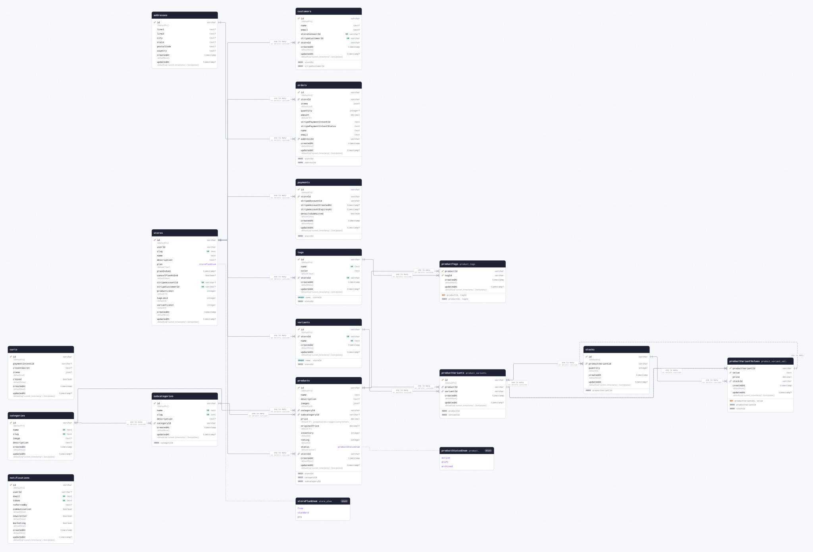

<details>
<summary>The whole schema as SQL</summary>

```sql
CREATE TYPE "product_status" AS ENUM('active', 'draft', 'archived');

CREATE TYPE "store_plan" AS ENUM('free', 'standard', 'pro');

CREATE TABLE "addresses" (
	"id" varchar(30) PRIMARY KEY,
	"line1" text,
	"line2" text,
	"city" text,
	"state" text,
	"postal_code" text,
	"country" text,
	"created_at" timestamp DEFAULT now() NOT NULL,
	"updated_at" timestamp DEFAULT current_timestamp
);

CREATE TABLE "carts" (
	"id" varchar(30) PRIMARY KEY,
	"payment_intent_id" varchar(256),
	"client_secret" text,
	"items" json DEFAULT 'null',
	"closed" boolean DEFAULT false NOT NULL,
	"created_at" timestamp DEFAULT now() NOT NULL,
	"updated_at" timestamp DEFAULT current_timestamp
);

CREATE TABLE "categories" (
	"id" varchar(30) PRIMARY KEY,
	"name" text NOT NULL UNIQUE,
	"slug" text NOT NULL UNIQUE,
	"image" text,
	"description" text,
	"created_at" timestamp DEFAULT now() NOT NULL,
	"updated_at" timestamp DEFAULT current_timestamp
);

CREATE TABLE "customers" (
	"id" varchar(30) PRIMARY KEY,
	"name" text,
	"email" text,
	"store_connect_id" varchar UNIQUE,
	"stripe_customer_id" varchar NOT NULL UNIQUE,
	"store_id" varchar(30) NOT NULL,
	"created_at" timestamp DEFAULT now() NOT NULL,
	"updated_at" timestamp DEFAULT current_timestamp
);

CREATE TABLE "notifications" (
	"id" varchar(30) PRIMARY KEY,
	"user_id" varchar(36),
	"email" text NOT NULL UNIQUE,
	"token" text NOT NULL UNIQUE,
	"referred_by" text,
	"communication" boolean DEFAULT false NOT NULL,
	"newsletter" boolean DEFAULT false NOT NULL,
	"marketing" boolean DEFAULT false NOT NULL,
	"created_at" timestamp DEFAULT now() NOT NULL,
	"updated_at" timestamp DEFAULT current_timestamp
);

CREATE TABLE "orders" (
	"id" varchar(30) PRIMARY KEY,
	"store_id" varchar(30) NOT NULL,
	"items" json DEFAULT 'null',
	"quantity" integer,
	"amount" numeric(10,2) DEFAULT '0' NOT NULL,
	"stripe_payment_intent_id" text NOT NULL,
	"stripe_payment_intent_status" text NOT NULL,
	"name" text NOT NULL,
	"email" text NOT NULL,
	"address_id" varchar(30) NOT NULL,
	"created_at" timestamp DEFAULT now() NOT NULL,
	"updated_at" timestamp DEFAULT current_timestamp
);

CREATE TABLE "payments" (
	"id" varchar(30) PRIMARY KEY,
	"store_id" varchar(30) NOT NULL,
	"stripe_account_id" varchar(256) NOT NULL,
	"stripe_account_created_at" timestamp,
	"stripe_account_expires_at" timestamp,
	"details_submitted" boolean DEFAULT false NOT NULL,
	"created_at" timestamp DEFAULT now() NOT NULL,
	"updated_at" timestamp DEFAULT current_timestamp
);

CREATE TABLE "product_tags" (
	"product_id" varchar(30),
	"tag_id" varchar(30),
	"created_at" timestamp DEFAULT now() NOT NULL,
	"updated_at" timestamp DEFAULT current_timestamp,
	CONSTRAINT "product_tags_pk" PRIMARY KEY("product_id","tag_id")
);

CREATE TABLE "product_variant_values" (
	"product_variant_id" varchar(30),
	"value" text,
	"price" numeric(10,2) NOT NULL,
	"stock_id" varchar(30) NOT NULL,
	"created_at" timestamp DEFAULT now() NOT NULL,
	"updated_at" timestamp DEFAULT current_timestamp,
	CONSTRAINT "product_variant_values_pk" PRIMARY KEY("product_variant_id","value")
);

CREATE TABLE "product_variants" (
	"id" varchar(30) PRIMARY KEY,
	"product_id" varchar(30) NOT NULL,
	"variant_id" varchar(30) NOT NULL,
	"created_at" timestamp DEFAULT now() NOT NULL,
	"updated_at" timestamp DEFAULT current_timestamp
);

CREATE TABLE "products" (
	"id" varchar(30) PRIMARY KEY,
	"name" text NOT NULL,
	"description" text,
	"images" json DEFAULT 'null',
	"category_id" varchar(30) NOT NULL,
	"subcategory_id" varchar(30),
	"price" numeric(10,2) DEFAULT '0' NOT NULL,
	"original_price" numeric(10,2) DEFAULT '0',
	"inventory" integer DEFAULT 0 NOT NULL,
	"rating" integer DEFAULT 0 NOT NULL,
	"status" "product_status" DEFAULT 'active'::"product_status" NOT NULL,
	"store_id" varchar(30) NOT NULL,
	"created_at" timestamp DEFAULT now() NOT NULL,
	"updated_at" timestamp DEFAULT current_timestamp
);

CREATE TABLE "stocks" (
	"id" varchar(30) PRIMARY KEY,
	"product_variant_id" varchar(30) NOT NULL,
	"quantity" integer DEFAULT 0 NOT NULL,
	"created_at" timestamp DEFAULT now() NOT NULL,
	"updated_at" timestamp DEFAULT current_timestamp
);

CREATE TABLE "stores" (
	"id" varchar(30) PRIMARY KEY,
	"user_id" varchar(36) NOT NULL,
	"slug" text NOT NULL UNIQUE,
	"name" text NOT NULL,
	"description" text,
	"plan" "store_plan" DEFAULT 'free'::"store_plan" NOT NULL,
	"ends_at" timestamp,
	"cancel_plan_at_end" boolean DEFAULT false,
	"stripe_account_id" varchar UNIQUE,
	"stripe_customer_id" varchar UNIQUE,
	"product_limit" integer DEFAULT 10 NOT NULL,
	"tag_limit" integer DEFAULT 5 NOT NULL,
	"variant_limit" integer DEFAULT 5 NOT NULL,
	"created_at" timestamp DEFAULT now() NOT NULL,
	"updated_at" timestamp DEFAULT current_timestamp
);

CREATE TABLE "subcategories" (
	"id" varchar(30) PRIMARY KEY,
	"name" text NOT NULL UNIQUE,
	"slug" text NOT NULL UNIQUE,
	"description" text,
	"category_id" varchar(30) NOT NULL,
	"created_at" timestamp DEFAULT now() NOT NULL,
	"updated_at" timestamp DEFAULT current_timestamp
);

CREATE TABLE "tags" (
	"id" varchar(30) PRIMARY KEY,
	"name" text NOT NULL,
	"color" text DEFAULT 'blue' NOT NULL,
	"store_id" varchar(30) NOT NULL,
	"created_at" timestamp DEFAULT now() NOT NULL,
	"updated_at" timestamp DEFAULT current_timestamp,
	CONSTRAINT "tags_name_store_id_unique" UNIQUE NULLS NOT DISTINCT("name","store_id")
);

CREATE TABLE "variants" (
	"id" varchar(30) PRIMARY KEY,
	"store_id" varchar(30) NOT NULL,
	"name" text NOT NULL,
	"created_at" timestamp DEFAULT now() NOT NULL,
	"updated_at" timestamp DEFAULT current_timestamp,
	CONSTRAINT "variants_name_store_id_unique" UNIQUE NULLS NOT DISTINCT("name","store_id")
);

CREATE INDEX "customers_store_id_idx" ON "customers" ("store_id");

CREATE INDEX "customers_stripe_customer_id_idx" ON "customers" ("stripe_customer_id");

CREATE INDEX "orders_store_id_idx" ON "orders" ("store_id");

CREATE INDEX "orders_address_id_idx" ON "orders" ("address_id");

CREATE INDEX "payments_store_id_idx" ON "payments" ("store_id");

CREATE INDEX "product_tags_product_id_tag_id_idx" ON "product_tags" ("product_id","tag_id");

CREATE INDEX "variant_values_product_variant_id_idx" ON "product_variant_values" ("product_variant_id");

CREATE INDEX "variant_values_stock_id_idx" ON "product_variant_values" ("stock_id");

CREATE INDEX "product_variants_product_id_idx" ON "product_variants" ("product_id");

CREATE INDEX "product_variants_variant_id_idx" ON "product_variants" ("variant_id");

CREATE INDEX "products_store_id_idx" ON "products" ("store_id");

CREATE INDEX "products_category_id_idx" ON "products" ("category_id");

CREATE INDEX "products_subcategory_id_idx" ON "products" ("subcategory_id");

CREATE INDEX "stocks_product_variant_id_idx" ON "stocks" ("product_variant_id");

CREATE INDEX "subcategories_category_id_idx" ON "subcategories" ("category_id");

CREATE INDEX "tags_store_id_idx" ON "tags" ("store_id");

CREATE INDEX "variants_store_id_idx" ON "variants" ("store_id");

ALTER TABLE "customers" ADD CONSTRAINT "customers_store_id_stores_id_fkey" FOREIGN KEY ("store_id") REFERENCES "stores"("id") ON DELETE CASCADE;

ALTER TABLE "orders" ADD CONSTRAINT "orders_store_id_stores_id_fkey" FOREIGN KEY ("store_id") REFERENCES "stores"("id") ON DELETE CASCADE;

ALTER TABLE "orders" ADD CONSTRAINT "orders_address_id_addresses_id_fkey" FOREIGN KEY ("address_id") REFERENCES "addresses"("id") ON DELETE CASCADE;

ALTER TABLE "payments" ADD CONSTRAINT "payments_store_id_stores_id_fkey" FOREIGN KEY ("store_id") REFERENCES "stores"("id") ON DELETE CASCADE;

ALTER TABLE "product_tags" ADD CONSTRAINT "product_tags_product_id_products_id_fkey" FOREIGN KEY ("product_id") REFERENCES "products"("id") ON DELETE CASCADE;

ALTER TABLE "product_tags" ADD CONSTRAINT "product_tags_tag_id_tags_id_fkey" FOREIGN KEY ("tag_id") REFERENCES "tags"("id") ON DELETE CASCADE;

ALTER TABLE "product_variant_values" ADD CONSTRAINT "product_variant_values_UA0iB4mOGIDb_fkey" FOREIGN KEY ("product_variant_id") REFERENCES "product_variants"("id") ON DELETE CASCADE;

ALTER TABLE "product_variant_values" ADD CONSTRAINT "product_variant_values_stock_id_stocks_id_fkey" FOREIGN KEY ("stock_id") REFERENCES "stocks"("id") ON DELETE CASCADE;

ALTER TABLE "product_variants" ADD CONSTRAINT "product_variants_product_id_products_id_fkey" FOREIGN KEY ("product_id") REFERENCES "products"("id") ON DELETE CASCADE;

ALTER TABLE "product_variants" ADD CONSTRAINT "product_variants_variant_id_variants_id_fkey" FOREIGN KEY ("variant_id") REFERENCES "variants"("id") ON DELETE CASCADE;

ALTER TABLE "products" ADD CONSTRAINT "products_category_id_categories_id_fkey" FOREIGN KEY ("category_id") REFERENCES "categories"("id") ON DELETE CASCADE;

ALTER TABLE "products" ADD CONSTRAINT "products_subcategory_id_subcategories_id_fkey" FOREIGN KEY ("subcategory_id") REFERENCES "subcategories"("id") ON DELETE CASCADE;

ALTER TABLE "products" ADD CONSTRAINT "products_store_id_stores_id_fkey" FOREIGN KEY ("store_id") REFERENCES "stores"("id") ON DELETE CASCADE;

ALTER TABLE "stocks" ADD CONSTRAINT "stocks_product_variant_id_product_variants_id_fkey" FOREIGN KEY ("product_variant_id") REFERENCES "product_variants"("id") ON DELETE CASCADE;

ALTER TABLE "subcategories" ADD CONSTRAINT "subcategories_category_id_categories_id_fkey" FOREIGN KEY ("category_id") REFERENCES "categories"("id") ON DELETE CASCADE;

ALTER TABLE "tags" ADD CONSTRAINT "tags_store_id_stores_id_fkey" FOREIGN KEY ("store_id") REFERENCES "stores"("id") ON DELETE CASCADE;

ALTER TABLE "variants" ADD CONSTRAINT "variants_store_id_stores_id_fkey" FOREIGN KEY ("store_id") REFERENCES "stores"("id") ON DELETE CASCADE;
```

</details>

## Contents

| Table                                               | Name in the database     | Description    |
| --------------------------------------------------- | ------------------------ | -------------- |
| [addresses](#table-addresses)                       | `addresses`              |                |
| [carts](#table-carts)                               | `carts`                  |                |
| [categories](#table-categories)                     | `categories`             |                |
| [customers](#table-customers)                       | `customers`              |                |
| [notifications](#table-notifications)               | `notifications`          |                |
| [orders](#table-orders)                             | `orders`                 |                |
| [payments](#table-payments)                         | `payments`               |                |
| [products](#table-products)                         | `products`               |                |
| [stocks](#table-stocks)                             | `stocks`                 |                |
| [stores](#table-stores)                             | `stores`                 |                |
| [subcategories](#table-subcategories)               | `subcategories`          |                |
| [tags](#table-tags)                                 | `tags`                   | store tags     |
| [productTags](#table-productTags)                   | `product_tags`           |                |
| [variants](#table-variants)                         | `variants`               | store variants |
| [productVariants](#table-productVariants)           | `product_variants`       |                |
| [productVariantValues](#table-productVariantValues) | `product_variant_values` |                |

| Enum                                         | Name in the database | Description |
| -------------------------------------------- | -------------------- | ----------- |
| [productStatusEnum](#enum-productStatusEnum) | `product_status`     |             |
| [storePlanEnum](#enum-storePlanEnum)         | `store_plan`         |             |

## Tables

<a id="table-addresses"></a>

### addresses

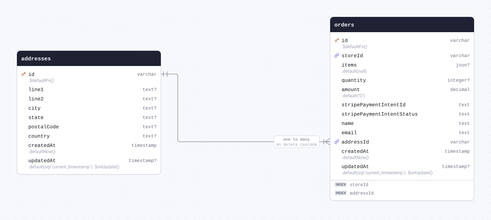

| Column                       | Type        | Constraints | Default                                             | Description |
| ---------------------------- | ----------- | ----------- | --------------------------------------------------- | ----------- |
| `id`                         | `varchar`   | PK NOT NULL | `.$defaultFn()`                                     |             |
| `line1`                      | `text`      | NULL        |                                                     |             |
| `line2`                      | `text`      | NULL        |                                                     |             |
| `city`                       | `text`      | NULL        |                                                     |             |
| `state`                      | `text`      | NULL        |                                                     |             |
| `postalCode` (`postal_code`) | `text`      | NULL        |                                                     |             |
| `country`                    | `text`      | NULL        |                                                     |             |
| `createdAt` (`created_at`)   | `timestamp` | NOT NULL    | `.defaultNow()`                                     |             |
| `updatedAt` (`updated_at`)   | `timestamp` | NULL        | ``.default(sql`current_timestamp`)`` `.$onUpdate()` |             |

#### Definition

```sql
CREATE TABLE "addresses" (
	"id" varchar(30) PRIMARY KEY,
	"line1" text,
	"line2" text,
	"city" text,
	"state" text,
	"postal_code" text,
	"country" text,
	"created_at" timestamp DEFAULT now() NOT NULL,
	"updated_at" timestamp DEFAULT current_timestamp
);
```

#### Referenced by

- `id` → [orders.addressId](#table-orders) (one to many, on delete cascade)

<details>
<summary>Queries and their SQL</summary>

**Select**: Every row of addresses.

```ts
db.select().from(addresses);
```

```sql
select "id", "line1", "line2", "city", "state", "postal_code", "country", "created_at", "updated_at"
from "addresses"
```

**Count**: How many rows addresses has.

```ts
db.select({ count: count() }).from(addresses);
```

```sql
select count(*)
from "addresses"
```

**Find many**: The rows of addresses, through the relational query API.

```ts
db.query.addresses.findMany();
```

```sql
select "d0"."id" as "id", "d0"."line1" as "line1", "d0"."line2" as "line2", "d0"."city" as "city", "d0"."state" as "state", "d0"."postal_code" as "postalCode", "d0"."country" as "country", "d0"."created_at" as "createdAt", "d0"."updated_at" as "updatedAt"
from "addresses" as "d0"
```

**Find by primary key**: One row of addresses, through the relational query API.

```ts
db.query.addresses.findFirst({ where: { id: "id" } });
```

```sql
select "d0"."id" as "id", "d0"."line1" as "line1", "d0"."line2" as "line2", "d0"."city" as "city", "d0"."state" as "state", "d0"."postal_code" as "postalCode", "d0"."country" as "country", "d0"."created_at" as "createdAt", "d0"."updated_at" as "updatedAt"
from "addresses" as "d0"
where "d0"."id" = $1
limit $2
-- params: ["id",1]
```

**Insert**: Adds a row to addresses, giving the columns that have no default.

```ts
db.insert(addresses).values({});
```

```sql
insert into "addresses" ("id", "line1", "line2", "city", "state", "postal_code", "country", "created_at", "updated_at")
values ($1, default, default, default, default, default, default, default, default)
-- params: ["000000000000"]
```

**Update**: Changes a row of addresses, found by its primary key.

```ts
db.update(addresses).set({ line1: "line1" }).where(eq(addresses.id, "id"));
```

```sql
update "addresses"
set "line1" = $1, "updated_at" = $2
where "addresses"."id" = $3
-- params: ["line1","2026-01-01T00:00:00.000Z","id"]
```

**Delete**: Deletes a row of addresses, found by its primary key.

```ts
db.delete(addresses).where(eq(addresses.id, "id"));
```

```sql
delete from "addresses"
where "addresses"."id" = $1
-- params: ["id"]
```

</details>

<a id="table-carts"></a>

### carts

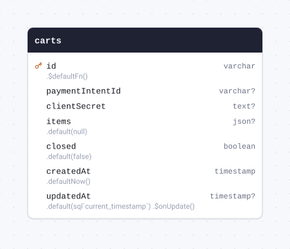

| Column                                  | Type        | Constraints | Default                                             | Description |
| --------------------------------------- | ----------- | ----------- | --------------------------------------------------- | ----------- |
| `id`                                    | `varchar`   | PK NOT NULL | `.$defaultFn()`                                     |             |
| `paymentIntentId` (`payment_intent_id`) | `varchar`   | NULL        |                                                     |             |
| `clientSecret` (`client_secret`)        | `text`      | NULL        |                                                     |             |
| `items`                                 | `json`      | NULL        | `.default(null)`                                    |             |
| `closed`                                | `boolean`   | NOT NULL    | `.default(false)`                                   |             |
| `createdAt` (`created_at`)              | `timestamp` | NOT NULL    | `.defaultNow()`                                     |             |
| `updatedAt` (`updated_at`)              | `timestamp` | NULL        | ``.default(sql`current_timestamp`)`` `.$onUpdate()` |             |

#### Definition

```sql
CREATE TABLE "carts" (
	"id" varchar(30) PRIMARY KEY,
	"payment_intent_id" varchar(256),
	"client_secret" text,
	"items" json DEFAULT 'null',
	"closed" boolean DEFAULT false NOT NULL,
	"created_at" timestamp DEFAULT now() NOT NULL,
	"updated_at" timestamp DEFAULT current_timestamp
);
```

<details>
<summary>Queries and their SQL</summary>

**Select**: Every row of carts.

```ts
db.select().from(carts);
```

```sql
select "id", "payment_intent_id", "client_secret", "items", "closed", "created_at", "updated_at"
from "carts"
```

**Count**: How many rows carts has.

```ts
db.select({ count: count() }).from(carts);
```

```sql
select count(*)
from "carts"
```

**Find many**: The rows of carts, through the relational query API.

```ts
db.query.carts.findMany();
```

```sql
select "d0"."id" as "id", "d0"."payment_intent_id" as "paymentIntentId", "d0"."client_secret" as "clientSecret", "d0"."items" as "items", "d0"."closed" as "closed", "d0"."created_at" as "createdAt", "d0"."updated_at" as "updatedAt"
from "carts" as "d0"
```

**Find by primary key**: One row of carts, through the relational query API.

```ts
db.query.carts.findFirst({ where: { id: "id" } });
```

```sql
select "d0"."id" as "id", "d0"."payment_intent_id" as "paymentIntentId", "d0"."client_secret" as "clientSecret", "d0"."items" as "items", "d0"."closed" as "closed", "d0"."created_at" as "createdAt", "d0"."updated_at" as "updatedAt"
from "carts" as "d0"
where "d0"."id" = $1
limit $2
-- params: ["id",1]
```

**Insert**: Adds a row to carts, giving the columns that have no default.

```ts
db.insert(carts).values({});
```

```sql
insert into "carts" ("id", "payment_intent_id", "client_secret", "items", "closed", "created_at", "updated_at")
values ($1, default, default, default, default, default, default)
-- params: ["000000000000"]
```

**Update**: Changes a row of carts, found by its primary key.

```ts
db.update(carts).set({ paymentIntentId: "paymentIntentId" }).where(eq(carts.id, "id"));
```

```sql
update "carts"
set "payment_intent_id" = $1, "updated_at" = $2
where "carts"."id" = $3
-- params: ["paymentIntentId","2026-01-01T00:00:00.000Z","id"]
```

**Delete**: Deletes a row of carts, found by its primary key.

```ts
db.delete(carts).where(eq(carts.id, "id"));
```

```sql
delete from "carts"
where "carts"."id" = $1
-- params: ["id"]
```

</details>

<a id="table-categories"></a>

### categories

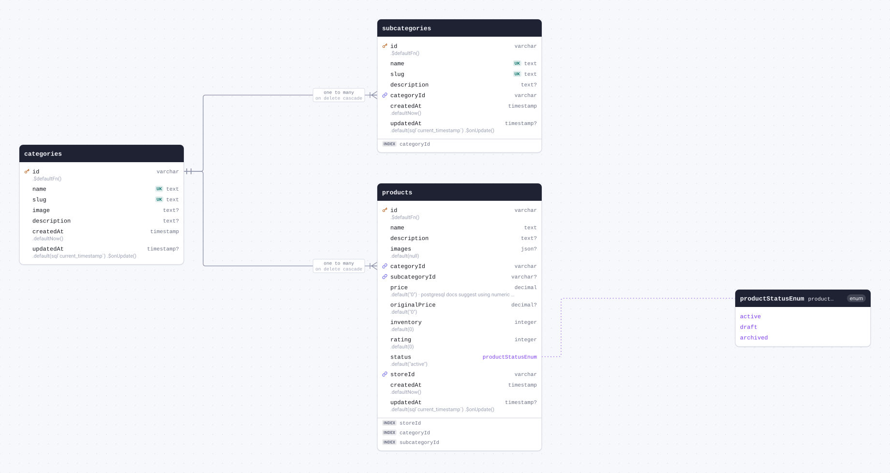

| Column                     | Type        | Constraints     | Default                                             | Description |
| -------------------------- | ----------- | --------------- | --------------------------------------------------- | ----------- |
| `id`                       | `varchar`   | PK NOT NULL     | `.$defaultFn()`                                     |             |
| `name`                     | `text`      | UNIQUE NOT NULL |                                                     |             |
| `slug`                     | `text`      | UNIQUE NOT NULL |                                                     |             |
| `image`                    | `text`      | NULL            |                                                     |             |
| `description`              | `text`      | NULL            |                                                     |             |
| `createdAt` (`created_at`) | `timestamp` | NOT NULL        | `.defaultNow()`                                     |             |
| `updatedAt` (`updated_at`) | `timestamp` | NULL            | ``.default(sql`current_timestamp`)`` `.$onUpdate()` |             |

#### Definition

```sql
CREATE TABLE "categories" (
	"id" varchar(30) PRIMARY KEY,
	"name" text NOT NULL UNIQUE,
	"slug" text NOT NULL UNIQUE,
	"image" text,
	"description" text,
	"created_at" timestamp DEFAULT now() NOT NULL,
	"updated_at" timestamp DEFAULT current_timestamp
);
```

#### Referenced by

- `id` → [products.categoryId](#table-products) (one to many, on delete cascade)
- `id` → [subcategories.categoryId](#table-subcategories) (one to many, on delete cascade)

<details>
<summary>Queries and their SQL</summary>

**Select**: Every row of categories.

```ts
db.select().from(categories);
```

```sql
select "id", "name", "slug", "image", "description", "created_at", "updated_at"
from "categories"
```

**Count**: How many rows categories has.

```ts
db.select({ count: count() }).from(categories);
```

```sql
select count(*)
from "categories"
```

**Find many**: The rows of categories, through the relational query API.

```ts
db.query.categories.findMany();
```

```sql
select "d0"."id" as "id", "d0"."name" as "name", "d0"."slug" as "slug", "d0"."image" as "image", "d0"."description" as "description", "d0"."created_at" as "createdAt", "d0"."updated_at" as "updatedAt"
from "categories" as "d0"
```

**Find by primary key**: One row of categories, through the relational query API.

```ts
db.query.categories.findFirst({ where: { id: "id" } });
```

```sql
select "d0"."id" as "id", "d0"."name" as "name", "d0"."slug" as "slug", "d0"."image" as "image", "d0"."description" as "description", "d0"."created_at" as "createdAt", "d0"."updated_at" as "updatedAt"
from "categories" as "d0"
where "d0"."id" = $1
limit $2
-- params: ["id",1]
```

**Insert**: Adds a row to categories, giving the columns that have no default.

```ts
db.insert(categories).values({ name: "name", slug: "slug" });
```

```sql
insert into "categories" ("id", "name", "slug", "image", "description", "created_at", "updated_at")
values ($1, $2, $3, default, default, default, default)
-- params: ["000000000000","name","slug"]
```

**Update**: Changes a row of categories, found by its primary key.

```ts
db.update(categories).set({ name: "name" }).where(eq(categories.id, "id"));
```

```sql
update "categories"
set "name" = $1, "updated_at" = $2
where "categories"."id" = $3
-- params: ["name","2026-01-01T00:00:00.000Z","id"]
```

**Delete**: Deletes a row of categories, found by its primary key.

```ts
db.delete(categories).where(eq(categories.id, "id"));
```

```sql
delete from "categories"
where "categories"."id" = $1
-- params: ["id"]
```

</details>

<a id="table-customers"></a>

### customers

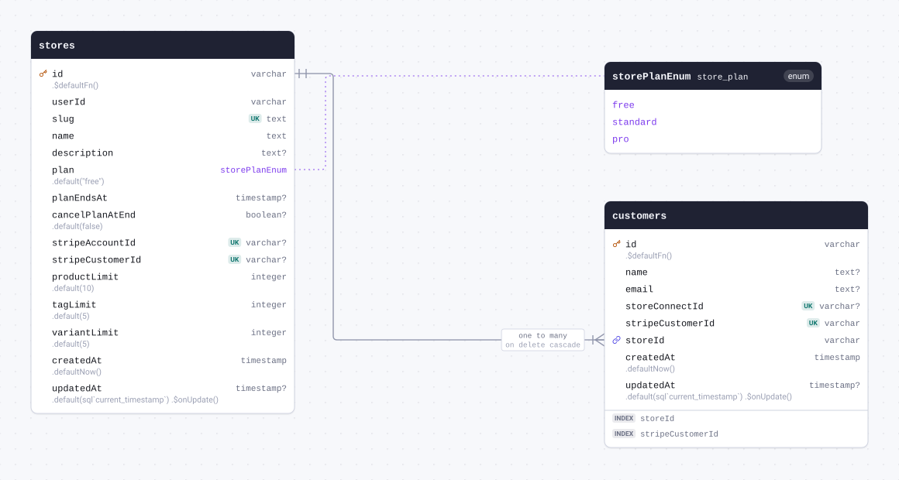

| Column                                    | Type        | Constraints                           | Default                                             | Description |
| ----------------------------------------- | ----------- | ------------------------------------- | --------------------------------------------------- | ----------- |
| `id`                                      | `varchar`   | PK NOT NULL                           | `.$defaultFn()`                                     |             |
| `name`                                    | `text`      | NULL                                  |                                                     |             |
| `email`                                   | `text`      | NULL                                  |                                                     |             |
| `storeConnectId` (`store_connect_id`)     | `varchar`   | UNIQUE NULL                           |                                                     |             |
| `stripeCustomerId` (`stripe_customer_id`) | `varchar`   | UNIQUE NOT NULL                       |                                                     |             |
| `storeId` (`store_id`)                    | `varchar`   | NOT NULL → [stores.id](#table-stores) |                                                     |             |
| `createdAt` (`created_at`)                | `timestamp` | NOT NULL                              | `.defaultNow()`                                     |             |
| `updatedAt` (`updated_at`)                | `timestamp` | NULL                                  | ``.default(sql`current_timestamp`)`` `.$onUpdate()` |             |

#### Definition

```sql
CREATE TABLE "customers" (
	"id" varchar(30) PRIMARY KEY,
	"name" text,
	"email" text,
	"store_connect_id" varchar UNIQUE,
	"stripe_customer_id" varchar NOT NULL UNIQUE,
	"store_id" varchar(30) NOT NULL,
	"created_at" timestamp DEFAULT now() NOT NULL,
	"updated_at" timestamp DEFAULT current_timestamp
);

CREATE INDEX "customers_store_id_idx" ON "customers" ("store_id");

CREATE INDEX "customers_stripe_customer_id_idx" ON "customers" ("stripe_customer_id");

ALTER TABLE "customers" ADD CONSTRAINT "customers_store_id_stores_id_fkey" FOREIGN KEY ("store_id") REFERENCES "stores"("id") ON DELETE CASCADE;
```

#### Indexes

- INDEX `storeId`
- INDEX `stripeCustomerId`

#### References

- `storeId` → [stores.id](#table-stores) (many to one, on delete cascade)

<details>
<summary>Queries and their SQL</summary>

**Select**: Every row of customers.

```ts
db.select().from(customers);
```

```sql
select "id", "name", "email", "store_connect_id", "stripe_customer_id", "store_id", "created_at", "updated_at"
from "customers"
```

**Count**: How many rows customers has.

```ts
db.select({ count: count() }).from(customers);
```

```sql
select count(*)
from "customers"
```

**Find many**: The rows of customers, through the relational query API.

```ts
db.query.customers.findMany();
```

```sql
select "d0"."id" as "id", "d0"."name" as "name", "d0"."email" as "email", "d0"."store_connect_id" as "storeConnectId", "d0"."stripe_customer_id" as "stripeCustomerId", "d0"."store_id" as "storeId", "d0"."created_at" as "createdAt", "d0"."updated_at" as "updatedAt"
from "customers" as "d0"
```

**Find by primary key**: One row of customers, through the relational query API.

```ts
db.query.customers.findFirst({ where: { id: "id" } });
```

```sql
select "d0"."id" as "id", "d0"."name" as "name", "d0"."email" as "email", "d0"."store_connect_id" as "storeConnectId", "d0"."stripe_customer_id" as "stripeCustomerId", "d0"."store_id" as "storeId", "d0"."created_at" as "createdAt", "d0"."updated_at" as "updatedAt"
from "customers" as "d0"
where "d0"."id" = $1
limit $2
-- params: ["id",1]
```

**Insert**: Adds a row to customers, giving the columns that have no default.

```ts
db.insert(customers).values({ stripeCustomerId: "stripeCustomerId", storeId: "storeId" });
```

```sql
insert into "customers" ("id", "name", "email", "store_connect_id", "stripe_customer_id", "store_id", "created_at", "updated_at")
values ($1, default, default, default, $2, $3, default, default)
-- params: ["000000000000","stripeCustomerId","storeId"]
```

**Update**: Changes a row of customers, found by its primary key.

```ts
db.update(customers).set({ name: "name" }).where(eq(customers.id, "id"));
```

```sql
update "customers"
set "name" = $1, "updated_at" = $2
where "customers"."id" = $3
-- params: ["name","2026-01-01T00:00:00.000Z","id"]
```

**Delete**: Deletes a row of customers, found by its primary key.

```ts
db.delete(customers).where(eq(customers.id, "id"));
```

```sql
delete from "customers"
where "customers"."id" = $1
-- params: ["id"]
```

</details>

<a id="table-notifications"></a>

### notifications

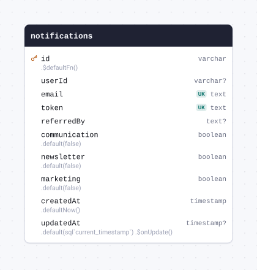

| Column                       | Type        | Constraints     | Default                                             | Description |
| ---------------------------- | ----------- | --------------- | --------------------------------------------------- | ----------- |
| `id`                         | `varchar`   | PK NOT NULL     | `.$defaultFn()`                                     |             |
| `userId` (`user_id`)         | `varchar`   | NULL            |                                                     |             |
| `email`                      | `text`      | UNIQUE NOT NULL |                                                     |             |
| `token`                      | `text`      | UNIQUE NOT NULL |                                                     |             |
| `referredBy` (`referred_by`) | `text`      | NULL            |                                                     |             |
| `communication`              | `boolean`   | NOT NULL        | `.default(false)`                                   |             |
| `newsletter`                 | `boolean`   | NOT NULL        | `.default(false)`                                   |             |
| `marketing`                  | `boolean`   | NOT NULL        | `.default(false)`                                   |             |
| `createdAt` (`created_at`)   | `timestamp` | NOT NULL        | `.defaultNow()`                                     |             |
| `updatedAt` (`updated_at`)   | `timestamp` | NULL            | ``.default(sql`current_timestamp`)`` `.$onUpdate()` |             |

#### Definition

```sql
CREATE TABLE "notifications" (
	"id" varchar(30) PRIMARY KEY,
	"user_id" varchar(36),
	"email" text NOT NULL UNIQUE,
	"token" text NOT NULL UNIQUE,
	"referred_by" text,
	"communication" boolean DEFAULT false NOT NULL,
	"newsletter" boolean DEFAULT false NOT NULL,
	"marketing" boolean DEFAULT false NOT NULL,
	"created_at" timestamp DEFAULT now() NOT NULL,
	"updated_at" timestamp DEFAULT current_timestamp
);
```

<details>
<summary>Queries and their SQL</summary>

**Select**: Every row of notifications.

```ts
db.select().from(notifications);
```

```sql
select "id", "user_id", "email", "token", "referred_by", "communication", "newsletter", "marketing", "created_at", "updated_at"
from "notifications"
```

**Count**: How many rows notifications has.

```ts
db.select({ count: count() }).from(notifications);
```

```sql
select count(*)
from "notifications"
```

**Find many**: The rows of notifications, through the relational query API.

```ts
db.query.notifications.findMany();
```

```sql
select "d0"."id" as "id", "d0"."user_id" as "userId", "d0"."email" as "email", "d0"."token" as "token", "d0"."referred_by" as "referredBy", "d0"."communication" as "communication", "d0"."newsletter" as "newsletter", "d0"."marketing" as "marketing", "d0"."created_at" as "createdAt", "d0"."updated_at" as "updatedAt"
from "notifications" as "d0"
```

**Find by primary key**: One row of notifications, through the relational query API.

```ts
db.query.notifications.findFirst({ where: { id: "id" } });
```

```sql
select "d0"."id" as "id", "d0"."user_id" as "userId", "d0"."email" as "email", "d0"."token" as "token", "d0"."referred_by" as "referredBy", "d0"."communication" as "communication", "d0"."newsletter" as "newsletter", "d0"."marketing" as "marketing", "d0"."created_at" as "createdAt", "d0"."updated_at" as "updatedAt"
from "notifications" as "d0"
where "d0"."id" = $1
limit $2
-- params: ["id",1]
```

**Insert**: Adds a row to notifications, giving the columns that have no default.

```ts
db.insert(notifications).values({ email: "email", token: "token" });
```

```sql
insert into "notifications" ("id", "user_id", "email", "token", "referred_by", "communication", "newsletter", "marketing", "created_at", "updated_at")
values ($1, default, $2, $3, default, default, default, default, default, default)
-- params: ["000000000000","email","token"]
```

**Update**: Changes a row of notifications, found by its primary key.

```ts
db.update(notifications).set({ userId: "userId" }).where(eq(notifications.id, "id"));
```

```sql
update "notifications"
set "user_id" = $1, "updated_at" = $2
where "notifications"."id" = $3
-- params: ["userId","2026-01-01T00:00:00.000Z","id"]
```

**Delete**: Deletes a row of notifications, found by its primary key.

```ts
db.delete(notifications).where(eq(notifications.id, "id"));
```

```sql
delete from "notifications"
where "notifications"."id" = $1
-- params: ["id"]
```

</details>

<a id="table-orders"></a>

### orders

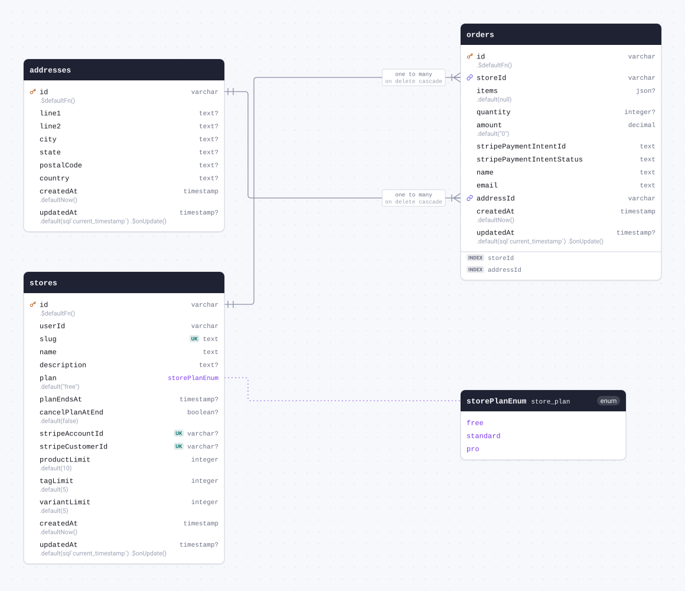

| Column                                                       | Type        | Constraints                                 | Default                                             | Description |
| ------------------------------------------------------------ | ----------- | ------------------------------------------- | --------------------------------------------------- | ----------- |
| `id`                                                         | `varchar`   | PK NOT NULL                                 | `.$defaultFn()`                                     |             |
| `storeId` (`store_id`)                                       | `varchar`   | NOT NULL → [stores.id](#table-stores)       |                                                     |             |
| `items`                                                      | `json`      | NULL                                        | `.default(null)`                                    |             |
| `quantity`                                                   | `integer`   | NULL                                        |                                                     |             |
| `amount`                                                     | `decimal`   | NOT NULL                                    | `.default("0")`                                     |             |
| `stripePaymentIntentId` (`stripe_payment_intent_id`)         | `text`      | NOT NULL                                    |                                                     |             |
| `stripePaymentIntentStatus` (`stripe_payment_intent_status`) | `text`      | NOT NULL                                    |                                                     |             |
| `name`                                                       | `text`      | NOT NULL                                    |                                                     |             |
| `email`                                                      | `text`      | NOT NULL                                    |                                                     |             |
| `addressId` (`address_id`)                                   | `varchar`   | NOT NULL → [addresses.id](#table-addresses) |                                                     |             |
| `createdAt` (`created_at`)                                   | `timestamp` | NOT NULL                                    | `.defaultNow()`                                     |             |
| `updatedAt` (`updated_at`)                                   | `timestamp` | NULL                                        | ``.default(sql`current_timestamp`)`` `.$onUpdate()` |             |

#### Definition

```sql
CREATE TABLE "orders" (
	"id" varchar(30) PRIMARY KEY,
	"store_id" varchar(30) NOT NULL,
	"items" json DEFAULT 'null',
	"quantity" integer,
	"amount" numeric(10,2) DEFAULT '0' NOT NULL,
	"stripe_payment_intent_id" text NOT NULL,
	"stripe_payment_intent_status" text NOT NULL,
	"name" text NOT NULL,
	"email" text NOT NULL,
	"address_id" varchar(30) NOT NULL,
	"created_at" timestamp DEFAULT now() NOT NULL,
	"updated_at" timestamp DEFAULT current_timestamp
);

CREATE INDEX "orders_store_id_idx" ON "orders" ("store_id");

CREATE INDEX "orders_address_id_idx" ON "orders" ("address_id");

ALTER TABLE "orders" ADD CONSTRAINT "orders_store_id_stores_id_fkey" FOREIGN KEY ("store_id") REFERENCES "stores"("id") ON DELETE CASCADE;

ALTER TABLE "orders" ADD CONSTRAINT "orders_address_id_addresses_id_fkey" FOREIGN KEY ("address_id") REFERENCES "addresses"("id") ON DELETE CASCADE;
```

#### Indexes

- INDEX `storeId`
- INDEX `addressId`

#### References

- `storeId` → [stores.id](#table-stores) (many to one, on delete cascade)
- `addressId` → [addresses.id](#table-addresses) (many to one, on delete cascade)

<details>
<summary>Queries and their SQL</summary>

**Select**: Every row of orders.

```ts
db.select().from(orders);
```

```sql
select "id", "store_id", "items", "quantity", "amount", "stripe_payment_intent_id", "stripe_payment_intent_status", "name", "email", "address_id", "created_at", "updated_at"
from "orders"
```

**Count**: How many rows orders has.

```ts
db.select({ count: count() }).from(orders);
```

```sql
select count(*)
from "orders"
```

**Find many**: The rows of orders, through the relational query API.

```ts
db.query.orders.findMany();
```

```sql
select "d0"."id" as "id", "d0"."store_id" as "storeId", "d0"."items" as "items", "d0"."quantity" as "quantity", "d0"."amount" as "amount", "d0"."stripe_payment_intent_id" as "stripePaymentIntentId", "d0"."stripe_payment_intent_status" as "stripePaymentIntentStatus", "d0"."name" as "name", "d0"."email" as "email", "d0"."address_id" as "addressId", "d0"."created_at" as "createdAt", "d0"."updated_at" as "updatedAt"
from "orders" as "d0"
```

**Find by primary key**: One row of orders, through the relational query API.

```ts
db.query.orders.findFirst({ where: { id: "id" } });
```

```sql
select "d0"."id" as "id", "d0"."store_id" as "storeId", "d0"."items" as "items", "d0"."quantity" as "quantity", "d0"."amount" as "amount", "d0"."stripe_payment_intent_id" as "stripePaymentIntentId", "d0"."stripe_payment_intent_status" as "stripePaymentIntentStatus", "d0"."name" as "name", "d0"."email" as "email", "d0"."address_id" as "addressId", "d0"."created_at" as "createdAt", "d0"."updated_at" as "updatedAt"
from "orders" as "d0"
where "d0"."id" = $1
limit $2
-- params: ["id",1]
```

**Insert**: Adds a row to orders, giving the columns that have no default.

```ts
db.insert(orders).values({
  storeId: "storeId",
  stripePaymentIntentId: "stripePaymentIntentId",
  stripePaymentIntentStatus: "stripePaymentIntentStatus",
  name: "name",
  email: "email",
  addressId: "addressId",
});
```

```sql
insert into "orders" ("id", "store_id", "items", "quantity", "amount", "stripe_payment_intent_id", "stripe_payment_intent_status", "name", "email", "address_id", "created_at", "updated_at")
values ($1, $2, default, default, default, $3, $4, $5, $6, $7, default, default)
-- params: ["000000000000","storeId","stripePaymentIntentId","stripePaymentIntentStatus","name","email","addressId"]
```

**Update**: Changes a row of orders, found by its primary key.

```ts
db.update(orders).set({ storeId: "storeId" }).where(eq(orders.id, "id"));
```

```sql
update "orders"
set "store_id" = $1, "updated_at" = $2
where "orders"."id" = $3
-- params: ["storeId","2026-01-01T00:00:00.000Z","id"]
```

**Delete**: Deletes a row of orders, found by its primary key.

```ts
db.delete(orders).where(eq(orders.id, "id"));
```

```sql
delete from "orders"
where "orders"."id" = $1
-- params: ["id"]
```

</details>

<a id="table-payments"></a>

### payments

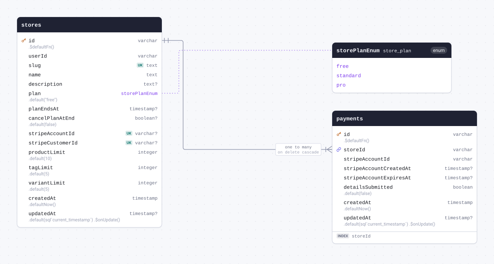

| Column                                                 | Type        | Constraints                           | Default                                             | Description |
| ------------------------------------------------------ | ----------- | ------------------------------------- | --------------------------------------------------- | ----------- |
| `id`                                                   | `varchar`   | PK NOT NULL                           | `.$defaultFn()`                                     |             |
| `storeId` (`store_id`)                                 | `varchar`   | NOT NULL → [stores.id](#table-stores) |                                                     |             |
| `stripeAccountId` (`stripe_account_id`)                | `varchar`   | NOT NULL                              |                                                     |             |
| `stripeAccountCreatedAt` (`stripe_account_created_at`) | `timestamp` | NULL                                  |                                                     |             |
| `stripeAccountExpiresAt` (`stripe_account_expires_at`) | `timestamp` | NULL                                  |                                                     |             |
| `detailsSubmitted` (`details_submitted`)               | `boolean`   | NOT NULL                              | `.default(false)`                                   |             |
| `createdAt` (`created_at`)                             | `timestamp` | NOT NULL                              | `.defaultNow()`                                     |             |
| `updatedAt` (`updated_at`)                             | `timestamp` | NULL                                  | ``.default(sql`current_timestamp`)`` `.$onUpdate()` |             |

#### Definition

```sql
CREATE TABLE "payments" (
	"id" varchar(30) PRIMARY KEY,
	"store_id" varchar(30) NOT NULL,
	"stripe_account_id" varchar(256) NOT NULL,
	"stripe_account_created_at" timestamp,
	"stripe_account_expires_at" timestamp,
	"details_submitted" boolean DEFAULT false NOT NULL,
	"created_at" timestamp DEFAULT now() NOT NULL,
	"updated_at" timestamp DEFAULT current_timestamp
);

CREATE INDEX "payments_store_id_idx" ON "payments" ("store_id");

ALTER TABLE "payments" ADD CONSTRAINT "payments_store_id_stores_id_fkey" FOREIGN KEY ("store_id") REFERENCES "stores"("id") ON DELETE CASCADE;
```

#### Indexes

- INDEX `storeId`

#### References

- `storeId` → [stores.id](#table-stores) (many to one, on delete cascade)

<details>
<summary>Queries and their SQL</summary>

**Select**: Every row of payments.

```ts
db.select().from(payments);
```

```sql
select "id", "store_id", "stripe_account_id", "stripe_account_created_at", "stripe_account_expires_at", "details_submitted", "created_at", "updated_at"
from "payments"
```

**Count**: How many rows payments has.

```ts
db.select({ count: count() }).from(payments);
```

```sql
select count(*)
from "payments"
```

**Find many**: The rows of payments, through the relational query API.

```ts
db.query.payments.findMany();
```

```sql
select "d0"."id" as "id", "d0"."store_id" as "storeId", "d0"."stripe_account_id" as "stripeAccountId", "d0"."stripe_account_created_at" as "stripeAccountCreatedAt", "d0"."stripe_account_expires_at" as "stripeAccountExpiresAt", "d0"."details_submitted" as "detailsSubmitted", "d0"."created_at" as "createdAt", "d0"."updated_at" as "updatedAt"
from "payments" as "d0"
```

**Find by primary key**: One row of payments, through the relational query API.

```ts
db.query.payments.findFirst({ where: { id: "id" } });
```

```sql
select "d0"."id" as "id", "d0"."store_id" as "storeId", "d0"."stripe_account_id" as "stripeAccountId", "d0"."stripe_account_created_at" as "stripeAccountCreatedAt", "d0"."stripe_account_expires_at" as "stripeAccountExpiresAt", "d0"."details_submitted" as "detailsSubmitted", "d0"."created_at" as "createdAt", "d0"."updated_at" as "updatedAt"
from "payments" as "d0"
where "d0"."id" = $1
limit $2
-- params: ["id",1]
```

**Insert**: Adds a row to payments, giving the columns that have no default.

```ts
db.insert(payments).values({ storeId: "storeId", stripeAccountId: "stripeAccountId" });
```

```sql
insert into "payments" ("id", "store_id", "stripe_account_id", "stripe_account_created_at", "stripe_account_expires_at", "details_submitted", "created_at", "updated_at")
values ($1, $2, $3, default, default, default, default, default)
-- params: ["000000000000","storeId","stripeAccountId"]
```

**Update**: Changes a row of payments, found by its primary key.

```ts
db.update(payments).set({ storeId: "storeId" }).where(eq(payments.id, "id"));
```

```sql
update "payments"
set "store_id" = $1, "updated_at" = $2
where "payments"."id" = $3
-- params: ["storeId","2026-01-01T00:00:00.000Z","id"]
```

**Delete**: Deletes a row of payments, found by its primary key.

```ts
db.delete(payments).where(eq(payments.id, "id"));
```

```sql
delete from "payments"
where "payments"."id" = $1
-- params: ["id"]
```

</details>

<a id="table-products"></a>

### products

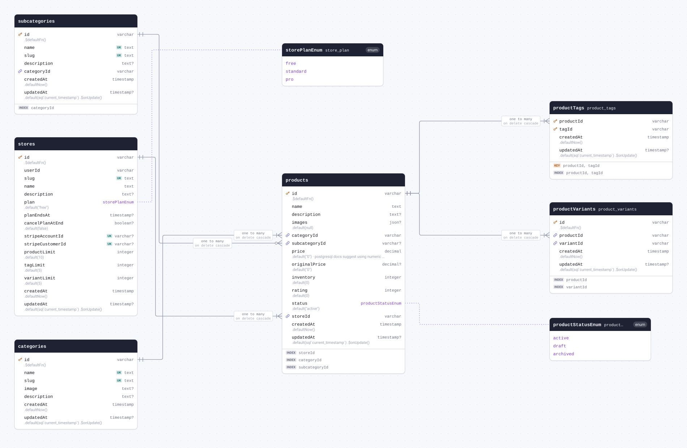

| Column                             | Type                                           | Constraints                                     | Default                                             | Description                                                                                    |
| ---------------------------------- | ---------------------------------------------- | ----------------------------------------------- | --------------------------------------------------- | ---------------------------------------------------------------------------------------------- |
| `id`                               | `varchar`                                      | PK NOT NULL                                     | `.$defaultFn()`                                     |                                                                                                |
| `name`                             | `text`                                         | NOT NULL                                        |                                                     |                                                                                                |
| `description`                      | `text`                                         | NULL                                            |                                                     |                                                                                                |
| `images`                           | `json`                                         | NULL                                            | `.default(null)`                                    |                                                                                                |
| `categoryId` (`category_id`)       | `varchar`                                      | NOT NULL → [categories.id](#table-categories)   |                                                     |                                                                                                |
| `subcategoryId` (`subcategory_id`) | `varchar`                                      | NULL → [subcategories.id](#table-subcategories) |                                                     |                                                                                                |
| `price`                            | `decimal`                                      | NOT NULL                                        | `.default("0")`                                     | postgresql docs suggest using numeric for money numeric and decimal are the same in postgresql |
| `originalPrice` (`original_price`) | `decimal`                                      | NULL                                            | `.default("0")`                                     |                                                                                                |
| `inventory`                        | `integer`                                      | NOT NULL                                        | `.default(0)`                                       |                                                                                                |
| `rating`                           | `integer`                                      | NOT NULL                                        | `.default(0)`                                       |                                                                                                |
| `status`                           | [`productStatusEnum`](#enum-productStatusEnum) | NOT NULL                                        | `.default("active")`                                |                                                                                                |
| `storeId` (`store_id`)             | `varchar`                                      | NOT NULL → [stores.id](#table-stores)           |                                                     |                                                                                                |
| `createdAt` (`created_at`)         | `timestamp`                                    | NOT NULL                                        | `.defaultNow()`                                     |                                                                                                |
| `updatedAt` (`updated_at`)         | `timestamp`                                    | NULL                                            | ``.default(sql`current_timestamp`)`` `.$onUpdate()` |                                                                                                |

#### Definition

```sql
CREATE TABLE "products" (
	"id" varchar(30) PRIMARY KEY,
	"name" text NOT NULL,
	"description" text,
	"images" json DEFAULT 'null',
	"category_id" varchar(30) NOT NULL,
	"subcategory_id" varchar(30),
	"price" numeric(10,2) DEFAULT '0' NOT NULL,
	"original_price" numeric(10,2) DEFAULT '0',
	"inventory" integer DEFAULT 0 NOT NULL,
	"rating" integer DEFAULT 0 NOT NULL,
	"status" "product_status" DEFAULT 'active'::"product_status" NOT NULL,
	"store_id" varchar(30) NOT NULL,
	"created_at" timestamp DEFAULT now() NOT NULL,
	"updated_at" timestamp DEFAULT current_timestamp
);

CREATE INDEX "products_store_id_idx" ON "products" ("store_id");

CREATE INDEX "products_category_id_idx" ON "products" ("category_id");

CREATE INDEX "products_subcategory_id_idx" ON "products" ("subcategory_id");

ALTER TABLE "products" ADD CONSTRAINT "products_category_id_categories_id_fkey" FOREIGN KEY ("category_id") REFERENCES "categories"("id") ON DELETE CASCADE;

ALTER TABLE "products" ADD CONSTRAINT "products_subcategory_id_subcategories_id_fkey" FOREIGN KEY ("subcategory_id") REFERENCES "subcategories"("id") ON DELETE CASCADE;

ALTER TABLE "products" ADD CONSTRAINT "products_store_id_stores_id_fkey" FOREIGN KEY ("store_id") REFERENCES "stores"("id") ON DELETE CASCADE;
```

#### Indexes

- INDEX `storeId`
- INDEX `categoryId`
- INDEX `subcategoryId`

#### References

- `categoryId` → [categories.id](#table-categories) (many to one, on delete cascade)
- `subcategoryId` → [subcategories.id](#table-subcategories) (many to one, on delete cascade)
- `storeId` → [stores.id](#table-stores) (many to one, on delete cascade)

#### Referenced by

- `id` → [productTags.productId](#table-productTags) (one to many, on delete cascade)
- `id` → [productVariants.productId](#table-productVariants) (one to many, on delete cascade)

<details>
<summary>Queries and their SQL</summary>

**Select**: Every row of products.

```ts
db.select().from(products);
```

```sql
select "id", "name", "description", "images", "category_id", "subcategory_id", "price", "original_price", "inventory", "rating", "status", "store_id", "created_at", "updated_at"
from "products"
```

**Count**: How many rows products has.

```ts
db.select({ count: count() }).from(products);
```

```sql
select count(*)
from "products"
```

**Find many**: The rows of products, through the relational query API.

```ts
db.query.products.findMany();
```

```sql
select "d0"."id" as "id", "d0"."name" as "name", "d0"."description" as "description", "d0"."images" as "images", "d0"."category_id" as "categoryId", "d0"."subcategory_id" as "subcategoryId", "d0"."price" as "price", "d0"."original_price" as "originalPrice", "d0"."inventory" as "inventory", "d0"."rating" as "rating", "d0"."status" as "status", "d0"."store_id" as "storeId", "d0"."created_at" as "createdAt", "d0"."updated_at" as "updatedAt"
from "products" as "d0"
```

**Find by primary key**: One row of products, through the relational query API.

```ts
db.query.products.findFirst({ where: { id: "id" } });
```

```sql
select "d0"."id" as "id", "d0"."name" as "name", "d0"."description" as "description", "d0"."images" as "images", "d0"."category_id" as "categoryId", "d0"."subcategory_id" as "subcategoryId", "d0"."price" as "price", "d0"."original_price" as "originalPrice", "d0"."inventory" as "inventory", "d0"."rating" as "rating", "d0"."status" as "status", "d0"."store_id" as "storeId", "d0"."created_at" as "createdAt", "d0"."updated_at" as "updatedAt"
from "products" as "d0"
where "d0"."id" = $1
limit $2
-- params: ["id",1]
```

**Insert**: Adds a row to products, giving the columns that have no default.

```ts
db.insert(products).values({ name: "name", categoryId: "categoryId", storeId: "storeId" });
```

```sql
insert into "products" ("id", "name", "description", "images", "category_id", "subcategory_id", "price", "original_price", "inventory", "rating", "status", "store_id", "created_at", "updated_at")
values ($1, $2, default, default, $3, default, default, default, default, default, default, $4, default, default)
-- params: ["000000000000","name","categoryId","storeId"]
```

**Update**: Changes a row of products, found by its primary key.

```ts
db.update(products).set({ name: "name" }).where(eq(products.id, "id"));
```

```sql
update "products"
set "name" = $1, "updated_at" = $2
where "products"."id" = $3
-- params: ["name","2026-01-01T00:00:00.000Z","id"]
```

**Delete**: Deletes a row of products, found by its primary key.

```ts
db.delete(products).where(eq(products.id, "id"));
```

```sql
delete from "products"
where "products"."id" = $1
-- params: ["id"]
```

</details>

<a id="table-stocks"></a>

### stocks

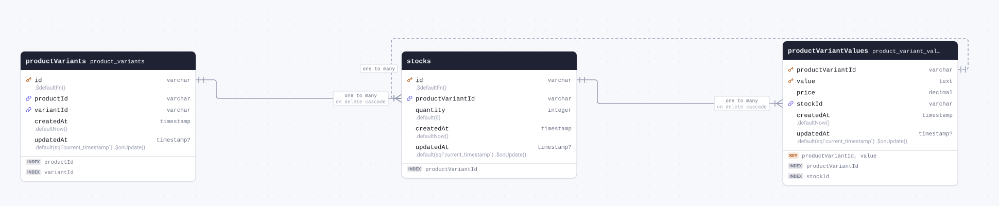

| Column                                    | Type        | Constraints                                             | Default                                             | Description |
| ----------------------------------------- | ----------- | ------------------------------------------------------- | --------------------------------------------------- | ----------- |
| `id`                                      | `varchar`   | PK NOT NULL                                             | `.$defaultFn()`                                     |             |
| `productVariantId` (`product_variant_id`) | `varchar`   | NOT NULL → [productVariants.id](#table-productVariants) |                                                     |             |
| `quantity`                                | `integer`   | NOT NULL                                                | `.default(0)`                                       |             |
| `createdAt` (`created_at`)                | `timestamp` | NOT NULL                                                | `.defaultNow()`                                     |             |
| `updatedAt` (`updated_at`)                | `timestamp` | NULL                                                    | ``.default(sql`current_timestamp`)`` `.$onUpdate()` |             |

#### Definition

```sql
CREATE TABLE "stocks" (
	"id" varchar(30) PRIMARY KEY,
	"product_variant_id" varchar(30) NOT NULL,
	"quantity" integer DEFAULT 0 NOT NULL,
	"created_at" timestamp DEFAULT now() NOT NULL,
	"updated_at" timestamp DEFAULT current_timestamp
);

CREATE INDEX "stocks_product_variant_id_idx" ON "stocks" ("product_variant_id");

ALTER TABLE "stocks" ADD CONSTRAINT "stocks_product_variant_id_product_variants_id_fkey" FOREIGN KEY ("product_variant_id") REFERENCES "product_variants"("id") ON DELETE CASCADE;
```

#### Indexes

- INDEX `productVariantId`

#### References

- `productVariantId` → [productVariants.id](#table-productVariants) (many to one, on delete cascade)
- `productVariantId` → [productVariantValues.productVariantId](#table-productVariantValues) (many to one, defineRelations, no foreign key)

#### Referenced by

- `id` → [productVariantValues.stockId](#table-productVariantValues) (one to many, on delete cascade)

<details>
<summary>Queries and their SQL</summary>

**Select**: Every row of stocks.

```ts
db.select().from(stocks);
```

```sql
select "id", "product_variant_id", "quantity", "created_at", "updated_at"
from "stocks"
```

**Count**: How many rows stocks has.

```ts
db.select({ count: count() }).from(stocks);
```

```sql
select count(*)
from "stocks"
```

**Find many**: The rows of stocks, through the relational query API.

```ts
db.query.stocks.findMany();
```

```sql
select "d0"."id" as "id", "d0"."product_variant_id" as "productVariantId", "d0"."quantity" as "quantity", "d0"."created_at" as "createdAt", "d0"."updated_at" as "updatedAt"
from "stocks" as "d0"
```

**Find by primary key**: One row of stocks, through the relational query API.

```ts
db.query.stocks.findFirst({ where: { id: "id" } });
```

```sql
select "d0"."id" as "id", "d0"."product_variant_id" as "productVariantId", "d0"."quantity" as "quantity", "d0"."created_at" as "createdAt", "d0"."updated_at" as "updatedAt"
from "stocks" as "d0"
where "d0"."id" = $1
limit $2
-- params: ["id",1]
```

**Insert**: Adds a row to stocks, giving the columns that have no default.

```ts
db.insert(stocks).values({ productVariantId: "productVariantId" });
```

```sql
insert into "stocks" ("id", "product_variant_id", "quantity", "created_at", "updated_at")
values ($1, $2, default, default, default)
-- params: ["000000000000","productVariantId"]
```

**Update**: Changes a row of stocks, found by its primary key.

```ts
db.update(stocks).set({ productVariantId: "productVariantId" }).where(eq(stocks.id, "id"));
```

```sql
update "stocks"
set "product_variant_id" = $1, "updated_at" = $2
where "stocks"."id" = $3
-- params: ["productVariantId","2026-01-01T00:00:00.000Z","id"]
```

**Delete**: Deletes a row of stocks, found by its primary key.

```ts
db.delete(stocks).where(eq(stocks.id, "id"));
```

```sql
delete from "stocks"
where "stocks"."id" = $1
-- params: ["id"]
```

</details>

<a id="table-stores"></a>

### stores

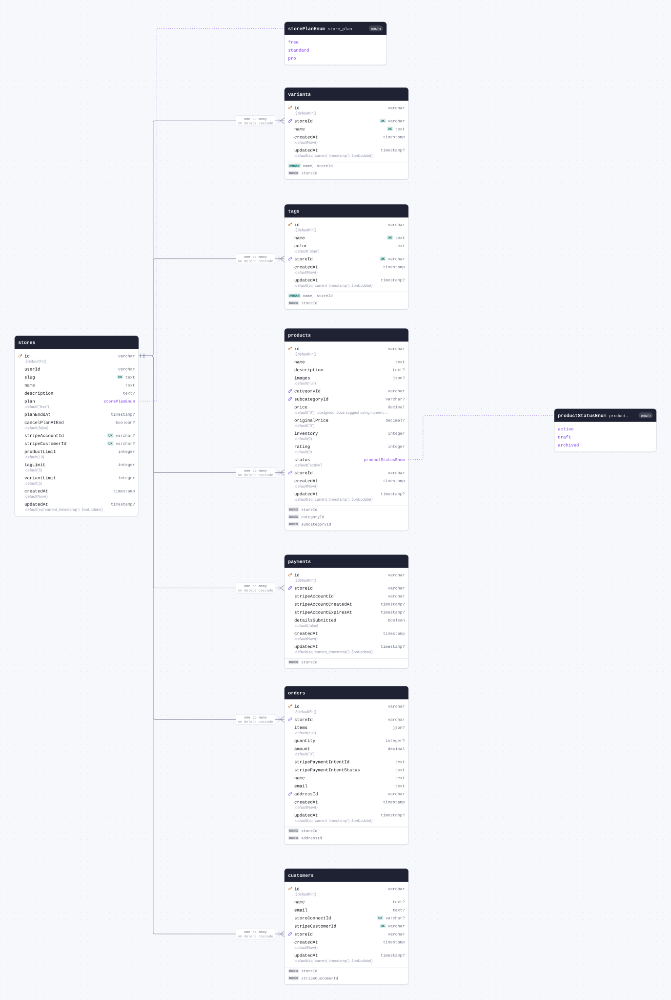

| Column                                    | Type                                   | Constraints     | Default                                             | Description |
| ----------------------------------------- | -------------------------------------- | --------------- | --------------------------------------------------- | ----------- |
| `id`                                      | `varchar`                              | PK NOT NULL     | `.$defaultFn()`                                     |             |
| `userId` (`user_id`)                      | `varchar`                              | NOT NULL        |                                                     |             |
| `slug`                                    | `text`                                 | UNIQUE NOT NULL |                                                     |             |
| `name`                                    | `text`                                 | NOT NULL        |                                                     |             |
| `description`                             | `text`                                 | NULL            |                                                     |             |
| `plan`                                    | [`storePlanEnum`](#enum-storePlanEnum) | NOT NULL        | `.default("free")`                                  |             |
| `planEndsAt` (`ends_at`)                  | `timestamp`                            | NULL            |                                                     |             |
| `cancelPlanAtEnd` (`cancel_plan_at_end`)  | `boolean`                              | NULL            | `.default(false)`                                   |             |
| `stripeAccountId` (`stripe_account_id`)   | `varchar`                              | UNIQUE NULL     |                                                     |             |
| `stripeCustomerId` (`stripe_customer_id`) | `varchar`                              | UNIQUE NULL     |                                                     |             |
| `productLimit` (`product_limit`)          | `integer`                              | NOT NULL        | `.default(10)`                                      |             |
| `tagLimit` (`tag_limit`)                  | `integer`                              | NOT NULL        | `.default(5)`                                       |             |
| `variantLimit` (`variant_limit`)          | `integer`                              | NOT NULL        | `.default(5)`                                       |             |
| `createdAt` (`created_at`)                | `timestamp`                            | NOT NULL        | `.defaultNow()`                                     |             |
| `updatedAt` (`updated_at`)                | `timestamp`                            | NULL            | ``.default(sql`current_timestamp`)`` `.$onUpdate()` |             |

#### Definition

```sql
CREATE TABLE "stores" (
	"id" varchar(30) PRIMARY KEY,
	"user_id" varchar(36) NOT NULL,
	"slug" text NOT NULL UNIQUE,
	"name" text NOT NULL,
	"description" text,
	"plan" "store_plan" DEFAULT 'free'::"store_plan" NOT NULL,
	"ends_at" timestamp,
	"cancel_plan_at_end" boolean DEFAULT false,
	"stripe_account_id" varchar UNIQUE,
	"stripe_customer_id" varchar UNIQUE,
	"product_limit" integer DEFAULT 10 NOT NULL,
	"tag_limit" integer DEFAULT 5 NOT NULL,
	"variant_limit" integer DEFAULT 5 NOT NULL,
	"created_at" timestamp DEFAULT now() NOT NULL,
	"updated_at" timestamp DEFAULT current_timestamp
);
```

#### Referenced by

- `id` → [customers.storeId](#table-customers) (one to many, on delete cascade)
- `id` → [orders.storeId](#table-orders) (one to many, on delete cascade)
- `id` → [payments.storeId](#table-payments) (one to many, on delete cascade)
- `id` → [products.storeId](#table-products) (one to many, on delete cascade)
- `id` → [tags.storeId](#table-tags) (one to many, on delete cascade)
- `id` → [variants.storeId](#table-variants) (one to many, on delete cascade)

<details>
<summary>Queries and their SQL</summary>

**Select**: Every row of stores.

```ts
db.select().from(stores);
```

```sql
select "id", "user_id", "slug", "name", "description", "plan", "ends_at", "cancel_plan_at_end", "stripe_account_id", "stripe_customer_id", "product_limit", "tag_limit", "variant_limit", "created_at", "updated_at"
from "stores"
```

**Count**: How many rows stores has.

```ts
db.select({ count: count() }).from(stores);
```

```sql
select count(*)
from "stores"
```

**Find many**: The rows of stores, through the relational query API.

```ts
db.query.stores.findMany();
```

```sql
select "d0"."id" as "id", "d0"."user_id" as "userId", "d0"."slug" as "slug", "d0"."name" as "name", "d0"."description" as "description", "d0"."plan" as "plan", "d0"."ends_at" as "planEndsAt", "d0"."cancel_plan_at_end" as "cancelPlanAtEnd", "d0"."stripe_account_id" as "stripeAccountId", "d0"."stripe_customer_id" as "stripeCustomerId", "d0"."product_limit" as "productLimit", "d0"."tag_limit" as "tagLimit", "d0"."variant_limit" as "variantLimit", "d0"."created_at" as "createdAt", "d0"."updated_at" as "updatedAt"
from "stores" as "d0"
```

**Find by primary key**: One row of stores, through the relational query API.

```ts
db.query.stores.findFirst({ where: { id: "id" } });
```

```sql
select "d0"."id" as "id", "d0"."user_id" as "userId", "d0"."slug" as "slug", "d0"."name" as "name", "d0"."description" as "description", "d0"."plan" as "plan", "d0"."ends_at" as "planEndsAt", "d0"."cancel_plan_at_end" as "cancelPlanAtEnd", "d0"."stripe_account_id" as "stripeAccountId", "d0"."stripe_customer_id" as "stripeCustomerId", "d0"."product_limit" as "productLimit", "d0"."tag_limit" as "tagLimit", "d0"."variant_limit" as "variantLimit", "d0"."created_at" as "createdAt", "d0"."updated_at" as "updatedAt"
from "stores" as "d0"
where "d0"."id" = $1
limit $2
-- params: ["id",1]
```

**Insert**: Adds a row to stores, giving the columns that have no default.

```ts
db.insert(stores).values({ userId: "userId", slug: "slug", name: "name" });
```

```sql
insert into "stores" ("id", "user_id", "slug", "name", "description", "plan", "ends_at", "cancel_plan_at_end", "stripe_account_id", "stripe_customer_id", "product_limit", "tag_limit", "variant_limit", "created_at", "updated_at")
values ($1, $2, $3, $4, default, default, default, default, default, default, default, default, default, default, default)
-- params: ["000000000000","userId","slug","name"]
```

**Update**: Changes a row of stores, found by its primary key.

```ts
db.update(stores).set({ userId: "userId" }).where(eq(stores.id, "id"));
```

```sql
update "stores"
set "user_id" = $1, "updated_at" = $2
where "stores"."id" = $3
-- params: ["userId","2026-01-01T00:00:00.000Z","id"]
```

**Delete**: Deletes a row of stores, found by its primary key.

```ts
db.delete(stores).where(eq(stores.id, "id"));
```

```sql
delete from "stores"
where "stores"."id" = $1
-- params: ["id"]
```

</details>

<a id="table-subcategories"></a>

### subcategories

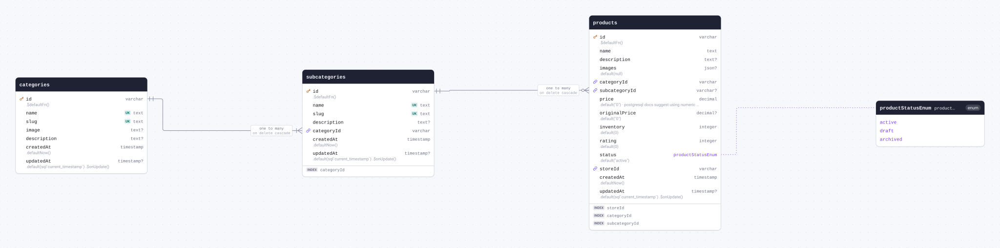

| Column                       | Type        | Constraints                                   | Default                                             | Description |
| ---------------------------- | ----------- | --------------------------------------------- | --------------------------------------------------- | ----------- |
| `id`                         | `varchar`   | PK NOT NULL                                   | `.$defaultFn()`                                     |             |
| `name`                       | `text`      | UNIQUE NOT NULL                               |                                                     |             |
| `slug`                       | `text`      | UNIQUE NOT NULL                               |                                                     |             |
| `description`                | `text`      | NULL                                          |                                                     |             |
| `categoryId` (`category_id`) | `varchar`   | NOT NULL → [categories.id](#table-categories) |                                                     |             |
| `createdAt` (`created_at`)   | `timestamp` | NOT NULL                                      | `.defaultNow()`                                     |             |
| `updatedAt` (`updated_at`)   | `timestamp` | NULL                                          | ``.default(sql`current_timestamp`)`` `.$onUpdate()` |             |

#### Definition

```sql
CREATE TABLE "subcategories" (
	"id" varchar(30) PRIMARY KEY,
	"name" text NOT NULL UNIQUE,
	"slug" text NOT NULL UNIQUE,
	"description" text,
	"category_id" varchar(30) NOT NULL,
	"created_at" timestamp DEFAULT now() NOT NULL,
	"updated_at" timestamp DEFAULT current_timestamp
);

CREATE INDEX "subcategories_category_id_idx" ON "subcategories" ("category_id");

ALTER TABLE "subcategories" ADD CONSTRAINT "subcategories_category_id_categories_id_fkey" FOREIGN KEY ("category_id") REFERENCES "categories"("id") ON DELETE CASCADE;
```

#### Indexes

- INDEX `categoryId`

#### References

- `categoryId` → [categories.id](#table-categories) (many to one, on delete cascade)

#### Referenced by

- `id` → [products.subcategoryId](#table-products) (one to many, on delete cascade)

<details>
<summary>Queries and their SQL</summary>

**Select**: Every row of subcategories.

```ts
db.select().from(subcategories);
```

```sql
select "id", "name", "slug", "description", "category_id", "created_at", "updated_at"
from "subcategories"
```

**Count**: How many rows subcategories has.

```ts
db.select({ count: count() }).from(subcategories);
```

```sql
select count(*)
from "subcategories"
```

**Find many**: The rows of subcategories, through the relational query API.

```ts
db.query.subcategories.findMany();
```

```sql
select "d0"."id" as "id", "d0"."name" as "name", "d0"."slug" as "slug", "d0"."description" as "description", "d0"."category_id" as "categoryId", "d0"."created_at" as "createdAt", "d0"."updated_at" as "updatedAt"
from "subcategories" as "d0"
```

**Find by primary key**: One row of subcategories, through the relational query API.

```ts
db.query.subcategories.findFirst({ where: { id: "id" } });
```

```sql
select "d0"."id" as "id", "d0"."name" as "name", "d0"."slug" as "slug", "d0"."description" as "description", "d0"."category_id" as "categoryId", "d0"."created_at" as "createdAt", "d0"."updated_at" as "updatedAt"
from "subcategories" as "d0"
where "d0"."id" = $1
limit $2
-- params: ["id",1]
```

**Insert**: Adds a row to subcategories, giving the columns that have no default.

```ts
db.insert(subcategories).values({ name: "name", slug: "slug", categoryId: "categoryId" });
```

```sql
insert into "subcategories" ("id", "name", "slug", "description", "category_id", "created_at", "updated_at")
values ($1, $2, $3, default, $4, default, default)
-- params: ["000000000000","name","slug","categoryId"]
```

**Update**: Changes a row of subcategories, found by its primary key.

```ts
db.update(subcategories).set({ name: "name" }).where(eq(subcategories.id, "id"));
```

```sql
update "subcategories"
set "name" = $1, "updated_at" = $2
where "subcategories"."id" = $3
-- params: ["name","2026-01-01T00:00:00.000Z","id"]
```

**Delete**: Deletes a row of subcategories, found by its primary key.

```ts
db.delete(subcategories).where(eq(subcategories.id, "id"));
```

```sql
delete from "subcategories"
where "subcategories"."id" = $1
-- params: ["id"]
```

</details>

<a id="table-tags"></a>

### tags

store tags

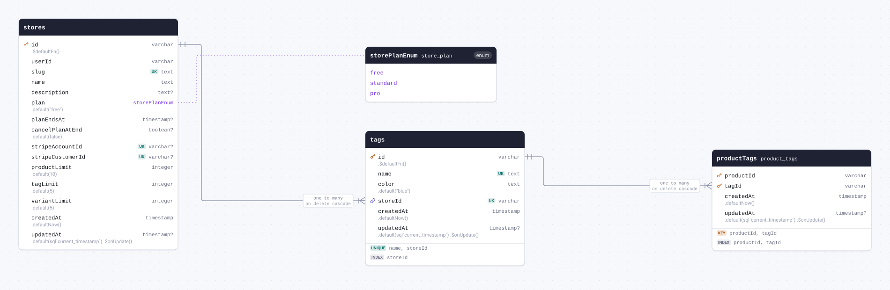

| Column                     | Type        | Constraints                           | Default                                             | Description |
| -------------------------- | ----------- | ------------------------------------- | --------------------------------------------------- | ----------- |
| `id`                       | `varchar`   | PK NOT NULL                           | `.$defaultFn()`                                     |             |
| `name`                     | `text`      | NOT NULL                              |                                                     |             |
| `color`                    | `text`      | NOT NULL                              | `.default("blue")`                                  |             |
| `storeId` (`store_id`)     | `varchar`   | NOT NULL → [stores.id](#table-stores) |                                                     |             |
| `createdAt` (`created_at`) | `timestamp` | NOT NULL                              | `.defaultNow()`                                     |             |
| `updatedAt` (`updated_at`) | `timestamp` | NULL                                  | ``.default(sql`current_timestamp`)`` `.$onUpdate()` |             |

#### Definition

```sql
CREATE TABLE "tags" (
	"id" varchar(30) PRIMARY KEY,
	"name" text NOT NULL,
	"color" text DEFAULT 'blue' NOT NULL,
	"store_id" varchar(30) NOT NULL,
	"created_at" timestamp DEFAULT now() NOT NULL,
	"updated_at" timestamp DEFAULT current_timestamp,
	CONSTRAINT "tags_name_store_id_unique" UNIQUE NULLS NOT DISTINCT("name","store_id")
);

CREATE INDEX "tags_store_id_idx" ON "tags" ("store_id");

ALTER TABLE "tags" ADD CONSTRAINT "tags_store_id_stores_id_fkey" FOREIGN KEY ("store_id") REFERENCES "stores"("id") ON DELETE CASCADE;
```

#### Indexes

- UNIQUE `name`, `storeId`
- INDEX `storeId`

#### References

- `storeId` → [stores.id](#table-stores) (many to one, on delete cascade)

#### Referenced by

- `id` → [productTags.tagId](#table-productTags) (one to many, on delete cascade)

<details>
<summary>Queries and their SQL</summary>

**Select**: Every row of tags.

```ts
db.select().from(tags);
```

```sql
select "id", "name", "color", "store_id", "created_at", "updated_at"
from "tags"
```

**Count**: How many rows tags has.

```ts
db.select({ count: count() }).from(tags);
```

```sql
select count(*)
from "tags"
```

**Find many**: The rows of tags, through the relational query API.

```ts
db.query.tags.findMany();
```

```sql
select "d0"."id" as "id", "d0"."name" as "name", "d0"."color" as "color", "d0"."store_id" as "storeId", "d0"."created_at" as "createdAt", "d0"."updated_at" as "updatedAt"
from "tags" as "d0"
```

**Find by primary key**: One row of tags, through the relational query API.

```ts
db.query.tags.findFirst({ where: { id: "id" } });
```

```sql
select "d0"."id" as "id", "d0"."name" as "name", "d0"."color" as "color", "d0"."store_id" as "storeId", "d0"."created_at" as "createdAt", "d0"."updated_at" as "updatedAt"
from "tags" as "d0"
where "d0"."id" = $1
limit $2
-- params: ["id",1]
```

**Insert**: Adds a row to tags, giving the columns that have no default.

```ts
db.insert(tags).values({ name: "name", storeId: "storeId" });
```

```sql
insert into "tags" ("id", "name", "color", "store_id", "created_at", "updated_at")
values ($1, $2, default, $3, default, default)
-- params: ["000000000000","name","storeId"]
```

**Update**: Changes a row of tags, found by its primary key.

```ts
db.update(tags).set({ name: "name" }).where(eq(tags.id, "id"));
```

```sql
update "tags"
set "name" = $1, "updated_at" = $2
where "tags"."id" = $3
-- params: ["name","2026-01-01T00:00:00.000Z","id"]
```

**Delete**: Deletes a row of tags, found by its primary key.

```ts
db.delete(tags).where(eq(tags.id, "id"));
```

```sql
delete from "tags"
where "tags"."id" = $1
-- params: ["id"]
```

</details>

<a id="table-productTags"></a>

### productTags

Table `product_tags`.

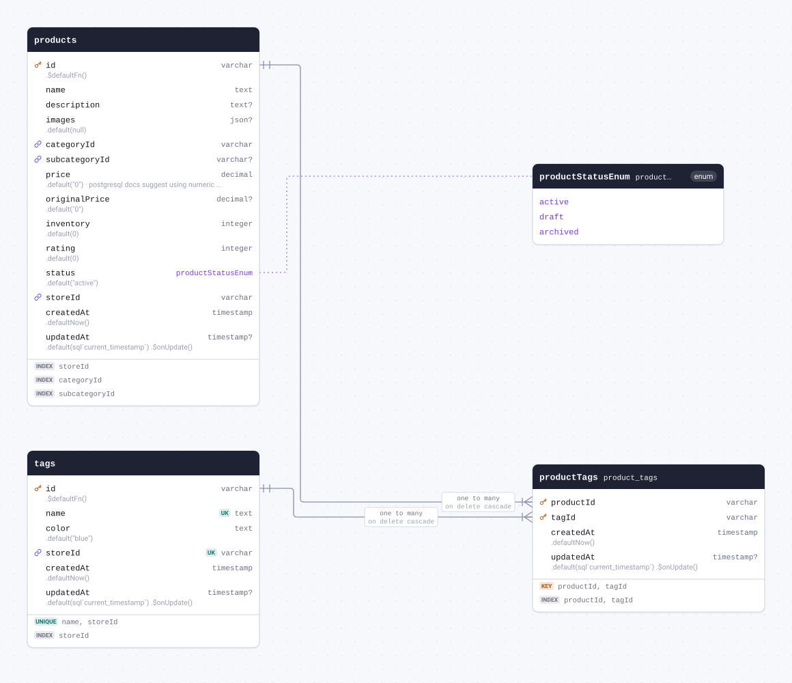

| Column                     | Type        | Constraints                                  | Default                                             | Description |
| -------------------------- | ----------- | -------------------------------------------- | --------------------------------------------------- | ----------- |
| `productId` (`product_id`) | `varchar`   | PK NOT NULL → [products.id](#table-products) |                                                     |             |
| `tagId` (`tag_id`)         | `varchar`   | PK NOT NULL → [tags.id](#table-tags)         |                                                     |             |
| `createdAt` (`created_at`) | `timestamp` | NOT NULL                                     | `.defaultNow()`                                     |             |
| `updatedAt` (`updated_at`) | `timestamp` | NULL                                         | ``.default(sql`current_timestamp`)`` `.$onUpdate()` |             |

#### Definition

```sql
CREATE TABLE "product_tags" (
	"product_id" varchar(30),
	"tag_id" varchar(30),
	"created_at" timestamp DEFAULT now() NOT NULL,
	"updated_at" timestamp DEFAULT current_timestamp,
	CONSTRAINT "product_tags_pk" PRIMARY KEY("product_id","tag_id")
);

CREATE INDEX "product_tags_product_id_tag_id_idx" ON "product_tags" ("product_id","tag_id");

ALTER TABLE "product_tags" ADD CONSTRAINT "product_tags_product_id_products_id_fkey" FOREIGN KEY ("product_id") REFERENCES "products"("id") ON DELETE CASCADE;

ALTER TABLE "product_tags" ADD CONSTRAINT "product_tags_tag_id_tags_id_fkey" FOREIGN KEY ("tag_id") REFERENCES "tags"("id") ON DELETE CASCADE;
```

#### Indexes

- PRIMARY KEY `productId`, `tagId`
- INDEX `productId`, `tagId`

#### References

- `productId` → [products.id](#table-products) (many to one, on delete cascade)
- `tagId` → [tags.id](#table-tags) (many to one, on delete cascade)

<details>
<summary>Queries and their SQL</summary>

**Select**: Every row of productTags.

```ts
db.select().from(productTags);
```

```sql
select "product_id", "tag_id", "created_at", "updated_at"
from "product_tags"
```

**Count**: How many rows productTags has.

```ts
db.select({ count: count() }).from(productTags);
```

```sql
select count(*)
from "product_tags"
```

**Find many**: The rows of productTags, through the relational query API.

```ts
db.query.productTags.findMany();
```

```sql
select "d0"."product_id" as "productId", "d0"."tag_id" as "tagId", "d0"."created_at" as "createdAt", "d0"."updated_at" as "updatedAt"
from "product_tags" as "d0"
```

**Find by primary key**: One row of productTags, through the relational query API.

```ts
db.query.productTags.findFirst({ where: { productId: "productId", tagId: "tagId" } });
```

```sql
select "d0"."product_id" as "productId", "d0"."tag_id" as "tagId", "d0"."created_at" as "createdAt", "d0"."updated_at" as "updatedAt"
from "product_tags" as "d0"
where (("d0"."product_id" = $1) and ("d0"."tag_id" = $2))
limit $3
-- params: ["productId","tagId",1]
```

**Insert**: Adds a row to productTags, giving the columns that have no default.

```ts
db.insert(productTags).values({ productId: "productId", tagId: "tagId" });
```

```sql
insert into "product_tags" ("product_id", "tag_id", "created_at", "updated_at")
values ($1, $2, default, default)
-- params: ["productId","tagId"]
```

**Update**: Changes a row of productTags, found by its primary key.

```ts
db.update(productTags)
  .set({ createdAt: new Date("2026-01-01T00:00:00.000Z") })
  .where(and(eq(productTags.productId, "productId"), eq(productTags.tagId, "tagId")));
```

```sql
update "product_tags"
set "created_at" = $1, "updated_at" = $2
where (("product_tags"."product_id" = $3) and ("product_tags"."tag_id" = $4))
-- params: ["2026-01-01T00:00:00.000Z","2026-01-01T00:00:00.000Z","productId","tagId"]
```

**Delete**: Deletes a row of productTags, found by its primary key.

```ts
db.delete(productTags).where(
  and(eq(productTags.productId, "productId"), eq(productTags.tagId, "tagId")),
);
```

```sql
delete from "product_tags"
where (("product_tags"."product_id" = $1) and ("product_tags"."tag_id" = $2))
-- params: ["productId","tagId"]
```

</details>

<a id="table-variants"></a>

### variants

store variants

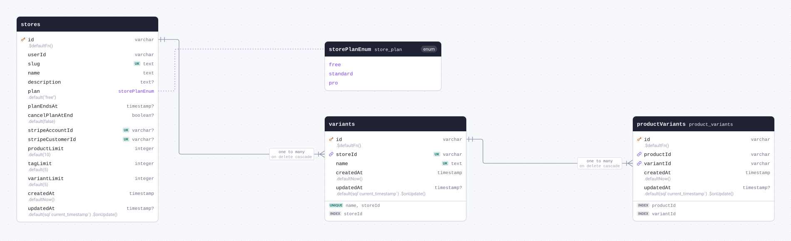

| Column                     | Type        | Constraints                           | Default                                             | Description |
| -------------------------- | ----------- | ------------------------------------- | --------------------------------------------------- | ----------- |
| `id`                       | `varchar`   | PK NOT NULL                           | `.$defaultFn()`                                     |             |
| `storeId` (`store_id`)     | `varchar`   | NOT NULL → [stores.id](#table-stores) |                                                     |             |
| `name`                     | `text`      | NOT NULL                              |                                                     |             |
| `createdAt` (`created_at`) | `timestamp` | NOT NULL                              | `.defaultNow()`                                     |             |
| `updatedAt` (`updated_at`) | `timestamp` | NULL                                  | ``.default(sql`current_timestamp`)`` `.$onUpdate()` |             |

#### Definition

```sql
CREATE TABLE "variants" (
	"id" varchar(30) PRIMARY KEY,
	"store_id" varchar(30) NOT NULL,
	"name" text NOT NULL,
	"created_at" timestamp DEFAULT now() NOT NULL,
	"updated_at" timestamp DEFAULT current_timestamp,
	CONSTRAINT "variants_name_store_id_unique" UNIQUE NULLS NOT DISTINCT("name","store_id")
);

CREATE INDEX "variants_store_id_idx" ON "variants" ("store_id");

ALTER TABLE "variants" ADD CONSTRAINT "variants_store_id_stores_id_fkey" FOREIGN KEY ("store_id") REFERENCES "stores"("id") ON DELETE CASCADE;
```

#### Indexes

- UNIQUE `name`, `storeId`
- INDEX `storeId`

#### References

- `storeId` → [stores.id](#table-stores) (many to one, on delete cascade)

#### Referenced by

- `id` → [productVariants.variantId](#table-productVariants) (one to many, on delete cascade)

<details>
<summary>Queries and their SQL</summary>

**Select**: Every row of variants.

```ts
db.select().from(variants);
```

```sql
select "id", "store_id", "name", "created_at", "updated_at"
from "variants"
```

**Count**: How many rows variants has.

```ts
db.select({ count: count() }).from(variants);
```

```sql
select count(*)
from "variants"
```

**Find many**: The rows of variants, through the relational query API.

```ts
db.query.variants.findMany();
```

```sql
select "d0"."id" as "id", "d0"."store_id" as "storeId", "d0"."name" as "name", "d0"."created_at" as "createdAt", "d0"."updated_at" as "updatedAt"
from "variants" as "d0"
```

**Find by primary key**: One row of variants, through the relational query API.

```ts
db.query.variants.findFirst({ where: { id: "id" } });
```

```sql
select "d0"."id" as "id", "d0"."store_id" as "storeId", "d0"."name" as "name", "d0"."created_at" as "createdAt", "d0"."updated_at" as "updatedAt"
from "variants" as "d0"
where "d0"."id" = $1
limit $2
-- params: ["id",1]
```

**Insert**: Adds a row to variants, giving the columns that have no default.

```ts
db.insert(variants).values({ storeId: "storeId", name: "name" });
```

```sql
insert into "variants" ("id", "store_id", "name", "created_at", "updated_at")
values ($1, $2, $3, default, default)
-- params: ["000000000000","storeId","name"]
```

**Update**: Changes a row of variants, found by its primary key.

```ts
db.update(variants).set({ storeId: "storeId" }).where(eq(variants.id, "id"));
```

```sql
update "variants"
set "store_id" = $1, "updated_at" = $2
where "variants"."id" = $3
-- params: ["storeId","2026-01-01T00:00:00.000Z","id"]
```

**Delete**: Deletes a row of variants, found by its primary key.

```ts
db.delete(variants).where(eq(variants.id, "id"));
```

```sql
delete from "variants"
where "variants"."id" = $1
-- params: ["id"]
```

</details>

<a id="table-productVariants"></a>

### productVariants

Table `product_variants`.

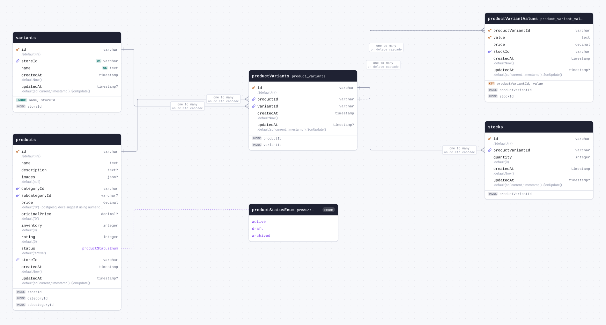

| Column                     | Type        | Constraints                               | Default                                             | Description |
| -------------------------- | ----------- | ----------------------------------------- | --------------------------------------------------- | ----------- |
| `id`                       | `varchar`   | PK NOT NULL                               | `.$defaultFn()`                                     |             |
| `productId` (`product_id`) | `varchar`   | NOT NULL → [products.id](#table-products) |                                                     |             |
| `variantId` (`variant_id`) | `varchar`   | NOT NULL → [variants.id](#table-variants) |                                                     |             |
| `createdAt` (`created_at`) | `timestamp` | NOT NULL                                  | `.defaultNow()`                                     |             |
| `updatedAt` (`updated_at`) | `timestamp` | NULL                                      | ``.default(sql`current_timestamp`)`` `.$onUpdate()` |             |

#### Definition

```sql
CREATE TABLE "product_variants" (
	"id" varchar(30) PRIMARY KEY,
	"product_id" varchar(30) NOT NULL,
	"variant_id" varchar(30) NOT NULL,
	"created_at" timestamp DEFAULT now() NOT NULL,
	"updated_at" timestamp DEFAULT current_timestamp
);

CREATE INDEX "product_variants_product_id_idx" ON "product_variants" ("product_id");

CREATE INDEX "product_variants_variant_id_idx" ON "product_variants" ("variant_id");

ALTER TABLE "product_variants" ADD CONSTRAINT "product_variants_product_id_products_id_fkey" FOREIGN KEY ("product_id") REFERENCES "products"("id") ON DELETE CASCADE;

ALTER TABLE "product_variants" ADD CONSTRAINT "product_variants_variant_id_variants_id_fkey" FOREIGN KEY ("variant_id") REFERENCES "variants"("id") ON DELETE CASCADE;
```

#### Indexes

- INDEX `productId`
- INDEX `variantId`

#### References

- `productId` → [products.id](#table-products) (many to one, on delete cascade)
- `variantId` → [variants.id](#table-variants) (many to one, on delete cascade)

#### Referenced by

- `id` → [stocks.productVariantId](#table-stocks) (one to many, on delete cascade)
- `id` → [productVariantValues.productVariantId](#table-productVariantValues) (one to many, on delete cascade)
- `productId` → [productVariantValues.productVariantId](#table-productVariantValues) (one to many, on delete cascade, defineRelations)

<details>
<summary>Queries and their SQL</summary>

**Select**: Every row of productVariants.

```ts
db.select().from(productVariants);
```

```sql
select "id", "product_id", "variant_id", "created_at", "updated_at"
from "product_variants"
```

**Count**: How many rows productVariants has.

```ts
db.select({ count: count() }).from(productVariants);
```

```sql
select count(*)
from "product_variants"
```

**Find many**: The rows of productVariants, through the relational query API.

```ts
db.query.productVariants.findMany();
```

```sql
select "d0"."id" as "id", "d0"."product_id" as "productId", "d0"."variant_id" as "variantId", "d0"."created_at" as "createdAt", "d0"."updated_at" as "updatedAt"
from "product_variants" as "d0"
```

**Find by primary key**: One row of productVariants, through the relational query API.

```ts
db.query.productVariants.findFirst({ where: { id: "id" } });
```

```sql
select "d0"."id" as "id", "d0"."product_id" as "productId", "d0"."variant_id" as "variantId", "d0"."created_at" as "createdAt", "d0"."updated_at" as "updatedAt"
from "product_variants" as "d0"
where "d0"."id" = $1
limit $2
-- params: ["id",1]
```

**Insert**: Adds a row to productVariants, giving the columns that have no default.

```ts
db.insert(productVariants).values({ productId: "productId", variantId: "variantId" });
```

```sql
insert into "product_variants" ("id", "product_id", "variant_id", "created_at", "updated_at")
values ($1, $2, $3, default, default)
-- params: ["000000000000","productId","variantId"]
```

**Update**: Changes a row of productVariants, found by its primary key.

```ts
db.update(productVariants).set({ productId: "productId" }).where(eq(productVariants.id, "id"));
```

```sql
update "product_variants"
set "product_id" = $1, "updated_at" = $2
where "product_variants"."id" = $3
-- params: ["productId","2026-01-01T00:00:00.000Z","id"]
```

**Delete**: Deletes a row of productVariants, found by its primary key.

```ts
db.delete(productVariants).where(eq(productVariants.id, "id"));
```

```sql
delete from "product_variants"
where "product_variants"."id" = $1
-- params: ["id"]
```

</details>

<a id="table-productVariantValues"></a>

### productVariantValues

Table `product_variant_values`.

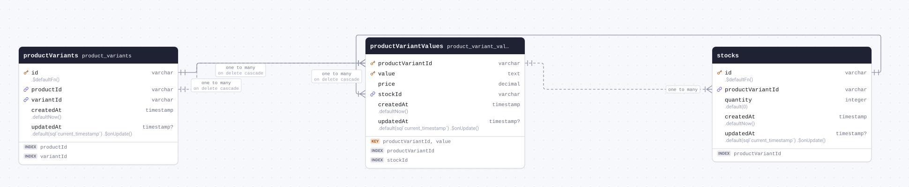

| Column                                    | Type        | Constraints                                                | Default                                             | Description |
| ----------------------------------------- | ----------- | ---------------------------------------------------------- | --------------------------------------------------- | ----------- |
| `productVariantId` (`product_variant_id`) | `varchar`   | PK NOT NULL → [productVariants.id](#table-productVariants) |                                                     |             |
| `value`                                   | `text`      | PK NOT NULL                                                |                                                     |             |
| `price`                                   | `decimal`   | NOT NULL                                                   |                                                     |             |
| `stockId` (`stock_id`)                    | `varchar`   | NOT NULL → [stocks.id](#table-stocks)                      |                                                     |             |
| `createdAt` (`created_at`)                | `timestamp` | NOT NULL                                                   | `.defaultNow()`                                     |             |
| `updatedAt` (`updated_at`)                | `timestamp` | NULL                                                       | ``.default(sql`current_timestamp`)`` `.$onUpdate()` |             |

#### Definition

```sql
CREATE TABLE "product_variant_values" (
	"product_variant_id" varchar(30),
	"value" text,
	"price" numeric(10,2) NOT NULL,
	"stock_id" varchar(30) NOT NULL,
	"created_at" timestamp DEFAULT now() NOT NULL,
	"updated_at" timestamp DEFAULT current_timestamp,
	CONSTRAINT "product_variant_values_pk" PRIMARY KEY("product_variant_id","value")
);

CREATE INDEX "variant_values_product_variant_id_idx" ON "product_variant_values" ("product_variant_id");

CREATE INDEX "variant_values_stock_id_idx" ON "product_variant_values" ("stock_id");

ALTER TABLE "product_variant_values" ADD CONSTRAINT "product_variant_values_UA0iB4mOGIDb_fkey" FOREIGN KEY ("product_variant_id") REFERENCES "product_variants"("id") ON DELETE CASCADE;

ALTER TABLE "product_variant_values" ADD CONSTRAINT "product_variant_values_stock_id_stocks_id_fkey" FOREIGN KEY ("stock_id") REFERENCES "stocks"("id") ON DELETE CASCADE;
```

#### Indexes

- PRIMARY KEY `productVariantId`, `value`
- INDEX `productVariantId`
- INDEX `stockId`

#### References

- `productVariantId` → [productVariants.id](#table-productVariants) (many to one, on delete cascade)
- `stockId` → [stocks.id](#table-stocks) (many to one, on delete cascade)
- `productVariantId` → [productVariants.productId](#table-productVariants) (many to one, on delete cascade, defineRelations, no foreign key)

#### Referenced by

- `productVariantId` → [stocks.productVariantId](#table-stocks) (one to many, defineRelations)

<details>
<summary>Queries and their SQL</summary>

**Select**: Every row of productVariantValues.

```ts
db.select().from(productVariantValues);
```

```sql
select "product_variant_id", "value", "price", "stock_id", "created_at", "updated_at"
from "product_variant_values"
```

**Count**: How many rows productVariantValues has.

```ts
db.select({ count: count() }).from(productVariantValues);
```

```sql
select count(*)
from "product_variant_values"
```

**Find many**: The rows of productVariantValues, through the relational query API.

```ts
db.query.productVariantValues.findMany();
```

```sql
select "d0"."product_variant_id" as "productVariantId", "d0"."value" as "value", "d0"."price" as "price", "d0"."stock_id" as "stockId", "d0"."created_at" as "createdAt", "d0"."updated_at" as "updatedAt"
from "product_variant_values" as "d0"
```

**Find by primary key**: One row of productVariantValues, through the relational query API.

```ts
db.query.productVariantValues.findFirst({
  where: { productVariantId: "productVariantId", value: "value" },
});
```

```sql
select "d0"."product_variant_id" as "productVariantId", "d0"."value" as "value", "d0"."price" as "price", "d0"."stock_id" as "stockId", "d0"."created_at" as "createdAt", "d0"."updated_at" as "updatedAt"
from "product_variant_values" as "d0"
where (("d0"."product_variant_id" = $1) and ("d0"."value" = $2))
limit $3
-- params: ["productVariantId","value",1]
```

**Insert**: Adds a row to productVariantValues, giving the columns that have no default.

```ts
db.insert(productVariantValues).values({
  productVariantId: "productVariantId",
  value: "value",
  price: "1.00",
  stockId: "stockId",
});
```

```sql
insert into "product_variant_values" ("product_variant_id", "value", "price", "stock_id", "created_at", "updated_at")
values ($1, $2, $3, $4, default, default)
-- params: ["productVariantId","value","1.00","stockId"]
```

**Update**: Changes a row of productVariantValues, found by its primary key.

```ts
db.update(productVariantValues)
  .set({ price: "1.00" })
  .where(
    and(
      eq(productVariantValues.productVariantId, "productVariantId"),
      eq(productVariantValues.value, "value"),
    ),
  );
```

```sql
update "product_variant_values"
set "price" = $1, "updated_at" = $2
where (("product_variant_values"."product_variant_id" = $3) and ("product_variant_values"."value" = $4))
-- params: ["1.00","2026-01-01T00:00:00.000Z","productVariantId","value"]
```

**Delete**: Deletes a row of productVariantValues, found by its primary key.

```ts
db.delete(productVariantValues).where(
  and(
    eq(productVariantValues.productVariantId, "productVariantId"),
    eq(productVariantValues.value, "value"),
  ),
);
```

```sql
delete from "product_variant_values"
where (("product_variant_values"."product_variant_id" = $1) and ("product_variant_values"."value" = $2))
-- params: ["productVariantId","value"]
```

</details>

## Enums

<a id="enum-productStatusEnum"></a>

### productStatusEnum

Type `product_status`.

- `active`
- `draft`
- `archived`

#### Definition

```sql
CREATE TYPE "product_status" AS ENUM('active', 'draft', 'archived');
```

<a id="enum-storePlanEnum"></a>

### storePlanEnum

Type `store_plan`.

- `free`
- `standard`
- `pro`

#### Definition

```sql
CREATE TYPE "store_plan" AS ENUM('free', 'standard', 'pro');
```
