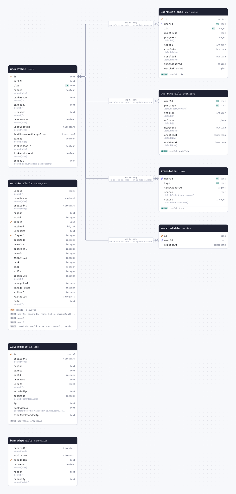
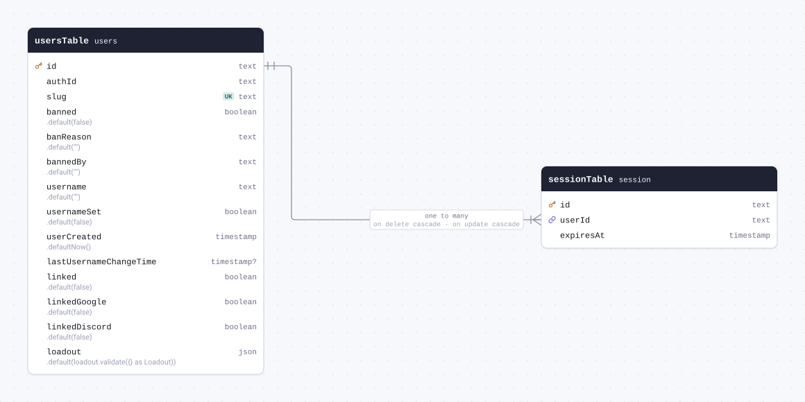
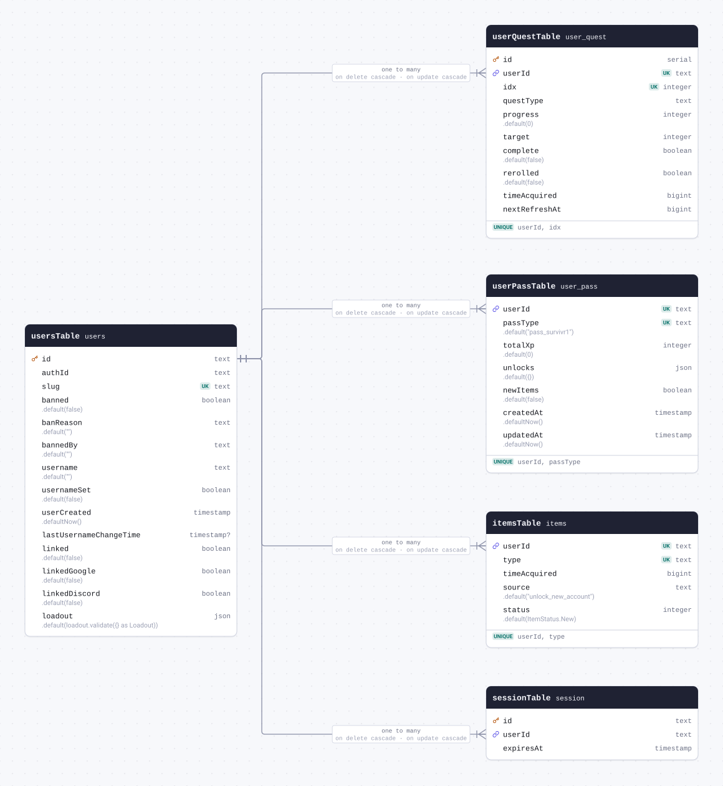
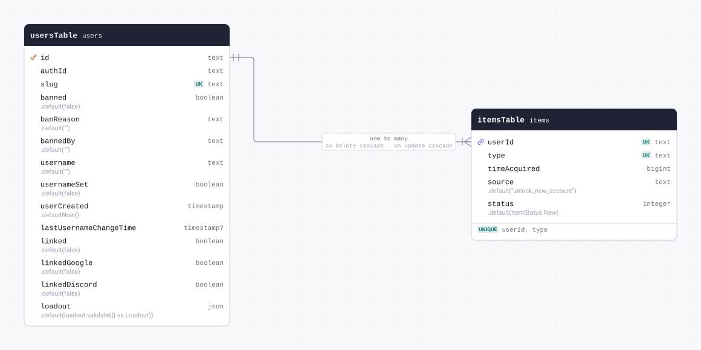
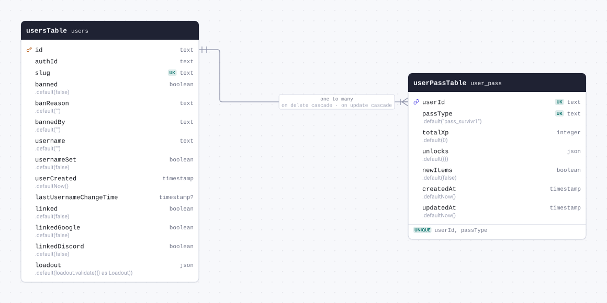
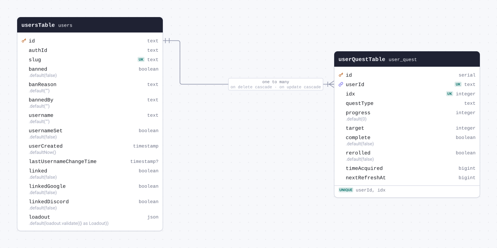
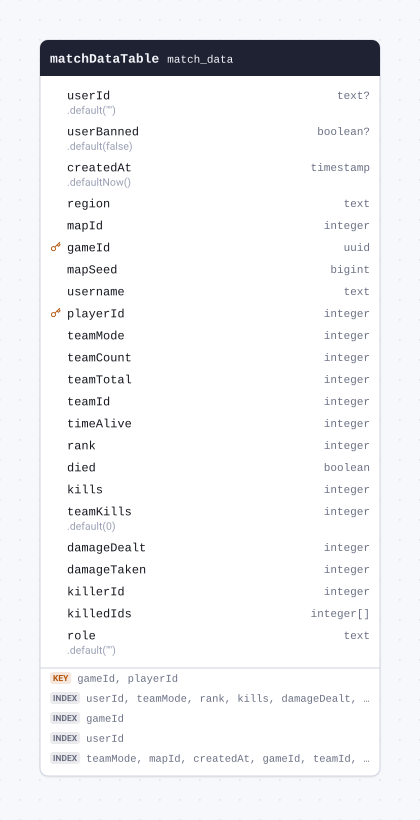
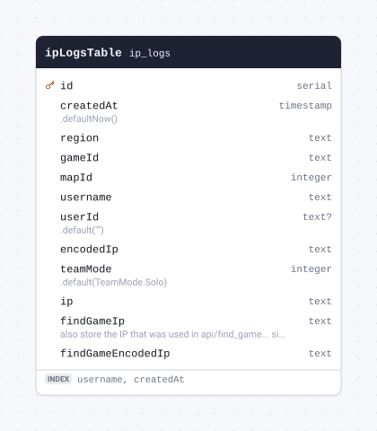
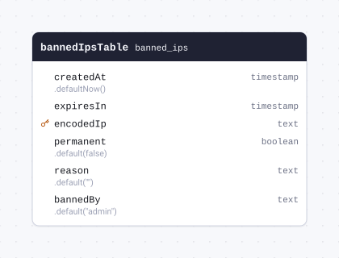

# Schema docs



<details>
<summary>The whole schema as SQL</summary>

```sql
CREATE TABLE "banned_ips" (
	"created_at" timestamp with time zone DEFAULT now() NOT NULL,
	"expires_in" timestamp NOT NULL,
	"encoded_ip" text PRIMARY KEY,
	"permanent" boolean DEFAULT false NOT NULL,
	"reason" text DEFAULT '' NOT NULL,
	"banned_by" text DEFAULT 'admin' NOT NULL
);

CREATE TABLE "ip_logs" (
	"id" serial PRIMARY KEY,
	"created_at" timestamp with time zone DEFAULT now() NOT NULL,
	"region" text NOT NULL,
	"game_id" text NOT NULL,
	"map_id" integer NOT NULL,
	"username" text NOT NULL,
	"user_id" text DEFAULT '',
	"encoded_ip" text NOT NULL,
	"team_mode" integer DEFAULT 1 NOT NULL,
	"ip" text NOT NULL,
	"find_game_ip" text NOT NULL,
	"find_game_encoded_ip" text NOT NULL
);

CREATE TABLE "items" (
	"user_id" text NOT NULL,
	"type" text NOT NULL,
	"time_acquired" bigint NOT NULL,
	"source" text DEFAULT 'unlock_new_account' NOT NULL,
	"status" integer DEFAULT 0 NOT NULL
);

CREATE TABLE "match_data" (
	"user_id" text DEFAULT '',
	"user_banned" boolean DEFAULT false,
	"created_at" timestamp with time zone DEFAULT now() NOT NULL,
	"region" text NOT NULL,
	"map_id" integer NOT NULL,
	"game_id" uuid,
	"map_seed" bigint NOT NULL,
	"username" text NOT NULL,
	"player_id" integer,
	"team_mode" integer NOT NULL,
	"team_count" integer NOT NULL,
	"team_total" integer NOT NULL,
	"team_id" integer NOT NULL,
	"time_alive" integer NOT NULL,
	"rank" integer NOT NULL,
	"died" boolean NOT NULL,
	"kills" integer NOT NULL,
	"team_kills" integer DEFAULT 0 NOT NULL,
	"damage_dealt" integer NOT NULL,
	"damage_taken" integer NOT NULL,
	"killer_id" integer NOT NULL,
	"killed_ids" integer[] NOT NULL,
	"role" text DEFAULT '' NOT NULL,
	CONSTRAINT "match_data_pkey" PRIMARY KEY("game_id","player_id")
);

CREATE TABLE "session" (
	"id" text PRIMARY KEY,
	"user_id" text NOT NULL,
	"expires_at" timestamp NOT NULL
);

CREATE TABLE "user_pass" (
	"user_id" text NOT NULL,
	"pass_type" text DEFAULT 'pass_survivr1' NOT NULL,
	"total_xp" integer DEFAULT 0 NOT NULL,
	"unlocks" json DEFAULT '{}' NOT NULL,
	"new_items" boolean DEFAULT false NOT NULL,
	"created_at" timestamp with time zone DEFAULT now() NOT NULL,
	"updated_at" timestamp with time zone DEFAULT now() NOT NULL
);

CREATE TABLE "user_quest" (
	"id" serial PRIMARY KEY,
	"user_id" text NOT NULL,
	"idx" integer NOT NULL,
	"quest_type" text NOT NULL,
	"progress" integer DEFAULT 0 NOT NULL,
	"target" integer NOT NULL,
	"complete" boolean DEFAULT false NOT NULL,
	"rerolled" boolean DEFAULT false NOT NULL,
	"time_acquired" bigint NOT NULL,
	"next_refresh_at" bigint NOT NULL
);

CREATE TABLE "users" (
	"id" text PRIMARY KEY,
	"auth_id" text NOT NULL,
	"slug" text NOT NULL UNIQUE,
	"banned" boolean DEFAULT false NOT NULL,
	"ban_reason" text DEFAULT '' NOT NULL,
	"banned_by" text DEFAULT '' NOT NULL,
	"username" text DEFAULT '' NOT NULL,
	"username_set" boolean DEFAULT false NOT NULL,
	"user_created" timestamp with time zone DEFAULT now() NOT NULL,
	"last_username_change_time" timestamp,
	"linked" boolean DEFAULT false NOT NULL,
	"linked_google" boolean DEFAULT false NOT NULL,
	"linked_discord" boolean DEFAULT false NOT NULL,
	"loadout" json DEFAULT '{"outfit":"outfitBase","melee":"fists","heal":"heal_basic","boost":"boost_basic","player_icon":"","crosshair":{"type":"crosshair_default","color":16777215,"size":"1.00","stroke":"0.00"},"emotes":["emote_happyface","emote_thumbsup","emote_surviv","emote_sadface","",""]}' NOT NULL
);

CREATE INDEX "name_created_at_idx" ON "ip_logs" ("username","created_at");

CREATE UNIQUE INDEX "uq_items_user_type" ON "items" ("user_id","type");

CREATE INDEX "idx_match_data_user_stats" ON "match_data" ("user_id","team_mode","rank","kills","damage_dealt","time_alive");

CREATE INDEX "idx_game_id" ON "match_data" ("game_id");

CREATE INDEX "idx_user_id" ON "match_data" ("user_id");

CREATE INDEX "idx_match_data_team_query" ON "match_data" ("team_mode","map_id","created_at","game_id","team_id","region","kills");

CREATE UNIQUE INDEX "user_pass_user_type" ON "user_pass" ("user_id","pass_type");

CREATE UNIQUE INDEX "user_quest_user_idx" ON "user_quest" ("user_id","idx");

ALTER TABLE "items" ADD CONSTRAINT "items_user_id_users_id_fkey" FOREIGN KEY ("user_id") REFERENCES "users"("id") ON DELETE CASCADE ON UPDATE CASCADE;

ALTER TABLE "session" ADD CONSTRAINT "session_user_id_users_id_fkey" FOREIGN KEY ("user_id") REFERENCES "users"("id") ON DELETE CASCADE ON UPDATE CASCADE;

ALTER TABLE "user_pass" ADD CONSTRAINT "user_pass_user_id_users_id_fkey" FOREIGN KEY ("user_id") REFERENCES "users"("id") ON DELETE CASCADE ON UPDATE CASCADE;

ALTER TABLE "user_quest" ADD CONSTRAINT "user_quest_user_id_users_id_fkey" FOREIGN KEY ("user_id") REFERENCES "users"("id") ON DELETE CASCADE ON UPDATE CASCADE;
```

</details>

## Contents

| Table                                   | Name in the database | Description |
| --------------------------------------- | -------------------- | ----------- |
| [sessionTable](#table-sessionTable)     | `session`            |             |
| [usersTable](#table-usersTable)         | `users`              |             |
| [itemsTable](#table-itemsTable)         | `items`              |             |
| [userPassTable](#table-userPassTable)   | `user_pass`          |             |
| [userQuestTable](#table-userQuestTable) | `user_quest`         |             |
| [matchDataTable](#table-matchDataTable) | `match_data`         |             |
| [ipLogsTable](#table-ipLogsTable)       | `ip_logs`            | LOGS        |
| [bannedIpsTable](#table-bannedIpsTable) | `banned_ips`         |             |

## Tables

<a id="table-sessionTable"></a>

### sessionTable

Table `session`.



| Column                     | Type        | Constraints                                   | Default | Description |
| -------------------------- | ----------- | --------------------------------------------- | ------- | ----------- |
| `id`                       | `text`      | PK NOT NULL                                   |         |             |
| `userId` (`user_id`)       | `text`      | NOT NULL → [usersTable.id](#table-usersTable) |         |             |
| `expiresAt` (`expires_at`) | `timestamp` | NOT NULL                                      |         |             |

#### Definition

```sql
CREATE TABLE "session" (
	"id" text PRIMARY KEY,
	"user_id" text NOT NULL,
	"expires_at" timestamp NOT NULL
);

ALTER TABLE "session" ADD CONSTRAINT "session_user_id_users_id_fkey" FOREIGN KEY ("user_id") REFERENCES "users"("id") ON DELETE CASCADE ON UPDATE CASCADE;
```

#### References

- `userId` → [usersTable.id](#table-usersTable) (many to one, on delete cascade, on update cascade)

<details>
<summary>Queries and their SQL</summary>

**Select**: Every row of sessionTable.

```ts
db.select().from(sessionTable);
```

```sql
select "id", "user_id", "expires_at"
from "session"
```

**Count**: How many rows sessionTable has.

```ts
db.select({ count: count() }).from(sessionTable);
```

```sql
select count(*)
from "session"
```

**Find many**: The rows of sessionTable, through the relational query API.

```ts
db.query.sessionTable.findMany();
```

```sql
select "d0"."id" as "id", "d0"."user_id" as "userId", "d0"."expires_at" as "expiresAt"
from "session" as "d0"
```

**Find by primary key**: One row of sessionTable, through the relational query API.

```ts
db.query.sessionTable.findFirst({ where: { id: "id" } });
```

```sql
select "d0"."id" as "id", "d0"."user_id" as "userId", "d0"."expires_at" as "expiresAt"
from "session" as "d0"
where "d0"."id" = $1
limit $2
-- params: ["id",1]
```

**Insert**: Adds a row to sessionTable, giving the columns that have no default.

```ts
db.insert(sessionTable).values({
  id: "id",
  userId: "userId",
  expiresAt: new Date("2026-01-01T00:00:00.000Z"),
});
```

```sql
insert into "session" ("id", "user_id", "expires_at")
values ($1, $2, $3)
-- params: ["id","userId","2026-01-01T00:00:00.000Z"]
```

**Update**: Changes a row of sessionTable, found by its primary key.

```ts
db.update(sessionTable).set({ userId: "userId" }).where(eq(sessionTable.id, "id"));
```

```sql
update "session"
set "user_id" = $1
where "session"."id" = $2
-- params: ["userId","id"]
```

**Delete**: Deletes a row of sessionTable, found by its primary key.

```ts
db.delete(sessionTable).where(eq(sessionTable.id, "id"));
```

```sql
delete from "session"
where "session"."id" = $1
-- params: ["id"]
```

</details>

<a id="table-usersTable"></a>

### usersTable

Table `users`.



| Column                                                 | Type        | Constraints     | Default                                     | Description |
| ------------------------------------------------------ | ----------- | --------------- | ------------------------------------------- | ----------- |
| `id`                                                   | `text`      | PK NOT NULL     |                                             |             |
| `authId` (`auth_id`)                                   | `text`      | NOT NULL        |                                             |             |
| `slug`                                                 | `text`      | UNIQUE NOT NULL |                                             |             |
| `banned`                                               | `boolean`   | NOT NULL        | `.default(false)`                           |             |
| `banReason` (`ban_reason`)                             | `text`      | NOT NULL        | `.default("")`                              |             |
| `bannedBy` (`banned_by`)                               | `text`      | NOT NULL        | `.default("")`                              |             |
| `username`                                             | `text`      | NOT NULL        | `.default("")`                              |             |
| `usernameSet` (`username_set`)                         | `boolean`   | NOT NULL        | `.default(false)`                           |             |
| `userCreated` (`user_created`)                         | `timestamp` | NOT NULL        | `.defaultNow()`                             |             |
| `lastUsernameChangeTime` (`last_username_change_time`) | `timestamp` | NULL            |                                             |             |
| `linked`                                               | `boolean`   | NOT NULL        | `.default(false)`                           |             |
| `linkedGoogle` (`linked_google`)                       | `boolean`   | NOT NULL        | `.default(false)`                           |             |
| `linkedDiscord` (`linked_discord`)                     | `boolean`   | NOT NULL        | `.default(false)`                           |             |
| `loadout`                                              | `json`      | NOT NULL        | `.default(loadout.validate({} as Loadout))` |             |

#### Definition

```sql
CREATE TABLE "users" (
	"id" text PRIMARY KEY,
	"auth_id" text NOT NULL,
	"slug" text NOT NULL UNIQUE,
	"banned" boolean DEFAULT false NOT NULL,
	"ban_reason" text DEFAULT '' NOT NULL,
	"banned_by" text DEFAULT '' NOT NULL,
	"username" text DEFAULT '' NOT NULL,
	"username_set" boolean DEFAULT false NOT NULL,
	"user_created" timestamp with time zone DEFAULT now() NOT NULL,
	"last_username_change_time" timestamp,
	"linked" boolean DEFAULT false NOT NULL,
	"linked_google" boolean DEFAULT false NOT NULL,
	"linked_discord" boolean DEFAULT false NOT NULL,
	"loadout" json DEFAULT '{"outfit":"outfitBase","melee":"fists","heal":"heal_basic","boost":"boost_basic","player_icon":"","crosshair":{"type":"crosshair_default","color":16777215,"size":"1.00","stroke":"0.00"},"emotes":["emote_happyface","emote_thumbsup","emote_surviv","emote_sadface","",""]}' NOT NULL
);
```

#### Referenced by

- `id` → [sessionTable.userId](#table-sessionTable) (one to many, on delete cascade, on update cascade)
- `id` → [itemsTable.userId](#table-itemsTable) (one to many, on delete cascade, on update cascade)
- `id` → [userPassTable.userId](#table-userPassTable) (one to many, on delete cascade, on update cascade)
- `id` → [userQuestTable.userId](#table-userQuestTable) (one to many, on delete cascade, on update cascade)

<details>
<summary>Queries and their SQL</summary>

**Select**: Every row of usersTable.

```ts
db.select().from(usersTable);
```

```sql
select "id", "auth_id", "slug", "banned", "ban_reason", "banned_by", "username", "username_set", "user_created", "last_username_change_time", "linked", "linked_google", "linked_discord", "loadout"
from "users"
```

**Count**: How many rows usersTable has.

```ts
db.select({ count: count() }).from(usersTable);
```

```sql
select count(*)
from "users"
```

**Find many**: The rows of usersTable, through the relational query API.

```ts
db.query.usersTable.findMany();
```

```sql
select "d0"."id" as "id", "d0"."auth_id" as "authId", "d0"."slug" as "slug", "d0"."banned" as "banned", "d0"."ban_reason" as "banReason", "d0"."banned_by" as "bannedBy", "d0"."username" as "username", "d0"."username_set" as "usernameSet", "d0"."user_created" as "userCreated", "d0"."last_username_change_time" as "lastUsernameChangeTime", "d0"."linked" as "linked", "d0"."linked_google" as "linkedGoogle", "d0"."linked_discord" as "linkedDiscord", "d0"."loadout" as "loadout"
from "users" as "d0"
```

**Find by primary key**: One row of usersTable, through the relational query API.

```ts
db.query.usersTable.findFirst({ where: { id: "id" } });
```

```sql
select "d0"."id" as "id", "d0"."auth_id" as "authId", "d0"."slug" as "slug", "d0"."banned" as "banned", "d0"."ban_reason" as "banReason", "d0"."banned_by" as "bannedBy", "d0"."username" as "username", "d0"."username_set" as "usernameSet", "d0"."user_created" as "userCreated", "d0"."last_username_change_time" as "lastUsernameChangeTime", "d0"."linked" as "linked", "d0"."linked_google" as "linkedGoogle", "d0"."linked_discord" as "linkedDiscord", "d0"."loadout" as "loadout"
from "users" as "d0"
where "d0"."id" = $1
limit $2
-- params: ["id",1]
```

**Insert**: Adds a row to usersTable, giving the columns that have no default.

```ts
db.insert(usersTable).values({ id: "id", authId: "authId", slug: "slug" });
```

```sql
insert into "users" ("id", "auth_id", "slug", "banned", "ban_reason", "banned_by", "username", "username_set", "user_created", "last_username_change_time", "linked", "linked_google", "linked_discord", "loadout")
values ($1, $2, $3, default, default, default, default, default, default, default, default, default, default, default)
-- params: ["id","authId","slug"]
```

**Update**: Changes a row of usersTable, found by its primary key.

```ts
db.update(usersTable).set({ authId: "authId" }).where(eq(usersTable.id, "id"));
```

```sql
update "users"
set "auth_id" = $1
where "users"."id" = $2
-- params: ["authId","id"]
```

**Delete**: Deletes a row of usersTable, found by its primary key.

```ts
db.delete(usersTable).where(eq(usersTable.id, "id"));
```

```sql
delete from "users"
where "users"."id" = $1
-- params: ["id"]
```

</details>

<a id="table-itemsTable"></a>

### itemsTable

Table `items`.



| Column                           | Type      | Constraints                                   | Default                          | Description |
| -------------------------------- | --------- | --------------------------------------------- | -------------------------------- | ----------- |
| `userId` (`user_id`)             | `text`    | NOT NULL → [usersTable.id](#table-usersTable) |                                  |             |
| `type`                           | `text`    | NOT NULL                                      |                                  |             |
| `timeAcquired` (`time_acquired`) | `bigint`  | NOT NULL                                      |                                  |             |
| `source`                         | `text`    | NOT NULL                                      | `.default("unlock_new_account")` |             |
| `status`                         | `integer` | NOT NULL                                      | `.default(ItemStatus.New)`       |             |

#### Definition

```sql
CREATE TABLE "items" (
	"user_id" text NOT NULL,
	"type" text NOT NULL,
	"time_acquired" bigint NOT NULL,
	"source" text DEFAULT 'unlock_new_account' NOT NULL,
	"status" integer DEFAULT 0 NOT NULL
);

CREATE UNIQUE INDEX "uq_items_user_type" ON "items" ("user_id","type");

ALTER TABLE "items" ADD CONSTRAINT "items_user_id_users_id_fkey" FOREIGN KEY ("user_id") REFERENCES "users"("id") ON DELETE CASCADE ON UPDATE CASCADE;
```

#### Indexes

- UNIQUE `userId`, `type`

#### References

- `userId` → [usersTable.id](#table-usersTable) (many to one, on delete cascade, on update cascade)

<details>
<summary>Queries and their SQL</summary>

**Select**: Every row of itemsTable.

```ts
db.select().from(itemsTable);
```

```sql
select "user_id", "type", "time_acquired", "source", "status"
from "items"
```

**Count**: How many rows itemsTable has.

```ts
db.select({ count: count() }).from(itemsTable);
```

```sql
select count(*)
from "items"
```

**Find many**: The rows of itemsTable, through the relational query API.

```ts
db.query.itemsTable.findMany();
```

```sql
select "d0"."user_id" as "userId", "d0"."type" as "type", "d0"."time_acquired" as "timeAcquired", "d0"."source" as "source", "d0"."status" as "status"
from "items" as "d0"
```

**Insert**: Adds a row to itemsTable, giving the columns that have no default.

```ts
db.insert(itemsTable).values({ userId: "userId", type: "type", timeAcquired: 1 });
```

```sql
insert into "items" ("user_id", "type", "time_acquired", "source", "status")
values ($1, $2, $3, default, default)
-- params: ["userId","type",1]
```

</details>

<a id="table-userPassTable"></a>

### userPassTable

Table `user_pass`.



| Column                     | Type        | Constraints                                   | Default                     | Description |
| -------------------------- | ----------- | --------------------------------------------- | --------------------------- | ----------- |
| `userId` (`user_id`)       | `text`      | NOT NULL → [usersTable.id](#table-usersTable) |                             |             |
| `passType` (`pass_type`)   | `text`      | NOT NULL                                      | `.default("pass_survivr1")` |             |
| `totalXp` (`total_xp`)     | `integer`   | NOT NULL                                      | `.default(0)`               |             |
| `unlocks`                  | `json`      | NOT NULL                                      | `.default({})`              |             |
| `newItems` (`new_items`)   | `boolean`   | NOT NULL                                      | `.default(false)`           |             |
| `createdAt` (`created_at`) | `timestamp` | NOT NULL                                      | `.defaultNow()`             |             |
| `updatedAt` (`updated_at`) | `timestamp` | NOT NULL                                      | `.defaultNow()`             |             |

#### Definition

```sql
CREATE TABLE "user_pass" (
	"user_id" text NOT NULL,
	"pass_type" text DEFAULT 'pass_survivr1' NOT NULL,
	"total_xp" integer DEFAULT 0 NOT NULL,
	"unlocks" json DEFAULT '{}' NOT NULL,
	"new_items" boolean DEFAULT false NOT NULL,
	"created_at" timestamp with time zone DEFAULT now() NOT NULL,
	"updated_at" timestamp with time zone DEFAULT now() NOT NULL
);

CREATE UNIQUE INDEX "user_pass_user_type" ON "user_pass" ("user_id","pass_type");

ALTER TABLE "user_pass" ADD CONSTRAINT "user_pass_user_id_users_id_fkey" FOREIGN KEY ("user_id") REFERENCES "users"("id") ON DELETE CASCADE ON UPDATE CASCADE;
```

#### Indexes

- UNIQUE `userId`, `passType`

#### References

- `userId` → [usersTable.id](#table-usersTable) (many to one, on delete cascade, on update cascade)

<details>
<summary>Queries and their SQL</summary>

**Select**: Every row of userPassTable.

```ts
db.select().from(userPassTable);
```

```sql
select "user_id", "pass_type", "total_xp", "unlocks", "new_items", "created_at", "updated_at"
from "user_pass"
```

**Count**: How many rows userPassTable has.

```ts
db.select({ count: count() }).from(userPassTable);
```

```sql
select count(*)
from "user_pass"
```

**Find many**: The rows of userPassTable, through the relational query API.

```ts
db.query.userPassTable.findMany();
```

```sql
select "d0"."user_id" as "userId", "d0"."pass_type" as "passType", "d0"."total_xp" as "totalXp", "d0"."unlocks" as "unlocks", "d0"."new_items" as "newItems", "d0"."created_at" as "createdAt", "d0"."updated_at" as "updatedAt"
from "user_pass" as "d0"
```

**Insert**: Adds a row to userPassTable, giving the columns that have no default.

```ts
db.insert(userPassTable).values({ userId: "userId" });
```

```sql
insert into "user_pass" ("user_id", "pass_type", "total_xp", "unlocks", "new_items", "created_at", "updated_at")
values ($1, default, default, default, default, default, default)
-- params: ["userId"]
```

</details>

<a id="table-userQuestTable"></a>

### userQuestTable

Table `user_quest`.



| Column                              | Type      | Constraints                                   | Default           | Description |
| ----------------------------------- | --------- | --------------------------------------------- | ----------------- | ----------- |
| `id`                                | `serial`  | PK NOT NULL                                   |                   |             |
| `userId` (`user_id`)                | `text`    | NOT NULL → [usersTable.id](#table-usersTable) |                   |             |
| `idx`                               | `integer` | NOT NULL                                      |                   |             |
| `questType` (`quest_type`)          | `text`    | NOT NULL                                      |                   |             |
| `progress`                          | `integer` | NOT NULL                                      | `.default(0)`     |             |
| `target`                            | `integer` | NOT NULL                                      |                   |             |
| `complete`                          | `boolean` | NOT NULL                                      | `.default(false)` |             |
| `rerolled`                          | `boolean` | NOT NULL                                      | `.default(false)` |             |
| `timeAcquired` (`time_acquired`)    | `bigint`  | NOT NULL                                      |                   |             |
| `nextRefreshAt` (`next_refresh_at`) | `bigint`  | NOT NULL                                      |                   |             |

#### Definition

```sql
CREATE TABLE "user_quest" (
	"id" serial PRIMARY KEY,
	"user_id" text NOT NULL,
	"idx" integer NOT NULL,
	"quest_type" text NOT NULL,
	"progress" integer DEFAULT 0 NOT NULL,
	"target" integer NOT NULL,
	"complete" boolean DEFAULT false NOT NULL,
	"rerolled" boolean DEFAULT false NOT NULL,
	"time_acquired" bigint NOT NULL,
	"next_refresh_at" bigint NOT NULL
);

CREATE UNIQUE INDEX "user_quest_user_idx" ON "user_quest" ("user_id","idx");

ALTER TABLE "user_quest" ADD CONSTRAINT "user_quest_user_id_users_id_fkey" FOREIGN KEY ("user_id") REFERENCES "users"("id") ON DELETE CASCADE ON UPDATE CASCADE;
```

#### Indexes

- UNIQUE `userId`, `idx`

#### References

- `userId` → [usersTable.id](#table-usersTable) (many to one, on delete cascade, on update cascade)

<details>
<summary>Queries and their SQL</summary>

**Select**: Every row of userQuestTable.

```ts
db.select().from(userQuestTable);
```

```sql
select "id", "user_id", "idx", "quest_type", "progress", "target", "complete", "rerolled", "time_acquired", "next_refresh_at"
from "user_quest"
```

**Count**: How many rows userQuestTable has.

```ts
db.select({ count: count() }).from(userQuestTable);
```

```sql
select count(*)
from "user_quest"
```

**Find many**: The rows of userQuestTable, through the relational query API.

```ts
db.query.userQuestTable.findMany();
```

```sql
select "d0"."id" as "id", "d0"."user_id" as "userId", "d0"."idx" as "idx", "d0"."quest_type" as "questType", "d0"."progress" as "progress", "d0"."target" as "target", "d0"."complete" as "complete", "d0"."rerolled" as "rerolled", "d0"."time_acquired" as "timeAcquired", "d0"."next_refresh_at" as "nextRefreshAt"
from "user_quest" as "d0"
```

**Find by primary key**: One row of userQuestTable, through the relational query API.

```ts
db.query.userQuestTable.findFirst({ where: { id: 1 } });
```

```sql
select "d0"."id" as "id", "d0"."user_id" as "userId", "d0"."idx" as "idx", "d0"."quest_type" as "questType", "d0"."progress" as "progress", "d0"."target" as "target", "d0"."complete" as "complete", "d0"."rerolled" as "rerolled", "d0"."time_acquired" as "timeAcquired", "d0"."next_refresh_at" as "nextRefreshAt"
from "user_quest" as "d0"
where "d0"."id" = $1
limit $2
-- params: [1,1]
```

**Insert**: Adds a row to userQuestTable, giving the columns that have no default.

```ts
db.insert(userQuestTable).values({
  userId: "userId",
  idx: 1,
  questType: "questType",
  target: 1,
  timeAcquired: 1,
  nextRefreshAt: 1,
});
```

```sql
insert into "user_quest" ("id", "user_id", "idx", "quest_type", "progress", "target", "complete", "rerolled", "time_acquired", "next_refresh_at")
values (default, $1, $2, $3, default, $4, default, default, $5, $6)
-- params: ["userId",1,"questType",1,1,1]
```

**Update**: Changes a row of userQuestTable, found by its primary key.

```ts
db.update(userQuestTable).set({ userId: "userId" }).where(eq(userQuestTable.id, 1));
```

```sql
update "user_quest"
set "user_id" = $1
where "user_quest"."id" = $2
-- params: ["userId",1]
```

**Delete**: Deletes a row of userQuestTable, found by its primary key.

```ts
db.delete(userQuestTable).where(eq(userQuestTable.id, 1));
```

```sql
delete from "user_quest"
where "user_quest"."id" = $1
-- params: [1]
```

</details>

<a id="table-matchDataTable"></a>

### matchDataTable

Table `match_data`.



| Column                         | Type        | Constraints | Default           | Description |
| ------------------------------ | ----------- | ----------- | ----------------- | ----------- |
| `userId` (`user_id`)           | `text`      | NULL        | `.default("")`    |             |
| `userBanned` (`user_banned`)   | `boolean`   | NULL        | `.default(false)` |             |
| `createdAt` (`created_at`)     | `timestamp` | NOT NULL    | `.defaultNow()`   |             |
| `region`                       | `text`      | NOT NULL    |                   |             |
| `mapId` (`map_id`)             | `integer`   | NOT NULL    |                   |             |
| `gameId` (`game_id`)           | `uuid`      | PK NOT NULL |                   |             |
| `mapSeed` (`map_seed`)         | `bigint`    | NOT NULL    |                   |             |
| `username`                     | `text`      | NOT NULL    |                   |             |
| `playerId` (`player_id`)       | `integer`   | PK NOT NULL |                   |             |
| `teamMode` (`team_mode`)       | `integer`   | NOT NULL    |                   |             |
| `teamCount` (`team_count`)     | `integer`   | NOT NULL    |                   |             |
| `teamTotal` (`team_total`)     | `integer`   | NOT NULL    |                   |             |
| `teamId` (`team_id`)           | `integer`   | NOT NULL    |                   |             |
| `timeAlive` (`time_alive`)     | `integer`   | NOT NULL    |                   |             |
| `rank`                         | `integer`   | NOT NULL    |                   |             |
| `died`                         | `boolean`   | NOT NULL    |                   |             |
| `kills`                        | `integer`   | NOT NULL    |                   |             |
| `teamKills` (`team_kills`)     | `integer`   | NOT NULL    | `.default(0)`     |             |
| `damageDealt` (`damage_dealt`) | `integer`   | NOT NULL    |                   |             |
| `damageTaken` (`damage_taken`) | `integer`   | NOT NULL    |                   |             |
| `killerId` (`killer_id`)       | `integer`   | NOT NULL    |                   |             |
| `killedIds` (`killed_ids`)     | `integer[]` | NOT NULL    |                   |             |
| `role`                         | `text`      | NOT NULL    | `.default("")`    |             |

#### Definition

```sql
CREATE TABLE "match_data" (
	"user_id" text DEFAULT '',
	"user_banned" boolean DEFAULT false,
	"created_at" timestamp with time zone DEFAULT now() NOT NULL,
	"region" text NOT NULL,
	"map_id" integer NOT NULL,
	"game_id" uuid,
	"map_seed" bigint NOT NULL,
	"username" text NOT NULL,
	"player_id" integer,
	"team_mode" integer NOT NULL,
	"team_count" integer NOT NULL,
	"team_total" integer NOT NULL,
	"team_id" integer NOT NULL,
	"time_alive" integer NOT NULL,
	"rank" integer NOT NULL,
	"died" boolean NOT NULL,
	"kills" integer NOT NULL,
	"team_kills" integer DEFAULT 0 NOT NULL,
	"damage_dealt" integer NOT NULL,
	"damage_taken" integer NOT NULL,
	"killer_id" integer NOT NULL,
	"killed_ids" integer[] NOT NULL,
	"role" text DEFAULT '' NOT NULL,
	CONSTRAINT "match_data_pkey" PRIMARY KEY("game_id","player_id")
);

CREATE INDEX "idx_match_data_user_stats" ON "match_data" ("user_id","team_mode","rank","kills","damage_dealt","time_alive");

CREATE INDEX "idx_game_id" ON "match_data" ("game_id");

CREATE INDEX "idx_user_id" ON "match_data" ("user_id");

CREATE INDEX "idx_match_data_team_query" ON "match_data" ("team_mode","map_id","created_at","game_id","team_id","region","kills");
```

#### Indexes

- INDEX `userId`, `teamMode`, `rank`, `kills`, `damageDealt`, `timeAlive`
- INDEX `gameId`
- INDEX `userId`
- INDEX `teamMode`, `mapId`, `createdAt`, `gameId`, `teamId`, `region`, `kills`
- PRIMARY KEY `gameId`, `playerId`

<details>
<summary>Queries and their SQL</summary>

**Select**: Every row of matchDataTable.

```ts
db.select().from(matchDataTable);
```

```sql
select "user_id", "user_banned", "created_at", "region", "map_id", "game_id", "map_seed", "username", "player_id", "team_mode", "team_count", "team_total", "team_id", "time_alive", "rank", "died", "kills", "team_kills", "damage_dealt", "damage_taken", "killer_id", "killed_ids", "role"
from "match_data"
```

**Count**: How many rows matchDataTable has.

```ts
db.select({ count: count() }).from(matchDataTable);
```

```sql
select count(*)
from "match_data"
```

**Find many**: The rows of matchDataTable, through the relational query API.

```ts
db.query.matchDataTable.findMany();
```

```sql
select "d0"."user_id" as "userId", "d0"."user_banned" as "userBanned", "d0"."created_at" as "createdAt", "d0"."region" as "region", "d0"."map_id" as "mapId", "d0"."game_id" as "gameId", "d0"."map_seed" as "mapSeed", "d0"."username" as "username", "d0"."player_id" as "playerId", "d0"."team_mode" as "teamMode", "d0"."team_count" as "teamCount", "d0"."team_total" as "teamTotal", "d0"."team_id" as "teamId", "d0"."time_alive" as "timeAlive", "d0"."rank" as "rank", "d0"."died" as "died", "d0"."kills" as "kills", "d0"."team_kills" as "teamKills", "d0"."damage_dealt" as "damageDealt", "d0"."damage_taken" as "damageTaken", "d0"."killer_id" as "killerId", "d0"."killed_ids" as "killedIds", "d0"."role" as "role"
from "match_data" as "d0"
```

**Find by primary key**: One row of matchDataTable, through the relational query API.

```ts
db.query.matchDataTable.findFirst({
  where: { gameId: "00000000-0000-0000-0000-000000000000", playerId: 1 },
});
```

```sql
select "d0"."user_id" as "userId", "d0"."user_banned" as "userBanned", "d0"."created_at" as "createdAt", "d0"."region" as "region", "d0"."map_id" as "mapId", "d0"."game_id" as "gameId", "d0"."map_seed" as "mapSeed", "d0"."username" as "username", "d0"."player_id" as "playerId", "d0"."team_mode" as "teamMode", "d0"."team_count" as "teamCount", "d0"."team_total" as "teamTotal", "d0"."team_id" as "teamId", "d0"."time_alive" as "timeAlive", "d0"."rank" as "rank", "d0"."died" as "died", "d0"."kills" as "kills", "d0"."team_kills" as "teamKills", "d0"."damage_dealt" as "damageDealt", "d0"."damage_taken" as "damageTaken", "d0"."killer_id" as "killerId", "d0"."killed_ids" as "killedIds", "d0"."role" as "role"
from "match_data" as "d0"
where (("d0"."game_id" = $1) and ("d0"."player_id" = $2))
limit $3
-- params: ["00000000-0000-0000-0000-000000000000",1,1]
```

**Insert**: Adds a row to matchDataTable, giving the columns that have no default.

```ts
db.insert(matchDataTable).values({
  region: "region",
  mapId: 1,
  gameId: "00000000-0000-0000-0000-000000000000",
  mapSeed: 1,
  username: "username",
  playerId: 1,
  teamMode: 1,
  teamCount: 1,
  teamTotal: 1,
  teamId: 1,
  timeAlive: 1,
  rank: 1,
  died: true,
  kills: 1,
  damageDealt: 1,
  damageTaken: 1,
  killerId: 1,
  killedIds: 1,
});
```

```sql
insert into "match_data" ("user_id", "user_banned", "created_at", "region", "map_id", "game_id", "map_seed", "username", "player_id", "team_mode", "team_count", "team_total", "team_id", "time_alive", "rank", "died", "kills", "team_kills", "damage_dealt", "damage_taken", "killer_id", "killed_ids", "role")
values (default, default, default, $1, $2, $3, $4, $5, $6, $7, $8, $9, $10, $11, $12, $13, $14, default, $15, $16, $17, $18, default)
-- params: ["region",1,"00000000-0000-0000-0000-000000000000",1,"username",1,1,1,1,1,1,1,true,1,1,1,1,1]
```

**Update**: Changes a row of matchDataTable, found by its primary key.

```ts
db.update(matchDataTable)
  .set({ userId: "userId" })
  .where(
    and(
      eq(matchDataTable.gameId, "00000000-0000-0000-0000-000000000000"),
      eq(matchDataTable.playerId, 1),
    ),
  );
```

```sql
update "match_data"
set "user_id" = $1
where (("match_data"."game_id" = $2) and ("match_data"."player_id" = $3))
-- params: ["userId","00000000-0000-0000-0000-000000000000",1]
```

**Delete**: Deletes a row of matchDataTable, found by its primary key.

```ts
db.delete(matchDataTable).where(
  and(
    eq(matchDataTable.gameId, "00000000-0000-0000-0000-000000000000"),
    eq(matchDataTable.playerId, 1),
  ),
);
```

```sql
delete from "match_data"
where (("match_data"."game_id" = $1) and ("match_data"."player_id" = $2))
-- params: ["00000000-0000-0000-0000-000000000000",1]
```

</details>

<a id="table-ipLogsTable"></a>

### ipLogsTable

Table `ip_logs`. LOGS



| Column                                       | Type        | Constraints | Default                   | Description                                                                                                                                                    |
| -------------------------------------------- | ----------- | ----------- | ------------------------- | -------------------------------------------------------------------------------------------------------------------------------------------------------------- |
| `id`                                         | `serial`    | PK NOT NULL |                           |                                                                                                                                                                |
| `createdAt` (`created_at`)                   | `timestamp` | NOT NULL    | `.defaultNow()`           |                                                                                                                                                                |
| `region`                                     | `text`      | NOT NULL    |                           |                                                                                                                                                                |
| `gameId` (`game_id`)                         | `text`      | NOT NULL    |                           |                                                                                                                                                                |
| `mapId` (`map_id`)                           | `integer`   | NOT NULL    |                           |                                                                                                                                                                |
| `username`                                   | `text`      | NOT NULL    |                           |                                                                                                                                                                |
| `userId` (`user_id`)                         | `text`      | NULL        | `.default("")`            |                                                                                                                                                                |
| `encodedIp` (`encoded_ip`)                   | `text`      | NOT NULL    |                           |                                                                                                                                                                |
| `teamMode` (`team_mode`)                     | `integer`   | NOT NULL    | `.default(TeamMode.Solo)` |                                                                                                                                                                |
| `ip`                                         | `text`      | NOT NULL    |                           |                                                                                                                                                                |
| `findGameIp` (`find_game_ip`)                | `text`      | NOT NULL    |                           | also store the IP that was used in api/find_game... since one could exploit that to never get banned by requesting it with a different IP than the in-game one |
| `findGameEncodedIp` (`find_game_encoded_ip`) | `text`      | NOT NULL    |                           |                                                                                                                                                                |

#### Definition

```sql
CREATE TABLE "ip_logs" (
	"id" serial PRIMARY KEY,
	"created_at" timestamp with time zone DEFAULT now() NOT NULL,
	"region" text NOT NULL,
	"game_id" text NOT NULL,
	"map_id" integer NOT NULL,
	"username" text NOT NULL,
	"user_id" text DEFAULT '',
	"encoded_ip" text NOT NULL,
	"team_mode" integer DEFAULT 1 NOT NULL,
	"ip" text NOT NULL,
	"find_game_ip" text NOT NULL,
	"find_game_encoded_ip" text NOT NULL
);

CREATE INDEX "name_created_at_idx" ON "ip_logs" ("username","created_at");
```

#### Indexes

- INDEX `username`, `createdAt`

<details>
<summary>Queries and their SQL</summary>

**Select**: Every row of ipLogsTable.

```ts
db.select().from(ipLogsTable);
```

```sql
select "id", "created_at", "region", "game_id", "map_id", "username", "user_id", "encoded_ip", "team_mode", "ip", "find_game_ip", "find_game_encoded_ip"
from "ip_logs"
```

**Count**: How many rows ipLogsTable has.

```ts
db.select({ count: count() }).from(ipLogsTable);
```

```sql
select count(*)
from "ip_logs"
```

**Find many**: The rows of ipLogsTable, through the relational query API.

```ts
db.query.ipLogsTable.findMany();
```

```sql
select "d0"."id" as "id", "d0"."created_at" as "createdAt", "d0"."region" as "region", "d0"."game_id" as "gameId", "d0"."map_id" as "mapId", "d0"."username" as "username", "d0"."user_id" as "userId", "d0"."encoded_ip" as "encodedIp", "d0"."team_mode" as "teamMode", "d0"."ip" as "ip", "d0"."find_game_ip" as "findGameIp", "d0"."find_game_encoded_ip" as "findGameEncodedIp"
from "ip_logs" as "d0"
```

**Find by primary key**: One row of ipLogsTable, through the relational query API.

```ts
db.query.ipLogsTable.findFirst({ where: { id: 1 } });
```

```sql
select "d0"."id" as "id", "d0"."created_at" as "createdAt", "d0"."region" as "region", "d0"."game_id" as "gameId", "d0"."map_id" as "mapId", "d0"."username" as "username", "d0"."user_id" as "userId", "d0"."encoded_ip" as "encodedIp", "d0"."team_mode" as "teamMode", "d0"."ip" as "ip", "d0"."find_game_ip" as "findGameIp", "d0"."find_game_encoded_ip" as "findGameEncodedIp"
from "ip_logs" as "d0"
where "d0"."id" = $1
limit $2
-- params: [1,1]
```

**Insert**: Adds a row to ipLogsTable, giving the columns that have no default.

```ts
db.insert(ipLogsTable).values({
  region: "region",
  gameId: "gameId",
  mapId: 1,
  username: "username",
  encodedIp: "encodedIp",
  ip: "ip",
  findGameIp: "findGameIp",
  findGameEncodedIp: "findGameEncodedIp",
});
```

```sql
insert into "ip_logs" ("id", "created_at", "region", "game_id", "map_id", "username", "user_id", "encoded_ip", "team_mode", "ip", "find_game_ip", "find_game_encoded_ip")
values (default, default, $1, $2, $3, $4, default, $5, default, $6, $7, $8)
-- params: ["region","gameId",1,"username","encodedIp","ip","findGameIp","findGameEncodedIp"]
```

**Update**: Changes a row of ipLogsTable, found by its primary key.

```ts
db.update(ipLogsTable)
  .set({ createdAt: new Date("2026-01-01T00:00:00.000Z") })
  .where(eq(ipLogsTable.id, 1));
```

```sql
update "ip_logs"
set "created_at" = $1
where "ip_logs"."id" = $2
-- params: ["2026-01-01T00:00:00.000Z",1]
```

**Delete**: Deletes a row of ipLogsTable, found by its primary key.

```ts
db.delete(ipLogsTable).where(eq(ipLogsTable.id, 1));
```

```sql
delete from "ip_logs"
where "ip_logs"."id" = $1
-- params: [1]
```

</details>

<a id="table-bannedIpsTable"></a>

### bannedIpsTable

Table `banned_ips`.



| Column                     | Type        | Constraints | Default             | Description |
| -------------------------- | ----------- | ----------- | ------------------- | ----------- |
| `createdAt` (`created_at`) | `timestamp` | NOT NULL    | `.defaultNow()`     |             |
| `expiresIn` (`expires_in`) | `timestamp` | NOT NULL    |                     |             |
| `encodedIp` (`encoded_ip`) | `text`      | PK NOT NULL |                     |             |
| `permanent`                | `boolean`   | NOT NULL    | `.default(false)`   |             |
| `reason`                   | `text`      | NOT NULL    | `.default("")`      |             |
| `bannedBy` (`banned_by`)   | `text`      | NOT NULL    | `.default("admin")` |             |

#### Definition

```sql
CREATE TABLE "banned_ips" (
	"created_at" timestamp with time zone DEFAULT now() NOT NULL,
	"expires_in" timestamp NOT NULL,
	"encoded_ip" text PRIMARY KEY,
	"permanent" boolean DEFAULT false NOT NULL,
	"reason" text DEFAULT '' NOT NULL,
	"banned_by" text DEFAULT 'admin' NOT NULL
);
```

<details>
<summary>Queries and their SQL</summary>

**Select**: Every row of bannedIpsTable.

```ts
db.select().from(bannedIpsTable);
```

```sql
select "created_at", "expires_in", "encoded_ip", "permanent", "reason", "banned_by"
from "banned_ips"
```

**Count**: How many rows bannedIpsTable has.

```ts
db.select({ count: count() }).from(bannedIpsTable);
```

```sql
select count(*)
from "banned_ips"
```

**Find many**: The rows of bannedIpsTable, through the relational query API.

```ts
db.query.bannedIpsTable.findMany();
```

```sql
select "d0"."created_at" as "createdAt", "d0"."expires_in" as "expiresIn", "d0"."encoded_ip" as "encodedIp", "d0"."permanent" as "permanent", "d0"."reason" as "reason", "d0"."banned_by" as "bannedBy"
from "banned_ips" as "d0"
```

**Find by primary key**: One row of bannedIpsTable, through the relational query API.

```ts
db.query.bannedIpsTable.findFirst({ where: { encodedIp: "encodedIp" } });
```

```sql
select "d0"."created_at" as "createdAt", "d0"."expires_in" as "expiresIn", "d0"."encoded_ip" as "encodedIp", "d0"."permanent" as "permanent", "d0"."reason" as "reason", "d0"."banned_by" as "bannedBy"
from "banned_ips" as "d0"
where "d0"."encoded_ip" = $1
limit $2
-- params: ["encodedIp",1]
```

**Insert**: Adds a row to bannedIpsTable, giving the columns that have no default.

```ts
db.insert(bannedIpsTable).values({
  expiresIn: new Date("2026-01-01T00:00:00.000Z"),
  encodedIp: "encodedIp",
});
```

```sql
insert into "banned_ips" ("created_at", "expires_in", "encoded_ip", "permanent", "reason", "banned_by")
values (default, $1, $2, default, default, default)
-- params: ["2026-01-01T00:00:00.000Z","encodedIp"]
```

**Update**: Changes a row of bannedIpsTable, found by its primary key.

```ts
db.update(bannedIpsTable)
  .set({ createdAt: new Date("2026-01-01T00:00:00.000Z") })
  .where(eq(bannedIpsTable.encodedIp, "encodedIp"));
```

```sql
update "banned_ips"
set "created_at" = $1
where "banned_ips"."encoded_ip" = $2
-- params: ["2026-01-01T00:00:00.000Z","encodedIp"]
```

**Delete**: Deletes a row of bannedIpsTable, found by its primary key.

```ts
db.delete(bannedIpsTable).where(eq(bannedIpsTable.encodedIp, "encodedIp"));
```

```sql
delete from "banned_ips"
where "banned_ips"."encoded_ip" = $1
-- params: ["encodedIp"]
```

</details>
