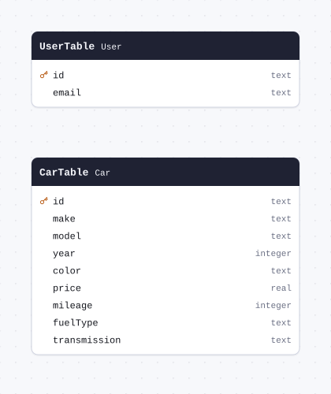
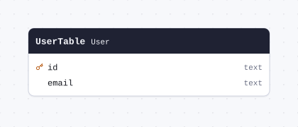
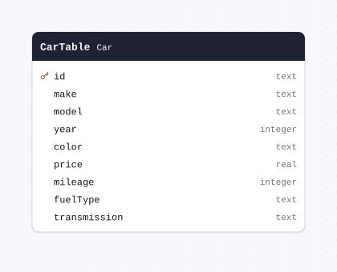

# Schema docs



<details>
<summary>The whole schema as SQL</summary>

```sql
CREATE TABLE `Car` (
	`id` text PRIMARY KEY,
	`make` text NOT NULL,
	`model` text NOT NULL,
	`year` integer NOT NULL,
	`color` text NOT NULL,
	`price` real NOT NULL,
	`mileage` integer NOT NULL,
	`fuelType` text NOT NULL,
	`transmission` text NOT NULL
);

CREATE TABLE `User` (
	`id` text PRIMARY KEY,
	`email` text NOT NULL
);
```

</details>

## Contents

| Table                         | Name in the database | Description |
| ----------------------------- | -------------------- | ----------- |
| [UserTable](#table-UserTable) | `User`               | User        |
| [CarTable](#table-CarTable)   | `Car`                | Car         |

## Tables

<a id="table-UserTable"></a>

### UserTable

Table `User`. User



| Column  | Type   | Constraints | Default | Description |
| ------- | ------ | ----------- | ------- | ----------- |
| `id`    | `text` | PK NOT NULL |         |             |
| `email` | `text` | NOT NULL    |         |             |

#### Definition

```sql
CREATE TABLE `User` (
	`id` text PRIMARY KEY,
	`email` text NOT NULL
);
```

<details>
<summary>Queries and their SQL</summary>

**Select**: Every row of UserTable.

```ts
db.select().from(UserTable);
```

```sql
select "id", "email"
from "User"
```

**Count**: How many rows UserTable has.

```ts
db.select({ count: count() }).from(UserTable);
```

```sql
select count(*)
from "User"
```

**Find many**: The rows of UserTable, through the relational query API.

```ts
db.query.UserTable.findMany();
```

```sql
select "d0"."id" as "id", "d0"."email" as "email"
from "User" as "d0"
```

**Find by primary key**: One row of UserTable, through the relational query API.

```ts
db.query.UserTable.findFirst({ where: { id: "id" } });
```

```sql
select "d0"."id" as "id", "d0"."email" as "email"
from "User" as "d0"
where "d0"."id" = ?
limit ?
-- params: ["id",1]
```

**Insert**: Adds a row to UserTable, giving the columns that have no default.

```ts
db.insert(UserTable).values({ id: "id", email: "email" });
```

```sql
insert into "User" ("id", "email")
values (?, ?)
-- params: ["id","email"]
```

**Update**: Changes a row of UserTable, found by its primary key.

```ts
db.update(UserTable).set({ email: "email" }).where(eq(UserTable.id, "id"));
```

```sql
update "User"
set "email" = ?
where "User"."id" = ?
-- params: ["email","id"]
```

**Delete**: Deletes a row of UserTable, found by its primary key.

```ts
db.delete(UserTable).where(eq(UserTable.id, "id"));
```

```sql
delete from "User"
where "User"."id" = ?
-- params: ["id"]
```

</details>

<a id="table-CarTable"></a>

### CarTable

Table `Car`. Car



| Column         | Type      | Constraints | Default | Description |
| -------------- | --------- | ----------- | ------- | ----------- |
| `id`           | `text`    | PK NOT NULL |         |             |
| `make`         | `text`    | NOT NULL    |         |             |
| `model`        | `text`    | NOT NULL    |         |             |
| `year`         | `integer` | NOT NULL    |         |             |
| `color`        | `text`    | NOT NULL    |         |             |
| `price`        | `real`    | NOT NULL    |         |             |
| `mileage`      | `integer` | NOT NULL    |         |             |
| `fuelType`     | `text`    | NOT NULL    |         |             |
| `transmission` | `text`    | NOT NULL    |         |             |

#### Definition

```sql
CREATE TABLE `Car` (
	`id` text PRIMARY KEY,
	`make` text NOT NULL,
	`model` text NOT NULL,
	`year` integer NOT NULL,
	`color` text NOT NULL,
	`price` real NOT NULL,
	`mileage` integer NOT NULL,
	`fuelType` text NOT NULL,
	`transmission` text NOT NULL
);
```

<details>
<summary>Queries and their SQL</summary>

**Select**: Every row of CarTable.

```ts
db.select().from(CarTable);
```

```sql
select "id", "make", "model", "year", "color", "price", "mileage", "fuelType", "transmission"
from "Car"
```

**Count**: How many rows CarTable has.

```ts
db.select({ count: count() }).from(CarTable);
```

```sql
select count(*)
from "Car"
```

**Find many**: The rows of CarTable, through the relational query API.

```ts
db.query.CarTable.findMany();
```

```sql
select "d0"."id" as "id", "d0"."make" as "make", "d0"."model" as "model", "d0"."year" as "year", "d0"."color" as "color", "d0"."price" as "price", "d0"."mileage" as "mileage", "d0"."fuelType" as "fuelType", "d0"."transmission" as "transmission"
from "Car" as "d0"
```

**Find by primary key**: One row of CarTable, through the relational query API.

```ts
db.query.CarTable.findFirst({ where: { id: "id" } });
```

```sql
select "d0"."id" as "id", "d0"."make" as "make", "d0"."model" as "model", "d0"."year" as "year", "d0"."color" as "color", "d0"."price" as "price", "d0"."mileage" as "mileage", "d0"."fuelType" as "fuelType", "d0"."transmission" as "transmission"
from "Car" as "d0"
where "d0"."id" = ?
limit ?
-- params: ["id",1]
```

**Insert**: Adds a row to CarTable, giving the columns that have no default.

```ts
db.insert(CarTable).values({
  id: "id",
  make: "make",
  model: "model",
  year: 1,
  color: "color",
  price: 1,
  mileage: 1,
  fuelType: "fuelType",
  transmission: "transmission",
});
```

```sql
insert into "Car" ("id", "make", "model", "year", "color", "price", "mileage", "fuelType", "transmission")
values (?, ?, ?, ?, ?, ?, ?, ?, ?)
-- params: ["id","make","model",1,"color",1,1,"fuelType","transmission"]
```

**Update**: Changes a row of CarTable, found by its primary key.

```ts
db.update(CarTable).set({ make: "make" }).where(eq(CarTable.id, "id"));
```

```sql
update "Car"
set "make" = ?
where "Car"."id" = ?
-- params: ["make","id"]
```

**Delete**: Deletes a row of CarTable, found by its primary key.

```ts
db.delete(CarTable).where(eq(CarTable.id, "id"));
```

```sql
delete from "Car"
where "Car"."id" = ?
-- params: ["id"]
```

</details>
