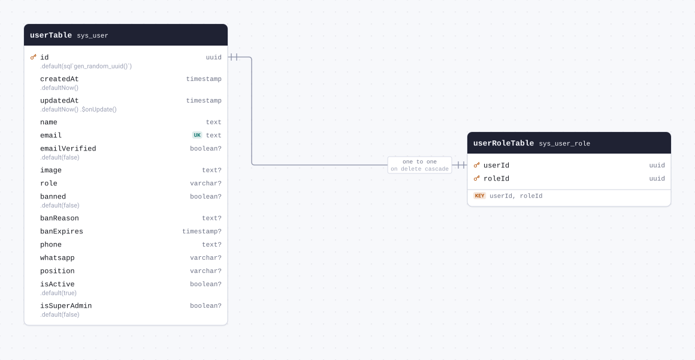
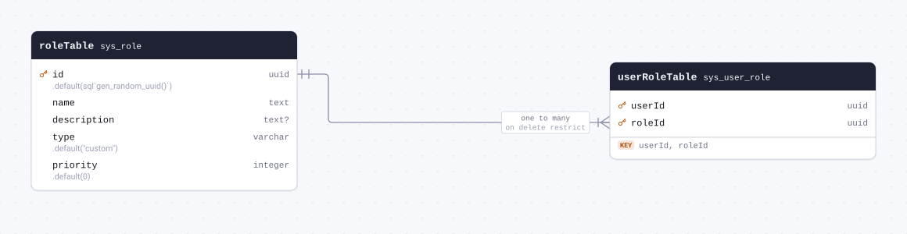
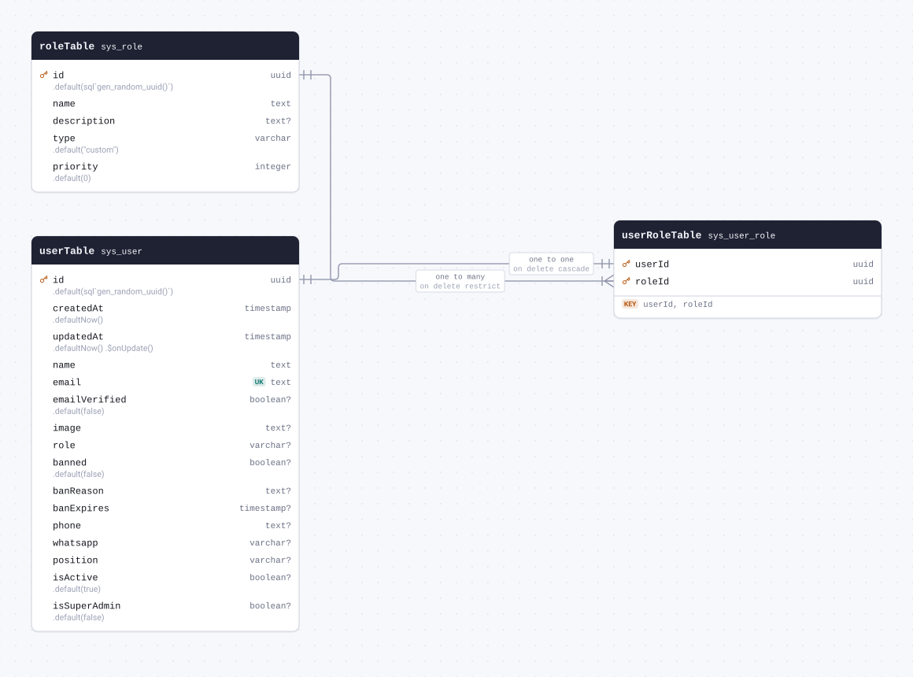

# Schema docs


<details>
<summary>The whole schema as SQL</summary>

```sql
CREATE TABLE "sys_role" (
	"id" uuid PRIMARY KEY DEFAULT gen_random_uuid(),
	"name" text NOT NULL,
	"description" text,
	"type" varchar DEFAULT 'custom' NOT NULL,
	"priority" integer DEFAULT 0 NOT NULL
);

CREATE TABLE "sys_user_role" (
	"user_id" uuid UNIQUE,
	"role_id" uuid,
	CONSTRAINT "sys_user_role_pkey" PRIMARY KEY("user_id","role_id")
);

CREATE TABLE "sys_user" (
	"id" uuid PRIMARY KEY DEFAULT gen_random_uuid(),
	"created_at" timestamp with time zone DEFAULT now() NOT NULL,
	"updated_at" timestamp with time zone DEFAULT now() NOT NULL,
	"name" text NOT NULL,
	"email" text NOT NULL UNIQUE,
	"email_verified" boolean DEFAULT false,
	"image" text,
	"role" varchar(50),
	"banned" boolean DEFAULT false,
	"ban_reason" text,
	"ban_expire_at" timestamp with time zone,
	"phone" text,
	"whatsapp" varchar(50),
	"position" varchar(100),
	"is_active" boolean DEFAULT true,
	"is_super_admin" boolean DEFAULT false
);

ALTER TABLE "sys_user_role" ADD CONSTRAINT "sys_user_role_user_id_sys_user_id_fkey" FOREIGN KEY ("user_id") REFERENCES "sys_user"("id") ON DELETE CASCADE;

ALTER TABLE "sys_user_role" ADD CONSTRAINT "sys_user_role_role_id_sys_role_id_fkey" FOREIGN KEY ("role_id") REFERENCES "sys_role"("id") ON DELETE RESTRICT;
```

</details>

## Contents

| Table                                 | Name in the database | Description |
| ------------------------------------- | -------------------- | ----------- |
| [userTable](#table-userTable)         | `sys_user`           |             |
| [roleTable](#table-roleTable)         | `sys_role`           |             |
| [userRoleTable](#table-userRoleTable) | `sys_user_role`      |             |

## Tables

<a id="table-userTable"></a>

### userTable

Table `sys_user`.



| Column                             | Type        | Constraints     | Default                              | Description |
| ---------------------------------- | ----------- | --------------- | ------------------------------------ | ----------- |
| `id`                               | `uuid`      | PK NOT NULL     | ``.default(sql`gen_random_uuid()`)`` |             |
| `createdAt` (`created_at`)         | `timestamp` | NOT NULL        | `.defaultNow()`                      |             |
| `updatedAt` (`updated_at`)         | `timestamp` | NOT NULL        | `.defaultNow()` `.$onUpdate()`       |             |
| `name`                             | `text`      | NOT NULL        |                                      |             |
| `email`                            | `text`      | UNIQUE NOT NULL |                                      |             |
| `emailVerified` (`email_verified`) | `boolean`   | NULL            | `.default(false)`                    |             |
| `image`                            | `text`      | NULL            |                                      |             |
| `role`                             | `varchar`   | NULL            |                                      |             |
| `banned`                           | `boolean`   | NULL            | `.default(false)`                    |             |
| `banReason` (`ban_reason`)         | `text`      | NULL            |                                      |             |
| `banExpires` (`ban_expire_at`)     | `timestamp` | NULL            |                                      |             |
| `phone`                            | `text`      | NULL            |                                      |             |
| `whatsapp`                         | `varchar`   | NULL            |                                      |             |
| `position`                         | `varchar`   | NULL            |                                      |             |
| `isActive` (`is_active`)           | `boolean`   | NULL            | `.default(true)`                     |             |
| `isSuperAdmin` (`is_super_admin`)  | `boolean`   | NULL            | `.default(false)`                    |             |

#### Definition

```sql
CREATE TABLE "sys_user" (
	"id" uuid PRIMARY KEY DEFAULT gen_random_uuid(),
	"created_at" timestamp with time zone DEFAULT now() NOT NULL,
	"updated_at" timestamp with time zone DEFAULT now() NOT NULL,
	"name" text NOT NULL,
	"email" text NOT NULL UNIQUE,
	"email_verified" boolean DEFAULT false,
	"image" text,
	"role" varchar(50),
	"banned" boolean DEFAULT false,
	"ban_reason" text,
	"ban_expire_at" timestamp with time zone,
	"phone" text,
	"whatsapp" varchar(50),
	"position" varchar(100),
	"is_active" boolean DEFAULT true,
	"is_super_admin" boolean DEFAULT false
);
```

#### Referenced by

- `id` → [userRoleTable.userId](#table-userRoleTable) (one to one, on delete cascade)

<details>
<summary>Queries and their SQL</summary>

**Select**: Every row of userTable.

```ts
db.select().from(userTable);
```

```sql
select "id", "created_at", "updated_at", "name", "email", "email_verified", "image", "role", "banned", "ban_reason", "ban_expire_at", "phone", "whatsapp", "position", "is_active", "is_super_admin"
from "sys_user"
```

**Count**: How many rows userTable has.

```ts
db.select({ count: count() }).from(userTable);
```

```sql
select count(*)
from "sys_user"
```

**Find many with relations**: The rows of userTable with what they relate to, through the relational query API.

```ts
db.query.userTable.findMany({ with: { roles: true } });
```

```sql
select "d0"."id" as "id", "d0"."created_at" as "createdAt", "d0"."updated_at" as "updatedAt", "d0"."name" as "name", "d0"."email" as "email", "d0"."email_verified" as "emailVerified", "d0"."image" as "image", "d0"."role" as "role", "d0"."banned" as "banned", "d0"."ban_reason" as "banReason", "d0"."ban_expire_at" as "banExpires", "d0"."phone" as "phone", "d0"."whatsapp" as "whatsapp", "d0"."position" as "position", "d0"."is_active" as "isActive", "d0"."is_super_admin" as "isSuperAdmin", "roles"."r" as "roles"
from "sys_user" as "d0"
left join lateral(select coalesce(json_agg(row_to_json("t".*)), '[]') as "r" from (select "d1"."id" as "id", "d1"."name" as "name", "d1"."description" as "description", "d1"."type" as "type", "d1"."priority" as "priority" from "sys_role" as "d1" inner join "sys_user_role" as "tr0" on "tr0"."role_id" = "d1"."id" where "d0"."id" = "tr0"."user_id") as "t") as "roles" on true
```

**Find by primary key**: One row of userTable, through the relational query API.

```ts
db.query.userTable.findFirst({ where: { id: "00000000-0000-0000-0000-000000000000" } });
```

```sql
select "d0"."id" as "id", "d0"."created_at" as "createdAt", "d0"."updated_at" as "updatedAt", "d0"."name" as "name", "d0"."email" as "email", "d0"."email_verified" as "emailVerified", "d0"."image" as "image", "d0"."role" as "role", "d0"."banned" as "banned", "d0"."ban_reason" as "banReason", "d0"."ban_expire_at" as "banExpires", "d0"."phone" as "phone", "d0"."whatsapp" as "whatsapp", "d0"."position" as "position", "d0"."is_active" as "isActive", "d0"."is_super_admin" as "isSuperAdmin"
from "sys_user" as "d0"
where "d0"."id" = $1
limit $2
-- params: ["00000000-0000-0000-0000-000000000000",1]
```

**Insert**: Adds a row to userTable, giving the columns that have no default.

```ts
db.insert(userTable).values({ name: "name", email: "email" });
```

```sql
insert into "sys_user" ("id", "created_at", "updated_at", "name", "email", "email_verified", "image", "role", "banned", "ban_reason", "ban_expire_at", "phone", "whatsapp", "position", "is_active", "is_super_admin")
values (default, default, default, $1, $2, default, default, default, default, default, default, default, default, default, default, default)
-- params: ["name","email"]
```

**Update**: Changes a row of userTable, found by its primary key.

```ts
db.update(userTable)
  .set({ createdAt: new Date("2026-01-01T00:00:00.000Z") })
  .where(eq(userTable.id, "00000000-0000-0000-0000-000000000000"));
```

```sql
update "sys_user"
set "created_at" = $1, "updated_at" = $2
where "sys_user"."id" = $3
-- params: ["2026-01-01T00:00:00.000Z","2026-01-01T00:00:00.000Z","00000000-0000-0000-0000-000000000000"]
```

**Delete**: Deletes a row of userTable, found by its primary key.

```ts
db.delete(userTable).where(eq(userTable.id, "00000000-0000-0000-0000-000000000000"));
```

```sql
delete from "sys_user"
where "sys_user"."id" = $1
-- params: ["00000000-0000-0000-0000-000000000000"]
```

</details>

<a id="table-roleTable"></a>

### roleTable

Table `sys_role`.



| Column        | Type      | Constraints | Default                              | Description |
| ------------- | --------- | ----------- | ------------------------------------ | ----------- |
| `id`          | `uuid`    | PK NOT NULL | ``.default(sql`gen_random_uuid()`)`` |             |
| `name`        | `text`    | NOT NULL    |                                      |             |
| `description` | `text`    | NULL        |                                      |             |
| `type`        | `varchar` | NOT NULL    | `.default("custom")`                 |             |
| `priority`    | `integer` | NOT NULL    | `.default(0)`                        |             |

#### Definition

```sql
CREATE TABLE "sys_role" (
	"id" uuid PRIMARY KEY DEFAULT gen_random_uuid(),
	"name" text NOT NULL,
	"description" text,
	"type" varchar DEFAULT 'custom' NOT NULL,
	"priority" integer DEFAULT 0 NOT NULL
);
```

#### Referenced by

- `id` → [userRoleTable.roleId](#table-userRoleTable) (one to many, on delete restrict)

<details>
<summary>Queries and their SQL</summary>

**Select**: Every row of roleTable.

```ts
db.select().from(roleTable);
```

```sql
select "id", "name", "description", "type", "priority"
from "sys_role"
```

**Count**: How many rows roleTable has.

```ts
db.select({ count: count() }).from(roleTable);
```

```sql
select count(*)
from "sys_role"
```

**Find many**: The rows of roleTable, through the relational query API.

```ts
db.query.roleTable.findMany();
```

```sql
select "d0"."id" as "id", "d0"."name" as "name", "d0"."description" as "description", "d0"."type" as "type", "d0"."priority" as "priority"
from "sys_role" as "d0"
```

**Find by primary key**: One row of roleTable, through the relational query API.

```ts
db.query.roleTable.findFirst({ where: { id: "00000000-0000-0000-0000-000000000000" } });
```

```sql
select "d0"."id" as "id", "d0"."name" as "name", "d0"."description" as "description", "d0"."type" as "type", "d0"."priority" as "priority"
from "sys_role" as "d0"
where "d0"."id" = $1
limit $2
-- params: ["00000000-0000-0000-0000-000000000000",1]
```

**Insert**: Adds a row to roleTable, giving the columns that have no default.

```ts
db.insert(roleTable).values({ name: "name" });
```

```sql
insert into "sys_role" ("id", "name", "description", "type", "priority")
values (default, $1, default, default, default)
-- params: ["name"]
```

**Update**: Changes a row of roleTable, found by its primary key.

```ts
db.update(roleTable)
  .set({ name: "name" })
  .where(eq(roleTable.id, "00000000-0000-0000-0000-000000000000"));
```

```sql
update "sys_role"
set "name" = $1
where "sys_role"."id" = $2
-- params: ["name","00000000-0000-0000-0000-000000000000"]
```

**Delete**: Deletes a row of roleTable, found by its primary key.

```ts
db.delete(roleTable).where(eq(roleTable.id, "00000000-0000-0000-0000-000000000000"));
```

```sql
delete from "sys_role"
where "sys_role"."id" = $1
-- params: ["00000000-0000-0000-0000-000000000000"]
```

</details>

<a id="table-userRoleTable"></a>

### userRoleTable

Table `sys_user_role`.



| Column               | Type   | Constraints                                           | Default | Description |
| -------------------- | ------ | ----------------------------------------------------- | ------- | ----------- |
| `userId` (`user_id`) | `uuid` | PK UNIQUE NOT NULL → [userTable.id](#table-userTable) |         |             |
| `roleId` (`role_id`) | `uuid` | PK NOT NULL → [roleTable.id](#table-roleTable)        |         |             |

#### Definition

```sql
CREATE TABLE "sys_user_role" (
	"user_id" uuid UNIQUE,
	"role_id" uuid,
	CONSTRAINT "sys_user_role_pkey" PRIMARY KEY("user_id","role_id")
);

ALTER TABLE "sys_user_role" ADD CONSTRAINT "sys_user_role_user_id_sys_user_id_fkey" FOREIGN KEY ("user_id") REFERENCES "sys_user"("id") ON DELETE CASCADE;

ALTER TABLE "sys_user_role" ADD CONSTRAINT "sys_user_role_role_id_sys_role_id_fkey" FOREIGN KEY ("role_id") REFERENCES "sys_role"("id") ON DELETE RESTRICT;
```

#### Indexes

- PRIMARY KEY `userId`, `roleId`

#### References

- `userId` → [userTable.id](#table-userTable) (one to one, on delete cascade)
- `roleId` → [roleTable.id](#table-roleTable) (many to one, on delete restrict)

<details>
<summary>Queries and their SQL</summary>

**Select**: Every row of userRoleTable.

```ts
db.select().from(userRoleTable);
```

```sql
select "user_id", "role_id"
from "sys_user_role"
```

**Count**: How many rows userRoleTable has.

```ts
db.select({ count: count() }).from(userRoleTable);
```

```sql
select count(*)
from "sys_user_role"
```

**Find many**: The rows of userRoleTable, through the relational query API.

```ts
db.query.userRoleTable.findMany();
```

```sql
select "d0"."user_id" as "userId", "d0"."role_id" as "roleId"
from "sys_user_role" as "d0"
```

**Find by primary key**: One row of userRoleTable, through the relational query API.

```ts
db.query.userRoleTable.findFirst({
  where: {
    userId: "00000000-0000-0000-0000-000000000000",
    roleId: "00000000-0000-0000-0000-000000000000",
  },
});
```

```sql
select "d0"."user_id" as "userId", "d0"."role_id" as "roleId"
from "sys_user_role" as "d0"
where (("d0"."user_id" = $1) and ("d0"."role_id" = $2))
limit $3
-- params: ["00000000-0000-0000-0000-000000000000","00000000-0000-0000-0000-000000000000",1]
```

**Insert**: Adds a row to userRoleTable, giving the columns that have no default.

```ts
db.insert(userRoleTable).values({
  userId: "00000000-0000-0000-0000-000000000000",
  roleId: "00000000-0000-0000-0000-000000000000",
});
```

```sql
insert into "sys_user_role" ("user_id", "role_id")
values ($1, $2)
-- params: ["00000000-0000-0000-0000-000000000000","00000000-0000-0000-0000-000000000000"]
```

**Delete**: Deletes a row of userRoleTable, found by its primary key.

```ts
db.delete(userRoleTable).where(
  and(
    eq(userRoleTable.userId, "00000000-0000-0000-0000-000000000000"),
    eq(userRoleTable.roleId, "00000000-0000-0000-0000-000000000000"),
  ),
);
```

```sql
delete from "sys_user_role"
where (("sys_user_role"."user_id" = $1) and ("sys_user_role"."role_id" = $2))
-- params: ["00000000-0000-0000-0000-000000000000","00000000-0000-0000-0000-000000000000"]
```

</details>
