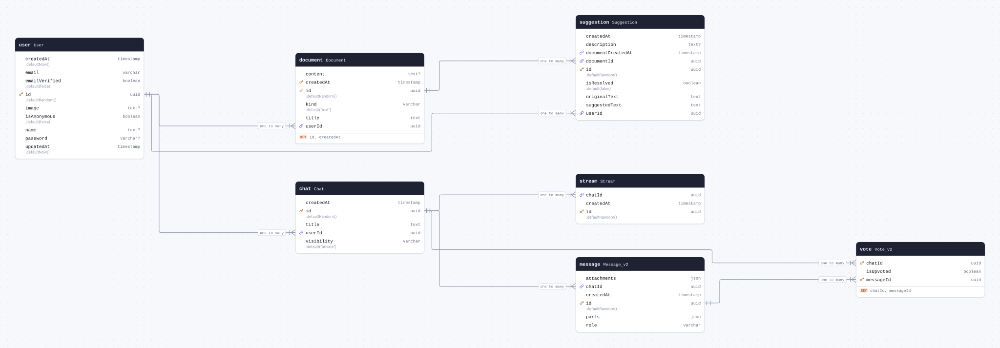
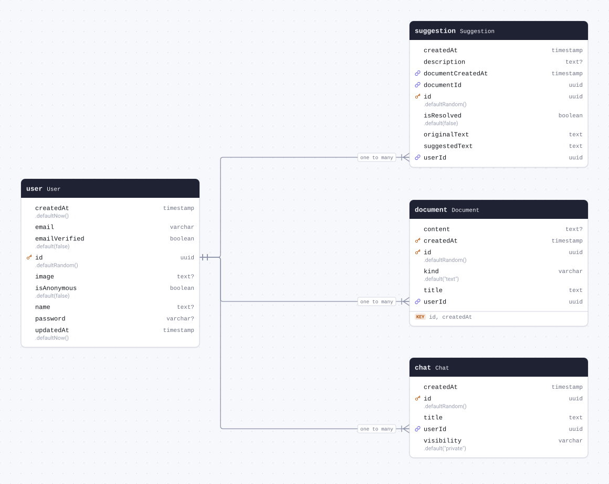
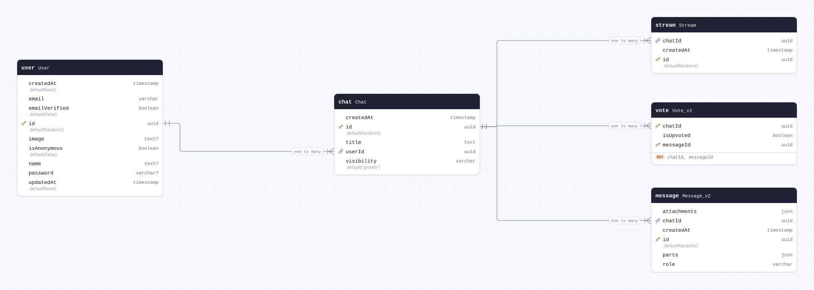
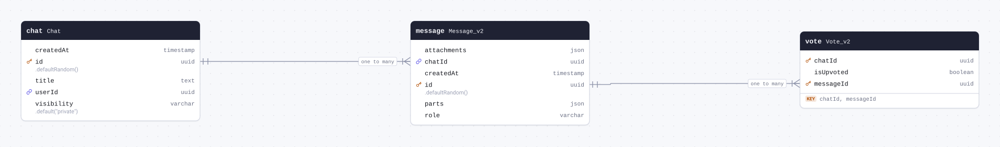
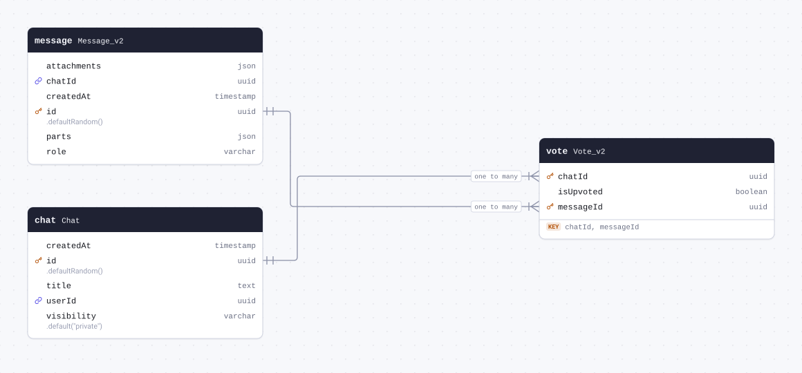
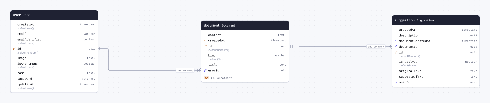
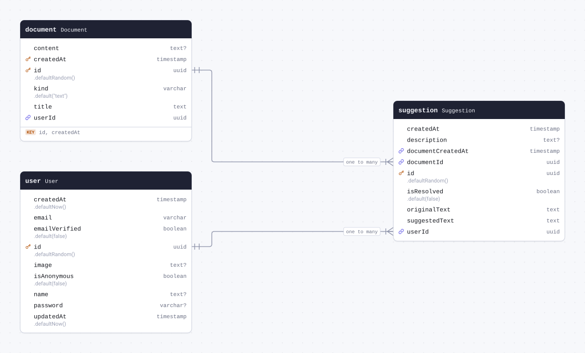
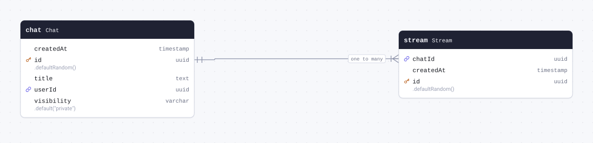

# Schema docs



<details>
<summary>The whole schema as SQL</summary>

```sql
CREATE TABLE "Chat" (
	"createdAt" timestamp NOT NULL,
	"id" uuid PRIMARY KEY DEFAULT gen_random_uuid(),
	"title" text NOT NULL,
	"userId" uuid NOT NULL,
	"visibility" varchar DEFAULT 'private' NOT NULL
);

CREATE TABLE "Document" (
	"content" text,
	"createdAt" timestamp,
	"id" uuid DEFAULT gen_random_uuid(),
	"text" varchar DEFAULT 'text' NOT NULL,
	"title" text NOT NULL,
	"userId" uuid NOT NULL,
	CONSTRAINT "Document_pkey" PRIMARY KEY("id","createdAt")
);

CREATE TABLE "Message_v2" (
	"attachments" json NOT NULL,
	"chatId" uuid NOT NULL,
	"createdAt" timestamp NOT NULL,
	"id" uuid PRIMARY KEY DEFAULT gen_random_uuid(),
	"parts" json NOT NULL,
	"role" varchar NOT NULL
);

CREATE TABLE "Stream" (
	"chatId" uuid NOT NULL,
	"createdAt" timestamp NOT NULL,
	"id" uuid PRIMARY KEY DEFAULT gen_random_uuid()
);

CREATE TABLE "Suggestion" (
	"createdAt" timestamp NOT NULL,
	"description" text,
	"documentCreatedAt" timestamp NOT NULL,
	"documentId" uuid NOT NULL,
	"id" uuid PRIMARY KEY DEFAULT gen_random_uuid(),
	"isResolved" boolean DEFAULT false NOT NULL,
	"originalText" text NOT NULL,
	"suggestedText" text NOT NULL,
	"userId" uuid NOT NULL
);

CREATE TABLE "User" (
	"createdAt" timestamp DEFAULT now() NOT NULL,
	"email" varchar(64) NOT NULL,
	"emailVerified" boolean DEFAULT false NOT NULL,
	"id" uuid PRIMARY KEY DEFAULT gen_random_uuid(),
	"image" text,
	"isAnonymous" boolean DEFAULT false NOT NULL,
	"name" text,
	"password" varchar(64),
	"updatedAt" timestamp DEFAULT now() NOT NULL
);

CREATE TABLE "Vote_v2" (
	"chatId" uuid,
	"isUpvoted" boolean NOT NULL,
	"messageId" uuid,
	CONSTRAINT "Vote_v2_pkey" PRIMARY KEY("chatId","messageId")
);

ALTER TABLE "Chat" ADD CONSTRAINT "Chat_userId_User_id_fkey" FOREIGN KEY ("userId") REFERENCES "User"("id");

ALTER TABLE "Document" ADD CONSTRAINT "Document_userId_User_id_fkey" FOREIGN KEY ("userId") REFERENCES "User"("id");

ALTER TABLE "Message_v2" ADD CONSTRAINT "Message_v2_chatId_Chat_id_fkey" FOREIGN KEY ("chatId") REFERENCES "Chat"("id");

ALTER TABLE "Stream" ADD CONSTRAINT "Stream_chatId_Chat_id_fkey" FOREIGN KEY ("chatId") REFERENCES "Chat"("id");

ALTER TABLE "Suggestion" ADD CONSTRAINT "Suggestion_userId_User_id_fkey" FOREIGN KEY ("userId") REFERENCES "User"("id");

ALTER TABLE "Suggestion" ADD CONSTRAINT "Suggestion_0xmkr3D4oqj8_fkey" FOREIGN KEY ("documentId","documentCreatedAt") REFERENCES "Document"("id","createdAt");

ALTER TABLE "Vote_v2" ADD CONSTRAINT "Vote_v2_chatId_Chat_id_fkey" FOREIGN KEY ("chatId") REFERENCES "Chat"("id");

ALTER TABLE "Vote_v2" ADD CONSTRAINT "Vote_v2_messageId_Message_v2_id_fkey" FOREIGN KEY ("messageId") REFERENCES "Message_v2"("id");
```

</details>

## Contents

| Table                           | Name in the database | Description |
| ------------------------------- | -------------------- | ----------- |
| [user](#table-user)             | `User`               |             |
| [chat](#table-chat)             | `Chat`               |             |
| [message](#table-message)       | `Message_v2`         |             |
| [vote](#table-vote)             | `Vote_v2`            |             |
| [document](#table-document)     | `Document`           |             |
| [suggestion](#table-suggestion) | `Suggestion`         |             |
| [stream](#table-stream)         | `Stream`             |             |

## Tables

<a id="table-user"></a>

### user

Table `User`.



| Column          | Type        | Constraints | Default            | Description |
| --------------- | ----------- | ----------- | ------------------ | ----------- |
| `createdAt`     | `timestamp` | NOT NULL    | `.defaultNow()`    |             |
| `email`         | `varchar`   | NOT NULL    |                    |             |
| `emailVerified` | `boolean`   | NOT NULL    | `.default(false)`  |             |
| `id`            | `uuid`      | PK NOT NULL | `.defaultRandom()` |             |
| `image`         | `text`      | NULL        |                    |             |
| `isAnonymous`   | `boolean`   | NOT NULL    | `.default(false)`  |             |
| `name`          | `text`      | NULL        |                    |             |
| `password`      | `varchar`   | NULL        |                    |             |
| `updatedAt`     | `timestamp` | NOT NULL    | `.defaultNow()`    |             |

#### Definition

```sql
CREATE TABLE "User" (
	"createdAt" timestamp DEFAULT now() NOT NULL,
	"email" varchar(64) NOT NULL,
	"emailVerified" boolean DEFAULT false NOT NULL,
	"id" uuid PRIMARY KEY DEFAULT gen_random_uuid(),
	"image" text,
	"isAnonymous" boolean DEFAULT false NOT NULL,
	"name" text,
	"password" varchar(64),
	"updatedAt" timestamp DEFAULT now() NOT NULL
);
```

#### Referenced by

- `id` → [chat.userId](#table-chat) (one to many)
- `id` → [document.userId](#table-document) (one to many)
- `id` → [suggestion.userId](#table-suggestion) (one to many)

<details>
<summary>Queries and their SQL</summary>

**Select**: Every row of user.

```ts
db.select().from(user);
```

```sql
select "createdAt", "email", "emailVerified", "id", "image", "isAnonymous", "name", "password", "updatedAt"
from "User"
```

**Count**: How many rows user has.

```ts
db.select({ count: count() }).from(user);
```

```sql
select count(*)
from "User"
```

**Find many**: The rows of user, through the relational query API.

```ts
db.query.user.findMany();
```

```sql
select "d0"."createdAt" as "createdAt", "d0"."email" as "email", "d0"."emailVerified" as "emailVerified", "d0"."id" as "id", "d0"."image" as "image", "d0"."isAnonymous" as "isAnonymous", "d0"."name" as "name", "d0"."password" as "password", "d0"."updatedAt" as "updatedAt"
from "User" as "d0"
```

**Find by primary key**: One row of user, through the relational query API.

```ts
db.query.user.findFirst({ where: { id: "00000000-0000-0000-0000-000000000000" } });
```

```sql
select "d0"."createdAt" as "createdAt", "d0"."email" as "email", "d0"."emailVerified" as "emailVerified", "d0"."id" as "id", "d0"."image" as "image", "d0"."isAnonymous" as "isAnonymous", "d0"."name" as "name", "d0"."password" as "password", "d0"."updatedAt" as "updatedAt"
from "User" as "d0"
where "d0"."id" = $1
limit $2
-- params: ["00000000-0000-0000-0000-000000000000",1]
```

**Insert**: Adds a row to user, giving the columns that have no default.

```ts
db.insert(user).values({ email: "email" });
```

```sql
insert into "User" ("createdAt", "email", "emailVerified", "id", "image", "isAnonymous", "name", "password", "updatedAt")
values (default, $1, default, default, default, default, default, default, default)
-- params: ["email"]
```

**Update**: Changes a row of user, found by its primary key.

```ts
db.update(user)
  .set({ createdAt: new Date("2026-01-01T00:00:00.000Z") })
  .where(eq(user.id, "00000000-0000-0000-0000-000000000000"));
```

```sql
update "User"
set "createdAt" = $1
where "User"."id" = $2
-- params: ["2026-01-01T00:00:00.000Z","00000000-0000-0000-0000-000000000000"]
```

**Delete**: Deletes a row of user, found by its primary key.

```ts
db.delete(user).where(eq(user.id, "00000000-0000-0000-0000-000000000000"));
```

```sql
delete from "User"
where "User"."id" = $1
-- params: ["00000000-0000-0000-0000-000000000000"]
```

</details>

<a id="table-chat"></a>

### chat

Table `Chat`.



| Column       | Type        | Constraints                       | Default               | Description |
| ------------ | ----------- | --------------------------------- | --------------------- | ----------- |
| `createdAt`  | `timestamp` | NOT NULL                          |                       |             |
| `id`         | `uuid`      | PK NOT NULL                       | `.defaultRandom()`    |             |
| `title`      | `text`      | NOT NULL                          |                       |             |
| `userId`     | `uuid`      | NOT NULL → [user.id](#table-user) |                       |             |
| `visibility` | `varchar`   | NOT NULL                          | `.default("private")` |             |

#### Definition

```sql
CREATE TABLE "Chat" (
	"createdAt" timestamp NOT NULL,
	"id" uuid PRIMARY KEY DEFAULT gen_random_uuid(),
	"title" text NOT NULL,
	"userId" uuid NOT NULL,
	"visibility" varchar DEFAULT 'private' NOT NULL
);

ALTER TABLE "Chat" ADD CONSTRAINT "Chat_userId_User_id_fkey" FOREIGN KEY ("userId") REFERENCES "User"("id");
```

#### References

- `userId` → [user.id](#table-user) (many to one)

#### Referenced by

- `id` → [message.chatId](#table-message) (one to many)
- `id` → [vote.chatId](#table-vote) (one to many)
- `id` → [stream.chatId](#table-stream) (one to many)

<details>
<summary>Queries and their SQL</summary>

**Select**: Every row of chat.

```ts
db.select().from(chat);
```

```sql
select "createdAt", "id", "title", "userId", "visibility"
from "Chat"
```

**Count**: How many rows chat has.

```ts
db.select({ count: count() }).from(chat);
```

```sql
select count(*)
from "Chat"
```

**Find many**: The rows of chat, through the relational query API.

```ts
db.query.chat.findMany();
```

```sql
select "d0"."createdAt" as "createdAt", "d0"."id" as "id", "d0"."title" as "title", "d0"."userId" as "userId", "d0"."visibility" as "visibility"
from "Chat" as "d0"
```

**Find by primary key**: One row of chat, through the relational query API.

```ts
db.query.chat.findFirst({ where: { id: "00000000-0000-0000-0000-000000000000" } });
```

```sql
select "d0"."createdAt" as "createdAt", "d0"."id" as "id", "d0"."title" as "title", "d0"."userId" as "userId", "d0"."visibility" as "visibility"
from "Chat" as "d0"
where "d0"."id" = $1
limit $2
-- params: ["00000000-0000-0000-0000-000000000000",1]
```

**Insert**: Adds a row to chat, giving the columns that have no default.

```ts
db.insert(chat).values({
  createdAt: new Date("2026-01-01T00:00:00.000Z"),
  title: "title",
  userId: "00000000-0000-0000-0000-000000000000",
});
```

```sql
insert into "Chat" ("createdAt", "id", "title", "userId", "visibility")
values ($1, default, $2, $3, default)
-- params: ["2026-01-01T00:00:00.000Z","title","00000000-0000-0000-0000-000000000000"]
```

**Update**: Changes a row of chat, found by its primary key.

```ts
db.update(chat)
  .set({ createdAt: new Date("2026-01-01T00:00:00.000Z") })
  .where(eq(chat.id, "00000000-0000-0000-0000-000000000000"));
```

```sql
update "Chat"
set "createdAt" = $1
where "Chat"."id" = $2
-- params: ["2026-01-01T00:00:00.000Z","00000000-0000-0000-0000-000000000000"]
```

**Delete**: Deletes a row of chat, found by its primary key.

```ts
db.delete(chat).where(eq(chat.id, "00000000-0000-0000-0000-000000000000"));
```

```sql
delete from "Chat"
where "Chat"."id" = $1
-- params: ["00000000-0000-0000-0000-000000000000"]
```

</details>

<a id="table-message"></a>

### message

Table `Message_v2`.



| Column        | Type        | Constraints                       | Default            | Description |
| ------------- | ----------- | --------------------------------- | ------------------ | ----------- |
| `attachments` | `json`      | NOT NULL                          |                    |             |
| `chatId`      | `uuid`      | NOT NULL → [chat.id](#table-chat) |                    |             |
| `createdAt`   | `timestamp` | NOT NULL                          |                    |             |
| `id`          | `uuid`      | PK NOT NULL                       | `.defaultRandom()` |             |
| `parts`       | `json`      | NOT NULL                          |                    |             |
| `role`        | `varchar`   | NOT NULL                          |                    |             |

#### Definition

```sql
CREATE TABLE "Message_v2" (
	"attachments" json NOT NULL,
	"chatId" uuid NOT NULL,
	"createdAt" timestamp NOT NULL,
	"id" uuid PRIMARY KEY DEFAULT gen_random_uuid(),
	"parts" json NOT NULL,
	"role" varchar NOT NULL
);

ALTER TABLE "Message_v2" ADD CONSTRAINT "Message_v2_chatId_Chat_id_fkey" FOREIGN KEY ("chatId") REFERENCES "Chat"("id");
```

#### References

- `chatId` → [chat.id](#table-chat) (many to one)

#### Referenced by

- `id` → [vote.messageId](#table-vote) (one to many)

<details>
<summary>Queries and their SQL</summary>

**Select**: Every row of message.

```ts
db.select().from(message);
```

```sql
select "attachments", "chatId", "createdAt", "id", "parts", "role"
from "Message_v2"
```

**Count**: How many rows message has.

```ts
db.select({ count: count() }).from(message);
```

```sql
select count(*)
from "Message_v2"
```

**Find many**: The rows of message, through the relational query API.

```ts
db.query.message.findMany();
```

```sql
select "d0"."attachments" as "attachments", "d0"."chatId" as "chatId", "d0"."createdAt" as "createdAt", "d0"."id" as "id", "d0"."parts" as "parts", "d0"."role" as "role"
from "Message_v2" as "d0"
```

**Find by primary key**: One row of message, through the relational query API.

```ts
db.query.message.findFirst({ where: { id: "00000000-0000-0000-0000-000000000000" } });
```

```sql
select "d0"."attachments" as "attachments", "d0"."chatId" as "chatId", "d0"."createdAt" as "createdAt", "d0"."id" as "id", "d0"."parts" as "parts", "d0"."role" as "role"
from "Message_v2" as "d0"
where "d0"."id" = $1
limit $2
-- params: ["00000000-0000-0000-0000-000000000000",1]
```

**Insert**: Adds a row to message, giving the columns that have no default.

```ts
db.insert(message).values({
  attachments: {},
  chatId: "00000000-0000-0000-0000-000000000000",
  createdAt: new Date("2026-01-01T00:00:00.000Z"),
  parts: {},
  role: "role",
});
```

```sql
insert into "Message_v2" ("attachments", "chatId", "createdAt", "id", "parts", "role")
values ($1, $2, $3, default, $4, $5)
-- params: [{},"00000000-0000-0000-0000-000000000000","2026-01-01T00:00:00.000Z",{},"role"]
```

**Update**: Changes a row of message, found by its primary key.

```ts
db.update(message)
  .set({ attachments: {} })
  .where(eq(message.id, "00000000-0000-0000-0000-000000000000"));
```

```sql
update "Message_v2"
set "attachments" = $1
where "Message_v2"."id" = $2
-- params: [{},"00000000-0000-0000-0000-000000000000"]
```

**Delete**: Deletes a row of message, found by its primary key.

```ts
db.delete(message).where(eq(message.id, "00000000-0000-0000-0000-000000000000"));
```

```sql
delete from "Message_v2"
where "Message_v2"."id" = $1
-- params: ["00000000-0000-0000-0000-000000000000"]
```

</details>

<a id="table-vote"></a>

### vote

Table `Vote_v2`.



| Column      | Type      | Constraints                                | Default | Description |
| ----------- | --------- | ------------------------------------------ | ------- | ----------- |
| `chatId`    | `uuid`    | PK NOT NULL → [chat.id](#table-chat)       |         |             |
| `isUpvoted` | `boolean` | NOT NULL                                   |         |             |
| `messageId` | `uuid`    | PK NOT NULL → [message.id](#table-message) |         |             |

#### Definition

```sql
CREATE TABLE "Vote_v2" (
	"chatId" uuid,
	"isUpvoted" boolean NOT NULL,
	"messageId" uuid,
	CONSTRAINT "Vote_v2_pkey" PRIMARY KEY("chatId","messageId")
);

ALTER TABLE "Vote_v2" ADD CONSTRAINT "Vote_v2_chatId_Chat_id_fkey" FOREIGN KEY ("chatId") REFERENCES "Chat"("id");

ALTER TABLE "Vote_v2" ADD CONSTRAINT "Vote_v2_messageId_Message_v2_id_fkey" FOREIGN KEY ("messageId") REFERENCES "Message_v2"("id");
```

#### Indexes

- PRIMARY KEY `chatId`, `messageId`

#### References

- `chatId` → [chat.id](#table-chat) (many to one)
- `messageId` → [message.id](#table-message) (many to one)

<details>
<summary>Queries and their SQL</summary>

**Select**: Every row of vote.

```ts
db.select().from(vote);
```

```sql
select "chatId", "isUpvoted", "messageId"
from "Vote_v2"
```

**Count**: How many rows vote has.

```ts
db.select({ count: count() }).from(vote);
```

```sql
select count(*)
from "Vote_v2"
```

**Find many**: The rows of vote, through the relational query API.

```ts
db.query.vote.findMany();
```

```sql
select "d0"."chatId" as "chatId", "d0"."isUpvoted" as "isUpvoted", "d0"."messageId" as "messageId"
from "Vote_v2" as "d0"
```

**Find by primary key**: One row of vote, through the relational query API.

```ts
db.query.vote.findFirst({
  where: {
    chatId: "00000000-0000-0000-0000-000000000000",
    messageId: "00000000-0000-0000-0000-000000000000",
  },
});
```

```sql
select "d0"."chatId" as "chatId", "d0"."isUpvoted" as "isUpvoted", "d0"."messageId" as "messageId"
from "Vote_v2" as "d0"
where (("d0"."chatId" = $1) and ("d0"."messageId" = $2))
limit $3
-- params: ["00000000-0000-0000-0000-000000000000","00000000-0000-0000-0000-000000000000",1]
```

**Insert**: Adds a row to vote, giving the columns that have no default.

```ts
db.insert(vote).values({
  chatId: "00000000-0000-0000-0000-000000000000",
  isUpvoted: true,
  messageId: "00000000-0000-0000-0000-000000000000",
});
```

```sql
insert into "Vote_v2" ("chatId", "isUpvoted", "messageId")
values ($1, $2, $3)
-- params: ["00000000-0000-0000-0000-000000000000",true,"00000000-0000-0000-0000-000000000000"]
```

**Update**: Changes a row of vote, found by its primary key.

```ts
db.update(vote)
  .set({ isUpvoted: true })
  .where(
    and(
      eq(vote.chatId, "00000000-0000-0000-0000-000000000000"),
      eq(vote.messageId, "00000000-0000-0000-0000-000000000000"),
    ),
  );
```

```sql
update "Vote_v2"
set "isUpvoted" = $1
where (("Vote_v2"."chatId" = $2) and ("Vote_v2"."messageId" = $3))
-- params: [true,"00000000-0000-0000-0000-000000000000","00000000-0000-0000-0000-000000000000"]
```

**Delete**: Deletes a row of vote, found by its primary key.

```ts
db.delete(vote).where(
  and(
    eq(vote.chatId, "00000000-0000-0000-0000-000000000000"),
    eq(vote.messageId, "00000000-0000-0000-0000-000000000000"),
  ),
);
```

```sql
delete from "Vote_v2"
where (("Vote_v2"."chatId" = $1) and ("Vote_v2"."messageId" = $2))
-- params: ["00000000-0000-0000-0000-000000000000","00000000-0000-0000-0000-000000000000"]
```

</details>

<a id="table-document"></a>

### document

Table `Document`.



| Column          | Type        | Constraints                       | Default            | Description |
| --------------- | ----------- | --------------------------------- | ------------------ | ----------- |
| `content`       | `text`      | NULL                              |                    |             |
| `createdAt`     | `timestamp` | PK NOT NULL                       |                    |             |
| `id`            | `uuid`      | PK NOT NULL                       | `.defaultRandom()` |             |
| `kind` (`text`) | `varchar`   | NOT NULL                          | `.default("text")` |             |
| `title`         | `text`      | NOT NULL                          |                    |             |
| `userId`        | `uuid`      | NOT NULL → [user.id](#table-user) |                    |             |

#### Definition

```sql
CREATE TABLE "Document" (
	"content" text,
	"createdAt" timestamp,
	"id" uuid DEFAULT gen_random_uuid(),
	"text" varchar DEFAULT 'text' NOT NULL,
	"title" text NOT NULL,
	"userId" uuid NOT NULL,
	CONSTRAINT "Document_pkey" PRIMARY KEY("id","createdAt")
);

ALTER TABLE "Document" ADD CONSTRAINT "Document_userId_User_id_fkey" FOREIGN KEY ("userId") REFERENCES "User"("id");
```

#### Indexes

- PRIMARY KEY `id`, `createdAt`

#### References

- `userId` → [user.id](#table-user) (many to one)

#### Referenced by

- `id` → [suggestion.documentId](#table-suggestion) (one to many)

<details>
<summary>Queries and their SQL</summary>

**Select**: Every row of document.

```ts
db.select().from(document);
```

```sql
select "content", "createdAt", "id", "text", "title", "userId"
from "Document"
```

**Count**: How many rows document has.

```ts
db.select({ count: count() }).from(document);
```

```sql
select count(*)
from "Document"
```

**Find many**: The rows of document, through the relational query API.

```ts
db.query.document.findMany();
```

```sql
select "d0"."content" as "content", "d0"."createdAt" as "createdAt", "d0"."id" as "id", "d0"."text" as "kind", "d0"."title" as "title", "d0"."userId" as "userId"
from "Document" as "d0"
```

**Find by primary key**: One row of document, through the relational query API.

```ts
db.query.document.findFirst({
  where: {
    createdAt: new Date("2026-01-01T00:00:00.000Z"),
    id: "00000000-0000-0000-0000-000000000000",
  },
});
```

```sql
select "d0"."content" as "content", "d0"."createdAt" as "createdAt", "d0"."id" as "id", "d0"."text" as "kind", "d0"."title" as "title", "d0"."userId" as "userId"
from "Document" as "d0"
where "d0"."id" = $1
limit $2
-- params: ["00000000-0000-0000-0000-000000000000",1]
```

**Insert**: Adds a row to document, giving the columns that have no default.

```ts
db.insert(document).values({
  createdAt: new Date("2026-01-01T00:00:00.000Z"),
  title: "title",
  userId: "00000000-0000-0000-0000-000000000000",
});
```

```sql
insert into "Document" ("content", "createdAt", "id", "text", "title", "userId")
values (default, $1, default, default, $2, $3)
-- params: ["2026-01-01T00:00:00.000Z","title","00000000-0000-0000-0000-000000000000"]
```

**Update**: Changes a row of document, found by its primary key.

```ts
db.update(document)
  .set({ content: "content" })
  .where(
    and(
      eq(document.createdAt, new Date("2026-01-01T00:00:00.000Z")),
      eq(document.id, "00000000-0000-0000-0000-000000000000"),
    ),
  );
```

```sql
update "Document"
set "content" = $1
where (("Document"."createdAt" = $2) and ("Document"."id" = $3))
-- params: ["content","2026-01-01T00:00:00.000Z","00000000-0000-0000-0000-000000000000"]
```

**Delete**: Deletes a row of document, found by its primary key.

```ts
db.delete(document).where(
  and(
    eq(document.createdAt, new Date("2026-01-01T00:00:00.000Z")),
    eq(document.id, "00000000-0000-0000-0000-000000000000"),
  ),
);
```

```sql
delete from "Document"
where (("Document"."createdAt" = $1) and ("Document"."id" = $2))
-- params: ["2026-01-01T00:00:00.000Z","00000000-0000-0000-0000-000000000000"]
```

</details>

<a id="table-suggestion"></a>

### suggestion

Table `Suggestion`.



| Column              | Type        | Constraints                               | Default            | Description |
| ------------------- | ----------- | ----------------------------------------- | ------------------ | ----------- |
| `createdAt`         | `timestamp` | NOT NULL                                  |                    |             |
| `description`       | `text`      | NULL                                      |                    |             |
| `documentCreatedAt` | `timestamp` | NOT NULL                                  |                    |             |
| `documentId`        | `uuid`      | NOT NULL → [document.id](#table-document) |                    |             |
| `id`                | `uuid`      | PK NOT NULL                               | `.defaultRandom()` |             |
| `isResolved`        | `boolean`   | NOT NULL                                  | `.default(false)`  |             |
| `originalText`      | `text`      | NOT NULL                                  |                    |             |
| `suggestedText`     | `text`      | NOT NULL                                  |                    |             |
| `userId`            | `uuid`      | NOT NULL → [user.id](#table-user)         |                    |             |

#### Definition

```sql
CREATE TABLE "Suggestion" (
	"createdAt" timestamp NOT NULL,
	"description" text,
	"documentCreatedAt" timestamp NOT NULL,
	"documentId" uuid NOT NULL,
	"id" uuid PRIMARY KEY DEFAULT gen_random_uuid(),
	"isResolved" boolean DEFAULT false NOT NULL,
	"originalText" text NOT NULL,
	"suggestedText" text NOT NULL,
	"userId" uuid NOT NULL
);

ALTER TABLE "Suggestion" ADD CONSTRAINT "Suggestion_userId_User_id_fkey" FOREIGN KEY ("userId") REFERENCES "User"("id");

ALTER TABLE "Suggestion" ADD CONSTRAINT "Suggestion_0xmkr3D4oqj8_fkey" FOREIGN KEY ("documentId","documentCreatedAt") REFERENCES "Document"("id","createdAt");
```

#### References

- `userId` → [user.id](#table-user) (many to one)
- `documentId` → [document.id](#table-document) (many to one)

<details>
<summary>Queries and their SQL</summary>

**Select**: Every row of suggestion.

```ts
db.select().from(suggestion);
```

```sql
select "createdAt", "description", "documentCreatedAt", "documentId", "id", "isResolved", "originalText", "suggestedText", "userId"
from "Suggestion"
```

**Count**: How many rows suggestion has.

```ts
db.select({ count: count() }).from(suggestion);
```

```sql
select count(*)
from "Suggestion"
```

**Find many**: The rows of suggestion, through the relational query API.

```ts
db.query.suggestion.findMany();
```

```sql
select "d0"."createdAt" as "createdAt", "d0"."description" as "description", "d0"."documentCreatedAt" as "documentCreatedAt", "d0"."documentId" as "documentId", "d0"."id" as "id", "d0"."isResolved" as "isResolved", "d0"."originalText" as "originalText", "d0"."suggestedText" as "suggestedText", "d0"."userId" as "userId"
from "Suggestion" as "d0"
```

**Find by primary key**: One row of suggestion, through the relational query API.

```ts
db.query.suggestion.findFirst({ where: { id: "00000000-0000-0000-0000-000000000000" } });
```

```sql
select "d0"."createdAt" as "createdAt", "d0"."description" as "description", "d0"."documentCreatedAt" as "documentCreatedAt", "d0"."documentId" as "documentId", "d0"."id" as "id", "d0"."isResolved" as "isResolved", "d0"."originalText" as "originalText", "d0"."suggestedText" as "suggestedText", "d0"."userId" as "userId"
from "Suggestion" as "d0"
where "d0"."id" = $1
limit $2
-- params: ["00000000-0000-0000-0000-000000000000",1]
```

**Insert**: Adds a row to suggestion, giving the columns that have no default.

```ts
db.insert(suggestion).values({
  createdAt: new Date("2026-01-01T00:00:00.000Z"),
  documentCreatedAt: new Date("2026-01-01T00:00:00.000Z"),
  documentId: "00000000-0000-0000-0000-000000000000",
  originalText: "originalText",
  suggestedText: "suggestedText",
  userId: "00000000-0000-0000-0000-000000000000",
});
```

```sql
insert into "Suggestion" ("createdAt", "description", "documentCreatedAt", "documentId", "id", "isResolved", "originalText", "suggestedText", "userId")
values ($1, default, $2, $3, default, default, $4, $5, $6)
-- params: ["2026-01-01T00:00:00.000Z","2026-01-01T00:00:00.000Z","00000000-0000-0000-0000-000000000000","originalText","suggestedText","00000000-0000-0000-0000-000000000000"]
```

**Update**: Changes a row of suggestion, found by its primary key.

```ts
db.update(suggestion)
  .set({ createdAt: new Date("2026-01-01T00:00:00.000Z") })
  .where(eq(suggestion.id, "00000000-0000-0000-0000-000000000000"));
```

```sql
update "Suggestion"
set "createdAt" = $1
where "Suggestion"."id" = $2
-- params: ["2026-01-01T00:00:00.000Z","00000000-0000-0000-0000-000000000000"]
```

**Delete**: Deletes a row of suggestion, found by its primary key.

```ts
db.delete(suggestion).where(eq(suggestion.id, "00000000-0000-0000-0000-000000000000"));
```

```sql
delete from "Suggestion"
where "Suggestion"."id" = $1
-- params: ["00000000-0000-0000-0000-000000000000"]
```

</details>

<a id="table-stream"></a>

### stream

Table `Stream`.



| Column      | Type        | Constraints                       | Default            | Description |
| ----------- | ----------- | --------------------------------- | ------------------ | ----------- |
| `chatId`    | `uuid`      | NOT NULL → [chat.id](#table-chat) |                    |             |
| `createdAt` | `timestamp` | NOT NULL                          |                    |             |
| `id`        | `uuid`      | PK NOT NULL                       | `.defaultRandom()` |             |

#### Definition

```sql
CREATE TABLE "Stream" (
	"chatId" uuid NOT NULL,
	"createdAt" timestamp NOT NULL,
	"id" uuid PRIMARY KEY DEFAULT gen_random_uuid()
);

ALTER TABLE "Stream" ADD CONSTRAINT "Stream_chatId_Chat_id_fkey" FOREIGN KEY ("chatId") REFERENCES "Chat"("id");
```

#### References

- `chatId` → [chat.id](#table-chat) (many to one)

<details>
<summary>Queries and their SQL</summary>

**Select**: Every row of stream.

```ts
db.select().from(stream);
```

```sql
select "chatId", "createdAt", "id"
from "Stream"
```

**Count**: How many rows stream has.

```ts
db.select({ count: count() }).from(stream);
```

```sql
select count(*)
from "Stream"
```

**Find many**: The rows of stream, through the relational query API.

```ts
db.query.stream.findMany();
```

```sql
select "d0"."chatId" as "chatId", "d0"."createdAt" as "createdAt", "d0"."id" as "id"
from "Stream" as "d0"
```

**Find by primary key**: One row of stream, through the relational query API.

```ts
db.query.stream.findFirst({ where: { id: "00000000-0000-0000-0000-000000000000" } });
```

```sql
select "d0"."chatId" as "chatId", "d0"."createdAt" as "createdAt", "d0"."id" as "id"
from "Stream" as "d0"
where "d0"."id" = $1
limit $2
-- params: ["00000000-0000-0000-0000-000000000000",1]
```

**Insert**: Adds a row to stream, giving the columns that have no default.

```ts
db.insert(stream).values({
  chatId: "00000000-0000-0000-0000-000000000000",
  createdAt: new Date("2026-01-01T00:00:00.000Z"),
});
```

```sql
insert into "Stream" ("chatId", "createdAt", "id")
values ($1, $2, default)
-- params: ["00000000-0000-0000-0000-000000000000","2026-01-01T00:00:00.000Z"]
```

**Update**: Changes a row of stream, found by its primary key.

```ts
db.update(stream)
  .set({ chatId: "00000000-0000-0000-0000-000000000000" })
  .where(eq(stream.id, "00000000-0000-0000-0000-000000000000"));
```

```sql
update "Stream"
set "chatId" = $1
where "Stream"."id" = $2
-- params: ["00000000-0000-0000-0000-000000000000","00000000-0000-0000-0000-000000000000"]
```

**Delete**: Deletes a row of stream, found by its primary key.

```ts
db.delete(stream).where(eq(stream.id, "00000000-0000-0000-0000-000000000000"));
```

```sql
delete from "Stream"
where "Stream"."id" = $1
-- params: ["00000000-0000-0000-0000-000000000000"]
```

</details>
