# Schema docs

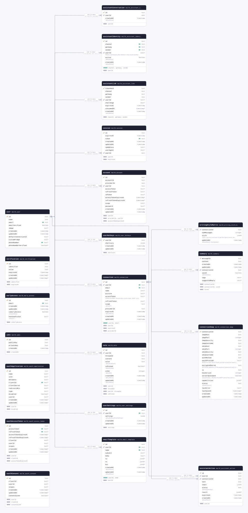

<details>
<summary>The whole schema as SQL</summary>

```sql
CREATE TABLE "mail0_account" (
	"id" text PRIMARY KEY,
	"account_id" text NOT NULL,
	"provider_id" text NOT NULL,
	"user_id" text NOT NULL,
	"access_token" text,
	"refresh_token" text,
	"id_token" text,
	"access_token_expires_at" timestamp,
	"refresh_token_expires_at" timestamp,
	"scope" text,
	"password" text,
	"created_at" timestamp NOT NULL,
	"updated_at" timestamp NOT NULL
);

CREATE TABLE "mail0_assistant_action" (
	"id" text PRIMARY KEY,
	"user_id" text NOT NULL,
	"connection_id" text NOT NULL,
	"tool" text NOT NULL,
	"input" jsonb NOT NULL,
	"status" text DEFAULT 'pending' NOT NULL,
	"result" jsonb,
	"expires_at" timestamp with time zone NOT NULL,
	"created_at" timestamp with time zone DEFAULT now() NOT NULL
);

CREATE TABLE "mail0_assistant_conversation" (
	"id" text PRIMARY KEY,
	"user_id" text NOT NULL,
	"created_at" timestamp with time zone DEFAULT now() NOT NULL
);

CREATE TABLE "mail0_assistant_identity" (
	"id" text PRIMARY KEY,
	"channel" text NOT NULL,
	"gateway" text NOT NULL,
	"sender" text NOT NULL,
	"user_id" text,
	"active" boolean DEFAULT true NOT NULL,
	"created_at" timestamp with time zone DEFAULT now() NOT NULL,
	CONSTRAINT "assistant_identity_sender" UNIQUE("channel","gateway","sender")
);

CREATE TABLE "mail0_assistant_link" (
	"token_hash" text PRIMARY KEY,
	"channel" text NOT NULL,
	"gateway" text NOT NULL,
	"sender" text NOT NULL,
	"user_id" text,
	"challenge" text,
	"expires_at" timestamp with time zone NOT NULL,
	"consumed_at" timestamp with time zone,
	"created_at" timestamp with time zone DEFAULT now() NOT NULL
);

CREATE TABLE "mail0_connection" (
	"id" text PRIMARY KEY,
	"user_id" text NOT NULL,
	"email" text NOT NULL,
	"name" text,
	"picture" text,
	"access_token" text,
	"refresh_token" text,
	"scope" text DEFAULT '' NOT NULL,
	"provider_id" text NOT NULL,
	"expires_at" timestamp DEFAULT now() NOT NULL,
	"created_at" timestamp NOT NULL,
	"updated_at" timestamp NOT NULL,
	CONSTRAINT "mail0_connection_user_id_email_unique" UNIQUE("user_id","email")
);

CREATE TABLE "mail0_connection_imap" (
	"connection_id" text PRIMARY KEY,
	"imap_host" text NOT NULL,
	"imap_port" integer NOT NULL,
	"imap_security" text NOT NULL,
	"imap_username" text NOT NULL,
	"smtp_host" text NOT NULL,
	"smtp_port" integer NOT NULL,
	"smtp_security" text NOT NULL,
	"smtp_username" text NOT NULL,
	"auth_method" text NOT NULL,
	"oauth_provider" text,
	"encrypted_secret" text NOT NULL,
	"iv" text NOT NULL,
	"key_version" integer NOT NULL,
	"server_saves_sent" boolean DEFAULT false NOT NULL,
	"capabilities" jsonb,
	"status" text DEFAULT 'active' NOT NULL,
	"last_error" text,
	"last_sync_at" timestamp,
	"created_at" timestamp NOT NULL,
	"updated_at" timestamp NOT NULL
);

CREATE TABLE "mail0_early_access" (
	"id" text PRIMARY KEY,
	"email" text NOT NULL UNIQUE,
	"created_at" timestamp NOT NULL,
	"updated_at" timestamp NOT NULL,
	"is_early_access" boolean DEFAULT false NOT NULL,
	"has_used_ticket" text DEFAULT ''
);

CREATE TABLE "mail0_email_template" (
	"id" text PRIMARY KEY,
	"user_id" text NOT NULL,
	"name" text NOT NULL,
	"subject" text,
	"body" text,
	"to" jsonb,
	"cc" jsonb,
	"bcc" jsonb,
	"created_at" timestamp DEFAULT now() NOT NULL,
	"updated_at" timestamp DEFAULT now() NOT NULL,
	CONSTRAINT "mail0_email_template_user_id_name_unique" UNIQUE("user_id","name")
);

CREATE TABLE "mail0_jwks" (
	"id" text PRIMARY KEY,
	"public_key" text NOT NULL,
	"private_key" text NOT NULL,
	"created_at" timestamp NOT NULL
);

CREATE TABLE "mail0_note" (
	"id" text PRIMARY KEY,
	"user_id" text NOT NULL,
	"thread_id" text NOT NULL,
	"content" text NOT NULL,
	"color" text DEFAULT 'default' NOT NULL,
	"is_pinned" boolean DEFAULT false,
	"order" integer DEFAULT 0 NOT NULL,
	"created_at" timestamp DEFAULT now() NOT NULL,
	"updated_at" timestamp DEFAULT now() NOT NULL
);

CREATE TABLE "mail0_oauth_access_token" (
	"id" text PRIMARY KEY,
	"access_token" text UNIQUE,
	"refresh_token" text UNIQUE,
	"access_token_expires_at" timestamp,
	"refresh_token_expires_at" timestamp,
	"client_id" text,
	"user_id" text,
	"scopes" text,
	"created_at" timestamp,
	"updated_at" timestamp
);

CREATE TABLE "mail0_oauth_application" (
	"id" text PRIMARY KEY,
	"name" text,
	"icon" text,
	"metadata" text,
	"client_id" text UNIQUE,
	"client_secret" text,
	"redirect_u_r_ls" text,
	"type" text,
	"disabled" boolean,
	"user_id" text,
	"created_at" timestamp,
	"updated_at" timestamp
);

CREATE TABLE "mail0_oauth_consent" (
	"id" text PRIMARY KEY,
	"client_id" text,
	"user_id" text,
	"scopes" text,
	"created_at" timestamp,
	"updated_at" timestamp,
	"consent_given" boolean
);

CREATE TABLE "mail0_session" (
	"id" text PRIMARY KEY,
	"expires_at" timestamp NOT NULL,
	"token" text NOT NULL UNIQUE,
	"created_at" timestamp NOT NULL,
	"updated_at" timestamp NOT NULL,
	"ip_address" text,
	"user_agent" text,
	"user_id" text NOT NULL
);

CREATE TABLE "mail0_summary" (
	"message_id" text PRIMARY KEY,
	"content" text NOT NULL,
	"created_at" timestamp NOT NULL,
	"updated_at" timestamp NOT NULL,
	"connection_id" text NOT NULL,
	"saved" boolean DEFAULT false NOT NULL,
	"tags" text,
	"suggested_reply" text
);

CREATE TABLE "mail0_user" (
	"id" text PRIMARY KEY,
	"name" text NOT NULL,
	"email" text NOT NULL UNIQUE,
	"email_verified" boolean NOT NULL,
	"image" text,
	"created_at" timestamp NOT NULL,
	"updated_at" timestamp NOT NULL,
	"default_connection_id" text,
	"custom_prompt" text,
	"phone_number" text UNIQUE,
	"phone_number_verified" boolean
);

CREATE TABLE "mail0_user_hotkeys" (
	"user_id" text PRIMARY KEY,
	"shortcuts" jsonb NOT NULL,
	"created_at" timestamp NOT NULL,
	"updated_at" timestamp NOT NULL
);

CREATE TABLE "mail0_user_settings" (
	"id" text PRIMARY KEY,
	"user_id" text NOT NULL UNIQUE,
	"settings" jsonb DEFAULT '{"language":"en","timezone":"UTC","dynamicContent":false,"externalImages":true,"customPrompt":"","trustedSenders":[],"isOnboarded":false,"colorTheme":"system","zeroSignature":true,"autoRead":true,"defaultEmailAlias":"","categories":[{"id":"Important","name":"Important","searchValue":"is:important NOT is:sent NOT is:draft","order":0,"icon":"Lightning","isDefault":false},{"id":"All Mail","name":"All Mail","searchValue":"NOT is:draft (is:inbox OR (is:sent AND to:me))","order":1,"icon":"Mail","isDefault":true},{"id":"Personal","name":"Personal","searchValue":"is:personal NOT is:sent NOT is:draft","order":2,"icon":"User","isDefault":false},{"id":"Promotions","name":"Promotions","searchValue":"is:promotions NOT is:sent NOT is:draft","order":3,"icon":"Tag","isDefault":false},{"id":"Updates","name":"Updates","searchValue":"is:updates NOT is:sent NOT is:draft","order":4,"icon":"Bell","isDefault":false},{"id":"Unread","name":"Unread","searchValue":"is:unread NOT is:sent NOT is:draft","order":5,"icon":"ScanEye","isDefault":false}],"imageCompression":"medium","animations":false,"ai":{"disabled":false,"summaries":true,"autoLabels":true,"replyDrafts":false}}' NOT NULL,
	"created_at" timestamp NOT NULL,
	"updated_at" timestamp NOT NULL
);

CREATE TABLE "mail0_verification" (
	"id" text PRIMARY KEY,
	"identifier" text NOT NULL,
	"value" text NOT NULL,
	"expires_at" timestamp NOT NULL,
	"created_at" timestamp,
	"updated_at" timestamp
);

CREATE TABLE "mail0_writing_style_matrix" (
	"connectionId" text PRIMARY KEY,
	"numMessages" integer NOT NULL,
	"style" jsonb NOT NULL,
	"updatedAt" timestamp DEFAULT now() NOT NULL
);

CREATE INDEX "account_user_id_idx" ON "mail0_account" ("user_id");

CREATE INDEX "account_provider_user_id_idx" ON "mail0_account" ("provider_id","user_id");

CREATE INDEX "account_expires_at_idx" ON "mail0_account" ("access_token_expires_at");

CREATE INDEX "assistant_action_user" ON "mail0_assistant_action" ("user_id");

CREATE INDEX "assistant_conversation_user" ON "mail0_assistant_conversation" ("user_id");

CREATE INDEX "assistant_identity_user" ON "mail0_assistant_identity" ("user_id");

CREATE INDEX "assistant_link_sender" ON "mail0_assistant_link" ("channel","gateway","sender");

CREATE INDEX "connection_user_id_idx" ON "mail0_connection" ("user_id");

CREATE INDEX "connection_expires_at_idx" ON "mail0_connection" ("expires_at");

CREATE INDEX "connection_provider_id_idx" ON "mail0_connection" ("provider_id");

CREATE INDEX "early_access_is_early_access_idx" ON "mail0_early_access" ("is_early_access");

CREATE INDEX "idx_mail0_email_template_user_id" ON "mail0_email_template" ("user_id");

CREATE INDEX "jwks_created_at_idx" ON "mail0_jwks" ("created_at");

CREATE INDEX "note_user_id_idx" ON "mail0_note" ("user_id");

CREATE INDEX "note_thread_id_idx" ON "mail0_note" ("thread_id");

CREATE INDEX "note_user_thread_idx" ON "mail0_note" ("user_id","thread_id");

CREATE INDEX "note_is_pinned_idx" ON "mail0_note" ("is_pinned");

CREATE INDEX "oauth_access_token_user_id_idx" ON "mail0_oauth_access_token" ("user_id");

CREATE INDEX "oauth_access_token_client_id_idx" ON "mail0_oauth_access_token" ("client_id");

CREATE INDEX "oauth_access_token_expires_at_idx" ON "mail0_oauth_access_token" ("access_token_expires_at");

CREATE INDEX "oauth_application_user_id_idx" ON "mail0_oauth_application" ("user_id");

CREATE INDEX "oauth_application_disabled_idx" ON "mail0_oauth_application" ("disabled");

CREATE INDEX "oauth_consent_user_id_idx" ON "mail0_oauth_consent" ("user_id");

CREATE INDEX "oauth_consent_client_id_idx" ON "mail0_oauth_consent" ("client_id");

CREATE INDEX "oauth_consent_given_idx" ON "mail0_oauth_consent" ("consent_given");

CREATE INDEX "session_user_id_idx" ON "mail0_session" ("user_id");

CREATE INDEX "session_expires_at_idx" ON "mail0_session" ("expires_at");

CREATE INDEX "summary_connection_id_idx" ON "mail0_summary" ("connection_id");

CREATE INDEX "summary_connection_id_saved_idx" ON "mail0_summary" ("connection_id","saved");

CREATE INDEX "summary_saved_idx" ON "mail0_summary" ("saved");

CREATE INDEX "user_hotkeys_shortcuts_idx" ON "mail0_user_hotkeys" ("shortcuts");

CREATE INDEX "user_settings_settings_idx" ON "mail0_user_settings" ("settings");

CREATE INDEX "verification_identifier_idx" ON "mail0_verification" ("identifier");

CREATE INDEX "verification_expires_at_idx" ON "mail0_verification" ("expires_at");

CREATE INDEX "writing_style_matrix_style_idx" ON "mail0_writing_style_matrix" ("style");

ALTER TABLE "mail0_account" ADD CONSTRAINT "mail0_account_user_id_mail0_user_id_fkey" FOREIGN KEY ("user_id") REFERENCES "mail0_user"("id") ON DELETE CASCADE;

ALTER TABLE "mail0_assistant_action" ADD CONSTRAINT "mail0_assistant_action_user_id_mail0_user_id_fkey" FOREIGN KEY ("user_id") REFERENCES "mail0_user"("id") ON DELETE CASCADE;

ALTER TABLE "mail0_assistant_action" ADD CONSTRAINT "mail0_assistant_action_connection_id_mail0_connection_id_fkey" FOREIGN KEY ("connection_id") REFERENCES "mail0_connection"("id") ON DELETE CASCADE;

ALTER TABLE "mail0_assistant_conversation" ADD CONSTRAINT "mail0_assistant_conversation_user_id_mail0_user_id_fkey" FOREIGN KEY ("user_id") REFERENCES "mail0_user"("id") ON DELETE CASCADE;

ALTER TABLE "mail0_assistant_identity" ADD CONSTRAINT "mail0_assistant_identity_user_id_mail0_user_id_fkey" FOREIGN KEY ("user_id") REFERENCES "mail0_user"("id") ON DELETE SET NULL;

ALTER TABLE "mail0_assistant_link" ADD CONSTRAINT "mail0_assistant_link_user_id_mail0_user_id_fkey" FOREIGN KEY ("user_id") REFERENCES "mail0_user"("id") ON DELETE CASCADE;

ALTER TABLE "mail0_connection" ADD CONSTRAINT "mail0_connection_user_id_mail0_user_id_fkey" FOREIGN KEY ("user_id") REFERENCES "mail0_user"("id") ON DELETE CASCADE;

ALTER TABLE "mail0_connection_imap" ADD CONSTRAINT "mail0_connection_imap_connection_id_mail0_connection_id_fkey" FOREIGN KEY ("connection_id") REFERENCES "mail0_connection"("id") ON DELETE CASCADE;

ALTER TABLE "mail0_email_template" ADD CONSTRAINT "mail0_email_template_user_id_mail0_user_id_fkey" FOREIGN KEY ("user_id") REFERENCES "mail0_user"("id") ON DELETE CASCADE;

ALTER TABLE "mail0_note" ADD CONSTRAINT "mail0_note_user_id_mail0_user_id_fkey" FOREIGN KEY ("user_id") REFERENCES "mail0_user"("id") ON DELETE CASCADE;

ALTER TABLE "mail0_session" ADD CONSTRAINT "mail0_session_user_id_mail0_user_id_fkey" FOREIGN KEY ("user_id") REFERENCES "mail0_user"("id") ON DELETE CASCADE;

ALTER TABLE "mail0_summary" ADD CONSTRAINT "mail0_summary_connection_id_mail0_connection_id_fkey" FOREIGN KEY ("connection_id") REFERENCES "mail0_connection"("id") ON DELETE CASCADE;

ALTER TABLE "mail0_user_hotkeys" ADD CONSTRAINT "mail0_user_hotkeys_user_id_mail0_user_id_fkey" FOREIGN KEY ("user_id") REFERENCES "mail0_user"("id") ON DELETE CASCADE;

ALTER TABLE "mail0_user_settings" ADD CONSTRAINT "mail0_user_settings_user_id_mail0_user_id_fkey" FOREIGN KEY ("user_id") REFERENCES "mail0_user"("id") ON DELETE CASCADE;

ALTER TABLE "mail0_writing_style_matrix" ADD CONSTRAINT "mail0_writing_style_matrix_F7RY1viGZi69_fkey" FOREIGN KEY ("connectionId") REFERENCES "mail0_connection"("id") ON DELETE CASCADE;
```

</details>

## Contents

| Table                                                 | Name in the database           | Description                                                                      |
| ----------------------------------------------------- | ------------------------------ | -------------------------------------------------------------------------------- |
| [user](#table-user)                                   | `mail0_user`                   |                                                                                  |
| [assistantConversation](#table-assistantConversation) | `mail0_assistant_conversation` | Authorization binding only; Keiki owns the transcript and agent runtime.         |
| [assistantIdentity](#table-assistantIdentity)         | `mail0_assistant_identity`     |                                                                                  |
| [assistantLink](#table-assistantLink)                 | `mail0_assistant_link`         |                                                                                  |
| [assistantAction](#table-assistantAction)             | `mail0_assistant_action`       |                                                                                  |
| [session](#table-session)                             | `mail0_session`                |                                                                                  |
| [account](#table-account)                             | `mail0_account`                |                                                                                  |
| [userHotkeys](#table-userHotkeys)                     | `mail0_user_hotkeys`           |                                                                                  |
| [verification](#table-verification)                   | `mail0_verification`           |                                                                                  |
| [earlyAccess](#table-earlyAccess)                     | `mail0_early_access`           |                                                                                  |
| [connection](#table-connection)                       | `mail0_connection`             |                                                                                  |
| [connectionImap](#table-connectionImap)               | `mail0_connection_imap`        | Server settings and encrypted credentials for `providerId = 'imap'` connections. |
| [summary](#table-summary)                             | `mail0_summary`                |                                                                                  |
| [note](#table-note)                                   | `mail0_note`                   | Testing                                                                          |
| [userSettings](#table-userSettings)                   | `mail0_user_settings`          |                                                                                  |
| [writingStyleMatrix](#table-writingStyleMatrix)       | `mail0_writing_style_matrix`   |                                                                                  |
| [jwks](#table-jwks)                                   | `mail0_jwks`                   |                                                                                  |
| [oauthApplication](#table-oauthApplication)           | `mail0_oauth_application`      |                                                                                  |
| [oauthAccessToken](#table-oauthAccessToken)           | `mail0_oauth_access_token`     |                                                                                  |
| [oauthConsent](#table-oauthConsent)                   | `mail0_oauth_consent`          |                                                                                  |
| [emailTemplate](#table-emailTemplate)                 | `mail0_email_template`         |                                                                                  |

## Tables

<a id="table-user"></a>

### user

Table `mail0_user`.

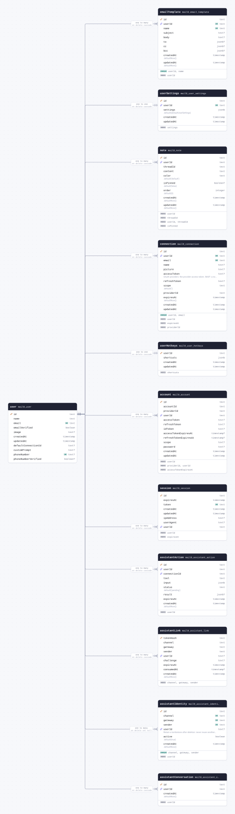

| Column                                          | Type        | Constraints     | Default | Description |
| ----------------------------------------------- | ----------- | --------------- | ------- | ----------- |
| `id`                                            | `text`      | PK NOT NULL     |         |             |
| `name`                                          | `text`      | NOT NULL        |         |             |
| `email`                                         | `text`      | UNIQUE NOT NULL |         |             |
| `emailVerified` (`email_verified`)              | `boolean`   | NOT NULL        |         |             |
| `image`                                         | `text`      | NULL            |         |             |
| `createdAt` (`created_at`)                      | `timestamp` | NOT NULL        |         |             |
| `updatedAt` (`updated_at`)                      | `timestamp` | NOT NULL        |         |             |
| `defaultConnectionId` (`default_connection_id`) | `text`      | NULL            |         |             |
| `customPrompt` (`custom_prompt`)                | `text`      | NULL            |         |             |
| `phoneNumber` (`phone_number`)                  | `text`      | UNIQUE NULL     |         |             |
| `phoneNumberVerified` (`phone_number_verified`) | `boolean`   | NULL            |         |             |

#### Definition

```sql
CREATE TABLE "mail0_user" (
	"id" text PRIMARY KEY,
	"name" text NOT NULL,
	"email" text NOT NULL UNIQUE,
	"email_verified" boolean NOT NULL,
	"image" text,
	"created_at" timestamp NOT NULL,
	"updated_at" timestamp NOT NULL,
	"default_connection_id" text,
	"custom_prompt" text,
	"phone_number" text UNIQUE,
	"phone_number_verified" boolean
);
```

#### Referenced by

- `id` → [assistantConversation.userId](#table-assistantConversation) (one to many, on delete cascade)
- `id` → [assistantIdentity.userId](#table-assistantIdentity) (one to many, on delete set null)
- `id` → [assistantLink.userId](#table-assistantLink) (one to many, on delete cascade)
- `id` → [assistantAction.userId](#table-assistantAction) (one to many, on delete cascade)
- `id` → [session.userId](#table-session) (one to many, on delete cascade)
- `id` → [account.userId](#table-account) (one to many, on delete cascade)
- `id` → [userHotkeys.userId](#table-userHotkeys) (one to one, on delete cascade)
- `id` → [connection.userId](#table-connection) (one to many, on delete cascade)
- `id` → [note.userId](#table-note) (one to many, on delete cascade)
- `id` → [userSettings.userId](#table-userSettings) (one to one, on delete cascade)
- `id` → [emailTemplate.userId](#table-emailTemplate) (one to many, on delete cascade)

<details>
<summary>Queries and their SQL</summary>

**Select**: Every row of user.

```ts
db.select().from(user);
```

```sql
select "id", "name", "email", "email_verified", "image", "created_at", "updated_at", "default_connection_id", "custom_prompt", "phone_number", "phone_number_verified"
from "mail0_user"
```

**Count**: How many rows user has.

```ts
db.select({ count: count() }).from(user);
```

```sql
select count(*)
from "mail0_user"
```

**Find many**: The rows of user, through the relational query API.

```ts
db.query.user.findMany();
```

```sql
select "d0"."id" as "id", "d0"."name" as "name", "d0"."email" as "email", "d0"."email_verified" as "emailVerified", "d0"."image" as "image", "d0"."created_at" as "createdAt", "d0"."updated_at" as "updatedAt", "d0"."default_connection_id" as "defaultConnectionId", "d0"."custom_prompt" as "customPrompt", "d0"."phone_number" as "phoneNumber", "d0"."phone_number_verified" as "phoneNumberVerified"
from "mail0_user" as "d0"
```

**Find by primary key**: One row of user, through the relational query API.

```ts
db.query.user.findFirst({ where: { id: "id" } });
```

```sql
select "d0"."id" as "id", "d0"."name" as "name", "d0"."email" as "email", "d0"."email_verified" as "emailVerified", "d0"."image" as "image", "d0"."created_at" as "createdAt", "d0"."updated_at" as "updatedAt", "d0"."default_connection_id" as "defaultConnectionId", "d0"."custom_prompt" as "customPrompt", "d0"."phone_number" as "phoneNumber", "d0"."phone_number_verified" as "phoneNumberVerified"
from "mail0_user" as "d0"
where "d0"."id" = $1
limit $2
-- params: ["id",1]
```

**Insert**: Adds a row to user, giving the columns that have no default.

```ts
db.insert(user).values({
  id: "id",
  name: "name",
  email: "email",
  emailVerified: true,
  createdAt: new Date("2026-01-01T00:00:00.000Z"),
  updatedAt: new Date("2026-01-01T00:00:00.000Z"),
});
```

```sql
insert into "mail0_user" ("id", "name", "email", "email_verified", "image", "created_at", "updated_at", "default_connection_id", "custom_prompt", "phone_number", "phone_number_verified")
values ($1, $2, $3, $4, default, $5, $6, default, default, default, default)
-- params: ["id","name","email",true,"2026-01-01T00:00:00.000Z","2026-01-01T00:00:00.000Z"]
```

**Update**: Changes a row of user, found by its primary key.

```ts
db.update(user).set({ name: "name" }).where(eq(user.id, "id"));
```

```sql
update "mail0_user"
set "name" = $1
where "mail0_user"."id" = $2
-- params: ["name","id"]
```

**Delete**: Deletes a row of user, found by its primary key.

```ts
db.delete(user).where(eq(user.id, "id"));
```

```sql
delete from "mail0_user"
where "mail0_user"."id" = $1
-- params: ["id"]
```

</details>

<a id="table-assistantConversation"></a>

### assistantConversation

Table `mail0_assistant_conversation`. Authorization binding only; Keiki owns the transcript and agent runtime.

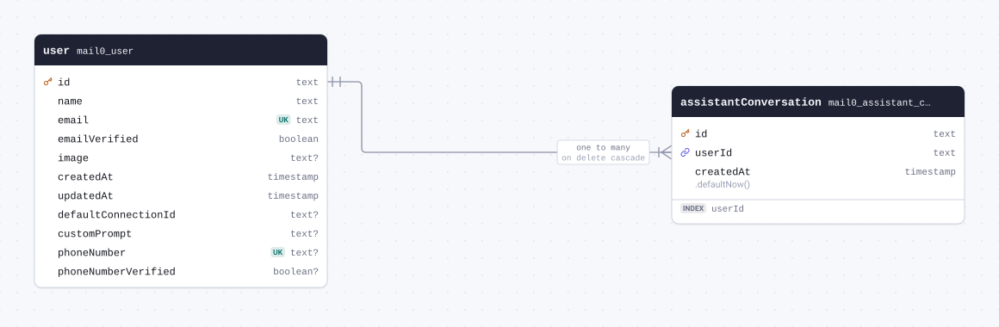

| Column                     | Type        | Constraints                       | Default         | Description |
| -------------------------- | ----------- | --------------------------------- | --------------- | ----------- |
| `id`                       | `text`      | PK NOT NULL                       |                 |             |
| `userId` (`user_id`)       | `text`      | NOT NULL → [user.id](#table-user) |                 |             |
| `createdAt` (`created_at`) | `timestamp` | NOT NULL                          | `.defaultNow()` |             |

#### Definition

```sql
CREATE TABLE "mail0_assistant_conversation" (
	"id" text PRIMARY KEY,
	"user_id" text NOT NULL,
	"created_at" timestamp with time zone DEFAULT now() NOT NULL
);

CREATE INDEX "assistant_conversation_user" ON "mail0_assistant_conversation" ("user_id");

ALTER TABLE "mail0_assistant_conversation" ADD CONSTRAINT "mail0_assistant_conversation_user_id_mail0_user_id_fkey" FOREIGN KEY ("user_id") REFERENCES "mail0_user"("id") ON DELETE CASCADE;
```

#### Indexes

- INDEX `userId`

#### References

- `userId` → [user.id](#table-user) (many to one, on delete cascade)

<details>
<summary>Queries and their SQL</summary>

**Select**: Every row of assistantConversation.

```ts
db.select().from(assistantConversation);
```

```sql
select "id", "user_id", "created_at"
from "mail0_assistant_conversation"
```

**Count**: How many rows assistantConversation has.

```ts
db.select({ count: count() }).from(assistantConversation);
```

```sql
select count(*)
from "mail0_assistant_conversation"
```

**Find many**: The rows of assistantConversation, through the relational query API.

```ts
db.query.assistantConversation.findMany();
```

```sql
select "d0"."id" as "id", "d0"."user_id" as "userId", "d0"."created_at" as "createdAt"
from "mail0_assistant_conversation" as "d0"
```

**Find by primary key**: One row of assistantConversation, through the relational query API.

```ts
db.query.assistantConversation.findFirst({ where: { id: "id" } });
```

```sql
select "d0"."id" as "id", "d0"."user_id" as "userId", "d0"."created_at" as "createdAt"
from "mail0_assistant_conversation" as "d0"
where "d0"."id" = $1
limit $2
-- params: ["id",1]
```

**Insert**: Adds a row to assistantConversation, giving the columns that have no default.

```ts
db.insert(assistantConversation).values({ id: "id", userId: "userId" });
```

```sql
insert into "mail0_assistant_conversation" ("id", "user_id", "created_at")
values ($1, $2, default)
-- params: ["id","userId"]
```

**Update**: Changes a row of assistantConversation, found by its primary key.

```ts
db.update(assistantConversation)
  .set({ userId: "userId" })
  .where(eq(assistantConversation.id, "id"));
```

```sql
update "mail0_assistant_conversation"
set "user_id" = $1
where "mail0_assistant_conversation"."id" = $2
-- params: ["userId","id"]
```

**Delete**: Deletes a row of assistantConversation, found by its primary key.

```ts
db.delete(assistantConversation).where(eq(assistantConversation.id, "id"));
```

```sql
delete from "mail0_assistant_conversation"
where "mail0_assistant_conversation"."id" = $1
-- params: ["id"]
```

</details>

<a id="table-assistantIdentity"></a>

### assistantIdentity

Table `mail0_assistant_identity`.

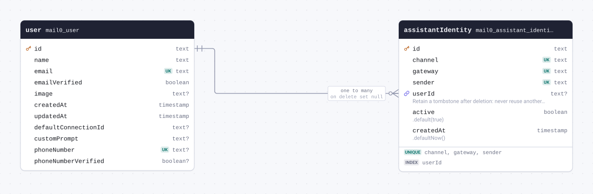

| Column                     | Type        | Constraints                   | Default          | Description                                                                 |
| -------------------------- | ----------- | ----------------------------- | ---------------- | --------------------------------------------------------------------------- |
| `id`                       | `text`      | PK NOT NULL                   |                  |                                                                             |
| `channel`                  | `text`      | NOT NULL                      |                  |                                                                             |
| `gateway`                  | `text`      | NOT NULL                      |                  |                                                                             |
| `sender`                   | `text`      | NOT NULL                      |                  |                                                                             |
| `userId` (`user_id`)       | `text`      | NULL → [user.id](#table-user) |                  | Retain a tombstone after deletion: never reuse another person's transcript. |
| `active`                   | `boolean`   | NOT NULL                      | `.default(true)` |                                                                             |
| `createdAt` (`created_at`) | `timestamp` | NOT NULL                      | `.defaultNow()`  |                                                                             |

#### Definition

```sql
CREATE TABLE "mail0_assistant_identity" (
	"id" text PRIMARY KEY,
	"channel" text NOT NULL,
	"gateway" text NOT NULL,
	"sender" text NOT NULL,
	"user_id" text,
	"active" boolean DEFAULT true NOT NULL,
	"created_at" timestamp with time zone DEFAULT now() NOT NULL,
	CONSTRAINT "assistant_identity_sender" UNIQUE("channel","gateway","sender")
);

CREATE INDEX "assistant_identity_user" ON "mail0_assistant_identity" ("user_id");

ALTER TABLE "mail0_assistant_identity" ADD CONSTRAINT "mail0_assistant_identity_user_id_mail0_user_id_fkey" FOREIGN KEY ("user_id") REFERENCES "mail0_user"("id") ON DELETE SET NULL;
```

#### Indexes

- UNIQUE `channel`, `gateway`, `sender`
- INDEX `userId`

#### References

- `userId` → [user.id](#table-user) (many to one, on delete set null)

<details>
<summary>Queries and their SQL</summary>

**Select**: Every row of assistantIdentity.

```ts
db.select().from(assistantIdentity);
```

```sql
select "id", "channel", "gateway", "sender", "user_id", "active", "created_at"
from "mail0_assistant_identity"
```

**Count**: How many rows assistantIdentity has.

```ts
db.select({ count: count() }).from(assistantIdentity);
```

```sql
select count(*)
from "mail0_assistant_identity"
```

**Find many**: The rows of assistantIdentity, through the relational query API.

```ts
db.query.assistantIdentity.findMany();
```

```sql
select "d0"."id" as "id", "d0"."channel" as "channel", "d0"."gateway" as "gateway", "d0"."sender" as "sender", "d0"."user_id" as "userId", "d0"."active" as "active", "d0"."created_at" as "createdAt"
from "mail0_assistant_identity" as "d0"
```

**Find by primary key**: One row of assistantIdentity, through the relational query API.

```ts
db.query.assistantIdentity.findFirst({ where: { id: "id" } });
```

```sql
select "d0"."id" as "id", "d0"."channel" as "channel", "d0"."gateway" as "gateway", "d0"."sender" as "sender", "d0"."user_id" as "userId", "d0"."active" as "active", "d0"."created_at" as "createdAt"
from "mail0_assistant_identity" as "d0"
where "d0"."id" = $1
limit $2
-- params: ["id",1]
```

**Insert**: Adds a row to assistantIdentity, giving the columns that have no default.

```ts
db.insert(assistantIdentity).values({
  id: "id",
  channel: "channel",
  gateway: "gateway",
  sender: "sender",
});
```

```sql
insert into "mail0_assistant_identity" ("id", "channel", "gateway", "sender", "user_id", "active", "created_at")
values ($1, $2, $3, $4, default, default, default)
-- params: ["id","channel","gateway","sender"]
```

**Update**: Changes a row of assistantIdentity, found by its primary key.

```ts
db.update(assistantIdentity).set({ channel: "channel" }).where(eq(assistantIdentity.id, "id"));
```

```sql
update "mail0_assistant_identity"
set "channel" = $1
where "mail0_assistant_identity"."id" = $2
-- params: ["channel","id"]
```

**Delete**: Deletes a row of assistantIdentity, found by its primary key.

```ts
db.delete(assistantIdentity).where(eq(assistantIdentity.id, "id"));
```

```sql
delete from "mail0_assistant_identity"
where "mail0_assistant_identity"."id" = $1
-- params: ["id"]
```

</details>

<a id="table-assistantLink"></a>

### assistantLink

Table `mail0_assistant_link`.

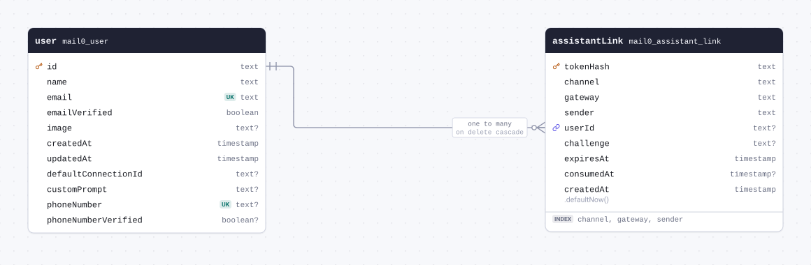

| Column                       | Type        | Constraints                   | Default         | Description |
| ---------------------------- | ----------- | ----------------------------- | --------------- | ----------- |
| `tokenHash` (`token_hash`)   | `text`      | PK NOT NULL                   |                 |             |
| `channel`                    | `text`      | NOT NULL                      |                 |             |
| `gateway`                    | `text`      | NOT NULL                      |                 |             |
| `sender`                     | `text`      | NOT NULL                      |                 |             |
| `userId` (`user_id`)         | `text`      | NULL → [user.id](#table-user) |                 |             |
| `challenge`                  | `text`      | NULL                          |                 |             |
| `expiresAt` (`expires_at`)   | `timestamp` | NOT NULL                      |                 |             |
| `consumedAt` (`consumed_at`) | `timestamp` | NULL                          |                 |             |
| `createdAt` (`created_at`)   | `timestamp` | NOT NULL                      | `.defaultNow()` |             |

#### Definition

```sql
CREATE TABLE "mail0_assistant_link" (
	"token_hash" text PRIMARY KEY,
	"channel" text NOT NULL,
	"gateway" text NOT NULL,
	"sender" text NOT NULL,
	"user_id" text,
	"challenge" text,
	"expires_at" timestamp with time zone NOT NULL,
	"consumed_at" timestamp with time zone,
	"created_at" timestamp with time zone DEFAULT now() NOT NULL
);

CREATE INDEX "assistant_link_sender" ON "mail0_assistant_link" ("channel","gateway","sender");

ALTER TABLE "mail0_assistant_link" ADD CONSTRAINT "mail0_assistant_link_user_id_mail0_user_id_fkey" FOREIGN KEY ("user_id") REFERENCES "mail0_user"("id") ON DELETE CASCADE;
```

#### Indexes

- INDEX `channel`, `gateway`, `sender`

#### References

- `userId` → [user.id](#table-user) (many to one, on delete cascade)

<details>
<summary>Queries and their SQL</summary>

**Select**: Every row of assistantLink.

```ts
db.select().from(assistantLink);
```

```sql
select "token_hash", "channel", "gateway", "sender", "user_id", "challenge", "expires_at", "consumed_at", "created_at"
from "mail0_assistant_link"
```

**Count**: How many rows assistantLink has.

```ts
db.select({ count: count() }).from(assistantLink);
```

```sql
select count(*)
from "mail0_assistant_link"
```

**Find many**: The rows of assistantLink, through the relational query API.

```ts
db.query.assistantLink.findMany();
```

```sql
select "d0"."token_hash" as "tokenHash", "d0"."channel" as "channel", "d0"."gateway" as "gateway", "d0"."sender" as "sender", "d0"."user_id" as "userId", "d0"."challenge" as "challenge", "d0"."expires_at" as "expiresAt", "d0"."consumed_at" as "consumedAt", "d0"."created_at" as "createdAt"
from "mail0_assistant_link" as "d0"
```

**Find by primary key**: One row of assistantLink, through the relational query API.

```ts
db.query.assistantLink.findFirst({ where: { tokenHash: "tokenHash" } });
```

```sql
select "d0"."token_hash" as "tokenHash", "d0"."channel" as "channel", "d0"."gateway" as "gateway", "d0"."sender" as "sender", "d0"."user_id" as "userId", "d0"."challenge" as "challenge", "d0"."expires_at" as "expiresAt", "d0"."consumed_at" as "consumedAt", "d0"."created_at" as "createdAt"
from "mail0_assistant_link" as "d0"
where "d0"."token_hash" = $1
limit $2
-- params: ["tokenHash",1]
```

**Insert**: Adds a row to assistantLink, giving the columns that have no default.

```ts
db.insert(assistantLink).values({
  tokenHash: "tokenHash",
  channel: "channel",
  gateway: "gateway",
  sender: "sender",
  expiresAt: new Date("2026-01-01T00:00:00.000Z"),
});
```

```sql
insert into "mail0_assistant_link" ("token_hash", "channel", "gateway", "sender", "user_id", "challenge", "expires_at", "consumed_at", "created_at")
values ($1, $2, $3, $4, default, default, $5, default, default)
-- params: ["tokenHash","channel","gateway","sender","2026-01-01T00:00:00.000Z"]
```

**Update**: Changes a row of assistantLink, found by its primary key.

```ts
db.update(assistantLink)
  .set({ channel: "channel" })
  .where(eq(assistantLink.tokenHash, "tokenHash"));
```

```sql
update "mail0_assistant_link"
set "channel" = $1
where "mail0_assistant_link"."token_hash" = $2
-- params: ["channel","tokenHash"]
```

**Delete**: Deletes a row of assistantLink, found by its primary key.

```ts
db.delete(assistantLink).where(eq(assistantLink.tokenHash, "tokenHash"));
```

```sql
delete from "mail0_assistant_link"
where "mail0_assistant_link"."token_hash" = $1
-- params: ["tokenHash"]
```

</details>

<a id="table-assistantAction"></a>

### assistantAction

Table `mail0_assistant_action`.

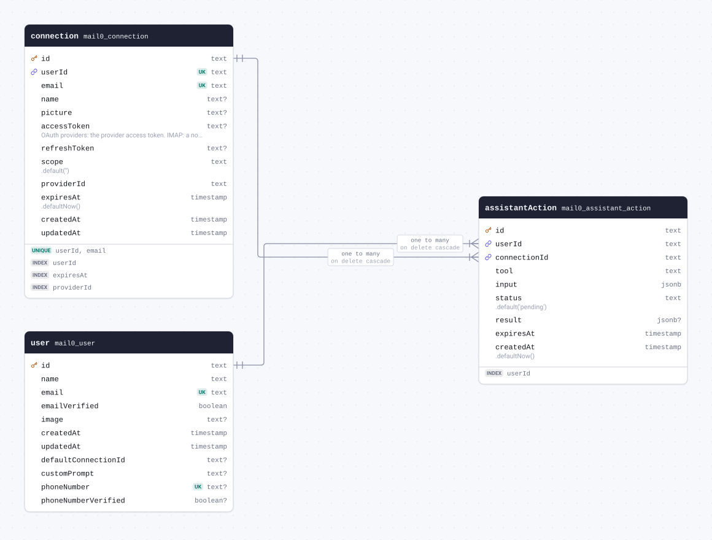

| Column                           | Type        | Constraints                                   | Default               | Description |
| -------------------------------- | ----------- | --------------------------------------------- | --------------------- | ----------- |
| `id`                             | `text`      | PK NOT NULL                                   |                       |             |
| `userId` (`user_id`)             | `text`      | NOT NULL → [user.id](#table-user)             |                       |             |
| `connectionId` (`connection_id`) | `text`      | NOT NULL → [connection.id](#table-connection) |                       |             |
| `tool`                           | `text`      | NOT NULL                                      |                       |             |
| `input`                          | `jsonb`     | NOT NULL                                      |                       |             |
| `status`                         | `text`      | NOT NULL                                      | `.default('pending')` |             |
| `result`                         | `jsonb`     | NULL                                          |                       |             |
| `expiresAt` (`expires_at`)       | `timestamp` | NOT NULL                                      |                       |             |
| `createdAt` (`created_at`)       | `timestamp` | NOT NULL                                      | `.defaultNow()`       |             |

#### Definition

```sql
CREATE TABLE "mail0_assistant_action" (
	"id" text PRIMARY KEY,
	"user_id" text NOT NULL,
	"connection_id" text NOT NULL,
	"tool" text NOT NULL,
	"input" jsonb NOT NULL,
	"status" text DEFAULT 'pending' NOT NULL,
	"result" jsonb,
	"expires_at" timestamp with time zone NOT NULL,
	"created_at" timestamp with time zone DEFAULT now() NOT NULL
);

CREATE INDEX "assistant_action_user" ON "mail0_assistant_action" ("user_id");

ALTER TABLE "mail0_assistant_action" ADD CONSTRAINT "mail0_assistant_action_user_id_mail0_user_id_fkey" FOREIGN KEY ("user_id") REFERENCES "mail0_user"("id") ON DELETE CASCADE;

ALTER TABLE "mail0_assistant_action" ADD CONSTRAINT "mail0_assistant_action_connection_id_mail0_connection_id_fkey" FOREIGN KEY ("connection_id") REFERENCES "mail0_connection"("id") ON DELETE CASCADE;
```

#### Indexes

- INDEX `userId`

#### References

- `userId` → [user.id](#table-user) (many to one, on delete cascade)
- `connectionId` → [connection.id](#table-connection) (many to one, on delete cascade)

<details>
<summary>Queries and their SQL</summary>

**Select**: Every row of assistantAction.

```ts
db.select().from(assistantAction);
```

```sql
select "id", "user_id", "connection_id", "tool", "input", "status", "result", "expires_at", "created_at"
from "mail0_assistant_action"
```

**Count**: How many rows assistantAction has.

```ts
db.select({ count: count() }).from(assistantAction);
```

```sql
select count(*)
from "mail0_assistant_action"
```

**Find many**: The rows of assistantAction, through the relational query API.

```ts
db.query.assistantAction.findMany();
```

```sql
select "d0"."id" as "id", "d0"."user_id" as "userId", "d0"."connection_id" as "connectionId", "d0"."tool" as "tool", "d0"."input" as "input", "d0"."status" as "status", "d0"."result" as "result", "d0"."expires_at" as "expiresAt", "d0"."created_at" as "createdAt"
from "mail0_assistant_action" as "d0"
```

**Find by primary key**: One row of assistantAction, through the relational query API.

```ts
db.query.assistantAction.findFirst({ where: { id: "id" } });
```

```sql
select "d0"."id" as "id", "d0"."user_id" as "userId", "d0"."connection_id" as "connectionId", "d0"."tool" as "tool", "d0"."input" as "input", "d0"."status" as "status", "d0"."result" as "result", "d0"."expires_at" as "expiresAt", "d0"."created_at" as "createdAt"
from "mail0_assistant_action" as "d0"
where "d0"."id" = $1
limit $2
-- params: ["id",1]
```

**Insert**: Adds a row to assistantAction, giving the columns that have no default.

```ts
db.insert(assistantAction).values({
  id: "id",
  userId: "userId",
  connectionId: "connectionId",
  tool: "tool",
  input: {},
  expiresAt: new Date("2026-01-01T00:00:00.000Z"),
});
```

```sql
insert into "mail0_assistant_action" ("id", "user_id", "connection_id", "tool", "input", "status", "result", "expires_at", "created_at")
values ($1, $2, $3, $4, $5, default, default, $6, default)
-- params: ["id","userId","connectionId","tool",{},"2026-01-01T00:00:00.000Z"]
```

**Update**: Changes a row of assistantAction, found by its primary key.

```ts
db.update(assistantAction).set({ userId: "userId" }).where(eq(assistantAction.id, "id"));
```

```sql
update "mail0_assistant_action"
set "user_id" = $1
where "mail0_assistant_action"."id" = $2
-- params: ["userId","id"]
```

**Delete**: Deletes a row of assistantAction, found by its primary key.

```ts
db.delete(assistantAction).where(eq(assistantAction.id, "id"));
```

```sql
delete from "mail0_assistant_action"
where "mail0_assistant_action"."id" = $1
-- params: ["id"]
```

</details>

<a id="table-session"></a>

### session

Table `mail0_session`.

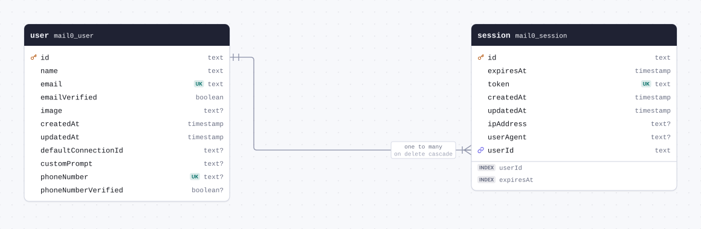

| Column                     | Type        | Constraints                       | Default | Description |
| -------------------------- | ----------- | --------------------------------- | ------- | ----------- |
| `id`                       | `text`      | PK NOT NULL                       |         |             |
| `expiresAt` (`expires_at`) | `timestamp` | NOT NULL                          |         |             |
| `token`                    | `text`      | UNIQUE NOT NULL                   |         |             |
| `createdAt` (`created_at`) | `timestamp` | NOT NULL                          |         |             |
| `updatedAt` (`updated_at`) | `timestamp` | NOT NULL                          |         |             |
| `ipAddress` (`ip_address`) | `text`      | NULL                              |         |             |
| `userAgent` (`user_agent`) | `text`      | NULL                              |         |             |
| `userId` (`user_id`)       | `text`      | NOT NULL → [user.id](#table-user) |         |             |

#### Definition

```sql
CREATE TABLE "mail0_session" (
	"id" text PRIMARY KEY,
	"expires_at" timestamp NOT NULL,
	"token" text NOT NULL UNIQUE,
	"created_at" timestamp NOT NULL,
	"updated_at" timestamp NOT NULL,
	"ip_address" text,
	"user_agent" text,
	"user_id" text NOT NULL
);

CREATE INDEX "session_user_id_idx" ON "mail0_session" ("user_id");

CREATE INDEX "session_expires_at_idx" ON "mail0_session" ("expires_at");

ALTER TABLE "mail0_session" ADD CONSTRAINT "mail0_session_user_id_mail0_user_id_fkey" FOREIGN KEY ("user_id") REFERENCES "mail0_user"("id") ON DELETE CASCADE;
```

#### Indexes

- INDEX `userId`
- INDEX `expiresAt`

#### References

- `userId` → [user.id](#table-user) (many to one, on delete cascade)

<details>
<summary>Queries and their SQL</summary>

**Select**: Every row of session.

```ts
db.select().from(session);
```

```sql
select "id", "expires_at", "token", "created_at", "updated_at", "ip_address", "user_agent", "user_id"
from "mail0_session"
```

**Count**: How many rows session has.

```ts
db.select({ count: count() }).from(session);
```

```sql
select count(*)
from "mail0_session"
```

**Find many**: The rows of session, through the relational query API.

```ts
db.query.session.findMany();
```

```sql
select "d0"."id" as "id", "d0"."expires_at" as "expiresAt", "d0"."token" as "token", "d0"."created_at" as "createdAt", "d0"."updated_at" as "updatedAt", "d0"."ip_address" as "ipAddress", "d0"."user_agent" as "userAgent", "d0"."user_id" as "userId"
from "mail0_session" as "d0"
```

**Find by primary key**: One row of session, through the relational query API.

```ts
db.query.session.findFirst({ where: { id: "id" } });
```

```sql
select "d0"."id" as "id", "d0"."expires_at" as "expiresAt", "d0"."token" as "token", "d0"."created_at" as "createdAt", "d0"."updated_at" as "updatedAt", "d0"."ip_address" as "ipAddress", "d0"."user_agent" as "userAgent", "d0"."user_id" as "userId"
from "mail0_session" as "d0"
where "d0"."id" = $1
limit $2
-- params: ["id",1]
```

**Insert**: Adds a row to session, giving the columns that have no default.

```ts
db.insert(session).values({
  id: "id",
  expiresAt: new Date("2026-01-01T00:00:00.000Z"),
  token: "token",
  createdAt: new Date("2026-01-01T00:00:00.000Z"),
  updatedAt: new Date("2026-01-01T00:00:00.000Z"),
  userId: "userId",
});
```

```sql
insert into "mail0_session" ("id", "expires_at", "token", "created_at", "updated_at", "ip_address", "user_agent", "user_id")
values ($1, $2, $3, $4, $5, default, default, $6)
-- params: ["id","2026-01-01T00:00:00.000Z","token","2026-01-01T00:00:00.000Z","2026-01-01T00:00:00.000Z","userId"]
```

**Update**: Changes a row of session, found by its primary key.

```ts
db.update(session)
  .set({ expiresAt: new Date("2026-01-01T00:00:00.000Z") })
  .where(eq(session.id, "id"));
```

```sql
update "mail0_session"
set "expires_at" = $1
where "mail0_session"."id" = $2
-- params: ["2026-01-01T00:00:00.000Z","id"]
```

**Delete**: Deletes a row of session, found by its primary key.

```ts
db.delete(session).where(eq(session.id, "id"));
```

```sql
delete from "mail0_session"
where "mail0_session"."id" = $1
-- params: ["id"]
```

</details>

<a id="table-account"></a>

### account

Table `mail0_account`.

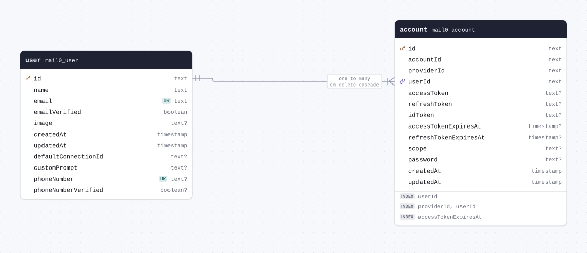

| Column                                               | Type        | Constraints                       | Default | Description |
| ---------------------------------------------------- | ----------- | --------------------------------- | ------- | ----------- |
| `id`                                                 | `text`      | PK NOT NULL                       |         |             |
| `accountId` (`account_id`)                           | `text`      | NOT NULL                          |         |             |
| `providerId` (`provider_id`)                         | `text`      | NOT NULL                          |         |             |
| `userId` (`user_id`)                                 | `text`      | NOT NULL → [user.id](#table-user) |         |             |
| `accessToken` (`access_token`)                       | `text`      | NULL                              |         |             |
| `refreshToken` (`refresh_token`)                     | `text`      | NULL                              |         |             |
| `idToken` (`id_token`)                               | `text`      | NULL                              |         |             |
| `accessTokenExpiresAt` (`access_token_expires_at`)   | `timestamp` | NULL                              |         |             |
| `refreshTokenExpiresAt` (`refresh_token_expires_at`) | `timestamp` | NULL                              |         |             |
| `scope`                                              | `text`      | NULL                              |         |             |
| `password`                                           | `text`      | NULL                              |         |             |
| `createdAt` (`created_at`)                           | `timestamp` | NOT NULL                          |         |             |
| `updatedAt` (`updated_at`)                           | `timestamp` | NOT NULL                          |         |             |

#### Definition

```sql
CREATE TABLE "mail0_account" (
	"id" text PRIMARY KEY,
	"account_id" text NOT NULL,
	"provider_id" text NOT NULL,
	"user_id" text NOT NULL,
	"access_token" text,
	"refresh_token" text,
	"id_token" text,
	"access_token_expires_at" timestamp,
	"refresh_token_expires_at" timestamp,
	"scope" text,
	"password" text,
	"created_at" timestamp NOT NULL,
	"updated_at" timestamp NOT NULL
);

CREATE INDEX "account_user_id_idx" ON "mail0_account" ("user_id");

CREATE INDEX "account_provider_user_id_idx" ON "mail0_account" ("provider_id","user_id");

CREATE INDEX "account_expires_at_idx" ON "mail0_account" ("access_token_expires_at");

ALTER TABLE "mail0_account" ADD CONSTRAINT "mail0_account_user_id_mail0_user_id_fkey" FOREIGN KEY ("user_id") REFERENCES "mail0_user"("id") ON DELETE CASCADE;
```

#### Indexes

- INDEX `userId`
- INDEX `providerId`, `userId`
- INDEX `accessTokenExpiresAt`

#### References

- `userId` → [user.id](#table-user) (many to one, on delete cascade)

<details>
<summary>Queries and their SQL</summary>

**Select**: Every row of account.

```ts
db.select().from(account);
```

```sql
select "id", "account_id", "provider_id", "user_id", "access_token", "refresh_token", "id_token", "access_token_expires_at", "refresh_token_expires_at", "scope", "password", "created_at", "updated_at"
from "mail0_account"
```

**Count**: How many rows account has.

```ts
db.select({ count: count() }).from(account);
```

```sql
select count(*)
from "mail0_account"
```

**Find many**: The rows of account, through the relational query API.

```ts
db.query.account.findMany();
```

```sql
select "d0"."id" as "id", "d0"."account_id" as "accountId", "d0"."provider_id" as "providerId", "d0"."user_id" as "userId", "d0"."access_token" as "accessToken", "d0"."refresh_token" as "refreshToken", "d0"."id_token" as "idToken", "d0"."access_token_expires_at" as "accessTokenExpiresAt", "d0"."refresh_token_expires_at" as "refreshTokenExpiresAt", "d0"."scope" as "scope", "d0"."password" as "password", "d0"."created_at" as "createdAt", "d0"."updated_at" as "updatedAt"
from "mail0_account" as "d0"
```

**Find by primary key**: One row of account, through the relational query API.

```ts
db.query.account.findFirst({ where: { id: "id" } });
```

```sql
select "d0"."id" as "id", "d0"."account_id" as "accountId", "d0"."provider_id" as "providerId", "d0"."user_id" as "userId", "d0"."access_token" as "accessToken", "d0"."refresh_token" as "refreshToken", "d0"."id_token" as "idToken", "d0"."access_token_expires_at" as "accessTokenExpiresAt", "d0"."refresh_token_expires_at" as "refreshTokenExpiresAt", "d0"."scope" as "scope", "d0"."password" as "password", "d0"."created_at" as "createdAt", "d0"."updated_at" as "updatedAt"
from "mail0_account" as "d0"
where "d0"."id" = $1
limit $2
-- params: ["id",1]
```

**Insert**: Adds a row to account, giving the columns that have no default.

```ts
db.insert(account).values({
  id: "id",
  accountId: "accountId",
  providerId: "providerId",
  userId: "userId",
  createdAt: new Date("2026-01-01T00:00:00.000Z"),
  updatedAt: new Date("2026-01-01T00:00:00.000Z"),
});
```

```sql
insert into "mail0_account" ("id", "account_id", "provider_id", "user_id", "access_token", "refresh_token", "id_token", "access_token_expires_at", "refresh_token_expires_at", "scope", "password", "created_at", "updated_at")
values ($1, $2, $3, $4, default, default, default, default, default, default, default, $5, $6)
-- params: ["id","accountId","providerId","userId","2026-01-01T00:00:00.000Z","2026-01-01T00:00:00.000Z"]
```

**Update**: Changes a row of account, found by its primary key.

```ts
db.update(account).set({ accountId: "accountId" }).where(eq(account.id, "id"));
```

```sql
update "mail0_account"
set "account_id" = $1
where "mail0_account"."id" = $2
-- params: ["accountId","id"]
```

**Delete**: Deletes a row of account, found by its primary key.

```ts
db.delete(account).where(eq(account.id, "id"));
```

```sql
delete from "mail0_account"
where "mail0_account"."id" = $1
-- params: ["id"]
```

</details>

<a id="table-userHotkeys"></a>

### userHotkeys

Table `mail0_user_hotkeys`.

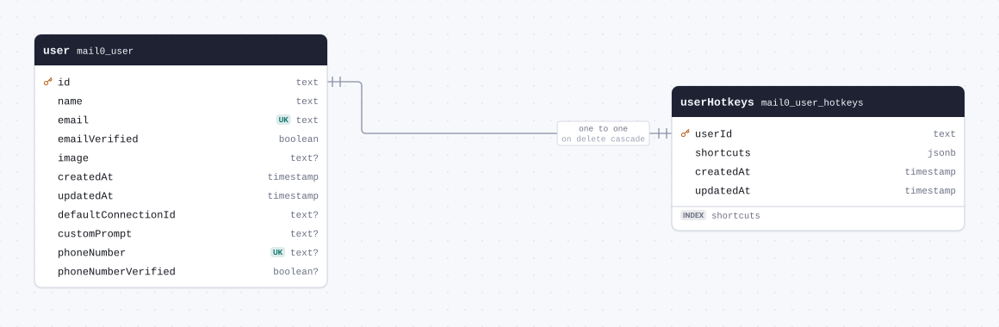

| Column                     | Type        | Constraints                          | Default | Description |
| -------------------------- | ----------- | ------------------------------------ | ------- | ----------- |
| `userId` (`user_id`)       | `text`      | PK NOT NULL → [user.id](#table-user) |         |             |
| `shortcuts`                | `jsonb`     | NOT NULL                             |         |             |
| `createdAt` (`created_at`) | `timestamp` | NOT NULL                             |         |             |
| `updatedAt` (`updated_at`) | `timestamp` | NOT NULL                             |         |             |

#### Definition

```sql
CREATE TABLE "mail0_user_hotkeys" (
	"user_id" text PRIMARY KEY,
	"shortcuts" jsonb NOT NULL,
	"created_at" timestamp NOT NULL,
	"updated_at" timestamp NOT NULL
);

CREATE INDEX "user_hotkeys_shortcuts_idx" ON "mail0_user_hotkeys" ("shortcuts");

ALTER TABLE "mail0_user_hotkeys" ADD CONSTRAINT "mail0_user_hotkeys_user_id_mail0_user_id_fkey" FOREIGN KEY ("user_id") REFERENCES "mail0_user"("id") ON DELETE CASCADE;
```

#### Indexes

- INDEX `shortcuts`

#### References

- `userId` → [user.id](#table-user) (one to one, on delete cascade)

<details>
<summary>Queries and their SQL</summary>

**Select**: Every row of userHotkeys.

```ts
db.select().from(userHotkeys);
```

```sql
select "user_id", "shortcuts", "created_at", "updated_at"
from "mail0_user_hotkeys"
```

**Count**: How many rows userHotkeys has.

```ts
db.select({ count: count() }).from(userHotkeys);
```

```sql
select count(*)
from "mail0_user_hotkeys"
```

**Find many**: The rows of userHotkeys, through the relational query API.

```ts
db.query.userHotkeys.findMany();
```

```sql
select "d0"."user_id" as "userId", "d0"."shortcuts" as "shortcuts", "d0"."created_at" as "createdAt", "d0"."updated_at" as "updatedAt"
from "mail0_user_hotkeys" as "d0"
```

**Find by primary key**: One row of userHotkeys, through the relational query API.

```ts
db.query.userHotkeys.findFirst({ where: { userId: "userId" } });
```

```sql
select "d0"."user_id" as "userId", "d0"."shortcuts" as "shortcuts", "d0"."created_at" as "createdAt", "d0"."updated_at" as "updatedAt"
from "mail0_user_hotkeys" as "d0"
where "d0"."user_id" = $1
limit $2
-- params: ["userId",1]
```

**Insert**: Adds a row to userHotkeys, giving the columns that have no default.

```ts
db.insert(userHotkeys).values({
  userId: "userId",
  shortcuts: {},
  createdAt: new Date("2026-01-01T00:00:00.000Z"),
  updatedAt: new Date("2026-01-01T00:00:00.000Z"),
});
```

```sql
insert into "mail0_user_hotkeys" ("user_id", "shortcuts", "created_at", "updated_at")
values ($1, $2, $3, $4)
-- params: ["userId",{},"2026-01-01T00:00:00.000Z","2026-01-01T00:00:00.000Z"]
```

**Update**: Changes a row of userHotkeys, found by its primary key.

```ts
db.update(userHotkeys).set({ shortcuts: {} }).where(eq(userHotkeys.userId, "userId"));
```

```sql
update "mail0_user_hotkeys"
set "shortcuts" = $1
where "mail0_user_hotkeys"."user_id" = $2
-- params: [{},"userId"]
```

**Delete**: Deletes a row of userHotkeys, found by its primary key.

```ts
db.delete(userHotkeys).where(eq(userHotkeys.userId, "userId"));
```

```sql
delete from "mail0_user_hotkeys"
where "mail0_user_hotkeys"."user_id" = $1
-- params: ["userId"]
```

</details>

<a id="table-verification"></a>

### verification

Table `mail0_verification`.

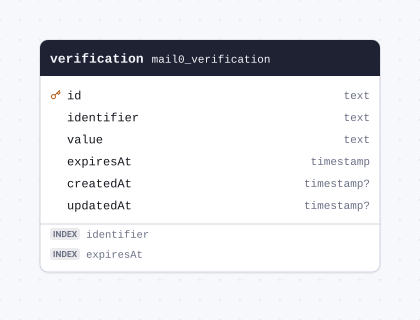

| Column                     | Type        | Constraints | Default | Description |
| -------------------------- | ----------- | ----------- | ------- | ----------- |
| `id`                       | `text`      | PK NOT NULL |         |             |
| `identifier`               | `text`      | NOT NULL    |         |             |
| `value`                    | `text`      | NOT NULL    |         |             |
| `expiresAt` (`expires_at`) | `timestamp` | NOT NULL    |         |             |
| `createdAt` (`created_at`) | `timestamp` | NULL        |         |             |
| `updatedAt` (`updated_at`) | `timestamp` | NULL        |         |             |

#### Definition

```sql
CREATE TABLE "mail0_verification" (
	"id" text PRIMARY KEY,
	"identifier" text NOT NULL,
	"value" text NOT NULL,
	"expires_at" timestamp NOT NULL,
	"created_at" timestamp,
	"updated_at" timestamp
);

CREATE INDEX "verification_identifier_idx" ON "mail0_verification" ("identifier");

CREATE INDEX "verification_expires_at_idx" ON "mail0_verification" ("expires_at");
```

#### Indexes

- INDEX `identifier`
- INDEX `expiresAt`

<details>
<summary>Queries and their SQL</summary>

**Select**: Every row of verification.

```ts
db.select().from(verification);
```

```sql
select "id", "identifier", "value", "expires_at", "created_at", "updated_at"
from "mail0_verification"
```

**Count**: How many rows verification has.

```ts
db.select({ count: count() }).from(verification);
```

```sql
select count(*)
from "mail0_verification"
```

**Find many**: The rows of verification, through the relational query API.

```ts
db.query.verification.findMany();
```

```sql
select "d0"."id" as "id", "d0"."identifier" as "identifier", "d0"."value" as "value", "d0"."expires_at" as "expiresAt", "d0"."created_at" as "createdAt", "d0"."updated_at" as "updatedAt"
from "mail0_verification" as "d0"
```

**Find by primary key**: One row of verification, through the relational query API.

```ts
db.query.verification.findFirst({ where: { id: "id" } });
```

```sql
select "d0"."id" as "id", "d0"."identifier" as "identifier", "d0"."value" as "value", "d0"."expires_at" as "expiresAt", "d0"."created_at" as "createdAt", "d0"."updated_at" as "updatedAt"
from "mail0_verification" as "d0"
where "d0"."id" = $1
limit $2
-- params: ["id",1]
```

**Insert**: Adds a row to verification, giving the columns that have no default.

```ts
db.insert(verification).values({
  id: "id",
  identifier: "identifier",
  value: "value",
  expiresAt: new Date("2026-01-01T00:00:00.000Z"),
});
```

```sql
insert into "mail0_verification" ("id", "identifier", "value", "expires_at", "created_at", "updated_at")
values ($1, $2, $3, $4, default, default)
-- params: ["id","identifier","value","2026-01-01T00:00:00.000Z"]
```

**Update**: Changes a row of verification, found by its primary key.

```ts
db.update(verification).set({ identifier: "identifier" }).where(eq(verification.id, "id"));
```

```sql
update "mail0_verification"
set "identifier" = $1
where "mail0_verification"."id" = $2
-- params: ["identifier","id"]
```

**Delete**: Deletes a row of verification, found by its primary key.

```ts
db.delete(verification).where(eq(verification.id, "id"));
```

```sql
delete from "mail0_verification"
where "mail0_verification"."id" = $1
-- params: ["id"]
```

</details>

<a id="table-earlyAccess"></a>

### earlyAccess

Table `mail0_early_access`.

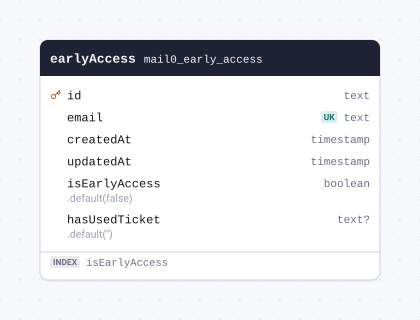

| Column                              | Type        | Constraints     | Default           | Description |
| ----------------------------------- | ----------- | --------------- | ----------------- | ----------- |
| `id`                                | `text`      | PK NOT NULL     |                   |             |
| `email`                             | `text`      | UNIQUE NOT NULL |                   |             |
| `createdAt` (`created_at`)          | `timestamp` | NOT NULL        |                   |             |
| `updatedAt` (`updated_at`)          | `timestamp` | NOT NULL        |                   |             |
| `isEarlyAccess` (`is_early_access`) | `boolean`   | NOT NULL        | `.default(false)` |             |
| `hasUsedTicket` (`has_used_ticket`) | `text`      | NULL            | `.default('')`    |             |

#### Definition

```sql
CREATE TABLE "mail0_early_access" (
	"id" text PRIMARY KEY,
	"email" text NOT NULL UNIQUE,
	"created_at" timestamp NOT NULL,
	"updated_at" timestamp NOT NULL,
	"is_early_access" boolean DEFAULT false NOT NULL,
	"has_used_ticket" text DEFAULT ''
);

CREATE INDEX "early_access_is_early_access_idx" ON "mail0_early_access" ("is_early_access");
```

#### Indexes

- INDEX `isEarlyAccess`

<details>
<summary>Queries and their SQL</summary>

**Select**: Every row of earlyAccess.

```ts
db.select().from(earlyAccess);
```

```sql
select "id", "email", "created_at", "updated_at", "is_early_access", "has_used_ticket"
from "mail0_early_access"
```

**Count**: How many rows earlyAccess has.

```ts
db.select({ count: count() }).from(earlyAccess);
```

```sql
select count(*)
from "mail0_early_access"
```

**Find many**: The rows of earlyAccess, through the relational query API.

```ts
db.query.earlyAccess.findMany();
```

```sql
select "d0"."id" as "id", "d0"."email" as "email", "d0"."created_at" as "createdAt", "d0"."updated_at" as "updatedAt", "d0"."is_early_access" as "isEarlyAccess", "d0"."has_used_ticket" as "hasUsedTicket"
from "mail0_early_access" as "d0"
```

**Find by primary key**: One row of earlyAccess, through the relational query API.

```ts
db.query.earlyAccess.findFirst({ where: { id: "id" } });
```

```sql
select "d0"."id" as "id", "d0"."email" as "email", "d0"."created_at" as "createdAt", "d0"."updated_at" as "updatedAt", "d0"."is_early_access" as "isEarlyAccess", "d0"."has_used_ticket" as "hasUsedTicket"
from "mail0_early_access" as "d0"
where "d0"."id" = $1
limit $2
-- params: ["id",1]
```

**Insert**: Adds a row to earlyAccess, giving the columns that have no default.

```ts
db.insert(earlyAccess).values({
  id: "id",
  email: "email",
  createdAt: new Date("2026-01-01T00:00:00.000Z"),
  updatedAt: new Date("2026-01-01T00:00:00.000Z"),
});
```

```sql
insert into "mail0_early_access" ("id", "email", "created_at", "updated_at", "is_early_access", "has_used_ticket")
values ($1, $2, $3, $4, default, default)
-- params: ["id","email","2026-01-01T00:00:00.000Z","2026-01-01T00:00:00.000Z"]
```

**Update**: Changes a row of earlyAccess, found by its primary key.

```ts
db.update(earlyAccess).set({ email: "email" }).where(eq(earlyAccess.id, "id"));
```

```sql
update "mail0_early_access"
set "email" = $1
where "mail0_early_access"."id" = $2
-- params: ["email","id"]
```

**Delete**: Deletes a row of earlyAccess, found by its primary key.

```ts
db.delete(earlyAccess).where(eq(earlyAccess.id, "id"));
```

```sql
delete from "mail0_early_access"
where "mail0_early_access"."id" = $1
-- params: ["id"]
```

</details>

<a id="table-connection"></a>

### connection

Table `mail0_connection`.

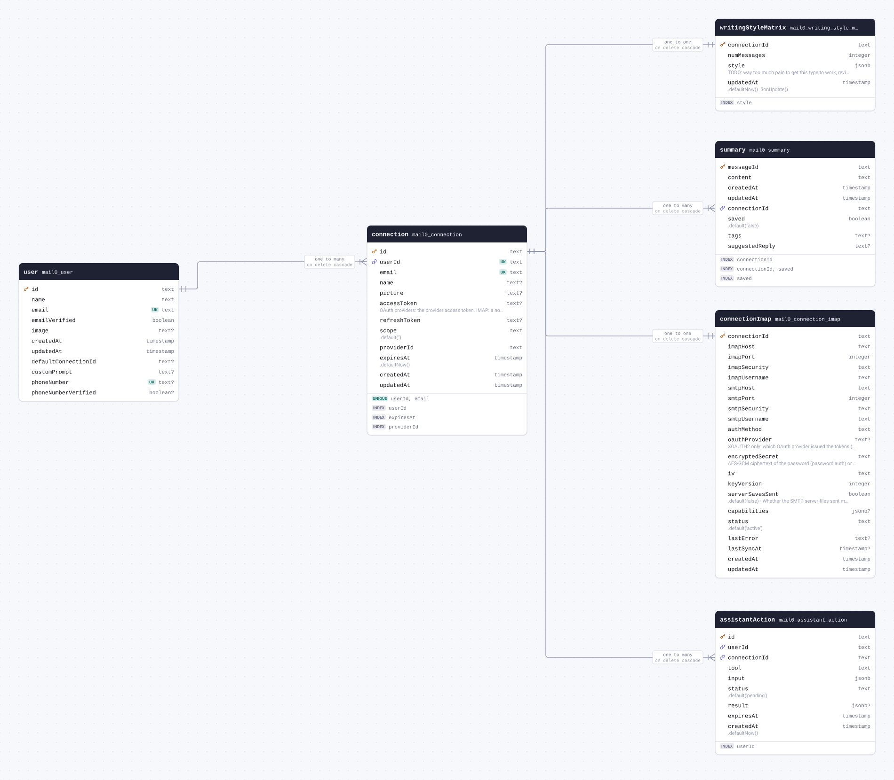

| Column                           | Type        | Constraints                       | Default         | Description                                                                                                                                                          |
| -------------------------------- | ----------- | --------------------------------- | --------------- | -------------------------------------------------------------------------------------------------------------------------------------------------------------------- |
| `id`                             | `text`      | PK NOT NULL                       |                 |                                                                                                                                                                      |
| `userId` (`user_id`)             | `text`      | NOT NULL → [user.id](#table-user) |                 |                                                                                                                                                                      |
| `email`                          | `text`      | NOT NULL                          |                 |                                                                                                                                                                      |
| `name`                           | `text`      | NULL                              |                 |                                                                                                                                                                      |
| `picture`                        | `text`      | NULL                              |                 |                                                                                                                                                                      |
| `accessToken` (`access_token`)   | `text`      | NULL                              |                 | OAuth providers: the provider access token. IMAP: a non-secret marker (password auth) or the XOAUTH2 access token. `null` means the connection must be reauthorized. |
| `refreshToken` (`refresh_token`) | `text`      | NULL                              |                 |                                                                                                                                                                      |
| `scope`                          | `text`      | NOT NULL                          | `.default('')`  |                                                                                                                                                                      |
| `providerId` (`provider_id`)     | `text`      | NOT NULL                          |                 |                                                                                                                                                                      |
| `expiresAt` (`expires_at`)       | `timestamp` | NOT NULL                          | `.defaultNow()` |                                                                                                                                                                      |
| `createdAt` (`created_at`)       | `timestamp` | NOT NULL                          |                 |                                                                                                                                                                      |
| `updatedAt` (`updated_at`)       | `timestamp` | NOT NULL                          |                 |                                                                                                                                                                      |

#### Definition

```sql
CREATE TABLE "mail0_connection" (
	"id" text PRIMARY KEY,
	"user_id" text NOT NULL,
	"email" text NOT NULL,
	"name" text,
	"picture" text,
	"access_token" text,
	"refresh_token" text,
	"scope" text DEFAULT '' NOT NULL,
	"provider_id" text NOT NULL,
	"expires_at" timestamp DEFAULT now() NOT NULL,
	"created_at" timestamp NOT NULL,
	"updated_at" timestamp NOT NULL,
	CONSTRAINT "mail0_connection_user_id_email_unique" UNIQUE("user_id","email")
);

CREATE INDEX "connection_user_id_idx" ON "mail0_connection" ("user_id");

CREATE INDEX "connection_expires_at_idx" ON "mail0_connection" ("expires_at");

CREATE INDEX "connection_provider_id_idx" ON "mail0_connection" ("provider_id");

ALTER TABLE "mail0_connection" ADD CONSTRAINT "mail0_connection_user_id_mail0_user_id_fkey" FOREIGN KEY ("user_id") REFERENCES "mail0_user"("id") ON DELETE CASCADE;
```

#### Indexes

- UNIQUE `userId`, `email`
- INDEX `userId`
- INDEX `expiresAt`
- INDEX `providerId`

#### References

- `userId` → [user.id](#table-user) (many to one, on delete cascade)

#### Referenced by

- `id` → [assistantAction.connectionId](#table-assistantAction) (one to many, on delete cascade)
- `id` → [connectionImap.connectionId](#table-connectionImap) (one to one, on delete cascade)
- `id` → [summary.connectionId](#table-summary) (one to many, on delete cascade)
- `id` → [writingStyleMatrix.connectionId](#table-writingStyleMatrix) (one to many, on delete cascade)

<details>
<summary>Queries and their SQL</summary>

**Select**: Every row of connection.

```ts
db.select().from(connection);
```

```sql
select "id", "user_id", "email", "name", "picture", "access_token", "refresh_token", "scope", "provider_id", "expires_at", "created_at", "updated_at"
from "mail0_connection"
```

**Count**: How many rows connection has.

```ts
db.select({ count: count() }).from(connection);
```

```sql
select count(*)
from "mail0_connection"
```

**Find many**: The rows of connection, through the relational query API.

```ts
db.query.connection.findMany();
```

```sql
select "d0"."id" as "id", "d0"."user_id" as "userId", "d0"."email" as "email", "d0"."name" as "name", "d0"."picture" as "picture", "d0"."access_token" as "accessToken", "d0"."refresh_token" as "refreshToken", "d0"."scope" as "scope", "d0"."provider_id" as "providerId", "d0"."expires_at" as "expiresAt", "d0"."created_at" as "createdAt", "d0"."updated_at" as "updatedAt"
from "mail0_connection" as "d0"
```

**Find by primary key**: One row of connection, through the relational query API.

```ts
db.query.connection.findFirst({ where: { id: "id" } });
```

```sql
select "d0"."id" as "id", "d0"."user_id" as "userId", "d0"."email" as "email", "d0"."name" as "name", "d0"."picture" as "picture", "d0"."access_token" as "accessToken", "d0"."refresh_token" as "refreshToken", "d0"."scope" as "scope", "d0"."provider_id" as "providerId", "d0"."expires_at" as "expiresAt", "d0"."created_at" as "createdAt", "d0"."updated_at" as "updatedAt"
from "mail0_connection" as "d0"
where "d0"."id" = $1
limit $2
-- params: ["id",1]
```

**Insert**: Adds a row to connection, giving the columns that have no default.

```ts
db.insert(connection).values({
  id: "id",
  userId: "userId",
  email: "email",
  providerId: "providerId",
  createdAt: new Date("2026-01-01T00:00:00.000Z"),
  updatedAt: new Date("2026-01-01T00:00:00.000Z"),
});
```

```sql
insert into "mail0_connection" ("id", "user_id", "email", "name", "picture", "access_token", "refresh_token", "scope", "provider_id", "expires_at", "created_at", "updated_at")
values ($1, $2, $3, default, default, default, default, default, $4, default, $5, $6)
-- params: ["id","userId","email","providerId","2026-01-01T00:00:00.000Z","2026-01-01T00:00:00.000Z"]
```

**Update**: Changes a row of connection, found by its primary key.

```ts
db.update(connection).set({ userId: "userId" }).where(eq(connection.id, "id"));
```

```sql
update "mail0_connection"
set "user_id" = $1
where "mail0_connection"."id" = $2
-- params: ["userId","id"]
```

**Delete**: Deletes a row of connection, found by its primary key.

```ts
db.delete(connection).where(eq(connection.id, "id"));
```

```sql
delete from "mail0_connection"
where "mail0_connection"."id" = $1
-- params: ["id"]
```

</details>

<a id="table-connectionImap"></a>

### connectionImap

Table `mail0_connection_imap`. Server settings and encrypted credentials for `providerId = 'imap'` connections.

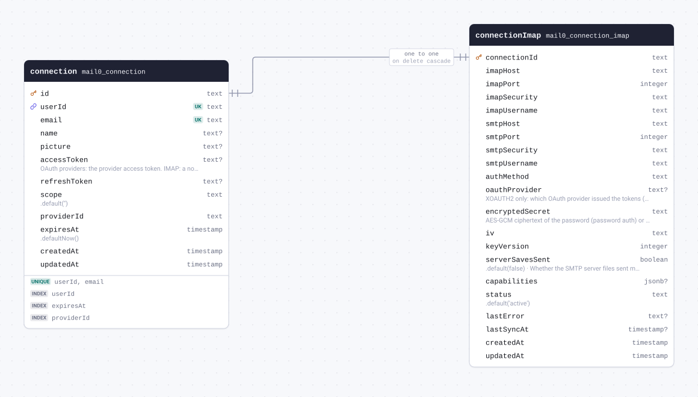

| Column                                  | Type        | Constraints                                      | Default              | Description                                                                    |
| --------------------------------------- | ----------- | ------------------------------------------------ | -------------------- | ------------------------------------------------------------------------------ |
| `connectionId` (`connection_id`)        | `text`      | PK NOT NULL → [connection.id](#table-connection) |                      |                                                                                |
| `imapHost` (`imap_host`)                | `text`      | NOT NULL                                         |                      |                                                                                |
| `imapPort` (`imap_port`)                | `integer`   | NOT NULL                                         |                      |                                                                                |
| `imapSecurity` (`imap_security`)        | `text`      | NOT NULL                                         |                      |                                                                                |
| `imapUsername` (`imap_username`)        | `text`      | NOT NULL                                         |                      |                                                                                |
| `smtpHost` (`smtp_host`)                | `text`      | NOT NULL                                         |                      |                                                                                |
| `smtpPort` (`smtp_port`)                | `integer`   | NOT NULL                                         |                      |                                                                                |
| `smtpSecurity` (`smtp_security`)        | `text`      | NOT NULL                                         |                      |                                                                                |
| `smtpUsername` (`smtp_username`)        | `text`      | NOT NULL                                         |                      |                                                                                |
| `authMethod` (`auth_method`)            | `text`      | NOT NULL                                         |                      |                                                                                |
| `oauthProvider` (`oauth_provider`)      | `text`      | NULL                                             |                      | XOAUTH2 only: which OAuth provider issued the tokens (used for refresh).       |
| `encryptedSecret` (`encrypted_secret`)  | `text`      | NOT NULL                                         |                      | AES-GCM ciphertext of the password (password auth) or refresh token (XOAUTH2). |
| `iv`                                    | `text`      | NOT NULL                                         |                      |                                                                                |
| `keyVersion` (`key_version`)            | `integer`   | NOT NULL                                         |                      |                                                                                |
| `serverSavesSent` (`server_saves_sent`) | `boolean`   | NOT NULL                                         | `.default(false)`    | Whether the SMTP server files sent mail into the Sent folder by itself.        |
| `capabilities`                          | `jsonb`     | NULL                                             |                      |                                                                                |
| `status`                                | `text`      | NOT NULL                                         | `.default('active')` |                                                                                |
| `lastError` (`last_error`)              | `text`      | NULL                                             |                      |                                                                                |
| `lastSyncAt` (`last_sync_at`)           | `timestamp` | NULL                                             |                      |                                                                                |
| `createdAt` (`created_at`)              | `timestamp` | NOT NULL                                         |                      |                                                                                |
| `updatedAt` (`updated_at`)              | `timestamp` | NOT NULL                                         |                      |                                                                                |

#### Definition

```sql
CREATE TABLE "mail0_connection_imap" (
	"connection_id" text PRIMARY KEY,
	"imap_host" text NOT NULL,
	"imap_port" integer NOT NULL,
	"imap_security" text NOT NULL,
	"imap_username" text NOT NULL,
	"smtp_host" text NOT NULL,
	"smtp_port" integer NOT NULL,
	"smtp_security" text NOT NULL,
	"smtp_username" text NOT NULL,
	"auth_method" text NOT NULL,
	"oauth_provider" text,
	"encrypted_secret" text NOT NULL,
	"iv" text NOT NULL,
	"key_version" integer NOT NULL,
	"server_saves_sent" boolean DEFAULT false NOT NULL,
	"capabilities" jsonb,
	"status" text DEFAULT 'active' NOT NULL,
	"last_error" text,
	"last_sync_at" timestamp,
	"created_at" timestamp NOT NULL,
	"updated_at" timestamp NOT NULL
);

ALTER TABLE "mail0_connection_imap" ADD CONSTRAINT "mail0_connection_imap_connection_id_mail0_connection_id_fkey" FOREIGN KEY ("connection_id") REFERENCES "mail0_connection"("id") ON DELETE CASCADE;
```

#### References

- `connectionId` → [connection.id](#table-connection) (one to one, on delete cascade)

<details>
<summary>Queries and their SQL</summary>

**Select**: Every row of connectionImap.

```ts
db.select().from(connectionImap);
```

```sql
select "connection_id", "imap_host", "imap_port", "imap_security", "imap_username", "smtp_host", "smtp_port", "smtp_security", "smtp_username", "auth_method", "oauth_provider", "encrypted_secret", "iv", "key_version", "server_saves_sent", "capabilities", "status", "last_error", "last_sync_at", "created_at", "updated_at"
from "mail0_connection_imap"
```

**Count**: How many rows connectionImap has.

```ts
db.select({ count: count() }).from(connectionImap);
```

```sql
select count(*)
from "mail0_connection_imap"
```

**Find many**: The rows of connectionImap, through the relational query API.

```ts
db.query.connectionImap.findMany();
```

```sql
select "d0"."connection_id" as "connectionId", "d0"."imap_host" as "imapHost", "d0"."imap_port" as "imapPort", "d0"."imap_security" as "imapSecurity", "d0"."imap_username" as "imapUsername", "d0"."smtp_host" as "smtpHost", "d0"."smtp_port" as "smtpPort", "d0"."smtp_security" as "smtpSecurity", "d0"."smtp_username" as "smtpUsername", "d0"."auth_method" as "authMethod", "d0"."oauth_provider" as "oauthProvider", "d0"."encrypted_secret" as "encryptedSecret", "d0"."iv" as "iv", "d0"."key_version" as "keyVersion", "d0"."server_saves_sent" as "serverSavesSent", "d0"."capabilities" as "capabilities", "d0"."status" as "status", "d0"."last_error" as "lastError", "d0"."last_sync_at" as "lastSyncAt", "d0"."created_at" as "createdAt", "d0"."updated_at" as "updatedAt"
from "mail0_connection_imap" as "d0"
```

**Find by primary key**: One row of connectionImap, through the relational query API.

```ts
db.query.connectionImap.findFirst({ where: { connectionId: "connectionId" } });
```

```sql
select "d0"."connection_id" as "connectionId", "d0"."imap_host" as "imapHost", "d0"."imap_port" as "imapPort", "d0"."imap_security" as "imapSecurity", "d0"."imap_username" as "imapUsername", "d0"."smtp_host" as "smtpHost", "d0"."smtp_port" as "smtpPort", "d0"."smtp_security" as "smtpSecurity", "d0"."smtp_username" as "smtpUsername", "d0"."auth_method" as "authMethod", "d0"."oauth_provider" as "oauthProvider", "d0"."encrypted_secret" as "encryptedSecret", "d0"."iv" as "iv", "d0"."key_version" as "keyVersion", "d0"."server_saves_sent" as "serverSavesSent", "d0"."capabilities" as "capabilities", "d0"."status" as "status", "d0"."last_error" as "lastError", "d0"."last_sync_at" as "lastSyncAt", "d0"."created_at" as "createdAt", "d0"."updated_at" as "updatedAt"
from "mail0_connection_imap" as "d0"
where "d0"."connection_id" = $1
limit $2
-- params: ["connectionId",1]
```

**Insert**: Adds a row to connectionImap, giving the columns that have no default.

```ts
db.insert(connectionImap).values({
  connectionId: "connectionId",
  imapHost: "imapHost",
  imapPort: 1,
  imapSecurity: "imapSecurity",
  imapUsername: "imapUsername",
  smtpHost: "smtpHost",
  smtpPort: 1,
  smtpSecurity: "smtpSecurity",
  smtpUsername: "smtpUsername",
  authMethod: "authMethod",
  encryptedSecret: "encryptedSecret",
  iv: "iv",
  keyVersion: 1,
  createdAt: new Date("2026-01-01T00:00:00.000Z"),
  updatedAt: new Date("2026-01-01T00:00:00.000Z"),
});
```

```sql
insert into "mail0_connection_imap" ("connection_id", "imap_host", "imap_port", "imap_security", "imap_username", "smtp_host", "smtp_port", "smtp_security", "smtp_username", "auth_method", "oauth_provider", "encrypted_secret", "iv", "key_version", "server_saves_sent", "capabilities", "status", "last_error", "last_sync_at", "created_at", "updated_at")
values ($1, $2, $3, $4, $5, $6, $7, $8, $9, $10, default, $11, $12, $13, default, default, default, default, default, $14, $15)
-- params: ["connectionId","imapHost",1,"imapSecurity","imapUsername","smtpHost",1,"smtpSecurity","smtpUsername","authMethod","encryptedSecret","iv",1,"2026-01-01T00:00:00.000Z","2026-01-01T00:00:00.000Z"]
```

**Update**: Changes a row of connectionImap, found by its primary key.

```ts
db.update(connectionImap)
  .set({ imapHost: "imapHost" })
  .where(eq(connectionImap.connectionId, "connectionId"));
```

```sql
update "mail0_connection_imap"
set "imap_host" = $1
where "mail0_connection_imap"."connection_id" = $2
-- params: ["imapHost","connectionId"]
```

**Delete**: Deletes a row of connectionImap, found by its primary key.

```ts
db.delete(connectionImap).where(eq(connectionImap.connectionId, "connectionId"));
```

```sql
delete from "mail0_connection_imap"
where "mail0_connection_imap"."connection_id" = $1
-- params: ["connectionId"]
```

</details>

<a id="table-summary"></a>

### summary

Table `mail0_summary`.

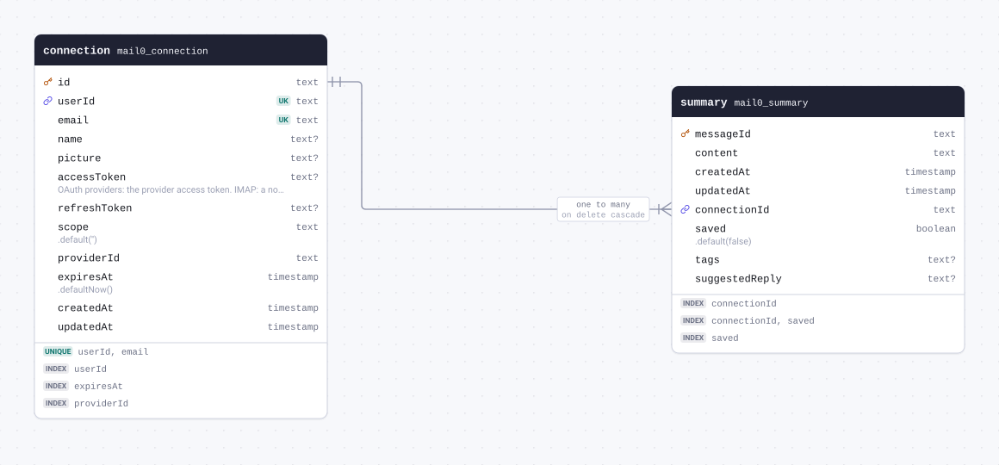

| Column                               | Type        | Constraints                                   | Default           | Description |
| ------------------------------------ | ----------- | --------------------------------------------- | ----------------- | ----------- |
| `messageId` (`message_id`)           | `text`      | PK NOT NULL                                   |                   |             |
| `content`                            | `text`      | NOT NULL                                      |                   |             |
| `createdAt` (`created_at`)           | `timestamp` | NOT NULL                                      |                   |             |
| `updatedAt` (`updated_at`)           | `timestamp` | NOT NULL                                      |                   |             |
| `connectionId` (`connection_id`)     | `text`      | NOT NULL → [connection.id](#table-connection) |                   |             |
| `saved`                              | `boolean`   | NOT NULL                                      | `.default(false)` |             |
| `tags`                               | `text`      | NULL                                          |                   |             |
| `suggestedReply` (`suggested_reply`) | `text`      | NULL                                          |                   |             |

#### Definition

```sql
CREATE TABLE "mail0_summary" (
	"message_id" text PRIMARY KEY,
	"content" text NOT NULL,
	"created_at" timestamp NOT NULL,
	"updated_at" timestamp NOT NULL,
	"connection_id" text NOT NULL,
	"saved" boolean DEFAULT false NOT NULL,
	"tags" text,
	"suggested_reply" text
);

CREATE INDEX "summary_connection_id_idx" ON "mail0_summary" ("connection_id");

CREATE INDEX "summary_connection_id_saved_idx" ON "mail0_summary" ("connection_id","saved");

CREATE INDEX "summary_saved_idx" ON "mail0_summary" ("saved");

ALTER TABLE "mail0_summary" ADD CONSTRAINT "mail0_summary_connection_id_mail0_connection_id_fkey" FOREIGN KEY ("connection_id") REFERENCES "mail0_connection"("id") ON DELETE CASCADE;
```

#### Indexes

- INDEX `connectionId`
- INDEX `connectionId`, `saved`
- INDEX `saved`

#### References

- `connectionId` → [connection.id](#table-connection) (many to one, on delete cascade)

<details>
<summary>Queries and their SQL</summary>

**Select**: Every row of summary.

```ts
db.select().from(summary);
```

```sql
select "message_id", "content", "created_at", "updated_at", "connection_id", "saved", "tags", "suggested_reply"
from "mail0_summary"
```

**Count**: How many rows summary has.

```ts
db.select({ count: count() }).from(summary);
```

```sql
select count(*)
from "mail0_summary"
```

**Find many**: The rows of summary, through the relational query API.

```ts
db.query.summary.findMany();
```

```sql
select "d0"."message_id" as "messageId", "d0"."content" as "content", "d0"."created_at" as "createdAt", "d0"."updated_at" as "updatedAt", "d0"."connection_id" as "connectionId", "d0"."saved" as "saved", "d0"."tags" as "tags", "d0"."suggested_reply" as "suggestedReply"
from "mail0_summary" as "d0"
```

**Find by primary key**: One row of summary, through the relational query API.

```ts
db.query.summary.findFirst({ where: { messageId: "messageId" } });
```

```sql
select "d0"."message_id" as "messageId", "d0"."content" as "content", "d0"."created_at" as "createdAt", "d0"."updated_at" as "updatedAt", "d0"."connection_id" as "connectionId", "d0"."saved" as "saved", "d0"."tags" as "tags", "d0"."suggested_reply" as "suggestedReply"
from "mail0_summary" as "d0"
where "d0"."message_id" = $1
limit $2
-- params: ["messageId",1]
```

**Insert**: Adds a row to summary, giving the columns that have no default.

```ts
db.insert(summary).values({
  messageId: "messageId",
  content: "content",
  createdAt: new Date("2026-01-01T00:00:00.000Z"),
  updatedAt: new Date("2026-01-01T00:00:00.000Z"),
  connectionId: "connectionId",
});
```

```sql
insert into "mail0_summary" ("message_id", "content", "created_at", "updated_at", "connection_id", "saved", "tags", "suggested_reply")
values ($1, $2, $3, $4, $5, default, default, default)
-- params: ["messageId","content","2026-01-01T00:00:00.000Z","2026-01-01T00:00:00.000Z","connectionId"]
```

**Update**: Changes a row of summary, found by its primary key.

```ts
db.update(summary).set({ content: "content" }).where(eq(summary.messageId, "messageId"));
```

```sql
update "mail0_summary"
set "content" = $1
where "mail0_summary"."message_id" = $2
-- params: ["content","messageId"]
```

**Delete**: Deletes a row of summary, found by its primary key.

```ts
db.delete(summary).where(eq(summary.messageId, "messageId"));
```

```sql
delete from "mail0_summary"
where "mail0_summary"."message_id" = $1
-- params: ["messageId"]
```

</details>

<a id="table-note"></a>

### note

Table `mail0_note`. Testing

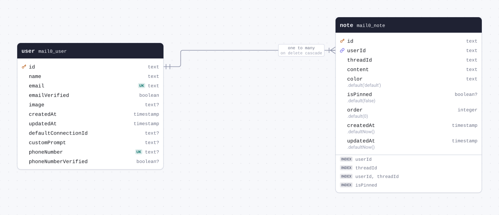

| Column                     | Type        | Constraints                       | Default               | Description |
| -------------------------- | ----------- | --------------------------------- | --------------------- | ----------- |
| `id`                       | `text`      | PK NOT NULL                       |                       |             |
| `userId` (`user_id`)       | `text`      | NOT NULL → [user.id](#table-user) |                       |             |
| `threadId` (`thread_id`)   | `text`      | NOT NULL                          |                       |             |
| `content`                  | `text`      | NOT NULL                          |                       |             |
| `color`                    | `text`      | NOT NULL                          | `.default('default')` |             |
| `isPinned` (`is_pinned`)   | `boolean`   | NULL                              | `.default(false)`     |             |
| `order`                    | `integer`   | NOT NULL                          | `.default(0)`         |             |
| `createdAt` (`created_at`) | `timestamp` | NOT NULL                          | `.defaultNow()`       |             |
| `updatedAt` (`updated_at`) | `timestamp` | NOT NULL                          | `.defaultNow()`       |             |

#### Definition

```sql
CREATE TABLE "mail0_note" (
	"id" text PRIMARY KEY,
	"user_id" text NOT NULL,
	"thread_id" text NOT NULL,
	"content" text NOT NULL,
	"color" text DEFAULT 'default' NOT NULL,
	"is_pinned" boolean DEFAULT false,
	"order" integer DEFAULT 0 NOT NULL,
	"created_at" timestamp DEFAULT now() NOT NULL,
	"updated_at" timestamp DEFAULT now() NOT NULL
);

CREATE INDEX "note_user_id_idx" ON "mail0_note" ("user_id");

CREATE INDEX "note_thread_id_idx" ON "mail0_note" ("thread_id");

CREATE INDEX "note_user_thread_idx" ON "mail0_note" ("user_id","thread_id");

CREATE INDEX "note_is_pinned_idx" ON "mail0_note" ("is_pinned");

ALTER TABLE "mail0_note" ADD CONSTRAINT "mail0_note_user_id_mail0_user_id_fkey" FOREIGN KEY ("user_id") REFERENCES "mail0_user"("id") ON DELETE CASCADE;
```

#### Indexes

- INDEX `userId`
- INDEX `threadId`
- INDEX `userId`, `threadId`
- INDEX `isPinned`

#### References

- `userId` → [user.id](#table-user) (many to one, on delete cascade)

<details>
<summary>Queries and their SQL</summary>

**Select**: Every row of note.

```ts
db.select().from(note);
```

```sql
select "id", "user_id", "thread_id", "content", "color", "is_pinned", "order", "created_at", "updated_at"
from "mail0_note"
```

**Count**: How many rows note has.

```ts
db.select({ count: count() }).from(note);
```

```sql
select count(*)
from "mail0_note"
```

**Find many**: The rows of note, through the relational query API.

```ts
db.query.note.findMany();
```

```sql
select "d0"."id" as "id", "d0"."user_id" as "userId", "d0"."thread_id" as "threadId", "d0"."content" as "content", "d0"."color" as "color", "d0"."is_pinned" as "isPinned", "d0"."order" as "order", "d0"."created_at" as "createdAt", "d0"."updated_at" as "updatedAt"
from "mail0_note" as "d0"
```

**Find by primary key**: One row of note, through the relational query API.

```ts
db.query.note.findFirst({ where: { id: "id" } });
```

```sql
select "d0"."id" as "id", "d0"."user_id" as "userId", "d0"."thread_id" as "threadId", "d0"."content" as "content", "d0"."color" as "color", "d0"."is_pinned" as "isPinned", "d0"."order" as "order", "d0"."created_at" as "createdAt", "d0"."updated_at" as "updatedAt"
from "mail0_note" as "d0"
where "d0"."id" = $1
limit $2
-- params: ["id",1]
```

**Insert**: Adds a row to note, giving the columns that have no default.

```ts
db.insert(note).values({ id: "id", userId: "userId", threadId: "threadId", content: "content" });
```

```sql
insert into "mail0_note" ("id", "user_id", "thread_id", "content", "color", "is_pinned", "order", "created_at", "updated_at")
values ($1, $2, $3, $4, default, default, default, default, default)
-- params: ["id","userId","threadId","content"]
```

**Update**: Changes a row of note, found by its primary key.

```ts
db.update(note).set({ userId: "userId" }).where(eq(note.id, "id"));
```

```sql
update "mail0_note"
set "user_id" = $1
where "mail0_note"."id" = $2
-- params: ["userId","id"]
```

**Delete**: Deletes a row of note, found by its primary key.

```ts
db.delete(note).where(eq(note.id, "id"));
```

```sql
delete from "mail0_note"
where "mail0_note"."id" = $1
-- params: ["id"]
```

</details>

<a id="table-userSettings"></a>

### userSettings

Table `mail0_user_settings`.

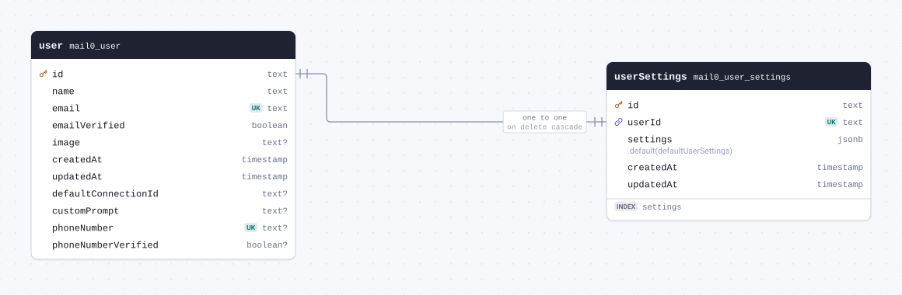

| Column                     | Type        | Constraints                              | Default                         | Description |
| -------------------------- | ----------- | ---------------------------------------- | ------------------------------- | ----------- |
| `id`                       | `text`      | PK NOT NULL                              |                                 |             |
| `userId` (`user_id`)       | `text`      | UNIQUE NOT NULL → [user.id](#table-user) |                                 |             |
| `settings`                 | `jsonb`     | NOT NULL                                 | `.default(defaultUserSettings)` |             |
| `createdAt` (`created_at`) | `timestamp` | NOT NULL                                 |                                 |             |
| `updatedAt` (`updated_at`) | `timestamp` | NOT NULL                                 |                                 |             |

#### Definition

```sql
CREATE TABLE "mail0_user_settings" (
	"id" text PRIMARY KEY,
	"user_id" text NOT NULL UNIQUE,
	"settings" jsonb DEFAULT '{"language":"en","timezone":"UTC","dynamicContent":false,"externalImages":true,"customPrompt":"","trustedSenders":[],"isOnboarded":false,"colorTheme":"system","zeroSignature":true,"autoRead":true,"defaultEmailAlias":"","categories":[{"id":"Important","name":"Important","searchValue":"is:important NOT is:sent NOT is:draft","order":0,"icon":"Lightning","isDefault":false},{"id":"All Mail","name":"All Mail","searchValue":"NOT is:draft (is:inbox OR (is:sent AND to:me))","order":1,"icon":"Mail","isDefault":true},{"id":"Personal","name":"Personal","searchValue":"is:personal NOT is:sent NOT is:draft","order":2,"icon":"User","isDefault":false},{"id":"Promotions","name":"Promotions","searchValue":"is:promotions NOT is:sent NOT is:draft","order":3,"icon":"Tag","isDefault":false},{"id":"Updates","name":"Updates","searchValue":"is:updates NOT is:sent NOT is:draft","order":4,"icon":"Bell","isDefault":false},{"id":"Unread","name":"Unread","searchValue":"is:unread NOT is:sent NOT is:draft","order":5,"icon":"ScanEye","isDefault":false}],"imageCompression":"medium","animations":false,"ai":{"disabled":false,"summaries":true,"autoLabels":true,"replyDrafts":false}}' NOT NULL,
	"created_at" timestamp NOT NULL,
	"updated_at" timestamp NOT NULL
);

CREATE INDEX "user_settings_settings_idx" ON "mail0_user_settings" ("settings");

ALTER TABLE "mail0_user_settings" ADD CONSTRAINT "mail0_user_settings_user_id_mail0_user_id_fkey" FOREIGN KEY ("user_id") REFERENCES "mail0_user"("id") ON DELETE CASCADE;
```

#### Indexes

- INDEX `settings`

#### References

- `userId` → [user.id](#table-user) (one to one, on delete cascade)

<details>
<summary>Queries and their SQL</summary>

**Select**: Every row of userSettings.

```ts
db.select().from(userSettings);
```

```sql
select "id", "user_id", "settings", "created_at", "updated_at"
from "mail0_user_settings"
```

**Count**: How many rows userSettings has.

```ts
db.select({ count: count() }).from(userSettings);
```

```sql
select count(*)
from "mail0_user_settings"
```

**Find many**: The rows of userSettings, through the relational query API.

```ts
db.query.userSettings.findMany();
```

```sql
select "d0"."id" as "id", "d0"."user_id" as "userId", "d0"."settings" as "settings", "d0"."created_at" as "createdAt", "d0"."updated_at" as "updatedAt"
from "mail0_user_settings" as "d0"
```

**Find by primary key**: One row of userSettings, through the relational query API.

```ts
db.query.userSettings.findFirst({ where: { id: "id" } });
```

```sql
select "d0"."id" as "id", "d0"."user_id" as "userId", "d0"."settings" as "settings", "d0"."created_at" as "createdAt", "d0"."updated_at" as "updatedAt"
from "mail0_user_settings" as "d0"
where "d0"."id" = $1
limit $2
-- params: ["id",1]
```

**Insert**: Adds a row to userSettings, giving the columns that have no default.

```ts
db.insert(userSettings).values({
  id: "id",
  userId: "userId",
  createdAt: new Date("2026-01-01T00:00:00.000Z"),
  updatedAt: new Date("2026-01-01T00:00:00.000Z"),
});
```

```sql
insert into "mail0_user_settings" ("id", "user_id", "settings", "created_at", "updated_at")
values ($1, $2, default, $3, $4)
-- params: ["id","userId","2026-01-01T00:00:00.000Z","2026-01-01T00:00:00.000Z"]
```

**Update**: Changes a row of userSettings, found by its primary key.

```ts
db.update(userSettings).set({ userId: "userId" }).where(eq(userSettings.id, "id"));
```

```sql
update "mail0_user_settings"
set "user_id" = $1
where "mail0_user_settings"."id" = $2
-- params: ["userId","id"]
```

**Delete**: Deletes a row of userSettings, found by its primary key.

```ts
db.delete(userSettings).where(eq(userSettings.id, "id"));
```

```sql
delete from "mail0_user_settings"
where "mail0_user_settings"."id" = $1
-- params: ["id"]
```

</details>

<a id="table-writingStyleMatrix"></a>

### writingStyleMatrix

Table `mail0_writing_style_matrix`.

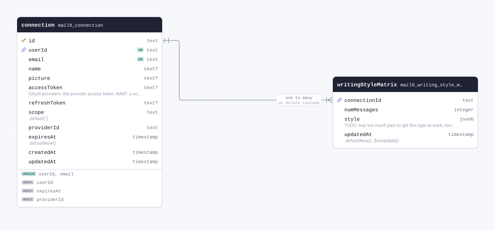

| Column         | Type        | Constraints                                   | Default                        | Description                                                     |
| -------------- | ----------- | --------------------------------------------- | ------------------------------ | --------------------------------------------------------------- |
| `connectionId` | `text`      | NOT NULL → [connection.id](#table-connection) |                                |                                                                 |
| `numMessages`  | `integer`   | NOT NULL                                      |                                |                                                                 |
| `style`        | `jsonb`     | NOT NULL                                      |                                | TODO: way too much pain to get this type to work, revisit later |
| `updatedAt`    | `timestamp` | NOT NULL                                      | `.defaultNow()` `.$onUpdate()` |                                                                 |

#### Definition

```sql
CREATE TABLE "mail0_writing_style_matrix" (
	"connectionId" text PRIMARY KEY,
	"numMessages" integer NOT NULL,
	"style" jsonb NOT NULL,
	"updatedAt" timestamp DEFAULT now() NOT NULL
);

CREATE INDEX "writing_style_matrix_style_idx" ON "mail0_writing_style_matrix" ("style");

ALTER TABLE "mail0_writing_style_matrix" ADD CONSTRAINT "mail0_writing_style_matrix_F7RY1viGZi69_fkey" FOREIGN KEY ("connectionId") REFERENCES "mail0_connection"("id") ON DELETE CASCADE;
```

#### References

- `connectionId` → [connection.id](#table-connection) (many to one, on delete cascade)

<details>
<summary>Queries and their SQL</summary>

**Select**: Every row of writingStyleMatrix.

```ts
db.select().from(writingStyleMatrix);
```

```sql
select "connectionId", "numMessages", "style", "updatedAt"
from "mail0_writing_style_matrix"
```

**Count**: How many rows writingStyleMatrix has.

```ts
db.select({ count: count() }).from(writingStyleMatrix);
```

```sql
select count(*)
from "mail0_writing_style_matrix"
```

**Find many**: The rows of writingStyleMatrix, through the relational query API.

```ts
db.query.writingStyleMatrix.findMany();
```

```sql
select "d0"."connectionId" as "connectionId", "d0"."numMessages" as "numMessages", "d0"."style" as "style", "d0"."updatedAt" as "updatedAt"
from "mail0_writing_style_matrix" as "d0"
```

**Insert**: Adds a row to writingStyleMatrix, giving the columns that have no default.

```ts
db.insert(writingStyleMatrix).values({ connectionId: "connectionId", numMessages: 1, style: {} });
```

```sql
insert into "mail0_writing_style_matrix" ("connectionId", "numMessages", "style", "updatedAt")
values ($1, $2, $3, default)
-- params: ["connectionId",1,{}]
```

</details>

<a id="table-jwks"></a>

### jwks

Table `mail0_jwks`.

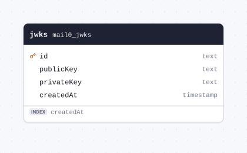

| Column                       | Type        | Constraints | Default | Description |
| ---------------------------- | ----------- | ----------- | ------- | ----------- |
| `id`                         | `text`      | PK NOT NULL |         |             |
| `publicKey` (`public_key`)   | `text`      | NOT NULL    |         |             |
| `privateKey` (`private_key`) | `text`      | NOT NULL    |         |             |
| `createdAt` (`created_at`)   | `timestamp` | NOT NULL    |         |             |

#### Definition

```sql
CREATE TABLE "mail0_jwks" (
	"id" text PRIMARY KEY,
	"public_key" text NOT NULL,
	"private_key" text NOT NULL,
	"created_at" timestamp NOT NULL
);

CREATE INDEX "jwks_created_at_idx" ON "mail0_jwks" ("created_at");
```

#### Indexes

- INDEX `createdAt`

<details>
<summary>Queries and their SQL</summary>

**Select**: Every row of jwks.

```ts
db.select().from(jwks);
```

```sql
select "id", "public_key", "private_key", "created_at"
from "mail0_jwks"
```

**Count**: How many rows jwks has.

```ts
db.select({ count: count() }).from(jwks);
```

```sql
select count(*)
from "mail0_jwks"
```

**Find many**: The rows of jwks, through the relational query API.

```ts
db.query.jwks.findMany();
```

```sql
select "d0"."id" as "id", "d0"."public_key" as "publicKey", "d0"."private_key" as "privateKey", "d0"."created_at" as "createdAt"
from "mail0_jwks" as "d0"
```

**Find by primary key**: One row of jwks, through the relational query API.

```ts
db.query.jwks.findFirst({ where: { id: "id" } });
```

```sql
select "d0"."id" as "id", "d0"."public_key" as "publicKey", "d0"."private_key" as "privateKey", "d0"."created_at" as "createdAt"
from "mail0_jwks" as "d0"
where "d0"."id" = $1
limit $2
-- params: ["id",1]
```

**Insert**: Adds a row to jwks, giving the columns that have no default.

```ts
db.insert(jwks).values({
  id: "id",
  publicKey: "publicKey",
  privateKey: "privateKey",
  createdAt: new Date("2026-01-01T00:00:00.000Z"),
});
```

```sql
insert into "mail0_jwks" ("id", "public_key", "private_key", "created_at")
values ($1, $2, $3, $4)
-- params: ["id","publicKey","privateKey","2026-01-01T00:00:00.000Z"]
```

**Update**: Changes a row of jwks, found by its primary key.

```ts
db.update(jwks).set({ publicKey: "publicKey" }).where(eq(jwks.id, "id"));
```

```sql
update "mail0_jwks"
set "public_key" = $1
where "mail0_jwks"."id" = $2
-- params: ["publicKey","id"]
```

**Delete**: Deletes a row of jwks, found by its primary key.

```ts
db.delete(jwks).where(eq(jwks.id, "id"));
```

```sql
delete from "mail0_jwks"
where "mail0_jwks"."id" = $1
-- params: ["id"]
```

</details>

<a id="table-oauthApplication"></a>

### oauthApplication

Table `mail0_oauth_application`.

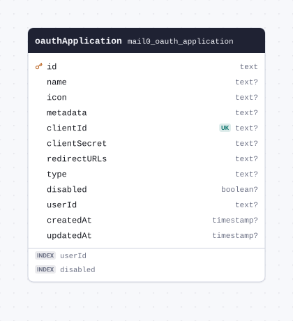

| Column                             | Type        | Constraints | Default | Description |
| ---------------------------------- | ----------- | ----------- | ------- | ----------- |
| `id`                               | `text`      | PK NOT NULL |         |             |
| `name`                             | `text`      | NULL        |         |             |
| `icon`                             | `text`      | NULL        |         |             |
| `metadata`                         | `text`      | NULL        |         |             |
| `clientId` (`client_id`)           | `text`      | UNIQUE NULL |         |             |
| `clientSecret` (`client_secret`)   | `text`      | NULL        |         |             |
| `redirectURLs` (`redirect_u_r_ls`) | `text`      | NULL        |         |             |
| `type`                             | `text`      | NULL        |         |             |
| `disabled`                         | `boolean`   | NULL        |         |             |
| `userId` (`user_id`)               | `text`      | NULL        |         |             |
| `createdAt` (`created_at`)         | `timestamp` | NULL        |         |             |
| `updatedAt` (`updated_at`)         | `timestamp` | NULL        |         |             |

#### Definition

```sql
CREATE TABLE "mail0_oauth_application" (
	"id" text PRIMARY KEY,
	"name" text,
	"icon" text,
	"metadata" text,
	"client_id" text UNIQUE,
	"client_secret" text,
	"redirect_u_r_ls" text,
	"type" text,
	"disabled" boolean,
	"user_id" text,
	"created_at" timestamp,
	"updated_at" timestamp
);

CREATE INDEX "oauth_application_user_id_idx" ON "mail0_oauth_application" ("user_id");

CREATE INDEX "oauth_application_disabled_idx" ON "mail0_oauth_application" ("disabled");
```

#### Indexes

- INDEX `userId`
- INDEX `disabled`

<details>
<summary>Queries and their SQL</summary>

**Select**: Every row of oauthApplication.

```ts
db.select().from(oauthApplication);
```

```sql
select "id", "name", "icon", "metadata", "client_id", "client_secret", "redirect_u_r_ls", "type", "disabled", "user_id", "created_at", "updated_at"
from "mail0_oauth_application"
```

**Count**: How many rows oauthApplication has.

```ts
db.select({ count: count() }).from(oauthApplication);
```

```sql
select count(*)
from "mail0_oauth_application"
```

**Find many**: The rows of oauthApplication, through the relational query API.

```ts
db.query.oauthApplication.findMany();
```

```sql
select "d0"."id" as "id", "d0"."name" as "name", "d0"."icon" as "icon", "d0"."metadata" as "metadata", "d0"."client_id" as "clientId", "d0"."client_secret" as "clientSecret", "d0"."redirect_u_r_ls" as "redirectURLs", "d0"."type" as "type", "d0"."disabled" as "disabled", "d0"."user_id" as "userId", "d0"."created_at" as "createdAt", "d0"."updated_at" as "updatedAt"
from "mail0_oauth_application" as "d0"
```

**Find by primary key**: One row of oauthApplication, through the relational query API.

```ts
db.query.oauthApplication.findFirst({ where: { id: "id" } });
```

```sql
select "d0"."id" as "id", "d0"."name" as "name", "d0"."icon" as "icon", "d0"."metadata" as "metadata", "d0"."client_id" as "clientId", "d0"."client_secret" as "clientSecret", "d0"."redirect_u_r_ls" as "redirectURLs", "d0"."type" as "type", "d0"."disabled" as "disabled", "d0"."user_id" as "userId", "d0"."created_at" as "createdAt", "d0"."updated_at" as "updatedAt"
from "mail0_oauth_application" as "d0"
where "d0"."id" = $1
limit $2
-- params: ["id",1]
```

**Insert**: Adds a row to oauthApplication, giving the columns that have no default.

```ts
db.insert(oauthApplication).values({ id: "id" });
```

```sql
insert into "mail0_oauth_application" ("id", "name", "icon", "metadata", "client_id", "client_secret", "redirect_u_r_ls", "type", "disabled", "user_id", "created_at", "updated_at")
values ($1, default, default, default, default, default, default, default, default, default, default, default)
-- params: ["id"]
```

**Update**: Changes a row of oauthApplication, found by its primary key.

```ts
db.update(oauthApplication).set({ name: "name" }).where(eq(oauthApplication.id, "id"));
```

```sql
update "mail0_oauth_application"
set "name" = $1
where "mail0_oauth_application"."id" = $2
-- params: ["name","id"]
```

**Delete**: Deletes a row of oauthApplication, found by its primary key.

```ts
db.delete(oauthApplication).where(eq(oauthApplication.id, "id"));
```

```sql
delete from "mail0_oauth_application"
where "mail0_oauth_application"."id" = $1
-- params: ["id"]
```

</details>

<a id="table-oauthAccessToken"></a>

### oauthAccessToken

Table `mail0_oauth_access_token`.

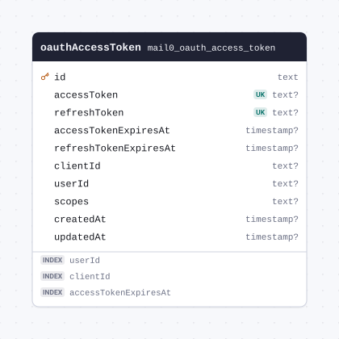

| Column                                               | Type        | Constraints | Default | Description |
| ---------------------------------------------------- | ----------- | ----------- | ------- | ----------- |
| `id`                                                 | `text`      | PK NOT NULL |         |             |
| `accessToken` (`access_token`)                       | `text`      | UNIQUE NULL |         |             |
| `refreshToken` (`refresh_token`)                     | `text`      | UNIQUE NULL |         |             |
| `accessTokenExpiresAt` (`access_token_expires_at`)   | `timestamp` | NULL        |         |             |
| `refreshTokenExpiresAt` (`refresh_token_expires_at`) | `timestamp` | NULL        |         |             |
| `clientId` (`client_id`)                             | `text`      | NULL        |         |             |
| `userId` (`user_id`)                                 | `text`      | NULL        |         |             |
| `scopes`                                             | `text`      | NULL        |         |             |
| `createdAt` (`created_at`)                           | `timestamp` | NULL        |         |             |
| `updatedAt` (`updated_at`)                           | `timestamp` | NULL        |         |             |

#### Definition

```sql
CREATE TABLE "mail0_oauth_access_token" (
	"id" text PRIMARY KEY,
	"access_token" text UNIQUE,
	"refresh_token" text UNIQUE,
	"access_token_expires_at" timestamp,
	"refresh_token_expires_at" timestamp,
	"client_id" text,
	"user_id" text,
	"scopes" text,
	"created_at" timestamp,
	"updated_at" timestamp
);

CREATE INDEX "oauth_access_token_user_id_idx" ON "mail0_oauth_access_token" ("user_id");

CREATE INDEX "oauth_access_token_client_id_idx" ON "mail0_oauth_access_token" ("client_id");

CREATE INDEX "oauth_access_token_expires_at_idx" ON "mail0_oauth_access_token" ("access_token_expires_at");
```

#### Indexes

- INDEX `userId`
- INDEX `clientId`
- INDEX `accessTokenExpiresAt`

<details>
<summary>Queries and their SQL</summary>

**Select**: Every row of oauthAccessToken.

```ts
db.select().from(oauthAccessToken);
```

```sql
select "id", "access_token", "refresh_token", "access_token_expires_at", "refresh_token_expires_at", "client_id", "user_id", "scopes", "created_at", "updated_at"
from "mail0_oauth_access_token"
```

**Count**: How many rows oauthAccessToken has.

```ts
db.select({ count: count() }).from(oauthAccessToken);
```

```sql
select count(*)
from "mail0_oauth_access_token"
```

**Find many**: The rows of oauthAccessToken, through the relational query API.

```ts
db.query.oauthAccessToken.findMany();
```

```sql
select "d0"."id" as "id", "d0"."access_token" as "accessToken", "d0"."refresh_token" as "refreshToken", "d0"."access_token_expires_at" as "accessTokenExpiresAt", "d0"."refresh_token_expires_at" as "refreshTokenExpiresAt", "d0"."client_id" as "clientId", "d0"."user_id" as "userId", "d0"."scopes" as "scopes", "d0"."created_at" as "createdAt", "d0"."updated_at" as "updatedAt"
from "mail0_oauth_access_token" as "d0"
```

**Find by primary key**: One row of oauthAccessToken, through the relational query API.

```ts
db.query.oauthAccessToken.findFirst({ where: { id: "id" } });
```

```sql
select "d0"."id" as "id", "d0"."access_token" as "accessToken", "d0"."refresh_token" as "refreshToken", "d0"."access_token_expires_at" as "accessTokenExpiresAt", "d0"."refresh_token_expires_at" as "refreshTokenExpiresAt", "d0"."client_id" as "clientId", "d0"."user_id" as "userId", "d0"."scopes" as "scopes", "d0"."created_at" as "createdAt", "d0"."updated_at" as "updatedAt"
from "mail0_oauth_access_token" as "d0"
where "d0"."id" = $1
limit $2
-- params: ["id",1]
```

**Insert**: Adds a row to oauthAccessToken, giving the columns that have no default.

```ts
db.insert(oauthAccessToken).values({ id: "id" });
```

```sql
insert into "mail0_oauth_access_token" ("id", "access_token", "refresh_token", "access_token_expires_at", "refresh_token_expires_at", "client_id", "user_id", "scopes", "created_at", "updated_at")
values ($1, default, default, default, default, default, default, default, default, default)
-- params: ["id"]
```

**Update**: Changes a row of oauthAccessToken, found by its primary key.

```ts
db.update(oauthAccessToken)
  .set({ accessToken: "accessToken" })
  .where(eq(oauthAccessToken.id, "id"));
```

```sql
update "mail0_oauth_access_token"
set "access_token" = $1
where "mail0_oauth_access_token"."id" = $2
-- params: ["accessToken","id"]
```

**Delete**: Deletes a row of oauthAccessToken, found by its primary key.

```ts
db.delete(oauthAccessToken).where(eq(oauthAccessToken.id, "id"));
```

```sql
delete from "mail0_oauth_access_token"
where "mail0_oauth_access_token"."id" = $1
-- params: ["id"]
```

</details>

<a id="table-oauthConsent"></a>

### oauthConsent

Table `mail0_oauth_consent`.

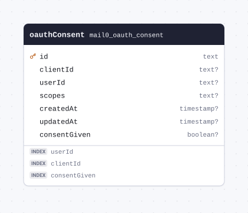

| Column                           | Type        | Constraints | Default | Description |
| -------------------------------- | ----------- | ----------- | ------- | ----------- |
| `id`                             | `text`      | PK NOT NULL |         |             |
| `clientId` (`client_id`)         | `text`      | NULL        |         |             |
| `userId` (`user_id`)             | `text`      | NULL        |         |             |
| `scopes`                         | `text`      | NULL        |         |             |
| `createdAt` (`created_at`)       | `timestamp` | NULL        |         |             |
| `updatedAt` (`updated_at`)       | `timestamp` | NULL        |         |             |
| `consentGiven` (`consent_given`) | `boolean`   | NULL        |         |             |

#### Definition

```sql
CREATE TABLE "mail0_oauth_consent" (
	"id" text PRIMARY KEY,
	"client_id" text,
	"user_id" text,
	"scopes" text,
	"created_at" timestamp,
	"updated_at" timestamp,
	"consent_given" boolean
);

CREATE INDEX "oauth_consent_user_id_idx" ON "mail0_oauth_consent" ("user_id");

CREATE INDEX "oauth_consent_client_id_idx" ON "mail0_oauth_consent" ("client_id");

CREATE INDEX "oauth_consent_given_idx" ON "mail0_oauth_consent" ("consent_given");
```

#### Indexes

- INDEX `userId`
- INDEX `clientId`
- INDEX `consentGiven`

<details>
<summary>Queries and their SQL</summary>

**Select**: Every row of oauthConsent.

```ts
db.select().from(oauthConsent);
```

```sql
select "id", "client_id", "user_id", "scopes", "created_at", "updated_at", "consent_given"
from "mail0_oauth_consent"
```

**Count**: How many rows oauthConsent has.

```ts
db.select({ count: count() }).from(oauthConsent);
```

```sql
select count(*)
from "mail0_oauth_consent"
```

**Find many**: The rows of oauthConsent, through the relational query API.

```ts
db.query.oauthConsent.findMany();
```

```sql
select "d0"."id" as "id", "d0"."client_id" as "clientId", "d0"."user_id" as "userId", "d0"."scopes" as "scopes", "d0"."created_at" as "createdAt", "d0"."updated_at" as "updatedAt", "d0"."consent_given" as "consentGiven"
from "mail0_oauth_consent" as "d0"
```

**Find by primary key**: One row of oauthConsent, through the relational query API.

```ts
db.query.oauthConsent.findFirst({ where: { id: "id" } });
```

```sql
select "d0"."id" as "id", "d0"."client_id" as "clientId", "d0"."user_id" as "userId", "d0"."scopes" as "scopes", "d0"."created_at" as "createdAt", "d0"."updated_at" as "updatedAt", "d0"."consent_given" as "consentGiven"
from "mail0_oauth_consent" as "d0"
where "d0"."id" = $1
limit $2
-- params: ["id",1]
```

**Insert**: Adds a row to oauthConsent, giving the columns that have no default.

```ts
db.insert(oauthConsent).values({ id: "id" });
```

```sql
insert into "mail0_oauth_consent" ("id", "client_id", "user_id", "scopes", "created_at", "updated_at", "consent_given")
values ($1, default, default, default, default, default, default)
-- params: ["id"]
```

**Update**: Changes a row of oauthConsent, found by its primary key.

```ts
db.update(oauthConsent).set({ clientId: "clientId" }).where(eq(oauthConsent.id, "id"));
```

```sql
update "mail0_oauth_consent"
set "client_id" = $1
where "mail0_oauth_consent"."id" = $2
-- params: ["clientId","id"]
```

**Delete**: Deletes a row of oauthConsent, found by its primary key.

```ts
db.delete(oauthConsent).where(eq(oauthConsent.id, "id"));
```

```sql
delete from "mail0_oauth_consent"
where "mail0_oauth_consent"."id" = $1
-- params: ["id"]
```

</details>

<a id="table-emailTemplate"></a>

### emailTemplate

Table `mail0_email_template`.

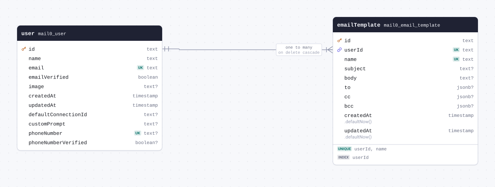

| Column                     | Type        | Constraints                       | Default         | Description |
| -------------------------- | ----------- | --------------------------------- | --------------- | ----------- |
| `id`                       | `text`      | PK NOT NULL                       |                 |             |
| `userId` (`user_id`)       | `text`      | NOT NULL → [user.id](#table-user) |                 |             |
| `name`                     | `text`      | NOT NULL                          |                 |             |
| `subject`                  | `text`      | NULL                              |                 |             |
| `body`                     | `text`      | NULL                              |                 |             |
| `to`                       | `jsonb`     | NULL                              |                 |             |
| `cc`                       | `jsonb`     | NULL                              |                 |             |
| `bcc`                      | `jsonb`     | NULL                              |                 |             |
| `createdAt` (`created_at`) | `timestamp` | NOT NULL                          | `.defaultNow()` |             |
| `updatedAt` (`updated_at`) | `timestamp` | NOT NULL                          | `.defaultNow()` |             |

#### Definition

```sql
CREATE TABLE "mail0_email_template" (
	"id" text PRIMARY KEY,
	"user_id" text NOT NULL,
	"name" text NOT NULL,
	"subject" text,
	"body" text,
	"to" jsonb,
	"cc" jsonb,
	"bcc" jsonb,
	"created_at" timestamp DEFAULT now() NOT NULL,
	"updated_at" timestamp DEFAULT now() NOT NULL,
	CONSTRAINT "mail0_email_template_user_id_name_unique" UNIQUE("user_id","name")
);

CREATE INDEX "idx_mail0_email_template_user_id" ON "mail0_email_template" ("user_id");

ALTER TABLE "mail0_email_template" ADD CONSTRAINT "mail0_email_template_user_id_mail0_user_id_fkey" FOREIGN KEY ("user_id") REFERENCES "mail0_user"("id") ON DELETE CASCADE;
```

#### Indexes

- INDEX `userId`
- UNIQUE `userId`, `name`

#### References

- `userId` → [user.id](#table-user) (many to one, on delete cascade)

<details>
<summary>Queries and their SQL</summary>

**Select**: Every row of emailTemplate.

```ts
db.select().from(emailTemplate);
```

```sql
select "id", "user_id", "name", "subject", "body", "to", "cc", "bcc", "created_at", "updated_at"
from "mail0_email_template"
```

**Count**: How many rows emailTemplate has.

```ts
db.select({ count: count() }).from(emailTemplate);
```

```sql
select count(*)
from "mail0_email_template"
```

**Find many**: The rows of emailTemplate, through the relational query API.

```ts
db.query.emailTemplate.findMany();
```

```sql
select "d0"."id" as "id", "d0"."user_id" as "userId", "d0"."name" as "name", "d0"."subject" as "subject", "d0"."body" as "body", "d0"."to" as "to", "d0"."cc" as "cc", "d0"."bcc" as "bcc", "d0"."created_at" as "createdAt", "d0"."updated_at" as "updatedAt"
from "mail0_email_template" as "d0"
```

**Find by primary key**: One row of emailTemplate, through the relational query API.

```ts
db.query.emailTemplate.findFirst({ where: { id: "id" } });
```

```sql
select "d0"."id" as "id", "d0"."user_id" as "userId", "d0"."name" as "name", "d0"."subject" as "subject", "d0"."body" as "body", "d0"."to" as "to", "d0"."cc" as "cc", "d0"."bcc" as "bcc", "d0"."created_at" as "createdAt", "d0"."updated_at" as "updatedAt"
from "mail0_email_template" as "d0"
where "d0"."id" = $1
limit $2
-- params: ["id",1]
```

**Insert**: Adds a row to emailTemplate, giving the columns that have no default.

```ts
db.insert(emailTemplate).values({ id: "id", userId: "userId", name: "name" });
```

```sql
insert into "mail0_email_template" ("id", "user_id", "name", "subject", "body", "to", "cc", "bcc", "created_at", "updated_at")
values ($1, $2, $3, default, default, default, default, default, default, default)
-- params: ["id","userId","name"]
```

**Update**: Changes a row of emailTemplate, found by its primary key.

```ts
db.update(emailTemplate).set({ userId: "userId" }).where(eq(emailTemplate.id, "id"));
```

```sql
update "mail0_email_template"
set "user_id" = $1
where "mail0_email_template"."id" = $2
-- params: ["userId","id"]
```

**Delete**: Deletes a row of emailTemplate, found by its primary key.

```ts
db.delete(emailTemplate).where(eq(emailTemplate.id, "id"));
```

```sql
delete from "mail0_email_template"
where "mail0_email_template"."id" = $1
-- params: ["id"]
```

</details>
