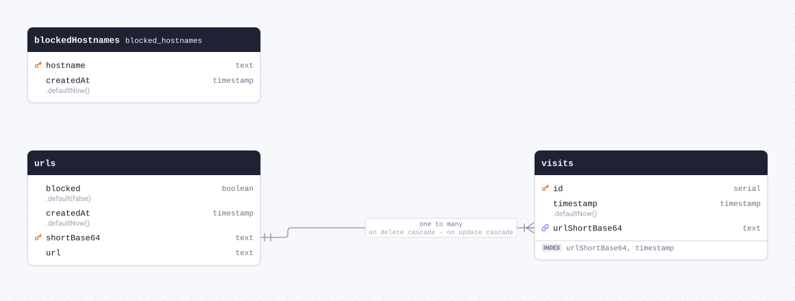
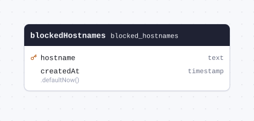
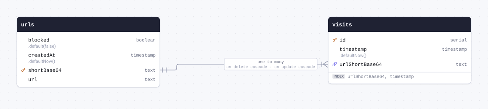

# Schema docs



<details>
<summary>The whole schema as SQL</summary>

```sql
CREATE TABLE "blocked_hostnames" (
	"hostname" text PRIMARY KEY,
	"created_at" timestamp with time zone DEFAULT now() NOT NULL
);

CREATE TABLE "urls" (
	"blocked" boolean DEFAULT false NOT NULL,
	"created_at" timestamp with time zone DEFAULT now() NOT NULL,
	"short_base64" text PRIMARY KEY,
	"url" text NOT NULL
);

CREATE TABLE "visits" (
	"id" serial PRIMARY KEY,
	"timestamp" timestamp with time zone DEFAULT now() NOT NULL,
	"url_short_base64" text NOT NULL
);

CREATE INDEX "visits_url_short_base64_timestamp_index" ON "visits" ("url_short_base64","timestamp");

ALTER TABLE "visits" ADD CONSTRAINT "visits_url_short_base64_urls_short_base64_fkey" FOREIGN KEY ("url_short_base64") REFERENCES "urls"("short_base64") ON DELETE CASCADE ON UPDATE CASCADE;
```

</details>

## Contents

| Table                                       | Name in the database | Description |
| ------------------------------------------- | -------------------- | ----------- |
| [blockedHostnames](#table-blockedHostnames) | `blocked_hostnames`  |             |
| [urls](#table-urls)                         | `urls`               |             |
| [visits](#table-visits)                     | `visits`             |             |

## Tables

<a id="table-blockedHostnames"></a>

### blockedHostnames

Table `blocked_hostnames`.



| Column                     | Type        | Constraints | Default         | Description |
| -------------------------- | ----------- | ----------- | --------------- | ----------- |
| `hostname`                 | `text`      | PK NOT NULL |                 |             |
| `createdAt` (`created_at`) | `timestamp` | NOT NULL    | `.defaultNow()` |             |

#### Definition

```sql
CREATE TABLE "blocked_hostnames" (
	"hostname" text PRIMARY KEY,
	"created_at" timestamp with time zone DEFAULT now() NOT NULL
);
```

<details>
<summary>Queries and their SQL</summary>

**Select**: Every row of blockedHostnames.

```ts
db.select().from(blockedHostnames);
```

```sql
select "hostname", "created_at"
from "blocked_hostnames"
```

**Count**: How many rows blockedHostnames has.

```ts
db.select({ count: count() }).from(blockedHostnames);
```

```sql
select count(*)
from "blocked_hostnames"
```

**Find many**: The rows of blockedHostnames, through the relational query API.

```ts
db.query.blockedHostnames.findMany();
```

```sql
select "d0"."hostname" as "hostname", "d0"."created_at" as "createdAt"
from "blocked_hostnames" as "d0"
```

**Find by primary key**: One row of blockedHostnames, through the relational query API.

```ts
db.query.blockedHostnames.findFirst({ where: { hostname: "hostname" } });
```

```sql
select "d0"."hostname" as "hostname", "d0"."created_at" as "createdAt"
from "blocked_hostnames" as "d0"
where "d0"."hostname" = $1
limit $2
-- params: ["hostname",1]
```

**Insert**: Adds a row to blockedHostnames, giving the columns that have no default.

```ts
db.insert(blockedHostnames).values({ hostname: "hostname" });
```

```sql
insert into "blocked_hostnames" ("hostname", "created_at")
values ($1, default)
-- params: ["hostname"]
```

**Update**: Changes a row of blockedHostnames, found by its primary key.

```ts
db.update(blockedHostnames)
  .set({ createdAt: new Date("2026-01-01T00:00:00.000Z") })
  .where(eq(blockedHostnames.hostname, "hostname"));
```

```sql
update "blocked_hostnames"
set "created_at" = $1
where "blocked_hostnames"."hostname" = $2
-- params: ["2026-01-01T00:00:00.000Z","hostname"]
```

**Delete**: Deletes a row of blockedHostnames, found by its primary key.

```ts
db.delete(blockedHostnames).where(eq(blockedHostnames.hostname, "hostname"));
```

```sql
delete from "blocked_hostnames"
where "blocked_hostnames"."hostname" = $1
-- params: ["hostname"]
```

</details>

<a id="table-urls"></a>

### urls


| Column                         | Type        | Constraints | Default           | Description |
| ------------------------------ | ----------- | ----------- | ----------------- | ----------- |
| `blocked`                      | `boolean`   | NOT NULL    | `.default(false)` |             |
| `createdAt` (`created_at`)     | `timestamp` | NOT NULL    | `.defaultNow()`   |             |
| `shortBase64` (`short_base64`) | `text`      | PK NOT NULL |                   |             |
| `url`                          | `text`      | NOT NULL    |                   |             |

#### Definition

```sql
CREATE TABLE "urls" (
	"blocked" boolean DEFAULT false NOT NULL,
	"created_at" timestamp with time zone DEFAULT now() NOT NULL,
	"short_base64" text PRIMARY KEY,
	"url" text NOT NULL
);
```

#### Referenced by

- `shortBase64` → [visits.urlShortBase64](#table-visits) (one to many, on delete cascade, on update cascade)

<details>
<summary>Queries and their SQL</summary>

**Select**: Every row of urls.

```ts
db.select().from(urls);
```

```sql
select "blocked", "created_at", "short_base64", "url"
from "urls"
```

**Count**: How many rows urls has.

```ts
db.select({ count: count() }).from(urls);
```

```sql
select count(*)
from "urls"
```

**Find many**: The rows of urls, through the relational query API.

```ts
db.query.urls.findMany();
```

```sql
select "d0"."blocked" as "blocked", "d0"."created_at" as "createdAt", "d0"."short_base64" as "shortBase64", "d0"."url" as "url"
from "urls" as "d0"
```

**Find by primary key**: One row of urls, through the relational query API.

```ts
db.query.urls.findFirst({ where: { shortBase64: "shortBase64" } });
```

```sql
select "d0"."blocked" as "blocked", "d0"."created_at" as "createdAt", "d0"."short_base64" as "shortBase64", "d0"."url" as "url"
from "urls" as "d0"
where "d0"."short_base64" = $1
limit $2
-- params: ["shortBase64",1]
```

**Insert**: Adds a row to urls, giving the columns that have no default.

```ts
db.insert(urls).values({ shortBase64: "shortBase64", url: "url" });
```

```sql
insert into "urls" ("blocked", "created_at", "short_base64", "url")
values (default, default, $1, $2)
-- params: ["shortBase64","url"]
```

**Update**: Changes a row of urls, found by its primary key.

```ts
db.update(urls).set({ blocked: true }).where(eq(urls.shortBase64, "shortBase64"));
```

```sql
update "urls"
set "blocked" = $1
where "urls"."short_base64" = $2
-- params: [true,"shortBase64"]
```

**Delete**: Deletes a row of urls, found by its primary key.

```ts
db.delete(urls).where(eq(urls.shortBase64, "shortBase64"));
```

```sql
delete from "urls"
where "urls"."short_base64" = $1
-- params: ["shortBase64"]
```

</details>

<a id="table-visits"></a>

### visits



| Column                                | Type        | Constraints                                | Default         | Description |
| ------------------------------------- | ----------- | ------------------------------------------ | --------------- | ----------- |
| `id`                                  | `serial`    | PK NOT NULL                                |                 |             |
| `timestamp`                           | `timestamp` | NOT NULL                                   | `.defaultNow()` |             |
| `urlShortBase64` (`url_short_base64`) | `text`      | NOT NULL → [urls.shortBase64](#table-urls) |                 |             |

#### Definition

```sql
CREATE TABLE "visits" (
	"id" serial PRIMARY KEY,
	"timestamp" timestamp with time zone DEFAULT now() NOT NULL,
	"url_short_base64" text NOT NULL
);

CREATE INDEX "visits_url_short_base64_timestamp_index" ON "visits" ("url_short_base64","timestamp");

ALTER TABLE "visits" ADD CONSTRAINT "visits_url_short_base64_urls_short_base64_fkey" FOREIGN KEY ("url_short_base64") REFERENCES "urls"("short_base64") ON DELETE CASCADE ON UPDATE CASCADE;
```

#### Indexes

- INDEX `urlShortBase64`, `timestamp`

#### References

- `urlShortBase64` → [urls.shortBase64](#table-urls) (many to one, on delete cascade, on update cascade)

<details>
<summary>Queries and their SQL</summary>

**Select**: Every row of visits.

```ts
db.select().from(visits);
```

```sql
select "id", "timestamp", "url_short_base64"
from "visits"
```

**Count**: How many rows visits has.

```ts
db.select({ count: count() }).from(visits);
```

```sql
select count(*)
from "visits"
```

**Find many**: The rows of visits, through the relational query API.

```ts
db.query.visits.findMany();
```

```sql
select "d0"."id" as "id", "d0"."timestamp" as "timestamp", "d0"."url_short_base64" as "urlShortBase64"
from "visits" as "d0"
```

**Find by primary key**: One row of visits, through the relational query API.

```ts
db.query.visits.findFirst({ where: { id: 1 } });
```

```sql
select "d0"."id" as "id", "d0"."timestamp" as "timestamp", "d0"."url_short_base64" as "urlShortBase64"
from "visits" as "d0"
where "d0"."id" = $1
limit $2
-- params: [1,1]
```

**Insert**: Adds a row to visits, giving the columns that have no default.

```ts
db.insert(visits).values({ urlShortBase64: "urlShortBase64" });
```

```sql
insert into "visits" ("id", "timestamp", "url_short_base64")
values (default, default, $1)
-- params: ["urlShortBase64"]
```

**Update**: Changes a row of visits, found by its primary key.

```ts
db.update(visits)
  .set({ timestamp: new Date("2026-01-01T00:00:00.000Z") })
  .where(eq(visits.id, 1));
```

```sql
update "visits"
set "timestamp" = $1
where "visits"."id" = $2
-- params: ["2026-01-01T00:00:00.000Z",1]
```

**Delete**: Deletes a row of visits, found by its primary key.

```ts
db.delete(visits).where(eq(visits.id, 1));
```

```sql
delete from "visits"
where "visits"."id" = $1
-- params: [1]
```

</details>
