# Schema docs

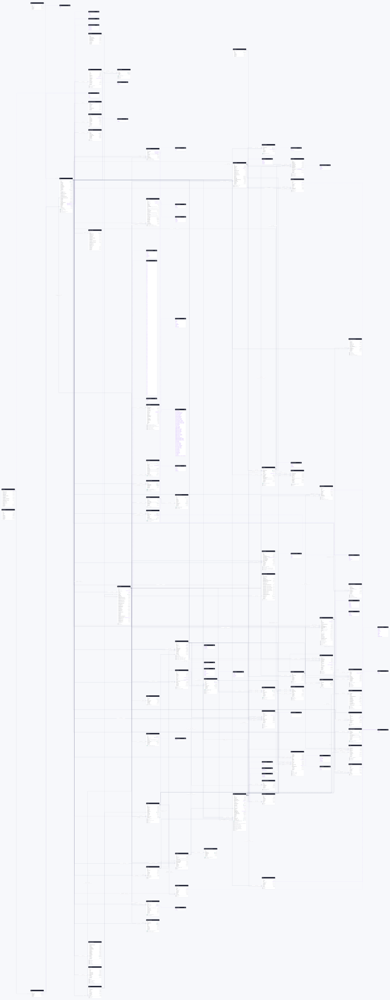

<details>
<summary>The whole schema as SQL</summary>

```sql
CREATE SCHEMA IF NOT EXISTS "public";

CREATE TYPE "AssetStatus" AS ENUM ('AVAILABLE', 'IN_CUSTODY', 'CHECKED_OUT');

CREATE TYPE "AssetType" AS ENUM ('INDIVIDUAL', 'QUANTITY_TRACKED');

CREATE TYPE "ConsumptionType" AS ENUM ('ONE_WAY', 'TWO_WAY');

CREATE TYPE "ConsumptionCategory" AS ENUM ('CHECKOUT', 'RETURN', 'RESTOCK', 'ADJUSTMENT', 'LOSS', 'CONSUME', 'DAMAGE', 'MOVE', 'INITIAL', 'OPENING_BALANCE');

CREATE TYPE "PdfTemplateKind" AS ENUM ('BOOKING');

CREATE TYPE "AssetIndexMode" AS ENUM ('SIMPLE', 'ADVANCED');

CREATE TYPE "TagUseFor" AS ENUM ('ASSET', 'BOOKING');

CREATE TYPE "NoteType" AS ENUM ('COMMENT', 'UPDATE');

CREATE TYPE "BarcodeType" AS ENUM ('Code128', 'Code39', 'DataMatrix', 'ExternalQR', 'EAN13');

CREATE TYPE "ErrorCorrection" AS ENUM ('L', 'M', 'Q', 'H');

CREATE TYPE "ScanCodeType" AS ENUM ('QR', 'BARCODE', 'SAM_ID');

CREATE TYPE "ScanSource" AS ENUM ('QR_LINK', 'WEB_SCANNER', 'WEB_DRAWER', 'AUDIT', 'COMPANION', 'GPS_UPDATE');

CREATE TYPE "Roles" AS ENUM ('USER', 'ADMIN');

CREATE TYPE "OrganizationType" AS ENUM ('PERSONAL', 'TEAM');

CREATE TYPE "QrIdDisplayPreference" AS ENUM ('QR_ID', 'SAM_ID', 'Code128', 'Code39', 'DataMatrix', 'ExternalQR', 'EAN13');

CREATE TYPE "DateFormatPreference" AS ENUM ('DD_MM_YYYY', 'MM_DD_YYYY', 'YYYY_MM_DD', 'MMM_DD_YYYY', 'DD_MMM_YYYY');

CREATE TYPE "TimeFormatPreference" AS ENUM ('H12', 'H24');

CREATE TYPE "WeekStartPreference" AS ENUM ('MONDAY', 'SUNDAY', 'SATURDAY');

CREATE TYPE "OrganizationRoles" AS ENUM ('ADMIN', 'BASE', 'OWNER', 'SELF_SERVICE', 'MANAGER');

CREATE TYPE "TierId" AS ENUM ('free', 'tier_1', 'tier_2', 'custom');

CREATE TYPE "CustomFieldType" AS ENUM ('TEXT', 'OPTION', 'BOOLEAN', 'DATE', 'MULTILINE_TEXT', 'AMOUNT', 'NUMBER');

CREATE TYPE "CustomFieldFormat" AS ENUM ('PLAIN', 'LINK');

CREATE TYPE "Currency" AS ENUM ('AED', 'AFN', 'ALL', 'AMD', 'ANG', 'AOA', 'ARS', 'AUD', 'AWG', 'AZN', 'BAM', 'BBD', 'BDT', 'BGN', 'BHD', 'BIF', 'BMD', 'BND', 'BOB', 'BRL', 'BSD', 'BTN', 'BWP', 'BYN', 'BZD', 'CAD', 'CDF', 'CHF', 'CLP', 'CNY', 'COP', 'CRC', 'CUP', 'CVE', 'CZK', 'DJF', 'DKK', 'DOP', 'DZD', 'EGP', 'ERN', 'ETB', 'EUR', 'FJD', 'FKP', 'GBP', 'GEL', 'GHS', 'GIP', 'GMD', 'GNF', 'GTQ', 'GYD', 'HKD', 'HNL', 'HTG', 'HUF', 'IDR', 'ILS', 'INR', 'IQD', 'IRR', 'ISK', 'JMD', 'JOD', 'JPY', 'KES', 'KGS', 'KHR', 'KMF', 'KPW', 'KRW', 'KWD', 'KYD', 'KZT', 'LAK', 'LBP', 'LKR', 'LRD', 'LSL', 'LYD', 'MAD', 'MDL', 'MGA', 'MKD', 'MMK', 'MNT', 'MOP', 'MRU', 'MUR', 'MVR', 'MWK', 'MXN', 'MYR', 'MZN', 'NAD', 'NGN', 'NIO', 'NOK', 'NPR', 'NZD', 'OMR', 'PAB', 'PEN', 'PGK', 'PHP', 'PKR', 'PLN', 'PYG', 'QAR', 'RON', 'RSD', 'RUB', 'RWF', 'SAR', 'SBD', 'SCR', 'SDG', 'SEK', 'SGD', 'SHP', 'SLE', 'SOS', 'SRD', 'SSP', 'STN', 'SVC', 'SYP', 'SZL', 'THB', 'TJS', 'TMT', 'TND', 'TOP', 'TRY', 'TTD', 'TWD', 'TZS', 'UAH', 'UGX', 'USD', 'UYU', 'UZS', 'VES', 'VND', 'VUV', 'WST', 'XAF', 'XCD', 'XOF', 'XPF', 'YER', 'ZAR', 'ZMW', 'ZWL');

CREATE TYPE "InviteStatuses" AS ENUM ('PENDING', 'ACCEPTED', 'REJECTED', 'INVALIDATED');

CREATE TYPE "BookingStatus" AS ENUM ('DRAFT', 'RESERVED', 'ONGOING', 'OVERDUE', 'COMPLETE', 'ARCHIVED', 'CANCELLED');

CREATE TYPE "DevicePlatform" AS ENUM ('IOS', 'ANDROID');

CREATE TYPE "KitStatus" AS ENUM ('AVAILABLE', 'IN_CUSTODY', 'CHECKED_OUT');

CREATE TYPE "ReminderRecurrenceUnit" AS ENUM ('DAY', 'WEEK', 'MONTH', 'YEAR');

CREATE TYPE "UpdateStatus" AS ENUM ('DRAFT', 'PUBLISHED');

CREATE TYPE "AuditStatus" AS ENUM ('PENDING', 'ACTIVE', 'COMPLETED', 'CANCELLED', 'ARCHIVED');

CREATE TYPE "AuditAssetStatus" AS ENUM ('PENDING', 'FOUND', 'MISSING', 'UNEXPECTED');

CREATE TYPE "AuditAssignmentRole" AS ENUM ('LEAD', 'PARTICIPANT');

CREATE TYPE "AssetImportStatus" AS ENUM ('DRAFT', 'QUEUED', 'RUNNING', 'COMPLETED', 'FAILED');

CREATE TYPE "AssetImportPhase" AS ENUM ('PREPARE', 'ROWS', 'FINALIZE');

CREATE TYPE "LinkPreviewOutcome" AS ENUM ('TITLE', 'NO_TITLE', 'SIGN_IN', 'BLOCKED', 'UNREACHABLE');

CREATE TYPE "AuditImageCaptureSource" AS ENUM ('CAMERA', 'LIBRARY', 'WEB_UPLOAD', 'PHONE');

CREATE TYPE "RoleChangeSource" AS ENUM ('MANUAL', 'SSO');

CREATE TYPE "ActivityEntity" AS ENUM ('ASSET', 'BOOKING', 'AUDIT', 'KIT', 'LOCATION', 'TEAM_MEMBER', 'CUSTODY', 'USER', 'ORGANIZATION');

CREATE TYPE "ActivityAction" AS ENUM ('ASSET_CREATED', 'ASSET_NAME_CHANGED', 'ASSET_DESCRIPTION_CHANGED', 'ASSET_CATEGORY_CHANGED', 'ASSET_MODEL_CHANGED', 'ASSET_KIT_CHANGED', 'ASSET_LOCATION_CHANGED', 'ASSET_TAGS_CHANGED', 'ASSET_STATUS_CHANGED', 'ASSET_VALUATION_CHANGED', 'ASSET_QUANTITY_CHANGED', 'ASSET_MIN_QUANTITY_CHANGED', 'ASSET_CUSTOM_FIELD_CHANGED', 'ASSET_PREFERRED_BARCODE_CHANGED', 'ASSET_AVAILABLE_TO_BOOK_CHANGED', 'ASSET_ARCHIVED', 'ASSET_UNARCHIVED', 'ASSET_DELETED', 'CUSTODY_ASSIGNED', 'CUSTODY_RELEASED', 'BOOKING_CREATED', 'BOOKING_STATUS_CHANGED', 'BOOKING_DATES_CHANGED', 'BOOKING_ASSETS_ADDED', 'BOOKING_ASSETS_REMOVED', 'BOOKING_CHECKED_OUT', 'BOOKING_CHECKED_IN', 'BOOKING_PARTIAL_CHECKIN', 'BOOKING_PARTIAL_CHECKOUT', 'BOOKING_CANCELLED', 'BOOKING_ARCHIVED', 'BOOKING_APPROVED', 'BOOKING_MODEL_REQUESTED', 'BOOKING_MODEL_REQUEST_CHANGED', 'BOOKING_MODEL_REQUEST_REMOVED', 'BOOKING_MODEL_REQUEST_FULFILLED', 'AUDIT_CREATED', 'AUDIT_STARTED', 'AUDIT_ASSETS_ADDED', 'AUDIT_ASSETS_REMOVED', 'AUDIT_ASSET_SCANNED', 'AUDIT_ASSET_SCAN_REMOVED', 'AUDIT_DUE_DATE_CHANGED', 'AUDIT_ASSIGNEE_ADDED', 'AUDIT_ASSIGNEE_REMOVED', 'AUDIT_UPDATED', 'AUDIT_COMPLETED', 'AUDIT_CANCELLED', 'AUDIT_ARCHIVED', 'LOCATION_CREATED', 'LOCATION_UPDATED', 'KIT_CREATED', 'KIT_UPDATED', 'ORGANIZATION_QR_ID_DISPLAY_PREFERENCE_CHANGED');

CREATE TABLE "Image" (
    "id" TEXT NOT NULL,
    "contentType" TEXT NOT NULL,
    "altText" TEXT,
    "blob" BYTEA NOT NULL,
    "createdAt" TIMESTAMP(3) NOT NULL DEFAULT CURRENT_TIMESTAMP,
    "updatedAt" TIMESTAMP(3) NOT NULL,
    "ownerOrgId" TEXT NOT NULL,
    "userId" TEXT NOT NULL,

    CONSTRAINT "Image_pkey" PRIMARY KEY ("id")
);

CREATE TABLE "User" (
    "id" TEXT NOT NULL,
    "email" TEXT NOT NULL,
    "username" TEXT NOT NULL,
    "firstName" TEXT,
    "lastName" TEXT,
    "displayName" TEXT,
    "profilePicture" TEXT,
    "usedFreeTrial" BOOLEAN NOT NULL DEFAULT false,
    "onboarded" BOOLEAN NOT NULL DEFAULT false,
    "customerId" TEXT,
    "sso" BOOLEAN NOT NULL DEFAULT false,
    "createdWithInvite" BOOLEAN NOT NULL DEFAULT false,
    "skipSubscriptionCheck" BOOLEAN NOT NULL DEFAULT false,
    "hasUnpaidInvoice" BOOLEAN NOT NULL DEFAULT false,
    "warnForNoPaymentMethod" BOOLEAN NOT NULL DEFAULT false,
    "lastSelectedOrganizationId" TEXT,
    "createdAt" TIMESTAMP(3) NOT NULL DEFAULT CURRENT_TIMESTAMP,
    "updatedAt" TIMESTAMP(3) NOT NULL,
    "deletedAt" TIMESTAMP(3),
    "lastMobileActiveAt" TIMESTAMP(3),
    "dateFormat" "DateFormatPreference",
    "timeFormat" "TimeFormatPreference",
    "weekStart" "WeekStartPreference",
    "timeZone" TEXT,
    "tierId" "TierId" NOT NULL DEFAULT 'free',
    "referralSource" TEXT,

    CONSTRAINT "User_pkey" PRIMARY KEY ("id")
);

CREATE TABLE "UserContact" (
    "id" TEXT NOT NULL,
    "phone" TEXT,
    "street" TEXT,
    "city" TEXT,
    "stateProvince" TEXT,
    "zipPostalCode" TEXT,
    "countryRegion" TEXT,
    "userId" TEXT NOT NULL,
    "createdAt" TIMESTAMP(3) NOT NULL DEFAULT CURRENT_TIMESTAMP,
    "updatedAt" TIMESTAMP(3) NOT NULL,

    CONSTRAINT "UserContact_pkey" PRIMARY KEY ("id")
);

CREATE TABLE "UserBusinessIntel" (
    "id" TEXT NOT NULL,
    "howDidYouHearAboutUs" TEXT,
    "jobTitle" TEXT,
    "teamSize" TEXT,
    "companyName" TEXT,
    "primaryUseCase" TEXT,
    "currentSolution" TEXT,
    "timeline" TEXT,
    "signupPlan" TEXT,
    "signupTrial" BOOLEAN,
    "utmSource" TEXT,
    "utmMedium" TEXT,
    "utmCampaign" TEXT,
    "utmContent" TEXT,
    "userId" TEXT NOT NULL,
    "createdAt" TIMESTAMP(3) NOT NULL DEFAULT CURRENT_TIMESTAMP,
    "updatedAt" TIMESTAMP(3) NOT NULL,

    CONSTRAINT "UserBusinessIntel_pkey" PRIMARY KEY ("id")
);

CREATE TABLE "Asset" (
    "id" TEXT NOT NULL,
    "title" TEXT NOT NULL,
    "description" TEXT,
    "mainImage" TEXT,
    "thumbnailImage" TEXT,
    "mainImageExpiration" TIMESTAMP(3),
    "status" "AssetStatus" NOT NULL DEFAULT 'AVAILABLE',
    "value" DOUBLE PRECISION,
    "availableToBook" BOOLEAN NOT NULL DEFAULT true,
    "sequentialId" TEXT,
    "archivedAt" TIMESTAMPTZ(3),
    "type" "AssetType" NOT NULL DEFAULT 'INDIVIDUAL',
    "assetModelId" TEXT,
    "quantity" INTEGER,
    "minQuantity" INTEGER,
    "consumptionType" "ConsumptionType",
    "unitOfMeasure" TEXT,
    "lowStockNotifiedAt" TIMESTAMP(3),
    "stockLedgerStartedAt" TIMESTAMP(3),
    "createdAt" TIMESTAMP(3) NOT NULL DEFAULT CURRENT_TIMESTAMP,
    "updatedAt" TIMESTAMP(3) NOT NULL,
    "userId" TEXT NOT NULL,
    "organizationId" TEXT NOT NULL,
    "categoryId" TEXT,
    "preferredBarcodeId" TEXT,

    CONSTRAINT "Asset_pkey" PRIMARY KEY ("id")
);

CREATE TABLE "AssetFilterPreset" (
    "id" TEXT NOT NULL,
    "organizationId" TEXT NOT NULL,
    "ownerId" TEXT NOT NULL,
    "name" TEXT NOT NULL,
    "query" TEXT NOT NULL,
    "starred" BOOLEAN NOT NULL DEFAULT false,
    "createdAt" TIMESTAMP(3) NOT NULL DEFAULT CURRENT_TIMESTAMP,
    "updatedAt" TIMESTAMP(3) NOT NULL,

    CONSTRAINT "AssetFilterPreset_pkey" PRIMARY KEY ("id")
);

CREATE TABLE "AssetIndexSettings" (
    "id" TEXT NOT NULL,
    "userId" TEXT NOT NULL,
    "organizationId" TEXT NOT NULL,
    "mode" "AssetIndexMode" NOT NULL DEFAULT 'SIMPLE',
    "columns" JSONB NOT NULL DEFAULT '[ {"name": "id", "visible": true, "position": 0}, {"name": "status", "visible": true, "position": 1}, {"name": "description", "visible": true, "position": 2}, {"name": "valuation", "visible": true, "position": 3}, {"name": "createdAt", "visible": true, "position": 4}, {"name": "category", "visible": true, "position": 5}, {"name": "tags", "visible": true, "position": 6}, {"name": "location", "visible": true, "position": 7}, {"name": "kit", "visible": true, "position": 8}, {"name": "custody", "visible": true, "position": 9} ]',
    "freezeColumn" BOOLEAN NOT NULL DEFAULT true,
    "showAssetImage" BOOLEAN NOT NULL DEFAULT true,
    "createdAt" TIMESTAMP(3) NOT NULL DEFAULT CURRENT_TIMESTAMP,
    "updatedAt" TIMESTAMP(3) NOT NULL,

    CONSTRAINT "AssetIndexSettings_pkey" PRIMARY KEY ("id")
);

CREATE TABLE "PdfTemplate" (
    "id" TEXT NOT NULL,
    "name" TEXT NOT NULL,
    "kind" "PdfTemplateKind" NOT NULL DEFAULT 'BOOKING',
    "config" JSONB NOT NULL DEFAULT '{}',
    "isDefault" BOOLEAN NOT NULL DEFAULT false,
    "organizationId" TEXT NOT NULL,
    "createdAt" TIMESTAMP(3) NOT NULL DEFAULT CURRENT_TIMESTAMP,
    "updatedAt" TIMESTAMP(3) NOT NULL,

    CONSTRAINT "PdfTemplate_pkey" PRIMARY KEY ("id")
);

CREATE TABLE "Category" (
    "id" TEXT NOT NULL,
    "name" TEXT NOT NULL,
    "description" TEXT,
    "color" TEXT NOT NULL,
    "createdAt" TIMESTAMP(3) NOT NULL DEFAULT CURRENT_TIMESTAMP,
    "updatedAt" TIMESTAMP(3) NOT NULL,
    "userId" TEXT NOT NULL,
    "organizationId" TEXT NOT NULL,

    CONSTRAINT "Category_pkey" PRIMARY KEY ("id")
);

CREATE TABLE "AssetModel" (
    "id" TEXT NOT NULL,
    "name" TEXT NOT NULL,
    "description" TEXT,
    "image" TEXT,
    "thumbnailImage" TEXT,
    "defaultCategoryId" TEXT,
    "defaultValuation" DOUBLE PRECISION,
    "organizationId" TEXT NOT NULL,
    "userId" TEXT NOT NULL,
    "createdAt" TIMESTAMP(3) NOT NULL DEFAULT CURRENT_TIMESTAMP,
    "updatedAt" TIMESTAMP(3) NOT NULL,

    CONSTRAINT "AssetModel_pkey" PRIMARY KEY ("id")
);

CREATE TABLE "BookingModelRequest" (
    "id" TEXT NOT NULL,
    "bookingId" TEXT NOT NULL,
    "assetModelId" TEXT NOT NULL,
    "quantity" INTEGER NOT NULL,
    "fulfilledQuantity" INTEGER NOT NULL DEFAULT 0,
    "fulfilledAt" TIMESTAMP(3),
    "createdAt" TIMESTAMP(3) NOT NULL DEFAULT CURRENT_TIMESTAMP,
    "updatedAt" TIMESTAMP(3) NOT NULL,

    CONSTRAINT "BookingModelRequest_pkey" PRIMARY KEY ("id")
);

CREATE TABLE "Tag" (
    "id" TEXT NOT NULL,
    "name" TEXT NOT NULL,
    "description" TEXT,
    "color" TEXT,
    "useFor" "TagUseFor"[] DEFAULT ARRAY['ASSET']::"TagUseFor"[],
    "userId" TEXT NOT NULL,
    "organizationId" TEXT NOT NULL,
    "createdAt" TIMESTAMP(3) NOT NULL DEFAULT CURRENT_TIMESTAMP,
    "updatedAt" TIMESTAMP(3) NOT NULL,

    CONSTRAINT "Tag_pkey" PRIMARY KEY ("id")
);

CREATE TABLE "Note" (
    "id" TEXT NOT NULL,
    "content" TEXT NOT NULL,
    "type" "NoteType" NOT NULL DEFAULT 'COMMENT',
    "createdAt" TIMESTAMP(3) NOT NULL DEFAULT CURRENT_TIMESTAMP,
    "updatedAt" TIMESTAMP(3) NOT NULL,
    "userId" TEXT,
    "assetId" TEXT NOT NULL,

    CONSTRAINT "Note_pkey" PRIMARY KEY ("id")
);

CREATE TABLE "BookingNote" (
    "id" TEXT NOT NULL,
    "content" TEXT NOT NULL,
    "type" "NoteType" NOT NULL DEFAULT 'COMMENT',
    "createdAt" TIMESTAMP(3) NOT NULL DEFAULT CURRENT_TIMESTAMP,
    "updatedAt" TIMESTAMP(3) NOT NULL,
    "userId" TEXT,
    "bookingId" TEXT NOT NULL,

    CONSTRAINT "BookingNote_pkey" PRIMARY KEY ("id")
);

CREATE TABLE "LocationNote" (
    "id" TEXT NOT NULL,
    "content" TEXT NOT NULL,
    "type" "NoteType" NOT NULL DEFAULT 'COMMENT',
    "createdAt" TIMESTAMP(3) NOT NULL DEFAULT CURRENT_TIMESTAMP,
    "updatedAt" TIMESTAMP(3) NOT NULL,
    "userId" TEXT,
    "locationId" TEXT NOT NULL,

    CONSTRAINT "LocationNote_pkey" PRIMARY KEY ("id")
);

CREATE TABLE "Qr" (
    "id" TEXT NOT NULL,
    "version" INTEGER NOT NULL DEFAULT 0,
    "errorCorrection" "ErrorCorrection" NOT NULL DEFAULT 'L',
    "assetId" TEXT,
    "kitId" TEXT,
    "userId" TEXT,
    "organizationId" TEXT,
    "batchId" TEXT,
    "createdAt" TIMESTAMP(3) NOT NULL DEFAULT CURRENT_TIMESTAMP,
    "updatedAt" TIMESTAMP(3) NOT NULL,

    CONSTRAINT "Qr_pkey" PRIMARY KEY ("id")
);

CREATE TABLE "Barcode" (
    "id" TEXT NOT NULL,
    "value" TEXT NOT NULL,
    "type" "BarcodeType" NOT NULL DEFAULT 'Code128',
    "assetId" TEXT,
    "kitId" TEXT,
    "organizationId" TEXT NOT NULL,
    "createdAt" TIMESTAMP(3) NOT NULL DEFAULT CURRENT_TIMESTAMP,
    "updatedAt" TIMESTAMP(3) NOT NULL,

    CONSTRAINT "Barcode_pkey" PRIMARY KEY ("id")
);

CREATE TABLE "PrintBatch" (
    "id" TEXT NOT NULL,
    "name" TEXT NOT NULL,
    "printed" BOOLEAN NOT NULL DEFAULT false,
    "createdAt" TIMESTAMP(3) NOT NULL DEFAULT CURRENT_TIMESTAMP,
    "updatedAt" TIMESTAMP(3) NOT NULL,

    CONSTRAINT "PrintBatch_pkey" PRIMARY KEY ("id")
);

CREATE TABLE "ReportFound" (
    "id" TEXT NOT NULL,
    "email" TEXT NOT NULL,
    "content" TEXT NOT NULL,
    "createdAt" TIMESTAMP(3) NOT NULL DEFAULT CURRENT_TIMESTAMP,
    "updatedAt" TIMESTAMP(3) NOT NULL,
    "assetId" TEXT,
    "kitId" TEXT,

    CONSTRAINT "ReportFound_pkey" PRIMARY KEY ("id")
);

CREATE TABLE "Scan" (
    "id" TEXT NOT NULL,
    "latitude" TEXT,
    "longitude" TEXT,
    "userAgent" TEXT,
    "userId" TEXT,
    "qrId" TEXT,
    "rawQrId" TEXT,
    "codeType" "ScanCodeType" NOT NULL DEFAULT 'QR',
    "code" TEXT,
    "barcodeId" TEXT,
    "assetId" TEXT,
    "kitId" TEXT,
    "organizationId" TEXT NOT NULL,
    "source" "ScanSource",
    "manuallyGenerated" BOOLEAN NOT NULL DEFAULT false,
    "createdAt" TIMESTAMP(3) NOT NULL DEFAULT CURRENT_TIMESTAMP,
    "updatedAt" TIMESTAMP(3) NOT NULL,

    CONSTRAINT "Scan_pkey" PRIMARY KEY ("id")
);

CREATE TABLE "Location" (
    "id" TEXT NOT NULL,
    "name" TEXT NOT NULL,
    "description" TEXT,
    "address" TEXT,
    "latitude" DOUBLE PRECISION,
    "longitude" DOUBLE PRECISION,
    "imageUrl" TEXT,
    "thumbnailUrl" TEXT,
    "imageId" TEXT,
    "createdAt" TIMESTAMP(3) NOT NULL DEFAULT CURRENT_TIMESTAMP,
    "updatedAt" TIMESTAMP(3) NOT NULL,
    "userId" TEXT NOT NULL,
    "organizationId" TEXT NOT NULL,
    "parentId" TEXT,

    CONSTRAINT "Location_pkey" PRIMARY KEY ("id")
);

CREATE TABLE "Role" (
    "id" TEXT NOT NULL,
    "name" "Roles" NOT NULL DEFAULT 'USER',
    "createdAt" TIMESTAMP(3) NOT NULL DEFAULT CURRENT_TIMESTAMP,
    "updatedAt" TIMESTAMP(3) NOT NULL,

    CONSTRAINT "Role_pkey" PRIMARY KEY ("id")
);

CREATE TABLE "TeamMember" (
    "id" TEXT NOT NULL,
    "name" TEXT NOT NULL,
    "organizationId" TEXT NOT NULL,
    "userId" TEXT,
    "createdAt" TIMESTAMP(3) NOT NULL DEFAULT CURRENT_TIMESTAMP,
    "updatedAt" TIMESTAMP(3) NOT NULL,
    "deletedAt" TIMESTAMP(3),

    CONSTRAINT "TeamMember_pkey" PRIMARY KEY ("id")
);

CREATE TABLE "Custody" (
    "id" TEXT NOT NULL,
    "teamMemberId" TEXT NOT NULL,
    "assetId" TEXT NOT NULL,
    "kitCustodyId" TEXT,
    "quantity" INTEGER NOT NULL DEFAULT 1,
    "locationId" TEXT,
    "sourceUnknown" BOOLEAN NOT NULL DEFAULT false,
    "createdAt" TIMESTAMP(3) NOT NULL DEFAULT CURRENT_TIMESTAMP,
    "updatedAt" TIMESTAMP(3) NOT NULL,

    CONSTRAINT "Custody_pkey" PRIMARY KEY ("id")
);

CREATE TABLE "Organization" (
    "id" TEXT NOT NULL,
    "name" TEXT NOT NULL DEFAULT 'Personal',
    "type" "OrganizationType" NOT NULL DEFAULT 'PERSONAL',
    "userId" TEXT NOT NULL,
    "currency" "Currency" NOT NULL DEFAULT 'USD',
    "imageId" TEXT,
    "enabledSso" BOOLEAN NOT NULL DEFAULT false,
    "ssoDetailsId" TEXT,
    "selfServiceCanSeeCustody" BOOLEAN NOT NULL DEFAULT false,
    "selfServiceCanSeeBookings" BOOLEAN NOT NULL DEFAULT false,
    "baseUserCanSeeCustody" BOOLEAN NOT NULL DEFAULT false,
    "baseUserCanSeeBookings" BOOLEAN NOT NULL DEFAULT false,
    "managersCanEditAssets" BOOLEAN NOT NULL DEFAULT false,
    "barcodesEnabled" BOOLEAN NOT NULL DEFAULT false,
    "barcodesEnabledAt" TIMESTAMP(3),
    "usedBarcodeTrial" BOOLEAN NOT NULL DEFAULT false,
    "auditsEnabled" BOOLEAN NOT NULL DEFAULT false,
    "auditsEnabledAt" TIMESTAMP(3),
    "usedAuditTrial" BOOLEAN NOT NULL DEFAULT false,
    "workspaceDisabled" BOOLEAN NOT NULL DEFAULT false,
    "createdAt" TIMESTAMP(3) NOT NULL DEFAULT CURRENT_TIMESTAMP,
    "updatedAt" TIMESTAMP(3) NOT NULL,
    "hasSequentialIdsMigrated" BOOLEAN NOT NULL DEFAULT false,
    "qrIdDisplayPreference" "QrIdDisplayPreference" NOT NULL DEFAULT 'QR_ID',
    "showShelfBranding" BOOLEAN NOT NULL DEFAULT true,
    "showQrCodesOnPdfs" BOOLEAN NOT NULL DEFAULT true,
    "customEmailFooter" VARCHAR(500),

    CONSTRAINT "Organization_pkey" PRIMARY KEY ("id")
);

CREATE TABLE "UserOrganization" (
    "id" TEXT NOT NULL,
    "userId" TEXT NOT NULL,
    "organizationId" TEXT NOT NULL,
    "roles" "OrganizationRoles"[],
    "createdAt" TIMESTAMP(3) NOT NULL DEFAULT CURRENT_TIMESTAMP,
    "updatedAt" TIMESTAMP(3) NOT NULL,
    "calendarTokenId" TEXT,

    CONSTRAINT "UserOrganization_pkey" PRIMARY KEY ("id")
);

CREATE TABLE "SsoDetails" (
    "id" TEXT NOT NULL,
    "domain" TEXT NOT NULL,
    "baseUserGroupId" TEXT,
    "selfServiceGroupId" TEXT,
    "adminGroupId" TEXT,
    "managerGroupId" TEXT,
    "requireSsoLogin" BOOLEAN NOT NULL DEFAULT true,
    "createdAt" TIMESTAMP(3) NOT NULL DEFAULT CURRENT_TIMESTAMP,
    "updatedAt" TIMESTAMP(3) NOT NULL,

    CONSTRAINT "SsoDetails_pkey" PRIMARY KEY ("id")
);

CREATE TABLE "ScimToken" (
    "id" TEXT NOT NULL,
    "tokenHash" TEXT NOT NULL,
    "label" TEXT NOT NULL,
    "organizationId" TEXT NOT NULL,
    "createdById" TEXT NOT NULL,
    "createdAt" TIMESTAMP(3) NOT NULL DEFAULT CURRENT_TIMESTAMP,
    "lastUsedAt" TIMESTAMP(3),

    CONSTRAINT "ScimToken_pkey" PRIMARY KEY ("id")
);

CREATE TABLE "UserScimExternalId" (
    "id" TEXT NOT NULL,
    "userId" TEXT NOT NULL,
    "organizationId" TEXT NOT NULL,
    "scimExternalId" TEXT NOT NULL,
    "createdAt" TIMESTAMP(3) NOT NULL DEFAULT CURRENT_TIMESTAMP,
    "updatedAt" TIMESTAMP(3) NOT NULL,

    CONSTRAINT "UserScimExternalId_pkey" PRIMARY KEY ("id")
);

CREATE TABLE "Tier" (
    "id" "TierId" NOT NULL,
    "name" TEXT NOT NULL,
    "tierLimitId" "TierId",
    "createdAt" TIMESTAMP(3) NOT NULL DEFAULT CURRENT_TIMESTAMP,
    "updatedAt" TIMESTAMP(3) NOT NULL,

    CONSTRAINT "Tier_pkey" PRIMARY KEY ("id")
);

CREATE TABLE "TierLimit" (
    "id" "TierId" NOT NULL,
    "canImportAssets" BOOLEAN NOT NULL DEFAULT false,
    "canExportAssets" BOOLEAN NOT NULL DEFAULT false,
    "canImportNRM" BOOLEAN NOT NULL DEFAULT false,
    "canHideShelfBranding" BOOLEAN NOT NULL DEFAULT false,
    "canUseReports" BOOLEAN NOT NULL DEFAULT false,
    "canUseRecurringReminders" BOOLEAN NOT NULL DEFAULT false,
    "canUsePushNotifications" BOOLEAN NOT NULL DEFAULT false,
    "maxCustomFields" INTEGER NOT NULL DEFAULT 0,
    "maxOrganizations" INTEGER NOT NULL DEFAULT 1,
    "createdAt" TIMESTAMP(3) NOT NULL DEFAULT CURRENT_TIMESTAMP,
    "updatedAt" TIMESTAMP(3) NOT NULL,

    CONSTRAINT "TierLimit_pkey" PRIMARY KEY ("id")
);

CREATE TABLE "CustomTierLimit" (
    "id" TEXT NOT NULL,
    "userId" TEXT,
    "canImportAssets" BOOLEAN NOT NULL DEFAULT true,
    "canExportAssets" BOOLEAN NOT NULL DEFAULT true,
    "canImportNRM" BOOLEAN NOT NULL DEFAULT true,
    "canHideShelfBranding" BOOLEAN NOT NULL DEFAULT true,
    "canUseReports" BOOLEAN NOT NULL DEFAULT true,
    "canUseRecurringReminders" BOOLEAN NOT NULL DEFAULT true,
    "canUsePushNotifications" BOOLEAN NOT NULL DEFAULT true,
    "maxCustomFields" INTEGER NOT NULL DEFAULT 1000,
    "maxOrganizations" INTEGER NOT NULL DEFAULT 1,
    "isEnterprise" BOOLEAN NOT NULL DEFAULT false,
    "createdAt" TIMESTAMP(3) NOT NULL DEFAULT CURRENT_TIMESTAMP,
    "updatedAt" TIMESTAMP(3) NOT NULL,

    CONSTRAINT "CustomTierLimit_pkey" PRIMARY KEY ("id")
);

CREATE TABLE "CustomField" (
    "id" TEXT NOT NULL,
    "name" TEXT NOT NULL,
    "helpText" TEXT,
    "required" BOOLEAN NOT NULL DEFAULT false,
    "active" BOOLEAN NOT NULL DEFAULT true,
    "type" "CustomFieldType" NOT NULL DEFAULT 'TEXT',
    "options" TEXT[],
    "format" "CustomFieldFormat" NOT NULL DEFAULT 'PLAIN',
    "organizationId" TEXT NOT NULL,
    "userId" TEXT NOT NULL,
    "createdAt" TIMESTAMP(3) NOT NULL DEFAULT CURRENT_TIMESTAMP,
    "updatedAt" TIMESTAMP(3) NOT NULL,
    "deletedAt" TIMESTAMP(3),

    CONSTRAINT "CustomField_pkey" PRIMARY KEY ("id")
);

CREATE TABLE "AssetCustomFieldValue" (
    "id" TEXT NOT NULL,
    "value" JSONB NOT NULL,
    "assetId" TEXT NOT NULL,
    "customFieldId" TEXT NOT NULL,
    "createdAt" TIMESTAMP(3) NOT NULL DEFAULT CURRENT_TIMESTAMP,
    "updatedAt" TIMESTAMP(3) NOT NULL,

    CONSTRAINT "AssetCustomFieldValue_pkey" PRIMARY KEY ("id")
);

CREATE TABLE "AssetModelCustomFieldDefault" (
    "id" TEXT NOT NULL,
    "value" JSONB NOT NULL,
    "assetModelId" TEXT NOT NULL,
    "customFieldId" TEXT NOT NULL,
    "createdAt" TIMESTAMP(3) NOT NULL DEFAULT CURRENT_TIMESTAMP,
    "updatedAt" TIMESTAMP(3) NOT NULL,

    CONSTRAINT "AssetModelCustomFieldDefault_pkey" PRIMARY KEY ("id")
);

CREATE TABLE "Invite" (
    "id" TEXT NOT NULL,
    "inviterId" TEXT NOT NULL,
    "organizationId" TEXT NOT NULL,
    "inviteeUserId" TEXT,
    "teamMemberId" TEXT NOT NULL,
    "inviteeEmail" TEXT NOT NULL,
    "status" "InviteStatuses" NOT NULL DEFAULT 'PENDING',
    "inviteCode" TEXT NOT NULL,
    "roles" "OrganizationRoles"[],
    "inviteMessage" VARCHAR(1000),
    "expiresAt" TIMESTAMP(3) NOT NULL,
    "createdAt" TIMESTAMP(3) NOT NULL DEFAULT CURRENT_TIMESTAMP,
    "updatedAt" TIMESTAMP(3) NOT NULL,

    CONSTRAINT "Invite_pkey" PRIMARY KEY ("id")
);

CREATE TABLE "Announcement" (
    "id" TEXT NOT NULL,
    "name" TEXT NOT NULL,
    "content" TEXT NOT NULL,
    "link" TEXT,
    "linkText" TEXT,
    "published" BOOLEAN NOT NULL DEFAULT false,
    "createdAt" TIMESTAMP(3) NOT NULL DEFAULT CURRENT_TIMESTAMP,
    "updatedAt" TIMESTAMP(3) NOT NULL,

    CONSTRAINT "Announcement_pkey" PRIMARY KEY ("id")
);

CREATE TABLE "ConsumptionLog" (
    "id" TEXT NOT NULL,
    "assetId" TEXT NOT NULL,
    "category" "ConsumptionCategory" NOT NULL,
    "quantity" INTEGER NOT NULL,
    "note" TEXT,
    "userId" TEXT NOT NULL,
    "bookingId" TEXT,
    "custodianId" TEXT,
    "bookingAssetId" TEXT,
    "locationId" TEXT,
    "stockChange" INTEGER,
    "createdAt" TIMESTAMP(3) NOT NULL DEFAULT CURRENT_TIMESTAMP,

    CONSTRAINT "ConsumptionLog_pkey" PRIMARY KEY ("id")
);

CREATE TABLE "BookingAsset" (
    "id" TEXT NOT NULL,
    "bookingId" TEXT NOT NULL,
    "assetId" TEXT NOT NULL,
    "quantity" INTEGER NOT NULL DEFAULT 1,
    "bookingModelRequestId" TEXT,
    "assetKitId" TEXT,
    "sourceKitId" TEXT,
    "checkedOutAt" TIMESTAMPTZ(3),
    "checkedOutById" TEXT,
    "checkedInAt" TIMESTAMPTZ(3),
    "checkedInById" TEXT,
    "checkedOutQuantity" INTEGER NOT NULL DEFAULT 0,
    "sourceLocationId" TEXT,

    CONSTRAINT "BookingAsset_pkey" PRIMARY KEY ("id")
);

CREATE TABLE "Booking" (
    "id" TEXT NOT NULL,
    "name" TEXT NOT NULL,
    "status" "BookingStatus" NOT NULL DEFAULT 'DRAFT',
    "description" TEXT DEFAULT '',
    "activeSchedulerReference" TEXT,
    "creatorId" TEXT NOT NULL,
    "custodianUserId" TEXT,
    "custodianTeamMemberId" TEXT,
    "organizationId" TEXT NOT NULL,
    "createdAt" TIMESTAMPTZ(3) NOT NULL DEFAULT CURRENT_TIMESTAMP,
    "updatedAt" TIMESTAMPTZ(3) NOT NULL,
    "from" TIMESTAMPTZ(3) NOT NULL,
    "to" TIMESTAMPTZ(3) NOT NULL,
    "originalFrom" TIMESTAMPTZ(3),
    "originalTo" TIMESTAMPTZ(3),
    "autoArchivedAt" TIMESTAMPTZ(3),
    "archivedWithoutCheckin" BOOLEAN NOT NULL DEFAULT false,
    "cancellationReason" TEXT,
    "approvedAt" TIMESTAMPTZ(3),
    "approvedById" TEXT,

    CONSTRAINT "Booking_pkey" PRIMARY KEY ("id")
);

CREATE TABLE "BookingSettings" (
    "id" TEXT NOT NULL,
    "bufferStartTime" INTEGER NOT NULL DEFAULT 0,
    "tagsRequired" BOOLEAN NOT NULL DEFAULT false,
    "maxBookingLength" INTEGER,
    "maxBookingLengthSkipClosedDays" BOOLEAN NOT NULL DEFAULT false,
    "autoArchiveBookings" BOOLEAN NOT NULL DEFAULT false,
    "autoArchiveDays" INTEGER NOT NULL DEFAULT 2,
    "autoArchiveExpiredReservations" BOOLEAN NOT NULL DEFAULT false,
    "requireApprovalForBase" BOOLEAN NOT NULL DEFAULT false,
    "requireApprovalForSelfService" BOOLEAN NOT NULL DEFAULT false,
    "requireExplicitCheckinForAdmin" BOOLEAN NOT NULL DEFAULT false,
    "requireExplicitCheckinForSelfService" BOOLEAN NOT NULL DEFAULT false,
    "requireExplicitCheckoutForAdmin" BOOLEAN NOT NULL DEFAULT false,
    "requireExplicitCheckoutForSelfService" BOOLEAN NOT NULL DEFAULT false,
    "countKitsAsSingleUnit" BOOLEAN NOT NULL DEFAULT false,
    "notifyBookingCreator" BOOLEAN NOT NULL DEFAULT true,
    "notifyAdminsOnNewBooking" BOOLEAN NOT NULL DEFAULT true,
    "organizationId" TEXT NOT NULL,
    "createdAt" TIMESTAMP(3) NOT NULL DEFAULT CURRENT_TIMESTAMP,
    "updatedAt" TIMESTAMP(3) NOT NULL,

    CONSTRAINT "BookingSettings_pkey" PRIMARY KEY ("id")
);

CREATE TABLE "PartialBookingCheckin" (
    "id" TEXT NOT NULL,
    "assetIds" TEXT[],
    "checkinCount" INTEGER NOT NULL,
    "checkinTimestamp" TIMESTAMPTZ(3) NOT NULL DEFAULT CURRENT_TIMESTAMP,
    "bookingId" TEXT NOT NULL,
    "checkedInById" TEXT NOT NULL,
    "createdAt" TIMESTAMP(3) NOT NULL DEFAULT CURRENT_TIMESTAMP,
    "updatedAt" TIMESTAMP(3) NOT NULL,

    CONSTRAINT "PartialBookingCheckin_pkey" PRIMARY KEY ("id")
);

CREATE TABLE "PartialBookingCheckout" (
    "id" TEXT NOT NULL,
    "assetIds" TEXT[],
    "quantities" INTEGER[] DEFAULT ARRAY[]::INTEGER[],
    "bookingAssetIds" TEXT[] DEFAULT ARRAY[]::TEXT[],
    "checkoutCount" INTEGER NOT NULL,
    "checkoutTimestamp" TIMESTAMPTZ(3) NOT NULL DEFAULT CURRENT_TIMESTAMP,
    "bookingId" TEXT NOT NULL,
    "checkedOutById" TEXT NOT NULL,
    "createdAt" TIMESTAMP(3) NOT NULL DEFAULT CURRENT_TIMESTAMP,
    "updatedAt" TIMESTAMP(3) NOT NULL,

    CONSTRAINT "PartialBookingCheckout_pkey" PRIMARY KEY ("id")
);

CREATE TABLE "MobileAuthCode" (
    "id" TEXT NOT NULL,
    "userId" TEXT NOT NULL,
    "codeHash" TEXT NOT NULL,
    "codeChallenge" TEXT,
    "sessionCiphertext" TEXT,
    "consumedAt" TIMESTAMP(3),
    "expiresAt" TIMESTAMP(3) NOT NULL,
    "createdAt" TIMESTAMP(3) NOT NULL DEFAULT CURRENT_TIMESTAMP,

    CONSTRAINT "MobileAuthCode_pkey" PRIMARY KEY ("id")
);

CREATE TABLE "PushToken" (
    "id" TEXT NOT NULL,
    "token" TEXT NOT NULL,
    "platform" "DevicePlatform" NOT NULL,
    "deviceName" TEXT,
    "appVersion" TEXT,
    "lastSeenAt" TIMESTAMP(3) NOT NULL,
    "disabledAt" TIMESTAMP(3),
    "userId" TEXT NOT NULL,
    "createdAt" TIMESTAMP(3) NOT NULL DEFAULT CURRENT_TIMESTAMP,
    "updatedAt" TIMESTAMP(3) NOT NULL,

    CONSTRAINT "PushToken_pkey" PRIMARY KEY ("id")
);

CREATE TABLE "NotificationPreference" (
    "userId" TEXT NOT NULL,
    "pushEnabled" BOOLEAN NOT NULL DEFAULT true,
    "bookings" BOOLEAN NOT NULL DEFAULT true,
    "audits" BOOLEAN NOT NULL DEFAULT true,
    "stockAndReminders" BOOLEAN NOT NULL DEFAULT true,
    "updatedAt" TIMESTAMP(3) NOT NULL,

    CONSTRAINT "NotificationPreference_pkey" PRIMARY KEY ("userId")
);

CREATE TABLE "Kit" (
    "id" TEXT NOT NULL,
    "name" TEXT NOT NULL,
    "description" TEXT,
    "status" "KitStatus" NOT NULL DEFAULT 'AVAILABLE',
    "image" TEXT,
    "imageExpiration" TIMESTAMP(3),
    "organizationId" TEXT NOT NULL,
    "createdById" TEXT NOT NULL,
    "categoryId" TEXT,
    "createdAt" TIMESTAMP(3) NOT NULL DEFAULT CURRENT_TIMESTAMP,
    "updatedAt" TIMESTAMP(3) NOT NULL,
    "locationId" TEXT,

    CONSTRAINT "Kit_pkey" PRIMARY KEY ("id")
);

CREATE TABLE "KitCustody" (
    "id" TEXT NOT NULL,
    "custodianId" TEXT NOT NULL,
    "kitId" TEXT NOT NULL,
    "createdAt" TIMESTAMP(3) NOT NULL DEFAULT CURRENT_TIMESTAMP,
    "updatedAt" TIMESTAMP(3) NOT NULL,

    CONSTRAINT "KitCustody_pkey" PRIMARY KEY ("id")
);

CREATE TABLE "AssetKit" (
    "id" TEXT NOT NULL,
    "assetId" TEXT NOT NULL,
    "kitId" TEXT NOT NULL,
    "organizationId" TEXT NOT NULL,
    "quantity" INTEGER NOT NULL DEFAULT 1,
    "createdAt" TIMESTAMP(3) NOT NULL DEFAULT CURRENT_TIMESTAMP,
    "updatedAt" TIMESTAMP(3) NOT NULL,

    CONSTRAINT "AssetKit_pkey" PRIMARY KEY ("id")
);

CREATE TABLE "AssetLocation" (
    "id" TEXT NOT NULL,
    "assetId" TEXT NOT NULL,
    "locationId" TEXT NOT NULL,
    "organizationId" TEXT NOT NULL,
    "quantity" INTEGER NOT NULL DEFAULT 1,
    "assetKitId" TEXT,
    "createdAt" TIMESTAMP(3) NOT NULL DEFAULT CURRENT_TIMESTAMP,
    "updatedAt" TIMESTAMP(3) NOT NULL,

    CONSTRAINT "AssetLocation_pkey" PRIMARY KEY ("id")
);

CREATE TABLE "AssetReminder" (
    "id" TEXT NOT NULL,
    "name" TEXT NOT NULL,
    "message" TEXT NOT NULL,
    "alertDateTime" TIMESTAMP(3) NOT NULL,
    "activeSchedulerReference" TEXT,
    "recurrenceUnit" "ReminderRecurrenceUnit",
    "recurrenceInterval" INTEGER,
    "recurrenceTimezone" TEXT,
    "recurrenceEndsAt" TIMESTAMP(3),
    "organizationId" TEXT NOT NULL,
    "assetId" TEXT NOT NULL,
    "createdById" TEXT NOT NULL,
    "createdAt" TIMESTAMP(3) NOT NULL DEFAULT CURRENT_TIMESTAMP,
    "updatedAt" TIMESTAMP(3) NOT NULL,

    CONSTRAINT "AssetReminder_pkey" PRIMARY KEY ("id")
);

CREATE TABLE "WorkingHours" (
    "id" TEXT NOT NULL,
    "enabled" BOOLEAN NOT NULL DEFAULT false,
    "weeklySchedule" JSONB NOT NULL DEFAULT '{"0":{"isOpen":false},"1":{"isOpen":true,"openTime":"09:00","closeTime":"17:00"},"2":{"isOpen":true,"openTime":"09:00","closeTime":"17:00"},"3":{"isOpen":true,"openTime":"09:00","closeTime":"17:00"},"4":{"isOpen":true,"openTime":"09:00","closeTime":"17:00"},"5":{"isOpen":true,"openTime":"09:00","closeTime":"17:00"},"6":{"isOpen":false}}',
    "organizationId" TEXT NOT NULL,
    "createdAt" TIMESTAMP(3) NOT NULL DEFAULT CURRENT_TIMESTAMP,
    "updatedAt" TIMESTAMP(3) NOT NULL,

    CONSTRAINT "WorkingHours_pkey" PRIMARY KEY ("id")
);

CREATE TABLE "WorkingHoursOverride" (
    "id" TEXT NOT NULL,
    "date" DATE NOT NULL,
    "isOpen" BOOLEAN NOT NULL DEFAULT false,
    "openTime" TEXT,
    "closeTime" TEXT,
    "reason" TEXT,
    "workingHoursId" TEXT NOT NULL,
    "createdAt" TIMESTAMP(3) NOT NULL DEFAULT CURRENT_TIMESTAMP,
    "updatedAt" TIMESTAMP(3) NOT NULL,

    CONSTRAINT "WorkingHoursOverride_pkey" PRIMARY KEY ("id")
);

CREATE TABLE "Update" (
    "id" TEXT NOT NULL,
    "title" TEXT NOT NULL,
    "content" TEXT NOT NULL,
    "url" TEXT,
    "imageUrl" TEXT,
    "publishDate" TIMESTAMP(3) NOT NULL,
    "status" "UpdateStatus" NOT NULL DEFAULT 'DRAFT',
    "targetRoles" "OrganizationRoles"[],
    "clickCount" INTEGER NOT NULL DEFAULT 0,
    "viewCount" INTEGER NOT NULL DEFAULT 0,
    "createdById" TEXT NOT NULL,
    "createdAt" TIMESTAMP(3) NOT NULL DEFAULT CURRENT_TIMESTAMP,
    "updatedAt" TIMESTAMP(3) NOT NULL,

    CONSTRAINT "Update_pkey" PRIMARY KEY ("id")
);

CREATE TABLE "UserUpdateRead" (
    "id" TEXT NOT NULL,
    "userId" TEXT NOT NULL,
    "updateId" TEXT NOT NULL,
    "readAt" TIMESTAMP(3) NOT NULL DEFAULT CURRENT_TIMESTAMP,

    CONSTRAINT "UserUpdateRead_pkey" PRIMARY KEY ("id")
);

CREATE TABLE "AuditNote" (
    "id" TEXT NOT NULL,
    "content" TEXT NOT NULL,
    "type" "NoteType" NOT NULL DEFAULT 'COMMENT',
    "createdAt" TIMESTAMP(3) NOT NULL DEFAULT CURRENT_TIMESTAMP,
    "updatedAt" TIMESTAMP(3) NOT NULL,
    "userId" TEXT,
    "auditSessionId" TEXT NOT NULL,
    "auditAssetId" TEXT,

    CONSTRAINT "AuditNote_pkey" PRIMARY KEY ("id")
);

CREATE TABLE "TeamMemberNote" (
    "id" TEXT NOT NULL,
    "content" TEXT NOT NULL,
    "type" "NoteType" NOT NULL DEFAULT 'COMMENT',
    "createdAt" TIMESTAMP(3) NOT NULL DEFAULT CURRENT_TIMESTAMP,
    "updatedAt" TIMESTAMP(3) NOT NULL,
    "userId" TEXT,
    "teamMemberId" TEXT NOT NULL,
    "organizationId" TEXT NOT NULL,

    CONSTRAINT "TeamMemberNote_pkey" PRIMARY KEY ("id")
);

CREATE TABLE "AuditSession" (
    "id" TEXT NOT NULL,
    "name" TEXT NOT NULL,
    "description" TEXT,
    "targetId" TEXT,
    "status" "AuditStatus" NOT NULL DEFAULT 'PENDING',
    "scopeMeta" JSONB,
    "expectedAssetCount" INTEGER NOT NULL DEFAULT 0,
    "foundAssetCount" INTEGER NOT NULL DEFAULT 0,
    "missingAssetCount" INTEGER NOT NULL DEFAULT 0,
    "unexpectedAssetCount" INTEGER NOT NULL DEFAULT 0,
    "startedAt" TIMESTAMP(3),
    "dueDate" TIMESTAMP(3),
    "completedAt" TIMESTAMP(3),
    "cancelledAt" TIMESTAMP(3),
    "activeSchedulerReference" TEXT,
    "createdById" TEXT NOT NULL,
    "organizationId" TEXT NOT NULL,
    "createdAt" TIMESTAMP(3) NOT NULL DEFAULT CURRENT_TIMESTAMP,
    "updatedAt" TIMESTAMP(3) NOT NULL,

    CONSTRAINT "AuditSession_pkey" PRIMARY KEY ("id")
);

CREATE TABLE "AssetImport" (
    "id" TEXT NOT NULL,
    "status" "AssetImportStatus" NOT NULL DEFAULT 'DRAFT',
    "phase" "AssetImportPhase" NOT NULL DEFAULT 'PREPARE',
    "fileName" TEXT,
    "totalRows" INTEGER NOT NULL,
    "processedRows" INTEGER NOT NULL DEFAULT 0,
    "rows" JSONB,
    "resolved" JSONB,
    "canUseBarcodes" BOOLEAN NOT NULL DEFAULT false,
    "errorMessage" TEXT,
    "warnings" JSONB,
    "warningCount" INTEGER NOT NULL DEFAULT 0,
    "lockedUntil" TIMESTAMP(3),
    "confirmedAt" TIMESTAMP(3),
    "startedAt" TIMESTAMP(3),
    "completedAt" TIMESTAMP(3),
    "createdAt" TIMESTAMP(3) NOT NULL DEFAULT CURRENT_TIMESTAMP,
    "updatedAt" TIMESTAMP(3) NOT NULL,
    "createdById" TEXT NOT NULL,
    "organizationId" TEXT NOT NULL,

    CONSTRAINT "AssetImport_pkey" PRIMARY KEY ("id")
);

CREATE TABLE "LinkPreview" (
    "id" TEXT NOT NULL,
    "url" TEXT NOT NULL,
    "pageTitle" TEXT,
    "outcome" "LinkPreviewOutcome",
    "attempts" INTEGER NOT NULL DEFAULT 0,
    "fetchedAt" TIMESTAMP(3),
    "nextFetchAt" TIMESTAMP(3) DEFAULT CURRENT_TIMESTAMP,
    "customTitle" TEXT,
    "createdAt" TIMESTAMP(3) NOT NULL DEFAULT CURRENT_TIMESTAMP,
    "updatedAt" TIMESTAMP(3) NOT NULL,
    "organizationId" TEXT NOT NULL,

    CONSTRAINT "LinkPreview_pkey" PRIMARY KEY ("id")
);

CREATE TABLE "AuditAssignment" (
    "id" TEXT NOT NULL,
    "auditSessionId" TEXT NOT NULL,
    "userId" TEXT NOT NULL,
    "role" "AuditAssignmentRole",
    "createdAt" TIMESTAMP(3) NOT NULL DEFAULT CURRENT_TIMESTAMP,
    "updatedAt" TIMESTAMP(3) NOT NULL,

    CONSTRAINT "AuditAssignment_pkey" PRIMARY KEY ("id")
);

CREATE TABLE "AuditAsset" (
    "id" TEXT NOT NULL,
    "auditSessionId" TEXT NOT NULL,
    "assetId" TEXT NOT NULL,
    "expected" BOOLEAN NOT NULL DEFAULT true,
    "status" "AuditAssetStatus" NOT NULL DEFAULT 'PENDING',
    "scannedById" TEXT,
    "scannedAt" TIMESTAMP(3),
    "metadata" JSONB,
    "expectedQuantity" INTEGER,
    "foundQuantity" INTEGER,
    "createdAt" TIMESTAMP(3) NOT NULL DEFAULT CURRENT_TIMESTAMP,
    "updatedAt" TIMESTAMP(3) NOT NULL,

    CONSTRAINT "AuditAsset_pkey" PRIMARY KEY ("id")
);

CREATE TABLE "AuditScan" (
    "id" TEXT NOT NULL,
    "auditSessionId" TEXT NOT NULL,
    "auditAssetId" TEXT,
    "assetId" TEXT,
    "scannedById" TEXT,
    "code" TEXT,
    "assetTitle" TEXT,
    "wasExpected" BOOLEAN,
    "metadata" JSONB,
    "scannedAt" TIMESTAMP(3) NOT NULL DEFAULT CURRENT_TIMESTAMP,
    "createdAt" TIMESTAMP(3) NOT NULL DEFAULT CURRENT_TIMESTAMP,

    CONSTRAINT "AuditScan_pkey" PRIMARY KEY ("id")
);

CREATE TABLE "AuditImage" (
    "id" TEXT NOT NULL,
    "imageUrl" TEXT NOT NULL,
    "thumbnailUrl" TEXT,
    "description" TEXT,
    "auditSessionId" TEXT NOT NULL,
    "auditAssetId" TEXT,
    "uploadedById" TEXT,
    "organizationId" TEXT NOT NULL,
    "capturedAt" TIMESTAMP(3),
    "captureSource" "AuditImageCaptureSource",
    "createdAt" TIMESTAMP(3) NOT NULL DEFAULT CURRENT_TIMESTAMP,
    "updatedAt" TIMESTAMP(3) NOT NULL,

    CONSTRAINT "AuditImage_pkey" PRIMARY KEY ("id")
);

CREATE TABLE "RoleChangeLog" (
    "id" TEXT NOT NULL,
    "previousRole" "OrganizationRoles" NOT NULL,
    "newRole" "OrganizationRoles" NOT NULL,
    "source" "RoleChangeSource" NOT NULL DEFAULT 'MANUAL',
    "createdAt" TIMESTAMP(3) NOT NULL DEFAULT CURRENT_TIMESTAMP,
    "userId" TEXT NOT NULL,
    "changedById" TEXT NOT NULL,
    "organizationId" TEXT NOT NULL,

    CONSTRAINT "RoleChangeLog_pkey" PRIMARY KEY ("id")
);

CREATE TABLE "ActivityEvent" (
    "id" TEXT NOT NULL,
    "organizationId" TEXT NOT NULL,
    "occurredAt" TIMESTAMPTZ(3) NOT NULL DEFAULT CURRENT_TIMESTAMP,
    "actorUserId" TEXT,
    "actorSnapshot" JSONB,
    "action" "ActivityAction" NOT NULL,
    "entityType" "ActivityEntity" NOT NULL,
    "entityId" TEXT NOT NULL,
    "assetId" TEXT,
    "bookingId" TEXT,
    "auditSessionId" TEXT,
    "auditAssetId" TEXT,
    "kitId" TEXT,
    "locationId" TEXT,
    "teamMemberId" TEXT,
    "targetUserId" TEXT,
    "field" TEXT,
    "fromValue" JSONB,
    "toValue" JSONB,
    "meta" JSONB,

    CONSTRAINT "ActivityEvent_pkey" PRIMARY KEY ("id")
);

CREATE TABLE "_AssetToTag" (
    "A" TEXT NOT NULL,
    "B" TEXT NOT NULL,

    CONSTRAINT "_AssetToTag_AB_pkey" PRIMARY KEY ("A","B")
);

CREATE TABLE "_CategoryToCustomField" (
    "A" TEXT NOT NULL,
    "B" TEXT NOT NULL,

    CONSTRAINT "_CategoryToCustomField_AB_pkey" PRIMARY KEY ("A","B")
);

CREATE TABLE "_RoleToUser" (
    "A" TEXT NOT NULL,
    "B" TEXT NOT NULL,

    CONSTRAINT "_RoleToUser_AB_pkey" PRIMARY KEY ("A","B")
);

CREATE TABLE "_BookingToTag" (
    "A" TEXT NOT NULL,
    "B" TEXT NOT NULL,

    CONSTRAINT "_BookingToTag_AB_pkey" PRIMARY KEY ("A","B")
);

CREATE TABLE "_BookingNotificationRecipients" (
    "A" TEXT NOT NULL,
    "B" TEXT NOT NULL,

    CONSTRAINT "_BookingNotificationRecipients_AB_pkey" PRIMARY KEY ("A","B")
);

CREATE TABLE "_BookingSettingsAlwaysNotify" (
    "A" TEXT NOT NULL,
    "B" TEXT NOT NULL,

    CONSTRAINT "_BookingSettingsAlwaysNotify_AB_pkey" PRIMARY KEY ("A","B")
);

CREATE TABLE "_AssetReminderToTeamMember" (
    "A" TEXT NOT NULL,
    "B" TEXT NOT NULL,

    CONSTRAINT "_AssetReminderToTeamMember_AB_pkey" PRIMARY KEY ("A","B")
);

CREATE INDEX "Image_ownerOrgId_idx" ON "Image"("ownerOrgId");

CREATE INDEX "Image_userId_idx" ON "Image"("userId");

CREATE UNIQUE INDEX "User_email_key" ON "User"("email");

CREATE UNIQUE INDEX "User_username_key" ON "User"("username");

CREATE UNIQUE INDEX "User_customerId_key" ON "User"("customerId");

CREATE INDEX "User_firstName_lastName_idx" ON "User"("firstName", "lastName");

CREATE INDEX "User_tierId_idx" ON "User"("tierId");

CREATE INDEX "User_lastSelectedOrganizationId_idx" ON "User"("lastSelectedOrganizationId");

CREATE INDEX "User_lastMobileActiveAt_idx" ON "User"("lastMobileActiveAt");

CREATE UNIQUE INDEX "User_email_username_key" ON "User"("email", "username");

CREATE UNIQUE INDEX "UserContact_userId_key" ON "UserContact"("userId");

CREATE INDEX "UserContact_userId_idx" ON "UserContact"("userId");

CREATE INDEX "UserContact_phone_idx" ON "UserContact"("phone");

CREATE INDEX "UserContact_city_stateProvince_idx" ON "UserContact"("city", "stateProvince");

CREATE INDEX "UserContact_countryRegion_idx" ON "UserContact"("countryRegion");

CREATE INDEX "UserContact_zipPostalCode_idx" ON "UserContact"("zipPostalCode");

CREATE INDEX "UserContact_city_countryRegion_idx" ON "UserContact"("city", "countryRegion");

CREATE UNIQUE INDEX "UserBusinessIntel_userId_key" ON "UserBusinessIntel"("userId");

CREATE INDEX "UserBusinessIntel_userId_idx" ON "UserBusinessIntel"("userId");

CREATE INDEX "UserBusinessIntel_companyName_idx" ON "UserBusinessIntel"("companyName");

CREATE INDEX "UserBusinessIntel_jobTitle_idx" ON "UserBusinessIntel"("jobTitle");

CREATE INDEX "UserBusinessIntel_teamSize_idx" ON "UserBusinessIntel"("teamSize");

CREATE INDEX "UserBusinessIntel_utmSource_idx" ON "UserBusinessIntel"("utmSource");

CREATE INDEX "UserBusinessIntel_utmCampaign_idx" ON "UserBusinessIntel"("utmCampaign");

CREATE UNIQUE INDEX "Asset_preferredBarcodeId_key" ON "Asset"("preferredBarcodeId");

CREATE INDEX "Asset_title_description_idx" ON "Asset" USING GIN ("title" gin_trgm_ops, "description" gin_trgm_ops);

CREATE INDEX "Asset_sequentialId_trgm_idx" ON "Asset" USING GIN ("sequentialId" gin_trgm_ops);

CREATE INDEX "Asset_organizationId_compound_idx" ON "Asset"("organizationId", "title", "status", "availableToBook");

CREATE INDEX "Asset_status_organizationId_idx" ON "Asset"("status", "organizationId");

CREATE INDEX "Asset_organizationId_archivedAt_idx" ON "Asset"("organizationId", "archivedAt");

CREATE INDEX "Asset_createdAt_organizationId_idx" ON "Asset"("createdAt", "organizationId");

CREATE INDEX "Asset_organizationId_createdAt_id_idx" ON "Asset"("organizationId", "createdAt" DESC, "id");

CREATE INDEX "Asset_valuation_organizationId_idx" ON "Asset"("value", "organizationId");

CREATE INDEX "Asset_categoryId_organizationId_idx" ON "Asset"("categoryId", "organizationId");

CREATE INDEX "Asset_assetModelId_organizationId_idx" ON "Asset"("assetModelId", "organizationId");

CREATE INDEX "Asset_sequentialId_idx" ON "Asset"("sequentialId");

CREATE INDEX "Asset_userId_idx" ON "Asset"("userId");

CREATE UNIQUE INDEX "Asset_organizationId_sequentialId_key" ON "Asset"("organizationId", "sequentialId");

CREATE INDEX "asset_filter_presets_owner_lookup_idx" ON "AssetFilterPreset"("organizationId", "ownerId");

CREATE UNIQUE INDEX "asset_filter_presets_owner_name_unique" ON "AssetFilterPreset"("organizationId", "ownerId", "name");

CREATE INDEX "AssetIndexSettings_organizationId_idx" ON "AssetIndexSettings"("organizationId");

CREATE UNIQUE INDEX "AssetIndexSettings_userId_organizationId_key" ON "AssetIndexSettings"("userId", "organizationId");

CREATE UNIQUE INDEX "PdfTemplate_organizationId_kind_name_key" ON "PdfTemplate"("organizationId", "kind", "name");

CREATE INDEX "Category_organizationId_idx" ON "Category"("organizationId");

CREATE INDEX "Category_userId_idx" ON "Category"("userId");

CREATE INDEX "Category_name_trgm_idx" ON "Category" USING GIN ("name" gin_trgm_ops);

CREATE INDEX "AssetModel_organizationId_name_idx" ON "AssetModel"("organizationId", "name");

CREATE INDEX "AssetModel_userId_idx" ON "AssetModel"("userId");

CREATE INDEX "AssetModel_name_trgm_idx" ON "AssetModel" USING GIN ("name" gin_trgm_ops);

CREATE INDEX "BookingModelRequest_assetModelId_idx" ON "BookingModelRequest"("assetModelId");

CREATE UNIQUE INDEX "BookingModelRequest_bookingId_assetModelId_key" ON "BookingModelRequest"("bookingId", "assetModelId");

CREATE INDEX "Tag_organizationId_idx" ON "Tag"("organizationId");

CREATE INDEX "Tag_userId_idx" ON "Tag"("userId");

CREATE INDEX "Tag_name_trgm_idx" ON "Tag" USING GIN ("name" gin_trgm_ops);

CREATE INDEX "Note_assetId_idx" ON "Note"("assetId");

CREATE INDEX "Note_userId_idx" ON "Note"("userId");

CREATE INDEX "BookingNote_bookingId_idx" ON "BookingNote"("bookingId");

CREATE INDEX "BookingNote_userId_idx" ON "BookingNote"("userId");

CREATE INDEX "LocationNote_locationId_idx" ON "LocationNote"("locationId");

CREATE INDEX "LocationNote_userId_idx" ON "LocationNote"("userId");

CREATE INDEX "Qr_assetId_idx" ON "Qr"("assetId");

CREATE INDEX "Qr_kitId_idx" ON "Qr"("kitId");

CREATE INDEX "Qr_userId_idx" ON "Qr"("userId");

CREATE INDEX "Qr_organizationId_idx" ON "Qr"("organizationId");

CREATE INDEX "Qr_batchId_idx" ON "Qr"("batchId");

CREATE INDEX "Qr_id_trgm_idx" ON "Qr" USING GIN ("id" gin_trgm_ops);

CREATE INDEX "Barcode_organizationId_value_idx" ON "Barcode"("organizationId", "value");

CREATE INDEX "Barcode_assetId_idx" ON "Barcode"("assetId");

CREATE INDEX "Barcode_kitId_idx" ON "Barcode"("kitId");

CREATE INDEX "Barcode_organizationId_idx" ON "Barcode"("organizationId");

CREATE INDEX "Barcode_value_trgm_idx" ON "Barcode" USING GIN ("value" gin_trgm_ops);

CREATE UNIQUE INDEX "Barcode_organizationId_value_key" ON "Barcode"("organizationId", "value");

CREATE UNIQUE INDEX "PrintBatch_name_key" ON "PrintBatch"("name");

CREATE INDEX "ReportFound_assetId_idx" ON "ReportFound"("assetId");

CREATE INDEX "ReportFound_kitId_idx" ON "ReportFound"("kitId");

CREATE INDEX "Scan_qrId_idx" ON "Scan"("qrId");

CREATE INDEX "Scan_userId_idx" ON "Scan"("userId");

CREATE INDEX "Scan_rawQrId_createdAt_idx" ON "Scan"("rawQrId", "createdAt");

CREATE INDEX "Scan_assetId_createdAt_idx" ON "Scan"("assetId", "createdAt");

CREATE INDEX "Scan_kitId_createdAt_idx" ON "Scan"("kitId", "createdAt");

CREATE INDEX "Scan_barcodeId_idx" ON "Scan"("barcodeId");

CREATE INDEX "Scan_organizationId_idx" ON "Scan"("organizationId");

CREATE UNIQUE INDEX "Location_imageId_key" ON "Location"("imageId");

CREATE INDEX "Location_organizationId_idx" ON "Location"("organizationId");

CREATE INDEX "Location_userId_idx" ON "Location"("userId");

CREATE INDEX "Location_organizationId_parentId_idx" ON "Location"("organizationId", "parentId");

CREATE INDEX "Location_name_trgm_idx" ON "Location" USING GIN ("name" gin_trgm_ops);

CREATE INDEX "Location_description_trgm_idx" ON "Location" USING GIN ("description" gin_trgm_ops);

CREATE INDEX "Location_address_trgm_idx" ON "Location" USING GIN ("address" gin_trgm_ops);

CREATE UNIQUE INDEX "Role_name_key" ON "Role"("name");

CREATE INDEX "TeamMember_name_idx" ON "TeamMember" USING GIN ("name" gin_trgm_ops);

CREATE INDEX "TeamMember_organizationId_idx" ON "TeamMember"("organizationId");

CREATE INDEX "TeamMember_userId_idx" ON "TeamMember"("userId");

CREATE INDEX "Custody_assetId_teamMemberId_idx" ON "Custody"("assetId", "teamMemberId");

CREATE INDEX "Custody_teamMemberId_idx" ON "Custody"("teamMemberId");

CREATE INDEX "Custody_kitCustodyId_idx" ON "Custody"("kitCustodyId");

CREATE INDEX "Custody_locationId_idx" ON "Custody"("locationId");

CREATE UNIQUE INDEX "Organization_imageId_key" ON "Organization"("imageId");

CREATE INDEX "Organization_userId_idx" ON "Organization"("userId");

CREATE INDEX "Organization_ssoDetailsId_idx" ON "Organization"("ssoDetailsId");

CREATE UNIQUE INDEX "UserOrganization_calendarTokenId_key" ON "UserOrganization"("calendarTokenId");

CREATE INDEX "UserOrganization_organizationId_idx" ON "UserOrganization"("organizationId");

CREATE UNIQUE INDEX "UserOrganization_userId_organizationId_key" ON "UserOrganization"("userId", "organizationId");

CREATE UNIQUE INDEX "ScimToken_tokenHash_key" ON "ScimToken"("tokenHash");

CREATE INDEX "ScimToken_organizationId_idx" ON "ScimToken"("organizationId");

CREATE INDEX "UserScimExternalId_organizationId_idx" ON "UserScimExternalId"("organizationId");

CREATE UNIQUE INDEX "UserScimExternalId_userId_organizationId_key" ON "UserScimExternalId"("userId", "organizationId");

CREATE UNIQUE INDEX "UserScimExternalId_organizationId_scimExternalId_key" ON "UserScimExternalId"("organizationId", "scimExternalId");

CREATE UNIQUE INDEX "Tier_tierLimitId_key" ON "Tier"("tierLimitId");

CREATE UNIQUE INDEX "CustomTierLimit_userId_key" ON "CustomTierLimit"("userId");

CREATE INDEX "CustomField_organizationId_idx" ON "CustomField"("organizationId");

CREATE INDEX "CustomField_userId_idx" ON "CustomField"("userId");

CREATE INDEX "CustomField_organizationId_deletedAt_idx" ON "CustomField"("organizationId", "deletedAt");

CREATE INDEX "AssetCustomFieldValue_lookup_idx" ON "AssetCustomFieldValue"("assetId", "customFieldId");

CREATE INDEX "AssetCustomFieldValue_customFieldId_idx" ON "AssetCustomFieldValue"("customFieldId");

CREATE INDEX "AssetModelCustomFieldDefault_customFieldId_idx" ON "AssetModelCustomFieldDefault"("customFieldId");

CREATE UNIQUE INDEX "AssetModelCustomFieldDefault_assetModelId_customFieldId_key" ON "AssetModelCustomFieldDefault"("assetModelId", "customFieldId");

CREATE INDEX "Invite_inviteeUserId_idx" ON "Invite"("inviteeUserId");

CREATE INDEX "Invite_inviterId_idx" ON "Invite"("inviterId");

CREATE INDEX "Invite_organizationId_idx" ON "Invite"("organizationId");

CREATE INDEX "Invite_teamMemberId_idx" ON "Invite"("teamMemberId");

CREATE INDEX "ConsumptionLog_assetId_createdAt_idx" ON "ConsumptionLog"("assetId", "createdAt");

CREATE INDEX "ConsumptionLog_userId_idx" ON "ConsumptionLog"("userId");

CREATE INDEX "ConsumptionLog_bookingId_idx" ON "ConsumptionLog"("bookingId");

CREATE INDEX "ConsumptionLog_custodianId_idx" ON "ConsumptionLog"("custodianId");

CREATE INDEX "ConsumptionLog_bookingAssetId_idx" ON "ConsumptionLog"("bookingAssetId");

CREATE INDEX "ConsumptionLog_locationId_idx" ON "ConsumptionLog"("locationId");

CREATE INDEX "BookingAsset_assetId_idx" ON "BookingAsset"("assetId");

CREATE INDEX "BookingAsset_assetKitId_idx" ON "BookingAsset"("assetKitId");

CREATE INDEX "BookingAsset_sourceKitId_idx" ON "BookingAsset"("sourceKitId");

CREATE INDEX "BookingAsset_sourceLocationId_idx" ON "BookingAsset"("sourceLocationId");

CREATE INDEX "Booking_creatorId_idx" ON "Booking"("creatorId");

CREATE INDEX "Booking_custodianTeamMemberId_idx" ON "Booking"("custodianTeamMemberId");

CREATE INDEX "Booking_custodianUserId_idx" ON "Booking"("custodianUserId");

CREATE INDEX "Booking_approvedById_idx" ON "Booking"("approvedById");

CREATE INDEX "Booking_organizationId_idx" ON "Booking"("organizationId");

CREATE INDEX "Booking_status_idx" ON "Booking"("status");

CREATE INDEX "Booking_organizationId_from_id_idx" ON "Booking"("organizationId", "from", "id");

CREATE UNIQUE INDEX "BookingSettings_organizationId_key" ON "BookingSettings"("organizationId");

CREATE INDEX "BookingSettings_organizationId_idx" ON "BookingSettings"("organizationId");

CREATE INDEX "PartialBookingCheckin_bookingId_idx" ON "PartialBookingCheckin"("bookingId");

CREATE INDEX "PartialBookingCheckin_checkedInById_idx" ON "PartialBookingCheckin"("checkedInById");

CREATE INDEX "PartialBookingCheckin_checkinTimestamp_idx" ON "PartialBookingCheckin"("checkinTimestamp");

CREATE INDEX "PartialBookingCheckin_bookingId_checkinTimestamp_idx" ON "PartialBookingCheckin"("bookingId", "checkinTimestamp");

CREATE INDEX "PartialBookingCheckout_bookingId_idx" ON "PartialBookingCheckout"("bookingId");

CREATE INDEX "PartialBookingCheckout_checkedOutById_idx" ON "PartialBookingCheckout"("checkedOutById");

CREATE INDEX "PartialBookingCheckout_checkoutTimestamp_idx" ON "PartialBookingCheckout"("checkoutTimestamp");

CREATE INDEX "PartialBookingCheckout_bookingId_checkoutTimestamp_idx" ON "PartialBookingCheckout"("bookingId", "checkoutTimestamp");

CREATE UNIQUE INDEX "MobileAuthCode_codeHash_key" ON "MobileAuthCode"("codeHash");

CREATE INDEX "MobileAuthCode_userId_idx" ON "MobileAuthCode"("userId");

CREATE INDEX "MobileAuthCode_expiresAt_idx" ON "MobileAuthCode"("expiresAt");

CREATE UNIQUE INDEX "PushToken_token_key" ON "PushToken"("token");

CREATE INDEX "PushToken_userId_idx" ON "PushToken"("userId");

CREATE INDEX "Kit_createdById_idx" ON "Kit"("createdById");

CREATE INDEX "Kit_organizationId_idx" ON "Kit"("organizationId");

CREATE INDEX "Kit_categoryId_organizationId_idx" ON "Kit"("categoryId", "organizationId");

CREATE INDEX "Kit_categoryId_organizationId_createdAt_idx" ON "Kit"("categoryId", "organizationId", "createdAt");

CREATE INDEX "Kit_categoryId_organizationId_name_idx" ON "Kit"("categoryId", "organizationId", "name");

CREATE INDEX "Kit_categoryId_organizationId_status_idx" ON "Kit"("categoryId", "organizationId", "status");

CREATE UNIQUE INDEX "KitCustody_kitId_key" ON "KitCustody"("kitId");

CREATE INDEX "KitCustody_custodianId_idx" ON "KitCustody"("custodianId");

CREATE INDEX "AssetKit_kitId_idx" ON "AssetKit"("kitId");

CREATE INDEX "AssetKit_organizationId_idx" ON "AssetKit"("organizationId");

CREATE UNIQUE INDEX "AssetKit_assetId_kitId_key" ON "AssetKit"("assetId", "kitId");

CREATE INDEX "AssetLocation_locationId_idx" ON "AssetLocation"("locationId");

CREATE INDEX "AssetLocation_organizationId_idx" ON "AssetLocation"("organizationId");

CREATE INDEX "AssetLocation_assetId_idx" ON "AssetLocation"("assetId");

CREATE INDEX "AssetLocation_assetKitId_idx" ON "AssetLocation"("assetKitId");

CREATE INDEX "AssetReminder_assetId_alertDateTime_idx" ON "AssetReminder"("assetId", "alertDateTime");

CREATE INDEX "AssetReminder_name_message_idx" ON "AssetReminder" USING GIN ("name" gin_trgm_ops, "message" gin_trgm_ops);

CREATE INDEX "AssetReminder_organizationId_alertDateTime_assetId_idx" ON "AssetReminder"("organizationId", "alertDateTime", "assetId");

CREATE INDEX "AssetReminder_alertDateTime_activeSchedulerReference_idx" ON "AssetReminder"("alertDateTime", "activeSchedulerReference");

CREATE INDEX "AssetReminder_createdById_idx" ON "AssetReminder"("createdById");

CREATE UNIQUE INDEX "WorkingHours_organizationId_key" ON "WorkingHours"("organizationId");

CREATE INDEX "WorkingHours_organizationId_idx" ON "WorkingHours"("organizationId");

CREATE INDEX "WorkingHoursOverride_workingHoursId_date_idx" ON "WorkingHoursOverride"("workingHoursId", "date");

CREATE INDEX "WorkingHoursOverride_date_isOpen_idx" ON "WorkingHoursOverride"("date", "isOpen");

CREATE UNIQUE INDEX "WorkingHoursOverride_workingHoursId_date_key" ON "WorkingHoursOverride"("workingHoursId", "date");

CREATE INDEX "Update_status_publishDate_idx" ON "Update"("status", "publishDate");

CREATE INDEX "Update_publishDate_idx" ON "Update"("publishDate");

CREATE INDEX "Update_createdById_idx" ON "Update"("createdById");

CREATE INDEX "UserUpdateRead_userId_idx" ON "UserUpdateRead"("userId");

CREATE INDEX "UserUpdateRead_updateId_idx" ON "UserUpdateRead"("updateId");

CREATE INDEX "UserUpdateRead_readAt_idx" ON "UserUpdateRead"("readAt");

CREATE UNIQUE INDEX "UserUpdateRead_userId_updateId_key" ON "UserUpdateRead"("userId", "updateId");

CREATE INDEX "AuditNote_auditSessionId_idx" ON "AuditNote"("auditSessionId");

CREATE INDEX "AuditNote_userId_idx" ON "AuditNote"("userId");

CREATE INDEX "AuditNote_auditAssetId_idx" ON "AuditNote"("auditAssetId");

CREATE INDEX "TeamMemberNote_teamMemberId_idx" ON "TeamMemberNote"("teamMemberId");

CREATE INDEX "TeamMemberNote_userId_idx" ON "TeamMemberNote"("userId");

CREATE INDEX "TeamMemberNote_organizationId_idx" ON "TeamMemberNote"("organizationId");

CREATE INDEX "TeamMemberNote_teamMemberId_organizationId_idx" ON "TeamMemberNote"("teamMemberId", "organizationId");

CREATE INDEX "AuditSession_organizationId_status_idx" ON "AuditSession"("organizationId", "status");

CREATE INDEX "AuditSession_createdById_idx" ON "AuditSession"("createdById");

CREATE INDEX "AuditSession_status_createdAt_idx" ON "AuditSession"("status", "createdAt");

CREATE INDEX "AssetImport_organizationId_status_idx" ON "AssetImport"("organizationId", "status");

CREATE INDEX "AssetImport_createdById_organizationId_status_idx" ON "AssetImport"("createdById", "organizationId", "status");

CREATE UNIQUE INDEX "LinkPreview_organizationId_url_key" ON "LinkPreview"("organizationId", "url");

CREATE INDEX "AuditAssignment_userId_idx" ON "AuditAssignment"("userId");

CREATE UNIQUE INDEX "AuditAssignment_auditSessionId_userId_key" ON "AuditAssignment"("auditSessionId", "userId");

CREATE INDEX "AuditAsset_status_idx" ON "AuditAsset"("status");

CREATE INDEX "AuditAsset_scannedById_idx" ON "AuditAsset"("scannedById");

CREATE INDEX "AuditAsset_assetId_idx" ON "AuditAsset"("assetId");

CREATE UNIQUE INDEX "AuditAsset_auditSessionId_assetId_key" ON "AuditAsset"("auditSessionId", "assetId");

CREATE INDEX "AuditScan_auditSessionId_scannedAt_idx" ON "AuditScan"("auditSessionId", "scannedAt");

CREATE INDEX "AuditScan_auditAssetId_idx" ON "AuditScan"("auditAssetId");

CREATE INDEX "AuditScan_assetId_idx" ON "AuditScan"("assetId");

CREATE INDEX "AuditImage_auditSessionId_idx" ON "AuditImage"("auditSessionId");

CREATE INDEX "AuditImage_auditAssetId_idx" ON "AuditImage"("auditAssetId");

CREATE INDEX "AuditImage_organizationId_idx" ON "AuditImage"("organizationId");

CREATE INDEX "AuditImage_uploadedById_idx" ON "AuditImage"("uploadedById");

CREATE INDEX "RoleChangeLog_userId_organizationId_idx" ON "RoleChangeLog"("userId", "organizationId");

CREATE INDEX "RoleChangeLog_organizationId_createdAt_idx" ON "RoleChangeLog"("organizationId", "createdAt");

CREATE INDEX "ActivityEvent_organizationId_occurredAt_idx" ON "ActivityEvent"("organizationId", "occurredAt");

CREATE INDEX "ActivityEvent_organizationId_action_occurredAt_idx" ON "ActivityEvent"("organizationId", "action", "occurredAt");

CREATE INDEX "ActivityEvent_organizationId_entityType_entityId_occurredAt_idx" ON "ActivityEvent"("organizationId", "entityType", "entityId", "occurredAt");

CREATE INDEX "ActivityEvent_actorUserId_occurredAt_idx" ON "ActivityEvent"("actorUserId", "occurredAt");

CREATE INDEX "ActivityEvent_assetId_occurredAt_idx" ON "ActivityEvent"("assetId", "occurredAt");

CREATE INDEX "ActivityEvent_bookingId_occurredAt_idx" ON "ActivityEvent"("bookingId", "occurredAt");

CREATE INDEX "ActivityEvent_auditSessionId_occurredAt_idx" ON "ActivityEvent"("auditSessionId", "occurredAt");

CREATE INDEX "_AssetToTag_B_index" ON "_AssetToTag"("B");

CREATE INDEX "_CategoryToCustomField_B_index" ON "_CategoryToCustomField"("B");

CREATE INDEX "_RoleToUser_B_index" ON "_RoleToUser"("B");

CREATE INDEX "_BookingToTag_B_index" ON "_BookingToTag"("B");

CREATE INDEX "_BookingNotificationRecipients_B_index" ON "_BookingNotificationRecipients"("B");

CREATE INDEX "_BookingSettingsAlwaysNotify_B_index" ON "_BookingSettingsAlwaysNotify"("B");

CREATE INDEX "_AssetReminderToTeamMember_B_index" ON "_AssetReminderToTeamMember"("B");

ALTER TABLE "Image" ADD CONSTRAINT "Image_ownerOrgId_fkey" FOREIGN KEY ("ownerOrgId") REFERENCES "Organization"("id") ON DELETE CASCADE ON UPDATE CASCADE;

ALTER TABLE "Image" ADD CONSTRAINT "Image_userId_fkey" FOREIGN KEY ("userId") REFERENCES "User"("id") ON DELETE RESTRICT ON UPDATE CASCADE;

ALTER TABLE "User" ADD CONSTRAINT "User_lastSelectedOrganizationId_fkey" FOREIGN KEY ("lastSelectedOrganizationId") REFERENCES "Organization"("id") ON DELETE SET NULL ON UPDATE CASCADE;

ALTER TABLE "User" ADD CONSTRAINT "User_tierId_fkey" FOREIGN KEY ("tierId") REFERENCES "Tier"("id") ON DELETE RESTRICT ON UPDATE CASCADE;

ALTER TABLE "UserContact" ADD CONSTRAINT "UserContact_userId_fkey" FOREIGN KEY ("userId") REFERENCES "User"("id") ON DELETE CASCADE ON UPDATE CASCADE;

ALTER TABLE "UserBusinessIntel" ADD CONSTRAINT "UserBusinessIntel_userId_fkey" FOREIGN KEY ("userId") REFERENCES "User"("id") ON DELETE CASCADE ON UPDATE CASCADE;

ALTER TABLE "Asset" ADD CONSTRAINT "Asset_assetModelId_fkey" FOREIGN KEY ("assetModelId") REFERENCES "AssetModel"("id") ON DELETE SET NULL ON UPDATE CASCADE;

ALTER TABLE "Asset" ADD CONSTRAINT "Asset_userId_fkey" FOREIGN KEY ("userId") REFERENCES "User"("id") ON DELETE CASCADE ON UPDATE CASCADE;

ALTER TABLE "Asset" ADD CONSTRAINT "Asset_organizationId_fkey" FOREIGN KEY ("organizationId") REFERENCES "Organization"("id") ON DELETE CASCADE ON UPDATE CASCADE;

ALTER TABLE "Asset" ADD CONSTRAINT "Asset_categoryId_fkey" FOREIGN KEY ("categoryId") REFERENCES "Category"("id") ON DELETE SET NULL ON UPDATE CASCADE;

ALTER TABLE "Asset" ADD CONSTRAINT "Asset_preferredBarcodeId_fkey" FOREIGN KEY ("preferredBarcodeId") REFERENCES "Barcode"("id") ON DELETE SET NULL ON UPDATE CASCADE;

ALTER TABLE "AssetFilterPreset" ADD CONSTRAINT "AssetFilterPreset_organizationId_fkey" FOREIGN KEY ("organizationId") REFERENCES "Organization"("id") ON DELETE CASCADE ON UPDATE CASCADE;

ALTER TABLE "AssetFilterPreset" ADD CONSTRAINT "AssetFilterPreset_ownerId_fkey" FOREIGN KEY ("ownerId") REFERENCES "User"("id") ON DELETE CASCADE ON UPDATE CASCADE;

ALTER TABLE "AssetIndexSettings" ADD CONSTRAINT "AssetIndexSettings_userId_fkey" FOREIGN KEY ("userId") REFERENCES "User"("id") ON DELETE CASCADE ON UPDATE CASCADE;

ALTER TABLE "AssetIndexSettings" ADD CONSTRAINT "AssetIndexSettings_organizationId_fkey" FOREIGN KEY ("organizationId") REFERENCES "Organization"("id") ON DELETE CASCADE ON UPDATE CASCADE;

ALTER TABLE "PdfTemplate" ADD CONSTRAINT "PdfTemplate_organizationId_fkey" FOREIGN KEY ("organizationId") REFERENCES "Organization"("id") ON DELETE CASCADE ON UPDATE CASCADE;

ALTER TABLE "Category" ADD CONSTRAINT "Category_userId_fkey" FOREIGN KEY ("userId") REFERENCES "User"("id") ON DELETE RESTRICT ON UPDATE CASCADE;

ALTER TABLE "Category" ADD CONSTRAINT "Category_organizationId_fkey" FOREIGN KEY ("organizationId") REFERENCES "Organization"("id") ON DELETE CASCADE ON UPDATE CASCADE;

ALTER TABLE "AssetModel" ADD CONSTRAINT "AssetModel_defaultCategoryId_fkey" FOREIGN KEY ("defaultCategoryId") REFERENCES "Category"("id") ON DELETE SET NULL ON UPDATE CASCADE;

ALTER TABLE "AssetModel" ADD CONSTRAINT "AssetModel_organizationId_fkey" FOREIGN KEY ("organizationId") REFERENCES "Organization"("id") ON DELETE CASCADE ON UPDATE CASCADE;

ALTER TABLE "AssetModel" ADD CONSTRAINT "AssetModel_userId_fkey" FOREIGN KEY ("userId") REFERENCES "User"("id") ON DELETE CASCADE ON UPDATE CASCADE;

ALTER TABLE "BookingModelRequest" ADD CONSTRAINT "BookingModelRequest_bookingId_fkey" FOREIGN KEY ("bookingId") REFERENCES "Booking"("id") ON DELETE CASCADE ON UPDATE CASCADE;

ALTER TABLE "BookingModelRequest" ADD CONSTRAINT "BookingModelRequest_assetModelId_fkey" FOREIGN KEY ("assetModelId") REFERENCES "AssetModel"("id") ON DELETE CASCADE ON UPDATE CASCADE;

ALTER TABLE "Tag" ADD CONSTRAINT "Tag_userId_fkey" FOREIGN KEY ("userId") REFERENCES "User"("id") ON DELETE RESTRICT ON UPDATE CASCADE;

ALTER TABLE "Tag" ADD CONSTRAINT "Tag_organizationId_fkey" FOREIGN KEY ("organizationId") REFERENCES "Organization"("id") ON DELETE CASCADE ON UPDATE CASCADE;

ALTER TABLE "Note" ADD CONSTRAINT "Note_userId_fkey" FOREIGN KEY ("userId") REFERENCES "User"("id") ON DELETE SET NULL ON UPDATE CASCADE;

ALTER TABLE "Note" ADD CONSTRAINT "Note_assetId_fkey" FOREIGN KEY ("assetId") REFERENCES "Asset"("id") ON DELETE CASCADE ON UPDATE CASCADE;

ALTER TABLE "BookingNote" ADD CONSTRAINT "BookingNote_userId_fkey" FOREIGN KEY ("userId") REFERENCES "User"("id") ON DELETE SET NULL ON UPDATE CASCADE;

ALTER TABLE "BookingNote" ADD CONSTRAINT "BookingNote_bookingId_fkey" FOREIGN KEY ("bookingId") REFERENCES "Booking"("id") ON DELETE CASCADE ON UPDATE CASCADE;

ALTER TABLE "LocationNote" ADD CONSTRAINT "LocationNote_userId_fkey" FOREIGN KEY ("userId") REFERENCES "User"("id") ON DELETE SET NULL ON UPDATE CASCADE;

ALTER TABLE "LocationNote" ADD CONSTRAINT "LocationNote_locationId_fkey" FOREIGN KEY ("locationId") REFERENCES "Location"("id") ON DELETE CASCADE ON UPDATE CASCADE;

ALTER TABLE "Qr" ADD CONSTRAINT "Qr_assetId_fkey" FOREIGN KEY ("assetId") REFERENCES "Asset"("id") ON DELETE SET NULL ON UPDATE CASCADE;

ALTER TABLE "Qr" ADD CONSTRAINT "Qr_kitId_fkey" FOREIGN KEY ("kitId") REFERENCES "Kit"("id") ON DELETE SET NULL ON UPDATE CASCADE;

ALTER TABLE "Qr" ADD CONSTRAINT "Qr_userId_fkey" FOREIGN KEY ("userId") REFERENCES "User"("id") ON DELETE SET NULL ON UPDATE CASCADE;

ALTER TABLE "Qr" ADD CONSTRAINT "Qr_organizationId_fkey" FOREIGN KEY ("organizationId") REFERENCES "Organization"("id") ON DELETE SET NULL ON UPDATE CASCADE;

ALTER TABLE "Qr" ADD CONSTRAINT "Qr_batchId_fkey" FOREIGN KEY ("batchId") REFERENCES "PrintBatch"("id") ON DELETE SET NULL ON UPDATE CASCADE;

ALTER TABLE "Barcode" ADD CONSTRAINT "Barcode_assetId_fkey" FOREIGN KEY ("assetId") REFERENCES "Asset"("id") ON DELETE SET NULL ON UPDATE CASCADE;

ALTER TABLE "Barcode" ADD CONSTRAINT "Barcode_kitId_fkey" FOREIGN KEY ("kitId") REFERENCES "Kit"("id") ON DELETE SET NULL ON UPDATE CASCADE;

ALTER TABLE "Barcode" ADD CONSTRAINT "Barcode_organizationId_fkey" FOREIGN KEY ("organizationId") REFERENCES "Organization"("id") ON DELETE CASCADE ON UPDATE CASCADE;

ALTER TABLE "ReportFound" ADD CONSTRAINT "ReportFound_assetId_fkey" FOREIGN KEY ("assetId") REFERENCES "Asset"("id") ON DELETE CASCADE ON UPDATE CASCADE;

ALTER TABLE "ReportFound" ADD CONSTRAINT "ReportFound_kitId_fkey" FOREIGN KEY ("kitId") REFERENCES "Kit"("id") ON DELETE CASCADE ON UPDATE CASCADE;

ALTER TABLE "Scan" ADD CONSTRAINT "Scan_userId_fkey" FOREIGN KEY ("userId") REFERENCES "User"("id") ON DELETE SET NULL ON UPDATE CASCADE;

ALTER TABLE "Scan" ADD CONSTRAINT "Scan_qrId_fkey" FOREIGN KEY ("qrId") REFERENCES "Qr"("id") ON DELETE SET NULL ON UPDATE CASCADE;

ALTER TABLE "Scan" ADD CONSTRAINT "Scan_barcodeId_fkey" FOREIGN KEY ("barcodeId") REFERENCES "Barcode"("id") ON DELETE SET NULL ON UPDATE CASCADE;

ALTER TABLE "Scan" ADD CONSTRAINT "Scan_assetId_fkey" FOREIGN KEY ("assetId") REFERENCES "Asset"("id") ON DELETE SET NULL ON UPDATE CASCADE;

ALTER TABLE "Scan" ADD CONSTRAINT "Scan_kitId_fkey" FOREIGN KEY ("kitId") REFERENCES "Kit"("id") ON DELETE SET NULL ON UPDATE CASCADE;

ALTER TABLE "Scan" ADD CONSTRAINT "Scan_organizationId_fkey" FOREIGN KEY ("organizationId") REFERENCES "Organization"("id") ON DELETE CASCADE ON UPDATE CASCADE;

ALTER TABLE "Location" ADD CONSTRAINT "Location_imageId_fkey" FOREIGN KEY ("imageId") REFERENCES "Image"("id") ON DELETE SET NULL ON UPDATE CASCADE;

ALTER TABLE "Location" ADD CONSTRAINT "Location_userId_fkey" FOREIGN KEY ("userId") REFERENCES "User"("id") ON DELETE CASCADE ON UPDATE CASCADE;

ALTER TABLE "Location" ADD CONSTRAINT "Location_organizationId_fkey" FOREIGN KEY ("organizationId") REFERENCES "Organization"("id") ON DELETE CASCADE ON UPDATE CASCADE;

ALTER TABLE "Location" ADD CONSTRAINT "Location_parentId_fkey" FOREIGN KEY ("parentId") REFERENCES "Location"("id") ON DELETE SET NULL ON UPDATE CASCADE;

ALTER TABLE "TeamMember" ADD CONSTRAINT "TeamMember_organizationId_fkey" FOREIGN KEY ("organizationId") REFERENCES "Organization"("id") ON DELETE CASCADE ON UPDATE CASCADE;

ALTER TABLE "TeamMember" ADD CONSTRAINT "TeamMember_userId_fkey" FOREIGN KEY ("userId") REFERENCES "User"("id") ON DELETE SET NULL ON UPDATE CASCADE;

ALTER TABLE "Custody" ADD CONSTRAINT "Custody_teamMemberId_fkey" FOREIGN KEY ("teamMemberId") REFERENCES "TeamMember"("id") ON DELETE RESTRICT ON UPDATE CASCADE;

ALTER TABLE "Custody" ADD CONSTRAINT "Custody_assetId_fkey" FOREIGN KEY ("assetId") REFERENCES "Asset"("id") ON DELETE CASCADE ON UPDATE CASCADE;

ALTER TABLE "Custody" ADD CONSTRAINT "Custody_kitCustodyId_fkey" FOREIGN KEY ("kitCustodyId") REFERENCES "KitCustody"("id") ON DELETE CASCADE ON UPDATE CASCADE;

ALTER TABLE "Custody" ADD CONSTRAINT "Custody_locationId_fkey" FOREIGN KEY ("locationId") REFERENCES "Location"("id") ON DELETE SET NULL ON UPDATE CASCADE;

ALTER TABLE "Organization" ADD CONSTRAINT "Organization_userId_fkey" FOREIGN KEY ("userId") REFERENCES "User"("id") ON DELETE CASCADE ON UPDATE CASCADE;

ALTER TABLE "Organization" ADD CONSTRAINT "Organization_imageId_fkey" FOREIGN KEY ("imageId") REFERENCES "Image"("id") ON DELETE SET NULL ON UPDATE CASCADE;

ALTER TABLE "Organization" ADD CONSTRAINT "Organization_ssoDetailsId_fkey" FOREIGN KEY ("ssoDetailsId") REFERENCES "SsoDetails"("id") ON DELETE SET NULL ON UPDATE CASCADE;

ALTER TABLE "UserOrganization" ADD CONSTRAINT "UserOrganization_userId_fkey" FOREIGN KEY ("userId") REFERENCES "User"("id") ON DELETE CASCADE ON UPDATE CASCADE;

ALTER TABLE "UserOrganization" ADD CONSTRAINT "UserOrganization_organizationId_fkey" FOREIGN KEY ("organizationId") REFERENCES "Organization"("id") ON DELETE CASCADE ON UPDATE CASCADE;

ALTER TABLE "ScimToken" ADD CONSTRAINT "ScimToken_organizationId_fkey" FOREIGN KEY ("organizationId") REFERENCES "Organization"("id") ON DELETE CASCADE ON UPDATE CASCADE;

ALTER TABLE "UserScimExternalId" ADD CONSTRAINT "UserScimExternalId_userId_fkey" FOREIGN KEY ("userId") REFERENCES "User"("id") ON DELETE CASCADE ON UPDATE CASCADE;

ALTER TABLE "UserScimExternalId" ADD CONSTRAINT "UserScimExternalId_organizationId_fkey" FOREIGN KEY ("organizationId") REFERENCES "Organization"("id") ON DELETE CASCADE ON UPDATE CASCADE;

ALTER TABLE "Tier" ADD CONSTRAINT "Tier_tierLimitId_fkey" FOREIGN KEY ("tierLimitId") REFERENCES "TierLimit"("id") ON DELETE SET NULL ON UPDATE CASCADE;

ALTER TABLE "CustomTierLimit" ADD CONSTRAINT "CustomTierLimit_userId_fkey" FOREIGN KEY ("userId") REFERENCES "User"("id") ON DELETE SET NULL ON UPDATE CASCADE;

ALTER TABLE "CustomField" ADD CONSTRAINT "CustomField_organizationId_fkey" FOREIGN KEY ("organizationId") REFERENCES "Organization"("id") ON DELETE CASCADE ON UPDATE CASCADE;

ALTER TABLE "CustomField" ADD CONSTRAINT "CustomField_userId_fkey" FOREIGN KEY ("userId") REFERENCES "User"("id") ON DELETE RESTRICT ON UPDATE CASCADE;

ALTER TABLE "AssetCustomFieldValue" ADD CONSTRAINT "AssetCustomFieldValue_assetId_fkey" FOREIGN KEY ("assetId") REFERENCES "Asset"("id") ON DELETE CASCADE ON UPDATE CASCADE;

ALTER TABLE "AssetCustomFieldValue" ADD CONSTRAINT "AssetCustomFieldValue_customFieldId_fkey" FOREIGN KEY ("customFieldId") REFERENCES "CustomField"("id") ON DELETE CASCADE ON UPDATE CASCADE;

ALTER TABLE "AssetModelCustomFieldDefault" ADD CONSTRAINT "AssetModelCustomFieldDefault_assetModelId_fkey" FOREIGN KEY ("assetModelId") REFERENCES "AssetModel"("id") ON DELETE CASCADE ON UPDATE CASCADE;

ALTER TABLE "Invite" ADD CONSTRAINT "Invite_inviterId_fkey" FOREIGN KEY ("inviterId") REFERENCES "User"("id") ON DELETE CASCADE ON UPDATE CASCADE;

ALTER TABLE "Invite" ADD CONSTRAINT "Invite_organizationId_fkey" FOREIGN KEY ("organizationId") REFERENCES "Organization"("id") ON DELETE CASCADE ON UPDATE CASCADE;

ALTER TABLE "Invite" ADD CONSTRAINT "Invite_inviteeUserId_fkey" FOREIGN KEY ("inviteeUserId") REFERENCES "User"("id") ON DELETE CASCADE ON UPDATE CASCADE;

ALTER TABLE "Invite" ADD CONSTRAINT "Invite_teamMemberId_fkey" FOREIGN KEY ("teamMemberId") REFERENCES "TeamMember"("id") ON DELETE RESTRICT ON UPDATE CASCADE;

ALTER TABLE "ConsumptionLog" ADD CONSTRAINT "ConsumptionLog_assetId_fkey" FOREIGN KEY ("assetId") REFERENCES "Asset"("id") ON DELETE CASCADE ON UPDATE CASCADE;

ALTER TABLE "ConsumptionLog" ADD CONSTRAINT "ConsumptionLog_userId_fkey" FOREIGN KEY ("userId") REFERENCES "User"("id") ON DELETE RESTRICT ON UPDATE CASCADE;

ALTER TABLE "ConsumptionLog" ADD CONSTRAINT "ConsumptionLog_bookingId_fkey" FOREIGN KEY ("bookingId") REFERENCES "Booking"("id") ON DELETE SET NULL ON UPDATE CASCADE;

ALTER TABLE "ConsumptionLog" ADD CONSTRAINT "ConsumptionLog_custodianId_fkey" FOREIGN KEY ("custodianId") REFERENCES "TeamMember"("id") ON DELETE SET NULL ON UPDATE CASCADE;

ALTER TABLE "ConsumptionLog" ADD CONSTRAINT "ConsumptionLog_locationId_fkey" FOREIGN KEY ("locationId") REFERENCES "Location"("id") ON DELETE SET NULL ON UPDATE CASCADE;

ALTER TABLE "BookingAsset" ADD CONSTRAINT "BookingAsset_bookingId_fkey" FOREIGN KEY ("bookingId") REFERENCES "Booking"("id") ON DELETE CASCADE ON UPDATE CASCADE;

ALTER TABLE "BookingAsset" ADD CONSTRAINT "BookingAsset_assetId_fkey" FOREIGN KEY ("assetId") REFERENCES "Asset"("id") ON DELETE CASCADE ON UPDATE CASCADE;

ALTER TABLE "Booking" ADD CONSTRAINT "Booking_creatorId_fkey" FOREIGN KEY ("creatorId") REFERENCES "User"("id") ON DELETE CASCADE ON UPDATE CASCADE;

ALTER TABLE "Booking" ADD CONSTRAINT "Booking_custodianUserId_fkey" FOREIGN KEY ("custodianUserId") REFERENCES "User"("id") ON DELETE CASCADE ON UPDATE CASCADE;

ALTER TABLE "Booking" ADD CONSTRAINT "Booking_custodianTeamMemberId_fkey" FOREIGN KEY ("custodianTeamMemberId") REFERENCES "TeamMember"("id") ON DELETE CASCADE ON UPDATE CASCADE;

ALTER TABLE "Booking" ADD CONSTRAINT "Booking_organizationId_fkey" FOREIGN KEY ("organizationId") REFERENCES "Organization"("id") ON DELETE CASCADE ON UPDATE CASCADE;

ALTER TABLE "Booking" ADD CONSTRAINT "Booking_approvedById_fkey" FOREIGN KEY ("approvedById") REFERENCES "User"("id") ON DELETE SET NULL ON UPDATE CASCADE;

ALTER TABLE "BookingSettings" ADD CONSTRAINT "BookingSettings_organizationId_fkey" FOREIGN KEY ("organizationId") REFERENCES "Organization"("id") ON DELETE CASCADE ON UPDATE CASCADE;

ALTER TABLE "PartialBookingCheckin" ADD CONSTRAINT "PartialBookingCheckin_bookingId_fkey" FOREIGN KEY ("bookingId") REFERENCES "Booking"("id") ON DELETE CASCADE ON UPDATE CASCADE;

ALTER TABLE "PartialBookingCheckin" ADD CONSTRAINT "PartialBookingCheckin_checkedInById_fkey" FOREIGN KEY ("checkedInById") REFERENCES "User"("id") ON DELETE RESTRICT ON UPDATE CASCADE;

ALTER TABLE "PartialBookingCheckout" ADD CONSTRAINT "PartialBookingCheckout_bookingId_fkey" FOREIGN KEY ("bookingId") REFERENCES "Booking"("id") ON DELETE CASCADE ON UPDATE CASCADE;

ALTER TABLE "PartialBookingCheckout" ADD CONSTRAINT "PartialBookingCheckout_checkedOutById_fkey" FOREIGN KEY ("checkedOutById") REFERENCES "User"("id") ON DELETE RESTRICT ON UPDATE CASCADE;

ALTER TABLE "MobileAuthCode" ADD CONSTRAINT "MobileAuthCode_userId_fkey" FOREIGN KEY ("userId") REFERENCES "User"("id") ON DELETE CASCADE ON UPDATE CASCADE;

ALTER TABLE "PushToken" ADD CONSTRAINT "PushToken_userId_fkey" FOREIGN KEY ("userId") REFERENCES "User"("id") ON DELETE CASCADE ON UPDATE CASCADE;

ALTER TABLE "NotificationPreference" ADD CONSTRAINT "NotificationPreference_userId_fkey" FOREIGN KEY ("userId") REFERENCES "User"("id") ON DELETE CASCADE ON UPDATE CASCADE;

ALTER TABLE "Kit" ADD CONSTRAINT "Kit_organizationId_fkey" FOREIGN KEY ("organizationId") REFERENCES "Organization"("id") ON DELETE CASCADE ON UPDATE CASCADE;

ALTER TABLE "Kit" ADD CONSTRAINT "Kit_createdById_fkey" FOREIGN KEY ("createdById") REFERENCES "User"("id") ON DELETE RESTRICT ON UPDATE CASCADE;

ALTER TABLE "Kit" ADD CONSTRAINT "Kit_categoryId_fkey" FOREIGN KEY ("categoryId") REFERENCES "Category"("id") ON DELETE SET NULL ON UPDATE CASCADE;

ALTER TABLE "Kit" ADD CONSTRAINT "Kit_locationId_fkey" FOREIGN KEY ("locationId") REFERENCES "Location"("id") ON DELETE SET NULL ON UPDATE CASCADE;

ALTER TABLE "KitCustody" ADD CONSTRAINT "KitCustody_custodianId_fkey" FOREIGN KEY ("custodianId") REFERENCES "TeamMember"("id") ON DELETE RESTRICT ON UPDATE CASCADE;

ALTER TABLE "KitCustody" ADD CONSTRAINT "KitCustody_kitId_fkey" FOREIGN KEY ("kitId") REFERENCES "Kit"("id") ON DELETE CASCADE ON UPDATE CASCADE;

ALTER TABLE "AssetKit" ADD CONSTRAINT "AssetKit_assetId_fkey" FOREIGN KEY ("assetId") REFERENCES "Asset"("id") ON DELETE CASCADE ON UPDATE CASCADE;

ALTER TABLE "AssetKit" ADD CONSTRAINT "AssetKit_kitId_fkey" FOREIGN KEY ("kitId") REFERENCES "Kit"("id") ON DELETE CASCADE ON UPDATE CASCADE;

ALTER TABLE "AssetKit" ADD CONSTRAINT "AssetKit_organizationId_fkey" FOREIGN KEY ("organizationId") REFERENCES "Organization"("id") ON DELETE CASCADE ON UPDATE CASCADE;

ALTER TABLE "AssetLocation" ADD CONSTRAINT "AssetLocation_assetId_fkey" FOREIGN KEY ("assetId") REFERENCES "Asset"("id") ON DELETE CASCADE ON UPDATE CASCADE;

ALTER TABLE "AssetLocation" ADD CONSTRAINT "AssetLocation_locationId_fkey" FOREIGN KEY ("locationId") REFERENCES "Location"("id") ON DELETE CASCADE ON UPDATE CASCADE;

ALTER TABLE "AssetLocation" ADD CONSTRAINT "AssetLocation_organizationId_fkey" FOREIGN KEY ("organizationId") REFERENCES "Organization"("id") ON DELETE CASCADE ON UPDATE CASCADE;

ALTER TABLE "AssetLocation" ADD CONSTRAINT "AssetLocation_assetKitId_fkey" FOREIGN KEY ("assetKitId") REFERENCES "AssetKit"("id") ON DELETE CASCADE ON UPDATE CASCADE;

ALTER TABLE "AssetReminder" ADD CONSTRAINT "AssetReminder_organizationId_fkey" FOREIGN KEY ("organizationId") REFERENCES "Organization"("id") ON DELETE RESTRICT ON UPDATE CASCADE;

ALTER TABLE "AssetReminder" ADD CONSTRAINT "AssetReminder_assetId_fkey" FOREIGN KEY ("assetId") REFERENCES "Asset"("id") ON DELETE CASCADE ON UPDATE CASCADE;

ALTER TABLE "AssetReminder" ADD CONSTRAINT "AssetReminder_createdById_fkey" FOREIGN KEY ("createdById") REFERENCES "User"("id") ON DELETE RESTRICT ON UPDATE CASCADE;

ALTER TABLE "WorkingHours" ADD CONSTRAINT "WorkingHours_organizationId_fkey" FOREIGN KEY ("organizationId") REFERENCES "Organization"("id") ON DELETE CASCADE ON UPDATE CASCADE;

ALTER TABLE "WorkingHoursOverride" ADD CONSTRAINT "WorkingHoursOverride_workingHoursId_fkey" FOREIGN KEY ("workingHoursId") REFERENCES "WorkingHours"("id") ON DELETE CASCADE ON UPDATE CASCADE;

ALTER TABLE "Update" ADD CONSTRAINT "Update_createdById_fkey" FOREIGN KEY ("createdById") REFERENCES "User"("id") ON DELETE CASCADE ON UPDATE CASCADE;

ALTER TABLE "UserUpdateRead" ADD CONSTRAINT "UserUpdateRead_userId_fkey" FOREIGN KEY ("userId") REFERENCES "User"("id") ON DELETE CASCADE ON UPDATE CASCADE;

ALTER TABLE "UserUpdateRead" ADD CONSTRAINT "UserUpdateRead_updateId_fkey" FOREIGN KEY ("updateId") REFERENCES "Update"("id") ON DELETE CASCADE ON UPDATE CASCADE;

ALTER TABLE "AuditNote" ADD CONSTRAINT "AuditNote_userId_fkey" FOREIGN KEY ("userId") REFERENCES "User"("id") ON DELETE SET NULL ON UPDATE CASCADE;

ALTER TABLE "AuditNote" ADD CONSTRAINT "AuditNote_auditSessionId_fkey" FOREIGN KEY ("auditSessionId") REFERENCES "AuditSession"("id") ON DELETE CASCADE ON UPDATE CASCADE;

ALTER TABLE "AuditNote" ADD CONSTRAINT "AuditNote_auditAssetId_fkey" FOREIGN KEY ("auditAssetId") REFERENCES "AuditAsset"("id") ON DELETE SET NULL ON UPDATE CASCADE;

ALTER TABLE "TeamMemberNote" ADD CONSTRAINT "TeamMemberNote_userId_fkey" FOREIGN KEY ("userId") REFERENCES "User"("id") ON DELETE SET NULL ON UPDATE CASCADE;

ALTER TABLE "TeamMemberNote" ADD CONSTRAINT "TeamMemberNote_teamMemberId_fkey" FOREIGN KEY ("teamMemberId") REFERENCES "TeamMember"("id") ON DELETE CASCADE ON UPDATE CASCADE;

ALTER TABLE "TeamMemberNote" ADD CONSTRAINT "TeamMemberNote_organizationId_fkey" FOREIGN KEY ("organizationId") REFERENCES "Organization"("id") ON DELETE CASCADE ON UPDATE CASCADE;

ALTER TABLE "AuditSession" ADD CONSTRAINT "AuditSession_createdById_fkey" FOREIGN KEY ("createdById") REFERENCES "User"("id") ON DELETE RESTRICT ON UPDATE CASCADE;

ALTER TABLE "AuditSession" ADD CONSTRAINT "AuditSession_organizationId_fkey" FOREIGN KEY ("organizationId") REFERENCES "Organization"("id") ON DELETE CASCADE ON UPDATE CASCADE;

ALTER TABLE "AssetImport" ADD CONSTRAINT "AssetImport_createdById_fkey" FOREIGN KEY ("createdById") REFERENCES "User"("id") ON DELETE CASCADE ON UPDATE CASCADE;

ALTER TABLE "AssetImport" ADD CONSTRAINT "AssetImport_organizationId_fkey" FOREIGN KEY ("organizationId") REFERENCES "Organization"("id") ON DELETE CASCADE ON UPDATE CASCADE;

ALTER TABLE "LinkPreview" ADD CONSTRAINT "LinkPreview_organizationId_fkey" FOREIGN KEY ("organizationId") REFERENCES "Organization"("id") ON DELETE CASCADE ON UPDATE CASCADE;

ALTER TABLE "AuditAssignment" ADD CONSTRAINT "AuditAssignment_auditSessionId_fkey" FOREIGN KEY ("auditSessionId") REFERENCES "AuditSession"("id") ON DELETE CASCADE ON UPDATE CASCADE;

ALTER TABLE "AuditAssignment" ADD CONSTRAINT "AuditAssignment_userId_fkey" FOREIGN KEY ("userId") REFERENCES "User"("id") ON DELETE CASCADE ON UPDATE CASCADE;

ALTER TABLE "AuditAsset" ADD CONSTRAINT "AuditAsset_auditSessionId_fkey" FOREIGN KEY ("auditSessionId") REFERENCES "AuditSession"("id") ON DELETE CASCADE ON UPDATE CASCADE;

ALTER TABLE "AuditAsset" ADD CONSTRAINT "AuditAsset_assetId_fkey" FOREIGN KEY ("assetId") REFERENCES "Asset"("id") ON DELETE CASCADE ON UPDATE CASCADE;

ALTER TABLE "AuditAsset" ADD CONSTRAINT "AuditAsset_scannedById_fkey" FOREIGN KEY ("scannedById") REFERENCES "User"("id") ON DELETE SET NULL ON UPDATE CASCADE;

ALTER TABLE "AuditScan" ADD CONSTRAINT "AuditScan_auditSessionId_fkey" FOREIGN KEY ("auditSessionId") REFERENCES "AuditSession"("id") ON DELETE CASCADE ON UPDATE CASCADE;

ALTER TABLE "AuditScan" ADD CONSTRAINT "AuditScan_auditAssetId_fkey" FOREIGN KEY ("auditAssetId") REFERENCES "AuditAsset"("id") ON DELETE SET NULL ON UPDATE CASCADE;

ALTER TABLE "AuditScan" ADD CONSTRAINT "AuditScan_assetId_fkey" FOREIGN KEY ("assetId") REFERENCES "Asset"("id") ON DELETE SET NULL ON UPDATE CASCADE;

ALTER TABLE "AuditScan" ADD CONSTRAINT "AuditScan_scannedById_fkey" FOREIGN KEY ("scannedById") REFERENCES "User"("id") ON DELETE SET NULL ON UPDATE CASCADE;

ALTER TABLE "AuditImage" ADD CONSTRAINT "AuditImage_auditSessionId_fkey" FOREIGN KEY ("auditSessionId") REFERENCES "AuditSession"("id") ON DELETE CASCADE ON UPDATE CASCADE;

ALTER TABLE "AuditImage" ADD CONSTRAINT "AuditImage_auditAssetId_fkey" FOREIGN KEY ("auditAssetId") REFERENCES "AuditAsset"("id") ON DELETE SET NULL ON UPDATE CASCADE;

ALTER TABLE "AuditImage" ADD CONSTRAINT "AuditImage_uploadedById_fkey" FOREIGN KEY ("uploadedById") REFERENCES "User"("id") ON DELETE SET NULL ON UPDATE CASCADE;

ALTER TABLE "AuditImage" ADD CONSTRAINT "AuditImage_organizationId_fkey" FOREIGN KEY ("organizationId") REFERENCES "Organization"("id") ON DELETE CASCADE ON UPDATE CASCADE;

ALTER TABLE "RoleChangeLog" ADD CONSTRAINT "RoleChangeLog_userId_fkey" FOREIGN KEY ("userId") REFERENCES "User"("id") ON DELETE RESTRICT ON UPDATE CASCADE;

ALTER TABLE "RoleChangeLog" ADD CONSTRAINT "RoleChangeLog_changedById_fkey" FOREIGN KEY ("changedById") REFERENCES "User"("id") ON DELETE RESTRICT ON UPDATE CASCADE;

ALTER TABLE "RoleChangeLog" ADD CONSTRAINT "RoleChangeLog_organizationId_fkey" FOREIGN KEY ("organizationId") REFERENCES "Organization"("id") ON DELETE RESTRICT ON UPDATE CASCADE;

ALTER TABLE "ActivityEvent" ADD CONSTRAINT "ActivityEvent_organizationId_fkey" FOREIGN KEY ("organizationId") REFERENCES "Organization"("id") ON DELETE CASCADE ON UPDATE CASCADE;

ALTER TABLE "_AssetToTag" ADD CONSTRAINT "_AssetToTag_A_fkey" FOREIGN KEY ("A") REFERENCES "Asset"("id") ON DELETE CASCADE ON UPDATE CASCADE;

ALTER TABLE "_AssetToTag" ADD CONSTRAINT "_AssetToTag_B_fkey" FOREIGN KEY ("B") REFERENCES "Tag"("id") ON DELETE CASCADE ON UPDATE CASCADE;

ALTER TABLE "_CategoryToCustomField" ADD CONSTRAINT "_CategoryToCustomField_A_fkey" FOREIGN KEY ("A") REFERENCES "Category"("id") ON DELETE CASCADE ON UPDATE CASCADE;

ALTER TABLE "_CategoryToCustomField" ADD CONSTRAINT "_CategoryToCustomField_B_fkey" FOREIGN KEY ("B") REFERENCES "CustomField"("id") ON DELETE CASCADE ON UPDATE CASCADE;

ALTER TABLE "_RoleToUser" ADD CONSTRAINT "_RoleToUser_A_fkey" FOREIGN KEY ("A") REFERENCES "Role"("id") ON DELETE CASCADE ON UPDATE CASCADE;

ALTER TABLE "_RoleToUser" ADD CONSTRAINT "_RoleToUser_B_fkey" FOREIGN KEY ("B") REFERENCES "User"("id") ON DELETE CASCADE ON UPDATE CASCADE;

ALTER TABLE "_BookingToTag" ADD CONSTRAINT "_BookingToTag_A_fkey" FOREIGN KEY ("A") REFERENCES "Booking"("id") ON DELETE CASCADE ON UPDATE CASCADE;

ALTER TABLE "_BookingToTag" ADD CONSTRAINT "_BookingToTag_B_fkey" FOREIGN KEY ("B") REFERENCES "Tag"("id") ON DELETE CASCADE ON UPDATE CASCADE;

ALTER TABLE "_BookingNotificationRecipients" ADD CONSTRAINT "_BookingNotificationRecipients_A_fkey" FOREIGN KEY ("A") REFERENCES "Booking"("id") ON DELETE CASCADE ON UPDATE CASCADE;

ALTER TABLE "_BookingNotificationRecipients" ADD CONSTRAINT "_BookingNotificationRecipients_B_fkey" FOREIGN KEY ("B") REFERENCES "TeamMember"("id") ON DELETE CASCADE ON UPDATE CASCADE;

ALTER TABLE "_BookingSettingsAlwaysNotify" ADD CONSTRAINT "_BookingSettingsAlwaysNotify_A_fkey" FOREIGN KEY ("A") REFERENCES "BookingSettings"("id") ON DELETE CASCADE ON UPDATE CASCADE;

ALTER TABLE "_BookingSettingsAlwaysNotify" ADD CONSTRAINT "_BookingSettingsAlwaysNotify_B_fkey" FOREIGN KEY ("B") REFERENCES "TeamMember"("id") ON DELETE CASCADE ON UPDATE CASCADE;

ALTER TABLE "_AssetReminderToTeamMember" ADD CONSTRAINT "_AssetReminderToTeamMember_A_fkey" FOREIGN KEY ("A") REFERENCES "AssetReminder"("id") ON DELETE CASCADE ON UPDATE CASCADE;

ALTER TABLE "_AssetReminderToTeamMember" ADD CONSTRAINT "_AssetReminderToTeamMember_B_fkey" FOREIGN KEY ("B") REFERENCES "TeamMember"("id") ON DELETE CASCADE ON UPDATE CASCADE;
```

</details>

## Contents

| Model                                                               | Table                          | Description                                                                                                                                                                                                                                                                                                                                                                                                                                                                                                                                                                                                             |
| ------------------------------------------------------------------- | ------------------------------ | ----------------------------------------------------------------------------------------------------------------------------------------------------------------------------------------------------------------------------------------------------------------------------------------------------------------------------------------------------------------------------------------------------------------------------------------------------------------------------------------------------------------------------------------------------------------------------------------------------------------------- |
| [Image](#model-Image)                                               | `Image`                        |                                                                                                                                                                                                                                                                                                                                                                                                                                                                                                                                                                                                                         |
| [User](#model-User)                                                 | `User`                         |                                                                                                                                                                                                                                                                                                                                                                                                                                                                                                                                                                                                                         |
| [UserContact](#model-UserContact)                                   | `UserContact`                  |                                                                                                                                                                                                                                                                                                                                                                                                                                                                                                                                                                                                                         |
| [UserBusinessIntel](#model-UserBusinessIntel)                       | `UserBusinessIntel`            |                                                                                                                                                                                                                                                                                                                                                                                                                                                                                                                                                                                                                         |
| [Asset](#model-Asset)                                               | `Asset`                        |                                                                                                                                                                                                                                                                                                                                                                                                                                                                                                                                                                                                                         |
| [AssetFilterPreset](#model-AssetFilterPreset)                       | `AssetFilterPreset`            |                                                                                                                                                                                                                                                                                                                                                                                                                                                                                                                                                                                                                         |
| [AssetIndexSettings](#model-AssetIndexSettings)                     | `AssetIndexSettings`           |                                                                                                                                                                                                                                                                                                                                                                                                                                                                                                                                                                                                                         |
| [PdfTemplate](#model-PdfTemplate)                                   | `PdfTemplate`                  | A saved layout for a generated PDF, kept per team workspace under a name: which columns, rows and header lines print, and in what order the rows come. A row is a layout, not a generated file; the person generating a PDF picks a template by name.                                                                                                                                                                                                                                                                                                                                                                   |
| [Category](#model-Category)                                         | `Category`                     |                                                                                                                                                                                                                                                                                                                                                                                                                                                                                                                                                                                                                         |
| [AssetModel](#model-AssetModel)                                     | `AssetModel`                   | * * A template/grouping entity for assets. * Groups individual assets of the same type (e.g., "Dell Latitude 5550") * and provides default field values when creating new assets from the model.                                                                                                                                                                                                                                                                                                                                                                                                                        |
| [BookingModelRequest](#model-BookingModelRequest)                   | `BookingModelRequest`          | Book-by-Model: intent row attached to a booking for a quantity of assets of a given AssetModel, without yet picking specific assets. Concrete `BookingAsset` rows are only created at scan-to-assign time; when the last unit is assigned, the request row is deleted. `quantity` is the number of units still needing assignment (starts at the full requested total, decrements on scan). Keeping model requests separate from `BookingAsset` means the ~40 code paths that assume `BookingAsset.assetId` points to a real asset stay untouched — model-only bookings become concrete the moment they're checked out. |
| [Tag](#model-Tag)                                                   | `Tag`                          |                                                                                                                                                                                                                                                                                                                                                                                                                                                                                                                                                                                                                         |
| [Note](#model-Note)                                                 | `Note`                         |                                                                                                                                                                                                                                                                                                                                                                                                                                                                                                                                                                                                                         |
| [BookingNote](#model-BookingNote)                                   | `BookingNote`                  |                                                                                                                                                                                                                                                                                                                                                                                                                                                                                                                                                                                                                         |
| [LocationNote](#model-LocationNote)                                 | `LocationNote`                 |                                                                                                                                                                                                                                                                                                                                                                                                                                                                                                                                                                                                                         |
| [Qr](#model-Qr)                                                     | `Qr`                           |                                                                                                                                                                                                                                                                                                                                                                                                                                                                                                                                                                                                                         |
| [Barcode](#model-Barcode)                                           | `Barcode`                      |                                                                                                                                                                                                                                                                                                                                                                                                                                                                                                                                                                                                                         |
| [PrintBatch](#model-PrintBatch)                                     | `PrintBatch`                   |                                                                                                                                                                                                                                                                                                                                                                                                                                                                                                                                                                                                                         |
| [ReportFound](#model-ReportFound)                                   | `ReportFound`                  |                                                                                                                                                                                                                                                                                                                                                                                                                                                                                                                                                                                                                         |
| [Scan](#model-Scan)                                                 | `Scan`                         |                                                                                                                                                                                                                                                                                                                                                                                                                                                                                                                                                                                                                         |
| [Location](#model-Location)                                         | `Location`                     |                                                                                                                                                                                                                                                                                                                                                                                                                                                                                                                                                                                                                         |
| [Role](#model-Role)                                                 | `Role`                         |                                                                                                                                                                                                                                                                                                                                                                                                                                                                                                                                                                                                                         |
| [TeamMember](#model-TeamMember)                                     | `TeamMember`                   |                                                                                                                                                                                                                                                                                                                                                                                                                                                                                                                                                                                                                         |
| [Custody](#model-Custody)                                           | `Custody`                      |                                                                                                                                                                                                                                                                                                                                                                                                                                                                                                                                                                                                                         |
| [Organization](#model-Organization)                                 | `Organization`                 |                                                                                                                                                                                                                                                                                                                                                                                                                                                                                                                                                                                                                         |
| [UserOrganization](#model-UserOrganization)                         | `UserOrganization`             |                                                                                                                                                                                                                                                                                                                                                                                                                                                                                                                                                                                                                         |
| [SsoDetails](#model-SsoDetails)                                     | `SsoDetails`                   |                                                                                                                                                                                                                                                                                                                                                                                                                                                                                                                                                                                                                         |
| [ScimToken](#model-ScimToken)                                       | `ScimToken`                    |                                                                                                                                                                                                                                                                                                                                                                                                                                                                                                                                                                                                                         |
| [UserScimExternalId](#model-UserScimExternalId)                     | `UserScimExternalId`           | * * Org-scoped SCIM external ID linking a Shelf user to an identity-provider * object within a specific organization. A single Shelf user can appear in * multiple organizations, each managed by a different identity provider, so the * external ID must be scoped to the (user, organization) pair.                                                                                                                                                                                                                                                                                                                  |
| [Tier](#model-Tier)                                                 | `Tier`                         |                                                                                                                                                                                                                                                                                                                                                                                                                                                                                                                                                                                                                         |
| [TierLimit](#model-TierLimit)                                       | `TierLimit`                    |                                                                                                                                                                                                                                                                                                                                                                                                                                                                                                                                                                                                                         |
| [CustomTierLimit](#model-CustomTierLimit)                           | `CustomTierLimit`              |                                                                                                                                                                                                                                                                                                                                                                                                                                                                                                                                                                                                                         |
| [CustomField](#model-CustomField)                                   | `CustomField`                  |                                                                                                                                                                                                                                                                                                                                                                                                                                                                                                                                                                                                                         |
| [AssetCustomFieldValue](#model-AssetCustomFieldValue)               | `AssetCustomFieldValue`        |                                                                                                                                                                                                                                                                                                                                                                                                                                                                                                                                                                                                                         |
| [AssetModelCustomFieldDefault](#model-AssetModelCustomFieldDefault) | `AssetModelCustomFieldDefault` | A custom field value an AssetModel gives the assets that join it. `value` has the exact shape of `AssetCustomFieldValue.value`, so filling an asset is a plain copy. Rows cascade away with their model or field.                                                                                                                                                                                                                                                                                                                                                                                                       |
| [Invite](#model-Invite)                                             | `Invite`                       |                                                                                                                                                                                                                                                                                                                                                                                                                                                                                                                                                                                                                         |
| [Announcement](#model-Announcement)                                 | `Announcement`                 |                                                                                                                                                                                                                                                                                                                                                                                                                                                                                                                                                                                                                         |
| [ConsumptionLog](#model-ConsumptionLog)                             | `ConsumptionLog`               | * * Audit trail for all quantity changes on quantity-tracked assets. * Every event records who performed it, who received/returned items, * which booking it relates to, and the category of change. * Quantity is always positive — direction is determined by category.                                                                                                                                                                                                                                                                                                                                               |
| [BookingAsset](#model-BookingAsset)                                 | `BookingAsset`                 | * * Explicit pivot table between Booking and Asset. * Replaces the implicit M2M (_AssetToBooking) via a rename migration in Phase 3.                                                                                                                                                                                                                                                                                                                                                                                                                                                                                    |
| [Booking](#model-Booking)                                           | `Booking`                      |                                                                                                                                                                                                                                                                                                                                                                                                                                                                                                                                                                                                                         |
| [BookingSettings](#model-BookingSettings)                           | `BookingSettings`              |                                                                                                                                                                                                                                                                                                                                                                                                                                                                                                                                                                                                                         |
| [PartialBookingCheckin](#model-PartialBookingCheckin)               | `PartialBookingCheckin`        | A progressive check-in SESSION, mirroring PartialBookingCheckout. `assetIds` lists only FULLY reconciled assets: INDIVIDUAL always, and QUANTITY_TRACKED only once its remaining units hit zero (partial returns live in `ConsumptionLog`). Completing a booking outright writes no row here, so the same warning applies — absence is not evidence of anything. `BookingAsset.checkedInAt` is the per-slice fact.                                                                                                                                                                                                      |
| [PartialBookingCheckout](#model-PartialBookingCheckout)             | `PartialBookingCheckout`       | A progressive checkout SESSION: one scan batch, covering N assets via the positional `assetIds` / `quantities` / `bookingAssetIds` arrays. Records sessions and the units they claimed — NOT whether an asset is out. The all-at-once checkout (`checkoutBooking`, the Check out button) flips statuses and writes NO row here, so **absence proves nothing** and must never be read as "was not checked out". Reading it that way is what let a single later scan mark every button-checked-out asset on a booking as "never checked out". `BookingAsset.checkedOutAt` answers that question.                          |
| [MobileAuthCode](#model-MobileAuthCode)                             | `MobileAuthCode`               | Native-app SSO web-delegated login — single-use session-handoff codes. @see apps/webapp/app/routes/_auth+/oauth.callback.mobile.tsx                                                                                                                                                                                                                                                                                                                                                                                                                                                                                     |
| [PushToken](#model-PushToken)                                       | `PushToken`                    | One Expo push token per installed companion app. A token identifies a device, not a person: when someone else signs in on the same phone, the row moves to them. Pushes go only to rows where `disabledAt` is null. @see apps/webapp/app/modules/push/service.server.ts                                                                                                                                                                                                                                                                                                                                                 |
| [NotificationPreference](#model-NotificationPreference)             | `NotificationPreference`       | A person's push notification switches. A missing row means every switch is on, so no backfill is needed. The three category columns are named after `PushCategory` in apps/webapp/app/modules/push/types.ts.                                                                                                                                                                                                                                                                                                                                                                                                            |
| [Kit](#model-Kit)                                                   | `Kit`                          |                                                                                                                                                                                                                                                                                                                                                                                                                                                                                                                                                                                                                         |
| [KitCustody](#model-KitCustody)                                     | `KitCustody`                   |                                                                                                                                                                                                                                                                                                                                                                                                                                                                                                                                                                                                                         |
| [AssetKit](#model-AssetKit)                                         | `AssetKit`                     | Pivot linking an `Asset` to the `Kit` it belongs to. `@@unique([assetId])` enforces "at most one kit per asset" today. The structure already allows multi-row-per-asset; if multi-kit allocation lands later, drop the `assetId` unique constraint and add a type-aware single-row trigger + sum-within-total CONSTRAINT TRIGGER (parallel to the Custody / BookingAsset pivots).                                                                                                                                                                                                                                       |
| [AssetLocation](#model-AssetLocation)                               | `AssetLocation`                |                                                                                                                                                                                                                                                                                                                                                                                                                                                                                                                                                                                                                         |
| [AssetReminder](#model-AssetReminder)                               | `AssetReminder`                |                                                                                                                                                                                                                                                                                                                                                                                                                                                                                                                                                                                                                         |
| [WorkingHours](#model-WorkingHours)                                 | `WorkingHours`                 |                                                                                                                                                                                                                                                                                                                                                                                                                                                                                                                                                                                                                         |
| [WorkingHoursOverride](#model-WorkingHoursOverride)                 | `WorkingHoursOverride`         |                                                                                                                                                                                                                                                                                                                                                                                                                                                                                                                                                                                                                         |
| [Update](#model-Update)                                             | `Update`                       |                                                                                                                                                                                                                                                                                                                                                                                                                                                                                                                                                                                                                         |
| [UserUpdateRead](#model-UserUpdateRead)                             | `UserUpdateRead`               |                                                                                                                                                                                                                                                                                                                                                                                                                                                                                                                                                                                                                         |
| [AuditNote](#model-AuditNote)                                       | `AuditNote`                    |                                                                                                                                                                                                                                                                                                                                                                                                                                                                                                                                                                                                                         |
| [TeamMemberNote](#model-TeamMemberNote)                             | `TeamMemberNote`               |                                                                                                                                                                                                                                                                                                                                                                                                                                                                                                                                                                                                                         |
| [AuditSession](#model-AuditSession)                                 | `AuditSession`                 |                                                                                                                                                                                                                                                                                                                                                                                                                                                                                                                                                                                                                         |
| [AssetImport](#model-AssetImport)                                   | `AssetImport`                  | One CSV content import. Holds the parsed rows from preview until the import completes, so the job imports exactly the file the user previewed. A partial unique index on (organizationId) WHERE status IN (QUEUED, RUNNING) allows one active import per workspace. Prisma cannot express it; it lives in migration 20261015120100_asset_import_one_active_per_workspace.                                                                                                                                                                                                                                               |
| [LinkPreview](#model-LinkPreview)                                   | `LinkPreview`                  | What Shelf knows about one web link used in a workspace's custom fields, keyed by its `LinkKey` from @shelf/links. Two writers on disjoint columns: the link preview job (fetch columns) and people (customTitle).                                                                                                                                                                                                                                                                                                                                                                                                      |
| [AuditAssignment](#model-AuditAssignment)                           | `AuditAssignment`              |                                                                                                                                                                                                                                                                                                                                                                                                                                                                                                                                                                                                                         |
| [AuditAsset](#model-AuditAsset)                                     | `AuditAsset`                   |                                                                                                                                                                                                                                                                                                                                                                                                                                                                                                                                                                                                                         |
| [AuditScan](#model-AuditScan)                                       | `AuditScan`                    |                                                                                                                                                                                                                                                                                                                                                                                                                                                                                                                                                                                                                         |
| [AuditImage](#model-AuditImage)                                     | `AuditImage`                   |                                                                                                                                                                                                                                                                                                                                                                                                                                                                                                                                                                                                                         |
| [RoleChangeLog](#model-RoleChangeLog)                               | `RoleChangeLog`                |                                                                                                                                                                                                                                                                                                                                                                                                                                                                                                                                                                                                                         |
| [ActivityEvent](#model-ActivityEvent)                               | `ActivityEvent`                |                                                                                                                                                                                                                                                                                                                                                                                                                                                                                                                                                                                                                         |

| Enum                                                     | Name in the database      | Description                                                                                                                                                                                                                                                                                                                                                                         |
| -------------------------------------------------------- | ------------------------- | ----------------------------------------------------------------------------------------------------------------------------------------------------------------------------------------------------------------------------------------------------------------------------------------------------------------------------------------------------------------------------------- |
| [AssetStatus](#enum-AssetStatus)                         | `AssetStatus`             |                                                                                                                                                                                                                                                                                                                                                                                     |
| [AssetType](#enum-AssetType)                             | `AssetType`               | * Determines how an asset is tracked throughout the system. Immutable after creation.                                                                                                                                                                                                                                                                                               |
| [ConsumptionType](#enum-ConsumptionType)                 | `ConsumptionType`         | * Controls what happens after checkout for quantity-tracked assets.                                                                                                                                                                                                                                                                                                                 |
| [ConsumptionCategory](#enum-ConsumptionCategory)         | `ConsumptionCategory`     | * Classifies the type of quantity change in a ConsumptionLog entry.                                                                                                                                                                                                                                                                                                                 |
| [PdfTemplateKind](#enum-PdfTemplateKind)                 | `PdfTemplateKind`         | The kind of PDF a PdfTemplate lays out. Only the booking PDF has saved layouts today; the check-in receipt and the audit receipt can join as new kinds.                                                                                                                                                                                                                             |
| [AssetIndexMode](#enum-AssetIndexMode)                   | `AssetIndexMode`          |                                                                                                                                                                                                                                                                                                                                                                                     |
| [TagUseFor](#enum-TagUseFor)                             | `TagUseFor`               |                                                                                                                                                                                                                                                                                                                                                                                     |
| [NoteType](#enum-NoteType)                               | `NoteType`                |                                                                                                                                                                                                                                                                                                                                                                                     |
| [BarcodeType](#enum-BarcodeType)                         | `BarcodeType`             |                                                                                                                                                                                                                                                                                                                                                                                     |
| [ErrorCorrection](#enum-ErrorCorrection)                 | `ErrorCorrection`         |                                                                                                                                                                                                                                                                                                                                                                                     |
| [ScanCodeType](#enum-ScanCodeType)                       | `ScanCodeType`            | The kind of code a `Scan` recorded.                                                                                                                                                                                                                                                                                                                                                 |
| [ScanSource](#enum-ScanSource)                           | `ScanSource`              | The surface that recorded a `Scan`.                                                                                                                                                                                                                                                                                                                                                 |
| [Roles](#enum-Roles)                                     | `Roles`                   |                                                                                                                                                                                                                                                                                                                                                                                     |
| [OrganizationType](#enum-OrganizationType)               | `OrganizationType`        |                                                                                                                                                                                                                                                                                                                                                                                     |
| [QrIdDisplayPreference](#enum-QrIdDisplayPreference)     | `QrIdDisplayPreference`   |                                                                                                                                                                                                                                                                                                                                                                                     |
| [DateFormatPreference](#enum-DateFormatPreference)       | `DateFormatPreference`    |                                                                                                                                                                                                                                                                                                                                                                                     |
| [TimeFormatPreference](#enum-TimeFormatPreference)       | `TimeFormatPreference`    |                                                                                                                                                                                                                                                                                                                                                                                     |
| [WeekStartPreference](#enum-WeekStartPreference)         | `WeekStartPreference`     |                                                                                                                                                                                                                                                                                                                                                                                     |
| [OrganizationRoles](#enum-OrganizationRoles)             | `OrganizationRoles`       |                                                                                                                                                                                                                                                                                                                                                                                     |
| [TierId](#enum-TierId)                                   | `TierId`                  |                                                                                                                                                                                                                                                                                                                                                                                     |
| [CustomFieldType](#enum-CustomFieldType)                 | `CustomFieldType`         |                                                                                                                                                                                                                                                                                                                                                                                     |
| [CustomFieldFormat](#enum-CustomFieldFormat)             | `CustomFieldFormat`       | The format of a TEXT custom field. Unlike the type, it can change after the field exists.                                                                                                                                                                                                                                                                                           |
| [Currency](#enum-Currency)                               | `Currency`                |                                                                                                                                                                                                                                                                                                                                                                                     |
| [InviteStatuses](#enum-InviteStatuses)                   | `InviteStatuses`          |                                                                                                                                                                                                                                                                                                                                                                                     |
| [BookingStatus](#enum-BookingStatus)                     | `BookingStatus`           |                                                                                                                                                                                                                                                                                                                                                                                     |
| [DevicePlatform](#enum-DevicePlatform)                   | `DevicePlatform`          | The operating system a companion-app push token was issued for.                                                                                                                                                                                                                                                                                                                     |
| [KitStatus](#enum-KitStatus)                             | `KitStatus`               |                                                                                                                                                                                                                                                                                                                                                                                     |
| [ReminderRecurrenceUnit](#enum-ReminderRecurrenceUnit)   | `ReminderRecurrenceUnit`  |                                                                                                                                                                                                                                                                                                                                                                                     |
| [UpdateStatus](#enum-UpdateStatus)                       | `UpdateStatus`            |                                                                                                                                                                                                                                                                                                                                                                                     |
| [AuditStatus](#enum-AuditStatus)                         | `AuditStatus`             |                                                                                                                                                                                                                                                                                                                                                                                     |
| [AuditAssetStatus](#enum-AuditAssetStatus)               | `AuditAssetStatus`        |                                                                                                                                                                                                                                                                                                                                                                                     |
| [AuditAssignmentRole](#enum-AuditAssignmentRole)         | `AuditAssignmentRole`     |                                                                                                                                                                                                                                                                                                                                                                                     |
| [AssetImportStatus](#enum-AssetImportStatus)             | `AssetImportStatus`       | Lifecycle of a background asset import.                                                                                                                                                                                                                                                                                                                                             |
| [AssetImportPhase](#enum-AssetImportPhase)               | `AssetImportPhase`        | Which step of the background import runs next (or failed).                                                                                                                                                                                                                                                                                                                          |
| [LinkPreviewOutcome](#enum-LinkPreviewOutcome)           | `LinkPreviewOutcome`      | How the last fetch of a link's page went.                                                                                                                                                                                                                                                                                                                                           |
| [AuditImageCaptureSource](#enum-AuditImageCaptureSource) | `AuditImageCaptureSource` | How an audit photo reached Shelf, as reported by the client. The phone app reports CAMERA only for its own camera, which cannot hand back an old picture, so it is the strongest evidence short of a modified client; a library photo's date is only what its file claims; the web app cannot tell a camera shot from a file; PHONE is a phone app version that does not say which. |
| [RoleChangeSource](#enum-RoleChangeSource)               | `RoleChangeSource`        | How a membership's role came to change.                                                                                                                                                                                                                                                                                                                                             |
| [ActivityEntity](#enum-ActivityEntity)                   | `ActivityEntity`          |                                                                                                                                                                                                                                                                                                                                                                                     |
| [ActivityAction](#enum-ActivityAction)                   | `ActivityAction`          |                                                                                                                                                                                                                                                                                                                                                                                     |

## Models

<a id="model-Image"></a>

### Image

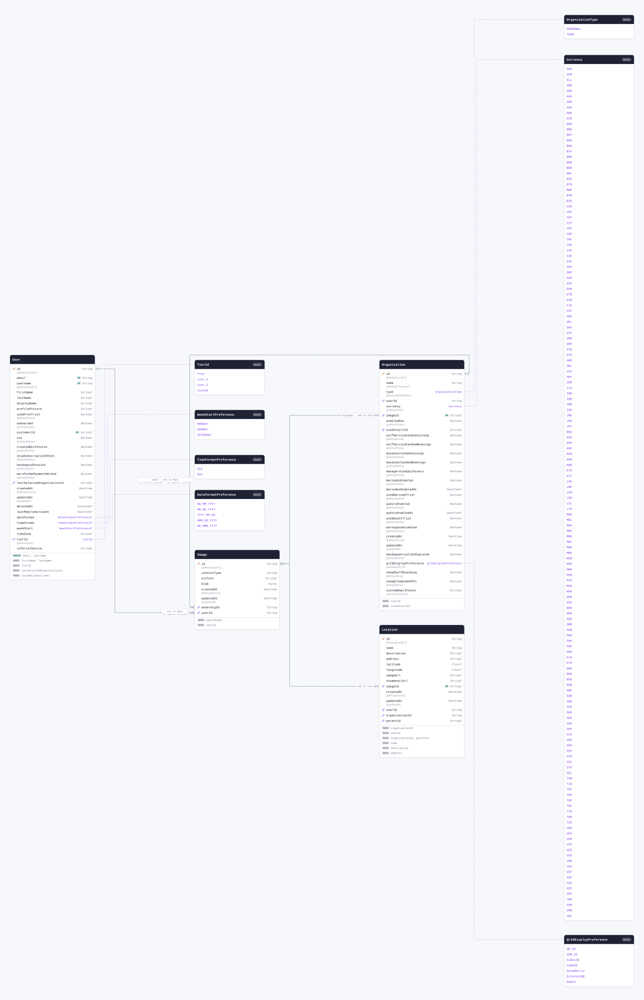

| Field         | Type       | Constraints                                       | Default      | Description |
| ------------- | ---------- | ------------------------------------------------- | ------------ | ----------- |
| `id`          | `String`   | PK NOT NULL                                       | `cuid(1)`    |             |
| `contentType` | `String`   | NOT NULL                                          |              |             |
| `altText`     | `String`   | NULL                                              |              |             |
| `blob`        | `Bytes`    | NOT NULL                                          |              |             |
| `createdAt`   | `DateTime` | NOT NULL                                          | `now()`      |             |
| `updatedAt`   | `DateTime` | NOT NULL                                          | `@updatedAt` |             |
| `ownerOrgId`  | `String`   | NOT NULL → [Organization.id](#model-Organization) |              |             |
| `userId`      | `String`   | NOT NULL → [User.id](#model-User)                 |              |             |

#### Indexes

- `@@index([ownerOrgId])`
- `@@index([userId])`

#### References

- `ownerOrgId` → [Organization.id](#model-Organization) (many-to-one, on delete Cascade, on update Cascade)
- `userId` → [User.id](#model-User) (many-to-one, on update Cascade)

#### Referenced by

- `id` ← [Location.imageId](#model-Location) (one-to-one)
- `id` ← [Organization.imageId](#model-Organization) (one-to-one)

#### Definition

```sql
CREATE TABLE "Image" (
    "id" TEXT NOT NULL,
    "contentType" TEXT NOT NULL,
    "altText" TEXT,
    "blob" BYTEA NOT NULL,
    "createdAt" TIMESTAMP(3) NOT NULL DEFAULT CURRENT_TIMESTAMP,
    "updatedAt" TIMESTAMP(3) NOT NULL,
    "ownerOrgId" TEXT NOT NULL,
    "userId" TEXT NOT NULL,

    CONSTRAINT "Image_pkey" PRIMARY KEY ("id")
);

CREATE INDEX "Image_ownerOrgId_idx" ON "Image"("ownerOrgId");

CREATE INDEX "Image_userId_idx" ON "Image"("userId");

ALTER TABLE "Image" ADD CONSTRAINT "Image_ownerOrgId_fkey" FOREIGN KEY ("ownerOrgId") REFERENCES "Organization"("id") ON DELETE CASCADE ON UPDATE CASCADE;

ALTER TABLE "Image" ADD CONSTRAINT "Image_userId_fkey" FOREIGN KEY ("userId") REFERENCES "User"("id") ON DELETE RESTRICT ON UPDATE CASCADE;
```

<details>
<summary>Queries and their SQL</summary>

**findMany**: Every row

```ts
await prisma.image.findMany();
```

```sql
SELECT
  "public"."Image"."id",
  "public"."Image"."contentType",
  "public"."Image"."altText",
  "public"."Image"."blob",
  "public"."Image"."createdAt",
  "public"."Image"."updatedAt",
  "public"."Image"."ownerOrgId",
  "public"."Image"."userId"
FROM
  "public"."Image"
WHERE
  1 = 1
OFFSET
  $1
-- params: ["0"]
```

**count**: How many rows there are

```ts
await prisma.image.count();
```

```sql
SELECT
  COUNT(*) AS "_count$_all"
FROM
  (
    SELECT
      "public"."Image"."id"
    FROM
      "public"."Image"
    WHERE
      1 = 1
    OFFSET
      $1
  ) AS "sub"
-- params: ["0"]
```

**findMany**: Every row with its relations

```ts
await prisma.image.findMany({
  include: { location: true, organization: true, ownerOrg: true, user: true },
});
```

```sql
SELECT
  "public"."Image"."id",
  "public"."Image"."contentType",
  "public"."Image"."altText",
  "public"."Image"."blob",
  "public"."Image"."createdAt",
  "public"."Image"."updatedAt",
  "public"."Image"."ownerOrgId",
  "public"."Image"."userId"
FROM
  "public"."Image"
WHERE
  1 = 1
OFFSET
  $1
-- params: ["0"]

SELECT
  "public"."Location"."id",
  "public"."Location"."name",
  "public"."Location"."description",
  "public"."Location"."address",
  "public"."Location"."latitude",
  "public"."Location"."longitude",
  "public"."Location"."imageUrl",
  "public"."Location"."thumbnailUrl",
  "public"."Location"."imageId",
  "public"."Location"."createdAt",
  "public"."Location"."updatedAt",
  "public"."Location"."userId",
  "public"."Location"."organizationId",
  "public"."Location"."parentId"
FROM
  "public"."Location"
WHERE
  "public"."Location"."imageId" IN ($1)
OFFSET
  $2
-- params: ["<id of the rows above>","0"]

SELECT
  "public"."Organization"."id",
  "public"."Organization"."name",
  "public"."Organization"."type"::text,
  "public"."Organization"."userId",
  "public"."Organization"."currency"::text,
  "public"."Organization"."imageId",
  "public"."Organization"."enabledSso",
  "public"."Organization"."ssoDetailsId",
  "public"."Organization"."selfServiceCanSeeCustody",
  "public"."Organization"."selfServiceCanSeeBookings",
  "public"."Organization"."baseUserCanSeeCustody",
  "public"."Organization"."baseUserCanSeeBookings",
  "public"."Organization"."managersCanEditAssets",
  "public"."Organization"."barcodesEnabled",
  "public"."Organization"."barcodesEnabledAt",
  "public"."Organization"."usedBarcodeTrial",
  "public"."Organization"."auditsEnabled",
  "public"."Organization"."auditsEnabledAt",
  "public"."Organization"."usedAuditTrial",
  "public"."Organization"."workspaceDisabled",
  "public"."Organization"."createdAt",
  "public"."Organization"."updatedAt",
  "public"."Organization"."hasSequentialIdsMigrated",
  "public"."Organization"."qrIdDisplayPreference"::text,
  "public"."Organization"."showShelfBranding",
  "public"."Organization"."showQrCodesOnPdfs",
  "public"."Organization"."customEmailFooter"
FROM
  "public"."Organization"
WHERE
  "public"."Organization"."imageId" IN ($1)
OFFSET
  $2
-- params: ["<id of the rows above>","0"]

SELECT
  "public"."Organization"."id",
  "public"."Organization"."name",
  "public"."Organization"."type"::text,
  "public"."Organization"."userId",
  "public"."Organization"."currency"::text,
  "public"."Organization"."imageId",
  "public"."Organization"."enabledSso",
  "public"."Organization"."ssoDetailsId",
  "public"."Organization"."selfServiceCanSeeCustody",
  "public"."Organization"."selfServiceCanSeeBookings",
  "public"."Organization"."baseUserCanSeeCustody",
  "public"."Organization"."baseUserCanSeeBookings",
  "public"."Organization"."managersCanEditAssets",
  "public"."Organization"."barcodesEnabled",
  "public"."Organization"."barcodesEnabledAt",
  "public"."Organization"."usedBarcodeTrial",
  "public"."Organization"."auditsEnabled",
  "public"."Organization"."auditsEnabledAt",
  "public"."Organization"."usedAuditTrial",
  "public"."Organization"."workspaceDisabled",
  "public"."Organization"."createdAt",
  "public"."Organization"."updatedAt",
  "public"."Organization"."hasSequentialIdsMigrated",
  "public"."Organization"."qrIdDisplayPreference"::text,
  "public"."Organization"."showShelfBranding",
  "public"."Organization"."showQrCodesOnPdfs",
  "public"."Organization"."customEmailFooter"
FROM
  "public"."Organization"
WHERE
  "public"."Organization"."id" IN ($1)
OFFSET
  $2
-- params: ["<ownerOrgId of the rows above>","0"]

SELECT
  "public"."User"."id",
  "public"."User"."email",
  "public"."User"."username",
  "public"."User"."firstName",
  "public"."User"."lastName",
  "public"."User"."displayName",
  "public"."User"."profilePicture",
  "public"."User"."usedFreeTrial",
  "public"."User"."onboarded",
  "public"."User"."customerId",
  "public"."User"."sso",
  "public"."User"."createdWithInvite",
  "public"."User"."skipSubscriptionCheck",
  "public"."User"."hasUnpaidInvoice",
  "public"."User"."warnForNoPaymentMethod",
  "public"."User"."lastSelectedOrganizationId",
  "public"."User"."createdAt",
  "public"."User"."updatedAt",
  "public"."User"."deletedAt",
  "public"."User"."lastMobileActiveAt",
  "public"."User"."dateFormat"::text,
  "public"."User"."timeFormat"::text,
  "public"."User"."weekStart"::text,
  "public"."User"."timeZone",
  "public"."User"."tierId"::text,
  "public"."User"."referralSource"
FROM
  "public"."User"
WHERE
  "public"."User"."id" IN ($1)
OFFSET
  $2
-- params: ["<userId of the rows above>","0"]
```

**findUnique**: One row by what is unique to it

```ts
await prisma.image.findUnique({ where: { id: "example" } });
```

```sql
SELECT
  "public"."Image"."id",
  "public"."Image"."contentType",
  "public"."Image"."altText",
  "public"."Image"."blob",
  "public"."Image"."createdAt",
  "public"."Image"."updatedAt",
  "public"."Image"."ownerOrgId",
  "public"."Image"."userId"
FROM
  "public"."Image"
WHERE
  (
    "public"."Image"."id" = $1
    AND 1 = 1
  )
LIMIT
  $2
OFFSET
  $3
-- params: ["example","1","0"]
```

**create**: Create a row

```ts
await prisma.image.create({
  data: {
    contentType: "example",
    blob: Uint8Array.from([1, 2, 3]),
    ownerOrgId: "example",
    userId: "example",
  },
});
```

```sql
INSERT INTO
  "public"."Image" (
    "id",
    "contentType",
    "blob",
    "createdAt",
    "updatedAt",
    "ownerOrgId",
    "userId"
  )
VALUES
  ($1, $2, $3, $4, $5, $6, $7)
RETURNING
  "public"."Image"."id",
  "public"."Image"."contentType",
  "public"."Image"."altText",
  "public"."Image"."blob",
  "public"."Image"."createdAt",
  "public"."Image"."updatedAt",
  "public"."Image"."ownerOrgId",
  "public"."Image"."userId"
-- params: ["<cuid(1)>","example","AQID","<now()>","<now()>","example","example"]
```

**update**: Update a row

```ts
await prisma.image.update({ where: { id: "example" }, data: { contentType: "example" } });
```

```sql
UPDATE "public"."Image"
SET
  "contentType" = $1,
  "updatedAt" = $2
WHERE
  (
    "public"."Image"."id" = $3
    AND 1 = 1
  )
RETURNING
  "public"."Image"."id",
  "public"."Image"."contentType",
  "public"."Image"."altText",
  "public"."Image"."blob",
  "public"."Image"."createdAt",
  "public"."Image"."updatedAt",
  "public"."Image"."ownerOrgId",
  "public"."Image"."userId"
-- params: ["example",{"prisma__type":"generatorCall","prisma__value":{"name":"now","args":[],"returnType":{"type":"DateTime"}}},"example"]
```

**delete**: Delete a row

```ts
await prisma.image.delete({ where: { id: "example" } });
```

```sql
DELETE FROM "public"."Image"
WHERE
  (
    "public"."Image"."id" = $1
    AND 1 = 1
  )
RETURNING
  "public"."Image"."id",
  "public"."Image"."contentType",
  "public"."Image"."altText",
  "public"."Image"."blob",
  "public"."Image"."createdAt",
  "public"."Image"."updatedAt",
  "public"."Image"."ownerOrgId",
  "public"."Image"."userId"
-- params: ["example"]
```

</details>

<a id="model-User"></a>

### User

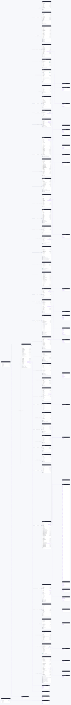

| Field                        | Type                                                 | Constraints                                   | Default      | Description |
| ---------------------------- | ---------------------------------------------------- | --------------------------------------------- | ------------ | ----------- |
| `id`                         | `String`                                             | PK NOT NULL                                   | `cuid(1)`    |             |
| `email`                      | `String`                                             | UNIQUE NOT NULL                               |              |             |
| `username`                   | `String`                                             | UNIQUE NOT NULL                               | `cuid(1)`    |             |
| `firstName`                  | `String`                                             | NULL                                          |              |             |
| `lastName`                   | `String`                                             | NULL                                          |              |             |
| `displayName`                | `String`                                             | NULL                                          |              |             |
| `profilePicture`             | `String`                                             | NULL                                          |              |             |
| `usedFreeTrial`              | `Boolean`                                            | NOT NULL                                      | `false`      |             |
| `onboarded`                  | `Boolean`                                            | NOT NULL                                      | `false`      |             |
| `customerId`                 | `String`                                             | UNIQUE NULL                                   |              |             |
| `sso`                        | `Boolean`                                            | NOT NULL                                      | `false`      |             |
| `createdWithInvite`          | `Boolean`                                            | NOT NULL                                      | `false`      |             |
| `skipSubscriptionCheck`      | `Boolean`                                            | NOT NULL                                      | `false`      |             |
| `hasUnpaidInvoice`           | `Boolean`                                            | NOT NULL                                      | `false`      |             |
| `warnForNoPaymentMethod`     | `Boolean`                                            | NOT NULL                                      | `false`      |             |
| `lastSelectedOrganizationId` | `String`                                             | NULL → [Organization.id](#model-Organization) |              |             |
| `createdAt`                  | `DateTime`                                           | NOT NULL                                      | `now()`      |             |
| `updatedAt`                  | `DateTime`                                           | NOT NULL                                      | `@updatedAt` |             |
| `deletedAt`                  | `DateTime`                                           | NULL                                          |              |             |
| `lastMobileActiveAt`         | `DateTime`                                           | NULL                                          |              |             |
| `dateFormat`                 | [`DateFormatPreference`](#enum-DateFormatPreference) | NULL                                          |              |             |
| `timeFormat`                 | [`TimeFormatPreference`](#enum-TimeFormatPreference) | NULL                                          |              |             |
| `weekStart`                  | [`WeekStartPreference`](#enum-WeekStartPreference)   | NULL                                          |              |             |
| `timeZone`                   | `String`                                             | NULL                                          |              |             |
| `tierId`                     | [`TierId`](#enum-TierId)                             | NOT NULL → [Tier.id](#model-Tier)             | `free`       |             |
| `referralSource`             | `String`                                             | NULL                                          |              |             |

#### Indexes

- `@@index([firstName, lastName])`
- `@@index([tierId])`
- `@@index([lastSelectedOrganizationId])`
- `@@index([lastMobileActiveAt])`
- `@@unique([email, username])`

#### References

- `lastSelectedOrganizationId` → [Organization.id](#model-Organization) (many-to-one, on delete SetNull)
- `tierId` → [Tier.id](#model-Tier) (many-to-one)

#### Referenced by

- `id` ← [Image.userId](#model-Image) (one-to-many, on update Cascade)
- `id` ← [UserContact.userId](#model-UserContact) (one-to-one, on delete Cascade, on update Cascade)
- `id` ← [UserBusinessIntel.userId](#model-UserBusinessIntel) (one-to-one, on delete Cascade, on update Cascade)
- `id` ← [Asset.userId](#model-Asset) (one-to-many, on delete Cascade, on update Cascade)
- `id` ← [AssetFilterPreset.ownerId](#model-AssetFilterPreset) (one-to-many, on delete Cascade)
- `id` ← [AssetIndexSettings.userId](#model-AssetIndexSettings) (one-to-many, on delete Cascade, on update Cascade)
- `id` ← [Category.userId](#model-Category) (one-to-many, on update Cascade)
- `id` ← [AssetModel.userId](#model-AssetModel) (one-to-many, on delete Cascade, on update Cascade)
- `id` ← [Tag.userId](#model-Tag) (one-to-many, on update Cascade)
- `id` ← [Note.userId](#model-Note) (one-to-many, on delete SetNull, on update Cascade)
- `id` ← [BookingNote.userId](#model-BookingNote) (one-to-many, on delete SetNull, on update Cascade)
- `id` ← [LocationNote.userId](#model-LocationNote) (one-to-many, on delete SetNull, on update Cascade)
- `id` ← [Qr.userId](#model-Qr) (one-to-many, on delete SetNull, on update Cascade)
- `id` ← [Scan.userId](#model-Scan) (one-to-many, on delete SetNull)
- `id` ← [Location.userId](#model-Location) (one-to-many, on delete Cascade, on update Cascade)
- `id` ← [TeamMember.userId](#model-TeamMember) (one-to-many, on delete SetNull, on update Cascade)
- `id` ← [Organization.userId](#model-Organization) (one-to-many, on delete Cascade, on update Cascade)
- `id` ← [UserOrganization.userId](#model-UserOrganization) (one-to-many, on delete Cascade, on update Cascade)
- `id` ← [UserScimExternalId.userId](#model-UserScimExternalId) (one-to-many, on delete Cascade, on update Cascade)
- `id` ← [CustomTierLimit.userId](#model-CustomTierLimit) (one-to-one, on delete SetNull)
- `id` ← [CustomField.userId](#model-CustomField) (one-to-many, on update Cascade)
- `id` ← [Invite.inviterId](#model-Invite) (one-to-many, on delete Cascade, on update Cascade)
- `id` ← [Invite.inviteeUserId](#model-Invite) (one-to-many, on delete Cascade, on update Cascade)
- `id` ← [ConsumptionLog.userId](#model-ConsumptionLog) (one-to-many)
- `id` ← [Booking.creatorId](#model-Booking) (one-to-many, on delete Cascade, on update Cascade)
- `id` ← [Booking.custodianUserId](#model-Booking) (one-to-many, on delete Cascade, on update Cascade)
- `id` ← [Booking.approvedById](#model-Booking) (one-to-many, on delete SetNull, on update Cascade)
- `id` ← [PartialBookingCheckin.checkedInById](#model-PartialBookingCheckin) (one-to-many)
- `id` ← [PartialBookingCheckout.checkedOutById](#model-PartialBookingCheckout) (one-to-many)
- `id` ← [MobileAuthCode.userId](#model-MobileAuthCode) (one-to-many, on delete Cascade, on update Cascade)
- `id` ← [PushToken.userId](#model-PushToken) (one-to-many, on delete Cascade, on update Cascade)
- `id` ← [NotificationPreference.userId](#model-NotificationPreference) (one-to-one, on delete Cascade, on update Cascade)
- `id` ← [Kit.createdById](#model-Kit) (one-to-many)
- `id` ← [AssetReminder.createdById](#model-AssetReminder) (one-to-many)
- `id` ← [Update.createdById](#model-Update) (one-to-many, on delete Cascade, on update Cascade)
- `id` ← [UserUpdateRead.userId](#model-UserUpdateRead) (one-to-many, on delete Cascade, on update Cascade)
- `id` ← [AuditNote.userId](#model-AuditNote) (one-to-many, on delete SetNull, on update Cascade)
- `id` ← [TeamMemberNote.userId](#model-TeamMemberNote) (one-to-many, on delete SetNull, on update Cascade)
- `id` ← [AuditSession.createdById](#model-AuditSession) (one-to-many)
- `id` ← [AssetImport.createdById](#model-AssetImport) (one-to-many, on delete Cascade, on update Cascade)
- `id` ← [AuditAssignment.userId](#model-AuditAssignment) (one-to-many, on delete Cascade, on update Cascade)
- `id` ← [AuditAsset.scannedById](#model-AuditAsset) (one-to-many, on delete SetNull, on update Cascade)
- `id` ← [AuditScan.scannedById](#model-AuditScan) (one-to-many, on delete SetNull, on update Cascade)
- `id` ← [AuditImage.uploadedById](#model-AuditImage) (one-to-many, on delete SetNull, on update Cascade)
- `id` ← [RoleChangeLog.userId](#model-RoleChangeLog) (one-to-many)
- `id` ← [RoleChangeLog.changedById](#model-RoleChangeLog) (one-to-many)

#### Many to many

- `roles` ↔ [Role.users](#model-Role) through `_RoleToUser`

#### Definition

```sql
CREATE TABLE "User" (
    "id" TEXT NOT NULL,
    "email" TEXT NOT NULL,
    "username" TEXT NOT NULL,
    "firstName" TEXT,
    "lastName" TEXT,
    "displayName" TEXT,
    "profilePicture" TEXT,
    "usedFreeTrial" BOOLEAN NOT NULL DEFAULT false,
    "onboarded" BOOLEAN NOT NULL DEFAULT false,
    "customerId" TEXT,
    "sso" BOOLEAN NOT NULL DEFAULT false,
    "createdWithInvite" BOOLEAN NOT NULL DEFAULT false,
    "skipSubscriptionCheck" BOOLEAN NOT NULL DEFAULT false,
    "hasUnpaidInvoice" BOOLEAN NOT NULL DEFAULT false,
    "warnForNoPaymentMethod" BOOLEAN NOT NULL DEFAULT false,
    "lastSelectedOrganizationId" TEXT,
    "createdAt" TIMESTAMP(3) NOT NULL DEFAULT CURRENT_TIMESTAMP,
    "updatedAt" TIMESTAMP(3) NOT NULL,
    "deletedAt" TIMESTAMP(3),
    "lastMobileActiveAt" TIMESTAMP(3),
    "dateFormat" "DateFormatPreference",
    "timeFormat" "TimeFormatPreference",
    "weekStart" "WeekStartPreference",
    "timeZone" TEXT,
    "tierId" "TierId" NOT NULL DEFAULT 'free',
    "referralSource" TEXT,

    CONSTRAINT "User_pkey" PRIMARY KEY ("id")
);

CREATE UNIQUE INDEX "User_email_key" ON "User"("email");

CREATE UNIQUE INDEX "User_username_key" ON "User"("username");

CREATE UNIQUE INDEX "User_customerId_key" ON "User"("customerId");

CREATE INDEX "User_firstName_lastName_idx" ON "User"("firstName", "lastName");

CREATE INDEX "User_tierId_idx" ON "User"("tierId");

CREATE INDEX "User_lastSelectedOrganizationId_idx" ON "User"("lastSelectedOrganizationId");

CREATE INDEX "User_lastMobileActiveAt_idx" ON "User"("lastMobileActiveAt");

CREATE UNIQUE INDEX "User_email_username_key" ON "User"("email", "username");

ALTER TABLE "User" ADD CONSTRAINT "User_lastSelectedOrganizationId_fkey" FOREIGN KEY ("lastSelectedOrganizationId") REFERENCES "Organization"("id") ON DELETE SET NULL ON UPDATE CASCADE;

ALTER TABLE "User" ADD CONSTRAINT "User_tierId_fkey" FOREIGN KEY ("tierId") REFERENCES "Tier"("id") ON DELETE RESTRICT ON UPDATE CASCADE;
```

<details>
<summary>Queries and their SQL</summary>

**findMany**: Every row

```ts
await prisma.user.findMany();
```

```sql
SELECT
  "public"."User"."id",
  "public"."User"."email",
  "public"."User"."username",
  "public"."User"."firstName",
  "public"."User"."lastName",
  "public"."User"."displayName",
  "public"."User"."profilePicture",
  "public"."User"."usedFreeTrial",
  "public"."User"."onboarded",
  "public"."User"."customerId",
  "public"."User"."sso",
  "public"."User"."createdWithInvite",
  "public"."User"."skipSubscriptionCheck",
  "public"."User"."hasUnpaidInvoice",
  "public"."User"."warnForNoPaymentMethod",
  "public"."User"."lastSelectedOrganizationId",
  "public"."User"."createdAt",
  "public"."User"."updatedAt",
  "public"."User"."deletedAt",
  "public"."User"."lastMobileActiveAt",
  "public"."User"."dateFormat"::text,
  "public"."User"."timeFormat"::text,
  "public"."User"."weekStart"::text,
  "public"."User"."timeZone",
  "public"."User"."tierId"::text,
  "public"."User"."referralSource"
FROM
  "public"."User"
WHERE
  1 = 1
OFFSET
  $1
-- params: ["0"]
```

**count**: How many rows there are

```ts
await prisma.user.count();
```

```sql
SELECT
  COUNT(*) AS "_count$_all"
FROM
  (
    SELECT
      "public"."User"."id"
    FROM
      "public"."User"
    WHERE
      1 = 1
    OFFSET
      $1
  ) AS "sub"
-- params: ["0"]
```

**findMany**: Every row with its relations

```ts
await prisma.user.findMany({
  include: {
    lastSelectedOrganization: true,
    assets: true,
    categories: true,
    notes: true,
    bookingNotes: true,
    auditNotes: true,
    locationNotes: true,
    qrCodes: true,
    scans: true,
    tags: true,
    roles: true,
    locations: true,
    images: true,
    organizations: true,
    customFields: true,
    sentInvites: true,
    receivedInvites: true,
    teamMembers: true,
    userOrganizations: true,
    bookings: true,
    custodies: true,
    approvedBookings: true,
    createdKits: true,
    tier: true,
    assetReminders: true,
    contact: true,
    businessIntel: true,
    auditsCreated: true,
    assetImports: true,
    auditAssignments: true,
    auditAssetsScanned: true,
    auditScans: true,
    auditImagesUploaded: true,
    assetIndexSettings: true,
    partialCheckins: true,
    partialCheckouts: true,
    mobileAuthCodes: true,
    pushTokens: true,
    notificationPreference: true,
    createdUpdates: true,
    updateReads: true,
    customTierLimit: true,
    assetFilterPresets: true,
    assetModels: true,
    consumptionLogs: true,
    scimExternalIds: true,
    roleChangesReceived: true,
    roleChangesPerformed: true,
    teamMemberNotesAuthored: true,
  },
});
```

```sql
SELECT
  "public"."User"."id",
  "public"."User"."email",
  "public"."User"."username",
  "public"."User"."firstName",
  "public"."User"."lastName",
  "public"."User"."displayName",
  "public"."User"."profilePicture",
  "public"."User"."usedFreeTrial",
  "public"."User"."onboarded",
  "public"."User"."customerId",
  "public"."User"."sso",
  "public"."User"."createdWithInvite",
  "public"."User"."skipSubscriptionCheck",
  "public"."User"."hasUnpaidInvoice",
  "public"."User"."warnForNoPaymentMethod",
  "public"."User"."lastSelectedOrganizationId",
  "public"."User"."createdAt",
  "public"."User"."updatedAt",
  "public"."User"."deletedAt",
  "public"."User"."lastMobileActiveAt",
  "public"."User"."dateFormat"::text,
  "public"."User"."timeFormat"::text,
  "public"."User"."weekStart"::text,
  "public"."User"."timeZone",
  "public"."User"."tierId"::text,
  "public"."User"."referralSource"
FROM
  "public"."User"
WHERE
  1 = 1
OFFSET
  $1
-- params: ["0"]

SELECT
  "public"."Organization"."id",
  "public"."Organization"."name",
  "public"."Organization"."type"::text,
  "public"."Organization"."userId",
  "public"."Organization"."currency"::text,
  "public"."Organization"."imageId",
  "public"."Organization"."enabledSso",
  "public"."Organization"."ssoDetailsId",
  "public"."Organization"."selfServiceCanSeeCustody",
  "public"."Organization"."selfServiceCanSeeBookings",
  "public"."Organization"."baseUserCanSeeCustody",
  "public"."Organization"."baseUserCanSeeBookings",
  "public"."Organization"."managersCanEditAssets",
  "public"."Organization"."barcodesEnabled",
  "public"."Organization"."barcodesEnabledAt",
  "public"."Organization"."usedBarcodeTrial",
  "public"."Organization"."auditsEnabled",
  "public"."Organization"."auditsEnabledAt",
  "public"."Organization"."usedAuditTrial",
  "public"."Organization"."workspaceDisabled",
  "public"."Organization"."createdAt",
  "public"."Organization"."updatedAt",
  "public"."Organization"."hasSequentialIdsMigrated",
  "public"."Organization"."qrIdDisplayPreference"::text,
  "public"."Organization"."showShelfBranding",
  "public"."Organization"."showQrCodesOnPdfs",
  "public"."Organization"."customEmailFooter"
FROM
  "public"."Organization"
WHERE
  "public"."Organization"."id" IN ($1)
OFFSET
  $2
-- params: ["<lastSelectedOrganizationId of the rows above>","0"]

SELECT
  "public"."Asset"."id",
  "public"."Asset"."title",
  "public"."Asset"."description",
  "public"."Asset"."mainImage",
  "public"."Asset"."thumbnailImage",
  "public"."Asset"."mainImageExpiration",
  "public"."Asset"."status"::text,
  "public"."Asset"."value",
  "public"."Asset"."availableToBook",
  "public"."Asset"."sequentialId",
  "public"."Asset"."archivedAt",
  "public"."Asset"."type"::text,
  "public"."Asset"."assetModelId",
  "public"."Asset"."quantity",
  "public"."Asset"."minQuantity",
  "public"."Asset"."consumptionType"::text,
  "public"."Asset"."unitOfMeasure",
  "public"."Asset"."lowStockNotifiedAt",
  "public"."Asset"."stockLedgerStartedAt",
  "public"."Asset"."createdAt",
  "public"."Asset"."updatedAt",
  "public"."Asset"."userId",
  "public"."Asset"."organizationId",
  "public"."Asset"."categoryId",
  "public"."Asset"."preferredBarcodeId"
FROM
  "public"."Asset"
WHERE
  "public"."Asset"."userId" IN ($1)
OFFSET
  $2
-- params: ["<id of the rows above>","0"]

SELECT
  "public"."Category"."id",
  "public"."Category"."name",
  "public"."Category"."description",
  "public"."Category"."color",
  "public"."Category"."createdAt",
  "public"."Category"."updatedAt",
  "public"."Category"."userId",
  "public"."Category"."organizationId"
FROM
  "public"."Category"
WHERE
  "public"."Category"."userId" IN ($1)
OFFSET
  $2
-- params: ["<id of the rows above>","0"]

SELECT
  "public"."Note"."id",
  "public"."Note"."content",
  "public"."Note"."type"::text,
  "public"."Note"."createdAt",
  "public"."Note"."updatedAt",
  "public"."Note"."userId",
  "public"."Note"."assetId"
FROM
  "public"."Note"
WHERE
  "public"."Note"."userId" IN ($1)
OFFSET
  $2
-- params: ["<id of the rows above>","0"]

SELECT
  "public"."BookingNote"."id",
  "public"."BookingNote"."content",
  "public"."BookingNote"."type"::text,
  "public"."BookingNote"."createdAt",
  "public"."BookingNote"."updatedAt",
  "public"."BookingNote"."userId",
  "public"."BookingNote"."bookingId"
FROM
  "public"."BookingNote"
WHERE
  "public"."BookingNote"."userId" IN ($1)
OFFSET
  $2
-- params: ["<id of the rows above>","0"]

SELECT
  "public"."AuditNote"."id",
  "public"."AuditNote"."content",
  "public"."AuditNote"."type"::text,
  "public"."AuditNote"."createdAt",
  "public"."AuditNote"."updatedAt",
  "public"."AuditNote"."userId",
  "public"."AuditNote"."auditSessionId",
  "public"."AuditNote"."auditAssetId"
FROM
  "public"."AuditNote"
WHERE
  "public"."AuditNote"."userId" IN ($1)
OFFSET
  $2
-- params: ["<id of the rows above>","0"]

SELECT
  "public"."LocationNote"."id",
  "public"."LocationNote"."content",
  "public"."LocationNote"."type"::text,
  "public"."LocationNote"."createdAt",
  "public"."LocationNote"."updatedAt",
  "public"."LocationNote"."userId",
  "public"."LocationNote"."locationId"
FROM
  "public"."LocationNote"
WHERE
  "public"."LocationNote"."userId" IN ($1)
OFFSET
  $2
-- params: ["<id of the rows above>","0"]

SELECT
  "public"."Qr"."id",
  "public"."Qr"."version",
  "public"."Qr"."errorCorrection"::text,
  "public"."Qr"."assetId",
  "public"."Qr"."kitId",
  "public"."Qr"."userId",
  "public"."Qr"."organizationId",
  "public"."Qr"."batchId",
  "public"."Qr"."createdAt",
  "public"."Qr"."updatedAt"
FROM
  "public"."Qr"
WHERE
  "public"."Qr"."userId" IN ($1)
OFFSET
  $2
-- params: ["<id of the rows above>","0"]

SELECT
  "public"."Scan"."id",
  "public"."Scan"."latitude",
  "public"."Scan"."longitude",
  "public"."Scan"."userAgent",
  "public"."Scan"."userId",
  "public"."Scan"."qrId",
  "public"."Scan"."rawQrId",
  "public"."Scan"."codeType"::text,
  "public"."Scan"."code",
  "public"."Scan"."barcodeId",
  "public"."Scan"."assetId",
  "public"."Scan"."kitId",
  "public"."Scan"."organizationId",
  "public"."Scan"."source"::text,
  "public"."Scan"."manuallyGenerated",
  "public"."Scan"."createdAt",
  "public"."Scan"."updatedAt"
FROM
  "public"."Scan"
WHERE
  "public"."Scan"."userId" IN ($1)
OFFSET
  $2
-- params: ["<id of the rows above>","0"]

SELECT
  "public"."Tag"."id",
  "public"."Tag"."name",
  "public"."Tag"."description",
  "public"."Tag"."color",
  "public"."Tag"."useFor"::text[],
  "public"."Tag"."userId",
  "public"."Tag"."organizationId",
  "public"."Tag"."createdAt",
  "public"."Tag"."updatedAt"
FROM
  "public"."Tag"
WHERE
  "public"."Tag"."userId" IN ($1)
OFFSET
  $2
-- params: ["<id of the rows above>","0"]

SELECT
  "public"."Role"."id",
  "public"."Role"."name"::text,
  "public"."Role"."createdAt",
  "public"."Role"."updatedAt",
  "t0"."B" AS "RoleToUser@User"
FROM
  "public"."Role"
  INNER JOIN "public"."_RoleToUser" AS "t0" ON "t0"."A" = "public"."Role"."id"
WHERE
  (
    1 = 1
    AND "t0"."B" IN ($1)
  )
OFFSET
  $2
-- params: ["<id of the rows above>","0"]

SELECT
  "public"."Location"."id",
  "public"."Location"."name",
  "public"."Location"."description",
  "public"."Location"."address",
  "public"."Location"."latitude",
  "public"."Location"."longitude",
  "public"."Location"."imageUrl",
  "public"."Location"."thumbnailUrl",
  "public"."Location"."imageId",
  "public"."Location"."createdAt",
  "public"."Location"."updatedAt",
  "public"."Location"."userId",
  "public"."Location"."organizationId",
  "public"."Location"."parentId"
FROM
  "public"."Location"
WHERE
  "public"."Location"."userId" IN ($1)
OFFSET
  $2
-- params: ["<id of the rows above>","0"]

SELECT
  "public"."Image"."id",
  "public"."Image"."contentType",
  "public"."Image"."altText",
  "public"."Image"."blob",
  "public"."Image"."createdAt",
  "public"."Image"."updatedAt",
  "public"."Image"."ownerOrgId",
  "public"."Image"."userId"
FROM
  "public"."Image"
WHERE
  "public"."Image"."userId" IN ($1)
OFFSET
  $2
-- params: ["<id of the rows above>","0"]

SELECT
  "public"."Organization"."id",
  "public"."Organization"."name",
  "public"."Organization"."type"::text,
  "public"."Organization"."userId",
  "public"."Organization"."currency"::text,
  "public"."Organization"."imageId",
  "public"."Organization"."enabledSso",
  "public"."Organization"."ssoDetailsId",
  "public"."Organization"."selfServiceCanSeeCustody",
  "public"."Organization"."selfServiceCanSeeBookings",
  "public"."Organization"."baseUserCanSeeCustody",
  "public"."Organization"."baseUserCanSeeBookings",
  "public"."Organization"."managersCanEditAssets",
  "public"."Organization"."barcodesEnabled",
  "public"."Organization"."barcodesEnabledAt",
  "public"."Organization"."usedBarcodeTrial",
  "public"."Organization"."auditsEnabled",
  "public"."Organization"."auditsEnabledAt",
  "public"."Organization"."usedAuditTrial",
  "public"."Organization"."workspaceDisabled",
  "public"."Organization"."createdAt",
  "public"."Organization"."updatedAt",
  "public"."Organization"."hasSequentialIdsMigrated",
  "public"."Organization"."qrIdDisplayPreference"::text,
  "public"."Organization"."showShelfBranding",
  "public"."Organization"."showQrCodesOnPdfs",
  "public"."Organization"."customEmailFooter"
FROM
  "public"."Organization"
WHERE
  "public"."Organization"."userId" IN ($1)
OFFSET
  $2
-- params: ["<id of the rows above>","0"]

SELECT
  "public"."CustomField"."id",
  "public"."CustomField"."name",
  "public"."CustomField"."helpText",
  "public"."CustomField"."required",
  "public"."CustomField"."active",
  "public"."CustomField"."type"::text,
  "public"."CustomField"."options",
  "public"."CustomField"."format"::text,
  "public"."CustomField"."organizationId",
  "public"."CustomField"."userId",
  "public"."CustomField"."createdAt",
  "public"."CustomField"."updatedAt",
  "public"."CustomField"."deletedAt"
FROM
  "public"."CustomField"
WHERE
  "public"."CustomField"."userId" IN ($1)
OFFSET
  $2
-- params: ["<id of the rows above>","0"]

SELECT
  "public"."Invite"."id",
  "public"."Invite"."inviterId",
  "public"."Invite"."organizationId",
  "public"."Invite"."inviteeUserId",
  "public"."Invite"."teamMemberId",
  "public"."Invite"."inviteeEmail",
  "public"."Invite"."status"::text,
  "public"."Invite"."inviteCode",
  "public"."Invite"."roles"::text[],
  "public"."Invite"."inviteMessage",
  "public"."Invite"."expiresAt",
  "public"."Invite"."createdAt",
  "public"."Invite"."updatedAt"
FROM
  "public"."Invite"
WHERE
  "public"."Invite"."inviterId" IN ($1)
OFFSET
  $2
-- params: ["<id of the rows above>","0"]

SELECT
  "public"."Invite"."id",
  "public"."Invite"."inviterId",
  "public"."Invite"."organizationId",
  "public"."Invite"."inviteeUserId",
  "public"."Invite"."teamMemberId",
  "public"."Invite"."inviteeEmail",
  "public"."Invite"."status"::text,
  "public"."Invite"."inviteCode",
  "public"."Invite"."roles"::text[],
  "public"."Invite"."inviteMessage",
  "public"."Invite"."expiresAt",
  "public"."Invite"."createdAt",
  "public"."Invite"."updatedAt"
FROM
  "public"."Invite"
WHERE
  "public"."Invite"."inviteeUserId" IN ($1)
OFFSET
  $2
-- params: ["<id of the rows above>","0"]

SELECT
  "public"."TeamMember"."id",
  "public"."TeamMember"."name",
  "public"."TeamMember"."organizationId",
  "public"."TeamMember"."userId",
  "public"."TeamMember"."createdAt",
  "public"."TeamMember"."updatedAt",
  "public"."TeamMember"."deletedAt"
FROM
  "public"."TeamMember"
WHERE
  "public"."TeamMember"."userId" IN ($1)
OFFSET
  $2
-- params: ["<id of the rows above>","0"]

SELECT
  "public"."UserOrganization"."id",
  "public"."UserOrganization"."userId",
  "public"."UserOrganization"."organizationId",
  "public"."UserOrganization"."roles"::text[],
  "public"."UserOrganization"."createdAt",
  "public"."UserOrganization"."updatedAt",
  "public"."UserOrganization"."calendarTokenId"
FROM
  "public"."UserOrganization"
WHERE
  "public"."UserOrganization"."userId" IN ($1)
OFFSET
  $2
-- params: ["<id of the rows above>","0"]

SELECT
  "public"."Booking"."id",
  "public"."Booking"."name",
  "public"."Booking"."status"::text,
  "public"."Booking"."description",
  "public"."Booking"."activeSchedulerReference",
  "public"."Booking"."creatorId",
  "public"."Booking"."custodianUserId",
  "public"."Booking"."custodianTeamMemberId",
  "public"."Booking"."organizationId",
  "public"."Booking"."createdAt",
  "public"."Booking"."updatedAt",
  "public"."Booking"."from",
  "public"."Booking"."to",
  "public"."Booking"."originalFrom",
  "public"."Booking"."originalTo",
  "public"."Booking"."autoArchivedAt",
  "public"."Booking"."archivedWithoutCheckin",
  "public"."Booking"."cancellationReason",
  "public"."Booking"."approvedAt",
  "public"."Booking"."approvedById"
FROM
  "public"."Booking"
WHERE
  "public"."Booking"."creatorId" IN ($1)
OFFSET
  $2
-- params: ["<id of the rows above>","0"]

SELECT
  "public"."Booking"."id",
  "public"."Booking"."name",
  "public"."Booking"."status"::text,
  "public"."Booking"."description",
  "public"."Booking"."activeSchedulerReference",
  "public"."Booking"."creatorId",
  "public"."Booking"."custodianUserId",
  "public"."Booking"."custodianTeamMemberId",
  "public"."Booking"."organizationId",
  "public"."Booking"."createdAt",
  "public"."Booking"."updatedAt",
  "public"."Booking"."from",
  "public"."Booking"."to",
  "public"."Booking"."originalFrom",
  "public"."Booking"."originalTo",
  "public"."Booking"."autoArchivedAt",
  "public"."Booking"."archivedWithoutCheckin",
  "public"."Booking"."cancellationReason",
  "public"."Booking"."approvedAt",
  "public"."Booking"."approvedById"
FROM
  "public"."Booking"
WHERE
  "public"."Booking"."custodianUserId" IN ($1)
OFFSET
  $2
-- params: ["<id of the rows above>","0"]

SELECT
  "public"."Booking"."id",
  "public"."Booking"."name",
  "public"."Booking"."status"::text,
  "public"."Booking"."description",
  "public"."Booking"."activeSchedulerReference",
  "public"."Booking"."creatorId",
  "public"."Booking"."custodianUserId",
  "public"."Booking"."custodianTeamMemberId",
  "public"."Booking"."organizationId",
  "public"."Booking"."createdAt",
  "public"."Booking"."updatedAt",
  "public"."Booking"."from",
  "public"."Booking"."to",
  "public"."Booking"."originalFrom",
  "public"."Booking"."originalTo",
  "public"."Booking"."autoArchivedAt",
  "public"."Booking"."archivedWithoutCheckin",
  "public"."Booking"."cancellationReason",
  "public"."Booking"."approvedAt",
  "public"."Booking"."approvedById"
FROM
  "public"."Booking"
WHERE
  "public"."Booking"."approvedById" IN ($1)
OFFSET
  $2
-- params: ["<id of the rows above>","0"]

SELECT
  "public"."Kit"."id",
  "public"."Kit"."name",
  "public"."Kit"."description",
  "public"."Kit"."status"::text,
  "public"."Kit"."image",
  "public"."Kit"."imageExpiration",
  "public"."Kit"."organizationId",
  "public"."Kit"."createdById",
  "public"."Kit"."categoryId",
  "public"."Kit"."createdAt",
  "public"."Kit"."updatedAt",
  "public"."Kit"."locationId"
FROM
  "public"."Kit"
WHERE
  "public"."Kit"."createdById" IN ($1)
OFFSET
  $2
-- params: ["<id of the rows above>","0"]

SELECT
  "public"."Tier"."id"::text,
  "public"."Tier"."name",
  "public"."Tier"."tierLimitId"::text,
  "public"."Tier"."createdAt",
  "public"."Tier"."updatedAt"
FROM
  "public"."Tier"
WHERE
  "public"."Tier"."id" IN ($1)
OFFSET
  $2
-- params: ["<tierId of the rows above>","0"]

SELECT
  "public"."AssetReminder"."id",
  "public"."AssetReminder"."name",
  "public"."AssetReminder"."message",
  "public"."AssetReminder"."alertDateTime",
  "public"."AssetReminder"."activeSchedulerReference",
  "public"."AssetReminder"."recurrenceUnit"::text,
  "public"."AssetReminder"."recurrenceInterval",
  "public"."AssetReminder"."recurrenceTimezone",
  "public"."AssetReminder"."recurrenceEndsAt",
  "public"."AssetReminder"."organizationId",
  "public"."AssetReminder"."assetId",
  "public"."AssetReminder"."createdById",
  "public"."AssetReminder"."createdAt",
  "public"."AssetReminder"."updatedAt"
FROM
  "public"."AssetReminder"
WHERE
  "public"."AssetReminder"."createdById" IN ($1)
OFFSET
  $2
-- params: ["<id of the rows above>","0"]

SELECT
  "public"."UserContact"."id",
  "public"."UserContact"."phone",
  "public"."UserContact"."street",
  "public"."UserContact"."city",
  "public"."UserContact"."stateProvince",
  "public"."UserContact"."zipPostalCode",
  "public"."UserContact"."countryRegion",
  "public"."UserContact"."userId",
  "public"."UserContact"."createdAt",
  "public"."UserContact"."updatedAt"
FROM
  "public"."UserContact"
WHERE
  "public"."UserContact"."userId" IN ($1)
OFFSET
  $2
-- params: ["<id of the rows above>","0"]

SELECT
  "public"."UserBusinessIntel"."id",
  "public"."UserBusinessIntel"."howDidYouHearAboutUs",
  "public"."UserBusinessIntel"."jobTitle",
  "public"."UserBusinessIntel"."teamSize",
  "public"."UserBusinessIntel"."companyName",
  "public"."UserBusinessIntel"."primaryUseCase",
  "public"."UserBusinessIntel"."currentSolution",
  "public"."UserBusinessIntel"."timeline",
  "public"."UserBusinessIntel"."signupPlan",
  "public"."UserBusinessIntel"."signupTrial",
  "public"."UserBusinessIntel"."utmSource",
  "public"."UserBusinessIntel"."utmMedium",
  "public"."UserBusinessIntel"."utmCampaign",
  "public"."UserBusinessIntel"."utmContent",
  "public"."UserBusinessIntel"."userId",
  "public"."UserBusinessIntel"."createdAt",
  "public"."UserBusinessIntel"."updatedAt"
FROM
  "public"."UserBusinessIntel"
WHERE
  "public"."UserBusinessIntel"."userId" IN ($1)
OFFSET
  $2
-- params: ["<id of the rows above>","0"]

SELECT
  "public"."AuditSession"."id",
  "public"."AuditSession"."name",
  "public"."AuditSession"."description",
  "public"."AuditSession"."targetId",
  "public"."AuditSession"."status"::text,
  "public"."AuditSession"."scopeMeta",
  "public"."AuditSession"."expectedAssetCount",
  "public"."AuditSession"."foundAssetCount",
  "public"."AuditSession"."missingAssetCount",
  "public"."AuditSession"."unexpectedAssetCount",
  "public"."AuditSession"."startedAt",
  "public"."AuditSession"."dueDate",
  "public"."AuditSession"."completedAt",
  "public"."AuditSession"."cancelledAt",
  "public"."AuditSession"."activeSchedulerReference",
  "public"."AuditSession"."createdById",
  "public"."AuditSession"."organizationId",
  "public"."AuditSession"."createdAt",
  "public"."AuditSession"."updatedAt"
FROM
  "public"."AuditSession"
WHERE
  "public"."AuditSession"."createdById" IN ($1)
OFFSET
  $2
-- params: ["<id of the rows above>","0"]

SELECT
  "public"."AssetImport"."id",
  "public"."AssetImport"."status"::text,
  "public"."AssetImport"."phase"::text,
  "public"."AssetImport"."fileName",
  "public"."AssetImport"."totalRows",
  "public"."AssetImport"."processedRows",
  "public"."AssetImport"."rows",
  "public"."AssetImport"."resolved",
  "public"."AssetImport"."canUseBarcodes",
  "public"."AssetImport"."errorMessage",
  "public"."AssetImport"."warnings",
  "public"."AssetImport"."warningCount",
  "public"."AssetImport"."lockedUntil",
  "public"."AssetImport"."confirmedAt",
  "public"."AssetImport"."startedAt",
  "public"."AssetImport"."completedAt",
  "public"."AssetImport"."createdAt",
  "public"."AssetImport"."updatedAt",
  "public"."AssetImport"."createdById",
  "public"."AssetImport"."organizationId"
FROM
  "public"."AssetImport"
WHERE
  "public"."AssetImport"."createdById" IN ($1)
OFFSET
  $2
-- params: ["<id of the rows above>","0"]

SELECT
  "public"."AuditAssignment"."id",
  "public"."AuditAssignment"."auditSessionId",
  "public"."AuditAssignment"."userId",
  "public"."AuditAssignment"."role"::text,
  "public"."AuditAssignment"."createdAt",
  "public"."AuditAssignment"."updatedAt"
FROM
  "public"."AuditAssignment"
WHERE
  "public"."AuditAssignment"."userId" IN ($1)
OFFSET
  $2
-- params: ["<id of the rows above>","0"]

SELECT
  "public"."AuditAsset"."id",
  "public"."AuditAsset"."auditSessionId",
  "public"."AuditAsset"."assetId",
  "public"."AuditAsset"."expected",
  "public"."AuditAsset"."status"::text,
  "public"."AuditAsset"."scannedById",
  "public"."AuditAsset"."scannedAt",
  "public"."AuditAsset"."metadata",
  "public"."AuditAsset"."expectedQuantity",
  "public"."AuditAsset"."foundQuantity",
  "public"."AuditAsset"."createdAt",
  "public"."AuditAsset"."updatedAt"
FROM
  "public"."AuditAsset"
WHERE
  "public"."AuditAsset"."scannedById" IN ($1)
OFFSET
  $2
-- params: ["<id of the rows above>","0"]

SELECT
  "public"."AuditScan"."id",
  "public"."AuditScan"."auditSessionId",
  "public"."AuditScan"."auditAssetId",
  "public"."AuditScan"."assetId",
  "public"."AuditScan"."scannedById",
  "public"."AuditScan"."code",
  "public"."AuditScan"."assetTitle",
  "public"."AuditScan"."wasExpected",
  "public"."AuditScan"."metadata",
  "public"."AuditScan"."scannedAt",
  "public"."AuditScan"."createdAt"
FROM
  "public"."AuditScan"
WHERE
  "public"."AuditScan"."scannedById" IN ($1)
OFFSET
  $2
-- params: ["<id of the rows above>","0"]

SELECT
  "public"."AuditImage"."id",
  "public"."AuditImage"."imageUrl",
  "public"."AuditImage"."thumbnailUrl",
  "public"."AuditImage"."description",
  "public"."AuditImage"."auditSessionId",
  "public"."AuditImage"."auditAssetId",
  "public"."AuditImage"."uploadedById",
  "public"."AuditImage"."organizationId",
  "public"."AuditImage"."capturedAt",
  "public"."AuditImage"."captureSource"::text,
  "public"."AuditImage"."createdAt",
  "public"."AuditImage"."updatedAt"
FROM
  "public"."AuditImage"
WHERE
  "public"."AuditImage"."uploadedById" IN ($1)
OFFSET
  $2
-- params: ["<id of the rows above>","0"]

SELECT
  "public"."AssetIndexSettings"."id",
  "public"."AssetIndexSettings"."userId",
  "public"."AssetIndexSettings"."organizationId",
  "public"."AssetIndexSettings"."mode"::text,
  "public"."AssetIndexSettings"."columns",
  "public"."AssetIndexSettings"."freezeColumn",
  "public"."AssetIndexSettings"."showAssetImage",
  "public"."AssetIndexSettings"."createdAt",
  "public"."AssetIndexSettings"."updatedAt"
FROM
  "public"."AssetIndexSettings"
WHERE
  "public"."AssetIndexSettings"."userId" IN ($1)
OFFSET
  $2
-- params: ["<id of the rows above>","0"]

SELECT
  "public"."PartialBookingCheckin"."id",
  "public"."PartialBookingCheckin"."assetIds",
  "public"."PartialBookingCheckin"."checkinCount",
  "public"."PartialBookingCheckin"."checkinTimestamp",
  "public"."PartialBookingCheckin"."bookingId",
  "public"."PartialBookingCheckin"."checkedInById",
  "public"."PartialBookingCheckin"."createdAt",
  "public"."PartialBookingCheckin"."updatedAt"
FROM
  "public"."PartialBookingCheckin"
WHERE
  "public"."PartialBookingCheckin"."checkedInById" IN ($1)
OFFSET
  $2
-- params: ["<id of the rows above>","0"]

SELECT
  "public"."PartialBookingCheckout"."id",
  "public"."PartialBookingCheckout"."assetIds",
  "public"."PartialBookingCheckout"."quantities",
  "public"."PartialBookingCheckout"."bookingAssetIds",
  "public"."PartialBookingCheckout"."checkoutCount",
  "public"."PartialBookingCheckout"."checkoutTimestamp",
  "public"."PartialBookingCheckout"."bookingId",
  "public"."PartialBookingCheckout"."checkedOutById",
  "public"."PartialBookingCheckout"."createdAt",
  "public"."PartialBookingCheckout"."updatedAt"
FROM
  "public"."PartialBookingCheckout"
WHERE
  "public"."PartialBookingCheckout"."checkedOutById" IN ($1)
OFFSET
  $2
-- params: ["<id of the rows above>","0"]

SELECT
  "public"."MobileAuthCode"."id",
  "public"."MobileAuthCode"."userId",
  "public"."MobileAuthCode"."codeHash",
  "public"."MobileAuthCode"."codeChallenge",
  "public"."MobileAuthCode"."sessionCiphertext",
  "public"."MobileAuthCode"."consumedAt",
  "public"."MobileAuthCode"."expiresAt",
  "public"."MobileAuthCode"."createdAt"
FROM
  "public"."MobileAuthCode"
WHERE
  "public"."MobileAuthCode"."userId" IN ($1)
OFFSET
  $2
-- params: ["<id of the rows above>","0"]

SELECT
  "public"."PushToken"."id",
  "public"."PushToken"."token",
  "public"."PushToken"."platform"::text,
  "public"."PushToken"."deviceName",
  "public"."PushToken"."appVersion",
  "public"."PushToken"."lastSeenAt",
  "public"."PushToken"."disabledAt",
  "public"."PushToken"."userId",
  "public"."PushToken"."createdAt",
  "public"."PushToken"."updatedAt"
FROM
  "public"."PushToken"
WHERE
  "public"."PushToken"."userId" IN ($1)
OFFSET
  $2
-- params: ["<id of the rows above>","0"]

SELECT
  "public"."NotificationPreference"."userId",
  "public"."NotificationPreference"."pushEnabled",
  "public"."NotificationPreference"."bookings",
  "public"."NotificationPreference"."audits",
  "public"."NotificationPreference"."stockAndReminders",
  "public"."NotificationPreference"."updatedAt"
FROM
  "public"."NotificationPreference"
WHERE
  "public"."NotificationPreference"."userId" IN ($1)
OFFSET
  $2
-- params: ["<id of the rows above>","0"]

SELECT
  "public"."Update"."id",
  "public"."Update"."title",
  "public"."Update"."content",
  "public"."Update"."url",
  "public"."Update"."imageUrl",
  "public"."Update"."publishDate",
  "public"."Update"."status"::text,
  "public"."Update"."targetRoles"::text[],
  "public"."Update"."clickCount",
  "public"."Update"."viewCount",
  "public"."Update"."createdById",
  "public"."Update"."createdAt",
  "public"."Update"."updatedAt"
FROM
  "public"."Update"
WHERE
  "public"."Update"."createdById" IN ($1)
OFFSET
  $2
-- params: ["<id of the rows above>","0"]

SELECT
  "public"."UserUpdateRead"."id",
  "public"."UserUpdateRead"."userId",
  "public"."UserUpdateRead"."updateId",
  "public"."UserUpdateRead"."readAt"
FROM
  "public"."UserUpdateRead"
WHERE
  "public"."UserUpdateRead"."userId" IN ($1)
OFFSET
  $2
-- params: ["<id of the rows above>","0"]

SELECT
  "public"."CustomTierLimit"."id",
  "public"."CustomTierLimit"."userId",
  "public"."CustomTierLimit"."canImportAssets",
  "public"."CustomTierLimit"."canExportAssets",
  "public"."CustomTierLimit"."canImportNRM",
  "public"."CustomTierLimit"."canHideShelfBranding",
  "public"."CustomTierLimit"."canUseReports",
  "public"."CustomTierLimit"."canUseRecurringReminders",
  "public"."CustomTierLimit"."canUsePushNotifications",
  "public"."CustomTierLimit"."maxCustomFields",
  "public"."CustomTierLimit"."maxOrganizations",
  "public"."CustomTierLimit"."isEnterprise",
  "public"."CustomTierLimit"."createdAt",
  "public"."CustomTierLimit"."updatedAt"
FROM
  "public"."CustomTierLimit"
WHERE
  "public"."CustomTierLimit"."userId" IN ($1)
OFFSET
  $2
-- params: ["<id of the rows above>","0"]

SELECT
  "public"."AssetFilterPreset"."id",
  "public"."AssetFilterPreset"."organizationId",
  "public"."AssetFilterPreset"."ownerId",
  "public"."AssetFilterPreset"."name",
  "public"."AssetFilterPreset"."query",
  "public"."AssetFilterPreset"."starred",
  "public"."AssetFilterPreset"."createdAt",
  "public"."AssetFilterPreset"."updatedAt"
FROM
  "public"."AssetFilterPreset"
WHERE
  "public"."AssetFilterPreset"."ownerId" IN ($1)
OFFSET
  $2
-- params: ["<id of the rows above>","0"]

SELECT
  "public"."AssetModel"."id",
  "public"."AssetModel"."name",
  "public"."AssetModel"."description",
  "public"."AssetModel"."image",
  "public"."AssetModel"."thumbnailImage",
  "public"."AssetModel"."defaultCategoryId",
  "public"."AssetModel"."defaultValuation",
  "public"."AssetModel"."organizationId",
  "public"."AssetModel"."userId",
  "public"."AssetModel"."createdAt",
  "public"."AssetModel"."updatedAt"
FROM
  "public"."AssetModel"
WHERE
  "public"."AssetModel"."userId" IN ($1)
OFFSET
  $2
-- params: ["<id of the rows above>","0"]

SELECT
  "public"."ConsumptionLog"."id",
  "public"."ConsumptionLog"."assetId",
  "public"."ConsumptionLog"."category"::text,
  "public"."ConsumptionLog"."quantity",
  "public"."ConsumptionLog"."note",
  "public"."ConsumptionLog"."userId",
  "public"."ConsumptionLog"."bookingId",
  "public"."ConsumptionLog"."custodianId",
  "public"."ConsumptionLog"."bookingAssetId",
  "public"."ConsumptionLog"."locationId",
  "public"."ConsumptionLog"."stockChange",
  "public"."ConsumptionLog"."createdAt"
FROM
  "public"."ConsumptionLog"
WHERE
  "public"."ConsumptionLog"."userId" IN ($1)
OFFSET
  $2
-- params: ["<id of the rows above>","0"]

SELECT
  "public"."UserScimExternalId"."id",
  "public"."UserScimExternalId"."userId",
  "public"."UserScimExternalId"."organizationId",
  "public"."UserScimExternalId"."scimExternalId",
  "public"."UserScimExternalId"."createdAt",
  "public"."UserScimExternalId"."updatedAt"
FROM
  "public"."UserScimExternalId"
WHERE
  "public"."UserScimExternalId"."userId" IN ($1)
OFFSET
  $2
-- params: ["<id of the rows above>","0"]

SELECT
  "public"."RoleChangeLog"."id",
  "public"."RoleChangeLog"."previousRole"::text,
  "public"."RoleChangeLog"."newRole"::text,
  "public"."RoleChangeLog"."source"::text,
  "public"."RoleChangeLog"."createdAt",
  "public"."RoleChangeLog"."userId",
  "public"."RoleChangeLog"."changedById",
  "public"."RoleChangeLog"."organizationId"
FROM
  "public"."RoleChangeLog"
WHERE
  "public"."RoleChangeLog"."userId" IN ($1)
OFFSET
  $2
-- params: ["<id of the rows above>","0"]

SELECT
  "public"."RoleChangeLog"."id",
  "public"."RoleChangeLog"."previousRole"::text,
  "public"."RoleChangeLog"."newRole"::text,
  "public"."RoleChangeLog"."source"::text,
  "public"."RoleChangeLog"."createdAt",
  "public"."RoleChangeLog"."userId",
  "public"."RoleChangeLog"."changedById",
  "public"."RoleChangeLog"."organizationId"
FROM
  "public"."RoleChangeLog"
WHERE
  "public"."RoleChangeLog"."changedById" IN ($1)
OFFSET
  $2
-- params: ["<id of the rows above>","0"]

SELECT
  "public"."TeamMemberNote"."id",
  "public"."TeamMemberNote"."content",
  "public"."TeamMemberNote"."type"::text,
  "public"."TeamMemberNote"."createdAt",
  "public"."TeamMemberNote"."updatedAt",
  "public"."TeamMemberNote"."userId",
  "public"."TeamMemberNote"."teamMemberId",
  "public"."TeamMemberNote"."organizationId"
FROM
  "public"."TeamMemberNote"
WHERE
  "public"."TeamMemberNote"."userId" IN ($1)
OFFSET
  $2
-- params: ["<id of the rows above>","0"]
```

**findUnique**: One row by what is unique to it

```ts
await prisma.user.findUnique({ where: { id: "example" } });
```

```sql
SELECT
  "public"."User"."id",
  "public"."User"."email",
  "public"."User"."username",
  "public"."User"."firstName",
  "public"."User"."lastName",
  "public"."User"."displayName",
  "public"."User"."profilePicture",
  "public"."User"."usedFreeTrial",
  "public"."User"."onboarded",
  "public"."User"."customerId",
  "public"."User"."sso",
  "public"."User"."createdWithInvite",
  "public"."User"."skipSubscriptionCheck",
  "public"."User"."hasUnpaidInvoice",
  "public"."User"."warnForNoPaymentMethod",
  "public"."User"."lastSelectedOrganizationId",
  "public"."User"."createdAt",
  "public"."User"."updatedAt",
  "public"."User"."deletedAt",
  "public"."User"."lastMobileActiveAt",
  "public"."User"."dateFormat"::text,
  "public"."User"."timeFormat"::text,
  "public"."User"."weekStart"::text,
  "public"."User"."timeZone",
  "public"."User"."tierId"::text,
  "public"."User"."referralSource"
FROM
  "public"."User"
WHERE
  (
    "public"."User"."id" = $1
    AND 1 = 1
  )
LIMIT
  $2
OFFSET
  $3
-- params: ["example","1","0"]
```

**create**: Create a row

```ts
await prisma.user.create({ data: { email: "example" } });
```

```sql
INSERT INTO
  "public"."User" (
    "id",
    "email",
    "username",
    "usedFreeTrial",
    "onboarded",
    "sso",
    "createdWithInvite",
    "skipSubscriptionCheck",
    "hasUnpaidInvoice",
    "warnForNoPaymentMethod",
    "createdAt",
    "updatedAt"
  )
VALUES
  ($1, $2, $3, $4, $5, $6, $7, $8, $9, $10, $11, $12)
RETURNING
  "public"."User"."id",
  "public"."User"."email",
  "public"."User"."username",
  "public"."User"."firstName",
  "public"."User"."lastName",
  "public"."User"."displayName",
  "public"."User"."profilePicture",
  "public"."User"."usedFreeTrial",
  "public"."User"."onboarded",
  "public"."User"."customerId",
  "public"."User"."sso",
  "public"."User"."createdWithInvite",
  "public"."User"."skipSubscriptionCheck",
  "public"."User"."hasUnpaidInvoice",
  "public"."User"."warnForNoPaymentMethod",
  "public"."User"."lastSelectedOrganizationId",
  "public"."User"."createdAt",
  "public"."User"."updatedAt",
  "public"."User"."deletedAt",
  "public"."User"."lastMobileActiveAt",
  "public"."User"."dateFormat"::text,
  "public"."User"."timeFormat"::text,
  "public"."User"."weekStart"::text,
  "public"."User"."timeZone",
  "public"."User"."tierId"::text,
  "public"."User"."referralSource"
-- params: ["<cuid(1)>","example","<cuid(1)>",false,false,false,false,false,false,false,"<now()>","<now()>"]
```

**update**: Update a row

```ts
await prisma.user.update({ where: { id: "example" }, data: { email: "example" } });
```

```sql
UPDATE "public"."User"
SET
  "email" = $1,
  "updatedAt" = $2
WHERE
  (
    "public"."User"."id" = $3
    AND 1 = 1
  )
RETURNING
  "public"."User"."id",
  "public"."User"."email",
  "public"."User"."username",
  "public"."User"."firstName",
  "public"."User"."lastName",
  "public"."User"."displayName",
  "public"."User"."profilePicture",
  "public"."User"."usedFreeTrial",
  "public"."User"."onboarded",
  "public"."User"."customerId",
  "public"."User"."sso",
  "public"."User"."createdWithInvite",
  "public"."User"."skipSubscriptionCheck",
  "public"."User"."hasUnpaidInvoice",
  "public"."User"."warnForNoPaymentMethod",
  "public"."User"."lastSelectedOrganizationId",
  "public"."User"."createdAt",
  "public"."User"."updatedAt",
  "public"."User"."deletedAt",
  "public"."User"."lastMobileActiveAt",
  "public"."User"."dateFormat"::text,
  "public"."User"."timeFormat"::text,
  "public"."User"."weekStart"::text,
  "public"."User"."timeZone",
  "public"."User"."tierId"::text,
  "public"."User"."referralSource"
-- params: ["example",{"prisma__type":"generatorCall","prisma__value":{"name":"now","args":[],"returnType":{"type":"DateTime"}}},"example"]
```

**delete**: Delete a row

```ts
await prisma.user.delete({ where: { id: "example" } });
```

```sql
DELETE FROM "public"."User"
WHERE
  (
    "public"."User"."id" = $1
    AND 1 = 1
  )
RETURNING
  "public"."User"."id",
  "public"."User"."email",
  "public"."User"."username",
  "public"."User"."firstName",
  "public"."User"."lastName",
  "public"."User"."displayName",
  "public"."User"."profilePicture",
  "public"."User"."usedFreeTrial",
  "public"."User"."onboarded",
  "public"."User"."customerId",
  "public"."User"."sso",
  "public"."User"."createdWithInvite",
  "public"."User"."skipSubscriptionCheck",
  "public"."User"."hasUnpaidInvoice",
  "public"."User"."warnForNoPaymentMethod",
  "public"."User"."lastSelectedOrganizationId",
  "public"."User"."createdAt",
  "public"."User"."updatedAt",
  "public"."User"."deletedAt",
  "public"."User"."lastMobileActiveAt",
  "public"."User"."dateFormat"::text,
  "public"."User"."timeFormat"::text,
  "public"."User"."weekStart"::text,
  "public"."User"."timeZone",
  "public"."User"."tierId"::text,
  "public"."User"."referralSource"
-- params: ["example"]
```

</details>

<a id="model-UserContact"></a>

### UserContact

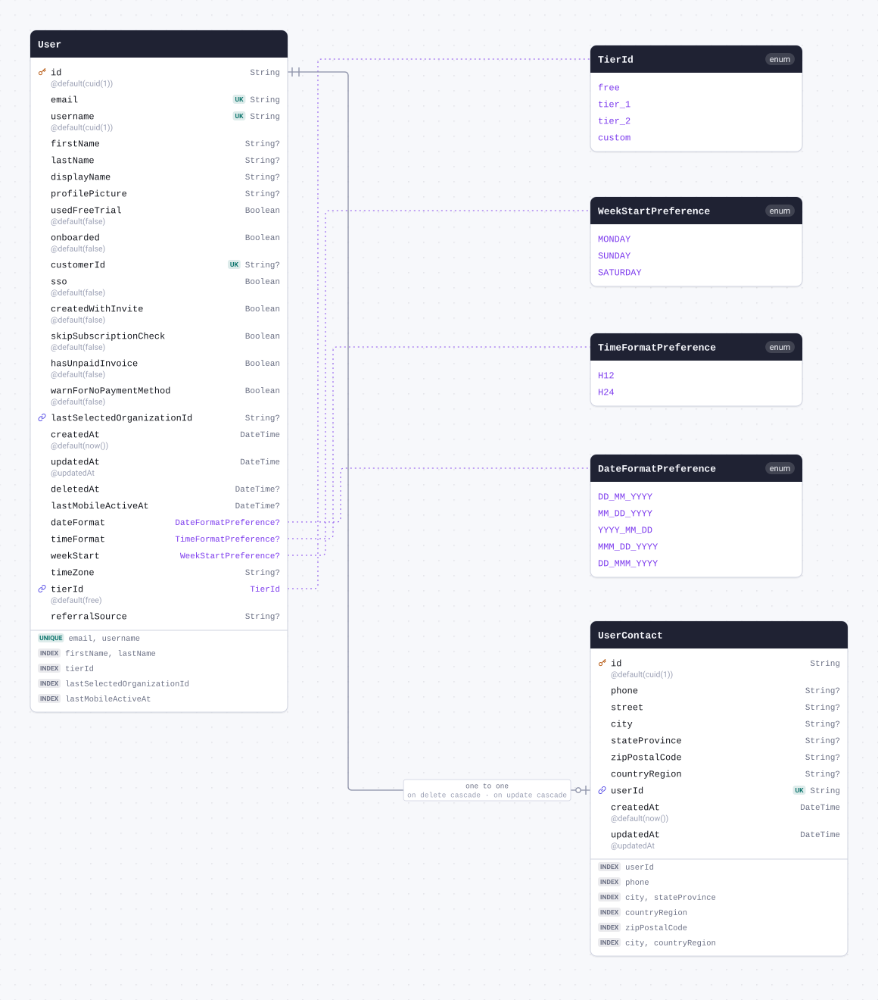

| Field           | Type       | Constraints                              | Default      | Description |
| --------------- | ---------- | ---------------------------------------- | ------------ | ----------- |
| `id`            | `String`   | PK NOT NULL                              | `cuid(1)`    |             |
| `phone`         | `String`   | NULL                                     |              |             |
| `street`        | `String`   | NULL                                     |              |             |
| `city`          | `String`   | NULL                                     |              |             |
| `stateProvince` | `String`   | NULL                                     |              |             |
| `zipPostalCode` | `String`   | NULL                                     |              |             |
| `countryRegion` | `String`   | NULL                                     |              |             |
| `userId`        | `String`   | UNIQUE NOT NULL → [User.id](#model-User) |              |             |
| `createdAt`     | `DateTime` | NOT NULL                                 | `now()`      |             |
| `updatedAt`     | `DateTime` | NOT NULL                                 | `@updatedAt` |             |

#### Indexes

- `@@index([userId])`
- `@@index([phone])`
- `@@index([city, stateProvince])`
- `@@index([countryRegion])`
- `@@index([zipPostalCode])`
- `@@index([city, countryRegion])`

#### References

- `userId` → [User.id](#model-User) (one-to-one, on delete Cascade, on update Cascade)

#### Definition

```sql
CREATE TABLE "UserContact" (
    "id" TEXT NOT NULL,
    "phone" TEXT,
    "street" TEXT,
    "city" TEXT,
    "stateProvince" TEXT,
    "zipPostalCode" TEXT,
    "countryRegion" TEXT,
    "userId" TEXT NOT NULL,
    "createdAt" TIMESTAMP(3) NOT NULL DEFAULT CURRENT_TIMESTAMP,
    "updatedAt" TIMESTAMP(3) NOT NULL,

    CONSTRAINT "UserContact_pkey" PRIMARY KEY ("id")
);

CREATE UNIQUE INDEX "UserContact_userId_key" ON "UserContact"("userId");

CREATE INDEX "UserContact_userId_idx" ON "UserContact"("userId");

CREATE INDEX "UserContact_phone_idx" ON "UserContact"("phone");

CREATE INDEX "UserContact_city_stateProvince_idx" ON "UserContact"("city", "stateProvince");

CREATE INDEX "UserContact_countryRegion_idx" ON "UserContact"("countryRegion");

CREATE INDEX "UserContact_zipPostalCode_idx" ON "UserContact"("zipPostalCode");

CREATE INDEX "UserContact_city_countryRegion_idx" ON "UserContact"("city", "countryRegion");

ALTER TABLE "UserContact" ADD CONSTRAINT "UserContact_userId_fkey" FOREIGN KEY ("userId") REFERENCES "User"("id") ON DELETE CASCADE ON UPDATE CASCADE;
```

<details>
<summary>Queries and their SQL</summary>

**findMany**: Every row

```ts
await prisma.userContact.findMany();
```

```sql
SELECT
  "public"."UserContact"."id",
  "public"."UserContact"."phone",
  "public"."UserContact"."street",
  "public"."UserContact"."city",
  "public"."UserContact"."stateProvince",
  "public"."UserContact"."zipPostalCode",
  "public"."UserContact"."countryRegion",
  "public"."UserContact"."userId",
  "public"."UserContact"."createdAt",
  "public"."UserContact"."updatedAt"
FROM
  "public"."UserContact"
WHERE
  1 = 1
OFFSET
  $1
-- params: ["0"]
```

**count**: How many rows there are

```ts
await prisma.userContact.count();
```

```sql
SELECT
  COUNT(*) AS "_count$_all"
FROM
  (
    SELECT
      "public"."UserContact"."id"
    FROM
      "public"."UserContact"
    WHERE
      1 = 1
    OFFSET
      $1
  ) AS "sub"
-- params: ["0"]
```

**findMany**: Every row with its relations

```ts
await prisma.userContact.findMany({ include: { user: true } });
```

```sql
SELECT
  "public"."UserContact"."id",
  "public"."UserContact"."phone",
  "public"."UserContact"."street",
  "public"."UserContact"."city",
  "public"."UserContact"."stateProvince",
  "public"."UserContact"."zipPostalCode",
  "public"."UserContact"."countryRegion",
  "public"."UserContact"."userId",
  "public"."UserContact"."createdAt",
  "public"."UserContact"."updatedAt"
FROM
  "public"."UserContact"
WHERE
  1 = 1
OFFSET
  $1
-- params: ["0"]

SELECT
  "public"."User"."id",
  "public"."User"."email",
  "public"."User"."username",
  "public"."User"."firstName",
  "public"."User"."lastName",
  "public"."User"."displayName",
  "public"."User"."profilePicture",
  "public"."User"."usedFreeTrial",
  "public"."User"."onboarded",
  "public"."User"."customerId",
  "public"."User"."sso",
  "public"."User"."createdWithInvite",
  "public"."User"."skipSubscriptionCheck",
  "public"."User"."hasUnpaidInvoice",
  "public"."User"."warnForNoPaymentMethod",
  "public"."User"."lastSelectedOrganizationId",
  "public"."User"."createdAt",
  "public"."User"."updatedAt",
  "public"."User"."deletedAt",
  "public"."User"."lastMobileActiveAt",
  "public"."User"."dateFormat"::text,
  "public"."User"."timeFormat"::text,
  "public"."User"."weekStart"::text,
  "public"."User"."timeZone",
  "public"."User"."tierId"::text,
  "public"."User"."referralSource"
FROM
  "public"."User"
WHERE
  "public"."User"."id" IN ($1)
OFFSET
  $2
-- params: ["<userId of the rows above>","0"]
```

**findUnique**: One row by what is unique to it

```ts
await prisma.userContact.findUnique({ where: { id: "example" } });
```

```sql
SELECT
  "public"."UserContact"."id",
  "public"."UserContact"."phone",
  "public"."UserContact"."street",
  "public"."UserContact"."city",
  "public"."UserContact"."stateProvince",
  "public"."UserContact"."zipPostalCode",
  "public"."UserContact"."countryRegion",
  "public"."UserContact"."userId",
  "public"."UserContact"."createdAt",
  "public"."UserContact"."updatedAt"
FROM
  "public"."UserContact"
WHERE
  (
    "public"."UserContact"."id" = $1
    AND 1 = 1
  )
LIMIT
  $2
OFFSET
  $3
-- params: ["example","1","0"]
```

**create**: Create a row

```ts
await prisma.userContact.create({ data: { userId: "example" } });
```

```sql
INSERT INTO
  "public"."UserContact" ("id", "userId", "createdAt", "updatedAt")
VALUES
  ($1, $2, $3, $4)
RETURNING
  "public"."UserContact"."id",
  "public"."UserContact"."phone",
  "public"."UserContact"."street",
  "public"."UserContact"."city",
  "public"."UserContact"."stateProvince",
  "public"."UserContact"."zipPostalCode",
  "public"."UserContact"."countryRegion",
  "public"."UserContact"."userId",
  "public"."UserContact"."createdAt",
  "public"."UserContact"."updatedAt"
-- params: ["<cuid(1)>","example","<now()>","<now()>"]
```

**update**: Update a row

```ts
await prisma.userContact.update({ where: { id: "example" }, data: { phone: "example" } });
```

```sql
UPDATE "public"."UserContact"
SET
  "phone" = $1,
  "updatedAt" = $2
WHERE
  (
    "public"."UserContact"."id" = $3
    AND 1 = 1
  )
RETURNING
  "public"."UserContact"."id",
  "public"."UserContact"."phone",
  "public"."UserContact"."street",
  "public"."UserContact"."city",
  "public"."UserContact"."stateProvince",
  "public"."UserContact"."zipPostalCode",
  "public"."UserContact"."countryRegion",
  "public"."UserContact"."userId",
  "public"."UserContact"."createdAt",
  "public"."UserContact"."updatedAt"
-- params: ["example",{"prisma__type":"generatorCall","prisma__value":{"name":"now","args":[],"returnType":{"type":"DateTime"}}},"example"]
```

**delete**: Delete a row

```ts
await prisma.userContact.delete({ where: { id: "example" } });
```

```sql
DELETE FROM "public"."UserContact"
WHERE
  (
    "public"."UserContact"."id" = $1
    AND 1 = 1
  )
RETURNING
  "public"."UserContact"."id",
  "public"."UserContact"."phone",
  "public"."UserContact"."street",
  "public"."UserContact"."city",
  "public"."UserContact"."stateProvince",
  "public"."UserContact"."zipPostalCode",
  "public"."UserContact"."countryRegion",
  "public"."UserContact"."userId",
  "public"."UserContact"."createdAt",
  "public"."UserContact"."updatedAt"
-- params: ["example"]
```

</details>

<a id="model-UserBusinessIntel"></a>

### UserBusinessIntel

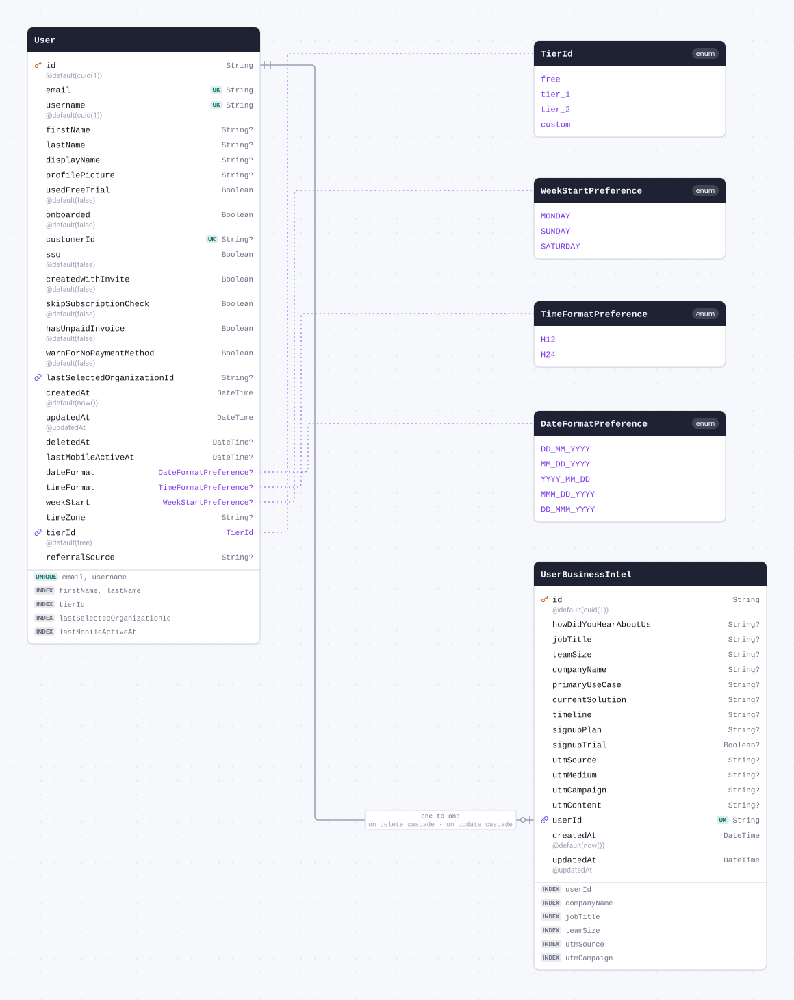

| Field                  | Type       | Constraints                              | Default      | Description |
| ---------------------- | ---------- | ---------------------------------------- | ------------ | ----------- |
| `id`                   | `String`   | PK NOT NULL                              | `cuid(1)`    |             |
| `howDidYouHearAboutUs` | `String`   | NULL                                     |              |             |
| `jobTitle`             | `String`   | NULL                                     |              |             |
| `teamSize`             | `String`   | NULL                                     |              |             |
| `companyName`          | `String`   | NULL                                     |              |             |
| `primaryUseCase`       | `String`   | NULL                                     |              |             |
| `currentSolution`      | `String`   | NULL                                     |              |             |
| `timeline`             | `String`   | NULL                                     |              |             |
| `signupPlan`           | `String`   | NULL                                     |              |             |
| `signupTrial`          | `Boolean`  | NULL                                     |              |             |
| `utmSource`            | `String`   | NULL                                     |              |             |
| `utmMedium`            | `String`   | NULL                                     |              |             |
| `utmCampaign`          | `String`   | NULL                                     |              |             |
| `utmContent`           | `String`   | NULL                                     |              |             |
| `userId`               | `String`   | UNIQUE NOT NULL → [User.id](#model-User) |              |             |
| `createdAt`            | `DateTime` | NOT NULL                                 | `now()`      |             |
| `updatedAt`            | `DateTime` | NOT NULL                                 | `@updatedAt` |             |

#### Indexes

- `@@index([userId])`
- `@@index([companyName])`
- `@@index([jobTitle])`
- `@@index([teamSize])`
- `@@index([utmSource])`
- `@@index([utmCampaign])`

#### References

- `userId` → [User.id](#model-User) (one-to-one, on delete Cascade, on update Cascade)

#### Definition

```sql
CREATE TABLE "UserBusinessIntel" (
    "id" TEXT NOT NULL,
    "howDidYouHearAboutUs" TEXT,
    "jobTitle" TEXT,
    "teamSize" TEXT,
    "companyName" TEXT,
    "primaryUseCase" TEXT,
    "currentSolution" TEXT,
    "timeline" TEXT,
    "signupPlan" TEXT,
    "signupTrial" BOOLEAN,
    "utmSource" TEXT,
    "utmMedium" TEXT,
    "utmCampaign" TEXT,
    "utmContent" TEXT,
    "userId" TEXT NOT NULL,
    "createdAt" TIMESTAMP(3) NOT NULL DEFAULT CURRENT_TIMESTAMP,
    "updatedAt" TIMESTAMP(3) NOT NULL,

    CONSTRAINT "UserBusinessIntel_pkey" PRIMARY KEY ("id")
);

CREATE UNIQUE INDEX "UserBusinessIntel_userId_key" ON "UserBusinessIntel"("userId");

CREATE INDEX "UserBusinessIntel_userId_idx" ON "UserBusinessIntel"("userId");

CREATE INDEX "UserBusinessIntel_companyName_idx" ON "UserBusinessIntel"("companyName");

CREATE INDEX "UserBusinessIntel_jobTitle_idx" ON "UserBusinessIntel"("jobTitle");

CREATE INDEX "UserBusinessIntel_teamSize_idx" ON "UserBusinessIntel"("teamSize");

CREATE INDEX "UserBusinessIntel_utmSource_idx" ON "UserBusinessIntel"("utmSource");

CREATE INDEX "UserBusinessIntel_utmCampaign_idx" ON "UserBusinessIntel"("utmCampaign");

ALTER TABLE "UserBusinessIntel" ADD CONSTRAINT "UserBusinessIntel_userId_fkey" FOREIGN KEY ("userId") REFERENCES "User"("id") ON DELETE CASCADE ON UPDATE CASCADE;
```

<details>
<summary>Queries and their SQL</summary>

**findMany**: Every row

```ts
await prisma.userBusinessIntel.findMany();
```

```sql
SELECT
  "public"."UserBusinessIntel"."id",
  "public"."UserBusinessIntel"."howDidYouHearAboutUs",
  "public"."UserBusinessIntel"."jobTitle",
  "public"."UserBusinessIntel"."teamSize",
  "public"."UserBusinessIntel"."companyName",
  "public"."UserBusinessIntel"."primaryUseCase",
  "public"."UserBusinessIntel"."currentSolution",
  "public"."UserBusinessIntel"."timeline",
  "public"."UserBusinessIntel"."signupPlan",
  "public"."UserBusinessIntel"."signupTrial",
  "public"."UserBusinessIntel"."utmSource",
  "public"."UserBusinessIntel"."utmMedium",
  "public"."UserBusinessIntel"."utmCampaign",
  "public"."UserBusinessIntel"."utmContent",
  "public"."UserBusinessIntel"."userId",
  "public"."UserBusinessIntel"."createdAt",
  "public"."UserBusinessIntel"."updatedAt"
FROM
  "public"."UserBusinessIntel"
WHERE
  1 = 1
OFFSET
  $1
-- params: ["0"]
```

**count**: How many rows there are

```ts
await prisma.userBusinessIntel.count();
```

```sql
SELECT
  COUNT(*) AS "_count$_all"
FROM
  (
    SELECT
      "public"."UserBusinessIntel"."id"
    FROM
      "public"."UserBusinessIntel"
    WHERE
      1 = 1
    OFFSET
      $1
  ) AS "sub"
-- params: ["0"]
```

**findMany**: Every row with its relations

```ts
await prisma.userBusinessIntel.findMany({ include: { user: true } });
```

```sql
SELECT
  "public"."UserBusinessIntel"."id",
  "public"."UserBusinessIntel"."howDidYouHearAboutUs",
  "public"."UserBusinessIntel"."jobTitle",
  "public"."UserBusinessIntel"."teamSize",
  "public"."UserBusinessIntel"."companyName",
  "public"."UserBusinessIntel"."primaryUseCase",
  "public"."UserBusinessIntel"."currentSolution",
  "public"."UserBusinessIntel"."timeline",
  "public"."UserBusinessIntel"."signupPlan",
  "public"."UserBusinessIntel"."signupTrial",
  "public"."UserBusinessIntel"."utmSource",
  "public"."UserBusinessIntel"."utmMedium",
  "public"."UserBusinessIntel"."utmCampaign",
  "public"."UserBusinessIntel"."utmContent",
  "public"."UserBusinessIntel"."userId",
  "public"."UserBusinessIntel"."createdAt",
  "public"."UserBusinessIntel"."updatedAt"
FROM
  "public"."UserBusinessIntel"
WHERE
  1 = 1
OFFSET
  $1
-- params: ["0"]

SELECT
  "public"."User"."id",
  "public"."User"."email",
  "public"."User"."username",
  "public"."User"."firstName",
  "public"."User"."lastName",
  "public"."User"."displayName",
  "public"."User"."profilePicture",
  "public"."User"."usedFreeTrial",
  "public"."User"."onboarded",
  "public"."User"."customerId",
  "public"."User"."sso",
  "public"."User"."createdWithInvite",
  "public"."User"."skipSubscriptionCheck",
  "public"."User"."hasUnpaidInvoice",
  "public"."User"."warnForNoPaymentMethod",
  "public"."User"."lastSelectedOrganizationId",
  "public"."User"."createdAt",
  "public"."User"."updatedAt",
  "public"."User"."deletedAt",
  "public"."User"."lastMobileActiveAt",
  "public"."User"."dateFormat"::text,
  "public"."User"."timeFormat"::text,
  "public"."User"."weekStart"::text,
  "public"."User"."timeZone",
  "public"."User"."tierId"::text,
  "public"."User"."referralSource"
FROM
  "public"."User"
WHERE
  "public"."User"."id" IN ($1)
OFFSET
  $2
-- params: ["<userId of the rows above>","0"]
```

**findUnique**: One row by what is unique to it

```ts
await prisma.userBusinessIntel.findUnique({ where: { id: "example" } });
```

```sql
SELECT
  "public"."UserBusinessIntel"."id",
  "public"."UserBusinessIntel"."howDidYouHearAboutUs",
  "public"."UserBusinessIntel"."jobTitle",
  "public"."UserBusinessIntel"."teamSize",
  "public"."UserBusinessIntel"."companyName",
  "public"."UserBusinessIntel"."primaryUseCase",
  "public"."UserBusinessIntel"."currentSolution",
  "public"."UserBusinessIntel"."timeline",
  "public"."UserBusinessIntel"."signupPlan",
  "public"."UserBusinessIntel"."signupTrial",
  "public"."UserBusinessIntel"."utmSource",
  "public"."UserBusinessIntel"."utmMedium",
  "public"."UserBusinessIntel"."utmCampaign",
  "public"."UserBusinessIntel"."utmContent",
  "public"."UserBusinessIntel"."userId",
  "public"."UserBusinessIntel"."createdAt",
  "public"."UserBusinessIntel"."updatedAt"
FROM
  "public"."UserBusinessIntel"
WHERE
  (
    "public"."UserBusinessIntel"."id" = $1
    AND 1 = 1
  )
LIMIT
  $2
OFFSET
  $3
-- params: ["example","1","0"]
```

**create**: Create a row

```ts
await prisma.userBusinessIntel.create({ data: { userId: "example" } });
```

```sql
INSERT INTO
  "public"."UserBusinessIntel" ("id", "userId", "createdAt", "updatedAt")
VALUES
  ($1, $2, $3, $4)
RETURNING
  "public"."UserBusinessIntel"."id",
  "public"."UserBusinessIntel"."howDidYouHearAboutUs",
  "public"."UserBusinessIntel"."jobTitle",
  "public"."UserBusinessIntel"."teamSize",
  "public"."UserBusinessIntel"."companyName",
  "public"."UserBusinessIntel"."primaryUseCase",
  "public"."UserBusinessIntel"."currentSolution",
  "public"."UserBusinessIntel"."timeline",
  "public"."UserBusinessIntel"."signupPlan",
  "public"."UserBusinessIntel"."signupTrial",
  "public"."UserBusinessIntel"."utmSource",
  "public"."UserBusinessIntel"."utmMedium",
  "public"."UserBusinessIntel"."utmCampaign",
  "public"."UserBusinessIntel"."utmContent",
  "public"."UserBusinessIntel"."userId",
  "public"."UserBusinessIntel"."createdAt",
  "public"."UserBusinessIntel"."updatedAt"
-- params: ["<cuid(1)>","example","<now()>","<now()>"]
```

**update**: Update a row

```ts
await prisma.userBusinessIntel.update({
  where: { id: "example" },
  data: { howDidYouHearAboutUs: "example" },
});
```

```sql
UPDATE "public"."UserBusinessIntel"
SET
  "howDidYouHearAboutUs" = $1,
  "updatedAt" = $2
WHERE
  (
    "public"."UserBusinessIntel"."id" = $3
    AND 1 = 1
  )
RETURNING
  "public"."UserBusinessIntel"."id",
  "public"."UserBusinessIntel"."howDidYouHearAboutUs",
  "public"."UserBusinessIntel"."jobTitle",
  "public"."UserBusinessIntel"."teamSize",
  "public"."UserBusinessIntel"."companyName",
  "public"."UserBusinessIntel"."primaryUseCase",
  "public"."UserBusinessIntel"."currentSolution",
  "public"."UserBusinessIntel"."timeline",
  "public"."UserBusinessIntel"."signupPlan",
  "public"."UserBusinessIntel"."signupTrial",
  "public"."UserBusinessIntel"."utmSource",
  "public"."UserBusinessIntel"."utmMedium",
  "public"."UserBusinessIntel"."utmCampaign",
  "public"."UserBusinessIntel"."utmContent",
  "public"."UserBusinessIntel"."userId",
  "public"."UserBusinessIntel"."createdAt",
  "public"."UserBusinessIntel"."updatedAt"
-- params: ["example",{"prisma__type":"generatorCall","prisma__value":{"name":"now","args":[],"returnType":{"type":"DateTime"}}},"example"]
```

**delete**: Delete a row

```ts
await prisma.userBusinessIntel.delete({ where: { id: "example" } });
```

```sql
DELETE FROM "public"."UserBusinessIntel"
WHERE
  (
    "public"."UserBusinessIntel"."id" = $1
    AND 1 = 1
  )
RETURNING
  "public"."UserBusinessIntel"."id",
  "public"."UserBusinessIntel"."howDidYouHearAboutUs",
  "public"."UserBusinessIntel"."jobTitle",
  "public"."UserBusinessIntel"."teamSize",
  "public"."UserBusinessIntel"."companyName",
  "public"."UserBusinessIntel"."primaryUseCase",
  "public"."UserBusinessIntel"."currentSolution",
  "public"."UserBusinessIntel"."timeline",
  "public"."UserBusinessIntel"."signupPlan",
  "public"."UserBusinessIntel"."signupTrial",
  "public"."UserBusinessIntel"."utmSource",
  "public"."UserBusinessIntel"."utmMedium",
  "public"."UserBusinessIntel"."utmCampaign",
  "public"."UserBusinessIntel"."utmContent",
  "public"."UserBusinessIntel"."userId",
  "public"."UserBusinessIntel"."createdAt",
  "public"."UserBusinessIntel"."updatedAt"
-- params: ["example"]
```

</details>

<a id="model-Asset"></a>

### Asset

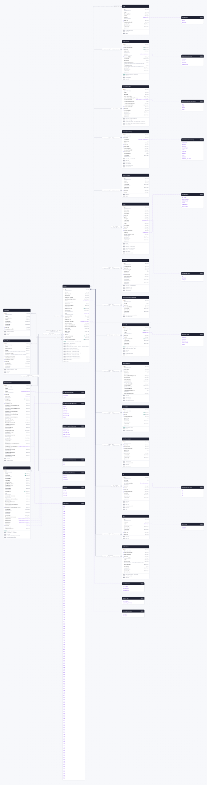

| Field                  | Type                                       | Constraints                                       | Default      | Description |
| ---------------------- | ------------------------------------------ | ------------------------------------------------- | ------------ | ----------- |
| `id`                   | `String`                                   | PK NOT NULL                                       | `cuid(1)`    |             |
| `title`                | `String`                                   | NOT NULL                                          |              |             |
| `description`          | `String`                                   | NULL                                              |              |             |
| `mainImage`            | `String`                                   | NULL                                              |              |             |
| `thumbnailImage`       | `String`                                   | NULL                                              |              |             |
| `mainImageExpiration`  | `DateTime`                                 | NULL                                              |              |             |
| `status`               | [`AssetStatus`](#enum-AssetStatus)         | NOT NULL                                          | `AVAILABLE`  |             |
| `valuation` (`value`)  | `Float`                                    | NULL                                              |              |             |
| `availableToBook`      | `Boolean`                                  | NOT NULL                                          | `true`       |             |
| `sequentialId`         | `String`                                   | NULL                                              |              |             |
| `archivedAt`           | `DateTime` `@db.Timestamptz(3)`            | NULL                                              |              |             |
| `type`                 | [`AssetType`](#enum-AssetType)             | NOT NULL                                          | `INDIVIDUAL` |             |
| `assetModelId`         | `String`                                   | NULL → [AssetModel.id](#model-AssetModel)         |              |             |
| `quantity`             | `Int`                                      | NULL                                              |              |             |
| `minQuantity`          | `Int`                                      | NULL                                              |              |             |
| `consumptionType`      | [`ConsumptionType`](#enum-ConsumptionType) | NULL                                              |              |             |
| `unitOfMeasure`        | `String`                                   | NULL                                              |              |             |
| `lowStockNotifiedAt`   | `DateTime`                                 | NULL                                              |              |             |
| `stockLedgerStartedAt` | `DateTime`                                 | NULL                                              |              |             |
| `createdAt`            | `DateTime`                                 | NOT NULL                                          | `now()`      |             |
| `updatedAt`            | `DateTime`                                 | NOT NULL                                          | `@updatedAt` |             |
| `userId`               | `String`                                   | NOT NULL → [User.id](#model-User)                 |              |             |
| `organizationId`       | `String`                                   | NOT NULL → [Organization.id](#model-Organization) |              |             |
| `categoryId`           | `String`                                   | NULL → [Category.id](#model-Category)             |              |             |
| `preferredBarcodeId`   | `String`                                   | UNIQUE NULL → [Barcode.id](#model-Barcode)        |              |             |

#### Indexes

- `@@index([title, description])`
- `@@index([sequentialId], map: "Asset_sequentialId_trgm_idx")`
- `@@index([organizationId, title, status, availableToBook], map: "Asset_organizationId_compound_idx")`
- `@@index([status, organizationId], map: "Asset_status_organizationId_idx")`
- `@@index([organizationId, archivedAt], map: "Asset_organizationId_archivedAt_idx")`
- `@@index([createdAt, organizationId], map: "Asset_createdAt_organizationId_idx")`
- `@@index([organizationId, createdAt, id], map: "Asset_organizationId_createdAt_id_idx")`
- `@@index([valuation, organizationId], map: "Asset_valuation_organizationId_idx")`
- `@@index([categoryId, organizationId], map: "Asset_categoryId_organizationId_idx")`
- `@@index([assetModelId, organizationId], map: "Asset_assetModelId_organizationId_idx")`
- `@@index([sequentialId], map: "Asset_sequentialId_idx")`
- `@@index([userId])`
- `@@unique([organizationId, sequentialId], name: "asset_org_sequential_unique")`

#### References

- `assetModelId` → [AssetModel.id](#model-AssetModel) (many-to-one)
- `userId` → [User.id](#model-User) (many-to-one, on delete Cascade, on update Cascade)
- `organizationId` → [Organization.id](#model-Organization) (many-to-one, on delete Cascade, on update Cascade)
- `categoryId` → [Category.id](#model-Category) (many-to-one)
- `preferredBarcodeId` → [Barcode.id](#model-Barcode) (one-to-one, on delete SetNull)

#### Referenced by

- `id` ← [Note.assetId](#model-Note) (one-to-many, on delete Cascade, on update Cascade)
- `id` ← [Qr.assetId](#model-Qr) (one-to-many, on delete SetNull)
- `id` ← [Barcode.assetId](#model-Barcode) (one-to-many, on delete SetNull)
- `id` ← [ReportFound.assetId](#model-ReportFound) (one-to-many, on delete Cascade, on update Cascade)
- `id` ← [Scan.assetId](#model-Scan) (one-to-many, on delete SetNull)
- `id` ← [Custody.assetId](#model-Custody) (one-to-many, on delete Cascade, on update Cascade)
- `id` ← [AssetCustomFieldValue.assetId](#model-AssetCustomFieldValue) (one-to-many, on delete Cascade, on update Cascade)
- `id` ← [ConsumptionLog.assetId](#model-ConsumptionLog) (one-to-many, on delete Cascade, on update Cascade)
- `id` ← [BookingAsset.assetId](#model-BookingAsset) (one-to-many, on delete Cascade, on update Cascade)
- `id` ← [AssetKit.assetId](#model-AssetKit) (one-to-many, on delete Cascade, on update Cascade)
- `id` ← [AssetLocation.assetId](#model-AssetLocation) (one-to-many, on delete Cascade, on update Cascade)
- `id` ← [AssetReminder.assetId](#model-AssetReminder) (one-to-many, on delete Cascade)
- `id` ← [AuditAsset.assetId](#model-AuditAsset) (one-to-many, on delete Cascade, on update Cascade)
- `id` ← [AuditScan.assetId](#model-AuditScan) (one-to-many, on delete SetNull, on update Cascade)

#### Many to many

- `tags` ↔ [Tag.assets](#model-Tag) through `_AssetToTag`

#### Definition

```sql
CREATE TABLE "Asset" (
    "id" TEXT NOT NULL,
    "title" TEXT NOT NULL,
    "description" TEXT,
    "mainImage" TEXT,
    "thumbnailImage" TEXT,
    "mainImageExpiration" TIMESTAMP(3),
    "status" "AssetStatus" NOT NULL DEFAULT 'AVAILABLE',
    "value" DOUBLE PRECISION,
    "availableToBook" BOOLEAN NOT NULL DEFAULT true,
    "sequentialId" TEXT,
    "archivedAt" TIMESTAMPTZ(3),
    "type" "AssetType" NOT NULL DEFAULT 'INDIVIDUAL',
    "assetModelId" TEXT,
    "quantity" INTEGER,
    "minQuantity" INTEGER,
    "consumptionType" "ConsumptionType",
    "unitOfMeasure" TEXT,
    "lowStockNotifiedAt" TIMESTAMP(3),
    "stockLedgerStartedAt" TIMESTAMP(3),
    "createdAt" TIMESTAMP(3) NOT NULL DEFAULT CURRENT_TIMESTAMP,
    "updatedAt" TIMESTAMP(3) NOT NULL,
    "userId" TEXT NOT NULL,
    "organizationId" TEXT NOT NULL,
    "categoryId" TEXT,
    "preferredBarcodeId" TEXT,

    CONSTRAINT "Asset_pkey" PRIMARY KEY ("id")
);

CREATE UNIQUE INDEX "Asset_preferredBarcodeId_key" ON "Asset"("preferredBarcodeId");

CREATE INDEX "Asset_title_description_idx" ON "Asset" USING GIN ("title" gin_trgm_ops, "description" gin_trgm_ops);

CREATE INDEX "Asset_sequentialId_trgm_idx" ON "Asset" USING GIN ("sequentialId" gin_trgm_ops);

CREATE INDEX "Asset_organizationId_compound_idx" ON "Asset"("organizationId", "title", "status", "availableToBook");

CREATE INDEX "Asset_status_organizationId_idx" ON "Asset"("status", "organizationId");

CREATE INDEX "Asset_organizationId_archivedAt_idx" ON "Asset"("organizationId", "archivedAt");

CREATE INDEX "Asset_createdAt_organizationId_idx" ON "Asset"("createdAt", "organizationId");

CREATE INDEX "Asset_organizationId_createdAt_id_idx" ON "Asset"("organizationId", "createdAt" DESC, "id");

CREATE INDEX "Asset_valuation_organizationId_idx" ON "Asset"("value", "organizationId");

CREATE INDEX "Asset_categoryId_organizationId_idx" ON "Asset"("categoryId", "organizationId");

CREATE INDEX "Asset_assetModelId_organizationId_idx" ON "Asset"("assetModelId", "organizationId");

CREATE INDEX "Asset_sequentialId_idx" ON "Asset"("sequentialId");

CREATE INDEX "Asset_userId_idx" ON "Asset"("userId");

CREATE UNIQUE INDEX "Asset_organizationId_sequentialId_key" ON "Asset"("organizationId", "sequentialId");

ALTER TABLE "Asset" ADD CONSTRAINT "Asset_assetModelId_fkey" FOREIGN KEY ("assetModelId") REFERENCES "AssetModel"("id") ON DELETE SET NULL ON UPDATE CASCADE;

ALTER TABLE "Asset" ADD CONSTRAINT "Asset_userId_fkey" FOREIGN KEY ("userId") REFERENCES "User"("id") ON DELETE CASCADE ON UPDATE CASCADE;

ALTER TABLE "Asset" ADD CONSTRAINT "Asset_organizationId_fkey" FOREIGN KEY ("organizationId") REFERENCES "Organization"("id") ON DELETE CASCADE ON UPDATE CASCADE;

ALTER TABLE "Asset" ADD CONSTRAINT "Asset_categoryId_fkey" FOREIGN KEY ("categoryId") REFERENCES "Category"("id") ON DELETE SET NULL ON UPDATE CASCADE;

ALTER TABLE "Asset" ADD CONSTRAINT "Asset_preferredBarcodeId_fkey" FOREIGN KEY ("preferredBarcodeId") REFERENCES "Barcode"("id") ON DELETE SET NULL ON UPDATE CASCADE;
```

<details>
<summary>Queries and their SQL</summary>

**findMany**: Every row

```ts
await prisma.asset.findMany();
```

```sql
SELECT
  "public"."Asset"."id",
  "public"."Asset"."title",
  "public"."Asset"."description",
  "public"."Asset"."mainImage",
  "public"."Asset"."thumbnailImage",
  "public"."Asset"."mainImageExpiration",
  "public"."Asset"."status"::text,
  "public"."Asset"."value",
  "public"."Asset"."availableToBook",
  "public"."Asset"."sequentialId",
  "public"."Asset"."archivedAt",
  "public"."Asset"."type"::text,
  "public"."Asset"."assetModelId",
  "public"."Asset"."quantity",
  "public"."Asset"."minQuantity",
  "public"."Asset"."consumptionType"::text,
  "public"."Asset"."unitOfMeasure",
  "public"."Asset"."lowStockNotifiedAt",
  "public"."Asset"."stockLedgerStartedAt",
  "public"."Asset"."createdAt",
  "public"."Asset"."updatedAt",
  "public"."Asset"."userId",
  "public"."Asset"."organizationId",
  "public"."Asset"."categoryId",
  "public"."Asset"."preferredBarcodeId"
FROM
  "public"."Asset"
WHERE
  1 = 1
OFFSET
  $1
-- params: ["0"]
```

**count**: How many rows there are

```ts
await prisma.asset.count();
```

```sql
SELECT
  COUNT(*) AS "_count$_all"
FROM
  (
    SELECT
      "public"."Asset"."id"
    FROM
      "public"."Asset"
    WHERE
      1 = 1
    OFFSET
      $1
  ) AS "sub"
-- params: ["0"]
```

**findMany**: Every row with its relations

```ts
await prisma.asset.findMany({
  include: {
    assetModel: true,
    user: true,
    organization: true,
    category: true,
    custody: true,
    notes: true,
    qrCodes: true,
    barcodes: true,
    reports: true,
    tags: true,
    customFields: true,
    bookingAssets: true,
    consumptionLogs: true,
    reminders: true,
    auditEntries: true,
    auditScans: true,
    scans: true,
    assetKits: true,
    assetLocations: true,
    preferredBarcode: true,
  },
});
```

```sql
SELECT
  "public"."Asset"."id",
  "public"."Asset"."title",
  "public"."Asset"."description",
  "public"."Asset"."mainImage",
  "public"."Asset"."thumbnailImage",
  "public"."Asset"."mainImageExpiration",
  "public"."Asset"."status"::text,
  "public"."Asset"."value",
  "public"."Asset"."availableToBook",
  "public"."Asset"."sequentialId",
  "public"."Asset"."archivedAt",
  "public"."Asset"."type"::text,
  "public"."Asset"."assetModelId",
  "public"."Asset"."quantity",
  "public"."Asset"."minQuantity",
  "public"."Asset"."consumptionType"::text,
  "public"."Asset"."unitOfMeasure",
  "public"."Asset"."lowStockNotifiedAt",
  "public"."Asset"."stockLedgerStartedAt",
  "public"."Asset"."createdAt",
  "public"."Asset"."updatedAt",
  "public"."Asset"."userId",
  "public"."Asset"."organizationId",
  "public"."Asset"."categoryId",
  "public"."Asset"."preferredBarcodeId"
FROM
  "public"."Asset"
WHERE
  1 = 1
OFFSET
  $1
-- params: ["0"]

SELECT
  "public"."AssetModel"."id",
  "public"."AssetModel"."name",
  "public"."AssetModel"."description",
  "public"."AssetModel"."image",
  "public"."AssetModel"."thumbnailImage",
  "public"."AssetModel"."defaultCategoryId",
  "public"."AssetModel"."defaultValuation",
  "public"."AssetModel"."organizationId",
  "public"."AssetModel"."userId",
  "public"."AssetModel"."createdAt",
  "public"."AssetModel"."updatedAt"
FROM
  "public"."AssetModel"
WHERE
  "public"."AssetModel"."id" IN ($1)
OFFSET
  $2
-- params: ["<assetModelId of the rows above>","0"]

SELECT
  "public"."User"."id",
  "public"."User"."email",
  "public"."User"."username",
  "public"."User"."firstName",
  "public"."User"."lastName",
  "public"."User"."displayName",
  "public"."User"."profilePicture",
  "public"."User"."usedFreeTrial",
  "public"."User"."onboarded",
  "public"."User"."customerId",
  "public"."User"."sso",
  "public"."User"."createdWithInvite",
  "public"."User"."skipSubscriptionCheck",
  "public"."User"."hasUnpaidInvoice",
  "public"."User"."warnForNoPaymentMethod",
  "public"."User"."lastSelectedOrganizationId",
  "public"."User"."createdAt",
  "public"."User"."updatedAt",
  "public"."User"."deletedAt",
  "public"."User"."lastMobileActiveAt",
  "public"."User"."dateFormat"::text,
  "public"."User"."timeFormat"::text,
  "public"."User"."weekStart"::text,
  "public"."User"."timeZone",
  "public"."User"."tierId"::text,
  "public"."User"."referralSource"
FROM
  "public"."User"
WHERE
  "public"."User"."id" IN ($1)
OFFSET
  $2
-- params: ["<userId of the rows above>","0"]

SELECT
  "public"."Organization"."id",
  "public"."Organization"."name",
  "public"."Organization"."type"::text,
  "public"."Organization"."userId",
  "public"."Organization"."currency"::text,
  "public"."Organization"."imageId",
  "public"."Organization"."enabledSso",
  "public"."Organization"."ssoDetailsId",
  "public"."Organization"."selfServiceCanSeeCustody",
  "public"."Organization"."selfServiceCanSeeBookings",
  "public"."Organization"."baseUserCanSeeCustody",
  "public"."Organization"."baseUserCanSeeBookings",
  "public"."Organization"."managersCanEditAssets",
  "public"."Organization"."barcodesEnabled",
  "public"."Organization"."barcodesEnabledAt",
  "public"."Organization"."usedBarcodeTrial",
  "public"."Organization"."auditsEnabled",
  "public"."Organization"."auditsEnabledAt",
  "public"."Organization"."usedAuditTrial",
  "public"."Organization"."workspaceDisabled",
  "public"."Organization"."createdAt",
  "public"."Organization"."updatedAt",
  "public"."Organization"."hasSequentialIdsMigrated",
  "public"."Organization"."qrIdDisplayPreference"::text,
  "public"."Organization"."showShelfBranding",
  "public"."Organization"."showQrCodesOnPdfs",
  "public"."Organization"."customEmailFooter"
FROM
  "public"."Organization"
WHERE
  "public"."Organization"."id" IN ($1)
OFFSET
  $2
-- params: ["<organizationId of the rows above>","0"]

SELECT
  "public"."Category"."id",
  "public"."Category"."name",
  "public"."Category"."description",
  "public"."Category"."color",
  "public"."Category"."createdAt",
  "public"."Category"."updatedAt",
  "public"."Category"."userId",
  "public"."Category"."organizationId"
FROM
  "public"."Category"
WHERE
  "public"."Category"."id" IN ($1)
OFFSET
  $2
-- params: ["<categoryId of the rows above>","0"]

SELECT
  "public"."Custody"."id",
  "public"."Custody"."teamMemberId",
  "public"."Custody"."assetId",
  "public"."Custody"."kitCustodyId",
  "public"."Custody"."quantity",
  "public"."Custody"."locationId",
  "public"."Custody"."sourceUnknown",
  "public"."Custody"."createdAt",
  "public"."Custody"."updatedAt"
FROM
  "public"."Custody"
WHERE
  "public"."Custody"."assetId" IN ($1)
OFFSET
  $2
-- params: ["<id of the rows above>","0"]

SELECT
  "public"."Note"."id",
  "public"."Note"."content",
  "public"."Note"."type"::text,
  "public"."Note"."createdAt",
  "public"."Note"."updatedAt",
  "public"."Note"."userId",
  "public"."Note"."assetId"
FROM
  "public"."Note"
WHERE
  "public"."Note"."assetId" IN ($1)
OFFSET
  $2
-- params: ["<id of the rows above>","0"]

SELECT
  "public"."Qr"."id",
  "public"."Qr"."version",
  "public"."Qr"."errorCorrection"::text,
  "public"."Qr"."assetId",
  "public"."Qr"."kitId",
  "public"."Qr"."userId",
  "public"."Qr"."organizationId",
  "public"."Qr"."batchId",
  "public"."Qr"."createdAt",
  "public"."Qr"."updatedAt"
FROM
  "public"."Qr"
WHERE
  "public"."Qr"."assetId" IN ($1)
OFFSET
  $2
-- params: ["<id of the rows above>","0"]

SELECT
  "public"."Barcode"."id",
  "public"."Barcode"."value",
  "public"."Barcode"."type"::text,
  "public"."Barcode"."assetId",
  "public"."Barcode"."kitId",
  "public"."Barcode"."organizationId",
  "public"."Barcode"."createdAt",
  "public"."Barcode"."updatedAt"
FROM
  "public"."Barcode"
WHERE
  "public"."Barcode"."assetId" IN ($1)
OFFSET
  $2
-- params: ["<id of the rows above>","0"]

SELECT
  "public"."ReportFound"."id",
  "public"."ReportFound"."email",
  "public"."ReportFound"."content",
  "public"."ReportFound"."createdAt",
  "public"."ReportFound"."updatedAt",
  "public"."ReportFound"."assetId",
  "public"."ReportFound"."kitId"
FROM
  "public"."ReportFound"
WHERE
  "public"."ReportFound"."assetId" IN ($1)
OFFSET
  $2
-- params: ["<id of the rows above>","0"]

SELECT
  "public"."Tag"."id",
  "public"."Tag"."name",
  "public"."Tag"."description",
  "public"."Tag"."color",
  "public"."Tag"."useFor"::text[],
  "public"."Tag"."userId",
  "public"."Tag"."organizationId",
  "public"."Tag"."createdAt",
  "public"."Tag"."updatedAt",
  "t0"."A" AS "AssetToTag@Asset"
FROM
  "public"."Tag"
  INNER JOIN "public"."_AssetToTag" AS "t0" ON "t0"."B" = "public"."Tag"."id"
WHERE
  (
    1 = 1
    AND "t0"."A" IN ($1)
  )
OFFSET
  $2
-- params: ["<id of the rows above>","0"]

SELECT
  "public"."AssetCustomFieldValue"."id",
  "public"."AssetCustomFieldValue"."value",
  "public"."AssetCustomFieldValue"."assetId",
  "public"."AssetCustomFieldValue"."customFieldId",
  "public"."AssetCustomFieldValue"."createdAt",
  "public"."AssetCustomFieldValue"."updatedAt"
FROM
  "public"."AssetCustomFieldValue"
WHERE
  "public"."AssetCustomFieldValue"."assetId" IN ($1)
OFFSET
  $2
-- params: ["<id of the rows above>","0"]

SELECT
  "public"."BookingAsset"."id",
  "public"."BookingAsset"."bookingId",
  "public"."BookingAsset"."assetId",
  "public"."BookingAsset"."quantity",
  "public"."BookingAsset"."bookingModelRequestId",
  "public"."BookingAsset"."assetKitId",
  "public"."BookingAsset"."sourceKitId",
  "public"."BookingAsset"."checkedOutAt",
  "public"."BookingAsset"."checkedOutById",
  "public"."BookingAsset"."checkedInAt",
  "public"."BookingAsset"."checkedInById",
  "public"."BookingAsset"."checkedOutQuantity",
  "public"."BookingAsset"."sourceLocationId"
FROM
  "public"."BookingAsset"
WHERE
  "public"."BookingAsset"."assetId" IN ($1)
OFFSET
  $2
-- params: ["<id of the rows above>","0"]

SELECT
  "public"."ConsumptionLog"."id",
  "public"."ConsumptionLog"."assetId",
  "public"."ConsumptionLog"."category"::text,
  "public"."ConsumptionLog"."quantity",
  "public"."ConsumptionLog"."note",
  "public"."ConsumptionLog"."userId",
  "public"."ConsumptionLog"."bookingId",
  "public"."ConsumptionLog"."custodianId",
  "public"."ConsumptionLog"."bookingAssetId",
  "public"."ConsumptionLog"."locationId",
  "public"."ConsumptionLog"."stockChange",
  "public"."ConsumptionLog"."createdAt"
FROM
  "public"."ConsumptionLog"
WHERE
  "public"."ConsumptionLog"."assetId" IN ($1)
OFFSET
  $2
-- params: ["<id of the rows above>","0"]

SELECT
  "public"."AssetReminder"."id",
  "public"."AssetReminder"."name",
  "public"."AssetReminder"."message",
  "public"."AssetReminder"."alertDateTime",
  "public"."AssetReminder"."activeSchedulerReference",
  "public"."AssetReminder"."recurrenceUnit"::text,
  "public"."AssetReminder"."recurrenceInterval",
  "public"."AssetReminder"."recurrenceTimezone",
  "public"."AssetReminder"."recurrenceEndsAt",
  "public"."AssetReminder"."organizationId",
  "public"."AssetReminder"."assetId",
  "public"."AssetReminder"."createdById",
  "public"."AssetReminder"."createdAt",
  "public"."AssetReminder"."updatedAt"
FROM
  "public"."AssetReminder"
WHERE
  "public"."AssetReminder"."assetId" IN ($1)
OFFSET
  $2
-- params: ["<id of the rows above>","0"]

SELECT
  "public"."AuditAsset"."id",
  "public"."AuditAsset"."auditSessionId",
  "public"."AuditAsset"."assetId",
  "public"."AuditAsset"."expected",
  "public"."AuditAsset"."status"::text,
  "public"."AuditAsset"."scannedById",
  "public"."AuditAsset"."scannedAt",
  "public"."AuditAsset"."metadata",
  "public"."AuditAsset"."expectedQuantity",
  "public"."AuditAsset"."foundQuantity",
  "public"."AuditAsset"."createdAt",
  "public"."AuditAsset"."updatedAt"
FROM
  "public"."AuditAsset"
WHERE
  "public"."AuditAsset"."assetId" IN ($1)
OFFSET
  $2
-- params: ["<id of the rows above>","0"]

SELECT
  "public"."AuditScan"."id",
  "public"."AuditScan"."auditSessionId",
  "public"."AuditScan"."auditAssetId",
  "public"."AuditScan"."assetId",
  "public"."AuditScan"."scannedById",
  "public"."AuditScan"."code",
  "public"."AuditScan"."assetTitle",
  "public"."AuditScan"."wasExpected",
  "public"."AuditScan"."metadata",
  "public"."AuditScan"."scannedAt",
  "public"."AuditScan"."createdAt"
FROM
  "public"."AuditScan"
WHERE
  "public"."AuditScan"."assetId" IN ($1)
OFFSET
  $2
-- params: ["<id of the rows above>","0"]

SELECT
  "public"."Scan"."id",
  "public"."Scan"."latitude",
  "public"."Scan"."longitude",
  "public"."Scan"."userAgent",
  "public"."Scan"."userId",
  "public"."Scan"."qrId",
  "public"."Scan"."rawQrId",
  "public"."Scan"."codeType"::text,
  "public"."Scan"."code",
  "public"."Scan"."barcodeId",
  "public"."Scan"."assetId",
  "public"."Scan"."kitId",
  "public"."Scan"."organizationId",
  "public"."Scan"."source"::text,
  "public"."Scan"."manuallyGenerated",
  "public"."Scan"."createdAt",
  "public"."Scan"."updatedAt"
FROM
  "public"."Scan"
WHERE
  "public"."Scan"."assetId" IN ($1)
OFFSET
  $2
-- params: ["<id of the rows above>","0"]

SELECT
  "public"."AssetKit"."id",
  "public"."AssetKit"."assetId",
  "public"."AssetKit"."kitId",
  "public"."AssetKit"."organizationId",
  "public"."AssetKit"."quantity",
  "public"."AssetKit"."createdAt",
  "public"."AssetKit"."updatedAt"
FROM
  "public"."AssetKit"
WHERE
  "public"."AssetKit"."assetId" IN ($1)
OFFSET
  $2
-- params: ["<id of the rows above>","0"]

SELECT
  "public"."AssetLocation"."id",
  "public"."AssetLocation"."assetId",
  "public"."AssetLocation"."locationId",
  "public"."AssetLocation"."organizationId",
  "public"."AssetLocation"."quantity",
  "public"."AssetLocation"."assetKitId",
  "public"."AssetLocation"."createdAt",
  "public"."AssetLocation"."updatedAt"
FROM
  "public"."AssetLocation"
WHERE
  "public"."AssetLocation"."assetId" IN ($1)
OFFSET
  $2
-- params: ["<id of the rows above>","0"]

SELECT
  "public"."Barcode"."id",
  "public"."Barcode"."value",
  "public"."Barcode"."type"::text,
  "public"."Barcode"."assetId",
  "public"."Barcode"."kitId",
  "public"."Barcode"."organizationId",
  "public"."Barcode"."createdAt",
  "public"."Barcode"."updatedAt"
FROM
  "public"."Barcode"
WHERE
  "public"."Barcode"."id" IN ($1)
OFFSET
  $2
-- params: ["<preferredBarcodeId of the rows above>","0"]
```

**findUnique**: One row by what is unique to it

```ts
await prisma.asset.findUnique({ where: { id: "example" } });
```

```sql
SELECT
  "public"."Asset"."id",
  "public"."Asset"."title",
  "public"."Asset"."description",
  "public"."Asset"."mainImage",
  "public"."Asset"."thumbnailImage",
  "public"."Asset"."mainImageExpiration",
  "public"."Asset"."status"::text,
  "public"."Asset"."value",
  "public"."Asset"."availableToBook",
  "public"."Asset"."sequentialId",
  "public"."Asset"."archivedAt",
  "public"."Asset"."type"::text,
  "public"."Asset"."assetModelId",
  "public"."Asset"."quantity",
  "public"."Asset"."minQuantity",
  "public"."Asset"."consumptionType"::text,
  "public"."Asset"."unitOfMeasure",
  "public"."Asset"."lowStockNotifiedAt",
  "public"."Asset"."stockLedgerStartedAt",
  "public"."Asset"."createdAt",
  "public"."Asset"."updatedAt",
  "public"."Asset"."userId",
  "public"."Asset"."organizationId",
  "public"."Asset"."categoryId",
  "public"."Asset"."preferredBarcodeId"
FROM
  "public"."Asset"
WHERE
  (
    "public"."Asset"."id" = $1
    AND 1 = 1
  )
LIMIT
  $2
OFFSET
  $3
-- params: ["example","1","0"]
```

**create**: Create a row

```ts
await prisma.asset.create({
  data: { title: "example", userId: "example", organizationId: "example" },
});
```

```sql
INSERT INTO
  "public"."Asset" (
    "id",
    "title",
    "status",
    "availableToBook",
    "type",
    "createdAt",
    "updatedAt",
    "userId",
    "organizationId"
  )
VALUES
  (
    $1,
    $2,
    CAST($3::text AS "public"."AssetStatus"),
    $4,
    CAST($5::text AS "public"."AssetType"),
    $6,
    $7,
    $8,
    $9
  )
RETURNING
  "public"."Asset"."id",
  "public"."Asset"."title",
  "public"."Asset"."description",
  "public"."Asset"."mainImage",
  "public"."Asset"."thumbnailImage",
  "public"."Asset"."mainImageExpiration",
  "public"."Asset"."status"::text,
  "public"."Asset"."value",
  "public"."Asset"."availableToBook",
  "public"."Asset"."sequentialId",
  "public"."Asset"."archivedAt",
  "public"."Asset"."type"::text,
  "public"."Asset"."assetModelId",
  "public"."Asset"."quantity",
  "public"."Asset"."minQuantity",
  "public"."Asset"."consumptionType"::text,
  "public"."Asset"."unitOfMeasure",
  "public"."Asset"."lowStockNotifiedAt",
  "public"."Asset"."stockLedgerStartedAt",
  "public"."Asset"."createdAt",
  "public"."Asset"."updatedAt",
  "public"."Asset"."userId",
  "public"."Asset"."organizationId",
  "public"."Asset"."categoryId",
  "public"."Asset"."preferredBarcodeId"
-- params: ["<cuid(1)>","example","AVAILABLE",true,"INDIVIDUAL","<now()>","<now()>","example","example"]
```

**update**: Update a row

```ts
await prisma.asset.update({ where: { id: "example" }, data: { title: "example" } });
```

```sql
UPDATE "public"."Asset"
SET
  "title" = $1,
  "updatedAt" = $2
WHERE
  (
    "public"."Asset"."id" = $3
    AND 1 = 1
  )
RETURNING
  "public"."Asset"."id",
  "public"."Asset"."title",
  "public"."Asset"."description",
  "public"."Asset"."mainImage",
  "public"."Asset"."thumbnailImage",
  "public"."Asset"."mainImageExpiration",
  "public"."Asset"."status"::text,
  "public"."Asset"."value",
  "public"."Asset"."availableToBook",
  "public"."Asset"."sequentialId",
  "public"."Asset"."archivedAt",
  "public"."Asset"."type"::text,
  "public"."Asset"."assetModelId",
  "public"."Asset"."quantity",
  "public"."Asset"."minQuantity",
  "public"."Asset"."consumptionType"::text,
  "public"."Asset"."unitOfMeasure",
  "public"."Asset"."lowStockNotifiedAt",
  "public"."Asset"."stockLedgerStartedAt",
  "public"."Asset"."createdAt",
  "public"."Asset"."updatedAt",
  "public"."Asset"."userId",
  "public"."Asset"."organizationId",
  "public"."Asset"."categoryId",
  "public"."Asset"."preferredBarcodeId"
-- params: ["example",{"prisma__type":"generatorCall","prisma__value":{"name":"now","args":[],"returnType":{"type":"DateTime"}}},"example"]
```

**delete**: Delete a row

```ts
await prisma.asset.delete({ where: { id: "example" } });
```

```sql
DELETE FROM "public"."Asset"
WHERE
  (
    "public"."Asset"."id" = $1
    AND 1 = 1
  )
RETURNING
  "public"."Asset"."id",
  "public"."Asset"."title",
  "public"."Asset"."description",
  "public"."Asset"."mainImage",
  "public"."Asset"."thumbnailImage",
  "public"."Asset"."mainImageExpiration",
  "public"."Asset"."status"::text,
  "public"."Asset"."value",
  "public"."Asset"."availableToBook",
  "public"."Asset"."sequentialId",
  "public"."Asset"."archivedAt",
  "public"."Asset"."type"::text,
  "public"."Asset"."assetModelId",
  "public"."Asset"."quantity",
  "public"."Asset"."minQuantity",
  "public"."Asset"."consumptionType"::text,
  "public"."Asset"."unitOfMeasure",
  "public"."Asset"."lowStockNotifiedAt",
  "public"."Asset"."stockLedgerStartedAt",
  "public"."Asset"."createdAt",
  "public"."Asset"."updatedAt",
  "public"."Asset"."userId",
  "public"."Asset"."organizationId",
  "public"."Asset"."categoryId",
  "public"."Asset"."preferredBarcodeId"
-- params: ["example"]
```

</details>

<a id="model-AssetFilterPreset"></a>

### AssetFilterPreset

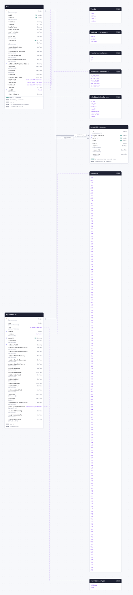

| Field            | Type       | Constraints                                       | Default      | Description |
| ---------------- | ---------- | ------------------------------------------------- | ------------ | ----------- |
| `id`             | `String`   | PK NOT NULL                                       | `cuid(1)`    |             |
| `organizationId` | `String`   | NOT NULL → [Organization.id](#model-Organization) |              |             |
| `ownerId`        | `String`   | NOT NULL → [User.id](#model-User)                 |              |             |
| `name`           | `String`   | NOT NULL                                          |              |             |
| `query`          | `String`   | NOT NULL                                          |              |             |
| `starred`        | `Boolean`  | NOT NULL                                          | `false`      |             |
| `createdAt`      | `DateTime` | NOT NULL                                          | `now()`      |             |
| `updatedAt`      | `DateTime` | NOT NULL                                          | `@updatedAt` |             |

#### Indexes

- `@@index([organizationId, ownerId], map: "asset_filter_presets_owner_lookup_idx")`
- `@@unique([organizationId, ownerId, name], map: "asset_filter_presets_owner_name_unique")`

#### References

- `organizationId` → [Organization.id](#model-Organization) (many-to-one, on delete Cascade)
- `ownerId` → [User.id](#model-User) (many-to-one, on delete Cascade)

#### Definition

```sql
CREATE TABLE "AssetFilterPreset" (
    "id" TEXT NOT NULL,
    "organizationId" TEXT NOT NULL,
    "ownerId" TEXT NOT NULL,
    "name" TEXT NOT NULL,
    "query" TEXT NOT NULL,
    "starred" BOOLEAN NOT NULL DEFAULT false,
    "createdAt" TIMESTAMP(3) NOT NULL DEFAULT CURRENT_TIMESTAMP,
    "updatedAt" TIMESTAMP(3) NOT NULL,

    CONSTRAINT "AssetFilterPreset_pkey" PRIMARY KEY ("id")
);

CREATE INDEX "asset_filter_presets_owner_lookup_idx" ON "AssetFilterPreset"("organizationId", "ownerId");

CREATE UNIQUE INDEX "asset_filter_presets_owner_name_unique" ON "AssetFilterPreset"("organizationId", "ownerId", "name");

ALTER TABLE "AssetFilterPreset" ADD CONSTRAINT "AssetFilterPreset_organizationId_fkey" FOREIGN KEY ("organizationId") REFERENCES "Organization"("id") ON DELETE CASCADE ON UPDATE CASCADE;

ALTER TABLE "AssetFilterPreset" ADD CONSTRAINT "AssetFilterPreset_ownerId_fkey" FOREIGN KEY ("ownerId") REFERENCES "User"("id") ON DELETE CASCADE ON UPDATE CASCADE;
```

<details>
<summary>Queries and their SQL</summary>

**findMany**: Every row

```ts
await prisma.assetFilterPreset.findMany();
```

```sql
SELECT
  "public"."AssetFilterPreset"."id",
  "public"."AssetFilterPreset"."organizationId",
  "public"."AssetFilterPreset"."ownerId",
  "public"."AssetFilterPreset"."name",
  "public"."AssetFilterPreset"."query",
  "public"."AssetFilterPreset"."starred",
  "public"."AssetFilterPreset"."createdAt",
  "public"."AssetFilterPreset"."updatedAt"
FROM
  "public"."AssetFilterPreset"
WHERE
  1 = 1
OFFSET
  $1
-- params: ["0"]
```

**count**: How many rows there are

```ts
await prisma.assetFilterPreset.count();
```

```sql
SELECT
  COUNT(*) AS "_count$_all"
FROM
  (
    SELECT
      "public"."AssetFilterPreset"."id"
    FROM
      "public"."AssetFilterPreset"
    WHERE
      1 = 1
    OFFSET
      $1
  ) AS "sub"
-- params: ["0"]
```

**findMany**: Every row with its relations

```ts
await prisma.assetFilterPreset.findMany({ include: { organization: true, owner: true } });
```

```sql
SELECT
  "public"."AssetFilterPreset"."id",
  "public"."AssetFilterPreset"."organizationId",
  "public"."AssetFilterPreset"."ownerId",
  "public"."AssetFilterPreset"."name",
  "public"."AssetFilterPreset"."query",
  "public"."AssetFilterPreset"."starred",
  "public"."AssetFilterPreset"."createdAt",
  "public"."AssetFilterPreset"."updatedAt"
FROM
  "public"."AssetFilterPreset"
WHERE
  1 = 1
OFFSET
  $1
-- params: ["0"]

SELECT
  "public"."Organization"."id",
  "public"."Organization"."name",
  "public"."Organization"."type"::text,
  "public"."Organization"."userId",
  "public"."Organization"."currency"::text,
  "public"."Organization"."imageId",
  "public"."Organization"."enabledSso",
  "public"."Organization"."ssoDetailsId",
  "public"."Organization"."selfServiceCanSeeCustody",
  "public"."Organization"."selfServiceCanSeeBookings",
  "public"."Organization"."baseUserCanSeeCustody",
  "public"."Organization"."baseUserCanSeeBookings",
  "public"."Organization"."managersCanEditAssets",
  "public"."Organization"."barcodesEnabled",
  "public"."Organization"."barcodesEnabledAt",
  "public"."Organization"."usedBarcodeTrial",
  "public"."Organization"."auditsEnabled",
  "public"."Organization"."auditsEnabledAt",
  "public"."Organization"."usedAuditTrial",
  "public"."Organization"."workspaceDisabled",
  "public"."Organization"."createdAt",
  "public"."Organization"."updatedAt",
  "public"."Organization"."hasSequentialIdsMigrated",
  "public"."Organization"."qrIdDisplayPreference"::text,
  "public"."Organization"."showShelfBranding",
  "public"."Organization"."showQrCodesOnPdfs",
  "public"."Organization"."customEmailFooter"
FROM
  "public"."Organization"
WHERE
  "public"."Organization"."id" IN ($1)
OFFSET
  $2
-- params: ["<organizationId of the rows above>","0"]

SELECT
  "public"."User"."id",
  "public"."User"."email",
  "public"."User"."username",
  "public"."User"."firstName",
  "public"."User"."lastName",
  "public"."User"."displayName",
  "public"."User"."profilePicture",
  "public"."User"."usedFreeTrial",
  "public"."User"."onboarded",
  "public"."User"."customerId",
  "public"."User"."sso",
  "public"."User"."createdWithInvite",
  "public"."User"."skipSubscriptionCheck",
  "public"."User"."hasUnpaidInvoice",
  "public"."User"."warnForNoPaymentMethod",
  "public"."User"."lastSelectedOrganizationId",
  "public"."User"."createdAt",
  "public"."User"."updatedAt",
  "public"."User"."deletedAt",
  "public"."User"."lastMobileActiveAt",
  "public"."User"."dateFormat"::text,
  "public"."User"."timeFormat"::text,
  "public"."User"."weekStart"::text,
  "public"."User"."timeZone",
  "public"."User"."tierId"::text,
  "public"."User"."referralSource"
FROM
  "public"."User"
WHERE
  "public"."User"."id" IN ($1)
OFFSET
  $2
-- params: ["<ownerId of the rows above>","0"]
```

**findUnique**: One row by what is unique to it

```ts
await prisma.assetFilterPreset.findUnique({ where: { id: "example" } });
```

```sql
SELECT
  "public"."AssetFilterPreset"."id",
  "public"."AssetFilterPreset"."organizationId",
  "public"."AssetFilterPreset"."ownerId",
  "public"."AssetFilterPreset"."name",
  "public"."AssetFilterPreset"."query",
  "public"."AssetFilterPreset"."starred",
  "public"."AssetFilterPreset"."createdAt",
  "public"."AssetFilterPreset"."updatedAt"
FROM
  "public"."AssetFilterPreset"
WHERE
  (
    "public"."AssetFilterPreset"."id" = $1
    AND 1 = 1
  )
LIMIT
  $2
OFFSET
  $3
-- params: ["example","1","0"]
```

**create**: Create a row

```ts
await prisma.assetFilterPreset.create({
  data: { organizationId: "example", ownerId: "example", name: "example", query: "example" },
});
```

```sql
INSERT INTO
  "public"."AssetFilterPreset" (
    "id",
    "organizationId",
    "ownerId",
    "name",
    "query",
    "starred",
    "createdAt",
    "updatedAt"
  )
VALUES
  ($1, $2, $3, $4, $5, $6, $7, $8)
RETURNING
  "public"."AssetFilterPreset"."id",
  "public"."AssetFilterPreset"."organizationId",
  "public"."AssetFilterPreset"."ownerId",
  "public"."AssetFilterPreset"."name",
  "public"."AssetFilterPreset"."query",
  "public"."AssetFilterPreset"."starred",
  "public"."AssetFilterPreset"."createdAt",
  "public"."AssetFilterPreset"."updatedAt"
-- params: ["<cuid(1)>","example","example","example","example",false,"<now()>","<now()>"]
```

**update**: Update a row

```ts
await prisma.assetFilterPreset.update({ where: { id: "example" }, data: { name: "example" } });
```

```sql
UPDATE "public"."AssetFilterPreset"
SET
  "name" = $1,
  "updatedAt" = $2
WHERE
  (
    "public"."AssetFilterPreset"."id" = $3
    AND 1 = 1
  )
RETURNING
  "public"."AssetFilterPreset"."id",
  "public"."AssetFilterPreset"."organizationId",
  "public"."AssetFilterPreset"."ownerId",
  "public"."AssetFilterPreset"."name",
  "public"."AssetFilterPreset"."query",
  "public"."AssetFilterPreset"."starred",
  "public"."AssetFilterPreset"."createdAt",
  "public"."AssetFilterPreset"."updatedAt"
-- params: ["example",{"prisma__type":"generatorCall","prisma__value":{"name":"now","args":[],"returnType":{"type":"DateTime"}}},"example"]
```

**delete**: Delete a row

```ts
await prisma.assetFilterPreset.delete({ where: { id: "example" } });
```

```sql
DELETE FROM "public"."AssetFilterPreset"
WHERE
  (
    "public"."AssetFilterPreset"."id" = $1
    AND 1 = 1
  )
RETURNING
  "public"."AssetFilterPreset"."id",
  "public"."AssetFilterPreset"."organizationId",
  "public"."AssetFilterPreset"."ownerId",
  "public"."AssetFilterPreset"."name",
  "public"."AssetFilterPreset"."query",
  "public"."AssetFilterPreset"."starred",
  "public"."AssetFilterPreset"."createdAt",
  "public"."AssetFilterPreset"."updatedAt"
-- params: ["example"]
```

</details>

<a id="model-AssetIndexSettings"></a>

### AssetIndexSettings

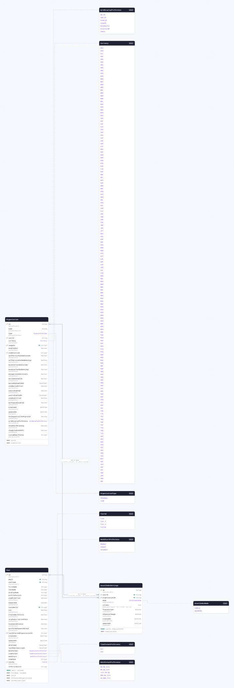

| Field            | Type                                     | Constraints                                       | Default                                                                                                                                                                                                                                                                                                                                                                                                                                                                                                                                                                                                                               | Description |
| ---------------- | ---------------------------------------- | ------------------------------------------------- | ------------------------------------------------------------------------------------------------------------------------------------------------------------------------------------------------------------------------------------------------------------------------------------------------------------------------------------------------------------------------------------------------------------------------------------------------------------------------------------------------------------------------------------------------------------------------------------------------------------------------------------- | ----------- |
| `id`             | `String`                                 | PK NOT NULL                                       | `cuid(1)`                                                                                                                                                                                                                                                                                                                                                                                                                                                                                                                                                                                                                             |             |
| `userId`         | `String`                                 | NOT NULL → [User.id](#model-User)                 |                                                                                                                                                                                                                                                                                                                                                                                                                                                                                                                                                                                                                                       |             |
| `organizationId` | `String`                                 | NOT NULL → [Organization.id](#model-Organization) |                                                                                                                                                                                                                                                                                                                                                                                                                                                                                                                                                                                                                                       |             |
| `mode`           | [`AssetIndexMode`](#enum-AssetIndexMode) | NOT NULL                                          | `SIMPLE`                                                                                                                                                                                                                                                                                                                                                                                                                                                                                                                                                                                                                              |             |
| `columns`        | `Json`                                   | NOT NULL                                          | `"[ {\"name\": \"id\", \"visible\": true, \"position\": 0}, {\"name\": \"status\", \"visible\": true, \"position\": 1}, {\"name\": \"description\", \"visible\": true, \"position\": 2}, {\"name\": \"valuation\", \"visible\": true, \"position\": 3}, {\"name\": \"createdAt\", \"visible\": true, \"position\": 4}, {\"name\": \"category\", \"visible\": true, \"position\": 5}, {\"name\": \"tags\", \"visible\": true, \"position\": 6}, {\"name\": \"location\", \"visible\": true, \"position\": 7}, {\"name\": \"kit\", \"visible\": true, \"position\": 8}, {\"name\": \"custody\", \"visible\": true, \"position\": 9} ]"` |             |
| `freezeColumn`   | `Boolean`                                | NOT NULL                                          | `true`                                                                                                                                                                                                                                                                                                                                                                                                                                                                                                                                                                                                                                |             |
| `showAssetImage` | `Boolean`                                | NOT NULL                                          | `true`                                                                                                                                                                                                                                                                                                                                                                                                                                                                                                                                                                                                                                |             |
| `createdAt`      | `DateTime`                               | NOT NULL                                          | `now()`                                                                                                                                                                                                                                                                                                                                                                                                                                                                                                                                                                                                                               |             |
| `updatedAt`      | `DateTime`                               | NOT NULL                                          | `@updatedAt`                                                                                                                                                                                                                                                                                                                                                                                                                                                                                                                                                                                                                          |             |

#### Indexes

- `@@index([organizationId])`
- `@@unique([userId, organizationId])`

#### References

- `userId` → [User.id](#model-User) (many-to-one, on delete Cascade, on update Cascade)
- `organizationId` → [Organization.id](#model-Organization) (many-to-one, on delete Cascade, on update Cascade)

#### Definition

```sql
CREATE TABLE "AssetIndexSettings" (
    "id" TEXT NOT NULL,
    "userId" TEXT NOT NULL,
    "organizationId" TEXT NOT NULL,
    "mode" "AssetIndexMode" NOT NULL DEFAULT 'SIMPLE',
    "columns" JSONB NOT NULL DEFAULT '[ {"name": "id", "visible": true, "position": 0}, {"name": "status", "visible": true, "position": 1}, {"name": "description", "visible": true, "position": 2}, {"name": "valuation", "visible": true, "position": 3}, {"name": "createdAt", "visible": true, "position": 4}, {"name": "category", "visible": true, "position": 5}, {"name": "tags", "visible": true, "position": 6}, {"name": "location", "visible": true, "position": 7}, {"name": "kit", "visible": true, "position": 8}, {"name": "custody", "visible": true, "position": 9} ]',
    "freezeColumn" BOOLEAN NOT NULL DEFAULT true,
    "showAssetImage" BOOLEAN NOT NULL DEFAULT true,
    "createdAt" TIMESTAMP(3) NOT NULL DEFAULT CURRENT_TIMESTAMP,
    "updatedAt" TIMESTAMP(3) NOT NULL,

    CONSTRAINT "AssetIndexSettings_pkey" PRIMARY KEY ("id")
);

CREATE INDEX "AssetIndexSettings_organizationId_idx" ON "AssetIndexSettings"("organizationId");

CREATE UNIQUE INDEX "AssetIndexSettings_userId_organizationId_key" ON "AssetIndexSettings"("userId", "organizationId");

ALTER TABLE "AssetIndexSettings" ADD CONSTRAINT "AssetIndexSettings_userId_fkey" FOREIGN KEY ("userId") REFERENCES "User"("id") ON DELETE CASCADE ON UPDATE CASCADE;

ALTER TABLE "AssetIndexSettings" ADD CONSTRAINT "AssetIndexSettings_organizationId_fkey" FOREIGN KEY ("organizationId") REFERENCES "Organization"("id") ON DELETE CASCADE ON UPDATE CASCADE;
```

<details>
<summary>Queries and their SQL</summary>

**findMany**: Every row

```ts
await prisma.assetIndexSettings.findMany();
```

```sql
SELECT
  "public"."AssetIndexSettings"."id",
  "public"."AssetIndexSettings"."userId",
  "public"."AssetIndexSettings"."organizationId",
  "public"."AssetIndexSettings"."mode"::text,
  "public"."AssetIndexSettings"."columns",
  "public"."AssetIndexSettings"."freezeColumn",
  "public"."AssetIndexSettings"."showAssetImage",
  "public"."AssetIndexSettings"."createdAt",
  "public"."AssetIndexSettings"."updatedAt"
FROM
  "public"."AssetIndexSettings"
WHERE
  1 = 1
OFFSET
  $1
-- params: ["0"]
```

**count**: How many rows there are

```ts
await prisma.assetIndexSettings.count();
```

```sql
SELECT
  COUNT(*) AS "_count$_all"
FROM
  (
    SELECT
      "public"."AssetIndexSettings"."id"
    FROM
      "public"."AssetIndexSettings"
    WHERE
      1 = 1
    OFFSET
      $1
  ) AS "sub"
-- params: ["0"]
```

**findMany**: Every row with its relations

```ts
await prisma.assetIndexSettings.findMany({ include: { user: true, organization: true } });
```

```sql
SELECT
  "public"."AssetIndexSettings"."id",
  "public"."AssetIndexSettings"."userId",
  "public"."AssetIndexSettings"."organizationId",
  "public"."AssetIndexSettings"."mode"::text,
  "public"."AssetIndexSettings"."columns",
  "public"."AssetIndexSettings"."freezeColumn",
  "public"."AssetIndexSettings"."showAssetImage",
  "public"."AssetIndexSettings"."createdAt",
  "public"."AssetIndexSettings"."updatedAt"
FROM
  "public"."AssetIndexSettings"
WHERE
  1 = 1
OFFSET
  $1
-- params: ["0"]

SELECT
  "public"."User"."id",
  "public"."User"."email",
  "public"."User"."username",
  "public"."User"."firstName",
  "public"."User"."lastName",
  "public"."User"."displayName",
  "public"."User"."profilePicture",
  "public"."User"."usedFreeTrial",
  "public"."User"."onboarded",
  "public"."User"."customerId",
  "public"."User"."sso",
  "public"."User"."createdWithInvite",
  "public"."User"."skipSubscriptionCheck",
  "public"."User"."hasUnpaidInvoice",
  "public"."User"."warnForNoPaymentMethod",
  "public"."User"."lastSelectedOrganizationId",
  "public"."User"."createdAt",
  "public"."User"."updatedAt",
  "public"."User"."deletedAt",
  "public"."User"."lastMobileActiveAt",
  "public"."User"."dateFormat"::text,
  "public"."User"."timeFormat"::text,
  "public"."User"."weekStart"::text,
  "public"."User"."timeZone",
  "public"."User"."tierId"::text,
  "public"."User"."referralSource"
FROM
  "public"."User"
WHERE
  "public"."User"."id" IN ($1)
OFFSET
  $2
-- params: ["<userId of the rows above>","0"]

SELECT
  "public"."Organization"."id",
  "public"."Organization"."name",
  "public"."Organization"."type"::text,
  "public"."Organization"."userId",
  "public"."Organization"."currency"::text,
  "public"."Organization"."imageId",
  "public"."Organization"."enabledSso",
  "public"."Organization"."ssoDetailsId",
  "public"."Organization"."selfServiceCanSeeCustody",
  "public"."Organization"."selfServiceCanSeeBookings",
  "public"."Organization"."baseUserCanSeeCustody",
  "public"."Organization"."baseUserCanSeeBookings",
  "public"."Organization"."managersCanEditAssets",
  "public"."Organization"."barcodesEnabled",
  "public"."Organization"."barcodesEnabledAt",
  "public"."Organization"."usedBarcodeTrial",
  "public"."Organization"."auditsEnabled",
  "public"."Organization"."auditsEnabledAt",
  "public"."Organization"."usedAuditTrial",
  "public"."Organization"."workspaceDisabled",
  "public"."Organization"."createdAt",
  "public"."Organization"."updatedAt",
  "public"."Organization"."hasSequentialIdsMigrated",
  "public"."Organization"."qrIdDisplayPreference"::text,
  "public"."Organization"."showShelfBranding",
  "public"."Organization"."showQrCodesOnPdfs",
  "public"."Organization"."customEmailFooter"
FROM
  "public"."Organization"
WHERE
  "public"."Organization"."id" IN ($1)
OFFSET
  $2
-- params: ["<organizationId of the rows above>","0"]
```

**findUnique**: One row by what is unique to it

```ts
await prisma.assetIndexSettings.findUnique({ where: { id: "example" } });
```

```sql
SELECT
  "public"."AssetIndexSettings"."id",
  "public"."AssetIndexSettings"."userId",
  "public"."AssetIndexSettings"."organizationId",
  "public"."AssetIndexSettings"."mode"::text,
  "public"."AssetIndexSettings"."columns",
  "public"."AssetIndexSettings"."freezeColumn",
  "public"."AssetIndexSettings"."showAssetImage",
  "public"."AssetIndexSettings"."createdAt",
  "public"."AssetIndexSettings"."updatedAt"
FROM
  "public"."AssetIndexSettings"
WHERE
  (
    "public"."AssetIndexSettings"."id" = $1
    AND 1 = 1
  )
LIMIT
  $2
OFFSET
  $3
-- params: ["example","1","0"]
```

**create**: Create a row

```ts
await prisma.assetIndexSettings.create({ data: { userId: "example", organizationId: "example" } });
```

```sql
INSERT INTO
  "public"."AssetIndexSettings" (
    "id",
    "userId",
    "organizationId",
    "mode",
    "columns",
    "freezeColumn",
    "showAssetImage",
    "createdAt",
    "updatedAt"
  )
VALUES
  (
    $1,
    $2,
    $3,
    CAST($4::text AS "public"."AssetIndexMode"),
    $5,
    $6,
    $7,
    $8,
    $9
  )
RETURNING
  "public"."AssetIndexSettings"."id",
  "public"."AssetIndexSettings"."userId",
  "public"."AssetIndexSettings"."organizationId",
  "public"."AssetIndexSettings"."mode"::text,
  "public"."AssetIndexSettings"."columns",
  "public"."AssetIndexSettings"."freezeColumn",
  "public"."AssetIndexSettings"."showAssetImage",
  "public"."AssetIndexSettings"."createdAt",
  "public"."AssetIndexSettings"."updatedAt"
-- params: ["<cuid(1)>","example","example","SIMPLE","[{\"name\":\"id\",\"visible\":true,\"position\":0},{\"name\":\"status\",\"visible\":true,\"position\":1},{\"name\":\"description\",\"visible\":true,\"position\":2},{\"name\":\"valuation\",\"visible\":true,\"position\":3},{\"name\":\"createdAt\",\"visible\":true,\"position\":4},{\"name\":\"category\",\"visible\":true,\"position\":5},{\"name\":\"tags\",\"visible\":true,\"position\":6},{\"name\":\"location\",\"visible\":true,\"position\":7},{\"name\":\"kit\",\"visible\":true,\"position\":8},{\"name\":\"custody\",\"visible\":true,\"position\":9}]",true,true,"<now()>","<now()>"]
```

**update**: Update a row

```ts
await prisma.assetIndexSettings.update({ where: { id: "example" }, data: { mode: "SIMPLE" } });
```

```sql
UPDATE "public"."AssetIndexSettings"
SET
  "mode" = CAST($1::text AS "public"."AssetIndexMode"),
  "updatedAt" = $2
WHERE
  (
    "public"."AssetIndexSettings"."id" = $3
    AND 1 = 1
  )
RETURNING
  "public"."AssetIndexSettings"."id",
  "public"."AssetIndexSettings"."userId",
  "public"."AssetIndexSettings"."organizationId",
  "public"."AssetIndexSettings"."mode"::text,
  "public"."AssetIndexSettings"."columns",
  "public"."AssetIndexSettings"."freezeColumn",
  "public"."AssetIndexSettings"."showAssetImage",
  "public"."AssetIndexSettings"."createdAt",
  "public"."AssetIndexSettings"."updatedAt"
-- params: ["SIMPLE",{"prisma__type":"generatorCall","prisma__value":{"name":"now","args":[],"returnType":{"type":"DateTime"}}},"example"]
```

**delete**: Delete a row

```ts
await prisma.assetIndexSettings.delete({ where: { id: "example" } });
```

```sql
DELETE FROM "public"."AssetIndexSettings"
WHERE
  (
    "public"."AssetIndexSettings"."id" = $1
    AND 1 = 1
  )
RETURNING
  "public"."AssetIndexSettings"."id",
  "public"."AssetIndexSettings"."userId",
  "public"."AssetIndexSettings"."organizationId",
  "public"."AssetIndexSettings"."mode"::text,
  "public"."AssetIndexSettings"."columns",
  "public"."AssetIndexSettings"."freezeColumn",
  "public"."AssetIndexSettings"."showAssetImage",
  "public"."AssetIndexSettings"."createdAt",
  "public"."AssetIndexSettings"."updatedAt"
-- params: ["example"]
```

</details>

<a id="model-PdfTemplate"></a>

### PdfTemplate

A saved layout for a generated PDF, kept per team workspace under a name:
which columns, rows and header lines print, and in what order the rows
come. A row is a layout, not a generated file; the person generating a PDF
picks a template by name.

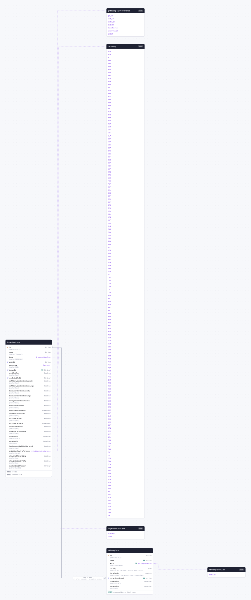

| Field            | Type                                       | Constraints                                       | Default      | Description                                                                                                                                                                                                                                                                      |
| ---------------- | ------------------------------------------ | ------------------------------------------------- | ------------ | -------------------------------------------------------------------------------------------------------------------------------------------------------------------------------------------------------------------------------------------------------------------------------- |
| `id`             | `String`                                   | PK NOT NULL                                       | `cuid(1)`    |                                                                                                                                                                                                                                                                                  |
| `name`           | `String`                                   | NOT NULL                                          |              |                                                                                                                                                                                                                                                                                  |
| `kind`           | [`PdfTemplateKind`](#enum-PdfTemplateKind) | NOT NULL                                          | `BOOKING`    |                                                                                                                                                                                                                                                                                  |
| `config`         | `Json`                                     | NOT NULL                                          | `"{}"`       | The layout's switches. Read through `parseBookingTemplateConfig`, which fills any key a stored row lacks from the Checklist template's values.                                                                                                                                   |
| `isDefault`      | `Boolean`                                  | NOT NULL                                          | `false`      | The template the PDF dialog offers first. One per workspace and kind, enforced by a partial unique index in raw SQL (migration 20261103120000_add_pdf_templates). Names are also unique per workspace and kind ignoring case, through an expression index in the same migration. |
| `organizationId` | `String`                                   | NOT NULL → [Organization.id](#model-Organization) |              |                                                                                                                                                                                                                                                                                  |
| `createdAt`      | `DateTime`                                 | NOT NULL                                          | `now()`      |                                                                                                                                                                                                                                                                                  |
| `updatedAt`      | `DateTime`                                 | NOT NULL                                          | `@updatedAt` |                                                                                                                                                                                                                                                                                  |

#### Indexes

- `@@unique([organizationId, kind, name])`

#### References

- `organizationId` → [Organization.id](#model-Organization) (many-to-one, on delete Cascade, on update Cascade)

#### Definition

```sql
CREATE TABLE "PdfTemplate" (
    "id" TEXT NOT NULL,
    "name" TEXT NOT NULL,
    "kind" "PdfTemplateKind" NOT NULL DEFAULT 'BOOKING',
    "config" JSONB NOT NULL DEFAULT '{}',
    "isDefault" BOOLEAN NOT NULL DEFAULT false,
    "organizationId" TEXT NOT NULL,
    "createdAt" TIMESTAMP(3) NOT NULL DEFAULT CURRENT_TIMESTAMP,
    "updatedAt" TIMESTAMP(3) NOT NULL,

    CONSTRAINT "PdfTemplate_pkey" PRIMARY KEY ("id")
);

CREATE UNIQUE INDEX "PdfTemplate_organizationId_kind_name_key" ON "PdfTemplate"("organizationId", "kind", "name");

ALTER TABLE "PdfTemplate" ADD CONSTRAINT "PdfTemplate_organizationId_fkey" FOREIGN KEY ("organizationId") REFERENCES "Organization"("id") ON DELETE CASCADE ON UPDATE CASCADE;
```

<details>
<summary>Queries and their SQL</summary>

**findMany**: Every row

```ts
await prisma.pdfTemplate.findMany();
```

```sql
SELECT
  "public"."PdfTemplate"."id",
  "public"."PdfTemplate"."name",
  "public"."PdfTemplate"."kind"::text,
  "public"."PdfTemplate"."config",
  "public"."PdfTemplate"."isDefault",
  "public"."PdfTemplate"."organizationId",
  "public"."PdfTemplate"."createdAt",
  "public"."PdfTemplate"."updatedAt"
FROM
  "public"."PdfTemplate"
WHERE
  1 = 1
OFFSET
  $1
-- params: ["0"]
```

**count**: How many rows there are

```ts
await prisma.pdfTemplate.count();
```

```sql
SELECT
  COUNT(*) AS "_count$_all"
FROM
  (
    SELECT
      "public"."PdfTemplate"."id"
    FROM
      "public"."PdfTemplate"
    WHERE
      1 = 1
    OFFSET
      $1
  ) AS "sub"
-- params: ["0"]
```

**findMany**: Every row with its relations

```ts
await prisma.pdfTemplate.findMany({ include: { organization: true } });
```

```sql
SELECT
  "public"."PdfTemplate"."id",
  "public"."PdfTemplate"."name",
  "public"."PdfTemplate"."kind"::text,
  "public"."PdfTemplate"."config",
  "public"."PdfTemplate"."isDefault",
  "public"."PdfTemplate"."organizationId",
  "public"."PdfTemplate"."createdAt",
  "public"."PdfTemplate"."updatedAt"
FROM
  "public"."PdfTemplate"
WHERE
  1 = 1
OFFSET
  $1
-- params: ["0"]

SELECT
  "public"."Organization"."id",
  "public"."Organization"."name",
  "public"."Organization"."type"::text,
  "public"."Organization"."userId",
  "public"."Organization"."currency"::text,
  "public"."Organization"."imageId",
  "public"."Organization"."enabledSso",
  "public"."Organization"."ssoDetailsId",
  "public"."Organization"."selfServiceCanSeeCustody",
  "public"."Organization"."selfServiceCanSeeBookings",
  "public"."Organization"."baseUserCanSeeCustody",
  "public"."Organization"."baseUserCanSeeBookings",
  "public"."Organization"."managersCanEditAssets",
  "public"."Organization"."barcodesEnabled",
  "public"."Organization"."barcodesEnabledAt",
  "public"."Organization"."usedBarcodeTrial",
  "public"."Organization"."auditsEnabled",
  "public"."Organization"."auditsEnabledAt",
  "public"."Organization"."usedAuditTrial",
  "public"."Organization"."workspaceDisabled",
  "public"."Organization"."createdAt",
  "public"."Organization"."updatedAt",
  "public"."Organization"."hasSequentialIdsMigrated",
  "public"."Organization"."qrIdDisplayPreference"::text,
  "public"."Organization"."showShelfBranding",
  "public"."Organization"."showQrCodesOnPdfs",
  "public"."Organization"."customEmailFooter"
FROM
  "public"."Organization"
WHERE
  "public"."Organization"."id" IN ($1)
OFFSET
  $2
-- params: ["<organizationId of the rows above>","0"]
```

**findUnique**: One row by what is unique to it

```ts
await prisma.pdfTemplate.findUnique({ where: { id: "example" } });
```

```sql
SELECT
  "public"."PdfTemplate"."id",
  "public"."PdfTemplate"."name",
  "public"."PdfTemplate"."kind"::text,
  "public"."PdfTemplate"."config",
  "public"."PdfTemplate"."isDefault",
  "public"."PdfTemplate"."organizationId",
  "public"."PdfTemplate"."createdAt",
  "public"."PdfTemplate"."updatedAt"
FROM
  "public"."PdfTemplate"
WHERE
  (
    "public"."PdfTemplate"."id" = $1
    AND 1 = 1
  )
LIMIT
  $2
OFFSET
  $3
-- params: ["example","1","0"]
```

**create**: Create a row

```ts
await prisma.pdfTemplate.create({ data: { name: "example", organizationId: "example" } });
```

```sql
INSERT INTO
  "public"."PdfTemplate" (
    "id",
    "name",
    "kind",
    "config",
    "isDefault",
    "organizationId",
    "createdAt",
    "updatedAt"
  )
VALUES
  (
    $1,
    $2,
    CAST($3::text AS "public"."PdfTemplateKind"),
    $4,
    $5,
    $6,
    $7,
    $8
  )
RETURNING
  "public"."PdfTemplate"."id",
  "public"."PdfTemplate"."name",
  "public"."PdfTemplate"."kind"::text,
  "public"."PdfTemplate"."config",
  "public"."PdfTemplate"."isDefault",
  "public"."PdfTemplate"."organizationId",
  "public"."PdfTemplate"."createdAt",
  "public"."PdfTemplate"."updatedAt"
-- params: ["<cuid(1)>","example","BOOKING","{}",false,"example","<now()>","<now()>"]
```

**update**: Update a row

```ts
await prisma.pdfTemplate.update({ where: { id: "example" }, data: { name: "example" } });
```

```sql
UPDATE "public"."PdfTemplate"
SET
  "name" = $1,
  "updatedAt" = $2
WHERE
  (
    "public"."PdfTemplate"."id" = $3
    AND 1 = 1
  )
RETURNING
  "public"."PdfTemplate"."id",
  "public"."PdfTemplate"."name",
  "public"."PdfTemplate"."kind"::text,
  "public"."PdfTemplate"."config",
  "public"."PdfTemplate"."isDefault",
  "public"."PdfTemplate"."organizationId",
  "public"."PdfTemplate"."createdAt",
  "public"."PdfTemplate"."updatedAt"
-- params: ["example",{"prisma__type":"generatorCall","prisma__value":{"name":"now","args":[],"returnType":{"type":"DateTime"}}},"example"]
```

**delete**: Delete a row

```ts
await prisma.pdfTemplate.delete({ where: { id: "example" } });
```

```sql
DELETE FROM "public"."PdfTemplate"
WHERE
  (
    "public"."PdfTemplate"."id" = $1
    AND 1 = 1
  )
RETURNING
  "public"."PdfTemplate"."id",
  "public"."PdfTemplate"."name",
  "public"."PdfTemplate"."kind"::text,
  "public"."PdfTemplate"."config",
  "public"."PdfTemplate"."isDefault",
  "public"."PdfTemplate"."organizationId",
  "public"."PdfTemplate"."createdAt",
  "public"."PdfTemplate"."updatedAt"
-- params: ["example"]
```

</details>

<a id="model-Category"></a>

### Category

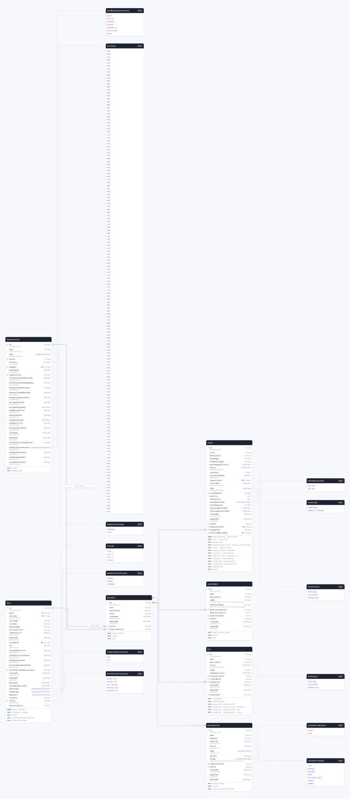

| Field            | Type       | Constraints                                       | Default      | Description |
| ---------------- | ---------- | ------------------------------------------------- | ------------ | ----------- |
| `id`             | `String`   | PK NOT NULL                                       | `cuid(1)`    |             |
| `name`           | `String`   | NOT NULL                                          |              |             |
| `description`    | `String`   | NULL                                              |              |             |
| `color`          | `String`   | NOT NULL                                          |              |             |
| `createdAt`      | `DateTime` | NOT NULL                                          | `now()`      |             |
| `updatedAt`      | `DateTime` | NOT NULL                                          | `@updatedAt` |             |
| `userId`         | `String`   | NOT NULL → [User.id](#model-User)                 |              |             |
| `organizationId` | `String`   | NOT NULL → [Organization.id](#model-Organization) |              |             |

#### Indexes

- `@@index([organizationId])`
- `@@index([userId])`
- `@@index([name], map: "Category_name_trgm_idx")`

#### References

- `userId` → [User.id](#model-User) (many-to-one, on update Cascade)
- `organizationId` → [Organization.id](#model-Organization) (many-to-one, on delete Cascade, on update Cascade)

#### Referenced by

- `id` ← [Asset.categoryId](#model-Asset) (one-to-many)
- `id` ← [AssetModel.defaultCategoryId](#model-AssetModel) (one-to-many)
- `id` ← [Kit.categoryId](#model-Kit) (one-to-many)

#### Many to many

- `customFields` ↔ [CustomField.categories](#model-CustomField) through `_CategoryToCustomField`

#### Definition

```sql
CREATE TABLE "Category" (
    "id" TEXT NOT NULL,
    "name" TEXT NOT NULL,
    "description" TEXT,
    "color" TEXT NOT NULL,
    "createdAt" TIMESTAMP(3) NOT NULL DEFAULT CURRENT_TIMESTAMP,
    "updatedAt" TIMESTAMP(3) NOT NULL,
    "userId" TEXT NOT NULL,
    "organizationId" TEXT NOT NULL,

    CONSTRAINT "Category_pkey" PRIMARY KEY ("id")
);

CREATE INDEX "Category_organizationId_idx" ON "Category"("organizationId");

CREATE INDEX "Category_userId_idx" ON "Category"("userId");

CREATE INDEX "Category_name_trgm_idx" ON "Category" USING GIN ("name" gin_trgm_ops);

ALTER TABLE "Category" ADD CONSTRAINT "Category_userId_fkey" FOREIGN KEY ("userId") REFERENCES "User"("id") ON DELETE RESTRICT ON UPDATE CASCADE;

ALTER TABLE "Category" ADD CONSTRAINT "Category_organizationId_fkey" FOREIGN KEY ("organizationId") REFERENCES "Organization"("id") ON DELETE CASCADE ON UPDATE CASCADE;
```

<details>
<summary>Queries and their SQL</summary>

**findMany**: Every row

```ts
await prisma.category.findMany();
```

```sql
SELECT
  "public"."Category"."id",
  "public"."Category"."name",
  "public"."Category"."description",
  "public"."Category"."color",
  "public"."Category"."createdAt",
  "public"."Category"."updatedAt",
  "public"."Category"."userId",
  "public"."Category"."organizationId"
FROM
  "public"."Category"
WHERE
  1 = 1
OFFSET
  $1
-- params: ["0"]
```

**count**: How many rows there are

```ts
await prisma.category.count();
```

```sql
SELECT
  COUNT(*) AS "_count$_all"
FROM
  (
    SELECT
      "public"."Category"."id"
    FROM
      "public"."Category"
    WHERE
      1 = 1
    OFFSET
      $1
  ) AS "sub"
-- params: ["0"]
```

**findMany**: Every row with its relations

```ts
await prisma.category.findMany({
  include: {
    assets: true,
    kits: true,
    user: true,
    customFields: true,
    assetModelDefaults: true,
    organization: true,
  },
});
```

```sql
SELECT
  "public"."Category"."id",
  "public"."Category"."name",
  "public"."Category"."description",
  "public"."Category"."color",
  "public"."Category"."createdAt",
  "public"."Category"."updatedAt",
  "public"."Category"."userId",
  "public"."Category"."organizationId"
FROM
  "public"."Category"
WHERE
  1 = 1
OFFSET
  $1
-- params: ["0"]

SELECT
  "public"."Asset"."id",
  "public"."Asset"."title",
  "public"."Asset"."description",
  "public"."Asset"."mainImage",
  "public"."Asset"."thumbnailImage",
  "public"."Asset"."mainImageExpiration",
  "public"."Asset"."status"::text,
  "public"."Asset"."value",
  "public"."Asset"."availableToBook",
  "public"."Asset"."sequentialId",
  "public"."Asset"."archivedAt",
  "public"."Asset"."type"::text,
  "public"."Asset"."assetModelId",
  "public"."Asset"."quantity",
  "public"."Asset"."minQuantity",
  "public"."Asset"."consumptionType"::text,
  "public"."Asset"."unitOfMeasure",
  "public"."Asset"."lowStockNotifiedAt",
  "public"."Asset"."stockLedgerStartedAt",
  "public"."Asset"."createdAt",
  "public"."Asset"."updatedAt",
  "public"."Asset"."userId",
  "public"."Asset"."organizationId",
  "public"."Asset"."categoryId",
  "public"."Asset"."preferredBarcodeId"
FROM
  "public"."Asset"
WHERE
  "public"."Asset"."categoryId" IN ($1)
OFFSET
  $2
-- params: ["<id of the rows above>","0"]

SELECT
  "public"."Kit"."id",
  "public"."Kit"."name",
  "public"."Kit"."description",
  "public"."Kit"."status"::text,
  "public"."Kit"."image",
  "public"."Kit"."imageExpiration",
  "public"."Kit"."organizationId",
  "public"."Kit"."createdById",
  "public"."Kit"."categoryId",
  "public"."Kit"."createdAt",
  "public"."Kit"."updatedAt",
  "public"."Kit"."locationId"
FROM
  "public"."Kit"
WHERE
  "public"."Kit"."categoryId" IN ($1)
OFFSET
  $2
-- params: ["<id of the rows above>","0"]

SELECT
  "public"."User"."id",
  "public"."User"."email",
  "public"."User"."username",
  "public"."User"."firstName",
  "public"."User"."lastName",
  "public"."User"."displayName",
  "public"."User"."profilePicture",
  "public"."User"."usedFreeTrial",
  "public"."User"."onboarded",
  "public"."User"."customerId",
  "public"."User"."sso",
  "public"."User"."createdWithInvite",
  "public"."User"."skipSubscriptionCheck",
  "public"."User"."hasUnpaidInvoice",
  "public"."User"."warnForNoPaymentMethod",
  "public"."User"."lastSelectedOrganizationId",
  "public"."User"."createdAt",
  "public"."User"."updatedAt",
  "public"."User"."deletedAt",
  "public"."User"."lastMobileActiveAt",
  "public"."User"."dateFormat"::text,
  "public"."User"."timeFormat"::text,
  "public"."User"."weekStart"::text,
  "public"."User"."timeZone",
  "public"."User"."tierId"::text,
  "public"."User"."referralSource"
FROM
  "public"."User"
WHERE
  "public"."User"."id" IN ($1)
OFFSET
  $2
-- params: ["<userId of the rows above>","0"]

SELECT
  "public"."CustomField"."id",
  "public"."CustomField"."name",
  "public"."CustomField"."helpText",
  "public"."CustomField"."required",
  "public"."CustomField"."active",
  "public"."CustomField"."type"::text,
  "public"."CustomField"."options",
  "public"."CustomField"."format"::text,
  "public"."CustomField"."organizationId",
  "public"."CustomField"."userId",
  "public"."CustomField"."createdAt",
  "public"."CustomField"."updatedAt",
  "public"."CustomField"."deletedAt",
  "t0"."A" AS "CategoryToCustomField@Category"
FROM
  "public"."CustomField"
  INNER JOIN "public"."_CategoryToCustomField" AS "t0" ON "t0"."B" = "public"."CustomField"."id"
WHERE
  (
    1 = 1
    AND "t0"."A" IN ($1)
  )
OFFSET
  $2
-- params: ["<id of the rows above>","0"]

SELECT
  "public"."AssetModel"."id",
  "public"."AssetModel"."name",
  "public"."AssetModel"."description",
  "public"."AssetModel"."image",
  "public"."AssetModel"."thumbnailImage",
  "public"."AssetModel"."defaultCategoryId",
  "public"."AssetModel"."defaultValuation",
  "public"."AssetModel"."organizationId",
  "public"."AssetModel"."userId",
  "public"."AssetModel"."createdAt",
  "public"."AssetModel"."updatedAt"
FROM
  "public"."AssetModel"
WHERE
  "public"."AssetModel"."defaultCategoryId" IN ($1)
OFFSET
  $2
-- params: ["<id of the rows above>","0"]

SELECT
  "public"."Organization"."id",
  "public"."Organization"."name",
  "public"."Organization"."type"::text,
  "public"."Organization"."userId",
  "public"."Organization"."currency"::text,
  "public"."Organization"."imageId",
  "public"."Organization"."enabledSso",
  "public"."Organization"."ssoDetailsId",
  "public"."Organization"."selfServiceCanSeeCustody",
  "public"."Organization"."selfServiceCanSeeBookings",
  "public"."Organization"."baseUserCanSeeCustody",
  "public"."Organization"."baseUserCanSeeBookings",
  "public"."Organization"."managersCanEditAssets",
  "public"."Organization"."barcodesEnabled",
  "public"."Organization"."barcodesEnabledAt",
  "public"."Organization"."usedBarcodeTrial",
  "public"."Organization"."auditsEnabled",
  "public"."Organization"."auditsEnabledAt",
  "public"."Organization"."usedAuditTrial",
  "public"."Organization"."workspaceDisabled",
  "public"."Organization"."createdAt",
  "public"."Organization"."updatedAt",
  "public"."Organization"."hasSequentialIdsMigrated",
  "public"."Organization"."qrIdDisplayPreference"::text,
  "public"."Organization"."showShelfBranding",
  "public"."Organization"."showQrCodesOnPdfs",
  "public"."Organization"."customEmailFooter"
FROM
  "public"."Organization"
WHERE
  "public"."Organization"."id" IN ($1)
OFFSET
  $2
-- params: ["<organizationId of the rows above>","0"]
```

**findUnique**: One row by what is unique to it

```ts
await prisma.category.findUnique({ where: { id: "example" } });
```

```sql
SELECT
  "public"."Category"."id",
  "public"."Category"."name",
  "public"."Category"."description",
  "public"."Category"."color",
  "public"."Category"."createdAt",
  "public"."Category"."updatedAt",
  "public"."Category"."userId",
  "public"."Category"."organizationId"
FROM
  "public"."Category"
WHERE
  (
    "public"."Category"."id" = $1
    AND 1 = 1
  )
LIMIT
  $2
OFFSET
  $3
-- params: ["example","1","0"]
```

**create**: Create a row

```ts
await prisma.category.create({
  data: { name: "example", color: "example", userId: "example", organizationId: "example" },
});
```

```sql
INSERT INTO
  "public"."Category" (
    "id",
    "name",
    "color",
    "createdAt",
    "updatedAt",
    "userId",
    "organizationId"
  )
VALUES
  ($1, $2, $3, $4, $5, $6, $7)
RETURNING
  "public"."Category"."id",
  "public"."Category"."name",
  "public"."Category"."description",
  "public"."Category"."color",
  "public"."Category"."createdAt",
  "public"."Category"."updatedAt",
  "public"."Category"."userId",
  "public"."Category"."organizationId"
-- params: ["<cuid(1)>","example","example","<now()>","<now()>","example","example"]
```

**update**: Update a row

```ts
await prisma.category.update({ where: { id: "example" }, data: { name: "example" } });
```

```sql
UPDATE "public"."Category"
SET
  "name" = $1,
  "updatedAt" = $2
WHERE
  (
    "public"."Category"."id" = $3
    AND 1 = 1
  )
RETURNING
  "public"."Category"."id",
  "public"."Category"."name",
  "public"."Category"."description",
  "public"."Category"."color",
  "public"."Category"."createdAt",
  "public"."Category"."updatedAt",
  "public"."Category"."userId",
  "public"."Category"."organizationId"
-- params: ["example",{"prisma__type":"generatorCall","prisma__value":{"name":"now","args":[],"returnType":{"type":"DateTime"}}},"example"]
```

**delete**: Delete a row

```ts
await prisma.category.delete({ where: { id: "example" } });
```

```sql
DELETE FROM "public"."Category"
WHERE
  (
    "public"."Category"."id" = $1
    AND 1 = 1
  )
RETURNING
  "public"."Category"."id",
  "public"."Category"."name",
  "public"."Category"."description",
  "public"."Category"."color",
  "public"."Category"."createdAt",
  "public"."Category"."updatedAt",
  "public"."Category"."userId",
  "public"."Category"."organizationId"
-- params: ["example"]
```

</details>

<a id="model-AssetModel"></a>

### AssetModel

-
- A template/grouping entity for assets.
- Groups individual assets of the same type (e.g., "Dell Latitude 5550")
- and provides default field values when creating new assets from the model.

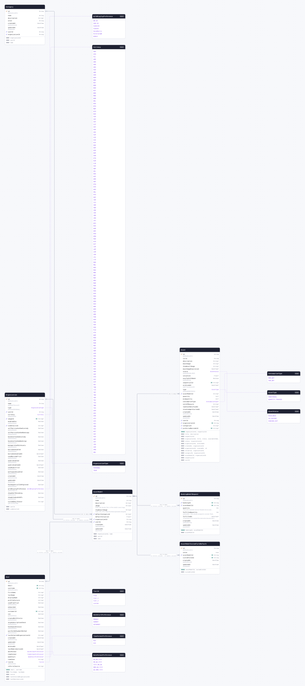

| Field               | Type       | Constraints                                       | Default      | Description                                                                                                                                                                                                                                      |
| ------------------- | ---------- | ------------------------------------------------- | ------------ | ------------------------------------------------------------------------------------------------------------------------------------------------------------------------------------------------------------------------------------------------ |
| `id`                | `String`   | PK NOT NULL                                       | `cuid(1)`    |                                                                                                                                                                                                                                                  |
| `name`              | `String`   | NOT NULL                                          |              |                                                                                                                                                                                                                                                  |
| `description`       | `String`   | NULL                                              |              |                                                                                                                                                                                                                                                  |
| `image`             | `String`   | NULL                                              |              | Public URL (bucket `files`) of the model's cover image. Rendered by any asset of this model that has no image of its own. Public — and therefore never-expiring and cacheable — like Location.imageUrl; see resolveAssetImage() for the cascade. |
| `thumbnailImage`    | `String`   | NULL                                              |              | Public URL of the 108px thumbnail generated alongside `image`. Used at list sizes so inheriting assets never render the full-size original.                                                                                                      |
| `defaultCategoryId` | `String`   | NULL → [Category.id](#model-Category)             |              |                                                                                                                                                                                                                                                  |
| `defaultValuation`  | `Float`    | NULL                                              |              |                                                                                                                                                                                                                                                  |
| `organizationId`    | `String`   | NOT NULL → [Organization.id](#model-Organization) |              |                                                                                                                                                                                                                                                  |
| `userId`            | `String`   | NOT NULL → [User.id](#model-User)                 |              |                                                                                                                                                                                                                                                  |
| `createdAt`         | `DateTime` | NOT NULL                                          | `now()`      |                                                                                                                                                                                                                                                  |
| `updatedAt`         | `DateTime` | NOT NULL                                          | `@updatedAt` |                                                                                                                                                                                                                                                  |

#### Indexes

- `@@index([organizationId, name])`
- `@@index([userId])`
- `@@index([name], map: "AssetModel_name_trgm_idx")`

#### References

- `defaultCategoryId` → [Category.id](#model-Category) (many-to-one)
- `organizationId` → [Organization.id](#model-Organization) (many-to-one, on delete Cascade, on update Cascade)
- `userId` → [User.id](#model-User) (many-to-one, on delete Cascade, on update Cascade)

#### Referenced by

- `id` ← [Asset.assetModelId](#model-Asset) (one-to-many)
- `id` ← [BookingModelRequest.assetModelId](#model-BookingModelRequest) (one-to-many, on delete Cascade, on update Cascade)
- `id` ← [AssetModelCustomFieldDefault.assetModelId](#model-AssetModelCustomFieldDefault) (one-to-many, on delete Cascade, on update Cascade)

#### Definition

```sql
CREATE TABLE "AssetModel" (
    "id" TEXT NOT NULL,
    "name" TEXT NOT NULL,
    "description" TEXT,
    "image" TEXT,
    "thumbnailImage" TEXT,
    "defaultCategoryId" TEXT,
    "defaultValuation" DOUBLE PRECISION,
    "organizationId" TEXT NOT NULL,
    "userId" TEXT NOT NULL,
    "createdAt" TIMESTAMP(3) NOT NULL DEFAULT CURRENT_TIMESTAMP,
    "updatedAt" TIMESTAMP(3) NOT NULL,

    CONSTRAINT "AssetModel_pkey" PRIMARY KEY ("id")
);

CREATE INDEX "AssetModel_organizationId_name_idx" ON "AssetModel"("organizationId", "name");

CREATE INDEX "AssetModel_userId_idx" ON "AssetModel"("userId");

CREATE INDEX "AssetModel_name_trgm_idx" ON "AssetModel" USING GIN ("name" gin_trgm_ops);

ALTER TABLE "AssetModel" ADD CONSTRAINT "AssetModel_defaultCategoryId_fkey" FOREIGN KEY ("defaultCategoryId") REFERENCES "Category"("id") ON DELETE SET NULL ON UPDATE CASCADE;

ALTER TABLE "AssetModel" ADD CONSTRAINT "AssetModel_organizationId_fkey" FOREIGN KEY ("organizationId") REFERENCES "Organization"("id") ON DELETE CASCADE ON UPDATE CASCADE;

ALTER TABLE "AssetModel" ADD CONSTRAINT "AssetModel_userId_fkey" FOREIGN KEY ("userId") REFERENCES "User"("id") ON DELETE CASCADE ON UPDATE CASCADE;
```

<details>
<summary>Queries and their SQL</summary>

**findMany**: Every row

```ts
await prisma.assetModel.findMany();
```

```sql
SELECT
  "public"."AssetModel"."id",
  "public"."AssetModel"."name",
  "public"."AssetModel"."description",
  "public"."AssetModel"."image",
  "public"."AssetModel"."thumbnailImage",
  "public"."AssetModel"."defaultCategoryId",
  "public"."AssetModel"."defaultValuation",
  "public"."AssetModel"."organizationId",
  "public"."AssetModel"."userId",
  "public"."AssetModel"."createdAt",
  "public"."AssetModel"."updatedAt"
FROM
  "public"."AssetModel"
WHERE
  1 = 1
OFFSET
  $1
-- params: ["0"]
```

**count**: How many rows there are

```ts
await prisma.assetModel.count();
```

```sql
SELECT
  COUNT(*) AS "_count$_all"
FROM
  (
    SELECT
      "public"."AssetModel"."id"
    FROM
      "public"."AssetModel"
    WHERE
      1 = 1
    OFFSET
      $1
  ) AS "sub"
-- params: ["0"]
```

**findMany**: Every row with its relations

```ts
await prisma.assetModel.findMany({
  include: {
    defaultCategory: true,
    customFieldDefaults: true,
    assets: true,
    modelRequests: true,
    organization: true,
    createdBy: true,
  },
});
```

```sql
SELECT
  "public"."AssetModel"."id",
  "public"."AssetModel"."name",
  "public"."AssetModel"."description",
  "public"."AssetModel"."image",
  "public"."AssetModel"."thumbnailImage",
  "public"."AssetModel"."defaultCategoryId",
  "public"."AssetModel"."defaultValuation",
  "public"."AssetModel"."organizationId",
  "public"."AssetModel"."userId",
  "public"."AssetModel"."createdAt",
  "public"."AssetModel"."updatedAt"
FROM
  "public"."AssetModel"
WHERE
  1 = 1
OFFSET
  $1
-- params: ["0"]

SELECT
  "public"."Category"."id",
  "public"."Category"."name",
  "public"."Category"."description",
  "public"."Category"."color",
  "public"."Category"."createdAt",
  "public"."Category"."updatedAt",
  "public"."Category"."userId",
  "public"."Category"."organizationId"
FROM
  "public"."Category"
WHERE
  "public"."Category"."id" IN ($1)
OFFSET
  $2
-- params: ["<defaultCategoryId of the rows above>","0"]

SELECT
  "public"."AssetModelCustomFieldDefault"."id",
  "public"."AssetModelCustomFieldDefault"."value",
  "public"."AssetModelCustomFieldDefault"."assetModelId",
  "public"."AssetModelCustomFieldDefault"."customFieldId",
  "public"."AssetModelCustomFieldDefault"."createdAt",
  "public"."AssetModelCustomFieldDefault"."updatedAt"
FROM
  "public"."AssetModelCustomFieldDefault"
WHERE
  "public"."AssetModelCustomFieldDefault"."assetModelId" IN ($1)
OFFSET
  $2
-- params: ["<id of the rows above>","0"]

SELECT
  "public"."Asset"."id",
  "public"."Asset"."title",
  "public"."Asset"."description",
  "public"."Asset"."mainImage",
  "public"."Asset"."thumbnailImage",
  "public"."Asset"."mainImageExpiration",
  "public"."Asset"."status"::text,
  "public"."Asset"."value",
  "public"."Asset"."availableToBook",
  "public"."Asset"."sequentialId",
  "public"."Asset"."archivedAt",
  "public"."Asset"."type"::text,
  "public"."Asset"."assetModelId",
  "public"."Asset"."quantity",
  "public"."Asset"."minQuantity",
  "public"."Asset"."consumptionType"::text,
  "public"."Asset"."unitOfMeasure",
  "public"."Asset"."lowStockNotifiedAt",
  "public"."Asset"."stockLedgerStartedAt",
  "public"."Asset"."createdAt",
  "public"."Asset"."updatedAt",
  "public"."Asset"."userId",
  "public"."Asset"."organizationId",
  "public"."Asset"."categoryId",
  "public"."Asset"."preferredBarcodeId"
FROM
  "public"."Asset"
WHERE
  "public"."Asset"."assetModelId" IN ($1)
OFFSET
  $2
-- params: ["<id of the rows above>","0"]

SELECT
  "public"."BookingModelRequest"."id",
  "public"."BookingModelRequest"."bookingId",
  "public"."BookingModelRequest"."assetModelId",
  "public"."BookingModelRequest"."quantity",
  "public"."BookingModelRequest"."fulfilledQuantity",
  "public"."BookingModelRequest"."fulfilledAt",
  "public"."BookingModelRequest"."createdAt",
  "public"."BookingModelRequest"."updatedAt"
FROM
  "public"."BookingModelRequest"
WHERE
  "public"."BookingModelRequest"."assetModelId" IN ($1)
OFFSET
  $2
-- params: ["<id of the rows above>","0"]

SELECT
  "public"."Organization"."id",
  "public"."Organization"."name",
  "public"."Organization"."type"::text,
  "public"."Organization"."userId",
  "public"."Organization"."currency"::text,
  "public"."Organization"."imageId",
  "public"."Organization"."enabledSso",
  "public"."Organization"."ssoDetailsId",
  "public"."Organization"."selfServiceCanSeeCustody",
  "public"."Organization"."selfServiceCanSeeBookings",
  "public"."Organization"."baseUserCanSeeCustody",
  "public"."Organization"."baseUserCanSeeBookings",
  "public"."Organization"."managersCanEditAssets",
  "public"."Organization"."barcodesEnabled",
  "public"."Organization"."barcodesEnabledAt",
  "public"."Organization"."usedBarcodeTrial",
  "public"."Organization"."auditsEnabled",
  "public"."Organization"."auditsEnabledAt",
  "public"."Organization"."usedAuditTrial",
  "public"."Organization"."workspaceDisabled",
  "public"."Organization"."createdAt",
  "public"."Organization"."updatedAt",
  "public"."Organization"."hasSequentialIdsMigrated",
  "public"."Organization"."qrIdDisplayPreference"::text,
  "public"."Organization"."showShelfBranding",
  "public"."Organization"."showQrCodesOnPdfs",
  "public"."Organization"."customEmailFooter"
FROM
  "public"."Organization"
WHERE
  "public"."Organization"."id" IN ($1)
OFFSET
  $2
-- params: ["<organizationId of the rows above>","0"]

SELECT
  "public"."User"."id",
  "public"."User"."email",
  "public"."User"."username",
  "public"."User"."firstName",
  "public"."User"."lastName",
  "public"."User"."displayName",
  "public"."User"."profilePicture",
  "public"."User"."usedFreeTrial",
  "public"."User"."onboarded",
  "public"."User"."customerId",
  "public"."User"."sso",
  "public"."User"."createdWithInvite",
  "public"."User"."skipSubscriptionCheck",
  "public"."User"."hasUnpaidInvoice",
  "public"."User"."warnForNoPaymentMethod",
  "public"."User"."lastSelectedOrganizationId",
  "public"."User"."createdAt",
  "public"."User"."updatedAt",
  "public"."User"."deletedAt",
  "public"."User"."lastMobileActiveAt",
  "public"."User"."dateFormat"::text,
  "public"."User"."timeFormat"::text,
  "public"."User"."weekStart"::text,
  "public"."User"."timeZone",
  "public"."User"."tierId"::text,
  "public"."User"."referralSource"
FROM
  "public"."User"
WHERE
  "public"."User"."id" IN ($1)
OFFSET
  $2
-- params: ["<userId of the rows above>","0"]
```

**findUnique**: One row by what is unique to it

```ts
await prisma.assetModel.findUnique({ where: { id: "example" } });
```

```sql
SELECT
  "public"."AssetModel"."id",
  "public"."AssetModel"."name",
  "public"."AssetModel"."description",
  "public"."AssetModel"."image",
  "public"."AssetModel"."thumbnailImage",
  "public"."AssetModel"."defaultCategoryId",
  "public"."AssetModel"."defaultValuation",
  "public"."AssetModel"."organizationId",
  "public"."AssetModel"."userId",
  "public"."AssetModel"."createdAt",
  "public"."AssetModel"."updatedAt"
FROM
  "public"."AssetModel"
WHERE
  (
    "public"."AssetModel"."id" = $1
    AND 1 = 1
  )
LIMIT
  $2
OFFSET
  $3
-- params: ["example","1","0"]
```

**create**: Create a row

```ts
await prisma.assetModel.create({
  data: { name: "example", organizationId: "example", userId: "example" },
});
```

```sql
INSERT INTO
  "public"."AssetModel" (
    "id",
    "name",
    "organizationId",
    "userId",
    "createdAt",
    "updatedAt"
  )
VALUES
  ($1, $2, $3, $4, $5, $6)
RETURNING
  "public"."AssetModel"."id",
  "public"."AssetModel"."name",
  "public"."AssetModel"."description",
  "public"."AssetModel"."image",
  "public"."AssetModel"."thumbnailImage",
  "public"."AssetModel"."defaultCategoryId",
  "public"."AssetModel"."defaultValuation",
  "public"."AssetModel"."organizationId",
  "public"."AssetModel"."userId",
  "public"."AssetModel"."createdAt",
  "public"."AssetModel"."updatedAt"
-- params: ["<cuid(1)>","example","example","example","<now()>","<now()>"]
```

**update**: Update a row

```ts
await prisma.assetModel.update({ where: { id: "example" }, data: { name: "example" } });
```

```sql
UPDATE "public"."AssetModel"
SET
  "name" = $1,
  "updatedAt" = $2
WHERE
  (
    "public"."AssetModel"."id" = $3
    AND 1 = 1
  )
RETURNING
  "public"."AssetModel"."id",
  "public"."AssetModel"."name",
  "public"."AssetModel"."description",
  "public"."AssetModel"."image",
  "public"."AssetModel"."thumbnailImage",
  "public"."AssetModel"."defaultCategoryId",
  "public"."AssetModel"."defaultValuation",
  "public"."AssetModel"."organizationId",
  "public"."AssetModel"."userId",
  "public"."AssetModel"."createdAt",
  "public"."AssetModel"."updatedAt"
-- params: ["example",{"prisma__type":"generatorCall","prisma__value":{"name":"now","args":[],"returnType":{"type":"DateTime"}}},"example"]
```

**delete**: Delete a row

```ts
await prisma.assetModel.delete({ where: { id: "example" } });
```

```sql
DELETE FROM "public"."AssetModel"
WHERE
  (
    "public"."AssetModel"."id" = $1
    AND 1 = 1
  )
RETURNING
  "public"."AssetModel"."id",
  "public"."AssetModel"."name",
  "public"."AssetModel"."description",
  "public"."AssetModel"."image",
  "public"."AssetModel"."thumbnailImage",
  "public"."AssetModel"."defaultCategoryId",
  "public"."AssetModel"."defaultValuation",
  "public"."AssetModel"."organizationId",
  "public"."AssetModel"."userId",
  "public"."AssetModel"."createdAt",
  "public"."AssetModel"."updatedAt"
-- params: ["example"]
```

</details>

<a id="model-BookingModelRequest"></a>

### BookingModelRequest

Book-by-Model: intent row attached to a booking for a quantity of
assets of a given AssetModel, without yet picking specific assets.
Concrete `BookingAsset` rows are only created at
scan-to-assign time; when the last unit is assigned, the request
row is deleted. `quantity` is the number of units still needing
assignment (starts at the full requested total, decrements on scan).

Keeping model requests separate from `BookingAsset` means the ~40
code paths that assume `BookingAsset.assetId` points to a real
asset stay untouched — model-only bookings become concrete the
moment they're checked out.

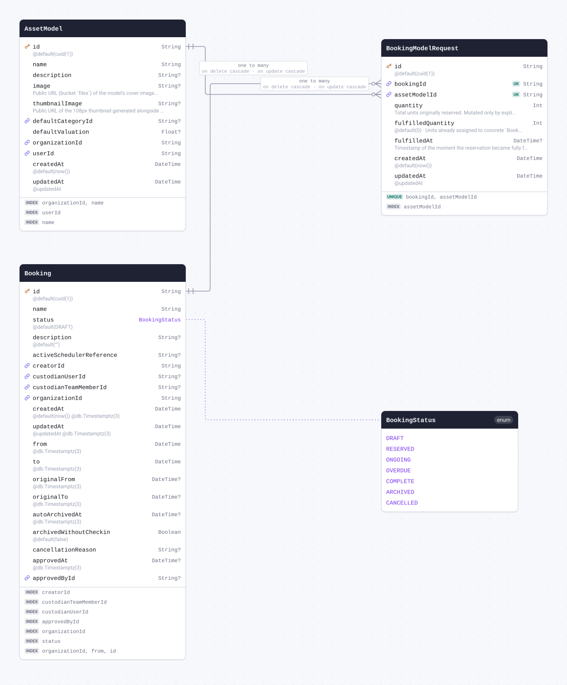

| Field               | Type       | Constraints                                   | Default      | Description                                                                                                                                                                                                                                                                                                                                                                                                                                                                                                                                                                                                                                                                                                                                                                             |
| ------------------- | ---------- | --------------------------------------------- | ------------ | --------------------------------------------------------------------------------------------------------------------------------------------------------------------------------------------------------------------------------------------------------------------------------------------------------------------------------------------------------------------------------------------------------------------------------------------------------------------------------------------------------------------------------------------------------------------------------------------------------------------------------------------------------------------------------------------------------------------------------------------------------------------------------------- |
| `id`                | `String`   | PK NOT NULL                                   | `cuid(1)`    |                                                                                                                                                                                                                                                                                                                                                                                                                                                                                                                                                                                                                                                                                                                                                                                         |
| `bookingId`         | `String`   | NOT NULL → [Booking.id](#model-Booking)       |              |                                                                                                                                                                                                                                                                                                                                                                                                                                                                                                                                                                                                                                                                                                                                                                                         |
| `assetModelId`      | `String`   | NOT NULL → [AssetModel.id](#model-AssetModel) |              |                                                                                                                                                                                                                                                                                                                                                                                                                                                                                                                                                                                                                                                                                                                                                                                         |
| `quantity`          | `Int`      | NOT NULL                                      |              | Total units originally reserved. Mutated only by explicit operator edits (upsert) — never decremented on materialisation. This preserves the audit trail of "how many were planned".                                                                                                                                                                                                                                                                                                                                                                                                                                                                                                                                                                                                    |
| `fulfilledQuantity` | `Int`      | NOT NULL                                      | `0`          | Units already assigned to concrete `BookingAsset` rows via `materializeModelRequestForAsset`. Scans increment it. It DOES decrease: `removeAssets` (booking service) decrements it by the number of removed `BookingAsset` rows whose `bookingModelRequestId` points at this request, floored at 0, and clears `fulfilledAt` when the result drops below `quantity`. Counted from that column, never from a shared `assetModelId`: an asset added directly alongside a reservation shares the model without having discharged anything, so grouping by model re-opened reservations that were still correctly satisfied.                                                                                                                                                                |
| `fulfilledAt`       | `DateTime` | NULL                                          |              | Timestamp of the moment the reservation became fully fulfilled — set when `fulfilledQuantity` catches up to `quantity`, and preserved (not re-stamped) if an unchanged quantity is saved again. Cleared back to null when outstanding units reappear: the operator edits `quantity` upwards, or `removeAssets` drops `fulfilledQuantity` below it. The invariant that makes this the primary "is this outstanding?" filter: non-null IFF `fulfilledQuantity === quantity`, so `fulfilledAt IS NULL` means units remain to materialise. `fulfilledQuantity` can never exceed `quantity` (the claim in `materializeModelRequestForAsset` is a single statement guarded by `WHERE "fulfilledQuantity" < "quantity"`; upsert rejects a shrink below it), so any decrement re-opens the row. |
| `createdAt`         | `DateTime` | NOT NULL                                      | `now()`      |                                                                                                                                                                                                                                                                                                                                                                                                                                                                                                                                                                                                                                                                                                                                                                                         |
| `updatedAt`         | `DateTime` | NOT NULL                                      | `@updatedAt` |                                                                                                                                                                                                                                                                                                                                                                                                                                                                                                                                                                                                                                                                                                                                                                                         |

#### Indexes

- `@@index([assetModelId])`
- `@@unique([bookingId, assetModelId])`

#### References

- `bookingId` → [Booking.id](#model-Booking) (many-to-one, on delete Cascade, on update Cascade)
- `assetModelId` → [AssetModel.id](#model-AssetModel) (many-to-one, on delete Cascade, on update Cascade)

#### Definition

```sql
CREATE TABLE "BookingModelRequest" (
    "id" TEXT NOT NULL,
    "bookingId" TEXT NOT NULL,
    "assetModelId" TEXT NOT NULL,
    "quantity" INTEGER NOT NULL,
    "fulfilledQuantity" INTEGER NOT NULL DEFAULT 0,
    "fulfilledAt" TIMESTAMP(3),
    "createdAt" TIMESTAMP(3) NOT NULL DEFAULT CURRENT_TIMESTAMP,
    "updatedAt" TIMESTAMP(3) NOT NULL,

    CONSTRAINT "BookingModelRequest_pkey" PRIMARY KEY ("id")
);

CREATE INDEX "BookingModelRequest_assetModelId_idx" ON "BookingModelRequest"("assetModelId");

CREATE UNIQUE INDEX "BookingModelRequest_bookingId_assetModelId_key" ON "BookingModelRequest"("bookingId", "assetModelId");

ALTER TABLE "BookingModelRequest" ADD CONSTRAINT "BookingModelRequest_bookingId_fkey" FOREIGN KEY ("bookingId") REFERENCES "Booking"("id") ON DELETE CASCADE ON UPDATE CASCADE;

ALTER TABLE "BookingModelRequest" ADD CONSTRAINT "BookingModelRequest_assetModelId_fkey" FOREIGN KEY ("assetModelId") REFERENCES "AssetModel"("id") ON DELETE CASCADE ON UPDATE CASCADE;
```

<details>
<summary>Queries and their SQL</summary>

**findMany**: Every row

```ts
await prisma.bookingModelRequest.findMany();
```

```sql
SELECT
  "public"."BookingModelRequest"."id",
  "public"."BookingModelRequest"."bookingId",
  "public"."BookingModelRequest"."assetModelId",
  "public"."BookingModelRequest"."quantity",
  "public"."BookingModelRequest"."fulfilledQuantity",
  "public"."BookingModelRequest"."fulfilledAt",
  "public"."BookingModelRequest"."createdAt",
  "public"."BookingModelRequest"."updatedAt"
FROM
  "public"."BookingModelRequest"
WHERE
  1 = 1
OFFSET
  $1
-- params: ["0"]
```

**count**: How many rows there are

```ts
await prisma.bookingModelRequest.count();
```

```sql
SELECT
  COUNT(*) AS "_count$_all"
FROM
  (
    SELECT
      "public"."BookingModelRequest"."id"
    FROM
      "public"."BookingModelRequest"
    WHERE
      1 = 1
    OFFSET
      $1
  ) AS "sub"
-- params: ["0"]
```

**findMany**: Every row with its relations

```ts
await prisma.bookingModelRequest.findMany({ include: { booking: true, assetModel: true } });
```

```sql
SELECT
  "public"."BookingModelRequest"."id",
  "public"."BookingModelRequest"."bookingId",
  "public"."BookingModelRequest"."assetModelId",
  "public"."BookingModelRequest"."quantity",
  "public"."BookingModelRequest"."fulfilledQuantity",
  "public"."BookingModelRequest"."fulfilledAt",
  "public"."BookingModelRequest"."createdAt",
  "public"."BookingModelRequest"."updatedAt"
FROM
  "public"."BookingModelRequest"
WHERE
  1 = 1
OFFSET
  $1
-- params: ["0"]

SELECT
  "public"."Booking"."id",
  "public"."Booking"."name",
  "public"."Booking"."status"::text,
  "public"."Booking"."description",
  "public"."Booking"."activeSchedulerReference",
  "public"."Booking"."creatorId",
  "public"."Booking"."custodianUserId",
  "public"."Booking"."custodianTeamMemberId",
  "public"."Booking"."organizationId",
  "public"."Booking"."createdAt",
  "public"."Booking"."updatedAt",
  "public"."Booking"."from",
  "public"."Booking"."to",
  "public"."Booking"."originalFrom",
  "public"."Booking"."originalTo",
  "public"."Booking"."autoArchivedAt",
  "public"."Booking"."archivedWithoutCheckin",
  "public"."Booking"."cancellationReason",
  "public"."Booking"."approvedAt",
  "public"."Booking"."approvedById"
FROM
  "public"."Booking"
WHERE
  "public"."Booking"."id" IN ($1)
OFFSET
  $2
-- params: ["<bookingId of the rows above>","0"]

SELECT
  "public"."AssetModel"."id",
  "public"."AssetModel"."name",
  "public"."AssetModel"."description",
  "public"."AssetModel"."image",
  "public"."AssetModel"."thumbnailImage",
  "public"."AssetModel"."defaultCategoryId",
  "public"."AssetModel"."defaultValuation",
  "public"."AssetModel"."organizationId",
  "public"."AssetModel"."userId",
  "public"."AssetModel"."createdAt",
  "public"."AssetModel"."updatedAt"
FROM
  "public"."AssetModel"
WHERE
  "public"."AssetModel"."id" IN ($1)
OFFSET
  $2
-- params: ["<assetModelId of the rows above>","0"]
```

**findUnique**: One row by what is unique to it

```ts
await prisma.bookingModelRequest.findUnique({ where: { id: "example" } });
```

```sql
SELECT
  "public"."BookingModelRequest"."id",
  "public"."BookingModelRequest"."bookingId",
  "public"."BookingModelRequest"."assetModelId",
  "public"."BookingModelRequest"."quantity",
  "public"."BookingModelRequest"."fulfilledQuantity",
  "public"."BookingModelRequest"."fulfilledAt",
  "public"."BookingModelRequest"."createdAt",
  "public"."BookingModelRequest"."updatedAt"
FROM
  "public"."BookingModelRequest"
WHERE
  (
    "public"."BookingModelRequest"."id" = $1
    AND 1 = 1
  )
LIMIT
  $2
OFFSET
  $3
-- params: ["example","1","0"]
```

**create**: Create a row

```ts
await prisma.bookingModelRequest.create({
  data: { bookingId: "example", assetModelId: "example", quantity: 1 },
});
```

```sql
INSERT INTO
  "public"."BookingModelRequest" (
    "id",
    "bookingId",
    "assetModelId",
    "quantity",
    "fulfilledQuantity",
    "createdAt",
    "updatedAt"
  )
VALUES
  ($1, $2, $3, $4, $5, $6, $7)
RETURNING
  "public"."BookingModelRequest"."id",
  "public"."BookingModelRequest"."bookingId",
  "public"."BookingModelRequest"."assetModelId",
  "public"."BookingModelRequest"."quantity",
  "public"."BookingModelRequest"."fulfilledQuantity",
  "public"."BookingModelRequest"."fulfilledAt",
  "public"."BookingModelRequest"."createdAt",
  "public"."BookingModelRequest"."updatedAt"
-- params: ["<cuid(1)>","example","example","1","0","<now()>","<now()>"]
```

**update**: Update a row

```ts
await prisma.bookingModelRequest.update({ where: { id: "example" }, data: { quantity: 1 } });
```

```sql
UPDATE "public"."BookingModelRequest"
SET
  "quantity" = $1,
  "updatedAt" = $2
WHERE
  (
    "public"."BookingModelRequest"."id" = $3
    AND 1 = 1
  )
RETURNING
  "public"."BookingModelRequest"."id",
  "public"."BookingModelRequest"."bookingId",
  "public"."BookingModelRequest"."assetModelId",
  "public"."BookingModelRequest"."quantity",
  "public"."BookingModelRequest"."fulfilledQuantity",
  "public"."BookingModelRequest"."fulfilledAt",
  "public"."BookingModelRequest"."createdAt",
  "public"."BookingModelRequest"."updatedAt"
-- params: ["1",{"prisma__type":"generatorCall","prisma__value":{"name":"now","args":[],"returnType":{"type":"DateTime"}}},"example"]
```

**delete**: Delete a row

```ts
await prisma.bookingModelRequest.delete({ where: { id: "example" } });
```

```sql
DELETE FROM "public"."BookingModelRequest"
WHERE
  (
    "public"."BookingModelRequest"."id" = $1
    AND 1 = 1
  )
RETURNING
  "public"."BookingModelRequest"."id",
  "public"."BookingModelRequest"."bookingId",
  "public"."BookingModelRequest"."assetModelId",
  "public"."BookingModelRequest"."quantity",
  "public"."BookingModelRequest"."fulfilledQuantity",
  "public"."BookingModelRequest"."fulfilledAt",
  "public"."BookingModelRequest"."createdAt",
  "public"."BookingModelRequest"."updatedAt"
-- params: ["example"]
```

</details>

<a id="model-Tag"></a>

### Tag

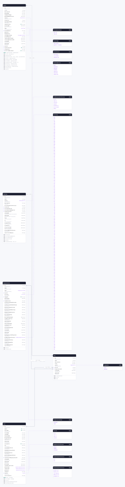

| Field            | Type                             | Constraints                                       | Default      | Description |
| ---------------- | -------------------------------- | ------------------------------------------------- | ------------ | ----------- |
| `id`             | `String`                         | PK NOT NULL                                       | `cuid(1)`    |             |
| `name`           | `String`                         | NOT NULL                                          |              |             |
| `description`    | `String`                         | NULL                                              |              |             |
| `color`          | `String`                         | NULL                                              |              |             |
| `useFor`         | [`TagUseFor[]`](#enum-TagUseFor) | NOT NULL                                          | `[ASSET]`    |             |
| `userId`         | `String`                         | NOT NULL → [User.id](#model-User)                 |              |             |
| `organizationId` | `String`                         | NOT NULL → [Organization.id](#model-Organization) |              |             |
| `createdAt`      | `DateTime`                       | NOT NULL                                          | `now()`      |             |
| `updatedAt`      | `DateTime`                       | NOT NULL                                          | `@updatedAt` |             |

#### Indexes

- `@@index([organizationId])`
- `@@index([userId])`
- `@@index([name], map: "Tag_name_trgm_idx")`

#### References

- `userId` → [User.id](#model-User) (many-to-one, on update Cascade)
- `organizationId` → [Organization.id](#model-Organization) (many-to-one, on delete Cascade, on update Cascade)

#### Many to many

- `assets` ↔ [Asset.tags](#model-Asset) through `_AssetToTag`
- `bookings` ↔ [Booking.tags](#model-Booking) through `_BookingToTag`

#### Definition

```sql
CREATE TABLE "Tag" (
    "id" TEXT NOT NULL,
    "name" TEXT NOT NULL,
    "description" TEXT,
    "color" TEXT,
    "useFor" "TagUseFor"[] DEFAULT ARRAY['ASSET']::"TagUseFor"[],
    "userId" TEXT NOT NULL,
    "organizationId" TEXT NOT NULL,
    "createdAt" TIMESTAMP(3) NOT NULL DEFAULT CURRENT_TIMESTAMP,
    "updatedAt" TIMESTAMP(3) NOT NULL,

    CONSTRAINT "Tag_pkey" PRIMARY KEY ("id")
);

CREATE INDEX "Tag_organizationId_idx" ON "Tag"("organizationId");

CREATE INDEX "Tag_userId_idx" ON "Tag"("userId");

CREATE INDEX "Tag_name_trgm_idx" ON "Tag" USING GIN ("name" gin_trgm_ops);

ALTER TABLE "Tag" ADD CONSTRAINT "Tag_userId_fkey" FOREIGN KEY ("userId") REFERENCES "User"("id") ON DELETE RESTRICT ON UPDATE CASCADE;

ALTER TABLE "Tag" ADD CONSTRAINT "Tag_organizationId_fkey" FOREIGN KEY ("organizationId") REFERENCES "Organization"("id") ON DELETE CASCADE ON UPDATE CASCADE;
```

<details>
<summary>Queries and their SQL</summary>

**findMany**: Every row

```ts
await prisma.tag.findMany();
```

```sql
SELECT
  "public"."Tag"."id",
  "public"."Tag"."name",
  "public"."Tag"."description",
  "public"."Tag"."color",
  "public"."Tag"."useFor"::text[],
  "public"."Tag"."userId",
  "public"."Tag"."organizationId",
  "public"."Tag"."createdAt",
  "public"."Tag"."updatedAt"
FROM
  "public"."Tag"
WHERE
  1 = 1
OFFSET
  $1
-- params: ["0"]
```

**count**: How many rows there are

```ts
await prisma.tag.count();
```

```sql
SELECT
  COUNT(*) AS "_count$_all"
FROM
  (
    SELECT
      "public"."Tag"."id"
    FROM
      "public"."Tag"
    WHERE
      1 = 1
    OFFSET
      $1
  ) AS "sub"
-- params: ["0"]
```

**findMany**: Every row with its relations

```ts
await prisma.tag.findMany({
  include: { assets: true, user: true, organization: true, bookings: true },
});
```

```sql
SELECT
  "public"."Tag"."id",
  "public"."Tag"."name",
  "public"."Tag"."description",
  "public"."Tag"."color",
  "public"."Tag"."useFor"::text[],
  "public"."Tag"."userId",
  "public"."Tag"."organizationId",
  "public"."Tag"."createdAt",
  "public"."Tag"."updatedAt"
FROM
  "public"."Tag"
WHERE
  1 = 1
OFFSET
  $1
-- params: ["0"]

SELECT
  "public"."Asset"."id",
  "public"."Asset"."title",
  "public"."Asset"."description",
  "public"."Asset"."mainImage",
  "public"."Asset"."thumbnailImage",
  "public"."Asset"."mainImageExpiration",
  "public"."Asset"."status"::text,
  "public"."Asset"."value",
  "public"."Asset"."availableToBook",
  "public"."Asset"."sequentialId",
  "public"."Asset"."archivedAt",
  "public"."Asset"."type"::text,
  "public"."Asset"."assetModelId",
  "public"."Asset"."quantity",
  "public"."Asset"."minQuantity",
  "public"."Asset"."consumptionType"::text,
  "public"."Asset"."unitOfMeasure",
  "public"."Asset"."lowStockNotifiedAt",
  "public"."Asset"."stockLedgerStartedAt",
  "public"."Asset"."createdAt",
  "public"."Asset"."updatedAt",
  "public"."Asset"."userId",
  "public"."Asset"."organizationId",
  "public"."Asset"."categoryId",
  "public"."Asset"."preferredBarcodeId",
  "t0"."B" AS "AssetToTag@Tag"
FROM
  "public"."Asset"
  INNER JOIN "public"."_AssetToTag" AS "t0" ON "t0"."A" = "public"."Asset"."id"
WHERE
  (
    1 = 1
    AND "t0"."B" IN ($1)
  )
OFFSET
  $2
-- params: ["<id of the rows above>","0"]

SELECT
  "public"."User"."id",
  "public"."User"."email",
  "public"."User"."username",
  "public"."User"."firstName",
  "public"."User"."lastName",
  "public"."User"."displayName",
  "public"."User"."profilePicture",
  "public"."User"."usedFreeTrial",
  "public"."User"."onboarded",
  "public"."User"."customerId",
  "public"."User"."sso",
  "public"."User"."createdWithInvite",
  "public"."User"."skipSubscriptionCheck",
  "public"."User"."hasUnpaidInvoice",
  "public"."User"."warnForNoPaymentMethod",
  "public"."User"."lastSelectedOrganizationId",
  "public"."User"."createdAt",
  "public"."User"."updatedAt",
  "public"."User"."deletedAt",
  "public"."User"."lastMobileActiveAt",
  "public"."User"."dateFormat"::text,
  "public"."User"."timeFormat"::text,
  "public"."User"."weekStart"::text,
  "public"."User"."timeZone",
  "public"."User"."tierId"::text,
  "public"."User"."referralSource"
FROM
  "public"."User"
WHERE
  "public"."User"."id" IN ($1)
OFFSET
  $2
-- params: ["<userId of the rows above>","0"]

SELECT
  "public"."Organization"."id",
  "public"."Organization"."name",
  "public"."Organization"."type"::text,
  "public"."Organization"."userId",
  "public"."Organization"."currency"::text,
  "public"."Organization"."imageId",
  "public"."Organization"."enabledSso",
  "public"."Organization"."ssoDetailsId",
  "public"."Organization"."selfServiceCanSeeCustody",
  "public"."Organization"."selfServiceCanSeeBookings",
  "public"."Organization"."baseUserCanSeeCustody",
  "public"."Organization"."baseUserCanSeeBookings",
  "public"."Organization"."managersCanEditAssets",
  "public"."Organization"."barcodesEnabled",
  "public"."Organization"."barcodesEnabledAt",
  "public"."Organization"."usedBarcodeTrial",
  "public"."Organization"."auditsEnabled",
  "public"."Organization"."auditsEnabledAt",
  "public"."Organization"."usedAuditTrial",
  "public"."Organization"."workspaceDisabled",
  "public"."Organization"."createdAt",
  "public"."Organization"."updatedAt",
  "public"."Organization"."hasSequentialIdsMigrated",
  "public"."Organization"."qrIdDisplayPreference"::text,
  "public"."Organization"."showShelfBranding",
  "public"."Organization"."showQrCodesOnPdfs",
  "public"."Organization"."customEmailFooter"
FROM
  "public"."Organization"
WHERE
  "public"."Organization"."id" IN ($1)
OFFSET
  $2
-- params: ["<organizationId of the rows above>","0"]

SELECT
  "public"."Booking"."id",
  "public"."Booking"."name",
  "public"."Booking"."status"::text,
  "public"."Booking"."description",
  "public"."Booking"."activeSchedulerReference",
  "public"."Booking"."creatorId",
  "public"."Booking"."custodianUserId",
  "public"."Booking"."custodianTeamMemberId",
  "public"."Booking"."organizationId",
  "public"."Booking"."createdAt",
  "public"."Booking"."updatedAt",
  "public"."Booking"."from",
  "public"."Booking"."to",
  "public"."Booking"."originalFrom",
  "public"."Booking"."originalTo",
  "public"."Booking"."autoArchivedAt",
  "public"."Booking"."archivedWithoutCheckin",
  "public"."Booking"."cancellationReason",
  "public"."Booking"."approvedAt",
  "public"."Booking"."approvedById",
  "t1"."B" AS "BookingToTag@Tag"
FROM
  "public"."Booking"
  INNER JOIN "public"."_BookingToTag" AS "t1" ON "t1"."A" = "public"."Booking"."id"
WHERE
  (
    1 = 1
    AND "t1"."B" IN ($1)
  )
OFFSET
  $2
-- params: ["<id of the rows above>","0"]
```

**findUnique**: One row by what is unique to it

```ts
await prisma.tag.findUnique({ where: { id: "example" } });
```

```sql
SELECT
  "public"."Tag"."id",
  "public"."Tag"."name",
  "public"."Tag"."description",
  "public"."Tag"."color",
  "public"."Tag"."useFor"::text[],
  "public"."Tag"."userId",
  "public"."Tag"."organizationId",
  "public"."Tag"."createdAt",
  "public"."Tag"."updatedAt"
FROM
  "public"."Tag"
WHERE
  (
    "public"."Tag"."id" = $1
    AND 1 = 1
  )
LIMIT
  $2
OFFSET
  $3
-- params: ["example","1","0"]
```

**create**: Create a row

```ts
await prisma.tag.create({
  data: { name: "example", userId: "example", organizationId: "example" },
});
```

```sql
INSERT INTO
  "public"."Tag" (
    "id",
    "name",
    "useFor",
    "userId",
    "organizationId",
    "createdAt",
    "updatedAt"
  )
VALUES
  (
    $1,
    $2,
    CAST($3::text[] AS "public"."TagUseFor" []),
    $4,
    $5,
    $6,
    $7
  )
RETURNING
  "public"."Tag"."id",
  "public"."Tag"."name",
  "public"."Tag"."description",
  "public"."Tag"."color",
  "public"."Tag"."useFor"::text[],
  "public"."Tag"."userId",
  "public"."Tag"."organizationId",
  "public"."Tag"."createdAt",
  "public"."Tag"."updatedAt"
-- params: ["<cuid(1)>","example",["ASSET"],"example","example","<now()>","<now()>"]
```

**update**: Update a row

```ts
await prisma.tag.update({ where: { id: "example" }, data: { name: "example" } });
```

```sql
UPDATE "public"."Tag"
SET
  "name" = $1,
  "updatedAt" = $2
WHERE
  (
    "public"."Tag"."id" = $3
    AND 1 = 1
  )
RETURNING
  "public"."Tag"."id",
  "public"."Tag"."name",
  "public"."Tag"."description",
  "public"."Tag"."color",
  "public"."Tag"."useFor"::text[],
  "public"."Tag"."userId",
  "public"."Tag"."organizationId",
  "public"."Tag"."createdAt",
  "public"."Tag"."updatedAt"
-- params: ["example",{"prisma__type":"generatorCall","prisma__value":{"name":"now","args":[],"returnType":{"type":"DateTime"}}},"example"]
```

**delete**: Delete a row

```ts
await prisma.tag.delete({ where: { id: "example" } });
```

```sql
DELETE FROM "public"."Tag"
WHERE
  (
    "public"."Tag"."id" = $1
    AND 1 = 1
  )
RETURNING
  "public"."Tag"."id",
  "public"."Tag"."name",
  "public"."Tag"."description",
  "public"."Tag"."color",
  "public"."Tag"."useFor"::text[],
  "public"."Tag"."userId",
  "public"."Tag"."organizationId",
  "public"."Tag"."createdAt",
  "public"."Tag"."updatedAt"
-- params: ["example"]
```

</details>

<a id="model-Note"></a>

### Note

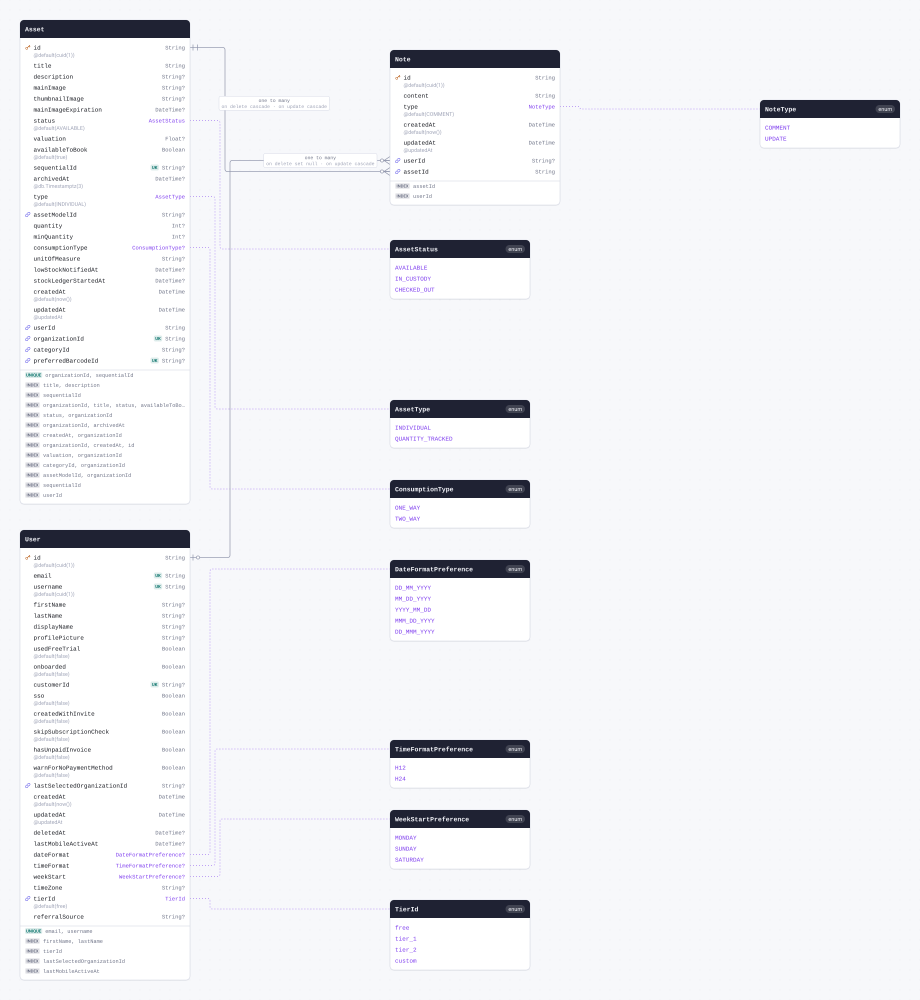

| Field       | Type                         | Constraints                         | Default      | Description |
| ----------- | ---------------------------- | ----------------------------------- | ------------ | ----------- |
| `id`        | `String`                     | PK NOT NULL                         | `cuid(1)`    |             |
| `content`   | `String`                     | NOT NULL                            |              |             |
| `type`      | [`NoteType`](#enum-NoteType) | NOT NULL                            | `COMMENT`    |             |
| `createdAt` | `DateTime`                   | NOT NULL                            | `now()`      |             |
| `updatedAt` | `DateTime`                   | NOT NULL                            | `@updatedAt` |             |
| `userId`    | `String`                     | NULL → [User.id](#model-User)       |              |             |
| `assetId`   | `String`                     | NOT NULL → [Asset.id](#model-Asset) |              |             |

#### Indexes

- `@@index([assetId])`
- `@@index([userId])`

#### References

- `userId` → [User.id](#model-User) (many-to-one, on delete SetNull, on update Cascade)
- `assetId` → [Asset.id](#model-Asset) (many-to-one, on delete Cascade, on update Cascade)

#### Definition

```sql
CREATE TABLE "Note" (
    "id" TEXT NOT NULL,
    "content" TEXT NOT NULL,
    "type" "NoteType" NOT NULL DEFAULT 'COMMENT',
    "createdAt" TIMESTAMP(3) NOT NULL DEFAULT CURRENT_TIMESTAMP,
    "updatedAt" TIMESTAMP(3) NOT NULL,
    "userId" TEXT,
    "assetId" TEXT NOT NULL,

    CONSTRAINT "Note_pkey" PRIMARY KEY ("id")
);

CREATE INDEX "Note_assetId_idx" ON "Note"("assetId");

CREATE INDEX "Note_userId_idx" ON "Note"("userId");

ALTER TABLE "Note" ADD CONSTRAINT "Note_userId_fkey" FOREIGN KEY ("userId") REFERENCES "User"("id") ON DELETE SET NULL ON UPDATE CASCADE;

ALTER TABLE "Note" ADD CONSTRAINT "Note_assetId_fkey" FOREIGN KEY ("assetId") REFERENCES "Asset"("id") ON DELETE CASCADE ON UPDATE CASCADE;
```

<details>
<summary>Queries and their SQL</summary>

**findMany**: Every row

```ts
await prisma.note.findMany();
```

```sql
SELECT
  "public"."Note"."id",
  "public"."Note"."content",
  "public"."Note"."type"::text,
  "public"."Note"."createdAt",
  "public"."Note"."updatedAt",
  "public"."Note"."userId",
  "public"."Note"."assetId"
FROM
  "public"."Note"
WHERE
  1 = 1
OFFSET
  $1
-- params: ["0"]
```

**count**: How many rows there are

```ts
await prisma.note.count();
```

```sql
SELECT
  COUNT(*) AS "_count$_all"
FROM
  (
    SELECT
      "public"."Note"."id"
    FROM
      "public"."Note"
    WHERE
      1 = 1
    OFFSET
      $1
  ) AS "sub"
-- params: ["0"]
```

**findMany**: Every row with its relations

```ts
await prisma.note.findMany({ include: { user: true, asset: true } });
```

```sql
SELECT
  "public"."Note"."id",
  "public"."Note"."content",
  "public"."Note"."type"::text,
  "public"."Note"."createdAt",
  "public"."Note"."updatedAt",
  "public"."Note"."userId",
  "public"."Note"."assetId"
FROM
  "public"."Note"
WHERE
  1 = 1
OFFSET
  $1
-- params: ["0"]

SELECT
  "public"."User"."id",
  "public"."User"."email",
  "public"."User"."username",
  "public"."User"."firstName",
  "public"."User"."lastName",
  "public"."User"."displayName",
  "public"."User"."profilePicture",
  "public"."User"."usedFreeTrial",
  "public"."User"."onboarded",
  "public"."User"."customerId",
  "public"."User"."sso",
  "public"."User"."createdWithInvite",
  "public"."User"."skipSubscriptionCheck",
  "public"."User"."hasUnpaidInvoice",
  "public"."User"."warnForNoPaymentMethod",
  "public"."User"."lastSelectedOrganizationId",
  "public"."User"."createdAt",
  "public"."User"."updatedAt",
  "public"."User"."deletedAt",
  "public"."User"."lastMobileActiveAt",
  "public"."User"."dateFormat"::text,
  "public"."User"."timeFormat"::text,
  "public"."User"."weekStart"::text,
  "public"."User"."timeZone",
  "public"."User"."tierId"::text,
  "public"."User"."referralSource"
FROM
  "public"."User"
WHERE
  "public"."User"."id" IN ($1)
OFFSET
  $2
-- params: ["<userId of the rows above>","0"]

SELECT
  "public"."Asset"."id",
  "public"."Asset"."title",
  "public"."Asset"."description",
  "public"."Asset"."mainImage",
  "public"."Asset"."thumbnailImage",
  "public"."Asset"."mainImageExpiration",
  "public"."Asset"."status"::text,
  "public"."Asset"."value",
  "public"."Asset"."availableToBook",
  "public"."Asset"."sequentialId",
  "public"."Asset"."archivedAt",
  "public"."Asset"."type"::text,
  "public"."Asset"."assetModelId",
  "public"."Asset"."quantity",
  "public"."Asset"."minQuantity",
  "public"."Asset"."consumptionType"::text,
  "public"."Asset"."unitOfMeasure",
  "public"."Asset"."lowStockNotifiedAt",
  "public"."Asset"."stockLedgerStartedAt",
  "public"."Asset"."createdAt",
  "public"."Asset"."updatedAt",
  "public"."Asset"."userId",
  "public"."Asset"."organizationId",
  "public"."Asset"."categoryId",
  "public"."Asset"."preferredBarcodeId"
FROM
  "public"."Asset"
WHERE
  "public"."Asset"."id" IN ($1)
OFFSET
  $2
-- params: ["<assetId of the rows above>","0"]
```

**findUnique**: One row by what is unique to it

```ts
await prisma.note.findUnique({ where: { id: "example" } });
```

```sql
SELECT
  "public"."Note"."id",
  "public"."Note"."content",
  "public"."Note"."type"::text,
  "public"."Note"."createdAt",
  "public"."Note"."updatedAt",
  "public"."Note"."userId",
  "public"."Note"."assetId"
FROM
  "public"."Note"
WHERE
  (
    "public"."Note"."id" = $1
    AND 1 = 1
  )
LIMIT
  $2
OFFSET
  $3
-- params: ["example","1","0"]
```

**create**: Create a row

```ts
await prisma.note.create({ data: { content: "example", assetId: "example" } });
```

```sql
INSERT INTO
  "public"."Note" (
    "id",
    "content",
    "type",
    "createdAt",
    "updatedAt",
    "assetId"
  )
VALUES
  (
    $1,
    $2,
    CAST($3::text AS "public"."NoteType"),
    $4,
    $5,
    $6
  )
RETURNING
  "public"."Note"."id",
  "public"."Note"."content",
  "public"."Note"."type"::text,
  "public"."Note"."createdAt",
  "public"."Note"."updatedAt",
  "public"."Note"."userId",
  "public"."Note"."assetId"
-- params: ["<cuid(1)>","example","COMMENT","<now()>","<now()>","example"]
```

**update**: Update a row

```ts
await prisma.note.update({ where: { id: "example" }, data: { content: "example" } });
```

```sql
UPDATE "public"."Note"
SET
  "content" = $1,
  "updatedAt" = $2
WHERE
  (
    "public"."Note"."id" = $3
    AND 1 = 1
  )
RETURNING
  "public"."Note"."id",
  "public"."Note"."content",
  "public"."Note"."type"::text,
  "public"."Note"."createdAt",
  "public"."Note"."updatedAt",
  "public"."Note"."userId",
  "public"."Note"."assetId"
-- params: ["example",{"prisma__type":"generatorCall","prisma__value":{"name":"now","args":[],"returnType":{"type":"DateTime"}}},"example"]
```

**delete**: Delete a row

```ts
await prisma.note.delete({ where: { id: "example" } });
```

```sql
DELETE FROM "public"."Note"
WHERE
  (
    "public"."Note"."id" = $1
    AND 1 = 1
  )
RETURNING
  "public"."Note"."id",
  "public"."Note"."content",
  "public"."Note"."type"::text,
  "public"."Note"."createdAt",
  "public"."Note"."updatedAt",
  "public"."Note"."userId",
  "public"."Note"."assetId"
-- params: ["example"]
```

</details>

<a id="model-BookingNote"></a>

### BookingNote

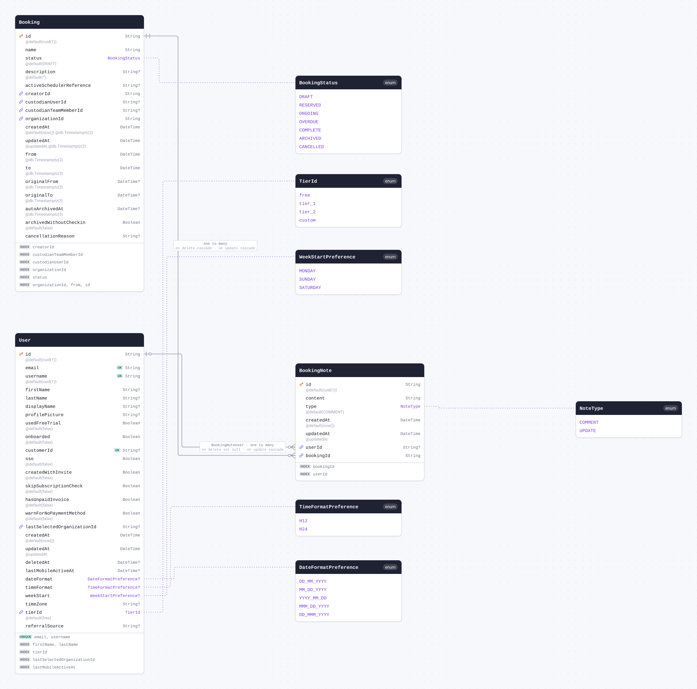

| Field       | Type                         | Constraints                             | Default      | Description |
| ----------- | ---------------------------- | --------------------------------------- | ------------ | ----------- |
| `id`        | `String`                     | PK NOT NULL                             | `cuid(1)`    |             |
| `content`   | `String`                     | NOT NULL                                |              |             |
| `type`      | [`NoteType`](#enum-NoteType) | NOT NULL                                | `COMMENT`    |             |
| `createdAt` | `DateTime`                   | NOT NULL                                | `now()`      |             |
| `updatedAt` | `DateTime`                   | NOT NULL                                | `@updatedAt` |             |
| `userId`    | `String`                     | NULL → [User.id](#model-User)           |              |             |
| `bookingId` | `String`                     | NOT NULL → [Booking.id](#model-Booking) |              |             |

#### Indexes

- `@@index([bookingId])`
- `@@index([userId])`

#### References

- `userId` → [User.id](#model-User) (many-to-one, on delete SetNull, on update Cascade)
- `bookingId` → [Booking.id](#model-Booking) (many-to-one, on delete Cascade, on update Cascade)

#### Definition

```sql
CREATE TABLE "BookingNote" (
    "id" TEXT NOT NULL,
    "content" TEXT NOT NULL,
    "type" "NoteType" NOT NULL DEFAULT 'COMMENT',
    "createdAt" TIMESTAMP(3) NOT NULL DEFAULT CURRENT_TIMESTAMP,
    "updatedAt" TIMESTAMP(3) NOT NULL,
    "userId" TEXT,
    "bookingId" TEXT NOT NULL,

    CONSTRAINT "BookingNote_pkey" PRIMARY KEY ("id")
);

CREATE INDEX "BookingNote_bookingId_idx" ON "BookingNote"("bookingId");

CREATE INDEX "BookingNote_userId_idx" ON "BookingNote"("userId");

ALTER TABLE "BookingNote" ADD CONSTRAINT "BookingNote_userId_fkey" FOREIGN KEY ("userId") REFERENCES "User"("id") ON DELETE SET NULL ON UPDATE CASCADE;

ALTER TABLE "BookingNote" ADD CONSTRAINT "BookingNote_bookingId_fkey" FOREIGN KEY ("bookingId") REFERENCES "Booking"("id") ON DELETE CASCADE ON UPDATE CASCADE;
```

<details>
<summary>Queries and their SQL</summary>

**findMany**: Every row

```ts
await prisma.bookingNote.findMany();
```

```sql
SELECT
  "public"."BookingNote"."id",
  "public"."BookingNote"."content",
  "public"."BookingNote"."type"::text,
  "public"."BookingNote"."createdAt",
  "public"."BookingNote"."updatedAt",
  "public"."BookingNote"."userId",
  "public"."BookingNote"."bookingId"
FROM
  "public"."BookingNote"
WHERE
  1 = 1
OFFSET
  $1
-- params: ["0"]
```

**count**: How many rows there are

```ts
await prisma.bookingNote.count();
```

```sql
SELECT
  COUNT(*) AS "_count$_all"
FROM
  (
    SELECT
      "public"."BookingNote"."id"
    FROM
      "public"."BookingNote"
    WHERE
      1 = 1
    OFFSET
      $1
  ) AS "sub"
-- params: ["0"]
```

**findMany**: Every row with its relations

```ts
await prisma.bookingNote.findMany({ include: { user: true, booking: true } });
```

```sql
SELECT
  "public"."BookingNote"."id",
  "public"."BookingNote"."content",
  "public"."BookingNote"."type"::text,
  "public"."BookingNote"."createdAt",
  "public"."BookingNote"."updatedAt",
  "public"."BookingNote"."userId",
  "public"."BookingNote"."bookingId"
FROM
  "public"."BookingNote"
WHERE
  1 = 1
OFFSET
  $1
-- params: ["0"]

SELECT
  "public"."User"."id",
  "public"."User"."email",
  "public"."User"."username",
  "public"."User"."firstName",
  "public"."User"."lastName",
  "public"."User"."displayName",
  "public"."User"."profilePicture",
  "public"."User"."usedFreeTrial",
  "public"."User"."onboarded",
  "public"."User"."customerId",
  "public"."User"."sso",
  "public"."User"."createdWithInvite",
  "public"."User"."skipSubscriptionCheck",
  "public"."User"."hasUnpaidInvoice",
  "public"."User"."warnForNoPaymentMethod",
  "public"."User"."lastSelectedOrganizationId",
  "public"."User"."createdAt",
  "public"."User"."updatedAt",
  "public"."User"."deletedAt",
  "public"."User"."lastMobileActiveAt",
  "public"."User"."dateFormat"::text,
  "public"."User"."timeFormat"::text,
  "public"."User"."weekStart"::text,
  "public"."User"."timeZone",
  "public"."User"."tierId"::text,
  "public"."User"."referralSource"
FROM
  "public"."User"
WHERE
  "public"."User"."id" IN ($1)
OFFSET
  $2
-- params: ["<userId of the rows above>","0"]

SELECT
  "public"."Booking"."id",
  "public"."Booking"."name",
  "public"."Booking"."status"::text,
  "public"."Booking"."description",
  "public"."Booking"."activeSchedulerReference",
  "public"."Booking"."creatorId",
  "public"."Booking"."custodianUserId",
  "public"."Booking"."custodianTeamMemberId",
  "public"."Booking"."organizationId",
  "public"."Booking"."createdAt",
  "public"."Booking"."updatedAt",
  "public"."Booking"."from",
  "public"."Booking"."to",
  "public"."Booking"."originalFrom",
  "public"."Booking"."originalTo",
  "public"."Booking"."autoArchivedAt",
  "public"."Booking"."archivedWithoutCheckin",
  "public"."Booking"."cancellationReason",
  "public"."Booking"."approvedAt",
  "public"."Booking"."approvedById"
FROM
  "public"."Booking"
WHERE
  "public"."Booking"."id" IN ($1)
OFFSET
  $2
-- params: ["<bookingId of the rows above>","0"]
```

**findUnique**: One row by what is unique to it

```ts
await prisma.bookingNote.findUnique({ where: { id: "example" } });
```

```sql
SELECT
  "public"."BookingNote"."id",
  "public"."BookingNote"."content",
  "public"."BookingNote"."type"::text,
  "public"."BookingNote"."createdAt",
  "public"."BookingNote"."updatedAt",
  "public"."BookingNote"."userId",
  "public"."BookingNote"."bookingId"
FROM
  "public"."BookingNote"
WHERE
  (
    "public"."BookingNote"."id" = $1
    AND 1 = 1
  )
LIMIT
  $2
OFFSET
  $3
-- params: ["example","1","0"]
```

**create**: Create a row

```ts
await prisma.bookingNote.create({ data: { content: "example", bookingId: "example" } });
```

```sql
INSERT INTO
  "public"."BookingNote" (
    "id",
    "content",
    "type",
    "createdAt",
    "updatedAt",
    "bookingId"
  )
VALUES
  (
    $1,
    $2,
    CAST($3::text AS "public"."NoteType"),
    $4,
    $5,
    $6
  )
RETURNING
  "public"."BookingNote"."id",
  "public"."BookingNote"."content",
  "public"."BookingNote"."type"::text,
  "public"."BookingNote"."createdAt",
  "public"."BookingNote"."updatedAt",
  "public"."BookingNote"."userId",
  "public"."BookingNote"."bookingId"
-- params: ["<cuid(1)>","example","COMMENT","<now()>","<now()>","example"]
```

**update**: Update a row

```ts
await prisma.bookingNote.update({ where: { id: "example" }, data: { content: "example" } });
```

```sql
UPDATE "public"."BookingNote"
SET
  "content" = $1,
  "updatedAt" = $2
WHERE
  (
    "public"."BookingNote"."id" = $3
    AND 1 = 1
  )
RETURNING
  "public"."BookingNote"."id",
  "public"."BookingNote"."content",
  "public"."BookingNote"."type"::text,
  "public"."BookingNote"."createdAt",
  "public"."BookingNote"."updatedAt",
  "public"."BookingNote"."userId",
  "public"."BookingNote"."bookingId"
-- params: ["example",{"prisma__type":"generatorCall","prisma__value":{"name":"now","args":[],"returnType":{"type":"DateTime"}}},"example"]
```

**delete**: Delete a row

```ts
await prisma.bookingNote.delete({ where: { id: "example" } });
```

```sql
DELETE FROM "public"."BookingNote"
WHERE
  (
    "public"."BookingNote"."id" = $1
    AND 1 = 1
  )
RETURNING
  "public"."BookingNote"."id",
  "public"."BookingNote"."content",
  "public"."BookingNote"."type"::text,
  "public"."BookingNote"."createdAt",
  "public"."BookingNote"."updatedAt",
  "public"."BookingNote"."userId",
  "public"."BookingNote"."bookingId"
-- params: ["example"]
```

</details>

<a id="model-LocationNote"></a>

### LocationNote

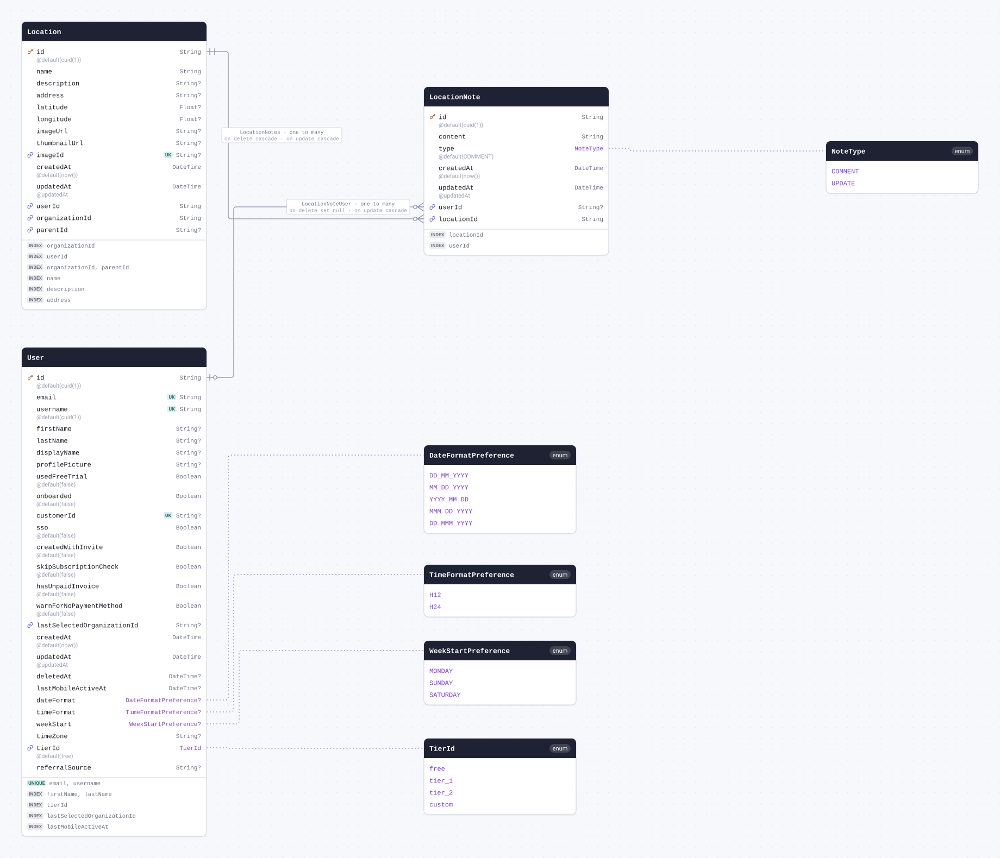

| Field        | Type                         | Constraints                               | Default      | Description |
| ------------ | ---------------------------- | ----------------------------------------- | ------------ | ----------- |
| `id`         | `String`                     | PK NOT NULL                               | `cuid(1)`    |             |
| `content`    | `String`                     | NOT NULL                                  |              |             |
| `type`       | [`NoteType`](#enum-NoteType) | NOT NULL                                  | `COMMENT`    |             |
| `createdAt`  | `DateTime`                   | NOT NULL                                  | `now()`      |             |
| `updatedAt`  | `DateTime`                   | NOT NULL                                  | `@updatedAt` |             |
| `userId`     | `String`                     | NULL → [User.id](#model-User)             |              |             |
| `locationId` | `String`                     | NOT NULL → [Location.id](#model-Location) |              |             |

#### Indexes

- `@@index([locationId])`
- `@@index([userId])`

#### References

- `userId` → [User.id](#model-User) (many-to-one, on delete SetNull, on update Cascade)
- `locationId` → [Location.id](#model-Location) (many-to-one, on delete Cascade, on update Cascade)

#### Definition

```sql
CREATE TABLE "LocationNote" (
    "id" TEXT NOT NULL,
    "content" TEXT NOT NULL,
    "type" "NoteType" NOT NULL DEFAULT 'COMMENT',
    "createdAt" TIMESTAMP(3) NOT NULL DEFAULT CURRENT_TIMESTAMP,
    "updatedAt" TIMESTAMP(3) NOT NULL,
    "userId" TEXT,
    "locationId" TEXT NOT NULL,

    CONSTRAINT "LocationNote_pkey" PRIMARY KEY ("id")
);

CREATE INDEX "LocationNote_locationId_idx" ON "LocationNote"("locationId");

CREATE INDEX "LocationNote_userId_idx" ON "LocationNote"("userId");

ALTER TABLE "LocationNote" ADD CONSTRAINT "LocationNote_userId_fkey" FOREIGN KEY ("userId") REFERENCES "User"("id") ON DELETE SET NULL ON UPDATE CASCADE;

ALTER TABLE "LocationNote" ADD CONSTRAINT "LocationNote_locationId_fkey" FOREIGN KEY ("locationId") REFERENCES "Location"("id") ON DELETE CASCADE ON UPDATE CASCADE;
```

<details>
<summary>Queries and their SQL</summary>

**findMany**: Every row

```ts
await prisma.locationNote.findMany();
```

```sql
SELECT
  "public"."LocationNote"."id",
  "public"."LocationNote"."content",
  "public"."LocationNote"."type"::text,
  "public"."LocationNote"."createdAt",
  "public"."LocationNote"."updatedAt",
  "public"."LocationNote"."userId",
  "public"."LocationNote"."locationId"
FROM
  "public"."LocationNote"
WHERE
  1 = 1
OFFSET
  $1
-- params: ["0"]
```

**count**: How many rows there are

```ts
await prisma.locationNote.count();
```

```sql
SELECT
  COUNT(*) AS "_count$_all"
FROM
  (
    SELECT
      "public"."LocationNote"."id"
    FROM
      "public"."LocationNote"
    WHERE
      1 = 1
    OFFSET
      $1
  ) AS "sub"
-- params: ["0"]
```

**findMany**: Every row with its relations

```ts
await prisma.locationNote.findMany({ include: { user: true, location: true } });
```

```sql
SELECT
  "public"."LocationNote"."id",
  "public"."LocationNote"."content",
  "public"."LocationNote"."type"::text,
  "public"."LocationNote"."createdAt",
  "public"."LocationNote"."updatedAt",
  "public"."LocationNote"."userId",
  "public"."LocationNote"."locationId"
FROM
  "public"."LocationNote"
WHERE
  1 = 1
OFFSET
  $1
-- params: ["0"]

SELECT
  "public"."User"."id",
  "public"."User"."email",
  "public"."User"."username",
  "public"."User"."firstName",
  "public"."User"."lastName",
  "public"."User"."displayName",
  "public"."User"."profilePicture",
  "public"."User"."usedFreeTrial",
  "public"."User"."onboarded",
  "public"."User"."customerId",
  "public"."User"."sso",
  "public"."User"."createdWithInvite",
  "public"."User"."skipSubscriptionCheck",
  "public"."User"."hasUnpaidInvoice",
  "public"."User"."warnForNoPaymentMethod",
  "public"."User"."lastSelectedOrganizationId",
  "public"."User"."createdAt",
  "public"."User"."updatedAt",
  "public"."User"."deletedAt",
  "public"."User"."lastMobileActiveAt",
  "public"."User"."dateFormat"::text,
  "public"."User"."timeFormat"::text,
  "public"."User"."weekStart"::text,
  "public"."User"."timeZone",
  "public"."User"."tierId"::text,
  "public"."User"."referralSource"
FROM
  "public"."User"
WHERE
  "public"."User"."id" IN ($1)
OFFSET
  $2
-- params: ["<userId of the rows above>","0"]

SELECT
  "public"."Location"."id",
  "public"."Location"."name",
  "public"."Location"."description",
  "public"."Location"."address",
  "public"."Location"."latitude",
  "public"."Location"."longitude",
  "public"."Location"."imageUrl",
  "public"."Location"."thumbnailUrl",
  "public"."Location"."imageId",
  "public"."Location"."createdAt",
  "public"."Location"."updatedAt",
  "public"."Location"."userId",
  "public"."Location"."organizationId",
  "public"."Location"."parentId"
FROM
  "public"."Location"
WHERE
  "public"."Location"."id" IN ($1)
OFFSET
  $2
-- params: ["<locationId of the rows above>","0"]
```

**findUnique**: One row by what is unique to it

```ts
await prisma.locationNote.findUnique({ where: { id: "example" } });
```

```sql
SELECT
  "public"."LocationNote"."id",
  "public"."LocationNote"."content",
  "public"."LocationNote"."type"::text,
  "public"."LocationNote"."createdAt",
  "public"."LocationNote"."updatedAt",
  "public"."LocationNote"."userId",
  "public"."LocationNote"."locationId"
FROM
  "public"."LocationNote"
WHERE
  (
    "public"."LocationNote"."id" = $1
    AND 1 = 1
  )
LIMIT
  $2
OFFSET
  $3
-- params: ["example","1","0"]
```

**create**: Create a row

```ts
await prisma.locationNote.create({ data: { content: "example", locationId: "example" } });
```

```sql
INSERT INTO
  "public"."LocationNote" (
    "id",
    "content",
    "type",
    "createdAt",
    "updatedAt",
    "locationId"
  )
VALUES
  (
    $1,
    $2,
    CAST($3::text AS "public"."NoteType"),
    $4,
    $5,
    $6
  )
RETURNING
  "public"."LocationNote"."id",
  "public"."LocationNote"."content",
  "public"."LocationNote"."type"::text,
  "public"."LocationNote"."createdAt",
  "public"."LocationNote"."updatedAt",
  "public"."LocationNote"."userId",
  "public"."LocationNote"."locationId"
-- params: ["<cuid(1)>","example","COMMENT","<now()>","<now()>","example"]
```

**update**: Update a row

```ts
await prisma.locationNote.update({ where: { id: "example" }, data: { content: "example" } });
```

```sql
UPDATE "public"."LocationNote"
SET
  "content" = $1,
  "updatedAt" = $2
WHERE
  (
    "public"."LocationNote"."id" = $3
    AND 1 = 1
  )
RETURNING
  "public"."LocationNote"."id",
  "public"."LocationNote"."content",
  "public"."LocationNote"."type"::text,
  "public"."LocationNote"."createdAt",
  "public"."LocationNote"."updatedAt",
  "public"."LocationNote"."userId",
  "public"."LocationNote"."locationId"
-- params: ["example",{"prisma__type":"generatorCall","prisma__value":{"name":"now","args":[],"returnType":{"type":"DateTime"}}},"example"]
```

**delete**: Delete a row

```ts
await prisma.locationNote.delete({ where: { id: "example" } });
```

```sql
DELETE FROM "public"."LocationNote"
WHERE
  (
    "public"."LocationNote"."id" = $1
    AND 1 = 1
  )
RETURNING
  "public"."LocationNote"."id",
  "public"."LocationNote"."content",
  "public"."LocationNote"."type"::text,
  "public"."LocationNote"."createdAt",
  "public"."LocationNote"."updatedAt",
  "public"."LocationNote"."userId",
  "public"."LocationNote"."locationId"
-- params: ["example"]
```

</details>

<a id="model-Qr"></a>

### Qr

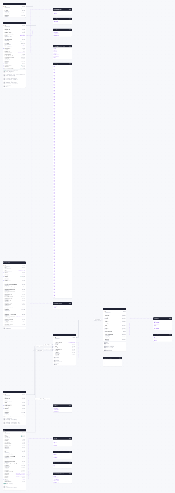

| Field             | Type                                       | Constraints                                   | Default      | Description |
| ----------------- | ------------------------------------------ | --------------------------------------------- | ------------ | ----------- |
| `id`              | `String`                                   | PK NOT NULL                                   | `cuid(1)`    |             |
| `version`         | `Int`                                      | NOT NULL                                      | `0`          |             |
| `errorCorrection` | [`ErrorCorrection`](#enum-ErrorCorrection) | NOT NULL                                      | `L`          |             |
| `assetId`         | `String`                                   | NULL → [Asset.id](#model-Asset)               |              |             |
| `kitId`           | `String`                                   | NULL → [Kit.id](#model-Kit)                   |              |             |
| `userId`          | `String`                                   | NULL → [User.id](#model-User)                 |              |             |
| `organizationId`  | `String`                                   | NULL → [Organization.id](#model-Organization) |              |             |
| `batchId`         | `String`                                   | NULL → [PrintBatch.id](#model-PrintBatch)     |              |             |
| `createdAt`       | `DateTime`                                 | NOT NULL                                      | `now()`      |             |
| `updatedAt`       | `DateTime`                                 | NOT NULL                                      | `@updatedAt` |             |

#### Indexes

- `@@index([assetId], map: "Qr_assetId_idx")`
- `@@index([kitId])`
- `@@index([userId])`
- `@@index([organizationId])`
- `@@index([batchId])`
- `@@index([id], map: "Qr_id_trgm_idx")`

#### References

- `assetId` → [Asset.id](#model-Asset) (many-to-one, on delete SetNull)
- `kitId` → [Kit.id](#model-Kit) (many-to-one, on delete SetNull)
- `userId` → [User.id](#model-User) (many-to-one, on delete SetNull, on update Cascade)
- `organizationId` → [Organization.id](#model-Organization) (many-to-one, on update Cascade)
- `batchId` → [PrintBatch.id](#model-PrintBatch) (many-to-one, on delete SetNull)

#### Referenced by

- `id` ← [Scan.qrId](#model-Scan) (one-to-many, on delete SetNull)

#### Definition

```sql
CREATE TABLE "Qr" (
    "id" TEXT NOT NULL,
    "version" INTEGER NOT NULL DEFAULT 0,
    "errorCorrection" "ErrorCorrection" NOT NULL DEFAULT 'L',
    "assetId" TEXT,
    "kitId" TEXT,
    "userId" TEXT,
    "organizationId" TEXT,
    "batchId" TEXT,
    "createdAt" TIMESTAMP(3) NOT NULL DEFAULT CURRENT_TIMESTAMP,
    "updatedAt" TIMESTAMP(3) NOT NULL,

    CONSTRAINT "Qr_pkey" PRIMARY KEY ("id")
);

CREATE INDEX "Qr_assetId_idx" ON "Qr"("assetId");

CREATE INDEX "Qr_kitId_idx" ON "Qr"("kitId");

CREATE INDEX "Qr_userId_idx" ON "Qr"("userId");

CREATE INDEX "Qr_organizationId_idx" ON "Qr"("organizationId");

CREATE INDEX "Qr_batchId_idx" ON "Qr"("batchId");

CREATE INDEX "Qr_id_trgm_idx" ON "Qr" USING GIN ("id" gin_trgm_ops);

ALTER TABLE "Qr" ADD CONSTRAINT "Qr_assetId_fkey" FOREIGN KEY ("assetId") REFERENCES "Asset"("id") ON DELETE SET NULL ON UPDATE CASCADE;

ALTER TABLE "Qr" ADD CONSTRAINT "Qr_kitId_fkey" FOREIGN KEY ("kitId") REFERENCES "Kit"("id") ON DELETE SET NULL ON UPDATE CASCADE;

ALTER TABLE "Qr" ADD CONSTRAINT "Qr_userId_fkey" FOREIGN KEY ("userId") REFERENCES "User"("id") ON DELETE SET NULL ON UPDATE CASCADE;

ALTER TABLE "Qr" ADD CONSTRAINT "Qr_organizationId_fkey" FOREIGN KEY ("organizationId") REFERENCES "Organization"("id") ON DELETE SET NULL ON UPDATE CASCADE;

ALTER TABLE "Qr" ADD CONSTRAINT "Qr_batchId_fkey" FOREIGN KEY ("batchId") REFERENCES "PrintBatch"("id") ON DELETE SET NULL ON UPDATE CASCADE;
```

<details>
<summary>Queries and their SQL</summary>

**findMany**: Every row

```ts
await prisma.qr.findMany();
```

```sql
SELECT
  "public"."Qr"."id",
  "public"."Qr"."version",
  "public"."Qr"."errorCorrection"::text,
  "public"."Qr"."assetId",
  "public"."Qr"."kitId",
  "public"."Qr"."userId",
  "public"."Qr"."organizationId",
  "public"."Qr"."batchId",
  "public"."Qr"."createdAt",
  "public"."Qr"."updatedAt"
FROM
  "public"."Qr"
WHERE
  1 = 1
OFFSET
  $1
-- params: ["0"]
```

**count**: How many rows there are

```ts
await prisma.qr.count();
```

```sql
SELECT
  COUNT(*) AS "_count$_all"
FROM
  (
    SELECT
      "public"."Qr"."id"
    FROM
      "public"."Qr"
    WHERE
      1 = 1
    OFFSET
      $1
  ) AS "sub"
-- params: ["0"]
```

**findMany**: Every row with its relations

```ts
await prisma.qr.findMany({
  include: { asset: true, kit: true, user: true, organization: true, batch: true, scans: true },
});
```

```sql
SELECT
  "public"."Qr"."id",
  "public"."Qr"."version",
  "public"."Qr"."errorCorrection"::text,
  "public"."Qr"."assetId",
  "public"."Qr"."kitId",
  "public"."Qr"."userId",
  "public"."Qr"."organizationId",
  "public"."Qr"."batchId",
  "public"."Qr"."createdAt",
  "public"."Qr"."updatedAt"
FROM
  "public"."Qr"
WHERE
  1 = 1
OFFSET
  $1
-- params: ["0"]

SELECT
  "public"."Asset"."id",
  "public"."Asset"."title",
  "public"."Asset"."description",
  "public"."Asset"."mainImage",
  "public"."Asset"."thumbnailImage",
  "public"."Asset"."mainImageExpiration",
  "public"."Asset"."status"::text,
  "public"."Asset"."value",
  "public"."Asset"."availableToBook",
  "public"."Asset"."sequentialId",
  "public"."Asset"."archivedAt",
  "public"."Asset"."type"::text,
  "public"."Asset"."assetModelId",
  "public"."Asset"."quantity",
  "public"."Asset"."minQuantity",
  "public"."Asset"."consumptionType"::text,
  "public"."Asset"."unitOfMeasure",
  "public"."Asset"."lowStockNotifiedAt",
  "public"."Asset"."stockLedgerStartedAt",
  "public"."Asset"."createdAt",
  "public"."Asset"."updatedAt",
  "public"."Asset"."userId",
  "public"."Asset"."organizationId",
  "public"."Asset"."categoryId",
  "public"."Asset"."preferredBarcodeId"
FROM
  "public"."Asset"
WHERE
  "public"."Asset"."id" IN ($1)
OFFSET
  $2
-- params: ["<assetId of the rows above>","0"]

SELECT
  "public"."Kit"."id",
  "public"."Kit"."name",
  "public"."Kit"."description",
  "public"."Kit"."status"::text,
  "public"."Kit"."image",
  "public"."Kit"."imageExpiration",
  "public"."Kit"."organizationId",
  "public"."Kit"."createdById",
  "public"."Kit"."categoryId",
  "public"."Kit"."createdAt",
  "public"."Kit"."updatedAt",
  "public"."Kit"."locationId"
FROM
  "public"."Kit"
WHERE
  "public"."Kit"."id" IN ($1)
OFFSET
  $2
-- params: ["<kitId of the rows above>","0"]

SELECT
  "public"."User"."id",
  "public"."User"."email",
  "public"."User"."username",
  "public"."User"."firstName",
  "public"."User"."lastName",
  "public"."User"."displayName",
  "public"."User"."profilePicture",
  "public"."User"."usedFreeTrial",
  "public"."User"."onboarded",
  "public"."User"."customerId",
  "public"."User"."sso",
  "public"."User"."createdWithInvite",
  "public"."User"."skipSubscriptionCheck",
  "public"."User"."hasUnpaidInvoice",
  "public"."User"."warnForNoPaymentMethod",
  "public"."User"."lastSelectedOrganizationId",
  "public"."User"."createdAt",
  "public"."User"."updatedAt",
  "public"."User"."deletedAt",
  "public"."User"."lastMobileActiveAt",
  "public"."User"."dateFormat"::text,
  "public"."User"."timeFormat"::text,
  "public"."User"."weekStart"::text,
  "public"."User"."timeZone",
  "public"."User"."tierId"::text,
  "public"."User"."referralSource"
FROM
  "public"."User"
WHERE
  "public"."User"."id" IN ($1)
OFFSET
  $2
-- params: ["<userId of the rows above>","0"]

SELECT
  "public"."Organization"."id",
  "public"."Organization"."name",
  "public"."Organization"."type"::text,
  "public"."Organization"."userId",
  "public"."Organization"."currency"::text,
  "public"."Organization"."imageId",
  "public"."Organization"."enabledSso",
  "public"."Organization"."ssoDetailsId",
  "public"."Organization"."selfServiceCanSeeCustody",
  "public"."Organization"."selfServiceCanSeeBookings",
  "public"."Organization"."baseUserCanSeeCustody",
  "public"."Organization"."baseUserCanSeeBookings",
  "public"."Organization"."managersCanEditAssets",
  "public"."Organization"."barcodesEnabled",
  "public"."Organization"."barcodesEnabledAt",
  "public"."Organization"."usedBarcodeTrial",
  "public"."Organization"."auditsEnabled",
  "public"."Organization"."auditsEnabledAt",
  "public"."Organization"."usedAuditTrial",
  "public"."Organization"."workspaceDisabled",
  "public"."Organization"."createdAt",
  "public"."Organization"."updatedAt",
  "public"."Organization"."hasSequentialIdsMigrated",
  "public"."Organization"."qrIdDisplayPreference"::text,
  "public"."Organization"."showShelfBranding",
  "public"."Organization"."showQrCodesOnPdfs",
  "public"."Organization"."customEmailFooter"
FROM
  "public"."Organization"
WHERE
  "public"."Organization"."id" IN ($1)
OFFSET
  $2
-- params: ["<organizationId of the rows above>","0"]

SELECT
  "public"."PrintBatch"."id",
  "public"."PrintBatch"."name",
  "public"."PrintBatch"."printed",
  "public"."PrintBatch"."createdAt",
  "public"."PrintBatch"."updatedAt"
FROM
  "public"."PrintBatch"
WHERE
  "public"."PrintBatch"."id" IN ($1)
OFFSET
  $2
-- params: ["<batchId of the rows above>","0"]

SELECT
  "public"."Scan"."id",
  "public"."Scan"."latitude",
  "public"."Scan"."longitude",
  "public"."Scan"."userAgent",
  "public"."Scan"."userId",
  "public"."Scan"."qrId",
  "public"."Scan"."rawQrId",
  "public"."Scan"."codeType"::text,
  "public"."Scan"."code",
  "public"."Scan"."barcodeId",
  "public"."Scan"."assetId",
  "public"."Scan"."kitId",
  "public"."Scan"."organizationId",
  "public"."Scan"."source"::text,
  "public"."Scan"."manuallyGenerated",
  "public"."Scan"."createdAt",
  "public"."Scan"."updatedAt"
FROM
  "public"."Scan"
WHERE
  "public"."Scan"."qrId" IN ($1)
OFFSET
  $2
-- params: ["<id of the rows above>","0"]
```

**findUnique**: One row by what is unique to it

```ts
await prisma.qr.findUnique({ where: { id: "example" } });
```

```sql
SELECT
  "public"."Qr"."id",
  "public"."Qr"."version",
  "public"."Qr"."errorCorrection"::text,
  "public"."Qr"."assetId",
  "public"."Qr"."kitId",
  "public"."Qr"."userId",
  "public"."Qr"."organizationId",
  "public"."Qr"."batchId",
  "public"."Qr"."createdAt",
  "public"."Qr"."updatedAt"
FROM
  "public"."Qr"
WHERE
  (
    "public"."Qr"."id" = $1
    AND 1 = 1
  )
LIMIT
  $2
OFFSET
  $3
-- params: ["example","1","0"]
```

**create**: Create a row

```ts
await prisma.qr.create({ data: {} });
```

```sql
INSERT INTO
  "public"."Qr" (
    "id",
    "version",
    "errorCorrection",
    "createdAt",
    "updatedAt"
  )
VALUES
  (
    $1,
    $2,
    CAST($3::text AS "public"."ErrorCorrection"),
    $4,
    $5
  )
RETURNING
  "public"."Qr"."id",
  "public"."Qr"."version",
  "public"."Qr"."errorCorrection"::text,
  "public"."Qr"."assetId",
  "public"."Qr"."kitId",
  "public"."Qr"."userId",
  "public"."Qr"."organizationId",
  "public"."Qr"."batchId",
  "public"."Qr"."createdAt",
  "public"."Qr"."updatedAt"
-- params: ["<cuid(1)>","0","L","<now()>","<now()>"]
```

**update**: Update a row

```ts
await prisma.qr.update({ where: { id: "example" }, data: { version: 1 } });
```

```sql
UPDATE "public"."Qr"
SET
  "version" = $1,
  "updatedAt" = $2
WHERE
  (
    "public"."Qr"."id" = $3
    AND 1 = 1
  )
RETURNING
  "public"."Qr"."id",
  "public"."Qr"."version",
  "public"."Qr"."errorCorrection"::text,
  "public"."Qr"."assetId",
  "public"."Qr"."kitId",
  "public"."Qr"."userId",
  "public"."Qr"."organizationId",
  "public"."Qr"."batchId",
  "public"."Qr"."createdAt",
  "public"."Qr"."updatedAt"
-- params: ["1",{"prisma__type":"generatorCall","prisma__value":{"name":"now","args":[],"returnType":{"type":"DateTime"}}},"example"]
```

**delete**: Delete a row

```ts
await prisma.qr.delete({ where: { id: "example" } });
```

```sql
DELETE FROM "public"."Qr"
WHERE
  (
    "public"."Qr"."id" = $1
    AND 1 = 1
  )
RETURNING
  "public"."Qr"."id",
  "public"."Qr"."version",
  "public"."Qr"."errorCorrection"::text,
  "public"."Qr"."assetId",
  "public"."Qr"."kitId",
  "public"."Qr"."userId",
  "public"."Qr"."organizationId",
  "public"."Qr"."batchId",
  "public"."Qr"."createdAt",
  "public"."Qr"."updatedAt"
-- params: ["example"]
```

</details>

<a id="model-Barcode"></a>

### Barcode

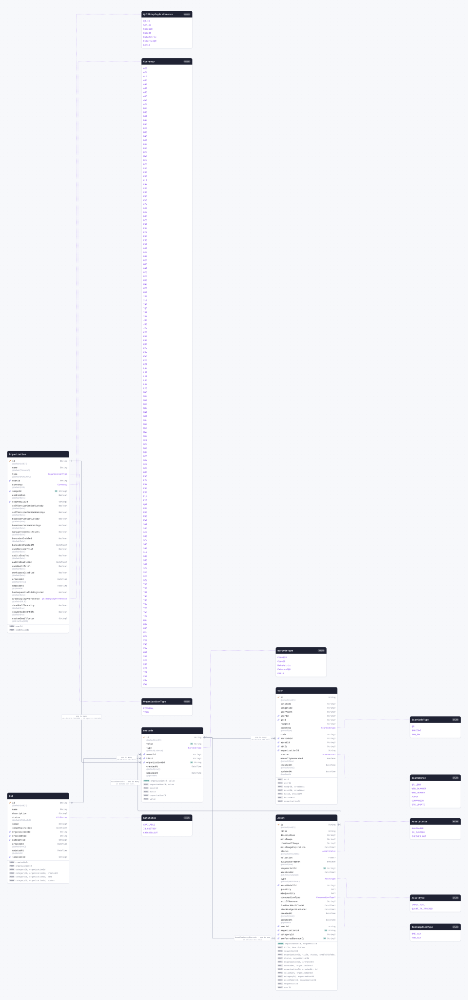

| Field            | Type                               | Constraints                                       | Default      | Description |
| ---------------- | ---------------------------------- | ------------------------------------------------- | ------------ | ----------- |
| `id`             | `String`                           | PK NOT NULL                                       | `cuid(1)`    |             |
| `value`          | `String`                           | NOT NULL                                          |              |             |
| `type`           | [`BarcodeType`](#enum-BarcodeType) | NOT NULL                                          | `Code128`    |             |
| `assetId`        | `String`                           | NULL → [Asset.id](#model-Asset)                   |              |             |
| `kitId`          | `String`                           | NULL → [Kit.id](#model-Kit)                       |              |             |
| `organizationId` | `String`                           | NOT NULL → [Organization.id](#model-Organization) |              |             |
| `createdAt`      | `DateTime`                         | NOT NULL                                          | `now()`      |             |
| `updatedAt`      | `DateTime`                         | NOT NULL                                          | `@updatedAt` |             |

#### Indexes

- `@@index([organizationId, value])`
- `@@index([assetId])`
- `@@index([kitId])`
- `@@index([organizationId])`
- `@@index([value], map: "Barcode_value_trgm_idx")`
- `@@unique([organizationId, value])`

#### References

- `assetId` → [Asset.id](#model-Asset) (many-to-one, on delete SetNull)
- `kitId` → [Kit.id](#model-Kit) (many-to-one, on delete SetNull)
- `organizationId` → [Organization.id](#model-Organization) (many-to-one, on delete Cascade, on update Cascade)

#### Referenced by

- `id` ← [Asset.preferredBarcodeId](#model-Asset) (one-to-one, on delete SetNull)
- `id` ← [Scan.barcodeId](#model-Scan) (one-to-many, on delete SetNull)

#### Definition

```sql
CREATE TABLE "Barcode" (
    "id" TEXT NOT NULL,
    "value" TEXT NOT NULL,
    "type" "BarcodeType" NOT NULL DEFAULT 'Code128',
    "assetId" TEXT,
    "kitId" TEXT,
    "organizationId" TEXT NOT NULL,
    "createdAt" TIMESTAMP(3) NOT NULL DEFAULT CURRENT_TIMESTAMP,
    "updatedAt" TIMESTAMP(3) NOT NULL,

    CONSTRAINT "Barcode_pkey" PRIMARY KEY ("id")
);

CREATE INDEX "Barcode_organizationId_value_idx" ON "Barcode"("organizationId", "value");

CREATE INDEX "Barcode_assetId_idx" ON "Barcode"("assetId");

CREATE INDEX "Barcode_kitId_idx" ON "Barcode"("kitId");

CREATE INDEX "Barcode_organizationId_idx" ON "Barcode"("organizationId");

CREATE INDEX "Barcode_value_trgm_idx" ON "Barcode" USING GIN ("value" gin_trgm_ops);

CREATE UNIQUE INDEX "Barcode_organizationId_value_key" ON "Barcode"("organizationId", "value");

ALTER TABLE "Barcode" ADD CONSTRAINT "Barcode_assetId_fkey" FOREIGN KEY ("assetId") REFERENCES "Asset"("id") ON DELETE SET NULL ON UPDATE CASCADE;

ALTER TABLE "Barcode" ADD CONSTRAINT "Barcode_kitId_fkey" FOREIGN KEY ("kitId") REFERENCES "Kit"("id") ON DELETE SET NULL ON UPDATE CASCADE;

ALTER TABLE "Barcode" ADD CONSTRAINT "Barcode_organizationId_fkey" FOREIGN KEY ("organizationId") REFERENCES "Organization"("id") ON DELETE CASCADE ON UPDATE CASCADE;
```

<details>
<summary>Queries and their SQL</summary>

**findMany**: Every row

```ts
await prisma.barcode.findMany();
```

```sql
SELECT
  "public"."Barcode"."id",
  "public"."Barcode"."value",
  "public"."Barcode"."type"::text,
  "public"."Barcode"."assetId",
  "public"."Barcode"."kitId",
  "public"."Barcode"."organizationId",
  "public"."Barcode"."createdAt",
  "public"."Barcode"."updatedAt"
FROM
  "public"."Barcode"
WHERE
  1 = 1
OFFSET
  $1
-- params: ["0"]
```

**count**: How many rows there are

```ts
await prisma.barcode.count();
```

```sql
SELECT
  COUNT(*) AS "_count$_all"
FROM
  (
    SELECT
      "public"."Barcode"."id"
    FROM
      "public"."Barcode"
    WHERE
      1 = 1
    OFFSET
      $1
  ) AS "sub"
-- params: ["0"]
```

**findMany**: Every row with its relations

```ts
await prisma.barcode.findMany({
  include: { asset: true, preferredByAsset: true, scans: true, kit: true, organization: true },
});
```

```sql
SELECT
  "public"."Barcode"."id",
  "public"."Barcode"."value",
  "public"."Barcode"."type"::text,
  "public"."Barcode"."assetId",
  "public"."Barcode"."kitId",
  "public"."Barcode"."organizationId",
  "public"."Barcode"."createdAt",
  "public"."Barcode"."updatedAt"
FROM
  "public"."Barcode"
WHERE
  1 = 1
OFFSET
  $1
-- params: ["0"]

SELECT
  "public"."Asset"."id",
  "public"."Asset"."title",
  "public"."Asset"."description",
  "public"."Asset"."mainImage",
  "public"."Asset"."thumbnailImage",
  "public"."Asset"."mainImageExpiration",
  "public"."Asset"."status"::text,
  "public"."Asset"."value",
  "public"."Asset"."availableToBook",
  "public"."Asset"."sequentialId",
  "public"."Asset"."archivedAt",
  "public"."Asset"."type"::text,
  "public"."Asset"."assetModelId",
  "public"."Asset"."quantity",
  "public"."Asset"."minQuantity",
  "public"."Asset"."consumptionType"::text,
  "public"."Asset"."unitOfMeasure",
  "public"."Asset"."lowStockNotifiedAt",
  "public"."Asset"."stockLedgerStartedAt",
  "public"."Asset"."createdAt",
  "public"."Asset"."updatedAt",
  "public"."Asset"."userId",
  "public"."Asset"."organizationId",
  "public"."Asset"."categoryId",
  "public"."Asset"."preferredBarcodeId"
FROM
  "public"."Asset"
WHERE
  "public"."Asset"."id" IN ($1)
OFFSET
  $2
-- params: ["<assetId of the rows above>","0"]

SELECT
  "public"."Asset"."id",
  "public"."Asset"."title",
  "public"."Asset"."description",
  "public"."Asset"."mainImage",
  "public"."Asset"."thumbnailImage",
  "public"."Asset"."mainImageExpiration",
  "public"."Asset"."status"::text,
  "public"."Asset"."value",
  "public"."Asset"."availableToBook",
  "public"."Asset"."sequentialId",
  "public"."Asset"."archivedAt",
  "public"."Asset"."type"::text,
  "public"."Asset"."assetModelId",
  "public"."Asset"."quantity",
  "public"."Asset"."minQuantity",
  "public"."Asset"."consumptionType"::text,
  "public"."Asset"."unitOfMeasure",
  "public"."Asset"."lowStockNotifiedAt",
  "public"."Asset"."stockLedgerStartedAt",
  "public"."Asset"."createdAt",
  "public"."Asset"."updatedAt",
  "public"."Asset"."userId",
  "public"."Asset"."organizationId",
  "public"."Asset"."categoryId",
  "public"."Asset"."preferredBarcodeId"
FROM
  "public"."Asset"
WHERE
  "public"."Asset"."preferredBarcodeId" IN ($1)
OFFSET
  $2
-- params: ["<id of the rows above>","0"]

SELECT
  "public"."Scan"."id",
  "public"."Scan"."latitude",
  "public"."Scan"."longitude",
  "public"."Scan"."userAgent",
  "public"."Scan"."userId",
  "public"."Scan"."qrId",
  "public"."Scan"."rawQrId",
  "public"."Scan"."codeType"::text,
  "public"."Scan"."code",
  "public"."Scan"."barcodeId",
  "public"."Scan"."assetId",
  "public"."Scan"."kitId",
  "public"."Scan"."organizationId",
  "public"."Scan"."source"::text,
  "public"."Scan"."manuallyGenerated",
  "public"."Scan"."createdAt",
  "public"."Scan"."updatedAt"
FROM
  "public"."Scan"
WHERE
  "public"."Scan"."barcodeId" IN ($1)
OFFSET
  $2
-- params: ["<id of the rows above>","0"]

SELECT
  "public"."Kit"."id",
  "public"."Kit"."name",
  "public"."Kit"."description",
  "public"."Kit"."status"::text,
  "public"."Kit"."image",
  "public"."Kit"."imageExpiration",
  "public"."Kit"."organizationId",
  "public"."Kit"."createdById",
  "public"."Kit"."categoryId",
  "public"."Kit"."createdAt",
  "public"."Kit"."updatedAt",
  "public"."Kit"."locationId"
FROM
  "public"."Kit"
WHERE
  "public"."Kit"."id" IN ($1)
OFFSET
  $2
-- params: ["<kitId of the rows above>","0"]

SELECT
  "public"."Organization"."id",
  "public"."Organization"."name",
  "public"."Organization"."type"::text,
  "public"."Organization"."userId",
  "public"."Organization"."currency"::text,
  "public"."Organization"."imageId",
  "public"."Organization"."enabledSso",
  "public"."Organization"."ssoDetailsId",
  "public"."Organization"."selfServiceCanSeeCustody",
  "public"."Organization"."selfServiceCanSeeBookings",
  "public"."Organization"."baseUserCanSeeCustody",
  "public"."Organization"."baseUserCanSeeBookings",
  "public"."Organization"."managersCanEditAssets",
  "public"."Organization"."barcodesEnabled",
  "public"."Organization"."barcodesEnabledAt",
  "public"."Organization"."usedBarcodeTrial",
  "public"."Organization"."auditsEnabled",
  "public"."Organization"."auditsEnabledAt",
  "public"."Organization"."usedAuditTrial",
  "public"."Organization"."workspaceDisabled",
  "public"."Organization"."createdAt",
  "public"."Organization"."updatedAt",
  "public"."Organization"."hasSequentialIdsMigrated",
  "public"."Organization"."qrIdDisplayPreference"::text,
  "public"."Organization"."showShelfBranding",
  "public"."Organization"."showQrCodesOnPdfs",
  "public"."Organization"."customEmailFooter"
FROM
  "public"."Organization"
WHERE
  "public"."Organization"."id" IN ($1)
OFFSET
  $2
-- params: ["<organizationId of the rows above>","0"]
```

**findUnique**: One row by what is unique to it

```ts
await prisma.barcode.findUnique({ where: { id: "example" } });
```

```sql
SELECT
  "public"."Barcode"."id",
  "public"."Barcode"."value",
  "public"."Barcode"."type"::text,
  "public"."Barcode"."assetId",
  "public"."Barcode"."kitId",
  "public"."Barcode"."organizationId",
  "public"."Barcode"."createdAt",
  "public"."Barcode"."updatedAt"
FROM
  "public"."Barcode"
WHERE
  (
    "public"."Barcode"."id" = $1
    AND 1 = 1
  )
LIMIT
  $2
OFFSET
  $3
-- params: ["example","1","0"]
```

**create**: Create a row

```ts
await prisma.barcode.create({ data: { value: "example", organizationId: "example" } });
```

```sql
INSERT INTO
  "public"."Barcode" (
    "id",
    "value",
    "type",
    "organizationId",
    "createdAt",
    "updatedAt"
  )
VALUES
  (
    $1,
    $2,
    CAST($3::text AS "public"."BarcodeType"),
    $4,
    $5,
    $6
  )
RETURNING
  "public"."Barcode"."id",
  "public"."Barcode"."value",
  "public"."Barcode"."type"::text,
  "public"."Barcode"."assetId",
  "public"."Barcode"."kitId",
  "public"."Barcode"."organizationId",
  "public"."Barcode"."createdAt",
  "public"."Barcode"."updatedAt"
-- params: ["<cuid(1)>","example","Code128","example","<now()>","<now()>"]
```

**update**: Update a row

```ts
await prisma.barcode.update({ where: { id: "example" }, data: { value: "example" } });
```

```sql
UPDATE "public"."Barcode"
SET
  "value" = $1,
  "updatedAt" = $2
WHERE
  (
    "public"."Barcode"."id" = $3
    AND 1 = 1
  )
RETURNING
  "public"."Barcode"."id",
  "public"."Barcode"."value",
  "public"."Barcode"."type"::text,
  "public"."Barcode"."assetId",
  "public"."Barcode"."kitId",
  "public"."Barcode"."organizationId",
  "public"."Barcode"."createdAt",
  "public"."Barcode"."updatedAt"
-- params: ["example",{"prisma__type":"generatorCall","prisma__value":{"name":"now","args":[],"returnType":{"type":"DateTime"}}},"example"]
```

**delete**: Delete a row

```ts
await prisma.barcode.delete({ where: { id: "example" } });
```

```sql
DELETE FROM "public"."Barcode"
WHERE
  (
    "public"."Barcode"."id" = $1
    AND 1 = 1
  )
RETURNING
  "public"."Barcode"."id",
  "public"."Barcode"."value",
  "public"."Barcode"."type"::text,
  "public"."Barcode"."assetId",
  "public"."Barcode"."kitId",
  "public"."Barcode"."organizationId",
  "public"."Barcode"."createdAt",
  "public"."Barcode"."updatedAt"
-- params: ["example"]
```

</details>

<a id="model-PrintBatch"></a>

### PrintBatch

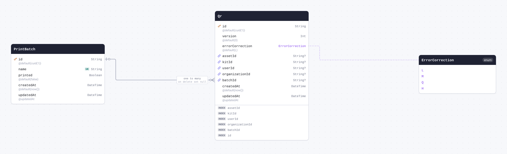

| Field       | Type       | Constraints     | Default      | Description |
| ----------- | ---------- | --------------- | ------------ | ----------- |
| `id`        | `String`   | PK NOT NULL     | `cuid(1)`    |             |
| `name`      | `String`   | UNIQUE NOT NULL |              |             |
| `printed`   | `Boolean`  | NOT NULL        | `false`      |             |
| `createdAt` | `DateTime` | NOT NULL        | `now()`      |             |
| `updatedAt` | `DateTime` | NOT NULL        | `@updatedAt` |             |

#### Referenced by

- `id` ← [Qr.batchId](#model-Qr) (one-to-many, on delete SetNull)

#### Definition

```sql
CREATE TABLE "PrintBatch" (
    "id" TEXT NOT NULL,
    "name" TEXT NOT NULL,
    "printed" BOOLEAN NOT NULL DEFAULT false,
    "createdAt" TIMESTAMP(3) NOT NULL DEFAULT CURRENT_TIMESTAMP,
    "updatedAt" TIMESTAMP(3) NOT NULL,

    CONSTRAINT "PrintBatch_pkey" PRIMARY KEY ("id")
);

CREATE UNIQUE INDEX "PrintBatch_name_key" ON "PrintBatch"("name");
```

<details>
<summary>Queries and their SQL</summary>

**findMany**: Every row

```ts
await prisma.printBatch.findMany();
```

```sql
SELECT
  "public"."PrintBatch"."id",
  "public"."PrintBatch"."name",
  "public"."PrintBatch"."printed",
  "public"."PrintBatch"."createdAt",
  "public"."PrintBatch"."updatedAt"
FROM
  "public"."PrintBatch"
WHERE
  1 = 1
OFFSET
  $1
-- params: ["0"]
```

**count**: How many rows there are

```ts
await prisma.printBatch.count();
```

```sql
SELECT
  COUNT(*) AS "_count$_all"
FROM
  (
    SELECT
      "public"."PrintBatch"."id"
    FROM
      "public"."PrintBatch"
    WHERE
      1 = 1
    OFFSET
      $1
  ) AS "sub"
-- params: ["0"]
```

**findMany**: Every row with its relations

```ts
await prisma.printBatch.findMany({ include: { qrCodes: true } });
```

```sql
SELECT
  "public"."PrintBatch"."id",
  "public"."PrintBatch"."name",
  "public"."PrintBatch"."printed",
  "public"."PrintBatch"."createdAt",
  "public"."PrintBatch"."updatedAt"
FROM
  "public"."PrintBatch"
WHERE
  1 = 1
OFFSET
  $1
-- params: ["0"]

SELECT
  "public"."Qr"."id",
  "public"."Qr"."version",
  "public"."Qr"."errorCorrection"::text,
  "public"."Qr"."assetId",
  "public"."Qr"."kitId",
  "public"."Qr"."userId",
  "public"."Qr"."organizationId",
  "public"."Qr"."batchId",
  "public"."Qr"."createdAt",
  "public"."Qr"."updatedAt"
FROM
  "public"."Qr"
WHERE
  "public"."Qr"."batchId" IN ($1)
OFFSET
  $2
-- params: ["<id of the rows above>","0"]
```

**findUnique**: One row by what is unique to it

```ts
await prisma.printBatch.findUnique({ where: { id: "example" } });
```

```sql
SELECT
  "public"."PrintBatch"."id",
  "public"."PrintBatch"."name",
  "public"."PrintBatch"."printed",
  "public"."PrintBatch"."createdAt",
  "public"."PrintBatch"."updatedAt"
FROM
  "public"."PrintBatch"
WHERE
  (
    "public"."PrintBatch"."id" = $1
    AND 1 = 1
  )
LIMIT
  $2
OFFSET
  $3
-- params: ["example","1","0"]
```

**create**: Create a row

```ts
await prisma.printBatch.create({ data: { name: "example" } });
```

```sql
INSERT INTO
  "public"."PrintBatch" ("id", "name", "printed", "createdAt", "updatedAt")
VALUES
  ($1, $2, $3, $4, $5)
RETURNING
  "public"."PrintBatch"."id",
  "public"."PrintBatch"."name",
  "public"."PrintBatch"."printed",
  "public"."PrintBatch"."createdAt",
  "public"."PrintBatch"."updatedAt"
-- params: ["<cuid(1)>","example",false,"<now()>","<now()>"]
```

**update**: Update a row

```ts
await prisma.printBatch.update({ where: { id: "example" }, data: { name: "example" } });
```

```sql
UPDATE "public"."PrintBatch"
SET
  "name" = $1,
  "updatedAt" = $2
WHERE
  (
    "public"."PrintBatch"."id" = $3
    AND 1 = 1
  )
RETURNING
  "public"."PrintBatch"."id",
  "public"."PrintBatch"."name",
  "public"."PrintBatch"."printed",
  "public"."PrintBatch"."createdAt",
  "public"."PrintBatch"."updatedAt"
-- params: ["example",{"prisma__type":"generatorCall","prisma__value":{"name":"now","args":[],"returnType":{"type":"DateTime"}}},"example"]
```

**delete**: Delete a row

```ts
await prisma.printBatch.delete({ where: { id: "example" } });
```

```sql
DELETE FROM "public"."PrintBatch"
WHERE
  (
    "public"."PrintBatch"."id" = $1
    AND 1 = 1
  )
RETURNING
  "public"."PrintBatch"."id",
  "public"."PrintBatch"."name",
  "public"."PrintBatch"."printed",
  "public"."PrintBatch"."createdAt",
  "public"."PrintBatch"."updatedAt"
-- params: ["example"]
```

</details>

<a id="model-ReportFound"></a>

### ReportFound

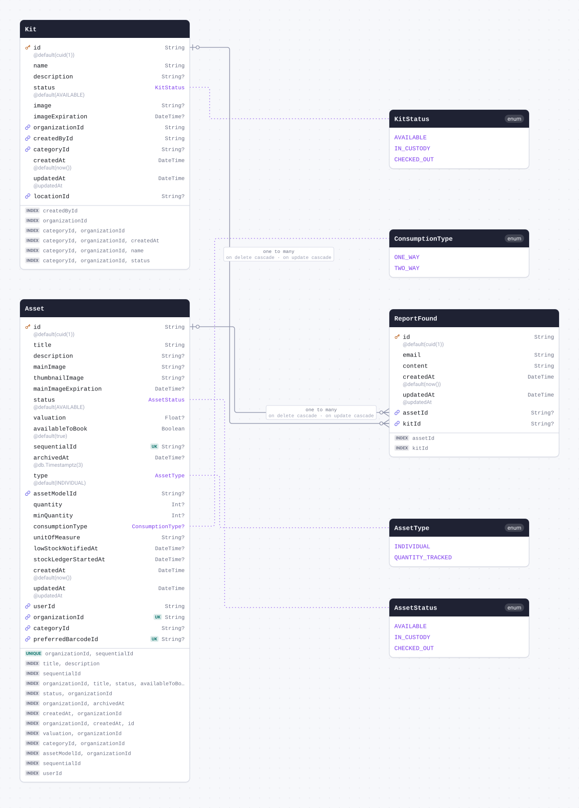

| Field       | Type       | Constraints                     | Default      | Description |
| ----------- | ---------- | ------------------------------- | ------------ | ----------- |
| `id`        | `String`   | PK NOT NULL                     | `cuid(1)`    |             |
| `email`     | `String`   | NOT NULL                        |              |             |
| `content`   | `String`   | NOT NULL                        |              |             |
| `createdAt` | `DateTime` | NOT NULL                        | `now()`      |             |
| `updatedAt` | `DateTime` | NOT NULL                        | `@updatedAt` |             |
| `assetId`   | `String`   | NULL → [Asset.id](#model-Asset) |              |             |
| `kitId`     | `String`   | NULL → [Kit.id](#model-Kit)     |              |             |

#### Indexes

- `@@index([assetId])`
- `@@index([kitId])`

#### References

- `assetId` → [Asset.id](#model-Asset) (many-to-one, on delete Cascade, on update Cascade)
- `kitId` → [Kit.id](#model-Kit) (many-to-one, on delete Cascade, on update Cascade)

#### Definition

```sql
CREATE TABLE "ReportFound" (
    "id" TEXT NOT NULL,
    "email" TEXT NOT NULL,
    "content" TEXT NOT NULL,
    "createdAt" TIMESTAMP(3) NOT NULL DEFAULT CURRENT_TIMESTAMP,
    "updatedAt" TIMESTAMP(3) NOT NULL,
    "assetId" TEXT,
    "kitId" TEXT,

    CONSTRAINT "ReportFound_pkey" PRIMARY KEY ("id")
);

CREATE INDEX "ReportFound_assetId_idx" ON "ReportFound"("assetId");

CREATE INDEX "ReportFound_kitId_idx" ON "ReportFound"("kitId");

ALTER TABLE "ReportFound" ADD CONSTRAINT "ReportFound_assetId_fkey" FOREIGN KEY ("assetId") REFERENCES "Asset"("id") ON DELETE CASCADE ON UPDATE CASCADE;

ALTER TABLE "ReportFound" ADD CONSTRAINT "ReportFound_kitId_fkey" FOREIGN KEY ("kitId") REFERENCES "Kit"("id") ON DELETE CASCADE ON UPDATE CASCADE;
```

<details>
<summary>Queries and their SQL</summary>

**findMany**: Every row

```ts
await prisma.reportFound.findMany();
```

```sql
SELECT
  "public"."ReportFound"."id",
  "public"."ReportFound"."email",
  "public"."ReportFound"."content",
  "public"."ReportFound"."createdAt",
  "public"."ReportFound"."updatedAt",
  "public"."ReportFound"."assetId",
  "public"."ReportFound"."kitId"
FROM
  "public"."ReportFound"
WHERE
  1 = 1
OFFSET
  $1
-- params: ["0"]
```

**count**: How many rows there are

```ts
await prisma.reportFound.count();
```

```sql
SELECT
  COUNT(*) AS "_count$_all"
FROM
  (
    SELECT
      "public"."ReportFound"."id"
    FROM
      "public"."ReportFound"
    WHERE
      1 = 1
    OFFSET
      $1
  ) AS "sub"
-- params: ["0"]
```

**findMany**: Every row with its relations

```ts
await prisma.reportFound.findMany({ include: { asset: true, kit: true } });
```

```sql
SELECT
  "public"."ReportFound"."id",
  "public"."ReportFound"."email",
  "public"."ReportFound"."content",
  "public"."ReportFound"."createdAt",
  "public"."ReportFound"."updatedAt",
  "public"."ReportFound"."assetId",
  "public"."ReportFound"."kitId"
FROM
  "public"."ReportFound"
WHERE
  1 = 1
OFFSET
  $1
-- params: ["0"]

SELECT
  "public"."Asset"."id",
  "public"."Asset"."title",
  "public"."Asset"."description",
  "public"."Asset"."mainImage",
  "public"."Asset"."thumbnailImage",
  "public"."Asset"."mainImageExpiration",
  "public"."Asset"."status"::text,
  "public"."Asset"."value",
  "public"."Asset"."availableToBook",
  "public"."Asset"."sequentialId",
  "public"."Asset"."archivedAt",
  "public"."Asset"."type"::text,
  "public"."Asset"."assetModelId",
  "public"."Asset"."quantity",
  "public"."Asset"."minQuantity",
  "public"."Asset"."consumptionType"::text,
  "public"."Asset"."unitOfMeasure",
  "public"."Asset"."lowStockNotifiedAt",
  "public"."Asset"."stockLedgerStartedAt",
  "public"."Asset"."createdAt",
  "public"."Asset"."updatedAt",
  "public"."Asset"."userId",
  "public"."Asset"."organizationId",
  "public"."Asset"."categoryId",
  "public"."Asset"."preferredBarcodeId"
FROM
  "public"."Asset"
WHERE
  "public"."Asset"."id" IN ($1)
OFFSET
  $2
-- params: ["<assetId of the rows above>","0"]

SELECT
  "public"."Kit"."id",
  "public"."Kit"."name",
  "public"."Kit"."description",
  "public"."Kit"."status"::text,
  "public"."Kit"."image",
  "public"."Kit"."imageExpiration",
  "public"."Kit"."organizationId",
  "public"."Kit"."createdById",
  "public"."Kit"."categoryId",
  "public"."Kit"."createdAt",
  "public"."Kit"."updatedAt",
  "public"."Kit"."locationId"
FROM
  "public"."Kit"
WHERE
  "public"."Kit"."id" IN ($1)
OFFSET
  $2
-- params: ["<kitId of the rows above>","0"]
```

**findUnique**: One row by what is unique to it

```ts
await prisma.reportFound.findUnique({ where: { id: "example" } });
```

```sql
SELECT
  "public"."ReportFound"."id",
  "public"."ReportFound"."email",
  "public"."ReportFound"."content",
  "public"."ReportFound"."createdAt",
  "public"."ReportFound"."updatedAt",
  "public"."ReportFound"."assetId",
  "public"."ReportFound"."kitId"
FROM
  "public"."ReportFound"
WHERE
  (
    "public"."ReportFound"."id" = $1
    AND 1 = 1
  )
LIMIT
  $2
OFFSET
  $3
-- params: ["example","1","0"]
```

**create**: Create a row

```ts
await prisma.reportFound.create({ data: { email: "example", content: "example" } });
```

```sql
INSERT INTO
  "public"."ReportFound" (
    "id",
    "email",
    "content",
    "createdAt",
    "updatedAt"
  )
VALUES
  ($1, $2, $3, $4, $5)
RETURNING
  "public"."ReportFound"."id",
  "public"."ReportFound"."email",
  "public"."ReportFound"."content",
  "public"."ReportFound"."createdAt",
  "public"."ReportFound"."updatedAt",
  "public"."ReportFound"."assetId",
  "public"."ReportFound"."kitId"
-- params: ["<cuid(1)>","example","example","<now()>","<now()>"]
```

**update**: Update a row

```ts
await prisma.reportFound.update({ where: { id: "example" }, data: { email: "example" } });
```

```sql
UPDATE "public"."ReportFound"
SET
  "email" = $1,
  "updatedAt" = $2
WHERE
  (
    "public"."ReportFound"."id" = $3
    AND 1 = 1
  )
RETURNING
  "public"."ReportFound"."id",
  "public"."ReportFound"."email",
  "public"."ReportFound"."content",
  "public"."ReportFound"."createdAt",
  "public"."ReportFound"."updatedAt",
  "public"."ReportFound"."assetId",
  "public"."ReportFound"."kitId"
-- params: ["example",{"prisma__type":"generatorCall","prisma__value":{"name":"now","args":[],"returnType":{"type":"DateTime"}}},"example"]
```

**delete**: Delete a row

```ts
await prisma.reportFound.delete({ where: { id: "example" } });
```

```sql
DELETE FROM "public"."ReportFound"
WHERE
  (
    "public"."ReportFound"."id" = $1
    AND 1 = 1
  )
RETURNING
  "public"."ReportFound"."id",
  "public"."ReportFound"."email",
  "public"."ReportFound"."content",
  "public"."ReportFound"."createdAt",
  "public"."ReportFound"."updatedAt",
  "public"."ReportFound"."assetId",
  "public"."ReportFound"."kitId"
-- params: ["example"]
```

</details>

<a id="model-Scan"></a>

### Scan

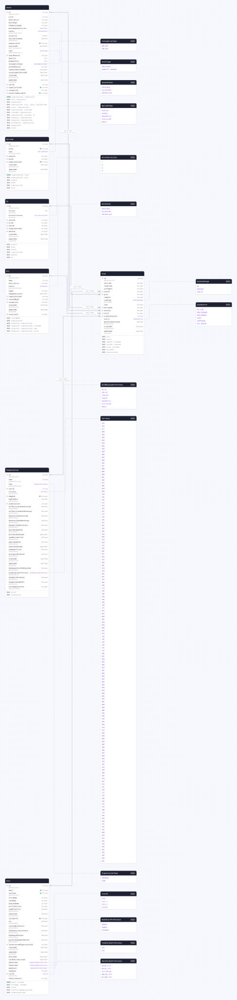

| Field               | Type                                 | Constraints                                       | Default      | Description |
| ------------------- | ------------------------------------ | ------------------------------------------------- | ------------ | ----------- |
| `id`                | `String`                             | PK NOT NULL                                       | `cuid(1)`    |             |
| `latitude`          | `String`                             | NULL                                              |              |             |
| `longitude`         | `String`                             | NULL                                              |              |             |
| `userAgent`         | `String`                             | NULL                                              |              |             |
| `userId`            | `String`                             | NULL → [User.id](#model-User)                     |              |             |
| `qrId`              | `String`                             | NULL → [Qr.id](#model-Qr)                         |              |             |
| `rawQrId`           | `String`                             | NULL                                              |              |             |
| `codeType`          | [`ScanCodeType`](#enum-ScanCodeType) | NOT NULL                                          | `QR`         |             |
| `code`              | `String`                             | NULL                                              |              |             |
| `barcodeId`         | `String`                             | NULL → [Barcode.id](#model-Barcode)               |              |             |
| `assetId`           | `String`                             | NULL → [Asset.id](#model-Asset)                   |              |             |
| `kitId`             | `String`                             | NULL → [Kit.id](#model-Kit)                       |              |             |
| `organizationId`    | `String`                             | NOT NULL → [Organization.id](#model-Organization) |              |             |
| `source`            | [`ScanSource`](#enum-ScanSource)     | NULL                                              |              |             |
| `manuallyGenerated` | `Boolean`                            | NOT NULL                                          | `false`      |             |
| `createdAt`         | `DateTime`                           | NOT NULL                                          | `now()`      |             |
| `updatedAt`         | `DateTime`                           | NOT NULL                                          | `@updatedAt` |             |

#### Indexes

- `@@index([qrId])`
- `@@index([userId])`
- `@@index([rawQrId, createdAt])`
- `@@index([assetId, createdAt])`
- `@@index([kitId, createdAt])`
- `@@index([barcodeId])`
- `@@index([organizationId])`

#### References

- `userId` → [User.id](#model-User) (many-to-one, on delete SetNull)
- `qrId` → [Qr.id](#model-Qr) (many-to-one, on delete SetNull)
- `barcodeId` → [Barcode.id](#model-Barcode) (many-to-one, on delete SetNull)
- `assetId` → [Asset.id](#model-Asset) (many-to-one, on delete SetNull)
- `kitId` → [Kit.id](#model-Kit) (many-to-one, on delete SetNull)
- `organizationId` → [Organization.id](#model-Organization) (many-to-one, on delete Cascade)

#### Definition

```sql
CREATE TABLE "Scan" (
    "id" TEXT NOT NULL,
    "latitude" TEXT,
    "longitude" TEXT,
    "userAgent" TEXT,
    "userId" TEXT,
    "qrId" TEXT,
    "rawQrId" TEXT,
    "codeType" "ScanCodeType" NOT NULL DEFAULT 'QR',
    "code" TEXT,
    "barcodeId" TEXT,
    "assetId" TEXT,
    "kitId" TEXT,
    "organizationId" TEXT NOT NULL,
    "source" "ScanSource",
    "manuallyGenerated" BOOLEAN NOT NULL DEFAULT false,
    "createdAt" TIMESTAMP(3) NOT NULL DEFAULT CURRENT_TIMESTAMP,
    "updatedAt" TIMESTAMP(3) NOT NULL,

    CONSTRAINT "Scan_pkey" PRIMARY KEY ("id")
);

CREATE INDEX "Scan_qrId_idx" ON "Scan"("qrId");

CREATE INDEX "Scan_userId_idx" ON "Scan"("userId");

CREATE INDEX "Scan_rawQrId_createdAt_idx" ON "Scan"("rawQrId", "createdAt");

CREATE INDEX "Scan_assetId_createdAt_idx" ON "Scan"("assetId", "createdAt");

CREATE INDEX "Scan_kitId_createdAt_idx" ON "Scan"("kitId", "createdAt");

CREATE INDEX "Scan_barcodeId_idx" ON "Scan"("barcodeId");

CREATE INDEX "Scan_organizationId_idx" ON "Scan"("organizationId");

ALTER TABLE "Scan" ADD CONSTRAINT "Scan_userId_fkey" FOREIGN KEY ("userId") REFERENCES "User"("id") ON DELETE SET NULL ON UPDATE CASCADE;

ALTER TABLE "Scan" ADD CONSTRAINT "Scan_qrId_fkey" FOREIGN KEY ("qrId") REFERENCES "Qr"("id") ON DELETE SET NULL ON UPDATE CASCADE;

ALTER TABLE "Scan" ADD CONSTRAINT "Scan_barcodeId_fkey" FOREIGN KEY ("barcodeId") REFERENCES "Barcode"("id") ON DELETE SET NULL ON UPDATE CASCADE;

ALTER TABLE "Scan" ADD CONSTRAINT "Scan_assetId_fkey" FOREIGN KEY ("assetId") REFERENCES "Asset"("id") ON DELETE SET NULL ON UPDATE CASCADE;

ALTER TABLE "Scan" ADD CONSTRAINT "Scan_kitId_fkey" FOREIGN KEY ("kitId") REFERENCES "Kit"("id") ON DELETE SET NULL ON UPDATE CASCADE;

ALTER TABLE "Scan" ADD CONSTRAINT "Scan_organizationId_fkey" FOREIGN KEY ("organizationId") REFERENCES "Organization"("id") ON DELETE CASCADE ON UPDATE CASCADE;
```

<details>
<summary>Queries and their SQL</summary>

**findMany**: Every row

```ts
await prisma.scan.findMany();
```

```sql
SELECT
  "public"."Scan"."id",
  "public"."Scan"."latitude",
  "public"."Scan"."longitude",
  "public"."Scan"."userAgent",
  "public"."Scan"."userId",
  "public"."Scan"."qrId",
  "public"."Scan"."rawQrId",
  "public"."Scan"."codeType"::text,
  "public"."Scan"."code",
  "public"."Scan"."barcodeId",
  "public"."Scan"."assetId",
  "public"."Scan"."kitId",
  "public"."Scan"."organizationId",
  "public"."Scan"."source"::text,
  "public"."Scan"."manuallyGenerated",
  "public"."Scan"."createdAt",
  "public"."Scan"."updatedAt"
FROM
  "public"."Scan"
WHERE
  1 = 1
OFFSET
  $1
-- params: ["0"]
```

**count**: How many rows there are

```ts
await prisma.scan.count();
```

```sql
SELECT
  COUNT(*) AS "_count$_all"
FROM
  (
    SELECT
      "public"."Scan"."id"
    FROM
      "public"."Scan"
    WHERE
      1 = 1
    OFFSET
      $1
  ) AS "sub"
-- params: ["0"]
```

**findMany**: Every row with its relations

```ts
await prisma.scan.findMany({
  include: { user: true, qr: true, barcode: true, asset: true, kit: true, organization: true },
});
```

```sql
SELECT
  "public"."Scan"."id",
  "public"."Scan"."latitude",
  "public"."Scan"."longitude",
  "public"."Scan"."userAgent",
  "public"."Scan"."userId",
  "public"."Scan"."qrId",
  "public"."Scan"."rawQrId",
  "public"."Scan"."codeType"::text,
  "public"."Scan"."code",
  "public"."Scan"."barcodeId",
  "public"."Scan"."assetId",
  "public"."Scan"."kitId",
  "public"."Scan"."organizationId",
  "public"."Scan"."source"::text,
  "public"."Scan"."manuallyGenerated",
  "public"."Scan"."createdAt",
  "public"."Scan"."updatedAt"
FROM
  "public"."Scan"
WHERE
  1 = 1
OFFSET
  $1
-- params: ["0"]

SELECT
  "public"."User"."id",
  "public"."User"."email",
  "public"."User"."username",
  "public"."User"."firstName",
  "public"."User"."lastName",
  "public"."User"."displayName",
  "public"."User"."profilePicture",
  "public"."User"."usedFreeTrial",
  "public"."User"."onboarded",
  "public"."User"."customerId",
  "public"."User"."sso",
  "public"."User"."createdWithInvite",
  "public"."User"."skipSubscriptionCheck",
  "public"."User"."hasUnpaidInvoice",
  "public"."User"."warnForNoPaymentMethod",
  "public"."User"."lastSelectedOrganizationId",
  "public"."User"."createdAt",
  "public"."User"."updatedAt",
  "public"."User"."deletedAt",
  "public"."User"."lastMobileActiveAt",
  "public"."User"."dateFormat"::text,
  "public"."User"."timeFormat"::text,
  "public"."User"."weekStart"::text,
  "public"."User"."timeZone",
  "public"."User"."tierId"::text,
  "public"."User"."referralSource"
FROM
  "public"."User"
WHERE
  "public"."User"."id" IN ($1)
OFFSET
  $2
-- params: ["<userId of the rows above>","0"]

SELECT
  "public"."Qr"."id",
  "public"."Qr"."version",
  "public"."Qr"."errorCorrection"::text,
  "public"."Qr"."assetId",
  "public"."Qr"."kitId",
  "public"."Qr"."userId",
  "public"."Qr"."organizationId",
  "public"."Qr"."batchId",
  "public"."Qr"."createdAt",
  "public"."Qr"."updatedAt"
FROM
  "public"."Qr"
WHERE
  "public"."Qr"."id" IN ($1)
OFFSET
  $2
-- params: ["<qrId of the rows above>","0"]

SELECT
  "public"."Barcode"."id",
  "public"."Barcode"."value",
  "public"."Barcode"."type"::text,
  "public"."Barcode"."assetId",
  "public"."Barcode"."kitId",
  "public"."Barcode"."organizationId",
  "public"."Barcode"."createdAt",
  "public"."Barcode"."updatedAt"
FROM
  "public"."Barcode"
WHERE
  "public"."Barcode"."id" IN ($1)
OFFSET
  $2
-- params: ["<barcodeId of the rows above>","0"]

SELECT
  "public"."Asset"."id",
  "public"."Asset"."title",
  "public"."Asset"."description",
  "public"."Asset"."mainImage",
  "public"."Asset"."thumbnailImage",
  "public"."Asset"."mainImageExpiration",
  "public"."Asset"."status"::text,
  "public"."Asset"."value",
  "public"."Asset"."availableToBook",
  "public"."Asset"."sequentialId",
  "public"."Asset"."archivedAt",
  "public"."Asset"."type"::text,
  "public"."Asset"."assetModelId",
  "public"."Asset"."quantity",
  "public"."Asset"."minQuantity",
  "public"."Asset"."consumptionType"::text,
  "public"."Asset"."unitOfMeasure",
  "public"."Asset"."lowStockNotifiedAt",
  "public"."Asset"."stockLedgerStartedAt",
  "public"."Asset"."createdAt",
  "public"."Asset"."updatedAt",
  "public"."Asset"."userId",
  "public"."Asset"."organizationId",
  "public"."Asset"."categoryId",
  "public"."Asset"."preferredBarcodeId"
FROM
  "public"."Asset"
WHERE
  "public"."Asset"."id" IN ($1)
OFFSET
  $2
-- params: ["<assetId of the rows above>","0"]

SELECT
  "public"."Kit"."id",
  "public"."Kit"."name",
  "public"."Kit"."description",
  "public"."Kit"."status"::text,
  "public"."Kit"."image",
  "public"."Kit"."imageExpiration",
  "public"."Kit"."organizationId",
  "public"."Kit"."createdById",
  "public"."Kit"."categoryId",
  "public"."Kit"."createdAt",
  "public"."Kit"."updatedAt",
  "public"."Kit"."locationId"
FROM
  "public"."Kit"
WHERE
  "public"."Kit"."id" IN ($1)
OFFSET
  $2
-- params: ["<kitId of the rows above>","0"]

SELECT
  "public"."Organization"."id",
  "public"."Organization"."name",
  "public"."Organization"."type"::text,
  "public"."Organization"."userId",
  "public"."Organization"."currency"::text,
  "public"."Organization"."imageId",
  "public"."Organization"."enabledSso",
  "public"."Organization"."ssoDetailsId",
  "public"."Organization"."selfServiceCanSeeCustody",
  "public"."Organization"."selfServiceCanSeeBookings",
  "public"."Organization"."baseUserCanSeeCustody",
  "public"."Organization"."baseUserCanSeeBookings",
  "public"."Organization"."managersCanEditAssets",
  "public"."Organization"."barcodesEnabled",
  "public"."Organization"."barcodesEnabledAt",
  "public"."Organization"."usedBarcodeTrial",
  "public"."Organization"."auditsEnabled",
  "public"."Organization"."auditsEnabledAt",
  "public"."Organization"."usedAuditTrial",
  "public"."Organization"."workspaceDisabled",
  "public"."Organization"."createdAt",
  "public"."Organization"."updatedAt",
  "public"."Organization"."hasSequentialIdsMigrated",
  "public"."Organization"."qrIdDisplayPreference"::text,
  "public"."Organization"."showShelfBranding",
  "public"."Organization"."showQrCodesOnPdfs",
  "public"."Organization"."customEmailFooter"
FROM
  "public"."Organization"
WHERE
  "public"."Organization"."id" IN ($1)
OFFSET
  $2
-- params: ["<organizationId of the rows above>","0"]
```

**findUnique**: One row by what is unique to it

```ts
await prisma.scan.findUnique({ where: { id: "example" } });
```

```sql
SELECT
  "public"."Scan"."id",
  "public"."Scan"."latitude",
  "public"."Scan"."longitude",
  "public"."Scan"."userAgent",
  "public"."Scan"."userId",
  "public"."Scan"."qrId",
  "public"."Scan"."rawQrId",
  "public"."Scan"."codeType"::text,
  "public"."Scan"."code",
  "public"."Scan"."barcodeId",
  "public"."Scan"."assetId",
  "public"."Scan"."kitId",
  "public"."Scan"."organizationId",
  "public"."Scan"."source"::text,
  "public"."Scan"."manuallyGenerated",
  "public"."Scan"."createdAt",
  "public"."Scan"."updatedAt"
FROM
  "public"."Scan"
WHERE
  (
    "public"."Scan"."id" = $1
    AND 1 = 1
  )
LIMIT
  $2
OFFSET
  $3
-- params: ["example","1","0"]
```

**create**: Create a row

```ts
await prisma.scan.create({ data: { organizationId: "example" } });
```

```sql
INSERT INTO
  "public"."Scan" (
    "id",
    "codeType",
    "organizationId",
    "manuallyGenerated",
    "createdAt",
    "updatedAt"
  )
VALUES
  (
    $1,
    CAST($2::text AS "public"."ScanCodeType"),
    $3,
    $4,
    $5,
    $6
  )
RETURNING
  "public"."Scan"."id",
  "public"."Scan"."latitude",
  "public"."Scan"."longitude",
  "public"."Scan"."userAgent",
  "public"."Scan"."userId",
  "public"."Scan"."qrId",
  "public"."Scan"."rawQrId",
  "public"."Scan"."codeType"::text,
  "public"."Scan"."code",
  "public"."Scan"."barcodeId",
  "public"."Scan"."assetId",
  "public"."Scan"."kitId",
  "public"."Scan"."organizationId",
  "public"."Scan"."source"::text,
  "public"."Scan"."manuallyGenerated",
  "public"."Scan"."createdAt",
  "public"."Scan"."updatedAt"
-- params: ["<cuid(1)>","QR","example",false,"<now()>","<now()>"]
```

**update**: Update a row

```ts
await prisma.scan.update({ where: { id: "example" }, data: { latitude: "example" } });
```

```sql
UPDATE "public"."Scan"
SET
  "latitude" = $1,
  "updatedAt" = $2
WHERE
  (
    "public"."Scan"."id" = $3
    AND 1 = 1
  )
RETURNING
  "public"."Scan"."id",
  "public"."Scan"."latitude",
  "public"."Scan"."longitude",
  "public"."Scan"."userAgent",
  "public"."Scan"."userId",
  "public"."Scan"."qrId",
  "public"."Scan"."rawQrId",
  "public"."Scan"."codeType"::text,
  "public"."Scan"."code",
  "public"."Scan"."barcodeId",
  "public"."Scan"."assetId",
  "public"."Scan"."kitId",
  "public"."Scan"."organizationId",
  "public"."Scan"."source"::text,
  "public"."Scan"."manuallyGenerated",
  "public"."Scan"."createdAt",
  "public"."Scan"."updatedAt"
-- params: ["example",{"prisma__type":"generatorCall","prisma__value":{"name":"now","args":[],"returnType":{"type":"DateTime"}}},"example"]
```

**delete**: Delete a row

```ts
await prisma.scan.delete({ where: { id: "example" } });
```

```sql
DELETE FROM "public"."Scan"
WHERE
  (
    "public"."Scan"."id" = $1
    AND 1 = 1
  )
RETURNING
  "public"."Scan"."id",
  "public"."Scan"."latitude",
  "public"."Scan"."longitude",
  "public"."Scan"."userAgent",
  "public"."Scan"."userId",
  "public"."Scan"."qrId",
  "public"."Scan"."rawQrId",
  "public"."Scan"."codeType"::text,
  "public"."Scan"."code",
  "public"."Scan"."barcodeId",
  "public"."Scan"."assetId",
  "public"."Scan"."kitId",
  "public"."Scan"."organizationId",
  "public"."Scan"."source"::text,
  "public"."Scan"."manuallyGenerated",
  "public"."Scan"."createdAt",
  "public"."Scan"."updatedAt"
-- params: ["example"]
```

</details>

<a id="model-Location"></a>

### Location

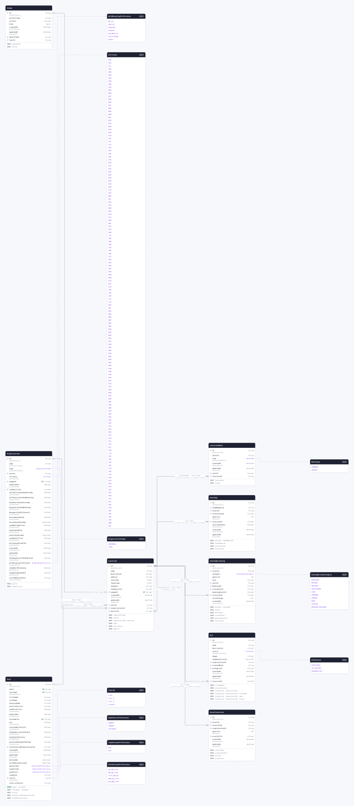

| Field            | Type       | Constraints                                       | Default      | Description |
| ---------------- | ---------- | ------------------------------------------------- | ------------ | ----------- |
| `id`             | `String`   | PK NOT NULL                                       | `cuid(1)`    |             |
| `name`           | `String`   | NOT NULL                                          |              |             |
| `description`    | `String`   | NULL                                              |              |             |
| `address`        | `String`   | NULL                                              |              |             |
| `latitude`       | `Float`    | NULL                                              |              |             |
| `longitude`      | `Float`    | NULL                                              |              |             |
| `imageUrl`       | `String`   | NULL                                              |              |             |
| `thumbnailUrl`   | `String`   | NULL                                              |              |             |
| `imageId`        | `String`   | UNIQUE NULL → [Image.id](#model-Image)            |              |             |
| `createdAt`      | `DateTime` | NOT NULL                                          | `now()`      |             |
| `updatedAt`      | `DateTime` | NOT NULL                                          | `@updatedAt` |             |
| `userId`         | `String`   | NOT NULL → [User.id](#model-User)                 |              |             |
| `organizationId` | `String`   | NOT NULL → [Organization.id](#model-Organization) |              |             |
| `parentId`       | `String`   | NULL → [Location.id](#model-Location)             |              |             |

#### Indexes

- `@@index([organizationId])`
- `@@index([userId])`
- `@@index([organizationId, parentId])`
- `@@index([name], map: "Location_name_trgm_idx")`
- `@@index([description], map: "Location_description_trgm_idx")`
- `@@index([address], map: "Location_address_trgm_idx")`

#### References

- `imageId` → [Image.id](#model-Image) (one-to-one)
- `userId` → [User.id](#model-User) (many-to-one, on delete Cascade, on update Cascade)
- `organizationId` → [Organization.id](#model-Organization) (many-to-one, on delete Cascade, on update Cascade)
- `parentId` → [Location.id](#model-Location) (many-to-one, on delete SetNull)

#### Referenced by

- `id` ← [LocationNote.locationId](#model-LocationNote) (one-to-many, on delete Cascade, on update Cascade)
- `id` ← [Location.parentId](#model-Location) (one-to-many, on delete SetNull)
- `id` ← [Custody.locationId](#model-Custody) (one-to-many, on delete SetNull, on update Cascade)
- `id` ← [ConsumptionLog.locationId](#model-ConsumptionLog) (one-to-many, on delete SetNull, on update Cascade)
- `id` ← [Kit.locationId](#model-Kit) (one-to-many)
- `id` ← [AssetLocation.locationId](#model-AssetLocation) (one-to-many, on delete Cascade, on update Cascade)

#### Definition

```sql
CREATE TABLE "Location" (
    "id" TEXT NOT NULL,
    "name" TEXT NOT NULL,
    "description" TEXT,
    "address" TEXT,
    "latitude" DOUBLE PRECISION,
    "longitude" DOUBLE PRECISION,
    "imageUrl" TEXT,
    "thumbnailUrl" TEXT,
    "imageId" TEXT,
    "createdAt" TIMESTAMP(3) NOT NULL DEFAULT CURRENT_TIMESTAMP,
    "updatedAt" TIMESTAMP(3) NOT NULL,
    "userId" TEXT NOT NULL,
    "organizationId" TEXT NOT NULL,
    "parentId" TEXT,

    CONSTRAINT "Location_pkey" PRIMARY KEY ("id")
);

CREATE UNIQUE INDEX "Location_imageId_key" ON "Location"("imageId");

CREATE INDEX "Location_organizationId_idx" ON "Location"("organizationId");

CREATE INDEX "Location_userId_idx" ON "Location"("userId");

CREATE INDEX "Location_organizationId_parentId_idx" ON "Location"("organizationId", "parentId");

CREATE INDEX "Location_name_trgm_idx" ON "Location" USING GIN ("name" gin_trgm_ops);

CREATE INDEX "Location_description_trgm_idx" ON "Location" USING GIN ("description" gin_trgm_ops);

CREATE INDEX "Location_address_trgm_idx" ON "Location" USING GIN ("address" gin_trgm_ops);

ALTER TABLE "Location" ADD CONSTRAINT "Location_imageId_fkey" FOREIGN KEY ("imageId") REFERENCES "Image"("id") ON DELETE SET NULL ON UPDATE CASCADE;

ALTER TABLE "Location" ADD CONSTRAINT "Location_userId_fkey" FOREIGN KEY ("userId") REFERENCES "User"("id") ON DELETE CASCADE ON UPDATE CASCADE;

ALTER TABLE "Location" ADD CONSTRAINT "Location_organizationId_fkey" FOREIGN KEY ("organizationId") REFERENCES "Organization"("id") ON DELETE CASCADE ON UPDATE CASCADE;

ALTER TABLE "Location" ADD CONSTRAINT "Location_parentId_fkey" FOREIGN KEY ("parentId") REFERENCES "Location"("id") ON DELETE SET NULL ON UPDATE CASCADE;
```

<details>
<summary>Queries and their SQL</summary>

**findMany**: Every row

```ts
await prisma.location.findMany();
```

```sql
SELECT
  "public"."Location"."id",
  "public"."Location"."name",
  "public"."Location"."description",
  "public"."Location"."address",
  "public"."Location"."latitude",
  "public"."Location"."longitude",
  "public"."Location"."imageUrl",
  "public"."Location"."thumbnailUrl",
  "public"."Location"."imageId",
  "public"."Location"."createdAt",
  "public"."Location"."updatedAt",
  "public"."Location"."userId",
  "public"."Location"."organizationId",
  "public"."Location"."parentId"
FROM
  "public"."Location"
WHERE
  1 = 1
OFFSET
  $1
-- params: ["0"]
```

**count**: How many rows there are

```ts
await prisma.location.count();
```

```sql
SELECT
  COUNT(*) AS "_count$_all"
FROM
  (
    SELECT
      "public"."Location"."id"
    FROM
      "public"."Location"
    WHERE
      1 = 1
    OFFSET
      $1
  ) AS "sub"
-- params: ["0"]
```

**findMany**: Every row with its relations

```ts
await prisma.location.findMany({
  include: {
    image: true,
    user: true,
    organization: true,
    assetLocations: true,
    kits: true,
    notes: true,
    custodies: true,
    consumptionLogs: true,
    parent: true,
    children: true,
  },
});
```

```sql
SELECT
  "public"."Location"."id",
  "public"."Location"."name",
  "public"."Location"."description",
  "public"."Location"."address",
  "public"."Location"."latitude",
  "public"."Location"."longitude",
  "public"."Location"."imageUrl",
  "public"."Location"."thumbnailUrl",
  "public"."Location"."imageId",
  "public"."Location"."createdAt",
  "public"."Location"."updatedAt",
  "public"."Location"."userId",
  "public"."Location"."organizationId",
  "public"."Location"."parentId"
FROM
  "public"."Location"
WHERE
  1 = 1
OFFSET
  $1
-- params: ["0"]

SELECT
  "public"."Image"."id",
  "public"."Image"."contentType",
  "public"."Image"."altText",
  "public"."Image"."blob",
  "public"."Image"."createdAt",
  "public"."Image"."updatedAt",
  "public"."Image"."ownerOrgId",
  "public"."Image"."userId"
FROM
  "public"."Image"
WHERE
  "public"."Image"."id" IN ($1)
OFFSET
  $2
-- params: ["<imageId of the rows above>","0"]

SELECT
  "public"."User"."id",
  "public"."User"."email",
  "public"."User"."username",
  "public"."User"."firstName",
  "public"."User"."lastName",
  "public"."User"."displayName",
  "public"."User"."profilePicture",
  "public"."User"."usedFreeTrial",
  "public"."User"."onboarded",
  "public"."User"."customerId",
  "public"."User"."sso",
  "public"."User"."createdWithInvite",
  "public"."User"."skipSubscriptionCheck",
  "public"."User"."hasUnpaidInvoice",
  "public"."User"."warnForNoPaymentMethod",
  "public"."User"."lastSelectedOrganizationId",
  "public"."User"."createdAt",
  "public"."User"."updatedAt",
  "public"."User"."deletedAt",
  "public"."User"."lastMobileActiveAt",
  "public"."User"."dateFormat"::text,
  "public"."User"."timeFormat"::text,
  "public"."User"."weekStart"::text,
  "public"."User"."timeZone",
  "public"."User"."tierId"::text,
  "public"."User"."referralSource"
FROM
  "public"."User"
WHERE
  "public"."User"."id" IN ($1)
OFFSET
  $2
-- params: ["<userId of the rows above>","0"]

SELECT
  "public"."Organization"."id",
  "public"."Organization"."name",
  "public"."Organization"."type"::text,
  "public"."Organization"."userId",
  "public"."Organization"."currency"::text,
  "public"."Organization"."imageId",
  "public"."Organization"."enabledSso",
  "public"."Organization"."ssoDetailsId",
  "public"."Organization"."selfServiceCanSeeCustody",
  "public"."Organization"."selfServiceCanSeeBookings",
  "public"."Organization"."baseUserCanSeeCustody",
  "public"."Organization"."baseUserCanSeeBookings",
  "public"."Organization"."managersCanEditAssets",
  "public"."Organization"."barcodesEnabled",
  "public"."Organization"."barcodesEnabledAt",
  "public"."Organization"."usedBarcodeTrial",
  "public"."Organization"."auditsEnabled",
  "public"."Organization"."auditsEnabledAt",
  "public"."Organization"."usedAuditTrial",
  "public"."Organization"."workspaceDisabled",
  "public"."Organization"."createdAt",
  "public"."Organization"."updatedAt",
  "public"."Organization"."hasSequentialIdsMigrated",
  "public"."Organization"."qrIdDisplayPreference"::text,
  "public"."Organization"."showShelfBranding",
  "public"."Organization"."showQrCodesOnPdfs",
  "public"."Organization"."customEmailFooter"
FROM
  "public"."Organization"
WHERE
  "public"."Organization"."id" IN ($1)
OFFSET
  $2
-- params: ["<organizationId of the rows above>","0"]

SELECT
  "public"."AssetLocation"."id",
  "public"."AssetLocation"."assetId",
  "public"."AssetLocation"."locationId",
  "public"."AssetLocation"."organizationId",
  "public"."AssetLocation"."quantity",
  "public"."AssetLocation"."assetKitId",
  "public"."AssetLocation"."createdAt",
  "public"."AssetLocation"."updatedAt"
FROM
  "public"."AssetLocation"
WHERE
  "public"."AssetLocation"."locationId" IN ($1)
OFFSET
  $2
-- params: ["<id of the rows above>","0"]

SELECT
  "public"."Kit"."id",
  "public"."Kit"."name",
  "public"."Kit"."description",
  "public"."Kit"."status"::text,
  "public"."Kit"."image",
  "public"."Kit"."imageExpiration",
  "public"."Kit"."organizationId",
  "public"."Kit"."createdById",
  "public"."Kit"."categoryId",
  "public"."Kit"."createdAt",
  "public"."Kit"."updatedAt",
  "public"."Kit"."locationId"
FROM
  "public"."Kit"
WHERE
  "public"."Kit"."locationId" IN ($1)
OFFSET
  $2
-- params: ["<id of the rows above>","0"]

SELECT
  "public"."LocationNote"."id",
  "public"."LocationNote"."content",
  "public"."LocationNote"."type"::text,
  "public"."LocationNote"."createdAt",
  "public"."LocationNote"."updatedAt",
  "public"."LocationNote"."userId",
  "public"."LocationNote"."locationId"
FROM
  "public"."LocationNote"
WHERE
  "public"."LocationNote"."locationId" IN ($1)
OFFSET
  $2
-- params: ["<id of the rows above>","0"]

SELECT
  "public"."Custody"."id",
  "public"."Custody"."teamMemberId",
  "public"."Custody"."assetId",
  "public"."Custody"."kitCustodyId",
  "public"."Custody"."quantity",
  "public"."Custody"."locationId",
  "public"."Custody"."sourceUnknown",
  "public"."Custody"."createdAt",
  "public"."Custody"."updatedAt"
FROM
  "public"."Custody"
WHERE
  "public"."Custody"."locationId" IN ($1)
OFFSET
  $2
-- params: ["<id of the rows above>","0"]

SELECT
  "public"."ConsumptionLog"."id",
  "public"."ConsumptionLog"."assetId",
  "public"."ConsumptionLog"."category"::text,
  "public"."ConsumptionLog"."quantity",
  "public"."ConsumptionLog"."note",
  "public"."ConsumptionLog"."userId",
  "public"."ConsumptionLog"."bookingId",
  "public"."ConsumptionLog"."custodianId",
  "public"."ConsumptionLog"."bookingAssetId",
  "public"."ConsumptionLog"."locationId",
  "public"."ConsumptionLog"."stockChange",
  "public"."ConsumptionLog"."createdAt"
FROM
  "public"."ConsumptionLog"
WHERE
  "public"."ConsumptionLog"."locationId" IN ($1)
OFFSET
  $2
-- params: ["<id of the rows above>","0"]

SELECT
  "public"."Location"."id",
  "public"."Location"."name",
  "public"."Location"."description",
  "public"."Location"."address",
  "public"."Location"."latitude",
  "public"."Location"."longitude",
  "public"."Location"."imageUrl",
  "public"."Location"."thumbnailUrl",
  "public"."Location"."imageId",
  "public"."Location"."createdAt",
  "public"."Location"."updatedAt",
  "public"."Location"."userId",
  "public"."Location"."organizationId",
  "public"."Location"."parentId"
FROM
  "public"."Location"
WHERE
  "public"."Location"."id" IN ($1)
OFFSET
  $2
-- params: ["<parentId of the rows above>","0"]

SELECT
  "public"."Location"."id",
  "public"."Location"."name",
  "public"."Location"."description",
  "public"."Location"."address",
  "public"."Location"."latitude",
  "public"."Location"."longitude",
  "public"."Location"."imageUrl",
  "public"."Location"."thumbnailUrl",
  "public"."Location"."imageId",
  "public"."Location"."createdAt",
  "public"."Location"."updatedAt",
  "public"."Location"."userId",
  "public"."Location"."organizationId",
  "public"."Location"."parentId"
FROM
  "public"."Location"
WHERE
  "public"."Location"."parentId" IN ($1)
OFFSET
  $2
-- params: ["<id of the rows above>","0"]
```

**findUnique**: One row by what is unique to it

```ts
await prisma.location.findUnique({ where: { id: "example" } });
```

```sql
SELECT
  "public"."Location"."id",
  "public"."Location"."name",
  "public"."Location"."description",
  "public"."Location"."address",
  "public"."Location"."latitude",
  "public"."Location"."longitude",
  "public"."Location"."imageUrl",
  "public"."Location"."thumbnailUrl",
  "public"."Location"."imageId",
  "public"."Location"."createdAt",
  "public"."Location"."updatedAt",
  "public"."Location"."userId",
  "public"."Location"."organizationId",
  "public"."Location"."parentId"
FROM
  "public"."Location"
WHERE
  (
    "public"."Location"."id" = $1
    AND 1 = 1
  )
LIMIT
  $2
OFFSET
  $3
-- params: ["example","1","0"]
```

**create**: Create a row

```ts
await prisma.location.create({
  data: { name: "example", userId: "example", organizationId: "example" },
});
```

```sql
INSERT INTO
  "public"."Location" (
    "id",
    "name",
    "createdAt",
    "updatedAt",
    "userId",
    "organizationId"
  )
VALUES
  ($1, $2, $3, $4, $5, $6)
RETURNING
  "public"."Location"."id",
  "public"."Location"."name",
  "public"."Location"."description",
  "public"."Location"."address",
  "public"."Location"."latitude",
  "public"."Location"."longitude",
  "public"."Location"."imageUrl",
  "public"."Location"."thumbnailUrl",
  "public"."Location"."imageId",
  "public"."Location"."createdAt",
  "public"."Location"."updatedAt",
  "public"."Location"."userId",
  "public"."Location"."organizationId",
  "public"."Location"."parentId"
-- params: ["<cuid(1)>","example","<now()>","<now()>","example","example"]
```

**update**: Update a row

```ts
await prisma.location.update({ where: { id: "example" }, data: { name: "example" } });
```

```sql
UPDATE "public"."Location"
SET
  "name" = $1,
  "updatedAt" = $2
WHERE
  (
    "public"."Location"."id" = $3
    AND 1 = 1
  )
RETURNING
  "public"."Location"."id",
  "public"."Location"."name",
  "public"."Location"."description",
  "public"."Location"."address",
  "public"."Location"."latitude",
  "public"."Location"."longitude",
  "public"."Location"."imageUrl",
  "public"."Location"."thumbnailUrl",
  "public"."Location"."imageId",
  "public"."Location"."createdAt",
  "public"."Location"."updatedAt",
  "public"."Location"."userId",
  "public"."Location"."organizationId",
  "public"."Location"."parentId"
-- params: ["example",{"prisma__type":"generatorCall","prisma__value":{"name":"now","args":[],"returnType":{"type":"DateTime"}}},"example"]
```

**delete**: Delete a row

```ts
await prisma.location.delete({ where: { id: "example" } });
```

```sql
DELETE FROM "public"."Location"
WHERE
  (
    "public"."Location"."id" = $1
    AND 1 = 1
  )
RETURNING
  "public"."Location"."id",
  "public"."Location"."name",
  "public"."Location"."description",
  "public"."Location"."address",
  "public"."Location"."latitude",
  "public"."Location"."longitude",
  "public"."Location"."imageUrl",
  "public"."Location"."thumbnailUrl",
  "public"."Location"."imageId",
  "public"."Location"."createdAt",
  "public"."Location"."updatedAt",
  "public"."Location"."userId",
  "public"."Location"."organizationId",
  "public"."Location"."parentId"
-- params: ["example"]
```

</details>

<a id="model-Role"></a>

### Role

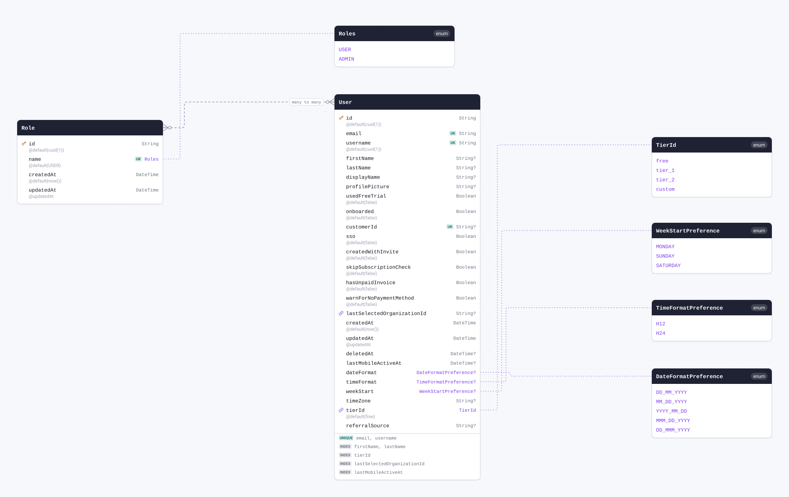

| Field       | Type                   | Constraints     | Default      | Description |
| ----------- | ---------------------- | --------------- | ------------ | ----------- |
| `id`        | `String`               | PK NOT NULL     | `cuid(1)`    |             |
| `name`      | [`Roles`](#enum-Roles) | UNIQUE NOT NULL | `USER`       |             |
| `createdAt` | `DateTime`             | NOT NULL        | `now()`      |             |
| `updatedAt` | `DateTime`             | NOT NULL        | `@updatedAt` |             |

#### Many to many

- `users` ↔ [User.roles](#model-User) through `_RoleToUser`

#### Definition

```sql
CREATE TABLE "Role" (
    "id" TEXT NOT NULL,
    "name" "Roles" NOT NULL DEFAULT 'USER',
    "createdAt" TIMESTAMP(3) NOT NULL DEFAULT CURRENT_TIMESTAMP,
    "updatedAt" TIMESTAMP(3) NOT NULL,

    CONSTRAINT "Role_pkey" PRIMARY KEY ("id")
);

CREATE UNIQUE INDEX "Role_name_key" ON "Role"("name");
```

<details>
<summary>Queries and their SQL</summary>

**findMany**: Every row

```ts
await prisma.role.findMany();
```

```sql
SELECT
  "public"."Role"."id",
  "public"."Role"."name"::text,
  "public"."Role"."createdAt",
  "public"."Role"."updatedAt"
FROM
  "public"."Role"
WHERE
  1 = 1
OFFSET
  $1
-- params: ["0"]
```

**count**: How many rows there are

```ts
await prisma.role.count();
```

```sql
SELECT
  COUNT(*) AS "_count$_all"
FROM
  (
    SELECT
      "public"."Role"."id"
    FROM
      "public"."Role"
    WHERE
      1 = 1
    OFFSET
      $1
  ) AS "sub"
-- params: ["0"]
```

**findMany**: Every row with its relations

```ts
await prisma.role.findMany({ include: { users: true } });
```

```sql
SELECT
  "public"."Role"."id",
  "public"."Role"."name"::text,
  "public"."Role"."createdAt",
  "public"."Role"."updatedAt"
FROM
  "public"."Role"
WHERE
  1 = 1
OFFSET
  $1
-- params: ["0"]

SELECT
  "public"."User"."id",
  "public"."User"."email",
  "public"."User"."username",
  "public"."User"."firstName",
  "public"."User"."lastName",
  "public"."User"."displayName",
  "public"."User"."profilePicture",
  "public"."User"."usedFreeTrial",
  "public"."User"."onboarded",
  "public"."User"."customerId",
  "public"."User"."sso",
  "public"."User"."createdWithInvite",
  "public"."User"."skipSubscriptionCheck",
  "public"."User"."hasUnpaidInvoice",
  "public"."User"."warnForNoPaymentMethod",
  "public"."User"."lastSelectedOrganizationId",
  "public"."User"."createdAt",
  "public"."User"."updatedAt",
  "public"."User"."deletedAt",
  "public"."User"."lastMobileActiveAt",
  "public"."User"."dateFormat"::text,
  "public"."User"."timeFormat"::text,
  "public"."User"."weekStart"::text,
  "public"."User"."timeZone",
  "public"."User"."tierId"::text,
  "public"."User"."referralSource",
  "t0"."A" AS "RoleToUser@Role"
FROM
  "public"."User"
  INNER JOIN "public"."_RoleToUser" AS "t0" ON "t0"."B" = "public"."User"."id"
WHERE
  (
    1 = 1
    AND "t0"."A" IN ($1)
  )
OFFSET
  $2
-- params: ["<id of the rows above>","0"]
```

**findUnique**: One row by what is unique to it

```ts
await prisma.role.findUnique({ where: { id: "example" } });
```

```sql
SELECT
  "public"."Role"."id",
  "public"."Role"."name"::text,
  "public"."Role"."createdAt",
  "public"."Role"."updatedAt"
FROM
  "public"."Role"
WHERE
  (
    "public"."Role"."id" = $1
    AND 1 = 1
  )
LIMIT
  $2
OFFSET
  $3
-- params: ["example","1","0"]
```

**create**: Create a row

```ts
await prisma.role.create({ data: {} });
```

```sql
INSERT INTO
  "public"."Role" ("id", "name", "createdAt", "updatedAt")
VALUES
  ($1, CAST($2::text AS "public"."Roles"), $3, $4)
RETURNING
  "public"."Role"."id",
  "public"."Role"."name"::text,
  "public"."Role"."createdAt",
  "public"."Role"."updatedAt"
-- params: ["<cuid(1)>","USER","<now()>","<now()>"]
```

**update**: Update a row

```ts
await prisma.role.update({ where: { id: "example" }, data: { name: "USER" } });
```

```sql
UPDATE "public"."Role"
SET
  "name" = CAST($1::text AS "public"."Roles"),
  "updatedAt" = $2
WHERE
  (
    "public"."Role"."id" = $3
    AND 1 = 1
  )
RETURNING
  "public"."Role"."id",
  "public"."Role"."name"::text,
  "public"."Role"."createdAt",
  "public"."Role"."updatedAt"
-- params: ["USER",{"prisma__type":"generatorCall","prisma__value":{"name":"now","args":[],"returnType":{"type":"DateTime"}}},"example"]
```

**delete**: Delete a row

```ts
await prisma.role.delete({ where: { id: "example" } });
```

```sql
DELETE FROM "public"."Role"
WHERE
  (
    "public"."Role"."id" = $1
    AND 1 = 1
  )
RETURNING
  "public"."Role"."id",
  "public"."Role"."name"::text,
  "public"."Role"."createdAt",
  "public"."Role"."updatedAt"
-- params: ["example"]
```

</details>

<a id="model-TeamMember"></a>

### TeamMember

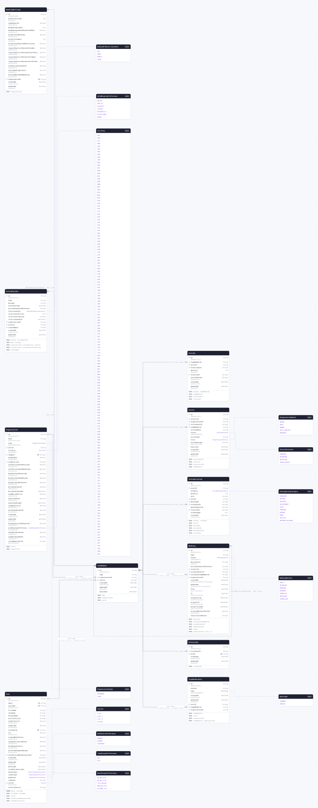

| Field            | Type       | Constraints                                       | Default      | Description |
| ---------------- | ---------- | ------------------------------------------------- | ------------ | ----------- |
| `id`             | `String`   | PK NOT NULL                                       | `cuid(1)`    |             |
| `name`           | `String`   | NOT NULL                                          |              |             |
| `organizationId` | `String`   | NOT NULL → [Organization.id](#model-Organization) |              |             |
| `userId`         | `String`   | NULL → [User.id](#model-User)                     |              |             |
| `createdAt`      | `DateTime` | NOT NULL                                          | `now()`      |             |
| `updatedAt`      | `DateTime` | NOT NULL                                          | `@updatedAt` |             |
| `deletedAt`      | `DateTime` | NULL                                              |              |             |

#### Indexes

- `@@index([name])`
- `@@index([organizationId])`
- `@@index([userId])`

#### References

- `organizationId` → [Organization.id](#model-Organization) (many-to-one, on delete Cascade, on update Cascade)
- `userId` → [User.id](#model-User) (many-to-one, on delete SetNull, on update Cascade)

#### Referenced by

- `id` ← [Custody.teamMemberId](#model-Custody) (one-to-many)
- `id` ← [Invite.teamMemberId](#model-Invite) (one-to-many)
- `id` ← [ConsumptionLog.custodianId](#model-ConsumptionLog) (one-to-many)
- `id` ← [Booking.custodianTeamMemberId](#model-Booking) (one-to-many, on delete Cascade, on update Cascade)
- `id` ← [KitCustody.custodianId](#model-KitCustody) (one-to-many)
- `id` ← [TeamMemberNote.teamMemberId](#model-TeamMemberNote) (one-to-many, on delete Cascade, on update Cascade)

#### Many to many

- `bookingNotifications` ↔ [Booking.notificationRecipients](#model-Booking) through `_BookingNotificationRecipients`
- `alwaysNotifyBookingSettings` ↔ [BookingSettings.alwaysNotifyTeamMembers](#model-BookingSettings) through `_BookingSettingsAlwaysNotify`
- `assetReminders` ↔ [AssetReminder.teamMembers](#model-AssetReminder) through `_AssetReminderToTeamMember`

#### Definition

```sql
CREATE TABLE "TeamMember" (
    "id" TEXT NOT NULL,
    "name" TEXT NOT NULL,
    "organizationId" TEXT NOT NULL,
    "userId" TEXT,
    "createdAt" TIMESTAMP(3) NOT NULL DEFAULT CURRENT_TIMESTAMP,
    "updatedAt" TIMESTAMP(3) NOT NULL,
    "deletedAt" TIMESTAMP(3),

    CONSTRAINT "TeamMember_pkey" PRIMARY KEY ("id")
);

CREATE INDEX "TeamMember_name_idx" ON "TeamMember" USING GIN ("name" gin_trgm_ops);

CREATE INDEX "TeamMember_organizationId_idx" ON "TeamMember"("organizationId");

CREATE INDEX "TeamMember_userId_idx" ON "TeamMember"("userId");

ALTER TABLE "TeamMember" ADD CONSTRAINT "TeamMember_organizationId_fkey" FOREIGN KEY ("organizationId") REFERENCES "Organization"("id") ON DELETE CASCADE ON UPDATE CASCADE;

ALTER TABLE "TeamMember" ADD CONSTRAINT "TeamMember_userId_fkey" FOREIGN KEY ("userId") REFERENCES "User"("id") ON DELETE SET NULL ON UPDATE CASCADE;
```

<details>
<summary>Queries and their SQL</summary>

**findMany**: Every row

```ts
await prisma.teamMember.findMany();
```

```sql
SELECT
  "public"."TeamMember"."id",
  "public"."TeamMember"."name",
  "public"."TeamMember"."organizationId",
  "public"."TeamMember"."userId",
  "public"."TeamMember"."createdAt",
  "public"."TeamMember"."updatedAt",
  "public"."TeamMember"."deletedAt"
FROM
  "public"."TeamMember"
WHERE
  1 = 1
OFFSET
  $1
-- params: ["0"]
```

**count**: How many rows there are

```ts
await prisma.teamMember.count();
```

```sql
SELECT
  COUNT(*) AS "_count$_all"
FROM
  (
    SELECT
      "public"."TeamMember"."id"
    FROM
      "public"."TeamMember"
    WHERE
      1 = 1
    OFFSET
      $1
  ) AS "sub"
-- params: ["0"]
```

**findMany**: Every row with its relations

```ts
await prisma.teamMember.findMany({
  include: {
    organization: true,
    custodies: true,
    receivedInvites: true,
    user: true,
    kitCustodies: true,
    bookings: true,
    assetReminders: true,
    consumptionLogs: true,
    teamMemberNotes: true,
    alwaysNotifyBookingSettings: true,
    bookingNotifications: true,
  },
});
```

```sql
SELECT
  "public"."TeamMember"."id",
  "public"."TeamMember"."name",
  "public"."TeamMember"."organizationId",
  "public"."TeamMember"."userId",
  "public"."TeamMember"."createdAt",
  "public"."TeamMember"."updatedAt",
  "public"."TeamMember"."deletedAt"
FROM
  "public"."TeamMember"
WHERE
  1 = 1
OFFSET
  $1
-- params: ["0"]

SELECT
  "public"."Organization"."id",
  "public"."Organization"."name",
  "public"."Organization"."type"::text,
  "public"."Organization"."userId",
  "public"."Organization"."currency"::text,
  "public"."Organization"."imageId",
  "public"."Organization"."enabledSso",
  "public"."Organization"."ssoDetailsId",
  "public"."Organization"."selfServiceCanSeeCustody",
  "public"."Organization"."selfServiceCanSeeBookings",
  "public"."Organization"."baseUserCanSeeCustody",
  "public"."Organization"."baseUserCanSeeBookings",
  "public"."Organization"."managersCanEditAssets",
  "public"."Organization"."barcodesEnabled",
  "public"."Organization"."barcodesEnabledAt",
  "public"."Organization"."usedBarcodeTrial",
  "public"."Organization"."auditsEnabled",
  "public"."Organization"."auditsEnabledAt",
  "public"."Organization"."usedAuditTrial",
  "public"."Organization"."workspaceDisabled",
  "public"."Organization"."createdAt",
  "public"."Organization"."updatedAt",
  "public"."Organization"."hasSequentialIdsMigrated",
  "public"."Organization"."qrIdDisplayPreference"::text,
  "public"."Organization"."showShelfBranding",
  "public"."Organization"."showQrCodesOnPdfs",
  "public"."Organization"."customEmailFooter"
FROM
  "public"."Organization"
WHERE
  "public"."Organization"."id" IN ($1)
OFFSET
  $2
-- params: ["<organizationId of the rows above>","0"]

SELECT
  "public"."Custody"."id",
  "public"."Custody"."teamMemberId",
  "public"."Custody"."assetId",
  "public"."Custody"."kitCustodyId",
  "public"."Custody"."quantity",
  "public"."Custody"."locationId",
  "public"."Custody"."sourceUnknown",
  "public"."Custody"."createdAt",
  "public"."Custody"."updatedAt"
FROM
  "public"."Custody"
WHERE
  "public"."Custody"."teamMemberId" IN ($1)
OFFSET
  $2
-- params: ["<id of the rows above>","0"]

SELECT
  "public"."Invite"."id",
  "public"."Invite"."inviterId",
  "public"."Invite"."organizationId",
  "public"."Invite"."inviteeUserId",
  "public"."Invite"."teamMemberId",
  "public"."Invite"."inviteeEmail",
  "public"."Invite"."status"::text,
  "public"."Invite"."inviteCode",
  "public"."Invite"."roles"::text[],
  "public"."Invite"."inviteMessage",
  "public"."Invite"."expiresAt",
  "public"."Invite"."createdAt",
  "public"."Invite"."updatedAt"
FROM
  "public"."Invite"
WHERE
  "public"."Invite"."teamMemberId" IN ($1)
OFFSET
  $2
-- params: ["<id of the rows above>","0"]

SELECT
  "public"."User"."id",
  "public"."User"."email",
  "public"."User"."username",
  "public"."User"."firstName",
  "public"."User"."lastName",
  "public"."User"."displayName",
  "public"."User"."profilePicture",
  "public"."User"."usedFreeTrial",
  "public"."User"."onboarded",
  "public"."User"."customerId",
  "public"."User"."sso",
  "public"."User"."createdWithInvite",
  "public"."User"."skipSubscriptionCheck",
  "public"."User"."hasUnpaidInvoice",
  "public"."User"."warnForNoPaymentMethod",
  "public"."User"."lastSelectedOrganizationId",
  "public"."User"."createdAt",
  "public"."User"."updatedAt",
  "public"."User"."deletedAt",
  "public"."User"."lastMobileActiveAt",
  "public"."User"."dateFormat"::text,
  "public"."User"."timeFormat"::text,
  "public"."User"."weekStart"::text,
  "public"."User"."timeZone",
  "public"."User"."tierId"::text,
  "public"."User"."referralSource"
FROM
  "public"."User"
WHERE
  "public"."User"."id" IN ($1)
OFFSET
  $2
-- params: ["<userId of the rows above>","0"]

SELECT
  "public"."KitCustody"."id",
  "public"."KitCustody"."custodianId",
  "public"."KitCustody"."kitId",
  "public"."KitCustody"."createdAt",
  "public"."KitCustody"."updatedAt"
FROM
  "public"."KitCustody"
WHERE
  "public"."KitCustody"."custodianId" IN ($1)
OFFSET
  $2
-- params: ["<id of the rows above>","0"]

SELECT
  "public"."Booking"."id",
  "public"."Booking"."name",
  "public"."Booking"."status"::text,
  "public"."Booking"."description",
  "public"."Booking"."activeSchedulerReference",
  "public"."Booking"."creatorId",
  "public"."Booking"."custodianUserId",
  "public"."Booking"."custodianTeamMemberId",
  "public"."Booking"."organizationId",
  "public"."Booking"."createdAt",
  "public"."Booking"."updatedAt",
  "public"."Booking"."from",
  "public"."Booking"."to",
  "public"."Booking"."originalFrom",
  "public"."Booking"."originalTo",
  "public"."Booking"."autoArchivedAt",
  "public"."Booking"."archivedWithoutCheckin",
  "public"."Booking"."cancellationReason",
  "public"."Booking"."approvedAt",
  "public"."Booking"."approvedById"
FROM
  "public"."Booking"
WHERE
  "public"."Booking"."custodianTeamMemberId" IN ($1)
OFFSET
  $2
-- params: ["<id of the rows above>","0"]

SELECT
  "public"."AssetReminder"."id",
  "public"."AssetReminder"."name",
  "public"."AssetReminder"."message",
  "public"."AssetReminder"."alertDateTime",
  "public"."AssetReminder"."activeSchedulerReference",
  "public"."AssetReminder"."recurrenceUnit"::text,
  "public"."AssetReminder"."recurrenceInterval",
  "public"."AssetReminder"."recurrenceTimezone",
  "public"."AssetReminder"."recurrenceEndsAt",
  "public"."AssetReminder"."organizationId",
  "public"."AssetReminder"."assetId",
  "public"."AssetReminder"."createdById",
  "public"."AssetReminder"."createdAt",
  "public"."AssetReminder"."updatedAt",
  "t0"."B" AS "AssetReminderToTeamMember@TeamMember"
FROM
  "public"."AssetReminder"
  INNER JOIN "public"."_AssetReminderToTeamMember" AS "t0" ON "t0"."A" = "public"."AssetReminder"."id"
WHERE
  (
    1 = 1
    AND "t0"."B" IN ($1)
  )
OFFSET
  $2
-- params: ["<id of the rows above>","0"]

SELECT
  "public"."ConsumptionLog"."id",
  "public"."ConsumptionLog"."assetId",
  "public"."ConsumptionLog"."category"::text,
  "public"."ConsumptionLog"."quantity",
  "public"."ConsumptionLog"."note",
  "public"."ConsumptionLog"."userId",
  "public"."ConsumptionLog"."bookingId",
  "public"."ConsumptionLog"."custodianId",
  "public"."ConsumptionLog"."bookingAssetId",
  "public"."ConsumptionLog"."locationId",
  "public"."ConsumptionLog"."stockChange",
  "public"."ConsumptionLog"."createdAt"
FROM
  "public"."ConsumptionLog"
WHERE
  "public"."ConsumptionLog"."custodianId" IN ($1)
OFFSET
  $2
-- params: ["<id of the rows above>","0"]

SELECT
  "public"."TeamMemberNote"."id",
  "public"."TeamMemberNote"."content",
  "public"."TeamMemberNote"."type"::text,
  "public"."TeamMemberNote"."createdAt",
  "public"."TeamMemberNote"."updatedAt",
  "public"."TeamMemberNote"."userId",
  "public"."TeamMemberNote"."teamMemberId",
  "public"."TeamMemberNote"."organizationId"
FROM
  "public"."TeamMemberNote"
WHERE
  "public"."TeamMemberNote"."teamMemberId" IN ($1)
OFFSET
  $2
-- params: ["<id of the rows above>","0"]

SELECT
  "public"."BookingSettings"."id",
  "public"."BookingSettings"."bufferStartTime",
  "public"."BookingSettings"."tagsRequired",
  "public"."BookingSettings"."maxBookingLength",
  "public"."BookingSettings"."maxBookingLengthSkipClosedDays",
  "public"."BookingSettings"."autoArchiveBookings",
  "public"."BookingSettings"."autoArchiveDays",
  "public"."BookingSettings"."autoArchiveExpiredReservations",
  "public"."BookingSettings"."requireApprovalForBase",
  "public"."BookingSettings"."requireApprovalForSelfService",
  "public"."BookingSettings"."requireExplicitCheckinForAdmin",
  "public"."BookingSettings"."requireExplicitCheckinForSelfService",
  "public"."BookingSettings"."requireExplicitCheckoutForAdmin",
  "public"."BookingSettings"."requireExplicitCheckoutForSelfService",
  "public"."BookingSettings"."countKitsAsSingleUnit",
  "public"."BookingSettings"."notifyBookingCreator",
  "public"."BookingSettings"."notifyAdminsOnNewBooking",
  "public"."BookingSettings"."organizationId",
  "public"."BookingSettings"."createdAt",
  "public"."BookingSettings"."updatedAt",
  "t1"."B" AS "BookingSettingsAlwaysNotify@TeamMember"
FROM
  "public"."BookingSettings"
  INNER JOIN "public"."_BookingSettingsAlwaysNotify" AS "t1" ON "t1"."A" = "public"."BookingSettings"."id"
WHERE
  (
    1 = 1
    AND "t1"."B" IN ($1)
  )
OFFSET
  $2
-- params: ["<id of the rows above>","0"]

SELECT
  "public"."Booking"."id",
  "public"."Booking"."name",
  "public"."Booking"."status"::text,
  "public"."Booking"."description",
  "public"."Booking"."activeSchedulerReference",
  "public"."Booking"."creatorId",
  "public"."Booking"."custodianUserId",
  "public"."Booking"."custodianTeamMemberId",
  "public"."Booking"."organizationId",
  "public"."Booking"."createdAt",
  "public"."Booking"."updatedAt",
  "public"."Booking"."from",
  "public"."Booking"."to",
  "public"."Booking"."originalFrom",
  "public"."Booking"."originalTo",
  "public"."Booking"."autoArchivedAt",
  "public"."Booking"."archivedWithoutCheckin",
  "public"."Booking"."cancellationReason",
  "public"."Booking"."approvedAt",
  "public"."Booking"."approvedById",
  "t2"."B" AS "BookingNotificationRecipients@TeamMember"
FROM
  "public"."Booking"
  INNER JOIN "public"."_BookingNotificationRecipients" AS "t2" ON "t2"."A" = "public"."Booking"."id"
WHERE
  (
    1 = 1
    AND "t2"."B" IN ($1)
  )
OFFSET
  $2
-- params: ["<id of the rows above>","0"]
```

**findUnique**: One row by what is unique to it

```ts
await prisma.teamMember.findUnique({ where: { id: "example" } });
```

```sql
SELECT
  "public"."TeamMember"."id",
  "public"."TeamMember"."name",
  "public"."TeamMember"."organizationId",
  "public"."TeamMember"."userId",
  "public"."TeamMember"."createdAt",
  "public"."TeamMember"."updatedAt",
  "public"."TeamMember"."deletedAt"
FROM
  "public"."TeamMember"
WHERE
  (
    "public"."TeamMember"."id" = $1
    AND 1 = 1
  )
LIMIT
  $2
OFFSET
  $3
-- params: ["example","1","0"]
```

**create**: Create a row

```ts
await prisma.teamMember.create({ data: { name: "example", organizationId: "example" } });
```

```sql
INSERT INTO
  "public"."TeamMember" (
    "id",
    "name",
    "organizationId",
    "createdAt",
    "updatedAt"
  )
VALUES
  ($1, $2, $3, $4, $5)
RETURNING
  "public"."TeamMember"."id",
  "public"."TeamMember"."name",
  "public"."TeamMember"."organizationId",
  "public"."TeamMember"."userId",
  "public"."TeamMember"."createdAt",
  "public"."TeamMember"."updatedAt",
  "public"."TeamMember"."deletedAt"
-- params: ["<cuid(1)>","example","example","<now()>","<now()>"]
```

**update**: Update a row

```ts
await prisma.teamMember.update({ where: { id: "example" }, data: { name: "example" } });
```

```sql
UPDATE "public"."TeamMember"
SET
  "name" = $1,
  "updatedAt" = $2
WHERE
  (
    "public"."TeamMember"."id" = $3
    AND 1 = 1
  )
RETURNING
  "public"."TeamMember"."id",
  "public"."TeamMember"."name",
  "public"."TeamMember"."organizationId",
  "public"."TeamMember"."userId",
  "public"."TeamMember"."createdAt",
  "public"."TeamMember"."updatedAt",
  "public"."TeamMember"."deletedAt"
-- params: ["example",{"prisma__type":"generatorCall","prisma__value":{"name":"now","args":[],"returnType":{"type":"DateTime"}}},"example"]
```

**delete**: Delete a row

```ts
await prisma.teamMember.delete({ where: { id: "example" } });
```

```sql
DELETE FROM "public"."TeamMember"
WHERE
  (
    "public"."TeamMember"."id" = $1
    AND 1 = 1
  )
RETURNING
  "public"."TeamMember"."id",
  "public"."TeamMember"."name",
  "public"."TeamMember"."organizationId",
  "public"."TeamMember"."userId",
  "public"."TeamMember"."createdAt",
  "public"."TeamMember"."updatedAt",
  "public"."TeamMember"."deletedAt"
-- params: ["example"]
```

</details>

<a id="model-Custody"></a>

### Custody

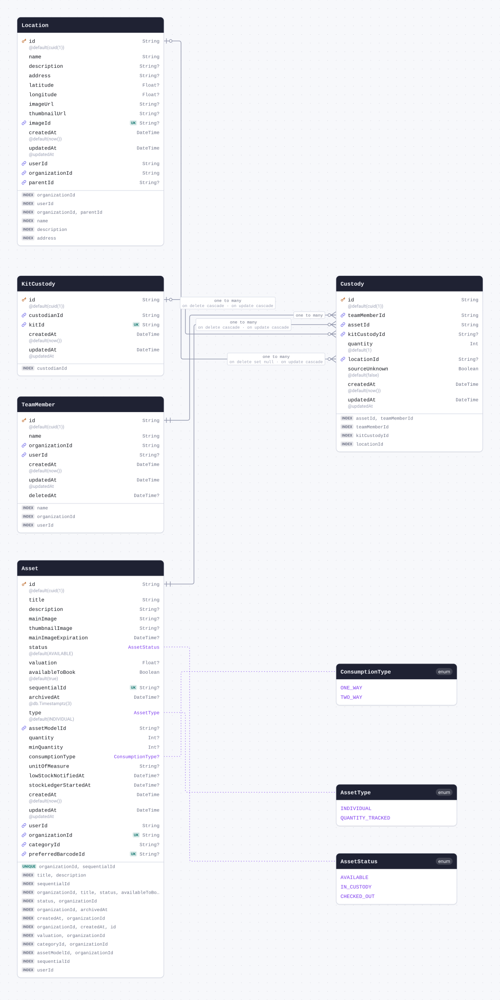

| Field           | Type       | Constraints                                   | Default      | Description |
| --------------- | ---------- | --------------------------------------------- | ------------ | ----------- |
| `id`            | `String`   | PK NOT NULL                                   | `cuid(1)`    |             |
| `teamMemberId`  | `String`   | NOT NULL → [TeamMember.id](#model-TeamMember) |              |             |
| `assetId`       | `String`   | NOT NULL → [Asset.id](#model-Asset)           |              |             |
| `kitCustodyId`  | `String`   | NULL → [KitCustody.id](#model-KitCustody)     |              |             |
| `quantity`      | `Int`      | NOT NULL                                      | `1`          |             |
| `locationId`    | `String`   | NULL → [Location.id](#model-Location)         |              |             |
| `sourceUnknown` | `Boolean`  | NOT NULL                                      | `false`      |             |
| `createdAt`     | `DateTime` | NOT NULL                                      | `now()`      |             |
| `updatedAt`     | `DateTime` | NOT NULL                                      | `@updatedAt` |             |

#### Indexes

- `@@index([assetId, teamMemberId], map: "Custody_assetId_teamMemberId_idx")`
- `@@index([teamMemberId])`
- `@@index([kitCustodyId])`
- `@@index([locationId])`

#### References

- `teamMemberId` → [TeamMember.id](#model-TeamMember) (many-to-one)
- `assetId` → [Asset.id](#model-Asset) (many-to-one, on delete Cascade, on update Cascade)
- `kitCustodyId` → [KitCustody.id](#model-KitCustody) (many-to-one, on delete Cascade, on update Cascade)
- `locationId` → [Location.id](#model-Location) (many-to-one, on delete SetNull, on update Cascade)

#### Definition

```sql
CREATE TABLE "Custody" (
    "id" TEXT NOT NULL,
    "teamMemberId" TEXT NOT NULL,
    "assetId" TEXT NOT NULL,
    "kitCustodyId" TEXT,
    "quantity" INTEGER NOT NULL DEFAULT 1,
    "locationId" TEXT,
    "sourceUnknown" BOOLEAN NOT NULL DEFAULT false,
    "createdAt" TIMESTAMP(3) NOT NULL DEFAULT CURRENT_TIMESTAMP,
    "updatedAt" TIMESTAMP(3) NOT NULL,

    CONSTRAINT "Custody_pkey" PRIMARY KEY ("id")
);

CREATE INDEX "Custody_assetId_teamMemberId_idx" ON "Custody"("assetId", "teamMemberId");

CREATE INDEX "Custody_teamMemberId_idx" ON "Custody"("teamMemberId");

CREATE INDEX "Custody_kitCustodyId_idx" ON "Custody"("kitCustodyId");

CREATE INDEX "Custody_locationId_idx" ON "Custody"("locationId");

ALTER TABLE "Custody" ADD CONSTRAINT "Custody_teamMemberId_fkey" FOREIGN KEY ("teamMemberId") REFERENCES "TeamMember"("id") ON DELETE RESTRICT ON UPDATE CASCADE;

ALTER TABLE "Custody" ADD CONSTRAINT "Custody_assetId_fkey" FOREIGN KEY ("assetId") REFERENCES "Asset"("id") ON DELETE CASCADE ON UPDATE CASCADE;

ALTER TABLE "Custody" ADD CONSTRAINT "Custody_kitCustodyId_fkey" FOREIGN KEY ("kitCustodyId") REFERENCES "KitCustody"("id") ON DELETE CASCADE ON UPDATE CASCADE;

ALTER TABLE "Custody" ADD CONSTRAINT "Custody_locationId_fkey" FOREIGN KEY ("locationId") REFERENCES "Location"("id") ON DELETE SET NULL ON UPDATE CASCADE;
```

<details>
<summary>Queries and their SQL</summary>

**findMany**: Every row

```ts
await prisma.custody.findMany();
```

```sql
SELECT
  "public"."Custody"."id",
  "public"."Custody"."teamMemberId",
  "public"."Custody"."assetId",
  "public"."Custody"."kitCustodyId",
  "public"."Custody"."quantity",
  "public"."Custody"."locationId",
  "public"."Custody"."sourceUnknown",
  "public"."Custody"."createdAt",
  "public"."Custody"."updatedAt"
FROM
  "public"."Custody"
WHERE
  1 = 1
OFFSET
  $1
-- params: ["0"]
```

**count**: How many rows there are

```ts
await prisma.custody.count();
```

```sql
SELECT
  COUNT(*) AS "_count$_all"
FROM
  (
    SELECT
      "public"."Custody"."id"
    FROM
      "public"."Custody"
    WHERE
      1 = 1
    OFFSET
      $1
  ) AS "sub"
-- params: ["0"]
```

**findMany**: Every row with its relations

```ts
await prisma.custody.findMany({
  include: { custodian: true, asset: true, kitCustody: true, location: true },
});
```

```sql
SELECT
  "public"."Custody"."id",
  "public"."Custody"."teamMemberId",
  "public"."Custody"."assetId",
  "public"."Custody"."kitCustodyId",
  "public"."Custody"."quantity",
  "public"."Custody"."locationId",
  "public"."Custody"."sourceUnknown",
  "public"."Custody"."createdAt",
  "public"."Custody"."updatedAt"
FROM
  "public"."Custody"
WHERE
  1 = 1
OFFSET
  $1
-- params: ["0"]

SELECT
  "public"."TeamMember"."id",
  "public"."TeamMember"."name",
  "public"."TeamMember"."organizationId",
  "public"."TeamMember"."userId",
  "public"."TeamMember"."createdAt",
  "public"."TeamMember"."updatedAt",
  "public"."TeamMember"."deletedAt"
FROM
  "public"."TeamMember"
WHERE
  "public"."TeamMember"."id" IN ($1)
OFFSET
  $2
-- params: ["<teamMemberId of the rows above>","0"]

SELECT
  "public"."Asset"."id",
  "public"."Asset"."title",
  "public"."Asset"."description",
  "public"."Asset"."mainImage",
  "public"."Asset"."thumbnailImage",
  "public"."Asset"."mainImageExpiration",
  "public"."Asset"."status"::text,
  "public"."Asset"."value",
  "public"."Asset"."availableToBook",
  "public"."Asset"."sequentialId",
  "public"."Asset"."archivedAt",
  "public"."Asset"."type"::text,
  "public"."Asset"."assetModelId",
  "public"."Asset"."quantity",
  "public"."Asset"."minQuantity",
  "public"."Asset"."consumptionType"::text,
  "public"."Asset"."unitOfMeasure",
  "public"."Asset"."lowStockNotifiedAt",
  "public"."Asset"."stockLedgerStartedAt",
  "public"."Asset"."createdAt",
  "public"."Asset"."updatedAt",
  "public"."Asset"."userId",
  "public"."Asset"."organizationId",
  "public"."Asset"."categoryId",
  "public"."Asset"."preferredBarcodeId"
FROM
  "public"."Asset"
WHERE
  "public"."Asset"."id" IN ($1)
OFFSET
  $2
-- params: ["<assetId of the rows above>","0"]

SELECT
  "public"."KitCustody"."id",
  "public"."KitCustody"."custodianId",
  "public"."KitCustody"."kitId",
  "public"."KitCustody"."createdAt",
  "public"."KitCustody"."updatedAt"
FROM
  "public"."KitCustody"
WHERE
  "public"."KitCustody"."id" IN ($1)
OFFSET
  $2
-- params: ["<kitCustodyId of the rows above>","0"]

SELECT
  "public"."Location"."id",
  "public"."Location"."name",
  "public"."Location"."description",
  "public"."Location"."address",
  "public"."Location"."latitude",
  "public"."Location"."longitude",
  "public"."Location"."imageUrl",
  "public"."Location"."thumbnailUrl",
  "public"."Location"."imageId",
  "public"."Location"."createdAt",
  "public"."Location"."updatedAt",
  "public"."Location"."userId",
  "public"."Location"."organizationId",
  "public"."Location"."parentId"
FROM
  "public"."Location"
WHERE
  "public"."Location"."id" IN ($1)
OFFSET
  $2
-- params: ["<locationId of the rows above>","0"]
```

**findUnique**: One row by what is unique to it

```ts
await prisma.custody.findUnique({ where: { id: "example" } });
```

```sql
SELECT
  "public"."Custody"."id",
  "public"."Custody"."teamMemberId",
  "public"."Custody"."assetId",
  "public"."Custody"."kitCustodyId",
  "public"."Custody"."quantity",
  "public"."Custody"."locationId",
  "public"."Custody"."sourceUnknown",
  "public"."Custody"."createdAt",
  "public"."Custody"."updatedAt"
FROM
  "public"."Custody"
WHERE
  (
    "public"."Custody"."id" = $1
    AND 1 = 1
  )
LIMIT
  $2
OFFSET
  $3
-- params: ["example","1","0"]
```

**create**: Create a row

```ts
await prisma.custody.create({ data: { teamMemberId: "example", assetId: "example" } });
```

```sql
INSERT INTO
  "public"."Custody" (
    "id",
    "teamMemberId",
    "assetId",
    "quantity",
    "sourceUnknown",
    "createdAt",
    "updatedAt"
  )
VALUES
  ($1, $2, $3, $4, $5, $6, $7)
RETURNING
  "public"."Custody"."id",
  "public"."Custody"."teamMemberId",
  "public"."Custody"."assetId",
  "public"."Custody"."kitCustodyId",
  "public"."Custody"."quantity",
  "public"."Custody"."locationId",
  "public"."Custody"."sourceUnknown",
  "public"."Custody"."createdAt",
  "public"."Custody"."updatedAt"
-- params: ["<cuid(1)>","example","example","1",false,"<now()>","<now()>"]
```

**update**: Update a row

```ts
await prisma.custody.update({ where: { id: "example" }, data: { quantity: 1 } });
```

```sql
UPDATE "public"."Custody"
SET
  "quantity" = $1,
  "updatedAt" = $2
WHERE
  (
    "public"."Custody"."id" = $3
    AND 1 = 1
  )
RETURNING
  "public"."Custody"."id",
  "public"."Custody"."teamMemberId",
  "public"."Custody"."assetId",
  "public"."Custody"."kitCustodyId",
  "public"."Custody"."quantity",
  "public"."Custody"."locationId",
  "public"."Custody"."sourceUnknown",
  "public"."Custody"."createdAt",
  "public"."Custody"."updatedAt"
-- params: ["1",{"prisma__type":"generatorCall","prisma__value":{"name":"now","args":[],"returnType":{"type":"DateTime"}}},"example"]
```

**delete**: Delete a row

```ts
await prisma.custody.delete({ where: { id: "example" } });
```

```sql
DELETE FROM "public"."Custody"
WHERE
  (
    "public"."Custody"."id" = $1
    AND 1 = 1
  )
RETURNING
  "public"."Custody"."id",
  "public"."Custody"."teamMemberId",
  "public"."Custody"."assetId",
  "public"."Custody"."kitCustodyId",
  "public"."Custody"."quantity",
  "public"."Custody"."locationId",
  "public"."Custody"."sourceUnknown",
  "public"."Custody"."createdAt",
  "public"."Custody"."updatedAt"
-- params: ["example"]
```

</details>

<a id="model-Organization"></a>

### Organization

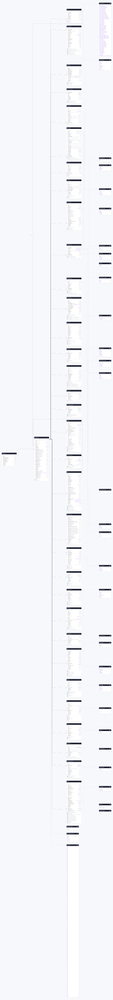

| Field                       | Type                                                   | Constraints                               | Default      | Description |
| --------------------------- | ------------------------------------------------------ | ----------------------------------------- | ------------ | ----------- |
| `id`                        | `String`                                               | PK NOT NULL                               | `cuid(1)`    |             |
| `name`                      | `String`                                               | NOT NULL                                  | `"Personal"` |             |
| `type`                      | [`OrganizationType`](#enum-OrganizationType)           | NOT NULL                                  | `PERSONAL`   |             |
| `userId`                    | `String`                                               | NOT NULL → [User.id](#model-User)         |              |             |
| `currency`                  | [`Currency`](#enum-Currency)                           | NOT NULL                                  | `USD`        |             |
| `imageId`                   | `String`                                               | UNIQUE NULL → [Image.id](#model-Image)    |              |             |
| `enabledSso`                | `Boolean`                                              | NOT NULL                                  | `false`      |             |
| `ssoDetailsId`              | `String`                                               | NULL → [SsoDetails.id](#model-SsoDetails) |              |             |
| `selfServiceCanSeeCustody`  | `Boolean`                                              | NOT NULL                                  | `false`      |             |
| `selfServiceCanSeeBookings` | `Boolean`                                              | NOT NULL                                  | `false`      |             |
| `baseUserCanSeeCustody`     | `Boolean`                                              | NOT NULL                                  | `false`      |             |
| `baseUserCanSeeBookings`    | `Boolean`                                              | NOT NULL                                  | `false`      |             |
| `managersCanEditAssets`     | `Boolean`                                              | NOT NULL                                  | `false`      |             |
| `barcodesEnabled`           | `Boolean`                                              | NOT NULL                                  | `false`      |             |
| `barcodesEnabledAt`         | `DateTime`                                             | NULL                                      |              |             |
| `usedBarcodeTrial`          | `Boolean`                                              | NOT NULL                                  | `false`      |             |
| `auditsEnabled`             | `Boolean`                                              | NOT NULL                                  | `false`      |             |
| `auditsEnabledAt`           | `DateTime`                                             | NULL                                      |              |             |
| `usedAuditTrial`            | `Boolean`                                              | NOT NULL                                  | `false`      |             |
| `workspaceDisabled`         | `Boolean`                                              | NOT NULL                                  | `false`      |             |
| `createdAt`                 | `DateTime`                                             | NOT NULL                                  | `now()`      |             |
| `updatedAt`                 | `DateTime`                                             | NOT NULL                                  | `@updatedAt` |             |
| `hasSequentialIdsMigrated`  | `Boolean`                                              | NOT NULL                                  | `false`      |             |
| `qrIdDisplayPreference`     | [`QrIdDisplayPreference`](#enum-QrIdDisplayPreference) | NOT NULL                                  | `QR_ID`      |             |
| `showShelfBranding`         | `Boolean`                                              | NOT NULL                                  | `true`       |             |
| `showQrCodesOnPdfs`         | `Boolean`                                              | NOT NULL                                  | `true`       |             |
| `customEmailFooter`         | `String` `@db.VarChar(500)`                            | NULL                                      |              |             |

#### Indexes

- `@@index([userId])`
- `@@index([ssoDetailsId])`

#### References

- `userId` → [User.id](#model-User) (many-to-one, on delete Cascade, on update Cascade)
- `imageId` → [Image.id](#model-Image) (one-to-one)
- `ssoDetailsId` → [SsoDetails.id](#model-SsoDetails) (many-to-one)

#### Referenced by

- `id` ← [Image.ownerOrgId](#model-Image) (one-to-many, on delete Cascade, on update Cascade)
- `id` ← [User.lastSelectedOrganizationId](#model-User) (one-to-many, on delete SetNull)
- `id` ← [Asset.organizationId](#model-Asset) (one-to-many, on delete Cascade, on update Cascade)
- `id` ← [AssetFilterPreset.organizationId](#model-AssetFilterPreset) (one-to-many, on delete Cascade)
- `id` ← [AssetIndexSettings.organizationId](#model-AssetIndexSettings) (one-to-many, on delete Cascade, on update Cascade)
- `id` ← [PdfTemplate.organizationId](#model-PdfTemplate) (one-to-many, on delete Cascade, on update Cascade)
- `id` ← [Category.organizationId](#model-Category) (one-to-many, on delete Cascade, on update Cascade)
- `id` ← [AssetModel.organizationId](#model-AssetModel) (one-to-many, on delete Cascade, on update Cascade)
- `id` ← [Tag.organizationId](#model-Tag) (one-to-many, on delete Cascade, on update Cascade)
- `id` ← [Qr.organizationId](#model-Qr) (one-to-many, on update Cascade)
- `id` ← [Barcode.organizationId](#model-Barcode) (one-to-many, on delete Cascade, on update Cascade)
- `id` ← [Scan.organizationId](#model-Scan) (one-to-many, on delete Cascade)
- `id` ← [Location.organizationId](#model-Location) (one-to-many, on delete Cascade, on update Cascade)
- `id` ← [TeamMember.organizationId](#model-TeamMember) (one-to-many, on delete Cascade, on update Cascade)
- `id` ← [UserOrganization.organizationId](#model-UserOrganization) (one-to-many, on delete Cascade, on update Cascade)
- `id` ← [ScimToken.organizationId](#model-ScimToken) (one-to-many, on delete Cascade)
- `id` ← [UserScimExternalId.organizationId](#model-UserScimExternalId) (one-to-many, on delete Cascade, on update Cascade)
- `id` ← [CustomField.organizationId](#model-CustomField) (one-to-many, on delete Cascade, on update Cascade)
- `id` ← [Invite.organizationId](#model-Invite) (one-to-many, on delete Cascade, on update Cascade)
- `id` ← [Booking.organizationId](#model-Booking) (one-to-many, on delete Cascade, on update Cascade)
- `id` ← [BookingSettings.organizationId](#model-BookingSettings) (one-to-one, on delete Cascade, on update Cascade)
- `id` ← [Kit.organizationId](#model-Kit) (one-to-many, on delete Cascade, on update Cascade)
- `id` ← [AssetKit.organizationId](#model-AssetKit) (one-to-many, on delete Cascade, on update Cascade)
- `id` ← [AssetLocation.organizationId](#model-AssetLocation) (one-to-many, on delete Cascade, on update Cascade)
- `id` ← [AssetReminder.organizationId](#model-AssetReminder) (one-to-many)
- `id` ← [WorkingHours.organizationId](#model-WorkingHours) (one-to-one, on delete Cascade, on update Cascade)
- `id` ← [TeamMemberNote.organizationId](#model-TeamMemberNote) (one-to-many, on delete Cascade, on update Cascade)
- `id` ← [AuditSession.organizationId](#model-AuditSession) (one-to-many, on delete Cascade, on update Cascade)
- `id` ← [AssetImport.organizationId](#model-AssetImport) (one-to-many, on delete Cascade, on update Cascade)
- `id` ← [LinkPreview.organizationId](#model-LinkPreview) (one-to-many, on delete Cascade, on update Cascade)
- `id` ← [AuditImage.organizationId](#model-AuditImage) (one-to-many, on delete Cascade, on update Cascade)
- `id` ← [RoleChangeLog.organizationId](#model-RoleChangeLog) (one-to-many)
- `id` ← [ActivityEvent.organizationId](#model-ActivityEvent) (one-to-many, on delete Cascade, on update Cascade)

#### Definition

```sql
CREATE TABLE "Organization" (
    "id" TEXT NOT NULL,
    "name" TEXT NOT NULL DEFAULT 'Personal',
    "type" "OrganizationType" NOT NULL DEFAULT 'PERSONAL',
    "userId" TEXT NOT NULL,
    "currency" "Currency" NOT NULL DEFAULT 'USD',
    "imageId" TEXT,
    "enabledSso" BOOLEAN NOT NULL DEFAULT false,
    "ssoDetailsId" TEXT,
    "selfServiceCanSeeCustody" BOOLEAN NOT NULL DEFAULT false,
    "selfServiceCanSeeBookings" BOOLEAN NOT NULL DEFAULT false,
    "baseUserCanSeeCustody" BOOLEAN NOT NULL DEFAULT false,
    "baseUserCanSeeBookings" BOOLEAN NOT NULL DEFAULT false,
    "managersCanEditAssets" BOOLEAN NOT NULL DEFAULT false,
    "barcodesEnabled" BOOLEAN NOT NULL DEFAULT false,
    "barcodesEnabledAt" TIMESTAMP(3),
    "usedBarcodeTrial" BOOLEAN NOT NULL DEFAULT false,
    "auditsEnabled" BOOLEAN NOT NULL DEFAULT false,
    "auditsEnabledAt" TIMESTAMP(3),
    "usedAuditTrial" BOOLEAN NOT NULL DEFAULT false,
    "workspaceDisabled" BOOLEAN NOT NULL DEFAULT false,
    "createdAt" TIMESTAMP(3) NOT NULL DEFAULT CURRENT_TIMESTAMP,
    "updatedAt" TIMESTAMP(3) NOT NULL,
    "hasSequentialIdsMigrated" BOOLEAN NOT NULL DEFAULT false,
    "qrIdDisplayPreference" "QrIdDisplayPreference" NOT NULL DEFAULT 'QR_ID',
    "showShelfBranding" BOOLEAN NOT NULL DEFAULT true,
    "showQrCodesOnPdfs" BOOLEAN NOT NULL DEFAULT true,
    "customEmailFooter" VARCHAR(500),

    CONSTRAINT "Organization_pkey" PRIMARY KEY ("id")
);

CREATE UNIQUE INDEX "Organization_imageId_key" ON "Organization"("imageId");

CREATE INDEX "Organization_userId_idx" ON "Organization"("userId");

CREATE INDEX "Organization_ssoDetailsId_idx" ON "Organization"("ssoDetailsId");

ALTER TABLE "Organization" ADD CONSTRAINT "Organization_userId_fkey" FOREIGN KEY ("userId") REFERENCES "User"("id") ON DELETE CASCADE ON UPDATE CASCADE;

ALTER TABLE "Organization" ADD CONSTRAINT "Organization_imageId_fkey" FOREIGN KEY ("imageId") REFERENCES "Image"("id") ON DELETE SET NULL ON UPDATE CASCADE;

ALTER TABLE "Organization" ADD CONSTRAINT "Organization_ssoDetailsId_fkey" FOREIGN KEY ("ssoDetailsId") REFERENCES "SsoDetails"("id") ON DELETE SET NULL ON UPDATE CASCADE;
```

<details>
<summary>Queries and their SQL</summary>

**findMany**: Every row

```ts
await prisma.organization.findMany();
```

```sql
SELECT
  "public"."Organization"."id",
  "public"."Organization"."name",
  "public"."Organization"."type"::text,
  "public"."Organization"."userId",
  "public"."Organization"."currency"::text,
  "public"."Organization"."imageId",
  "public"."Organization"."enabledSso",
  "public"."Organization"."ssoDetailsId",
  "public"."Organization"."selfServiceCanSeeCustody",
  "public"."Organization"."selfServiceCanSeeBookings",
  "public"."Organization"."baseUserCanSeeCustody",
  "public"."Organization"."baseUserCanSeeBookings",
  "public"."Organization"."managersCanEditAssets",
  "public"."Organization"."barcodesEnabled",
  "public"."Organization"."barcodesEnabledAt",
  "public"."Organization"."usedBarcodeTrial",
  "public"."Organization"."auditsEnabled",
  "public"."Organization"."auditsEnabledAt",
  "public"."Organization"."usedAuditTrial",
  "public"."Organization"."workspaceDisabled",
  "public"."Organization"."createdAt",
  "public"."Organization"."updatedAt",
  "public"."Organization"."hasSequentialIdsMigrated",
  "public"."Organization"."qrIdDisplayPreference"::text,
  "public"."Organization"."showShelfBranding",
  "public"."Organization"."showQrCodesOnPdfs",
  "public"."Organization"."customEmailFooter"
FROM
  "public"."Organization"
WHERE
  1 = 1
OFFSET
  $1
-- params: ["0"]
```

**count**: How many rows there are

```ts
await prisma.organization.count();
```

```sql
SELECT
  COUNT(*) AS "_count$_all"
FROM
  (
    SELECT
      "public"."Organization"."id"
    FROM
      "public"."Organization"
    WHERE
      1 = 1
    OFFSET
      $1
  ) AS "sub"
-- params: ["0"]
```

**findMany**: Every row with its relations

```ts
await prisma.organization.findMany({
  include: {
    owner: true,
    members: true,
    assets: true,
    assetKits: true,
    assetLocations: true,
    scans: true,
    image: true,
    ssoDetails: true,
    workingHours: true,
    bookingSettings: true,
    locations: true,
    categories: true,
    tags: true,
    qrCodes: true,
    barcodes: true,
    invites: true,
    userOrganizations: true,
    customFields: true,
    images: true,
    bookings: true,
    kits: true,
    assetModels: true,
    assetIndexSettings: true,
    assetReminders: true,
    assetFilterPresets: true,
    auditSessions: true,
    auditImages: true,
    assetImports: true,
    linkPreviews: true,
    pdfTemplates: true,
    usersWithLastSelected: true,
    scimTokens: true,
    scimExternalIds: true,
    roleChangeLogs: true,
    teamMemberNotes: true,
    activityEvents: true,
  },
});
```

```sql
SELECT
  "public"."Organization"."id",
  "public"."Organization"."name",
  "public"."Organization"."type"::text,
  "public"."Organization"."userId",
  "public"."Organization"."currency"::text,
  "public"."Organization"."imageId",
  "public"."Organization"."enabledSso",
  "public"."Organization"."ssoDetailsId",
  "public"."Organization"."selfServiceCanSeeCustody",
  "public"."Organization"."selfServiceCanSeeBookings",
  "public"."Organization"."baseUserCanSeeCustody",
  "public"."Organization"."baseUserCanSeeBookings",
  "public"."Organization"."managersCanEditAssets",
  "public"."Organization"."barcodesEnabled",
  "public"."Organization"."barcodesEnabledAt",
  "public"."Organization"."usedBarcodeTrial",
  "public"."Organization"."auditsEnabled",
  "public"."Organization"."auditsEnabledAt",
  "public"."Organization"."usedAuditTrial",
  "public"."Organization"."workspaceDisabled",
  "public"."Organization"."createdAt",
  "public"."Organization"."updatedAt",
  "public"."Organization"."hasSequentialIdsMigrated",
  "public"."Organization"."qrIdDisplayPreference"::text,
  "public"."Organization"."showShelfBranding",
  "public"."Organization"."showQrCodesOnPdfs",
  "public"."Organization"."customEmailFooter"
FROM
  "public"."Organization"
WHERE
  1 = 1
OFFSET
  $1
-- params: ["0"]

SELECT
  "public"."User"."id",
  "public"."User"."email",
  "public"."User"."username",
  "public"."User"."firstName",
  "public"."User"."lastName",
  "public"."User"."displayName",
  "public"."User"."profilePicture",
  "public"."User"."usedFreeTrial",
  "public"."User"."onboarded",
  "public"."User"."customerId",
  "public"."User"."sso",
  "public"."User"."createdWithInvite",
  "public"."User"."skipSubscriptionCheck",
  "public"."User"."hasUnpaidInvoice",
  "public"."User"."warnForNoPaymentMethod",
  "public"."User"."lastSelectedOrganizationId",
  "public"."User"."createdAt",
  "public"."User"."updatedAt",
  "public"."User"."deletedAt",
  "public"."User"."lastMobileActiveAt",
  "public"."User"."dateFormat"::text,
  "public"."User"."timeFormat"::text,
  "public"."User"."weekStart"::text,
  "public"."User"."timeZone",
  "public"."User"."tierId"::text,
  "public"."User"."referralSource"
FROM
  "public"."User"
WHERE
  "public"."User"."id" IN ($1)
OFFSET
  $2
-- params: ["<userId of the rows above>","0"]

SELECT
  "public"."TeamMember"."id",
  "public"."TeamMember"."name",
  "public"."TeamMember"."organizationId",
  "public"."TeamMember"."userId",
  "public"."TeamMember"."createdAt",
  "public"."TeamMember"."updatedAt",
  "public"."TeamMember"."deletedAt"
FROM
  "public"."TeamMember"
WHERE
  "public"."TeamMember"."organizationId" IN ($1)
OFFSET
  $2
-- params: ["<id of the rows above>","0"]

SELECT
  "public"."Asset"."id",
  "public"."Asset"."title",
  "public"."Asset"."description",
  "public"."Asset"."mainImage",
  "public"."Asset"."thumbnailImage",
  "public"."Asset"."mainImageExpiration",
  "public"."Asset"."status"::text,
  "public"."Asset"."value",
  "public"."Asset"."availableToBook",
  "public"."Asset"."sequentialId",
  "public"."Asset"."archivedAt",
  "public"."Asset"."type"::text,
  "public"."Asset"."assetModelId",
  "public"."Asset"."quantity",
  "public"."Asset"."minQuantity",
  "public"."Asset"."consumptionType"::text,
  "public"."Asset"."unitOfMeasure",
  "public"."Asset"."lowStockNotifiedAt",
  "public"."Asset"."stockLedgerStartedAt",
  "public"."Asset"."createdAt",
  "public"."Asset"."updatedAt",
  "public"."Asset"."userId",
  "public"."Asset"."organizationId",
  "public"."Asset"."categoryId",
  "public"."Asset"."preferredBarcodeId"
FROM
  "public"."Asset"
WHERE
  "public"."Asset"."organizationId" IN ($1)
OFFSET
  $2
-- params: ["<id of the rows above>","0"]

SELECT
  "public"."AssetKit"."id",
  "public"."AssetKit"."assetId",
  "public"."AssetKit"."kitId",
  "public"."AssetKit"."organizationId",
  "public"."AssetKit"."quantity",
  "public"."AssetKit"."createdAt",
  "public"."AssetKit"."updatedAt"
FROM
  "public"."AssetKit"
WHERE
  "public"."AssetKit"."organizationId" IN ($1)
OFFSET
  $2
-- params: ["<id of the rows above>","0"]

SELECT
  "public"."AssetLocation"."id",
  "public"."AssetLocation"."assetId",
  "public"."AssetLocation"."locationId",
  "public"."AssetLocation"."organizationId",
  "public"."AssetLocation"."quantity",
  "public"."AssetLocation"."assetKitId",
  "public"."AssetLocation"."createdAt",
  "public"."AssetLocation"."updatedAt"
FROM
  "public"."AssetLocation"
WHERE
  "public"."AssetLocation"."organizationId" IN ($1)
OFFSET
  $2
-- params: ["<id of the rows above>","0"]

SELECT
  "public"."Scan"."id",
  "public"."Scan"."latitude",
  "public"."Scan"."longitude",
  "public"."Scan"."userAgent",
  "public"."Scan"."userId",
  "public"."Scan"."qrId",
  "public"."Scan"."rawQrId",
  "public"."Scan"."codeType"::text,
  "public"."Scan"."code",
  "public"."Scan"."barcodeId",
  "public"."Scan"."assetId",
  "public"."Scan"."kitId",
  "public"."Scan"."organizationId",
  "public"."Scan"."source"::text,
  "public"."Scan"."manuallyGenerated",
  "public"."Scan"."createdAt",
  "public"."Scan"."updatedAt"
FROM
  "public"."Scan"
WHERE
  "public"."Scan"."organizationId" IN ($1)
OFFSET
  $2
-- params: ["<id of the rows above>","0"]

SELECT
  "public"."Image"."id",
  "public"."Image"."contentType",
  "public"."Image"."altText",
  "public"."Image"."blob",
  "public"."Image"."createdAt",
  "public"."Image"."updatedAt",
  "public"."Image"."ownerOrgId",
  "public"."Image"."userId"
FROM
  "public"."Image"
WHERE
  "public"."Image"."id" IN ($1)
OFFSET
  $2
-- params: ["<imageId of the rows above>","0"]

SELECT
  "public"."SsoDetails"."id",
  "public"."SsoDetails"."domain",
  "public"."SsoDetails"."baseUserGroupId",
  "public"."SsoDetails"."selfServiceGroupId",
  "public"."SsoDetails"."adminGroupId",
  "public"."SsoDetails"."managerGroupId",
  "public"."SsoDetails"."requireSsoLogin",
  "public"."SsoDetails"."createdAt",
  "public"."SsoDetails"."updatedAt"
FROM
  "public"."SsoDetails"
WHERE
  "public"."SsoDetails"."id" IN ($1)
OFFSET
  $2
-- params: ["<ssoDetailsId of the rows above>","0"]

SELECT
  "public"."WorkingHours"."id",
  "public"."WorkingHours"."enabled",
  "public"."WorkingHours"."weeklySchedule",
  "public"."WorkingHours"."organizationId",
  "public"."WorkingHours"."createdAt",
  "public"."WorkingHours"."updatedAt"
FROM
  "public"."WorkingHours"
WHERE
  "public"."WorkingHours"."organizationId" IN ($1)
OFFSET
  $2
-- params: ["<id of the rows above>","0"]

SELECT
  "public"."BookingSettings"."id",
  "public"."BookingSettings"."bufferStartTime",
  "public"."BookingSettings"."tagsRequired",
  "public"."BookingSettings"."maxBookingLength",
  "public"."BookingSettings"."maxBookingLengthSkipClosedDays",
  "public"."BookingSettings"."autoArchiveBookings",
  "public"."BookingSettings"."autoArchiveDays",
  "public"."BookingSettings"."autoArchiveExpiredReservations",
  "public"."BookingSettings"."requireApprovalForBase",
  "public"."BookingSettings"."requireApprovalForSelfService",
  "public"."BookingSettings"."requireExplicitCheckinForAdmin",
  "public"."BookingSettings"."requireExplicitCheckinForSelfService",
  "public"."BookingSettings"."requireExplicitCheckoutForAdmin",
  "public"."BookingSettings"."requireExplicitCheckoutForSelfService",
  "public"."BookingSettings"."countKitsAsSingleUnit",
  "public"."BookingSettings"."notifyBookingCreator",
  "public"."BookingSettings"."notifyAdminsOnNewBooking",
  "public"."BookingSettings"."organizationId",
  "public"."BookingSettings"."createdAt",
  "public"."BookingSettings"."updatedAt"
FROM
  "public"."BookingSettings"
WHERE
  "public"."BookingSettings"."organizationId" IN ($1)
OFFSET
  $2
-- params: ["<id of the rows above>","0"]

SELECT
  "public"."Location"."id",
  "public"."Location"."name",
  "public"."Location"."description",
  "public"."Location"."address",
  "public"."Location"."latitude",
  "public"."Location"."longitude",
  "public"."Location"."imageUrl",
  "public"."Location"."thumbnailUrl",
  "public"."Location"."imageId",
  "public"."Location"."createdAt",
  "public"."Location"."updatedAt",
  "public"."Location"."userId",
  "public"."Location"."organizationId",
  "public"."Location"."parentId"
FROM
  "public"."Location"
WHERE
  "public"."Location"."organizationId" IN ($1)
OFFSET
  $2
-- params: ["<id of the rows above>","0"]

SELECT
  "public"."Category"."id",
  "public"."Category"."name",
  "public"."Category"."description",
  "public"."Category"."color",
  "public"."Category"."createdAt",
  "public"."Category"."updatedAt",
  "public"."Category"."userId",
  "public"."Category"."organizationId"
FROM
  "public"."Category"
WHERE
  "public"."Category"."organizationId" IN ($1)
OFFSET
  $2
-- params: ["<id of the rows above>","0"]

SELECT
  "public"."Tag"."id",
  "public"."Tag"."name",
  "public"."Tag"."description",
  "public"."Tag"."color",
  "public"."Tag"."useFor"::text[],
  "public"."Tag"."userId",
  "public"."Tag"."organizationId",
  "public"."Tag"."createdAt",
  "public"."Tag"."updatedAt"
FROM
  "public"."Tag"
WHERE
  "public"."Tag"."organizationId" IN ($1)
OFFSET
  $2
-- params: ["<id of the rows above>","0"]

SELECT
  "public"."Qr"."id",
  "public"."Qr"."version",
  "public"."Qr"."errorCorrection"::text,
  "public"."Qr"."assetId",
  "public"."Qr"."kitId",
  "public"."Qr"."userId",
  "public"."Qr"."organizationId",
  "public"."Qr"."batchId",
  "public"."Qr"."createdAt",
  "public"."Qr"."updatedAt"
FROM
  "public"."Qr"
WHERE
  "public"."Qr"."organizationId" IN ($1)
OFFSET
  $2
-- params: ["<id of the rows above>","0"]

SELECT
  "public"."Barcode"."id",
  "public"."Barcode"."value",
  "public"."Barcode"."type"::text,
  "public"."Barcode"."assetId",
  "public"."Barcode"."kitId",
  "public"."Barcode"."organizationId",
  "public"."Barcode"."createdAt",
  "public"."Barcode"."updatedAt"
FROM
  "public"."Barcode"
WHERE
  "public"."Barcode"."organizationId" IN ($1)
OFFSET
  $2
-- params: ["<id of the rows above>","0"]

SELECT
  "public"."Invite"."id",
  "public"."Invite"."inviterId",
  "public"."Invite"."organizationId",
  "public"."Invite"."inviteeUserId",
  "public"."Invite"."teamMemberId",
  "public"."Invite"."inviteeEmail",
  "public"."Invite"."status"::text,
  "public"."Invite"."inviteCode",
  "public"."Invite"."roles"::text[],
  "public"."Invite"."inviteMessage",
  "public"."Invite"."expiresAt",
  "public"."Invite"."createdAt",
  "public"."Invite"."updatedAt"
FROM
  "public"."Invite"
WHERE
  "public"."Invite"."organizationId" IN ($1)
OFFSET
  $2
-- params: ["<id of the rows above>","0"]

SELECT
  "public"."UserOrganization"."id",
  "public"."UserOrganization"."userId",
  "public"."UserOrganization"."organizationId",
  "public"."UserOrganization"."roles"::text[],
  "public"."UserOrganization"."createdAt",
  "public"."UserOrganization"."updatedAt",
  "public"."UserOrganization"."calendarTokenId"
FROM
  "public"."UserOrganization"
WHERE
  "public"."UserOrganization"."organizationId" IN ($1)
OFFSET
  $2
-- params: ["<id of the rows above>","0"]

SELECT
  "public"."CustomField"."id",
  "public"."CustomField"."name",
  "public"."CustomField"."helpText",
  "public"."CustomField"."required",
  "public"."CustomField"."active",
  "public"."CustomField"."type"::text,
  "public"."CustomField"."options",
  "public"."CustomField"."format"::text,
  "public"."CustomField"."organizationId",
  "public"."CustomField"."userId",
  "public"."CustomField"."createdAt",
  "public"."CustomField"."updatedAt",
  "public"."CustomField"."deletedAt"
FROM
  "public"."CustomField"
WHERE
  "public"."CustomField"."organizationId" IN ($1)
OFFSET
  $2
-- params: ["<id of the rows above>","0"]

SELECT
  "public"."Image"."id",
  "public"."Image"."contentType",
  "public"."Image"."altText",
  "public"."Image"."blob",
  "public"."Image"."createdAt",
  "public"."Image"."updatedAt",
  "public"."Image"."ownerOrgId",
  "public"."Image"."userId"
FROM
  "public"."Image"
WHERE
  "public"."Image"."ownerOrgId" IN ($1)
OFFSET
  $2
-- params: ["<id of the rows above>","0"]

SELECT
  "public"."Booking"."id",
  "public"."Booking"."name",
  "public"."Booking"."status"::text,
  "public"."Booking"."description",
  "public"."Booking"."activeSchedulerReference",
  "public"."Booking"."creatorId",
  "public"."Booking"."custodianUserId",
  "public"."Booking"."custodianTeamMemberId",
  "public"."Booking"."organizationId",
  "public"."Booking"."createdAt",
  "public"."Booking"."updatedAt",
  "public"."Booking"."from",
  "public"."Booking"."to",
  "public"."Booking"."originalFrom",
  "public"."Booking"."originalTo",
  "public"."Booking"."autoArchivedAt",
  "public"."Booking"."archivedWithoutCheckin",
  "public"."Booking"."cancellationReason",
  "public"."Booking"."approvedAt",
  "public"."Booking"."approvedById"
FROM
  "public"."Booking"
WHERE
  "public"."Booking"."organizationId" IN ($1)
OFFSET
  $2
-- params: ["<id of the rows above>","0"]

SELECT
  "public"."Kit"."id",
  "public"."Kit"."name",
  "public"."Kit"."description",
  "public"."Kit"."status"::text,
  "public"."Kit"."image",
  "public"."Kit"."imageExpiration",
  "public"."Kit"."organizationId",
  "public"."Kit"."createdById",
  "public"."Kit"."categoryId",
  "public"."Kit"."createdAt",
  "public"."Kit"."updatedAt",
  "public"."Kit"."locationId"
FROM
  "public"."Kit"
WHERE
  "public"."Kit"."organizationId" IN ($1)
OFFSET
  $2
-- params: ["<id of the rows above>","0"]

SELECT
  "public"."AssetModel"."id",
  "public"."AssetModel"."name",
  "public"."AssetModel"."description",
  "public"."AssetModel"."image",
  "public"."AssetModel"."thumbnailImage",
  "public"."AssetModel"."defaultCategoryId",
  "public"."AssetModel"."defaultValuation",
  "public"."AssetModel"."organizationId",
  "public"."AssetModel"."userId",
  "public"."AssetModel"."createdAt",
  "public"."AssetModel"."updatedAt"
FROM
  "public"."AssetModel"
WHERE
  "public"."AssetModel"."organizationId" IN ($1)
OFFSET
  $2
-- params: ["<id of the rows above>","0"]

SELECT
  "public"."AssetIndexSettings"."id",
  "public"."AssetIndexSettings"."userId",
  "public"."AssetIndexSettings"."organizationId",
  "public"."AssetIndexSettings"."mode"::text,
  "public"."AssetIndexSettings"."columns",
  "public"."AssetIndexSettings"."freezeColumn",
  "public"."AssetIndexSettings"."showAssetImage",
  "public"."AssetIndexSettings"."createdAt",
  "public"."AssetIndexSettings"."updatedAt"
FROM
  "public"."AssetIndexSettings"
WHERE
  "public"."AssetIndexSettings"."organizationId" IN ($1)
OFFSET
  $2
-- params: ["<id of the rows above>","0"]

SELECT
  "public"."AssetReminder"."id",
  "public"."AssetReminder"."name",
  "public"."AssetReminder"."message",
  "public"."AssetReminder"."alertDateTime",
  "public"."AssetReminder"."activeSchedulerReference",
  "public"."AssetReminder"."recurrenceUnit"::text,
  "public"."AssetReminder"."recurrenceInterval",
  "public"."AssetReminder"."recurrenceTimezone",
  "public"."AssetReminder"."recurrenceEndsAt",
  "public"."AssetReminder"."organizationId",
  "public"."AssetReminder"."assetId",
  "public"."AssetReminder"."createdById",
  "public"."AssetReminder"."createdAt",
  "public"."AssetReminder"."updatedAt"
FROM
  "public"."AssetReminder"
WHERE
  "public"."AssetReminder"."organizationId" IN ($1)
OFFSET
  $2
-- params: ["<id of the rows above>","0"]

SELECT
  "public"."AssetFilterPreset"."id",
  "public"."AssetFilterPreset"."organizationId",
  "public"."AssetFilterPreset"."ownerId",
  "public"."AssetFilterPreset"."name",
  "public"."AssetFilterPreset"."query",
  "public"."AssetFilterPreset"."starred",
  "public"."AssetFilterPreset"."createdAt",
  "public"."AssetFilterPreset"."updatedAt"
FROM
  "public"."AssetFilterPreset"
WHERE
  "public"."AssetFilterPreset"."organizationId" IN ($1)
OFFSET
  $2
-- params: ["<id of the rows above>","0"]

SELECT
  "public"."AuditSession"."id",
  "public"."AuditSession"."name",
  "public"."AuditSession"."description",
  "public"."AuditSession"."targetId",
  "public"."AuditSession"."status"::text,
  "public"."AuditSession"."scopeMeta",
  "public"."AuditSession"."expectedAssetCount",
  "public"."AuditSession"."foundAssetCount",
  "public"."AuditSession"."missingAssetCount",
  "public"."AuditSession"."unexpectedAssetCount",
  "public"."AuditSession"."startedAt",
  "public"."AuditSession"."dueDate",
  "public"."AuditSession"."completedAt",
  "public"."AuditSession"."cancelledAt",
  "public"."AuditSession"."activeSchedulerReference",
  "public"."AuditSession"."createdById",
  "public"."AuditSession"."organizationId",
  "public"."AuditSession"."createdAt",
  "public"."AuditSession"."updatedAt"
FROM
  "public"."AuditSession"
WHERE
  "public"."AuditSession"."organizationId" IN ($1)
OFFSET
  $2
-- params: ["<id of the rows above>","0"]

SELECT
  "public"."AuditImage"."id",
  "public"."AuditImage"."imageUrl",
  "public"."AuditImage"."thumbnailUrl",
  "public"."AuditImage"."description",
  "public"."AuditImage"."auditSessionId",
  "public"."AuditImage"."auditAssetId",
  "public"."AuditImage"."uploadedById",
  "public"."AuditImage"."organizationId",
  "public"."AuditImage"."capturedAt",
  "public"."AuditImage"."captureSource"::text,
  "public"."AuditImage"."createdAt",
  "public"."AuditImage"."updatedAt"
FROM
  "public"."AuditImage"
WHERE
  "public"."AuditImage"."organizationId" IN ($1)
OFFSET
  $2
-- params: ["<id of the rows above>","0"]

SELECT
  "public"."AssetImport"."id",
  "public"."AssetImport"."status"::text,
  "public"."AssetImport"."phase"::text,
  "public"."AssetImport"."fileName",
  "public"."AssetImport"."totalRows",
  "public"."AssetImport"."processedRows",
  "public"."AssetImport"."rows",
  "public"."AssetImport"."resolved",
  "public"."AssetImport"."canUseBarcodes",
  "public"."AssetImport"."errorMessage",
  "public"."AssetImport"."warnings",
  "public"."AssetImport"."warningCount",
  "public"."AssetImport"."lockedUntil",
  "public"."AssetImport"."confirmedAt",
  "public"."AssetImport"."startedAt",
  "public"."AssetImport"."completedAt",
  "public"."AssetImport"."createdAt",
  "public"."AssetImport"."updatedAt",
  "public"."AssetImport"."createdById",
  "public"."AssetImport"."organizationId"
FROM
  "public"."AssetImport"
WHERE
  "public"."AssetImport"."organizationId" IN ($1)
OFFSET
  $2
-- params: ["<id of the rows above>","0"]

SELECT
  "public"."LinkPreview"."id",
  "public"."LinkPreview"."url",
  "public"."LinkPreview"."pageTitle",
  "public"."LinkPreview"."outcome"::text,
  "public"."LinkPreview"."attempts",
  "public"."LinkPreview"."fetchedAt",
  "public"."LinkPreview"."nextFetchAt",
  "public"."LinkPreview"."customTitle",
  "public"."LinkPreview"."createdAt",
  "public"."LinkPreview"."updatedAt",
  "public"."LinkPreview"."organizationId"
FROM
  "public"."LinkPreview"
WHERE
  "public"."LinkPreview"."organizationId" IN ($1)
OFFSET
  $2
-- params: ["<id of the rows above>","0"]

SELECT
  "public"."PdfTemplate"."id",
  "public"."PdfTemplate"."name",
  "public"."PdfTemplate"."kind"::text,
  "public"."PdfTemplate"."config",
  "public"."PdfTemplate"."isDefault",
  "public"."PdfTemplate"."organizationId",
  "public"."PdfTemplate"."createdAt",
  "public"."PdfTemplate"."updatedAt"
FROM
  "public"."PdfTemplate"
WHERE
  "public"."PdfTemplate"."organizationId" IN ($1)
OFFSET
  $2
-- params: ["<id of the rows above>","0"]

SELECT
  "public"."User"."id",
  "public"."User"."email",
  "public"."User"."username",
  "public"."User"."firstName",
  "public"."User"."lastName",
  "public"."User"."displayName",
  "public"."User"."profilePicture",
  "public"."User"."usedFreeTrial",
  "public"."User"."onboarded",
  "public"."User"."customerId",
  "public"."User"."sso",
  "public"."User"."createdWithInvite",
  "public"."User"."skipSubscriptionCheck",
  "public"."User"."hasUnpaidInvoice",
  "public"."User"."warnForNoPaymentMethod",
  "public"."User"."lastSelectedOrganizationId",
  "public"."User"."createdAt",
  "public"."User"."updatedAt",
  "public"."User"."deletedAt",
  "public"."User"."lastMobileActiveAt",
  "public"."User"."dateFormat"::text,
  "public"."User"."timeFormat"::text,
  "public"."User"."weekStart"::text,
  "public"."User"."timeZone",
  "public"."User"."tierId"::text,
  "public"."User"."referralSource"
FROM
  "public"."User"
WHERE
  "public"."User"."lastSelectedOrganizationId" IN ($1)
OFFSET
  $2
-- params: ["<id of the rows above>","0"]

SELECT
  "public"."ScimToken"."id",
  "public"."ScimToken"."tokenHash",
  "public"."ScimToken"."label",
  "public"."ScimToken"."organizationId",
  "public"."ScimToken"."createdById",
  "public"."ScimToken"."createdAt",
  "public"."ScimToken"."lastUsedAt"
FROM
  "public"."ScimToken"
WHERE
  "public"."ScimToken"."organizationId" IN ($1)
OFFSET
  $2
-- params: ["<id of the rows above>","0"]

SELECT
  "public"."UserScimExternalId"."id",
  "public"."UserScimExternalId"."userId",
  "public"."UserScimExternalId"."organizationId",
  "public"."UserScimExternalId"."scimExternalId",
  "public"."UserScimExternalId"."createdAt",
  "public"."UserScimExternalId"."updatedAt"
FROM
  "public"."UserScimExternalId"
WHERE
  "public"."UserScimExternalId"."organizationId" IN ($1)
OFFSET
  $2
-- params: ["<id of the rows above>","0"]

SELECT
  "public"."RoleChangeLog"."id",
  "public"."RoleChangeLog"."previousRole"::text,
  "public"."RoleChangeLog"."newRole"::text,
  "public"."RoleChangeLog"."source"::text,
  "public"."RoleChangeLog"."createdAt",
  "public"."RoleChangeLog"."userId",
  "public"."RoleChangeLog"."changedById",
  "public"."RoleChangeLog"."organizationId"
FROM
  "public"."RoleChangeLog"
WHERE
  "public"."RoleChangeLog"."organizationId" IN ($1)
OFFSET
  $2
-- params: ["<id of the rows above>","0"]

SELECT
  "public"."TeamMemberNote"."id",
  "public"."TeamMemberNote"."content",
  "public"."TeamMemberNote"."type"::text,
  "public"."TeamMemberNote"."createdAt",
  "public"."TeamMemberNote"."updatedAt",
  "public"."TeamMemberNote"."userId",
  "public"."TeamMemberNote"."teamMemberId",
  "public"."TeamMemberNote"."organizationId"
FROM
  "public"."TeamMemberNote"
WHERE
  "public"."TeamMemberNote"."organizationId" IN ($1)
OFFSET
  $2
-- params: ["<id of the rows above>","0"]

SELECT
  "public"."ActivityEvent"."id",
  "public"."ActivityEvent"."organizationId",
  "public"."ActivityEvent"."occurredAt",
  "public"."ActivityEvent"."actorUserId",
  "public"."ActivityEvent"."actorSnapshot",
  "public"."ActivityEvent"."action"::text,
  "public"."ActivityEvent"."entityType"::text,
  "public"."ActivityEvent"."entityId",
  "public"."ActivityEvent"."assetId",
  "public"."ActivityEvent"."bookingId",
  "public"."ActivityEvent"."auditSessionId",
  "public"."ActivityEvent"."auditAssetId",
  "public"."ActivityEvent"."kitId",
  "public"."ActivityEvent"."locationId",
  "public"."ActivityEvent"."teamMemberId",
  "public"."ActivityEvent"."targetUserId",
  "public"."ActivityEvent"."field",
  "public"."ActivityEvent"."fromValue",
  "public"."ActivityEvent"."toValue",
  "public"."ActivityEvent"."meta"
FROM
  "public"."ActivityEvent"
WHERE
  "public"."ActivityEvent"."organizationId" IN ($1)
OFFSET
  $2
-- params: ["<id of the rows above>","0"]
```

**findUnique**: One row by what is unique to it

```ts
await prisma.organization.findUnique({ where: { id: "example" } });
```

```sql
SELECT
  "public"."Organization"."id",
  "public"."Organization"."name",
  "public"."Organization"."type"::text,
  "public"."Organization"."userId",
  "public"."Organization"."currency"::text,
  "public"."Organization"."imageId",
  "public"."Organization"."enabledSso",
  "public"."Organization"."ssoDetailsId",
  "public"."Organization"."selfServiceCanSeeCustody",
  "public"."Organization"."selfServiceCanSeeBookings",
  "public"."Organization"."baseUserCanSeeCustody",
  "public"."Organization"."baseUserCanSeeBookings",
  "public"."Organization"."managersCanEditAssets",
  "public"."Organization"."barcodesEnabled",
  "public"."Organization"."barcodesEnabledAt",
  "public"."Organization"."usedBarcodeTrial",
  "public"."Organization"."auditsEnabled",
  "public"."Organization"."auditsEnabledAt",
  "public"."Organization"."usedAuditTrial",
  "public"."Organization"."workspaceDisabled",
  "public"."Organization"."createdAt",
  "public"."Organization"."updatedAt",
  "public"."Organization"."hasSequentialIdsMigrated",
  "public"."Organization"."qrIdDisplayPreference"::text,
  "public"."Organization"."showShelfBranding",
  "public"."Organization"."showQrCodesOnPdfs",
  "public"."Organization"."customEmailFooter"
FROM
  "public"."Organization"
WHERE
  (
    "public"."Organization"."id" = $1
    AND 1 = 1
  )
LIMIT
  $2
OFFSET
  $3
-- params: ["example","1","0"]
```

**create**: Create a row

```ts
await prisma.organization.create({ data: { userId: "example" } });
```

```sql
INSERT INTO
  "public"."Organization" (
    "id",
    "name",
    "type",
    "userId",
    "currency",
    "enabledSso",
    "selfServiceCanSeeCustody",
    "selfServiceCanSeeBookings",
    "baseUserCanSeeCustody",
    "baseUserCanSeeBookings",
    "managersCanEditAssets",
    "barcodesEnabled",
    "usedBarcodeTrial",
    "auditsEnabled",
    "usedAuditTrial",
    "workspaceDisabled",
    "createdAt",
    "updatedAt",
    "hasSequentialIdsMigrated",
    "qrIdDisplayPreference",
    "showShelfBranding",
    "showQrCodesOnPdfs"
  )
VALUES
  (
    $1,
    $2,
    CAST($3::text AS "public"."OrganizationType"),
    $4,
    CAST($5::text AS "public"."Currency"),
    $6,
    $7,
    $8,
    $9,
    $10,
    $11,
    $12,
    $13,
    $14,
    $15,
    $16,
    $17,
    $18,
    $19,
    CAST($20::text AS "public"."QrIdDisplayPreference"),
    $21,
    $22
  )
RETURNING
  "public"."Organization"."id",
  "public"."Organization"."name",
  "public"."Organization"."type"::text,
  "public"."Organization"."userId",
  "public"."Organization"."currency"::text,
  "public"."Organization"."imageId",
  "public"."Organization"."enabledSso",
  "public"."Organization"."ssoDetailsId",
  "public"."Organization"."selfServiceCanSeeCustody",
  "public"."Organization"."selfServiceCanSeeBookings",
  "public"."Organization"."baseUserCanSeeCustody",
  "public"."Organization"."baseUserCanSeeBookings",
  "public"."Organization"."managersCanEditAssets",
  "public"."Organization"."barcodesEnabled",
  "public"."Organization"."barcodesEnabledAt",
  "public"."Organization"."usedBarcodeTrial",
  "public"."Organization"."auditsEnabled",
  "public"."Organization"."auditsEnabledAt",
  "public"."Organization"."usedAuditTrial",
  "public"."Organization"."workspaceDisabled",
  "public"."Organization"."createdAt",
  "public"."Organization"."updatedAt",
  "public"."Organization"."hasSequentialIdsMigrated",
  "public"."Organization"."qrIdDisplayPreference"::text,
  "public"."Organization"."showShelfBranding",
  "public"."Organization"."showQrCodesOnPdfs",
  "public"."Organization"."customEmailFooter"
-- params: ["<cuid(1)>","Personal","PERSONAL","example","USD",false,false,false,false,false,false,false,false,false,false,false,"<now()>","<now()>",false,"QR_ID",true,true]
```

**update**: Update a row

```ts
await prisma.organization.update({ where: { id: "example" }, data: { name: "example" } });
```

```sql
UPDATE "public"."Organization"
SET
  "name" = $1,
  "updatedAt" = $2
WHERE
  (
    "public"."Organization"."id" = $3
    AND 1 = 1
  )
RETURNING
  "public"."Organization"."id",
  "public"."Organization"."name",
  "public"."Organization"."type"::text,
  "public"."Organization"."userId",
  "public"."Organization"."currency"::text,
  "public"."Organization"."imageId",
  "public"."Organization"."enabledSso",
  "public"."Organization"."ssoDetailsId",
  "public"."Organization"."selfServiceCanSeeCustody",
  "public"."Organization"."selfServiceCanSeeBookings",
  "public"."Organization"."baseUserCanSeeCustody",
  "public"."Organization"."baseUserCanSeeBookings",
  "public"."Organization"."managersCanEditAssets",
  "public"."Organization"."barcodesEnabled",
  "public"."Organization"."barcodesEnabledAt",
  "public"."Organization"."usedBarcodeTrial",
  "public"."Organization"."auditsEnabled",
  "public"."Organization"."auditsEnabledAt",
  "public"."Organization"."usedAuditTrial",
  "public"."Organization"."workspaceDisabled",
  "public"."Organization"."createdAt",
  "public"."Organization"."updatedAt",
  "public"."Organization"."hasSequentialIdsMigrated",
  "public"."Organization"."qrIdDisplayPreference"::text,
  "public"."Organization"."showShelfBranding",
  "public"."Organization"."showQrCodesOnPdfs",
  "public"."Organization"."customEmailFooter"
-- params: ["example",{"prisma__type":"generatorCall","prisma__value":{"name":"now","args":[],"returnType":{"type":"DateTime"}}},"example"]
```

**delete**: Delete a row

```ts
await prisma.organization.delete({ where: { id: "example" } });
```

```sql
DELETE FROM "public"."Organization"
WHERE
  (
    "public"."Organization"."id" = $1
    AND 1 = 1
  )
RETURNING
  "public"."Organization"."id",
  "public"."Organization"."name",
  "public"."Organization"."type"::text,
  "public"."Organization"."userId",
  "public"."Organization"."currency"::text,
  "public"."Organization"."imageId",
  "public"."Organization"."enabledSso",
  "public"."Organization"."ssoDetailsId",
  "public"."Organization"."selfServiceCanSeeCustody",
  "public"."Organization"."selfServiceCanSeeBookings",
  "public"."Organization"."baseUserCanSeeCustody",
  "public"."Organization"."baseUserCanSeeBookings",
  "public"."Organization"."managersCanEditAssets",
  "public"."Organization"."barcodesEnabled",
  "public"."Organization"."barcodesEnabledAt",
  "public"."Organization"."usedBarcodeTrial",
  "public"."Organization"."auditsEnabled",
  "public"."Organization"."auditsEnabledAt",
  "public"."Organization"."usedAuditTrial",
  "public"."Organization"."workspaceDisabled",
  "public"."Organization"."createdAt",
  "public"."Organization"."updatedAt",
  "public"."Organization"."hasSequentialIdsMigrated",
  "public"."Organization"."qrIdDisplayPreference"::text,
  "public"."Organization"."showShelfBranding",
  "public"."Organization"."showQrCodesOnPdfs",
  "public"."Organization"."customEmailFooter"
-- params: ["example"]
```

</details>

<a id="model-UserOrganization"></a>

### UserOrganization

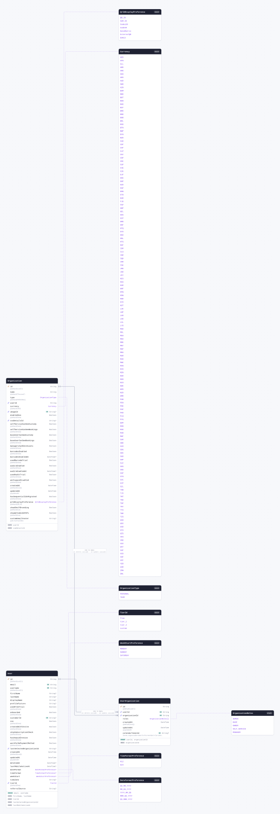

| Field             | Type                                             | Constraints                                       | Default      | Description                                                                                                                                                                                                                                                                                    |
| ----------------- | ------------------------------------------------ | ------------------------------------------------- | ------------ | ---------------------------------------------------------------------------------------------------------------------------------------------------------------------------------------------------------------------------------------------------------------------------------------------- |
| `id`              | `String`                                         | PK NOT NULL                                       | `cuid(1)`    |                                                                                                                                                                                                                                                                                                |
| `userId`          | `String`                                         | NOT NULL → [User.id](#model-User)                 |              |                                                                                                                                                                                                                                                                                                |
| `organizationId`  | `String`                                         | NOT NULL → [Organization.id](#model-Organization) |              |                                                                                                                                                                                                                                                                                                |
| `roles`           | [`OrganizationRoles[]`](#enum-OrganizationRoles) | NOT NULL                                          |              |                                                                                                                                                                                                                                                                                                |
| `createdAt`       | `DateTime`                                       | NOT NULL                                          | `now()`      |                                                                                                                                                                                                                                                                                                |
| `updatedAt`       | `DateTime`                                       | NOT NULL                                          | `@updatedAt` |                                                                                                                                                                                                                                                                                                |
| `calendarTokenId` | `String`                                         | UNIQUE NULL                                       |              | Secret, unguessable token for this member's iCal calendar-feed subscription in this workspace. Null until the user generates a feed; regenerating it rotates the value (invalidating any previously-shared subscription URL). `@unique` doubles as the lookup index for the public feed route. |

#### Indexes

- `@@index([organizationId])`
- `@@unique([userId, organizationId])`

#### References

- `userId` → [User.id](#model-User) (many-to-one, on delete Cascade, on update Cascade)
- `organizationId` → [Organization.id](#model-Organization) (many-to-one, on delete Cascade, on update Cascade)

#### Definition

```sql
CREATE TABLE "UserOrganization" (
    "id" TEXT NOT NULL,
    "userId" TEXT NOT NULL,
    "organizationId" TEXT NOT NULL,
    "roles" "OrganizationRoles"[],
    "createdAt" TIMESTAMP(3) NOT NULL DEFAULT CURRENT_TIMESTAMP,
    "updatedAt" TIMESTAMP(3) NOT NULL,
    "calendarTokenId" TEXT,

    CONSTRAINT "UserOrganization_pkey" PRIMARY KEY ("id")
);

CREATE UNIQUE INDEX "UserOrganization_calendarTokenId_key" ON "UserOrganization"("calendarTokenId");

CREATE INDEX "UserOrganization_organizationId_idx" ON "UserOrganization"("organizationId");

CREATE UNIQUE INDEX "UserOrganization_userId_organizationId_key" ON "UserOrganization"("userId", "organizationId");

ALTER TABLE "UserOrganization" ADD CONSTRAINT "UserOrganization_userId_fkey" FOREIGN KEY ("userId") REFERENCES "User"("id") ON DELETE CASCADE ON UPDATE CASCADE;

ALTER TABLE "UserOrganization" ADD CONSTRAINT "UserOrganization_organizationId_fkey" FOREIGN KEY ("organizationId") REFERENCES "Organization"("id") ON DELETE CASCADE ON UPDATE CASCADE;
```

<details>
<summary>Queries and their SQL</summary>

**findMany**: Every row

```ts
await prisma.userOrganization.findMany();
```

```sql
SELECT
  "public"."UserOrganization"."id",
  "public"."UserOrganization"."userId",
  "public"."UserOrganization"."organizationId",
  "public"."UserOrganization"."roles"::text[],
  "public"."UserOrganization"."createdAt",
  "public"."UserOrganization"."updatedAt",
  "public"."UserOrganization"."calendarTokenId"
FROM
  "public"."UserOrganization"
WHERE
  1 = 1
OFFSET
  $1
-- params: ["0"]
```

**count**: How many rows there are

```ts
await prisma.userOrganization.count();
```

```sql
SELECT
  COUNT(*) AS "_count$_all"
FROM
  (
    SELECT
      "public"."UserOrganization"."id"
    FROM
      "public"."UserOrganization"
    WHERE
      1 = 1
    OFFSET
      $1
  ) AS "sub"
-- params: ["0"]
```

**findMany**: Every row with its relations

```ts
await prisma.userOrganization.findMany({ include: { user: true, organization: true } });
```

```sql
SELECT
  "public"."UserOrganization"."id",
  "public"."UserOrganization"."userId",
  "public"."UserOrganization"."organizationId",
  "public"."UserOrganization"."roles"::text[],
  "public"."UserOrganization"."createdAt",
  "public"."UserOrganization"."updatedAt",
  "public"."UserOrganization"."calendarTokenId"
FROM
  "public"."UserOrganization"
WHERE
  1 = 1
OFFSET
  $1
-- params: ["0"]

SELECT
  "public"."User"."id",
  "public"."User"."email",
  "public"."User"."username",
  "public"."User"."firstName",
  "public"."User"."lastName",
  "public"."User"."displayName",
  "public"."User"."profilePicture",
  "public"."User"."usedFreeTrial",
  "public"."User"."onboarded",
  "public"."User"."customerId",
  "public"."User"."sso",
  "public"."User"."createdWithInvite",
  "public"."User"."skipSubscriptionCheck",
  "public"."User"."hasUnpaidInvoice",
  "public"."User"."warnForNoPaymentMethod",
  "public"."User"."lastSelectedOrganizationId",
  "public"."User"."createdAt",
  "public"."User"."updatedAt",
  "public"."User"."deletedAt",
  "public"."User"."lastMobileActiveAt",
  "public"."User"."dateFormat"::text,
  "public"."User"."timeFormat"::text,
  "public"."User"."weekStart"::text,
  "public"."User"."timeZone",
  "public"."User"."tierId"::text,
  "public"."User"."referralSource"
FROM
  "public"."User"
WHERE
  "public"."User"."id" IN ($1)
OFFSET
  $2
-- params: ["<userId of the rows above>","0"]

SELECT
  "public"."Organization"."id",
  "public"."Organization"."name",
  "public"."Organization"."type"::text,
  "public"."Organization"."userId",
  "public"."Organization"."currency"::text,
  "public"."Organization"."imageId",
  "public"."Organization"."enabledSso",
  "public"."Organization"."ssoDetailsId",
  "public"."Organization"."selfServiceCanSeeCustody",
  "public"."Organization"."selfServiceCanSeeBookings",
  "public"."Organization"."baseUserCanSeeCustody",
  "public"."Organization"."baseUserCanSeeBookings",
  "public"."Organization"."managersCanEditAssets",
  "public"."Organization"."barcodesEnabled",
  "public"."Organization"."barcodesEnabledAt",
  "public"."Organization"."usedBarcodeTrial",
  "public"."Organization"."auditsEnabled",
  "public"."Organization"."auditsEnabledAt",
  "public"."Organization"."usedAuditTrial",
  "public"."Organization"."workspaceDisabled",
  "public"."Organization"."createdAt",
  "public"."Organization"."updatedAt",
  "public"."Organization"."hasSequentialIdsMigrated",
  "public"."Organization"."qrIdDisplayPreference"::text,
  "public"."Organization"."showShelfBranding",
  "public"."Organization"."showQrCodesOnPdfs",
  "public"."Organization"."customEmailFooter"
FROM
  "public"."Organization"
WHERE
  "public"."Organization"."id" IN ($1)
OFFSET
  $2
-- params: ["<organizationId of the rows above>","0"]
```

**findUnique**: One row by what is unique to it

```ts
await prisma.userOrganization.findUnique({ where: { id: "example" } });
```

```sql
SELECT
  "public"."UserOrganization"."id",
  "public"."UserOrganization"."userId",
  "public"."UserOrganization"."organizationId",
  "public"."UserOrganization"."roles"::text[],
  "public"."UserOrganization"."createdAt",
  "public"."UserOrganization"."updatedAt",
  "public"."UserOrganization"."calendarTokenId"
FROM
  "public"."UserOrganization"
WHERE
  (
    "public"."UserOrganization"."id" = $1
    AND 1 = 1
  )
LIMIT
  $2
OFFSET
  $3
-- params: ["example","1","0"]
```

**create**: Create a row

```ts
await prisma.userOrganization.create({
  data: { userId: "example", organizationId: "example", roles: ["ADMIN"] },
});
```

```sql
INSERT INTO
  "public"."UserOrganization" (
    "id",
    "userId",
    "organizationId",
    "roles",
    "createdAt",
    "updatedAt"
  )
VALUES
  (
    $1,
    $2,
    $3,
    CAST($4::text[] AS "public"."OrganizationRoles" []),
    $5,
    $6
  )
RETURNING
  "public"."UserOrganization"."id",
  "public"."UserOrganization"."userId",
  "public"."UserOrganization"."organizationId",
  "public"."UserOrganization"."roles"::text[],
  "public"."UserOrganization"."createdAt",
  "public"."UserOrganization"."updatedAt",
  "public"."UserOrganization"."calendarTokenId"
-- params: ["<cuid(1)>","example","example",["ADMIN"],"<now()>","<now()>"]
```

**update**: Update a row

```ts
await prisma.userOrganization.update({ where: { id: "example" }, data: { roles: ["ADMIN"] } });
```

```sql
UPDATE "public"."UserOrganization"
SET
  "roles" = CAST($1::text[] AS "public"."OrganizationRoles" []),
  "updatedAt" = $2
WHERE
  (
    "public"."UserOrganization"."id" = $3
    AND 1 = 1
  )
RETURNING
  "public"."UserOrganization"."id",
  "public"."UserOrganization"."userId",
  "public"."UserOrganization"."organizationId",
  "public"."UserOrganization"."roles"::text[],
  "public"."UserOrganization"."createdAt",
  "public"."UserOrganization"."updatedAt",
  "public"."UserOrganization"."calendarTokenId"
-- params: [["ADMIN"],{"prisma__type":"generatorCall","prisma__value":{"name":"now","args":[],"returnType":{"type":"DateTime"}}},"example"]
```

**delete**: Delete a row

```ts
await prisma.userOrganization.delete({ where: { id: "example" } });
```

```sql
DELETE FROM "public"."UserOrganization"
WHERE
  (
    "public"."UserOrganization"."id" = $1
    AND 1 = 1
  )
RETURNING
  "public"."UserOrganization"."id",
  "public"."UserOrganization"."userId",
  "public"."UserOrganization"."organizationId",
  "public"."UserOrganization"."roles"::text[],
  "public"."UserOrganization"."createdAt",
  "public"."UserOrganization"."updatedAt",
  "public"."UserOrganization"."calendarTokenId"
-- params: ["example"]
```

</details>

<a id="model-SsoDetails"></a>

### SsoDetails

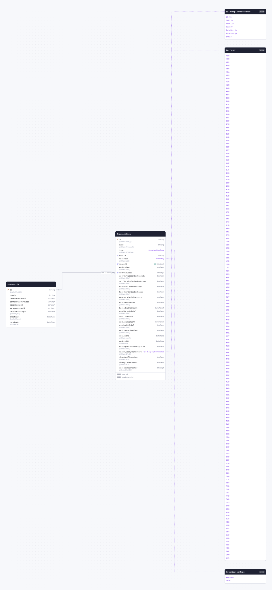

| Field                | Type       | Constraints | Default      | Description |
| -------------------- | ---------- | ----------- | ------------ | ----------- |
| `id`                 | `String`   | PK NOT NULL | `cuid(1)`    |             |
| `domain`             | `String`   | NOT NULL    |              |             |
| `baseUserGroupId`    | `String`   | NULL        |              |             |
| `selfServiceGroupId` | `String`   | NULL        |              |             |
| `adminGroupId`       | `String`   | NULL        |              |             |
| `managerGroupId`     | `String`   | NULL        |              |             |
| `requireSsoLogin`    | `Boolean`  | NOT NULL    | `true`       |             |
| `createdAt`          | `DateTime` | NOT NULL    | `now()`      |             |
| `updatedAt`          | `DateTime` | NOT NULL    | `@updatedAt` |             |

#### Referenced by

- `id` ← [Organization.ssoDetailsId](#model-Organization) (one-to-many)

#### Definition

```sql
CREATE TABLE "SsoDetails" (
    "id" TEXT NOT NULL,
    "domain" TEXT NOT NULL,
    "baseUserGroupId" TEXT,
    "selfServiceGroupId" TEXT,
    "adminGroupId" TEXT,
    "managerGroupId" TEXT,
    "requireSsoLogin" BOOLEAN NOT NULL DEFAULT true,
    "createdAt" TIMESTAMP(3) NOT NULL DEFAULT CURRENT_TIMESTAMP,
    "updatedAt" TIMESTAMP(3) NOT NULL,

    CONSTRAINT "SsoDetails_pkey" PRIMARY KEY ("id")
);
```

<details>
<summary>Queries and their SQL</summary>

**findMany**: Every row

```ts
await prisma.ssoDetails.findMany();
```

```sql
SELECT
  "public"."SsoDetails"."id",
  "public"."SsoDetails"."domain",
  "public"."SsoDetails"."baseUserGroupId",
  "public"."SsoDetails"."selfServiceGroupId",
  "public"."SsoDetails"."adminGroupId",
  "public"."SsoDetails"."managerGroupId",
  "public"."SsoDetails"."requireSsoLogin",
  "public"."SsoDetails"."createdAt",
  "public"."SsoDetails"."updatedAt"
FROM
  "public"."SsoDetails"
WHERE
  1 = 1
OFFSET
  $1
-- params: ["0"]
```

**count**: How many rows there are

```ts
await prisma.ssoDetails.count();
```

```sql
SELECT
  COUNT(*) AS "_count$_all"
FROM
  (
    SELECT
      "public"."SsoDetails"."id"
    FROM
      "public"."SsoDetails"
    WHERE
      1 = 1
    OFFSET
      $1
  ) AS "sub"
-- params: ["0"]
```

**findMany**: Every row with its relations

```ts
await prisma.ssoDetails.findMany({ include: { organizations: true } });
```

```sql
SELECT
  "public"."SsoDetails"."id",
  "public"."SsoDetails"."domain",
  "public"."SsoDetails"."baseUserGroupId",
  "public"."SsoDetails"."selfServiceGroupId",
  "public"."SsoDetails"."adminGroupId",
  "public"."SsoDetails"."managerGroupId",
  "public"."SsoDetails"."requireSsoLogin",
  "public"."SsoDetails"."createdAt",
  "public"."SsoDetails"."updatedAt"
FROM
  "public"."SsoDetails"
WHERE
  1 = 1
OFFSET
  $1
-- params: ["0"]

SELECT
  "public"."Organization"."id",
  "public"."Organization"."name",
  "public"."Organization"."type"::text,
  "public"."Organization"."userId",
  "public"."Organization"."currency"::text,
  "public"."Organization"."imageId",
  "public"."Organization"."enabledSso",
  "public"."Organization"."ssoDetailsId",
  "public"."Organization"."selfServiceCanSeeCustody",
  "public"."Organization"."selfServiceCanSeeBookings",
  "public"."Organization"."baseUserCanSeeCustody",
  "public"."Organization"."baseUserCanSeeBookings",
  "public"."Organization"."managersCanEditAssets",
  "public"."Organization"."barcodesEnabled",
  "public"."Organization"."barcodesEnabledAt",
  "public"."Organization"."usedBarcodeTrial",
  "public"."Organization"."auditsEnabled",
  "public"."Organization"."auditsEnabledAt",
  "public"."Organization"."usedAuditTrial",
  "public"."Organization"."workspaceDisabled",
  "public"."Organization"."createdAt",
  "public"."Organization"."updatedAt",
  "public"."Organization"."hasSequentialIdsMigrated",
  "public"."Organization"."qrIdDisplayPreference"::text,
  "public"."Organization"."showShelfBranding",
  "public"."Organization"."showQrCodesOnPdfs",
  "public"."Organization"."customEmailFooter"
FROM
  "public"."Organization"
WHERE
  "public"."Organization"."ssoDetailsId" IN ($1)
OFFSET
  $2
-- params: ["<id of the rows above>","0"]
```

**findUnique**: One row by what is unique to it

```ts
await prisma.ssoDetails.findUnique({ where: { id: "example" } });
```

```sql
SELECT
  "public"."SsoDetails"."id",
  "public"."SsoDetails"."domain",
  "public"."SsoDetails"."baseUserGroupId",
  "public"."SsoDetails"."selfServiceGroupId",
  "public"."SsoDetails"."adminGroupId",
  "public"."SsoDetails"."managerGroupId",
  "public"."SsoDetails"."requireSsoLogin",
  "public"."SsoDetails"."createdAt",
  "public"."SsoDetails"."updatedAt"
FROM
  "public"."SsoDetails"
WHERE
  (
    "public"."SsoDetails"."id" = $1
    AND 1 = 1
  )
LIMIT
  $2
OFFSET
  $3
-- params: ["example","1","0"]
```

**create**: Create a row

```ts
await prisma.ssoDetails.create({ data: { domain: "example" } });
```

```sql
INSERT INTO
  "public"."SsoDetails" (
    "id",
    "domain",
    "requireSsoLogin",
    "createdAt",
    "updatedAt"
  )
VALUES
  ($1, $2, $3, $4, $5)
RETURNING
  "public"."SsoDetails"."id",
  "public"."SsoDetails"."domain",
  "public"."SsoDetails"."baseUserGroupId",
  "public"."SsoDetails"."selfServiceGroupId",
  "public"."SsoDetails"."adminGroupId",
  "public"."SsoDetails"."managerGroupId",
  "public"."SsoDetails"."requireSsoLogin",
  "public"."SsoDetails"."createdAt",
  "public"."SsoDetails"."updatedAt"
-- params: ["<cuid(1)>","example",true,"<now()>","<now()>"]
```

**update**: Update a row

```ts
await prisma.ssoDetails.update({ where: { id: "example" }, data: { domain: "example" } });
```

```sql
UPDATE "public"."SsoDetails"
SET
  "domain" = $1,
  "updatedAt" = $2
WHERE
  (
    "public"."SsoDetails"."id" = $3
    AND 1 = 1
  )
RETURNING
  "public"."SsoDetails"."id",
  "public"."SsoDetails"."domain",
  "public"."SsoDetails"."baseUserGroupId",
  "public"."SsoDetails"."selfServiceGroupId",
  "public"."SsoDetails"."adminGroupId",
  "public"."SsoDetails"."managerGroupId",
  "public"."SsoDetails"."requireSsoLogin",
  "public"."SsoDetails"."createdAt",
  "public"."SsoDetails"."updatedAt"
-- params: ["example",{"prisma__type":"generatorCall","prisma__value":{"name":"now","args":[],"returnType":{"type":"DateTime"}}},"example"]
```

**delete**: Delete a row

```ts
await prisma.ssoDetails.delete({ where: { id: "example" } });
```

```sql
DELETE FROM "public"."SsoDetails"
WHERE
  (
    "public"."SsoDetails"."id" = $1
    AND 1 = 1
  )
RETURNING
  "public"."SsoDetails"."id",
  "public"."SsoDetails"."domain",
  "public"."SsoDetails"."baseUserGroupId",
  "public"."SsoDetails"."selfServiceGroupId",
  "public"."SsoDetails"."adminGroupId",
  "public"."SsoDetails"."managerGroupId",
  "public"."SsoDetails"."requireSsoLogin",
  "public"."SsoDetails"."createdAt",
  "public"."SsoDetails"."updatedAt"
-- params: ["example"]
```

</details>

<a id="model-ScimToken"></a>

### ScimToken

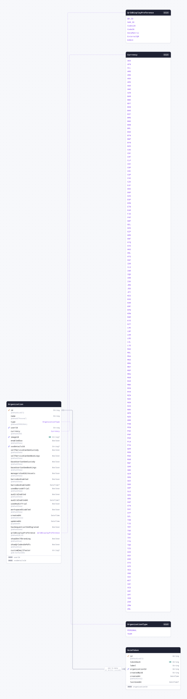

| Field            | Type       | Constraints                                       | Default   | Description |
| ---------------- | ---------- | ------------------------------------------------- | --------- | ----------- |
| `id`             | `String`   | PK NOT NULL                                       | `cuid(1)` |             |
| `tokenHash`      | `String`   | UNIQUE NOT NULL                                   |           |             |
| `label`          | `String`   | NOT NULL                                          |           |             |
| `organizationId` | `String`   | NOT NULL → [Organization.id](#model-Organization) |           |             |
| `createdById`    | `String`   | NOT NULL                                          |           |             |
| `createdAt`      | `DateTime` | NOT NULL                                          | `now()`   |             |
| `lastUsedAt`     | `DateTime` | NULL                                              |           |             |

#### Indexes

- `@@index([organizationId])`

#### References

- `organizationId` → [Organization.id](#model-Organization) (many-to-one, on delete Cascade)

#### Definition

```sql
CREATE TABLE "ScimToken" (
    "id" TEXT NOT NULL,
    "tokenHash" TEXT NOT NULL,
    "label" TEXT NOT NULL,
    "organizationId" TEXT NOT NULL,
    "createdById" TEXT NOT NULL,
    "createdAt" TIMESTAMP(3) NOT NULL DEFAULT CURRENT_TIMESTAMP,
    "lastUsedAt" TIMESTAMP(3),

    CONSTRAINT "ScimToken_pkey" PRIMARY KEY ("id")
);

CREATE UNIQUE INDEX "ScimToken_tokenHash_key" ON "ScimToken"("tokenHash");

CREATE INDEX "ScimToken_organizationId_idx" ON "ScimToken"("organizationId");

ALTER TABLE "ScimToken" ADD CONSTRAINT "ScimToken_organizationId_fkey" FOREIGN KEY ("organizationId") REFERENCES "Organization"("id") ON DELETE CASCADE ON UPDATE CASCADE;
```

<details>
<summary>Queries and their SQL</summary>

**findMany**: Every row

```ts
await prisma.scimToken.findMany();
```

```sql
SELECT
  "public"."ScimToken"."id",
  "public"."ScimToken"."tokenHash",
  "public"."ScimToken"."label",
  "public"."ScimToken"."organizationId",
  "public"."ScimToken"."createdById",
  "public"."ScimToken"."createdAt",
  "public"."ScimToken"."lastUsedAt"
FROM
  "public"."ScimToken"
WHERE
  1 = 1
OFFSET
  $1
-- params: ["0"]
```

**count**: How many rows there are

```ts
await prisma.scimToken.count();
```

```sql
SELECT
  COUNT(*) AS "_count$_all"
FROM
  (
    SELECT
      "public"."ScimToken"."id"
    FROM
      "public"."ScimToken"
    WHERE
      1 = 1
    OFFSET
      $1
  ) AS "sub"
-- params: ["0"]
```

**findMany**: Every row with its relations

```ts
await prisma.scimToken.findMany({ include: { organization: true } });
```

```sql
SELECT
  "public"."ScimToken"."id",
  "public"."ScimToken"."tokenHash",
  "public"."ScimToken"."label",
  "public"."ScimToken"."organizationId",
  "public"."ScimToken"."createdById",
  "public"."ScimToken"."createdAt",
  "public"."ScimToken"."lastUsedAt"
FROM
  "public"."ScimToken"
WHERE
  1 = 1
OFFSET
  $1
-- params: ["0"]

SELECT
  "public"."Organization"."id",
  "public"."Organization"."name",
  "public"."Organization"."type"::text,
  "public"."Organization"."userId",
  "public"."Organization"."currency"::text,
  "public"."Organization"."imageId",
  "public"."Organization"."enabledSso",
  "public"."Organization"."ssoDetailsId",
  "public"."Organization"."selfServiceCanSeeCustody",
  "public"."Organization"."selfServiceCanSeeBookings",
  "public"."Organization"."baseUserCanSeeCustody",
  "public"."Organization"."baseUserCanSeeBookings",
  "public"."Organization"."managersCanEditAssets",
  "public"."Organization"."barcodesEnabled",
  "public"."Organization"."barcodesEnabledAt",
  "public"."Organization"."usedBarcodeTrial",
  "public"."Organization"."auditsEnabled",
  "public"."Organization"."auditsEnabledAt",
  "public"."Organization"."usedAuditTrial",
  "public"."Organization"."workspaceDisabled",
  "public"."Organization"."createdAt",
  "public"."Organization"."updatedAt",
  "public"."Organization"."hasSequentialIdsMigrated",
  "public"."Organization"."qrIdDisplayPreference"::text,
  "public"."Organization"."showShelfBranding",
  "public"."Organization"."showQrCodesOnPdfs",
  "public"."Organization"."customEmailFooter"
FROM
  "public"."Organization"
WHERE
  "public"."Organization"."id" IN ($1)
OFFSET
  $2
-- params: ["<organizationId of the rows above>","0"]
```

**findUnique**: One row by what is unique to it

```ts
await prisma.scimToken.findUnique({ where: { id: "example" } });
```

```sql
SELECT
  "public"."ScimToken"."id",
  "public"."ScimToken"."tokenHash",
  "public"."ScimToken"."label",
  "public"."ScimToken"."organizationId",
  "public"."ScimToken"."createdById",
  "public"."ScimToken"."createdAt",
  "public"."ScimToken"."lastUsedAt"
FROM
  "public"."ScimToken"
WHERE
  (
    "public"."ScimToken"."id" = $1
    AND 1 = 1
  )
LIMIT
  $2
OFFSET
  $3
-- params: ["example","1","0"]
```

**create**: Create a row

```ts
await prisma.scimToken.create({
  data: {
    tokenHash: "example",
    label: "example",
    organizationId: "example",
    createdById: "example",
  },
});
```

```sql
INSERT INTO
  "public"."ScimToken" (
    "id",
    "tokenHash",
    "label",
    "organizationId",
    "createdById",
    "createdAt"
  )
VALUES
  ($1, $2, $3, $4, $5, $6)
RETURNING
  "public"."ScimToken"."id",
  "public"."ScimToken"."tokenHash",
  "public"."ScimToken"."label",
  "public"."ScimToken"."organizationId",
  "public"."ScimToken"."createdById",
  "public"."ScimToken"."createdAt",
  "public"."ScimToken"."lastUsedAt"
-- params: ["<cuid(1)>","example","example","example","example","<now()>"]
```

**update**: Update a row

```ts
await prisma.scimToken.update({ where: { id: "example" }, data: { tokenHash: "example" } });
```

```sql
UPDATE "public"."ScimToken"
SET
  "tokenHash" = $1
WHERE
  (
    "public"."ScimToken"."id" = $2
    AND 1 = 1
  )
RETURNING
  "public"."ScimToken"."id",
  "public"."ScimToken"."tokenHash",
  "public"."ScimToken"."label",
  "public"."ScimToken"."organizationId",
  "public"."ScimToken"."createdById",
  "public"."ScimToken"."createdAt",
  "public"."ScimToken"."lastUsedAt"
-- params: ["example","example"]
```

**delete**: Delete a row

```ts
await prisma.scimToken.delete({ where: { id: "example" } });
```

```sql
DELETE FROM "public"."ScimToken"
WHERE
  (
    "public"."ScimToken"."id" = $1
    AND 1 = 1
  )
RETURNING
  "public"."ScimToken"."id",
  "public"."ScimToken"."tokenHash",
  "public"."ScimToken"."label",
  "public"."ScimToken"."organizationId",
  "public"."ScimToken"."createdById",
  "public"."ScimToken"."createdAt",
  "public"."ScimToken"."lastUsedAt"
-- params: ["example"]
```

</details>

<a id="model-UserScimExternalId"></a>

### UserScimExternalId

-
- Org-scoped SCIM external ID linking a Shelf user to an identity-provider
- object within a specific organization. A single Shelf user can appear in
- multiple organizations, each managed by a different identity provider, so the
- external ID must be scoped to the (user, organization) pair.

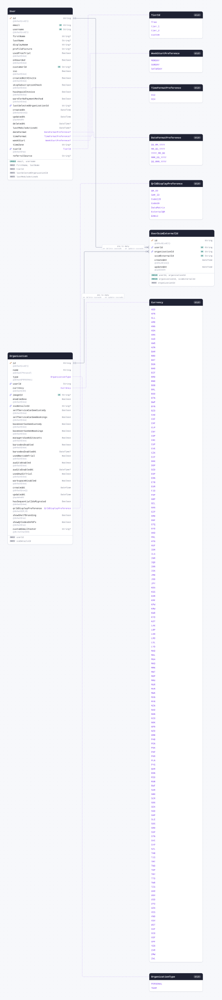

| Field            | Type       | Constraints                                       | Default      | Description |
| ---------------- | ---------- | ------------------------------------------------- | ------------ | ----------- |
| `id`             | `String`   | PK NOT NULL                                       | `cuid(1)`    |             |
| `userId`         | `String`   | NOT NULL → [User.id](#model-User)                 |              |             |
| `organizationId` | `String`   | NOT NULL → [Organization.id](#model-Organization) |              |             |
| `scimExternalId` | `String`   | NOT NULL                                          |              |             |
| `createdAt`      | `DateTime` | NOT NULL                                          | `now()`      |             |
| `updatedAt`      | `DateTime` | NOT NULL                                          | `@updatedAt` |             |

#### Indexes

- `@@index([organizationId])`
- `@@unique([userId, organizationId])`
- `@@unique([organizationId, scimExternalId])`

#### References

- `userId` → [User.id](#model-User) (many-to-one, on delete Cascade, on update Cascade)
- `organizationId` → [Organization.id](#model-Organization) (many-to-one, on delete Cascade, on update Cascade)

#### Definition

```sql
CREATE TABLE "UserScimExternalId" (
    "id" TEXT NOT NULL,
    "userId" TEXT NOT NULL,
    "organizationId" TEXT NOT NULL,
    "scimExternalId" TEXT NOT NULL,
    "createdAt" TIMESTAMP(3) NOT NULL DEFAULT CURRENT_TIMESTAMP,
    "updatedAt" TIMESTAMP(3) NOT NULL,

    CONSTRAINT "UserScimExternalId_pkey" PRIMARY KEY ("id")
);

CREATE INDEX "UserScimExternalId_organizationId_idx" ON "UserScimExternalId"("organizationId");

CREATE UNIQUE INDEX "UserScimExternalId_userId_organizationId_key" ON "UserScimExternalId"("userId", "organizationId");

CREATE UNIQUE INDEX "UserScimExternalId_organizationId_scimExternalId_key" ON "UserScimExternalId"("organizationId", "scimExternalId");

ALTER TABLE "UserScimExternalId" ADD CONSTRAINT "UserScimExternalId_userId_fkey" FOREIGN KEY ("userId") REFERENCES "User"("id") ON DELETE CASCADE ON UPDATE CASCADE;

ALTER TABLE "UserScimExternalId" ADD CONSTRAINT "UserScimExternalId_organizationId_fkey" FOREIGN KEY ("organizationId") REFERENCES "Organization"("id") ON DELETE CASCADE ON UPDATE CASCADE;
```

<details>
<summary>Queries and their SQL</summary>

**findMany**: Every row

```ts
await prisma.userScimExternalId.findMany();
```

```sql
SELECT
  "public"."UserScimExternalId"."id",
  "public"."UserScimExternalId"."userId",
  "public"."UserScimExternalId"."organizationId",
  "public"."UserScimExternalId"."scimExternalId",
  "public"."UserScimExternalId"."createdAt",
  "public"."UserScimExternalId"."updatedAt"
FROM
  "public"."UserScimExternalId"
WHERE
  1 = 1
OFFSET
  $1
-- params: ["0"]
```

**count**: How many rows there are

```ts
await prisma.userScimExternalId.count();
```

```sql
SELECT
  COUNT(*) AS "_count$_all"
FROM
  (
    SELECT
      "public"."UserScimExternalId"."id"
    FROM
      "public"."UserScimExternalId"
    WHERE
      1 = 1
    OFFSET
      $1
  ) AS "sub"
-- params: ["0"]
```

**findMany**: Every row with its relations

```ts
await prisma.userScimExternalId.findMany({ include: { user: true, organization: true } });
```

```sql
SELECT
  "public"."UserScimExternalId"."id",
  "public"."UserScimExternalId"."userId",
  "public"."UserScimExternalId"."organizationId",
  "public"."UserScimExternalId"."scimExternalId",
  "public"."UserScimExternalId"."createdAt",
  "public"."UserScimExternalId"."updatedAt"
FROM
  "public"."UserScimExternalId"
WHERE
  1 = 1
OFFSET
  $1
-- params: ["0"]

SELECT
  "public"."User"."id",
  "public"."User"."email",
  "public"."User"."username",
  "public"."User"."firstName",
  "public"."User"."lastName",
  "public"."User"."displayName",
  "public"."User"."profilePicture",
  "public"."User"."usedFreeTrial",
  "public"."User"."onboarded",
  "public"."User"."customerId",
  "public"."User"."sso",
  "public"."User"."createdWithInvite",
  "public"."User"."skipSubscriptionCheck",
  "public"."User"."hasUnpaidInvoice",
  "public"."User"."warnForNoPaymentMethod",
  "public"."User"."lastSelectedOrganizationId",
  "public"."User"."createdAt",
  "public"."User"."updatedAt",
  "public"."User"."deletedAt",
  "public"."User"."lastMobileActiveAt",
  "public"."User"."dateFormat"::text,
  "public"."User"."timeFormat"::text,
  "public"."User"."weekStart"::text,
  "public"."User"."timeZone",
  "public"."User"."tierId"::text,
  "public"."User"."referralSource"
FROM
  "public"."User"
WHERE
  "public"."User"."id" IN ($1)
OFFSET
  $2
-- params: ["<userId of the rows above>","0"]

SELECT
  "public"."Organization"."id",
  "public"."Organization"."name",
  "public"."Organization"."type"::text,
  "public"."Organization"."userId",
  "public"."Organization"."currency"::text,
  "public"."Organization"."imageId",
  "public"."Organization"."enabledSso",
  "public"."Organization"."ssoDetailsId",
  "public"."Organization"."selfServiceCanSeeCustody",
  "public"."Organization"."selfServiceCanSeeBookings",
  "public"."Organization"."baseUserCanSeeCustody",
  "public"."Organization"."baseUserCanSeeBookings",
  "public"."Organization"."managersCanEditAssets",
  "public"."Organization"."barcodesEnabled",
  "public"."Organization"."barcodesEnabledAt",
  "public"."Organization"."usedBarcodeTrial",
  "public"."Organization"."auditsEnabled",
  "public"."Organization"."auditsEnabledAt",
  "public"."Organization"."usedAuditTrial",
  "public"."Organization"."workspaceDisabled",
  "public"."Organization"."createdAt",
  "public"."Organization"."updatedAt",
  "public"."Organization"."hasSequentialIdsMigrated",
  "public"."Organization"."qrIdDisplayPreference"::text,
  "public"."Organization"."showShelfBranding",
  "public"."Organization"."showQrCodesOnPdfs",
  "public"."Organization"."customEmailFooter"
FROM
  "public"."Organization"
WHERE
  "public"."Organization"."id" IN ($1)
OFFSET
  $2
-- params: ["<organizationId of the rows above>","0"]
```

**findUnique**: One row by what is unique to it

```ts
await prisma.userScimExternalId.findUnique({ where: { id: "example" } });
```

```sql
SELECT
  "public"."UserScimExternalId"."id",
  "public"."UserScimExternalId"."userId",
  "public"."UserScimExternalId"."organizationId",
  "public"."UserScimExternalId"."scimExternalId",
  "public"."UserScimExternalId"."createdAt",
  "public"."UserScimExternalId"."updatedAt"
FROM
  "public"."UserScimExternalId"
WHERE
  (
    "public"."UserScimExternalId"."id" = $1
    AND 1 = 1
  )
LIMIT
  $2
OFFSET
  $3
-- params: ["example","1","0"]
```

**create**: Create a row

```ts
await prisma.userScimExternalId.create({
  data: { userId: "example", organizationId: "example", scimExternalId: "example" },
});
```

```sql
INSERT INTO
  "public"."UserScimExternalId" (
    "id",
    "userId",
    "organizationId",
    "scimExternalId",
    "createdAt",
    "updatedAt"
  )
VALUES
  ($1, $2, $3, $4, $5, $6)
RETURNING
  "public"."UserScimExternalId"."id",
  "public"."UserScimExternalId"."userId",
  "public"."UserScimExternalId"."organizationId",
  "public"."UserScimExternalId"."scimExternalId",
  "public"."UserScimExternalId"."createdAt",
  "public"."UserScimExternalId"."updatedAt"
-- params: ["<cuid(1)>","example","example","example","<now()>","<now()>"]
```

**update**: Update a row

```ts
await prisma.userScimExternalId.update({
  where: { id: "example" },
  data: { scimExternalId: "example" },
});
```

```sql
UPDATE "public"."UserScimExternalId"
SET
  "scimExternalId" = $1,
  "updatedAt" = $2
WHERE
  (
    "public"."UserScimExternalId"."id" = $3
    AND 1 = 1
  )
RETURNING
  "public"."UserScimExternalId"."id",
  "public"."UserScimExternalId"."userId",
  "public"."UserScimExternalId"."organizationId",
  "public"."UserScimExternalId"."scimExternalId",
  "public"."UserScimExternalId"."createdAt",
  "public"."UserScimExternalId"."updatedAt"
-- params: ["example",{"prisma__type":"generatorCall","prisma__value":{"name":"now","args":[],"returnType":{"type":"DateTime"}}},"example"]
```

**delete**: Delete a row

```ts
await prisma.userScimExternalId.delete({ where: { id: "example" } });
```

```sql
DELETE FROM "public"."UserScimExternalId"
WHERE
  (
    "public"."UserScimExternalId"."id" = $1
    AND 1 = 1
  )
RETURNING
  "public"."UserScimExternalId"."id",
  "public"."UserScimExternalId"."userId",
  "public"."UserScimExternalId"."organizationId",
  "public"."UserScimExternalId"."scimExternalId",
  "public"."UserScimExternalId"."createdAt",
  "public"."UserScimExternalId"."updatedAt"
-- params: ["example"]
```

</details>

<a id="model-Tier"></a>

### Tier

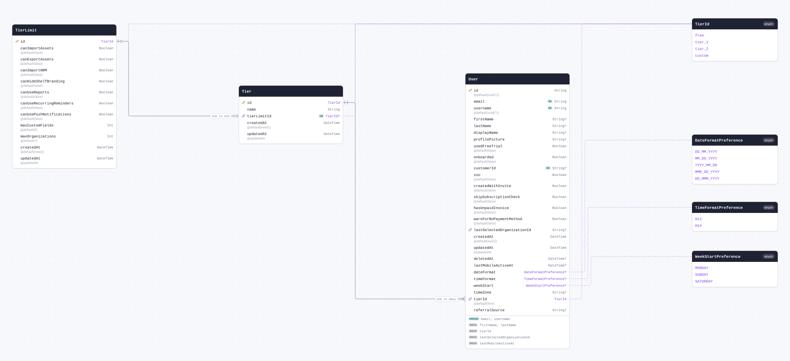

| Field         | Type                     | Constraints                                    | Default      | Description |
| ------------- | ------------------------ | ---------------------------------------------- | ------------ | ----------- |
| `id`          | [`TierId`](#enum-TierId) | PK NOT NULL                                    |              |             |
| `name`        | `String`                 | NOT NULL                                       |              |             |
| `tierLimitId` | [`TierId`](#enum-TierId) | UNIQUE NULL → [TierLimit.id](#model-TierLimit) |              |             |
| `createdAt`   | `DateTime`               | NOT NULL                                       | `now()`      |             |
| `updatedAt`   | `DateTime`               | NOT NULL                                       | `@updatedAt` |             |

#### References

- `tierLimitId` → [TierLimit.id](#model-TierLimit) (one-to-one)

#### Referenced by

- `id` ← [User.tierId](#model-User) (one-to-many)

#### Definition

```sql
CREATE TABLE "Tier" (
    "id" "TierId" NOT NULL,
    "name" TEXT NOT NULL,
    "tierLimitId" "TierId",
    "createdAt" TIMESTAMP(3) NOT NULL DEFAULT CURRENT_TIMESTAMP,
    "updatedAt" TIMESTAMP(3) NOT NULL,

    CONSTRAINT "Tier_pkey" PRIMARY KEY ("id")
);

CREATE UNIQUE INDEX "Tier_tierLimitId_key" ON "Tier"("tierLimitId");

ALTER TABLE "Tier" ADD CONSTRAINT "Tier_tierLimitId_fkey" FOREIGN KEY ("tierLimitId") REFERENCES "TierLimit"("id") ON DELETE SET NULL ON UPDATE CASCADE;
```

<details>
<summary>Queries and their SQL</summary>

**findMany**: Every row

```ts
await prisma.tier.findMany();
```

```sql
SELECT
  "public"."Tier"."id"::text,
  "public"."Tier"."name",
  "public"."Tier"."tierLimitId"::text,
  "public"."Tier"."createdAt",
  "public"."Tier"."updatedAt"
FROM
  "public"."Tier"
WHERE
  1 = 1
OFFSET
  $1
-- params: ["0"]
```

**count**: How many rows there are

```ts
await prisma.tier.count();
```

```sql
SELECT
  COUNT(*) AS "_count$_all"
FROM
  (
    SELECT
      "public"."Tier"."id"
    FROM
      "public"."Tier"
    WHERE
      1 = 1
    OFFSET
      $1
  ) AS "sub"
-- params: ["0"]
```

**findMany**: Every row with its relations

```ts
await prisma.tier.findMany({ include: { subscribers: true, tierLimit: true } });
```

```sql
SELECT
  "public"."Tier"."id"::text,
  "public"."Tier"."name",
  "public"."Tier"."tierLimitId"::text,
  "public"."Tier"."createdAt",
  "public"."Tier"."updatedAt"
FROM
  "public"."Tier"
WHERE
  1 = 1
OFFSET
  $1
-- params: ["0"]

SELECT
  "public"."User"."id",
  "public"."User"."email",
  "public"."User"."username",
  "public"."User"."firstName",
  "public"."User"."lastName",
  "public"."User"."displayName",
  "public"."User"."profilePicture",
  "public"."User"."usedFreeTrial",
  "public"."User"."onboarded",
  "public"."User"."customerId",
  "public"."User"."sso",
  "public"."User"."createdWithInvite",
  "public"."User"."skipSubscriptionCheck",
  "public"."User"."hasUnpaidInvoice",
  "public"."User"."warnForNoPaymentMethod",
  "public"."User"."lastSelectedOrganizationId",
  "public"."User"."createdAt",
  "public"."User"."updatedAt",
  "public"."User"."deletedAt",
  "public"."User"."lastMobileActiveAt",
  "public"."User"."dateFormat"::text,
  "public"."User"."timeFormat"::text,
  "public"."User"."weekStart"::text,
  "public"."User"."timeZone",
  "public"."User"."tierId"::text,
  "public"."User"."referralSource"
FROM
  "public"."User"
WHERE
  "public"."User"."tierId" IN ($1)
OFFSET
  $2
-- params: ["<id of the rows above>","0"]

SELECT
  "public"."TierLimit"."id"::text,
  "public"."TierLimit"."canImportAssets",
  "public"."TierLimit"."canExportAssets",
  "public"."TierLimit"."canImportNRM",
  "public"."TierLimit"."canHideShelfBranding",
  "public"."TierLimit"."canUseReports",
  "public"."TierLimit"."canUseRecurringReminders",
  "public"."TierLimit"."canUsePushNotifications",
  "public"."TierLimit"."maxCustomFields",
  "public"."TierLimit"."maxOrganizations",
  "public"."TierLimit"."createdAt",
  "public"."TierLimit"."updatedAt"
FROM
  "public"."TierLimit"
WHERE
  "public"."TierLimit"."id" IN ($1)
OFFSET
  $2
-- params: ["<tierLimitId of the rows above>","0"]
```

**findUnique**: One row by what is unique to it

```ts
await prisma.tier.findUnique({ where: { id: "free" } });
```

```sql
SELECT
  "public"."Tier"."id"::text,
  "public"."Tier"."name",
  "public"."Tier"."tierLimitId"::text,
  "public"."Tier"."createdAt",
  "public"."Tier"."updatedAt"
FROM
  "public"."Tier"
WHERE
  (
    "public"."Tier"."id" = CAST($1::text AS "public"."TierId")
    AND 1 = 1
  )
LIMIT
  $2
OFFSET
  $3
-- params: ["free","1","0"]
```

**create**: Create a row

```ts
await prisma.tier.create({ data: { id: "free", name: "example" } });
```

```sql
INSERT INTO
  "public"."Tier" ("id", "name", "createdAt", "updatedAt")
VALUES
  (CAST($1::text AS "public"."TierId"), $2, $3, $4)
RETURNING
  "public"."Tier"."id"::text,
  "public"."Tier"."name",
  "public"."Tier"."tierLimitId"::text,
  "public"."Tier"."createdAt",
  "public"."Tier"."updatedAt"
-- params: ["free","example","<now()>","<now()>"]
```

**update**: Update a row

```ts
await prisma.tier.update({ where: { id: "free" }, data: { name: "example" } });
```

```sql
UPDATE "public"."Tier"
SET
  "name" = $1,
  "updatedAt" = $2
WHERE
  (
    "public"."Tier"."id" = CAST($3::text AS "public"."TierId")
    AND 1 = 1
  )
RETURNING
  "public"."Tier"."id"::text,
  "public"."Tier"."name",
  "public"."Tier"."tierLimitId"::text,
  "public"."Tier"."createdAt",
  "public"."Tier"."updatedAt"
-- params: ["example",{"prisma__type":"generatorCall","prisma__value":{"name":"now","args":[],"returnType":{"type":"DateTime"}}},"free"]
```

**delete**: Delete a row

```ts
await prisma.tier.delete({ where: { id: "free" } });
```

```sql
DELETE FROM "public"."Tier"
WHERE
  (
    "public"."Tier"."id" = CAST($1::text AS "public"."TierId")
    AND 1 = 1
  )
RETURNING
  "public"."Tier"."id"::text,
  "public"."Tier"."name",
  "public"."Tier"."tierLimitId"::text,
  "public"."Tier"."createdAt",
  "public"."Tier"."updatedAt"
-- params: ["free"]
```

</details>

<a id="model-TierLimit"></a>

### TierLimit

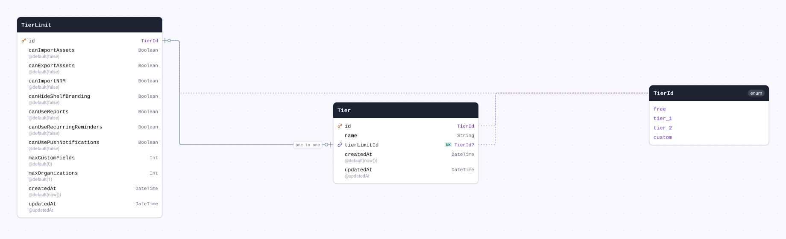

| Field                      | Type                     | Constraints | Default      | Description |
| -------------------------- | ------------------------ | ----------- | ------------ | ----------- |
| `id`                       | [`TierId`](#enum-TierId) | PK NOT NULL |              |             |
| `canImportAssets`          | `Boolean`                | NOT NULL    | `false`      |             |
| `canExportAssets`          | `Boolean`                | NOT NULL    | `false`      |             |
| `canImportNRM`             | `Boolean`                | NOT NULL    | `false`      |             |
| `canHideShelfBranding`     | `Boolean`                | NOT NULL    | `false`      |             |
| `canUseReports`            | `Boolean`                | NOT NULL    | `false`      |             |
| `canUseRecurringReminders` | `Boolean`                | NOT NULL    | `false`      |             |
| `canUsePushNotifications`  | `Boolean`                | NOT NULL    | `false`      |             |
| `maxCustomFields`          | `Int`                    | NOT NULL    | `0`          |             |
| `maxOrganizations`         | `Int`                    | NOT NULL    | `1`          |             |
| `createdAt`                | `DateTime`               | NOT NULL    | `now()`      |             |
| `updatedAt`                | `DateTime`               | NOT NULL    | `@updatedAt` |             |

#### Referenced by

- `id` ← [Tier.tierLimitId](#model-Tier) (one-to-one)

#### Definition

```sql
CREATE TABLE "TierLimit" (
    "id" "TierId" NOT NULL,
    "canImportAssets" BOOLEAN NOT NULL DEFAULT false,
    "canExportAssets" BOOLEAN NOT NULL DEFAULT false,
    "canImportNRM" BOOLEAN NOT NULL DEFAULT false,
    "canHideShelfBranding" BOOLEAN NOT NULL DEFAULT false,
    "canUseReports" BOOLEAN NOT NULL DEFAULT false,
    "canUseRecurringReminders" BOOLEAN NOT NULL DEFAULT false,
    "canUsePushNotifications" BOOLEAN NOT NULL DEFAULT false,
    "maxCustomFields" INTEGER NOT NULL DEFAULT 0,
    "maxOrganizations" INTEGER NOT NULL DEFAULT 1,
    "createdAt" TIMESTAMP(3) NOT NULL DEFAULT CURRENT_TIMESTAMP,
    "updatedAt" TIMESTAMP(3) NOT NULL,

    CONSTRAINT "TierLimit_pkey" PRIMARY KEY ("id")
);
```

<details>
<summary>Queries and their SQL</summary>

**findMany**: Every row

```ts
await prisma.tierLimit.findMany();
```

```sql
SELECT
  "public"."TierLimit"."id"::text,
  "public"."TierLimit"."canImportAssets",
  "public"."TierLimit"."canExportAssets",
  "public"."TierLimit"."canImportNRM",
  "public"."TierLimit"."canHideShelfBranding",
  "public"."TierLimit"."canUseReports",
  "public"."TierLimit"."canUseRecurringReminders",
  "public"."TierLimit"."canUsePushNotifications",
  "public"."TierLimit"."maxCustomFields",
  "public"."TierLimit"."maxOrganizations",
  "public"."TierLimit"."createdAt",
  "public"."TierLimit"."updatedAt"
FROM
  "public"."TierLimit"
WHERE
  1 = 1
OFFSET
  $1
-- params: ["0"]
```

**count**: How many rows there are

```ts
await prisma.tierLimit.count();
```

```sql
SELECT
  COUNT(*) AS "_count$_all"
FROM
  (
    SELECT
      "public"."TierLimit"."id"
    FROM
      "public"."TierLimit"
    WHERE
      1 = 1
    OFFSET
      $1
  ) AS "sub"
-- params: ["0"]
```

**findMany**: Every row with its relations

```ts
await prisma.tierLimit.findMany({ include: { tier: true } });
```

```sql
SELECT
  "public"."TierLimit"."id"::text,
  "public"."TierLimit"."canImportAssets",
  "public"."TierLimit"."canExportAssets",
  "public"."TierLimit"."canImportNRM",
  "public"."TierLimit"."canHideShelfBranding",
  "public"."TierLimit"."canUseReports",
  "public"."TierLimit"."canUseRecurringReminders",
  "public"."TierLimit"."canUsePushNotifications",
  "public"."TierLimit"."maxCustomFields",
  "public"."TierLimit"."maxOrganizations",
  "public"."TierLimit"."createdAt",
  "public"."TierLimit"."updatedAt"
FROM
  "public"."TierLimit"
WHERE
  1 = 1
OFFSET
  $1
-- params: ["0"]

SELECT
  "public"."Tier"."id"::text,
  "public"."Tier"."name",
  "public"."Tier"."tierLimitId"::text,
  "public"."Tier"."createdAt",
  "public"."Tier"."updatedAt"
FROM
  "public"."Tier"
WHERE
  "public"."Tier"."tierLimitId" IN ($1)
OFFSET
  $2
-- params: ["<id of the rows above>","0"]
```

**findUnique**: One row by what is unique to it

```ts
await prisma.tierLimit.findUnique({ where: { id: "free" } });
```

```sql
SELECT
  "public"."TierLimit"."id"::text,
  "public"."TierLimit"."canImportAssets",
  "public"."TierLimit"."canExportAssets",
  "public"."TierLimit"."canImportNRM",
  "public"."TierLimit"."canHideShelfBranding",
  "public"."TierLimit"."canUseReports",
  "public"."TierLimit"."canUseRecurringReminders",
  "public"."TierLimit"."canUsePushNotifications",
  "public"."TierLimit"."maxCustomFields",
  "public"."TierLimit"."maxOrganizations",
  "public"."TierLimit"."createdAt",
  "public"."TierLimit"."updatedAt"
FROM
  "public"."TierLimit"
WHERE
  (
    "public"."TierLimit"."id" = CAST($1::text AS "public"."TierId")
    AND 1 = 1
  )
LIMIT
  $2
OFFSET
  $3
-- params: ["free","1","0"]
```

**create**: Create a row

```ts
await prisma.tierLimit.create({ data: { id: "free" } });
```

```sql
INSERT INTO
  "public"."TierLimit" (
    "id",
    "canImportAssets",
    "canExportAssets",
    "canImportNRM",
    "canHideShelfBranding",
    "canUseReports",
    "canUseRecurringReminders",
    "canUsePushNotifications",
    "maxCustomFields",
    "maxOrganizations",
    "createdAt",
    "updatedAt"
  )
VALUES
  (
    CAST($1::text AS "public"."TierId"),
    $2,
    $3,
    $4,
    $5,
    $6,
    $7,
    $8,
    $9,
    $10,
    $11,
    $12
  )
RETURNING
  "public"."TierLimit"."id"::text,
  "public"."TierLimit"."canImportAssets",
  "public"."TierLimit"."canExportAssets",
  "public"."TierLimit"."canImportNRM",
  "public"."TierLimit"."canHideShelfBranding",
  "public"."TierLimit"."canUseReports",
  "public"."TierLimit"."canUseRecurringReminders",
  "public"."TierLimit"."canUsePushNotifications",
  "public"."TierLimit"."maxCustomFields",
  "public"."TierLimit"."maxOrganizations",
  "public"."TierLimit"."createdAt",
  "public"."TierLimit"."updatedAt"
-- params: ["free",false,false,false,false,false,false,false,"0","1","<now()>","<now()>"]
```

**update**: Update a row

```ts
await prisma.tierLimit.update({ where: { id: "free" }, data: { canImportAssets: true } });
```

```sql
UPDATE "public"."TierLimit"
SET
  "canImportAssets" = $1,
  "updatedAt" = $2
WHERE
  (
    "public"."TierLimit"."id" = CAST($3::text AS "public"."TierId")
    AND 1 = 1
  )
RETURNING
  "public"."TierLimit"."id"::text,
  "public"."TierLimit"."canImportAssets",
  "public"."TierLimit"."canExportAssets",
  "public"."TierLimit"."canImportNRM",
  "public"."TierLimit"."canHideShelfBranding",
  "public"."TierLimit"."canUseReports",
  "public"."TierLimit"."canUseRecurringReminders",
  "public"."TierLimit"."canUsePushNotifications",
  "public"."TierLimit"."maxCustomFields",
  "public"."TierLimit"."maxOrganizations",
  "public"."TierLimit"."createdAt",
  "public"."TierLimit"."updatedAt"
-- params: [true,{"prisma__type":"generatorCall","prisma__value":{"name":"now","args":[],"returnType":{"type":"DateTime"}}},"free"]
```

**delete**: Delete a row

```ts
await prisma.tierLimit.delete({ where: { id: "free" } });
```

```sql
DELETE FROM "public"."TierLimit"
WHERE
  (
    "public"."TierLimit"."id" = CAST($1::text AS "public"."TierId")
    AND 1 = 1
  )
RETURNING
  "public"."TierLimit"."id"::text,
  "public"."TierLimit"."canImportAssets",
  "public"."TierLimit"."canExportAssets",
  "public"."TierLimit"."canImportNRM",
  "public"."TierLimit"."canHideShelfBranding",
  "public"."TierLimit"."canUseReports",
  "public"."TierLimit"."canUseRecurringReminders",
  "public"."TierLimit"."canUsePushNotifications",
  "public"."TierLimit"."maxCustomFields",
  "public"."TierLimit"."maxOrganizations",
  "public"."TierLimit"."createdAt",
  "public"."TierLimit"."updatedAt"
-- params: ["free"]
```

</details>

<a id="model-CustomTierLimit"></a>

### CustomTierLimit

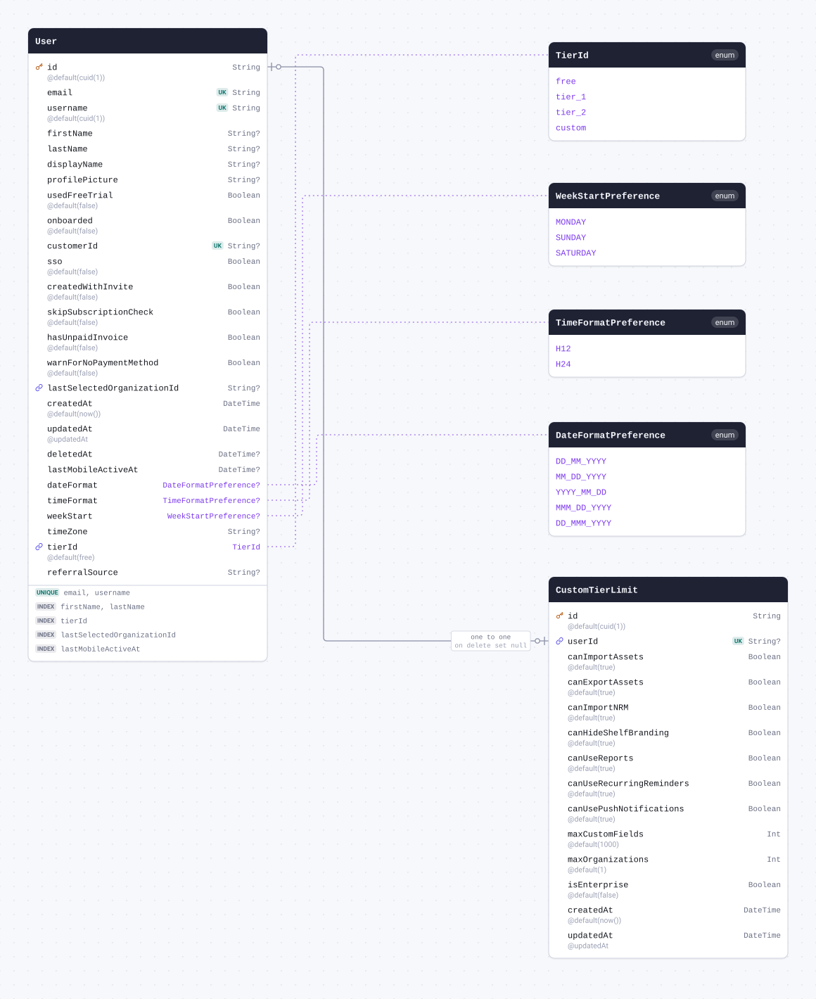

| Field                      | Type       | Constraints                          | Default      | Description |
| -------------------------- | ---------- | ------------------------------------ | ------------ | ----------- |
| `id`                       | `String`   | PK NOT NULL                          | `cuid(1)`    |             |
| `userId`                   | `String`   | UNIQUE NULL → [User.id](#model-User) |              |             |
| `canImportAssets`          | `Boolean`  | NOT NULL                             | `true`       |             |
| `canExportAssets`          | `Boolean`  | NOT NULL                             | `true`       |             |
| `canImportNRM`             | `Boolean`  | NOT NULL                             | `true`       |             |
| `canHideShelfBranding`     | `Boolean`  | NOT NULL                             | `true`       |             |
| `canUseReports`            | `Boolean`  | NOT NULL                             | `true`       |             |
| `canUseRecurringReminders` | `Boolean`  | NOT NULL                             | `true`       |             |
| `canUsePushNotifications`  | `Boolean`  | NOT NULL                             | `true`       |             |
| `maxCustomFields`          | `Int`      | NOT NULL                             | `1000`       |             |
| `maxOrganizations`         | `Int`      | NOT NULL                             | `1`          |             |
| `isEnterprise`             | `Boolean`  | NOT NULL                             | `false`      |             |
| `createdAt`                | `DateTime` | NOT NULL                             | `now()`      |             |
| `updatedAt`                | `DateTime` | NOT NULL                             | `@updatedAt` |             |

#### References

- `userId` → [User.id](#model-User) (one-to-one, on delete SetNull)

#### Definition

```sql
CREATE TABLE "CustomTierLimit" (
    "id" TEXT NOT NULL,
    "userId" TEXT,
    "canImportAssets" BOOLEAN NOT NULL DEFAULT true,
    "canExportAssets" BOOLEAN NOT NULL DEFAULT true,
    "canImportNRM" BOOLEAN NOT NULL DEFAULT true,
    "canHideShelfBranding" BOOLEAN NOT NULL DEFAULT true,
    "canUseReports" BOOLEAN NOT NULL DEFAULT true,
    "canUseRecurringReminders" BOOLEAN NOT NULL DEFAULT true,
    "canUsePushNotifications" BOOLEAN NOT NULL DEFAULT true,
    "maxCustomFields" INTEGER NOT NULL DEFAULT 1000,
    "maxOrganizations" INTEGER NOT NULL DEFAULT 1,
    "isEnterprise" BOOLEAN NOT NULL DEFAULT false,
    "createdAt" TIMESTAMP(3) NOT NULL DEFAULT CURRENT_TIMESTAMP,
    "updatedAt" TIMESTAMP(3) NOT NULL,

    CONSTRAINT "CustomTierLimit_pkey" PRIMARY KEY ("id")
);

CREATE UNIQUE INDEX "CustomTierLimit_userId_key" ON "CustomTierLimit"("userId");

ALTER TABLE "CustomTierLimit" ADD CONSTRAINT "CustomTierLimit_userId_fkey" FOREIGN KEY ("userId") REFERENCES "User"("id") ON DELETE SET NULL ON UPDATE CASCADE;
```

<details>
<summary>Queries and their SQL</summary>

**findMany**: Every row

```ts
await prisma.customTierLimit.findMany();
```

```sql
SELECT
  "public"."CustomTierLimit"."id",
  "public"."CustomTierLimit"."userId",
  "public"."CustomTierLimit"."canImportAssets",
  "public"."CustomTierLimit"."canExportAssets",
  "public"."CustomTierLimit"."canImportNRM",
  "public"."CustomTierLimit"."canHideShelfBranding",
  "public"."CustomTierLimit"."canUseReports",
  "public"."CustomTierLimit"."canUseRecurringReminders",
  "public"."CustomTierLimit"."canUsePushNotifications",
  "public"."CustomTierLimit"."maxCustomFields",
  "public"."CustomTierLimit"."maxOrganizations",
  "public"."CustomTierLimit"."isEnterprise",
  "public"."CustomTierLimit"."createdAt",
  "public"."CustomTierLimit"."updatedAt"
FROM
  "public"."CustomTierLimit"
WHERE
  1 = 1
OFFSET
  $1
-- params: ["0"]
```

**count**: How many rows there are

```ts
await prisma.customTierLimit.count();
```

```sql
SELECT
  COUNT(*) AS "_count$_all"
FROM
  (
    SELECT
      "public"."CustomTierLimit"."id"
    FROM
      "public"."CustomTierLimit"
    WHERE
      1 = 1
    OFFSET
      $1
  ) AS "sub"
-- params: ["0"]
```

**findMany**: Every row with its relations

```ts
await prisma.customTierLimit.findMany({ include: { user: true } });
```

```sql
SELECT
  "public"."CustomTierLimit"."id",
  "public"."CustomTierLimit"."userId",
  "public"."CustomTierLimit"."canImportAssets",
  "public"."CustomTierLimit"."canExportAssets",
  "public"."CustomTierLimit"."canImportNRM",
  "public"."CustomTierLimit"."canHideShelfBranding",
  "public"."CustomTierLimit"."canUseReports",
  "public"."CustomTierLimit"."canUseRecurringReminders",
  "public"."CustomTierLimit"."canUsePushNotifications",
  "public"."CustomTierLimit"."maxCustomFields",
  "public"."CustomTierLimit"."maxOrganizations",
  "public"."CustomTierLimit"."isEnterprise",
  "public"."CustomTierLimit"."createdAt",
  "public"."CustomTierLimit"."updatedAt"
FROM
  "public"."CustomTierLimit"
WHERE
  1 = 1
OFFSET
  $1
-- params: ["0"]

SELECT
  "public"."User"."id",
  "public"."User"."email",
  "public"."User"."username",
  "public"."User"."firstName",
  "public"."User"."lastName",
  "public"."User"."displayName",
  "public"."User"."profilePicture",
  "public"."User"."usedFreeTrial",
  "public"."User"."onboarded",
  "public"."User"."customerId",
  "public"."User"."sso",
  "public"."User"."createdWithInvite",
  "public"."User"."skipSubscriptionCheck",
  "public"."User"."hasUnpaidInvoice",
  "public"."User"."warnForNoPaymentMethod",
  "public"."User"."lastSelectedOrganizationId",
  "public"."User"."createdAt",
  "public"."User"."updatedAt",
  "public"."User"."deletedAt",
  "public"."User"."lastMobileActiveAt",
  "public"."User"."dateFormat"::text,
  "public"."User"."timeFormat"::text,
  "public"."User"."weekStart"::text,
  "public"."User"."timeZone",
  "public"."User"."tierId"::text,
  "public"."User"."referralSource"
FROM
  "public"."User"
WHERE
  "public"."User"."id" IN ($1)
OFFSET
  $2
-- params: ["<userId of the rows above>","0"]
```

**findUnique**: One row by what is unique to it

```ts
await prisma.customTierLimit.findUnique({ where: { id: "example" } });
```

```sql
SELECT
  "public"."CustomTierLimit"."id",
  "public"."CustomTierLimit"."userId",
  "public"."CustomTierLimit"."canImportAssets",
  "public"."CustomTierLimit"."canExportAssets",
  "public"."CustomTierLimit"."canImportNRM",
  "public"."CustomTierLimit"."canHideShelfBranding",
  "public"."CustomTierLimit"."canUseReports",
  "public"."CustomTierLimit"."canUseRecurringReminders",
  "public"."CustomTierLimit"."canUsePushNotifications",
  "public"."CustomTierLimit"."maxCustomFields",
  "public"."CustomTierLimit"."maxOrganizations",
  "public"."CustomTierLimit"."isEnterprise",
  "public"."CustomTierLimit"."createdAt",
  "public"."CustomTierLimit"."updatedAt"
FROM
  "public"."CustomTierLimit"
WHERE
  (
    "public"."CustomTierLimit"."id" = $1
    AND 1 = 1
  )
LIMIT
  $2
OFFSET
  $3
-- params: ["example","1","0"]
```

**create**: Create a row

```ts
await prisma.customTierLimit.create({ data: {} });
```

```sql
INSERT INTO
  "public"."CustomTierLimit" (
    "id",
    "canImportAssets",
    "canExportAssets",
    "canImportNRM",
    "canHideShelfBranding",
    "canUseReports",
    "canUseRecurringReminders",
    "canUsePushNotifications",
    "maxCustomFields",
    "maxOrganizations",
    "isEnterprise",
    "createdAt",
    "updatedAt"
  )
VALUES
  (
    $1,
    $2,
    $3,
    $4,
    $5,
    $6,
    $7,
    $8,
    $9,
    $10,
    $11,
    $12,
    $13
  )
RETURNING
  "public"."CustomTierLimit"."id",
  "public"."CustomTierLimit"."userId",
  "public"."CustomTierLimit"."canImportAssets",
  "public"."CustomTierLimit"."canExportAssets",
  "public"."CustomTierLimit"."canImportNRM",
  "public"."CustomTierLimit"."canHideShelfBranding",
  "public"."CustomTierLimit"."canUseReports",
  "public"."CustomTierLimit"."canUseRecurringReminders",
  "public"."CustomTierLimit"."canUsePushNotifications",
  "public"."CustomTierLimit"."maxCustomFields",
  "public"."CustomTierLimit"."maxOrganizations",
  "public"."CustomTierLimit"."isEnterprise",
  "public"."CustomTierLimit"."createdAt",
  "public"."CustomTierLimit"."updatedAt"
-- params: ["<cuid(1)>",true,true,true,true,true,true,true,"1000","1",false,"<now()>","<now()>"]
```

**update**: Update a row

```ts
await prisma.customTierLimit.update({ where: { id: "example" }, data: { canImportAssets: true } });
```

```sql
UPDATE "public"."CustomTierLimit"
SET
  "canImportAssets" = $1,
  "updatedAt" = $2
WHERE
  (
    "public"."CustomTierLimit"."id" = $3
    AND 1 = 1
  )
RETURNING
  "public"."CustomTierLimit"."id",
  "public"."CustomTierLimit"."userId",
  "public"."CustomTierLimit"."canImportAssets",
  "public"."CustomTierLimit"."canExportAssets",
  "public"."CustomTierLimit"."canImportNRM",
  "public"."CustomTierLimit"."canHideShelfBranding",
  "public"."CustomTierLimit"."canUseReports",
  "public"."CustomTierLimit"."canUseRecurringReminders",
  "public"."CustomTierLimit"."canUsePushNotifications",
  "public"."CustomTierLimit"."maxCustomFields",
  "public"."CustomTierLimit"."maxOrganizations",
  "public"."CustomTierLimit"."isEnterprise",
  "public"."CustomTierLimit"."createdAt",
  "public"."CustomTierLimit"."updatedAt"
-- params: [true,{"prisma__type":"generatorCall","prisma__value":{"name":"now","args":[],"returnType":{"type":"DateTime"}}},"example"]
```

**delete**: Delete a row

```ts
await prisma.customTierLimit.delete({ where: { id: "example" } });
```

```sql
DELETE FROM "public"."CustomTierLimit"
WHERE
  (
    "public"."CustomTierLimit"."id" = $1
    AND 1 = 1
  )
RETURNING
  "public"."CustomTierLimit"."id",
  "public"."CustomTierLimit"."userId",
  "public"."CustomTierLimit"."canImportAssets",
  "public"."CustomTierLimit"."canExportAssets",
  "public"."CustomTierLimit"."canImportNRM",
  "public"."CustomTierLimit"."canHideShelfBranding",
  "public"."CustomTierLimit"."canUseReports",
  "public"."CustomTierLimit"."canUseRecurringReminders",
  "public"."CustomTierLimit"."canUsePushNotifications",
  "public"."CustomTierLimit"."maxCustomFields",
  "public"."CustomTierLimit"."maxOrganizations",
  "public"."CustomTierLimit"."isEnterprise",
  "public"."CustomTierLimit"."createdAt",
  "public"."CustomTierLimit"."updatedAt"
-- params: ["example"]
```

</details>

<a id="model-CustomField"></a>

### CustomField

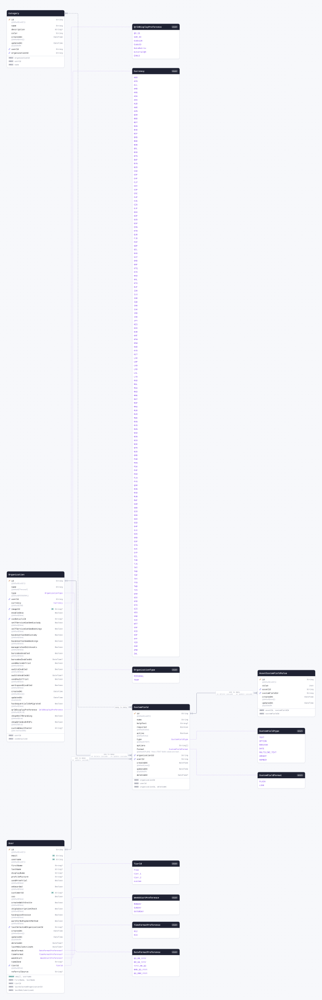

| Field            | Type                                           | Constraints                                       | Default      | Description                                                                                                                               |
| ---------------- | ---------------------------------------------- | ------------------------------------------------- | ------------ | ----------------------------------------------------------------------------------------------------------------------------------------- |
| `id`             | `String`                                       | PK NOT NULL                                       | `cuid(1)`    |                                                                                                                                           |
| `name`           | `String`                                       | NOT NULL                                          |              |                                                                                                                                           |
| `helpText`       | `String`                                       | NULL                                              |              |                                                                                                                                           |
| `required`       | `Boolean`                                      | NOT NULL                                          | `false`      |                                                                                                                                           |
| `active`         | `Boolean`                                      | NOT NULL                                          | `true`       |                                                                                                                                           |
| `type`           | [`CustomFieldType`](#enum-CustomFieldType)     | NOT NULL                                          | `TEXT`       |                                                                                                                                           |
| `options`        | `String[]`                                     | NOT NULL                                          |              |                                                                                                                                           |
| `format`         | [`CustomFieldFormat`](#enum-CustomFieldFormat) | NOT NULL                                          | `PLAIN`      | How a TEXT field's values are read. LINK requires a web link in every value; any other type stays PLAIN (enforced by a CHECK constraint). |
| `organizationId` | `String`                                       | NOT NULL → [Organization.id](#model-Organization) |              |                                                                                                                                           |
| `userId`         | `String`                                       | NOT NULL → [User.id](#model-User)                 |              |                                                                                                                                           |
| `createdAt`      | `DateTime`                                     | NOT NULL                                          | `now()`      |                                                                                                                                           |
| `updatedAt`      | `DateTime`                                     | NOT NULL                                          | `@updatedAt` |                                                                                                                                           |
| `deletedAt`      | `DateTime`                                     | NULL                                              |              |                                                                                                                                           |

#### Indexes

- `@@index([organizationId])`
- `@@index([userId])`
- `@@index([organizationId, deletedAt])`

#### References

- `organizationId` → [Organization.id](#model-Organization) (many-to-one, on delete Cascade, on update Cascade)
- `userId` → [User.id](#model-User) (many-to-one, on update Cascade)

#### Referenced by

- `id` ← [AssetCustomFieldValue.customFieldId](#model-AssetCustomFieldValue) (one-to-many, on delete Cascade, on update Cascade)

#### Many to many

- `categories` ↔ [Category.customFields](#model-Category) through `_CategoryToCustomField`

#### Definition

```sql
CREATE TABLE "CustomField" (
    "id" TEXT NOT NULL,
    "name" TEXT NOT NULL,
    "helpText" TEXT,
    "required" BOOLEAN NOT NULL DEFAULT false,
    "active" BOOLEAN NOT NULL DEFAULT true,
    "type" "CustomFieldType" NOT NULL DEFAULT 'TEXT',
    "options" TEXT[],
    "format" "CustomFieldFormat" NOT NULL DEFAULT 'PLAIN',
    "organizationId" TEXT NOT NULL,
    "userId" TEXT NOT NULL,
    "createdAt" TIMESTAMP(3) NOT NULL DEFAULT CURRENT_TIMESTAMP,
    "updatedAt" TIMESTAMP(3) NOT NULL,
    "deletedAt" TIMESTAMP(3),

    CONSTRAINT "CustomField_pkey" PRIMARY KEY ("id")
);

CREATE INDEX "CustomField_organizationId_idx" ON "CustomField"("organizationId");

CREATE INDEX "CustomField_userId_idx" ON "CustomField"("userId");

CREATE INDEX "CustomField_organizationId_deletedAt_idx" ON "CustomField"("organizationId", "deletedAt");

ALTER TABLE "CustomField" ADD CONSTRAINT "CustomField_organizationId_fkey" FOREIGN KEY ("organizationId") REFERENCES "Organization"("id") ON DELETE CASCADE ON UPDATE CASCADE;

ALTER TABLE "CustomField" ADD CONSTRAINT "CustomField_userId_fkey" FOREIGN KEY ("userId") REFERENCES "User"("id") ON DELETE RESTRICT ON UPDATE CASCADE;
```

<details>
<summary>Queries and their SQL</summary>

**findMany**: Every row

```ts
await prisma.customField.findMany();
```

```sql
SELECT
  "public"."CustomField"."id",
  "public"."CustomField"."name",
  "public"."CustomField"."helpText",
  "public"."CustomField"."required",
  "public"."CustomField"."active",
  "public"."CustomField"."type"::text,
  "public"."CustomField"."options",
  "public"."CustomField"."format"::text,
  "public"."CustomField"."organizationId",
  "public"."CustomField"."userId",
  "public"."CustomField"."createdAt",
  "public"."CustomField"."updatedAt",
  "public"."CustomField"."deletedAt"
FROM
  "public"."CustomField"
WHERE
  1 = 1
OFFSET
  $1
-- params: ["0"]
```

**count**: How many rows there are

```ts
await prisma.customField.count();
```

```sql
SELECT
  COUNT(*) AS "_count$_all"
FROM
  (
    SELECT
      "public"."CustomField"."id"
    FROM
      "public"."CustomField"
    WHERE
      1 = 1
    OFFSET
      $1
  ) AS "sub"
-- params: ["0"]
```

**findMany**: Every row with its relations

```ts
await prisma.customField.findMany({
  include: { organization: true, createdBy: true, categories: true, assetCustomFieldsValues: true },
});
```

```sql
SELECT
  "public"."CustomField"."id",
  "public"."CustomField"."name",
  "public"."CustomField"."helpText",
  "public"."CustomField"."required",
  "public"."CustomField"."active",
  "public"."CustomField"."type"::text,
  "public"."CustomField"."options",
  "public"."CustomField"."format"::text,
  "public"."CustomField"."organizationId",
  "public"."CustomField"."userId",
  "public"."CustomField"."createdAt",
  "public"."CustomField"."updatedAt",
  "public"."CustomField"."deletedAt"
FROM
  "public"."CustomField"
WHERE
  1 = 1
OFFSET
  $1
-- params: ["0"]

SELECT
  "public"."Organization"."id",
  "public"."Organization"."name",
  "public"."Organization"."type"::text,
  "public"."Organization"."userId",
  "public"."Organization"."currency"::text,
  "public"."Organization"."imageId",
  "public"."Organization"."enabledSso",
  "public"."Organization"."ssoDetailsId",
  "public"."Organization"."selfServiceCanSeeCustody",
  "public"."Organization"."selfServiceCanSeeBookings",
  "public"."Organization"."baseUserCanSeeCustody",
  "public"."Organization"."baseUserCanSeeBookings",
  "public"."Organization"."managersCanEditAssets",
  "public"."Organization"."barcodesEnabled",
  "public"."Organization"."barcodesEnabledAt",
  "public"."Organization"."usedBarcodeTrial",
  "public"."Organization"."auditsEnabled",
  "public"."Organization"."auditsEnabledAt",
  "public"."Organization"."usedAuditTrial",
  "public"."Organization"."workspaceDisabled",
  "public"."Organization"."createdAt",
  "public"."Organization"."updatedAt",
  "public"."Organization"."hasSequentialIdsMigrated",
  "public"."Organization"."qrIdDisplayPreference"::text,
  "public"."Organization"."showShelfBranding",
  "public"."Organization"."showQrCodesOnPdfs",
  "public"."Organization"."customEmailFooter"
FROM
  "public"."Organization"
WHERE
  "public"."Organization"."id" IN ($1)
OFFSET
  $2
-- params: ["<organizationId of the rows above>","0"]

SELECT
  "public"."User"."id",
  "public"."User"."email",
  "public"."User"."username",
  "public"."User"."firstName",
  "public"."User"."lastName",
  "public"."User"."displayName",
  "public"."User"."profilePicture",
  "public"."User"."usedFreeTrial",
  "public"."User"."onboarded",
  "public"."User"."customerId",
  "public"."User"."sso",
  "public"."User"."createdWithInvite",
  "public"."User"."skipSubscriptionCheck",
  "public"."User"."hasUnpaidInvoice",
  "public"."User"."warnForNoPaymentMethod",
  "public"."User"."lastSelectedOrganizationId",
  "public"."User"."createdAt",
  "public"."User"."updatedAt",
  "public"."User"."deletedAt",
  "public"."User"."lastMobileActiveAt",
  "public"."User"."dateFormat"::text,
  "public"."User"."timeFormat"::text,
  "public"."User"."weekStart"::text,
  "public"."User"."timeZone",
  "public"."User"."tierId"::text,
  "public"."User"."referralSource"
FROM
  "public"."User"
WHERE
  "public"."User"."id" IN ($1)
OFFSET
  $2
-- params: ["<userId of the rows above>","0"]

SELECT
  "public"."Category"."id",
  "public"."Category"."name",
  "public"."Category"."description",
  "public"."Category"."color",
  "public"."Category"."createdAt",
  "public"."Category"."updatedAt",
  "public"."Category"."userId",
  "public"."Category"."organizationId",
  "t0"."B" AS "CategoryToCustomField@CustomField"
FROM
  "public"."Category"
  INNER JOIN "public"."_CategoryToCustomField" AS "t0" ON "t0"."A" = "public"."Category"."id"
WHERE
  (
    1 = 1
    AND "t0"."B" IN ($1)
  )
OFFSET
  $2
-- params: ["<id of the rows above>","0"]

SELECT
  "public"."AssetCustomFieldValue"."id",
  "public"."AssetCustomFieldValue"."value",
  "public"."AssetCustomFieldValue"."assetId",
  "public"."AssetCustomFieldValue"."customFieldId",
  "public"."AssetCustomFieldValue"."createdAt",
  "public"."AssetCustomFieldValue"."updatedAt"
FROM
  "public"."AssetCustomFieldValue"
WHERE
  "public"."AssetCustomFieldValue"."customFieldId" IN ($1)
OFFSET
  $2
-- params: ["<id of the rows above>","0"]
```

**findUnique**: One row by what is unique to it

```ts
await prisma.customField.findUnique({ where: { id: "example" } });
```

```sql
SELECT
  "public"."CustomField"."id",
  "public"."CustomField"."name",
  "public"."CustomField"."helpText",
  "public"."CustomField"."required",
  "public"."CustomField"."active",
  "public"."CustomField"."type"::text,
  "public"."CustomField"."options",
  "public"."CustomField"."format"::text,
  "public"."CustomField"."organizationId",
  "public"."CustomField"."userId",
  "public"."CustomField"."createdAt",
  "public"."CustomField"."updatedAt",
  "public"."CustomField"."deletedAt"
FROM
  "public"."CustomField"
WHERE
  (
    "public"."CustomField"."id" = $1
    AND 1 = 1
  )
LIMIT
  $2
OFFSET
  $3
-- params: ["example","1","0"]
```

**create**: Create a row

```ts
await prisma.customField.create({
  data: { name: "example", options: ["example"], organizationId: "example", userId: "example" },
});
```

```sql
INSERT INTO
  "public"."CustomField" (
    "id",
    "name",
    "required",
    "active",
    "type",
    "options",
    "format",
    "organizationId",
    "userId",
    "createdAt",
    "updatedAt"
  )
VALUES
  (
    $1,
    $2,
    $3,
    $4,
    CAST($5::text AS "public"."CustomFieldType"),
    $6,
    CAST($7::text AS "public"."CustomFieldFormat"),
    $8,
    $9,
    $10,
    $11
  )
RETURNING
  "public"."CustomField"."id",
  "public"."CustomField"."name",
  "public"."CustomField"."helpText",
  "public"."CustomField"."required",
  "public"."CustomField"."active",
  "public"."CustomField"."type"::text,
  "public"."CustomField"."options",
  "public"."CustomField"."format"::text,
  "public"."CustomField"."organizationId",
  "public"."CustomField"."userId",
  "public"."CustomField"."createdAt",
  "public"."CustomField"."updatedAt",
  "public"."CustomField"."deletedAt"
-- params: ["<cuid(1)>","example",false,true,"TEXT",["example"],"PLAIN","example","example","<now()>","<now()>"]
```

**update**: Update a row

```ts
await prisma.customField.update({ where: { id: "example" }, data: { name: "example" } });
```

```sql
UPDATE "public"."CustomField"
SET
  "name" = $1,
  "updatedAt" = $2
WHERE
  (
    "public"."CustomField"."id" = $3
    AND 1 = 1
  )
RETURNING
  "public"."CustomField"."id",
  "public"."CustomField"."name",
  "public"."CustomField"."helpText",
  "public"."CustomField"."required",
  "public"."CustomField"."active",
  "public"."CustomField"."type"::text,
  "public"."CustomField"."options",
  "public"."CustomField"."format"::text,
  "public"."CustomField"."organizationId",
  "public"."CustomField"."userId",
  "public"."CustomField"."createdAt",
  "public"."CustomField"."updatedAt",
  "public"."CustomField"."deletedAt"
-- params: ["example",{"prisma__type":"generatorCall","prisma__value":{"name":"now","args":[],"returnType":{"type":"DateTime"}}},"example"]
```

**delete**: Delete a row

```ts
await prisma.customField.delete({ where: { id: "example" } });
```

```sql
DELETE FROM "public"."CustomField"
WHERE
  (
    "public"."CustomField"."id" = $1
    AND 1 = 1
  )
RETURNING
  "public"."CustomField"."id",
  "public"."CustomField"."name",
  "public"."CustomField"."helpText",
  "public"."CustomField"."required",
  "public"."CustomField"."active",
  "public"."CustomField"."type"::text,
  "public"."CustomField"."options",
  "public"."CustomField"."format"::text,
  "public"."CustomField"."organizationId",
  "public"."CustomField"."userId",
  "public"."CustomField"."createdAt",
  "public"."CustomField"."updatedAt",
  "public"."CustomField"."deletedAt"
-- params: ["example"]
```

</details>

<a id="model-AssetCustomFieldValue"></a>

### AssetCustomFieldValue

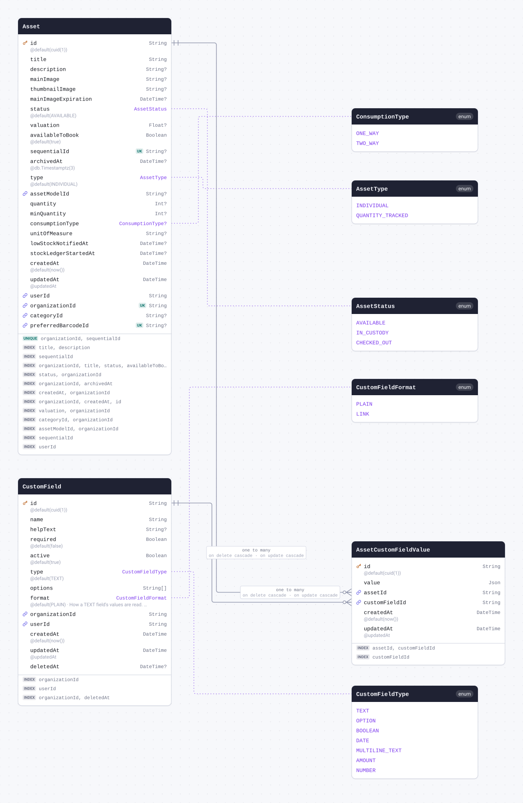

| Field           | Type       | Constraints                                     | Default      | Description |
| --------------- | ---------- | ----------------------------------------------- | ------------ | ----------- |
| `id`            | `String`   | PK NOT NULL                                     | `cuid(1)`    |             |
| `value`         | `Json`     | NOT NULL                                        |              |             |
| `assetId`       | `String`   | NOT NULL → [Asset.id](#model-Asset)             |              |             |
| `customFieldId` | `String`   | NOT NULL → [CustomField.id](#model-CustomField) |              |             |
| `createdAt`     | `DateTime` | NOT NULL                                        | `now()`      |             |
| `updatedAt`     | `DateTime` | NOT NULL                                        | `@updatedAt` |             |

#### Indexes

- `@@index([assetId, customFieldId], map: "AssetCustomFieldValue_lookup_idx")`
- `@@index([customFieldId])`

#### References

- `assetId` → [Asset.id](#model-Asset) (many-to-one, on delete Cascade, on update Cascade)
- `customFieldId` → [CustomField.id](#model-CustomField) (many-to-one, on delete Cascade, on update Cascade)

#### Definition

```sql
CREATE TABLE "AssetCustomFieldValue" (
    "id" TEXT NOT NULL,
    "value" JSONB NOT NULL,
    "assetId" TEXT NOT NULL,
    "customFieldId" TEXT NOT NULL,
    "createdAt" TIMESTAMP(3) NOT NULL DEFAULT CURRENT_TIMESTAMP,
    "updatedAt" TIMESTAMP(3) NOT NULL,

    CONSTRAINT "AssetCustomFieldValue_pkey" PRIMARY KEY ("id")
);

CREATE INDEX "AssetCustomFieldValue_lookup_idx" ON "AssetCustomFieldValue"("assetId", "customFieldId");

CREATE INDEX "AssetCustomFieldValue_customFieldId_idx" ON "AssetCustomFieldValue"("customFieldId");

ALTER TABLE "AssetCustomFieldValue" ADD CONSTRAINT "AssetCustomFieldValue_assetId_fkey" FOREIGN KEY ("assetId") REFERENCES "Asset"("id") ON DELETE CASCADE ON UPDATE CASCADE;

ALTER TABLE "AssetCustomFieldValue" ADD CONSTRAINT "AssetCustomFieldValue_customFieldId_fkey" FOREIGN KEY ("customFieldId") REFERENCES "CustomField"("id") ON DELETE CASCADE ON UPDATE CASCADE;
```

<details>
<summary>Queries and their SQL</summary>

**findMany**: Every row

```ts
await prisma.assetCustomFieldValue.findMany();
```

```sql
SELECT
  "public"."AssetCustomFieldValue"."id",
  "public"."AssetCustomFieldValue"."value",
  "public"."AssetCustomFieldValue"."assetId",
  "public"."AssetCustomFieldValue"."customFieldId",
  "public"."AssetCustomFieldValue"."createdAt",
  "public"."AssetCustomFieldValue"."updatedAt"
FROM
  "public"."AssetCustomFieldValue"
WHERE
  1 = 1
OFFSET
  $1
-- params: ["0"]
```

**count**: How many rows there are

```ts
await prisma.assetCustomFieldValue.count();
```

```sql
SELECT
  COUNT(*) AS "_count$_all"
FROM
  (
    SELECT
      "public"."AssetCustomFieldValue"."id"
    FROM
      "public"."AssetCustomFieldValue"
    WHERE
      1 = 1
    OFFSET
      $1
  ) AS "sub"
-- params: ["0"]
```

**findMany**: Every row with its relations

```ts
await prisma.assetCustomFieldValue.findMany({ include: { asset: true, customField: true } });
```

```sql
SELECT
  "public"."AssetCustomFieldValue"."id",
  "public"."AssetCustomFieldValue"."value",
  "public"."AssetCustomFieldValue"."assetId",
  "public"."AssetCustomFieldValue"."customFieldId",
  "public"."AssetCustomFieldValue"."createdAt",
  "public"."AssetCustomFieldValue"."updatedAt"
FROM
  "public"."AssetCustomFieldValue"
WHERE
  1 = 1
OFFSET
  $1
-- params: ["0"]

SELECT
  "public"."Asset"."id",
  "public"."Asset"."title",
  "public"."Asset"."description",
  "public"."Asset"."mainImage",
  "public"."Asset"."thumbnailImage",
  "public"."Asset"."mainImageExpiration",
  "public"."Asset"."status"::text,
  "public"."Asset"."value",
  "public"."Asset"."availableToBook",
  "public"."Asset"."sequentialId",
  "public"."Asset"."archivedAt",
  "public"."Asset"."type"::text,
  "public"."Asset"."assetModelId",
  "public"."Asset"."quantity",
  "public"."Asset"."minQuantity",
  "public"."Asset"."consumptionType"::text,
  "public"."Asset"."unitOfMeasure",
  "public"."Asset"."lowStockNotifiedAt",
  "public"."Asset"."stockLedgerStartedAt",
  "public"."Asset"."createdAt",
  "public"."Asset"."updatedAt",
  "public"."Asset"."userId",
  "public"."Asset"."organizationId",
  "public"."Asset"."categoryId",
  "public"."Asset"."preferredBarcodeId"
FROM
  "public"."Asset"
WHERE
  "public"."Asset"."id" IN ($1)
OFFSET
  $2
-- params: ["<assetId of the rows above>","0"]

SELECT
  "public"."CustomField"."id",
  "public"."CustomField"."name",
  "public"."CustomField"."helpText",
  "public"."CustomField"."required",
  "public"."CustomField"."active",
  "public"."CustomField"."type"::text,
  "public"."CustomField"."options",
  "public"."CustomField"."format"::text,
  "public"."CustomField"."organizationId",
  "public"."CustomField"."userId",
  "public"."CustomField"."createdAt",
  "public"."CustomField"."updatedAt",
  "public"."CustomField"."deletedAt"
FROM
  "public"."CustomField"
WHERE
  "public"."CustomField"."id" IN ($1)
OFFSET
  $2
-- params: ["<customFieldId of the rows above>","0"]
```

**findUnique**: One row by what is unique to it

```ts
await prisma.assetCustomFieldValue.findUnique({ where: { id: "example" } });
```

```sql
SELECT
  "public"."AssetCustomFieldValue"."id",
  "public"."AssetCustomFieldValue"."value",
  "public"."AssetCustomFieldValue"."assetId",
  "public"."AssetCustomFieldValue"."customFieldId",
  "public"."AssetCustomFieldValue"."createdAt",
  "public"."AssetCustomFieldValue"."updatedAt"
FROM
  "public"."AssetCustomFieldValue"
WHERE
  (
    "public"."AssetCustomFieldValue"."id" = $1
    AND 1 = 1
  )
LIMIT
  $2
OFFSET
  $3
-- params: ["example","1","0"]
```

**create**: Create a row

```ts
await prisma.assetCustomFieldValue.create({
  data: { value: {}, assetId: "example", customFieldId: "example" },
});
```

```sql
INSERT INTO
  "public"."AssetCustomFieldValue" (
    "id",
    "value",
    "assetId",
    "customFieldId",
    "createdAt",
    "updatedAt"
  )
VALUES
  ($1, $2, $3, $4, $5, $6)
RETURNING
  "public"."AssetCustomFieldValue"."id",
  "public"."AssetCustomFieldValue"."value",
  "public"."AssetCustomFieldValue"."assetId",
  "public"."AssetCustomFieldValue"."customFieldId",
  "public"."AssetCustomFieldValue"."createdAt",
  "public"."AssetCustomFieldValue"."updatedAt"
-- params: ["<cuid(1)>","{}","example","example","<now()>","<now()>"]
```

**update**: Update a row

```ts
await prisma.assetCustomFieldValue.update({ where: { id: "example" }, data: { value: {} } });
```

```sql
UPDATE "public"."AssetCustomFieldValue"
SET
  "value" = $1,
  "updatedAt" = $2
WHERE
  (
    "public"."AssetCustomFieldValue"."id" = $3
    AND 1 = 1
  )
RETURNING
  "public"."AssetCustomFieldValue"."id",
  "public"."AssetCustomFieldValue"."value",
  "public"."AssetCustomFieldValue"."assetId",
  "public"."AssetCustomFieldValue"."customFieldId",
  "public"."AssetCustomFieldValue"."createdAt",
  "public"."AssetCustomFieldValue"."updatedAt"
-- params: ["{}",{"prisma__type":"generatorCall","prisma__value":{"name":"now","args":[],"returnType":{"type":"DateTime"}}},"example"]
```

**delete**: Delete a row

```ts
await prisma.assetCustomFieldValue.delete({ where: { id: "example" } });
```

```sql
DELETE FROM "public"."AssetCustomFieldValue"
WHERE
  (
    "public"."AssetCustomFieldValue"."id" = $1
    AND 1 = 1
  )
RETURNING
  "public"."AssetCustomFieldValue"."id",
  "public"."AssetCustomFieldValue"."value",
  "public"."AssetCustomFieldValue"."assetId",
  "public"."AssetCustomFieldValue"."customFieldId",
  "public"."AssetCustomFieldValue"."createdAt",
  "public"."AssetCustomFieldValue"."updatedAt"
-- params: ["example"]
```

</details>

<a id="model-AssetModelCustomFieldDefault"></a>

### AssetModelCustomFieldDefault

A custom field value an AssetModel gives the assets that join it.

`value` has the exact shape of `AssetCustomFieldValue.value`, so filling an
asset is a plain copy. Rows cascade away with their model or field.

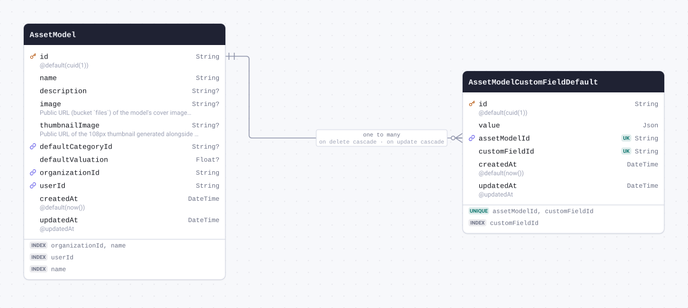

| Field           | Type       | Constraints                                   | Default      | Description |
| --------------- | ---------- | --------------------------------------------- | ------------ | ----------- |
| `id`            | `String`   | PK NOT NULL                                   | `cuid(1)`    |             |
| `value`         | `Json`     | NOT NULL                                      |              |             |
| `assetModelId`  | `String`   | NOT NULL → [AssetModel.id](#model-AssetModel) |              |             |
| `customFieldId` | `String`   | NOT NULL                                      |              |             |
| `createdAt`     | `DateTime` | NOT NULL                                      | `now()`      |             |
| `updatedAt`     | `DateTime` | NOT NULL                                      | `@updatedAt` |             |

#### Indexes

- `@@index([customFieldId])`
- `@@unique([assetModelId, customFieldId])`

#### References

- `assetModelId` → [AssetModel.id](#model-AssetModel) (many-to-one, on delete Cascade, on update Cascade)

#### Definition

```sql
CREATE TABLE "AssetModelCustomFieldDefault" (
    "id" TEXT NOT NULL,
    "value" JSONB NOT NULL,
    "assetModelId" TEXT NOT NULL,
    "customFieldId" TEXT NOT NULL,
    "createdAt" TIMESTAMP(3) NOT NULL DEFAULT CURRENT_TIMESTAMP,
    "updatedAt" TIMESTAMP(3) NOT NULL,

    CONSTRAINT "AssetModelCustomFieldDefault_pkey" PRIMARY KEY ("id")
);

CREATE INDEX "AssetModelCustomFieldDefault_customFieldId_idx" ON "AssetModelCustomFieldDefault"("customFieldId");

CREATE UNIQUE INDEX "AssetModelCustomFieldDefault_assetModelId_customFieldId_key" ON "AssetModelCustomFieldDefault"("assetModelId", "customFieldId");

ALTER TABLE "AssetModelCustomFieldDefault" ADD CONSTRAINT "AssetModelCustomFieldDefault_assetModelId_fkey" FOREIGN KEY ("assetModelId") REFERENCES "AssetModel"("id") ON DELETE CASCADE ON UPDATE CASCADE;
```

<details>
<summary>Queries and their SQL</summary>

**findMany**: Every row

```ts
await prisma.assetModelCustomFieldDefault.findMany();
```

```sql
SELECT
  "public"."AssetModelCustomFieldDefault"."id",
  "public"."AssetModelCustomFieldDefault"."value",
  "public"."AssetModelCustomFieldDefault"."assetModelId",
  "public"."AssetModelCustomFieldDefault"."customFieldId",
  "public"."AssetModelCustomFieldDefault"."createdAt",
  "public"."AssetModelCustomFieldDefault"."updatedAt"
FROM
  "public"."AssetModelCustomFieldDefault"
WHERE
  1 = 1
OFFSET
  $1
-- params: ["0"]
```

**count**: How many rows there are

```ts
await prisma.assetModelCustomFieldDefault.count();
```

```sql
SELECT
  COUNT(*) AS "_count$_all"
FROM
  (
    SELECT
      "public"."AssetModelCustomFieldDefault"."id"
    FROM
      "public"."AssetModelCustomFieldDefault"
    WHERE
      1 = 1
    OFFSET
      $1
  ) AS "sub"
-- params: ["0"]
```

**findMany**: Every row with its relations

```ts
await prisma.assetModelCustomFieldDefault.findMany({ include: { assetModel: true } });
```

```sql
SELECT
  "public"."AssetModelCustomFieldDefault"."id",
  "public"."AssetModelCustomFieldDefault"."value",
  "public"."AssetModelCustomFieldDefault"."assetModelId",
  "public"."AssetModelCustomFieldDefault"."customFieldId",
  "public"."AssetModelCustomFieldDefault"."createdAt",
  "public"."AssetModelCustomFieldDefault"."updatedAt"
FROM
  "public"."AssetModelCustomFieldDefault"
WHERE
  1 = 1
OFFSET
  $1
-- params: ["0"]

SELECT
  "public"."AssetModel"."id",
  "public"."AssetModel"."name",
  "public"."AssetModel"."description",
  "public"."AssetModel"."image",
  "public"."AssetModel"."thumbnailImage",
  "public"."AssetModel"."defaultCategoryId",
  "public"."AssetModel"."defaultValuation",
  "public"."AssetModel"."organizationId",
  "public"."AssetModel"."userId",
  "public"."AssetModel"."createdAt",
  "public"."AssetModel"."updatedAt"
FROM
  "public"."AssetModel"
WHERE
  "public"."AssetModel"."id" IN ($1)
OFFSET
  $2
-- params: ["<assetModelId of the rows above>","0"]
```

**findUnique**: One row by what is unique to it

```ts
await prisma.assetModelCustomFieldDefault.findUnique({ where: { id: "example" } });
```

```sql
SELECT
  "public"."AssetModelCustomFieldDefault"."id",
  "public"."AssetModelCustomFieldDefault"."value",
  "public"."AssetModelCustomFieldDefault"."assetModelId",
  "public"."AssetModelCustomFieldDefault"."customFieldId",
  "public"."AssetModelCustomFieldDefault"."createdAt",
  "public"."AssetModelCustomFieldDefault"."updatedAt"
FROM
  "public"."AssetModelCustomFieldDefault"
WHERE
  (
    "public"."AssetModelCustomFieldDefault"."id" = $1
    AND 1 = 1
  )
LIMIT
  $2
OFFSET
  $3
-- params: ["example","1","0"]
```

**create**: Create a row

```ts
await prisma.assetModelCustomFieldDefault.create({
  data: { value: {}, assetModelId: "example", customFieldId: "example" },
});
```

```sql
INSERT INTO
  "public"."AssetModelCustomFieldDefault" (
    "id",
    "value",
    "assetModelId",
    "customFieldId",
    "createdAt",
    "updatedAt"
  )
VALUES
  ($1, $2, $3, $4, $5, $6)
RETURNING
  "public"."AssetModelCustomFieldDefault"."id",
  "public"."AssetModelCustomFieldDefault"."value",
  "public"."AssetModelCustomFieldDefault"."assetModelId",
  "public"."AssetModelCustomFieldDefault"."customFieldId",
  "public"."AssetModelCustomFieldDefault"."createdAt",
  "public"."AssetModelCustomFieldDefault"."updatedAt"
-- params: ["<cuid(1)>","{}","example","example","<now()>","<now()>"]
```

**update**: Update a row

```ts
await prisma.assetModelCustomFieldDefault.update({ where: { id: "example" }, data: { value: {} } });
```

```sql
UPDATE "public"."AssetModelCustomFieldDefault"
SET
  "value" = $1,
  "updatedAt" = $2
WHERE
  (
    "public"."AssetModelCustomFieldDefault"."id" = $3
    AND 1 = 1
  )
RETURNING
  "public"."AssetModelCustomFieldDefault"."id",
  "public"."AssetModelCustomFieldDefault"."value",
  "public"."AssetModelCustomFieldDefault"."assetModelId",
  "public"."AssetModelCustomFieldDefault"."customFieldId",
  "public"."AssetModelCustomFieldDefault"."createdAt",
  "public"."AssetModelCustomFieldDefault"."updatedAt"
-- params: ["{}",{"prisma__type":"generatorCall","prisma__value":{"name":"now","args":[],"returnType":{"type":"DateTime"}}},"example"]
```

**delete**: Delete a row

```ts
await prisma.assetModelCustomFieldDefault.delete({ where: { id: "example" } });
```

```sql
DELETE FROM "public"."AssetModelCustomFieldDefault"
WHERE
  (
    "public"."AssetModelCustomFieldDefault"."id" = $1
    AND 1 = 1
  )
RETURNING
  "public"."AssetModelCustomFieldDefault"."id",
  "public"."AssetModelCustomFieldDefault"."value",
  "public"."AssetModelCustomFieldDefault"."assetModelId",
  "public"."AssetModelCustomFieldDefault"."customFieldId",
  "public"."AssetModelCustomFieldDefault"."createdAt",
  "public"."AssetModelCustomFieldDefault"."updatedAt"
-- params: ["example"]
```

</details>

<a id="model-Invite"></a>

### Invite

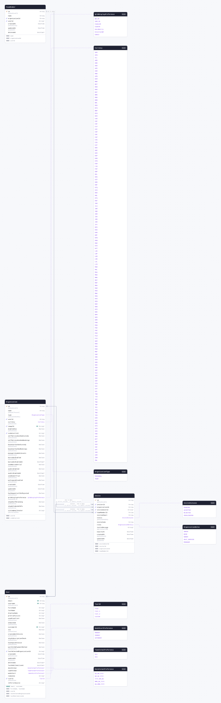

| Field            | Type                                             | Constraints                                       | Default      | Description |
| ---------------- | ------------------------------------------------ | ------------------------------------------------- | ------------ | ----------- |
| `id`             | `String`                                         | PK NOT NULL                                       | `cuid(1)`    |             |
| `inviterId`      | `String`                                         | NOT NULL → [User.id](#model-User)                 |              |             |
| `organizationId` | `String`                                         | NOT NULL → [Organization.id](#model-Organization) |              |             |
| `inviteeUserId`  | `String`                                         | NULL → [User.id](#model-User)                     |              |             |
| `teamMemberId`   | `String`                                         | NOT NULL → [TeamMember.id](#model-TeamMember)     |              |             |
| `inviteeEmail`   | `String`                                         | NOT NULL                                          |              |             |
| `status`         | [`InviteStatuses`](#enum-InviteStatuses)         | NOT NULL                                          | `PENDING`    |             |
| `inviteCode`     | `String`                                         | NOT NULL                                          |              |             |
| `roles`          | [`OrganizationRoles[]`](#enum-OrganizationRoles) | NOT NULL                                          |              |             |
| `inviteMessage`  | `String` `@db.VarChar(1000)`                     | NULL                                              |              |             |
| `expiresAt`      | `DateTime`                                       | NOT NULL                                          |              |             |
| `createdAt`      | `DateTime`                                       | NOT NULL                                          | `now()`      |             |
| `updatedAt`      | `DateTime`                                       | NOT NULL                                          | `@updatedAt` |             |

#### Indexes

- `@@index([inviteeUserId])`
- `@@index([inviterId])`
- `@@index([organizationId])`
- `@@index([teamMemberId])`

#### References

- `inviterId` → [User.id](#model-User) (many-to-one, on delete Cascade, on update Cascade)
- `organizationId` → [Organization.id](#model-Organization) (many-to-one, on delete Cascade, on update Cascade)
- `inviteeUserId` → [User.id](#model-User) (many-to-one, on delete Cascade, on update Cascade)
- `teamMemberId` → [TeamMember.id](#model-TeamMember) (many-to-one)

#### Definition

```sql
CREATE TABLE "Invite" (
    "id" TEXT NOT NULL,
    "inviterId" TEXT NOT NULL,
    "organizationId" TEXT NOT NULL,
    "inviteeUserId" TEXT,
    "teamMemberId" TEXT NOT NULL,
    "inviteeEmail" TEXT NOT NULL,
    "status" "InviteStatuses" NOT NULL DEFAULT 'PENDING',
    "inviteCode" TEXT NOT NULL,
    "roles" "OrganizationRoles"[],
    "inviteMessage" VARCHAR(1000),
    "expiresAt" TIMESTAMP(3) NOT NULL,
    "createdAt" TIMESTAMP(3) NOT NULL DEFAULT CURRENT_TIMESTAMP,
    "updatedAt" TIMESTAMP(3) NOT NULL,

    CONSTRAINT "Invite_pkey" PRIMARY KEY ("id")
);

CREATE INDEX "Invite_inviteeUserId_idx" ON "Invite"("inviteeUserId");

CREATE INDEX "Invite_inviterId_idx" ON "Invite"("inviterId");

CREATE INDEX "Invite_organizationId_idx" ON "Invite"("organizationId");

CREATE INDEX "Invite_teamMemberId_idx" ON "Invite"("teamMemberId");

ALTER TABLE "Invite" ADD CONSTRAINT "Invite_inviterId_fkey" FOREIGN KEY ("inviterId") REFERENCES "User"("id") ON DELETE CASCADE ON UPDATE CASCADE;

ALTER TABLE "Invite" ADD CONSTRAINT "Invite_organizationId_fkey" FOREIGN KEY ("organizationId") REFERENCES "Organization"("id") ON DELETE CASCADE ON UPDATE CASCADE;

ALTER TABLE "Invite" ADD CONSTRAINT "Invite_inviteeUserId_fkey" FOREIGN KEY ("inviteeUserId") REFERENCES "User"("id") ON DELETE CASCADE ON UPDATE CASCADE;

ALTER TABLE "Invite" ADD CONSTRAINT "Invite_teamMemberId_fkey" FOREIGN KEY ("teamMemberId") REFERENCES "TeamMember"("id") ON DELETE RESTRICT ON UPDATE CASCADE;
```

<details>
<summary>Queries and their SQL</summary>

**findMany**: Every row

```ts
await prisma.invite.findMany();
```

```sql
SELECT
  "public"."Invite"."id",
  "public"."Invite"."inviterId",
  "public"."Invite"."organizationId",
  "public"."Invite"."inviteeUserId",
  "public"."Invite"."teamMemberId",
  "public"."Invite"."inviteeEmail",
  "public"."Invite"."status"::text,
  "public"."Invite"."inviteCode",
  "public"."Invite"."roles"::text[],
  "public"."Invite"."inviteMessage",
  "public"."Invite"."expiresAt",
  "public"."Invite"."createdAt",
  "public"."Invite"."updatedAt"
FROM
  "public"."Invite"
WHERE
  1 = 1
OFFSET
  $1
-- params: ["0"]
```

**count**: How many rows there are

```ts
await prisma.invite.count();
```

```sql
SELECT
  COUNT(*) AS "_count$_all"
FROM
  (
    SELECT
      "public"."Invite"."id"
    FROM
      "public"."Invite"
    WHERE
      1 = 1
    OFFSET
      $1
  ) AS "sub"
-- params: ["0"]
```

**findMany**: Every row with its relations

```ts
await prisma.invite.findMany({
  include: { inviter: true, organization: true, inviteeUser: true, inviteeTeamMember: true },
});
```

```sql
SELECT
  "public"."Invite"."id",
  "public"."Invite"."inviterId",
  "public"."Invite"."organizationId",
  "public"."Invite"."inviteeUserId",
  "public"."Invite"."teamMemberId",
  "public"."Invite"."inviteeEmail",
  "public"."Invite"."status"::text,
  "public"."Invite"."inviteCode",
  "public"."Invite"."roles"::text[],
  "public"."Invite"."inviteMessage",
  "public"."Invite"."expiresAt",
  "public"."Invite"."createdAt",
  "public"."Invite"."updatedAt"
FROM
  "public"."Invite"
WHERE
  1 = 1
OFFSET
  $1
-- params: ["0"]

SELECT
  "public"."User"."id",
  "public"."User"."email",
  "public"."User"."username",
  "public"."User"."firstName",
  "public"."User"."lastName",
  "public"."User"."displayName",
  "public"."User"."profilePicture",
  "public"."User"."usedFreeTrial",
  "public"."User"."onboarded",
  "public"."User"."customerId",
  "public"."User"."sso",
  "public"."User"."createdWithInvite",
  "public"."User"."skipSubscriptionCheck",
  "public"."User"."hasUnpaidInvoice",
  "public"."User"."warnForNoPaymentMethod",
  "public"."User"."lastSelectedOrganizationId",
  "public"."User"."createdAt",
  "public"."User"."updatedAt",
  "public"."User"."deletedAt",
  "public"."User"."lastMobileActiveAt",
  "public"."User"."dateFormat"::text,
  "public"."User"."timeFormat"::text,
  "public"."User"."weekStart"::text,
  "public"."User"."timeZone",
  "public"."User"."tierId"::text,
  "public"."User"."referralSource"
FROM
  "public"."User"
WHERE
  "public"."User"."id" IN ($1)
OFFSET
  $2
-- params: ["<inviterId of the rows above>","0"]

SELECT
  "public"."Organization"."id",
  "public"."Organization"."name",
  "public"."Organization"."type"::text,
  "public"."Organization"."userId",
  "public"."Organization"."currency"::text,
  "public"."Organization"."imageId",
  "public"."Organization"."enabledSso",
  "public"."Organization"."ssoDetailsId",
  "public"."Organization"."selfServiceCanSeeCustody",
  "public"."Organization"."selfServiceCanSeeBookings",
  "public"."Organization"."baseUserCanSeeCustody",
  "public"."Organization"."baseUserCanSeeBookings",
  "public"."Organization"."managersCanEditAssets",
  "public"."Organization"."barcodesEnabled",
  "public"."Organization"."barcodesEnabledAt",
  "public"."Organization"."usedBarcodeTrial",
  "public"."Organization"."auditsEnabled",
  "public"."Organization"."auditsEnabledAt",
  "public"."Organization"."usedAuditTrial",
  "public"."Organization"."workspaceDisabled",
  "public"."Organization"."createdAt",
  "public"."Organization"."updatedAt",
  "public"."Organization"."hasSequentialIdsMigrated",
  "public"."Organization"."qrIdDisplayPreference"::text,
  "public"."Organization"."showShelfBranding",
  "public"."Organization"."showQrCodesOnPdfs",
  "public"."Organization"."customEmailFooter"
FROM
  "public"."Organization"
WHERE
  "public"."Organization"."id" IN ($1)
OFFSET
  $2
-- params: ["<organizationId of the rows above>","0"]

SELECT
  "public"."User"."id",
  "public"."User"."email",
  "public"."User"."username",
  "public"."User"."firstName",
  "public"."User"."lastName",
  "public"."User"."displayName",
  "public"."User"."profilePicture",
  "public"."User"."usedFreeTrial",
  "public"."User"."onboarded",
  "public"."User"."customerId",
  "public"."User"."sso",
  "public"."User"."createdWithInvite",
  "public"."User"."skipSubscriptionCheck",
  "public"."User"."hasUnpaidInvoice",
  "public"."User"."warnForNoPaymentMethod",
  "public"."User"."lastSelectedOrganizationId",
  "public"."User"."createdAt",
  "public"."User"."updatedAt",
  "public"."User"."deletedAt",
  "public"."User"."lastMobileActiveAt",
  "public"."User"."dateFormat"::text,
  "public"."User"."timeFormat"::text,
  "public"."User"."weekStart"::text,
  "public"."User"."timeZone",
  "public"."User"."tierId"::text,
  "public"."User"."referralSource"
FROM
  "public"."User"
WHERE
  "public"."User"."id" IN ($1)
OFFSET
  $2
-- params: ["<inviteeUserId of the rows above>","0"]

SELECT
  "public"."TeamMember"."id",
  "public"."TeamMember"."name",
  "public"."TeamMember"."organizationId",
  "public"."TeamMember"."userId",
  "public"."TeamMember"."createdAt",
  "public"."TeamMember"."updatedAt",
  "public"."TeamMember"."deletedAt"
FROM
  "public"."TeamMember"
WHERE
  "public"."TeamMember"."id" IN ($1)
OFFSET
  $2
-- params: ["<teamMemberId of the rows above>","0"]
```

**findUnique**: One row by what is unique to it

```ts
await prisma.invite.findUnique({ where: { id: "example" } });
```

```sql
SELECT
  "public"."Invite"."id",
  "public"."Invite"."inviterId",
  "public"."Invite"."organizationId",
  "public"."Invite"."inviteeUserId",
  "public"."Invite"."teamMemberId",
  "public"."Invite"."inviteeEmail",
  "public"."Invite"."status"::text,
  "public"."Invite"."inviteCode",
  "public"."Invite"."roles"::text[],
  "public"."Invite"."inviteMessage",
  "public"."Invite"."expiresAt",
  "public"."Invite"."createdAt",
  "public"."Invite"."updatedAt"
FROM
  "public"."Invite"
WHERE
  (
    "public"."Invite"."id" = $1
    AND 1 = 1
  )
LIMIT
  $2
OFFSET
  $3
-- params: ["example","1","0"]
```

**create**: Create a row

```ts
await prisma.invite.create({
  data: {
    inviterId: "example",
    organizationId: "example",
    teamMemberId: "example",
    inviteeEmail: "example",
    inviteCode: "example",
    roles: ["ADMIN"],
    expiresAt: new Date("2026-01-01T00:00:00.000Z"),
  },
});
```

```sql
INSERT INTO
  "public"."Invite" (
    "id",
    "inviterId",
    "organizationId",
    "teamMemberId",
    "inviteeEmail",
    "status",
    "inviteCode",
    "roles",
    "expiresAt",
    "createdAt",
    "updatedAt"
  )
VALUES
  (
    $1,
    $2,
    $3,
    $4,
    $5,
    CAST($6::text AS "public"."InviteStatuses"),
    $7,
    CAST($8::text[] AS "public"."OrganizationRoles" []),
    $9,
    $10,
    $11
  )
RETURNING
  "public"."Invite"."id",
  "public"."Invite"."inviterId",
  "public"."Invite"."organizationId",
  "public"."Invite"."inviteeUserId",
  "public"."Invite"."teamMemberId",
  "public"."Invite"."inviteeEmail",
  "public"."Invite"."status"::text,
  "public"."Invite"."inviteCode",
  "public"."Invite"."roles"::text[],
  "public"."Invite"."inviteMessage",
  "public"."Invite"."expiresAt",
  "public"."Invite"."createdAt",
  "public"."Invite"."updatedAt"
-- params: ["<cuid(1)>","example","example","example","example","PENDING","example",["ADMIN"],"2026-01-01T00:00:00.000Z","<now()>","<now()>"]
```

**update**: Update a row

```ts
await prisma.invite.update({ where: { id: "example" }, data: { inviteeEmail: "example" } });
```

```sql
UPDATE "public"."Invite"
SET
  "inviteeEmail" = $1,
  "updatedAt" = $2
WHERE
  (
    "public"."Invite"."id" = $3
    AND 1 = 1
  )
RETURNING
  "public"."Invite"."id",
  "public"."Invite"."inviterId",
  "public"."Invite"."organizationId",
  "public"."Invite"."inviteeUserId",
  "public"."Invite"."teamMemberId",
  "public"."Invite"."inviteeEmail",
  "public"."Invite"."status"::text,
  "public"."Invite"."inviteCode",
  "public"."Invite"."roles"::text[],
  "public"."Invite"."inviteMessage",
  "public"."Invite"."expiresAt",
  "public"."Invite"."createdAt",
  "public"."Invite"."updatedAt"
-- params: ["example",{"prisma__type":"generatorCall","prisma__value":{"name":"now","args":[],"returnType":{"type":"DateTime"}}},"example"]
```

**delete**: Delete a row

```ts
await prisma.invite.delete({ where: { id: "example" } });
```

```sql
DELETE FROM "public"."Invite"
WHERE
  (
    "public"."Invite"."id" = $1
    AND 1 = 1
  )
RETURNING
  "public"."Invite"."id",
  "public"."Invite"."inviterId",
  "public"."Invite"."organizationId",
  "public"."Invite"."inviteeUserId",
  "public"."Invite"."teamMemberId",
  "public"."Invite"."inviteeEmail",
  "public"."Invite"."status"::text,
  "public"."Invite"."inviteCode",
  "public"."Invite"."roles"::text[],
  "public"."Invite"."inviteMessage",
  "public"."Invite"."expiresAt",
  "public"."Invite"."createdAt",
  "public"."Invite"."updatedAt"
-- params: ["example"]
```

</details>

<a id="model-Announcement"></a>

### Announcement

| Field       | Type       | Constraints | Default      | Description |
| ----------- | ---------- | ----------- | ------------ | ----------- |
| `id`        | `String`   | PK NOT NULL | `cuid(1)`    |             |
| `name`      | `String`   | NOT NULL    |              |             |
| `content`   | `String`   | NOT NULL    |              |             |
| `link`      | `String`   | NULL        |              |             |
| `linkText`  | `String`   | NULL        |              |             |
| `published` | `Boolean`  | NOT NULL    | `false`      |             |
| `createdAt` | `DateTime` | NOT NULL    | `now()`      |             |
| `updatedAt` | `DateTime` | NOT NULL    | `@updatedAt` |             |

#### Definition

```sql
CREATE TABLE "Announcement" (
    "id" TEXT NOT NULL,
    "name" TEXT NOT NULL,
    "content" TEXT NOT NULL,
    "link" TEXT,
    "linkText" TEXT,
    "published" BOOLEAN NOT NULL DEFAULT false,
    "createdAt" TIMESTAMP(3) NOT NULL DEFAULT CURRENT_TIMESTAMP,
    "updatedAt" TIMESTAMP(3) NOT NULL,

    CONSTRAINT "Announcement_pkey" PRIMARY KEY ("id")
);
```

<details>
<summary>Queries and their SQL</summary>

**findMany**: Every row

```ts
await prisma.announcement.findMany();
```

```sql
SELECT
  "public"."Announcement"."id",
  "public"."Announcement"."name",
  "public"."Announcement"."content",
  "public"."Announcement"."link",
  "public"."Announcement"."linkText",
  "public"."Announcement"."published",
  "public"."Announcement"."createdAt",
  "public"."Announcement"."updatedAt"
FROM
  "public"."Announcement"
WHERE
  1 = 1
OFFSET
  $1
-- params: ["0"]
```

**count**: How many rows there are

```ts
await prisma.announcement.count();
```

```sql
SELECT
  COUNT(*) AS "_count$_all"
FROM
  (
    SELECT
      "public"."Announcement"."id"
    FROM
      "public"."Announcement"
    WHERE
      1 = 1
    OFFSET
      $1
  ) AS "sub"
-- params: ["0"]
```

**findUnique**: One row by what is unique to it

```ts
await prisma.announcement.findUnique({ where: { id: "example" } });
```

```sql
SELECT
  "public"."Announcement"."id",
  "public"."Announcement"."name",
  "public"."Announcement"."content",
  "public"."Announcement"."link",
  "public"."Announcement"."linkText",
  "public"."Announcement"."published",
  "public"."Announcement"."createdAt",
  "public"."Announcement"."updatedAt"
FROM
  "public"."Announcement"
WHERE
  (
    "public"."Announcement"."id" = $1
    AND 1 = 1
  )
LIMIT
  $2
OFFSET
  $3
-- params: ["example","1","0"]
```

**create**: Create a row

```ts
await prisma.announcement.create({ data: { name: "example", content: "example" } });
```

```sql
INSERT INTO
  "public"."Announcement" (
    "id",
    "name",
    "content",
    "published",
    "createdAt",
    "updatedAt"
  )
VALUES
  ($1, $2, $3, $4, $5, $6)
RETURNING
  "public"."Announcement"."id",
  "public"."Announcement"."name",
  "public"."Announcement"."content",
  "public"."Announcement"."link",
  "public"."Announcement"."linkText",
  "public"."Announcement"."published",
  "public"."Announcement"."createdAt",
  "public"."Announcement"."updatedAt"
-- params: ["<cuid(1)>","example","example",false,"<now()>","<now()>"]
```

**update**: Update a row

```ts
await prisma.announcement.update({ where: { id: "example" }, data: { name: "example" } });
```

```sql
UPDATE "public"."Announcement"
SET
  "name" = $1,
  "updatedAt" = $2
WHERE
  (
    "public"."Announcement"."id" = $3
    AND 1 = 1
  )
RETURNING
  "public"."Announcement"."id",
  "public"."Announcement"."name",
  "public"."Announcement"."content",
  "public"."Announcement"."link",
  "public"."Announcement"."linkText",
  "public"."Announcement"."published",
  "public"."Announcement"."createdAt",
  "public"."Announcement"."updatedAt"
-- params: ["example",{"prisma__type":"generatorCall","prisma__value":{"name":"now","args":[],"returnType":{"type":"DateTime"}}},"example"]
```

**delete**: Delete a row

```ts
await prisma.announcement.delete({ where: { id: "example" } });
```

```sql
DELETE FROM "public"."Announcement"
WHERE
  (
    "public"."Announcement"."id" = $1
    AND 1 = 1
  )
RETURNING
  "public"."Announcement"."id",
  "public"."Announcement"."name",
  "public"."Announcement"."content",
  "public"."Announcement"."link",
  "public"."Announcement"."linkText",
  "public"."Announcement"."published",
  "public"."Announcement"."createdAt",
  "public"."Announcement"."updatedAt"
-- params: ["example"]
```

</details>

<a id="model-ConsumptionLog"></a>

### ConsumptionLog

-
- Audit trail for all quantity changes on quantity-tracked assets.
- Every event records who performed it, who received/returned items,
- which booking it relates to, and the category of change.
- Quantity is always positive — direction is determined by category.

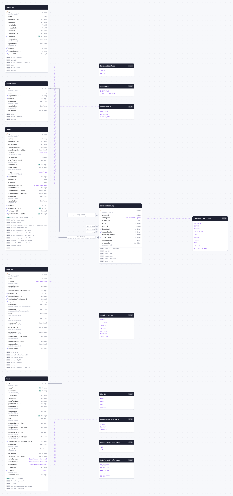

| Field            | Type                                               | Constraints                               | Default   | Description |
| ---------------- | -------------------------------------------------- | ----------------------------------------- | --------- | ----------- |
| `id`             | `String`                                           | PK NOT NULL                               | `cuid(1)` |             |
| `assetId`        | `String`                                           | NOT NULL → [Asset.id](#model-Asset)       |           |             |
| `category`       | [`ConsumptionCategory`](#enum-ConsumptionCategory) | NOT NULL                                  |           |             |
| `quantity`       | `Int`                                              | NOT NULL                                  |           |             |
| `note`           | `String`                                           | NULL                                      |           |             |
| `userId`         | `String`                                           | NOT NULL → [User.id](#model-User)         |           |             |
| `bookingId`      | `String`                                           | NULL → [Booking.id](#model-Booking)       |           |             |
| `custodianId`    | `String`                                           | NULL → [TeamMember.id](#model-TeamMember) |           |             |
| `bookingAssetId` | `String`                                           | NULL                                      |           |             |
| `locationId`     | `String`                                           | NULL → [Location.id](#model-Location)     |           |             |
| `stockChange`    | `Int`                                              | NULL                                      |           |             |
| `createdAt`      | `DateTime`                                         | NOT NULL                                  | `now()`   |             |

#### Indexes

- `@@index([assetId, createdAt])`
- `@@index([userId])`
- `@@index([bookingId])`
- `@@index([custodianId])`
- `@@index([bookingAssetId])`
- `@@index([locationId])`

#### References

- `assetId` → [Asset.id](#model-Asset) (many-to-one, on delete Cascade, on update Cascade)
- `userId` → [User.id](#model-User) (many-to-one)
- `bookingId` → [Booking.id](#model-Booking) (many-to-one)
- `custodianId` → [TeamMember.id](#model-TeamMember) (many-to-one)
- `locationId` → [Location.id](#model-Location) (many-to-one, on delete SetNull, on update Cascade)

#### Definition

```sql
CREATE TABLE "ConsumptionLog" (
    "id" TEXT NOT NULL,
    "assetId" TEXT NOT NULL,
    "category" "ConsumptionCategory" NOT NULL,
    "quantity" INTEGER NOT NULL,
    "note" TEXT,
    "userId" TEXT NOT NULL,
    "bookingId" TEXT,
    "custodianId" TEXT,
    "bookingAssetId" TEXT,
    "locationId" TEXT,
    "stockChange" INTEGER,
    "createdAt" TIMESTAMP(3) NOT NULL DEFAULT CURRENT_TIMESTAMP,

    CONSTRAINT "ConsumptionLog_pkey" PRIMARY KEY ("id")
);

CREATE INDEX "ConsumptionLog_assetId_createdAt_idx" ON "ConsumptionLog"("assetId", "createdAt");

CREATE INDEX "ConsumptionLog_userId_idx" ON "ConsumptionLog"("userId");

CREATE INDEX "ConsumptionLog_bookingId_idx" ON "ConsumptionLog"("bookingId");

CREATE INDEX "ConsumptionLog_custodianId_idx" ON "ConsumptionLog"("custodianId");

CREATE INDEX "ConsumptionLog_bookingAssetId_idx" ON "ConsumptionLog"("bookingAssetId");

CREATE INDEX "ConsumptionLog_locationId_idx" ON "ConsumptionLog"("locationId");

ALTER TABLE "ConsumptionLog" ADD CONSTRAINT "ConsumptionLog_assetId_fkey" FOREIGN KEY ("assetId") REFERENCES "Asset"("id") ON DELETE CASCADE ON UPDATE CASCADE;

ALTER TABLE "ConsumptionLog" ADD CONSTRAINT "ConsumptionLog_userId_fkey" FOREIGN KEY ("userId") REFERENCES "User"("id") ON DELETE RESTRICT ON UPDATE CASCADE;

ALTER TABLE "ConsumptionLog" ADD CONSTRAINT "ConsumptionLog_bookingId_fkey" FOREIGN KEY ("bookingId") REFERENCES "Booking"("id") ON DELETE SET NULL ON UPDATE CASCADE;

ALTER TABLE "ConsumptionLog" ADD CONSTRAINT "ConsumptionLog_custodianId_fkey" FOREIGN KEY ("custodianId") REFERENCES "TeamMember"("id") ON DELETE SET NULL ON UPDATE CASCADE;

ALTER TABLE "ConsumptionLog" ADD CONSTRAINT "ConsumptionLog_locationId_fkey" FOREIGN KEY ("locationId") REFERENCES "Location"("id") ON DELETE SET NULL ON UPDATE CASCADE;
```

<details>
<summary>Queries and their SQL</summary>

**findMany**: Every row

```ts
await prisma.consumptionLog.findMany();
```

```sql
SELECT
  "public"."ConsumptionLog"."id",
  "public"."ConsumptionLog"."assetId",
  "public"."ConsumptionLog"."category"::text,
  "public"."ConsumptionLog"."quantity",
  "public"."ConsumptionLog"."note",
  "public"."ConsumptionLog"."userId",
  "public"."ConsumptionLog"."bookingId",
  "public"."ConsumptionLog"."custodianId",
  "public"."ConsumptionLog"."bookingAssetId",
  "public"."ConsumptionLog"."locationId",
  "public"."ConsumptionLog"."stockChange",
  "public"."ConsumptionLog"."createdAt"
FROM
  "public"."ConsumptionLog"
WHERE
  1 = 1
OFFSET
  $1
-- params: ["0"]
```

**count**: How many rows there are

```ts
await prisma.consumptionLog.count();
```

```sql
SELECT
  COUNT(*) AS "_count$_all"
FROM
  (
    SELECT
      "public"."ConsumptionLog"."id"
    FROM
      "public"."ConsumptionLog"
    WHERE
      1 = 1
    OFFSET
      $1
  ) AS "sub"
-- params: ["0"]
```

**findMany**: Every row with its relations

```ts
await prisma.consumptionLog.findMany({
  include: { asset: true, performedBy: true, booking: true, custodian: true, location: true },
});
```

```sql
SELECT
  "public"."ConsumptionLog"."id",
  "public"."ConsumptionLog"."assetId",
  "public"."ConsumptionLog"."category"::text,
  "public"."ConsumptionLog"."quantity",
  "public"."ConsumptionLog"."note",
  "public"."ConsumptionLog"."userId",
  "public"."ConsumptionLog"."bookingId",
  "public"."ConsumptionLog"."custodianId",
  "public"."ConsumptionLog"."bookingAssetId",
  "public"."ConsumptionLog"."locationId",
  "public"."ConsumptionLog"."stockChange",
  "public"."ConsumptionLog"."createdAt"
FROM
  "public"."ConsumptionLog"
WHERE
  1 = 1
OFFSET
  $1
-- params: ["0"]

SELECT
  "public"."Asset"."id",
  "public"."Asset"."title",
  "public"."Asset"."description",
  "public"."Asset"."mainImage",
  "public"."Asset"."thumbnailImage",
  "public"."Asset"."mainImageExpiration",
  "public"."Asset"."status"::text,
  "public"."Asset"."value",
  "public"."Asset"."availableToBook",
  "public"."Asset"."sequentialId",
  "public"."Asset"."archivedAt",
  "public"."Asset"."type"::text,
  "public"."Asset"."assetModelId",
  "public"."Asset"."quantity",
  "public"."Asset"."minQuantity",
  "public"."Asset"."consumptionType"::text,
  "public"."Asset"."unitOfMeasure",
  "public"."Asset"."lowStockNotifiedAt",
  "public"."Asset"."stockLedgerStartedAt",
  "public"."Asset"."createdAt",
  "public"."Asset"."updatedAt",
  "public"."Asset"."userId",
  "public"."Asset"."organizationId",
  "public"."Asset"."categoryId",
  "public"."Asset"."preferredBarcodeId"
FROM
  "public"."Asset"
WHERE
  "public"."Asset"."id" IN ($1)
OFFSET
  $2
-- params: ["<assetId of the rows above>","0"]

SELECT
  "public"."User"."id",
  "public"."User"."email",
  "public"."User"."username",
  "public"."User"."firstName",
  "public"."User"."lastName",
  "public"."User"."displayName",
  "public"."User"."profilePicture",
  "public"."User"."usedFreeTrial",
  "public"."User"."onboarded",
  "public"."User"."customerId",
  "public"."User"."sso",
  "public"."User"."createdWithInvite",
  "public"."User"."skipSubscriptionCheck",
  "public"."User"."hasUnpaidInvoice",
  "public"."User"."warnForNoPaymentMethod",
  "public"."User"."lastSelectedOrganizationId",
  "public"."User"."createdAt",
  "public"."User"."updatedAt",
  "public"."User"."deletedAt",
  "public"."User"."lastMobileActiveAt",
  "public"."User"."dateFormat"::text,
  "public"."User"."timeFormat"::text,
  "public"."User"."weekStart"::text,
  "public"."User"."timeZone",
  "public"."User"."tierId"::text,
  "public"."User"."referralSource"
FROM
  "public"."User"
WHERE
  "public"."User"."id" IN ($1)
OFFSET
  $2
-- params: ["<userId of the rows above>","0"]

SELECT
  "public"."Booking"."id",
  "public"."Booking"."name",
  "public"."Booking"."status"::text,
  "public"."Booking"."description",
  "public"."Booking"."activeSchedulerReference",
  "public"."Booking"."creatorId",
  "public"."Booking"."custodianUserId",
  "public"."Booking"."custodianTeamMemberId",
  "public"."Booking"."organizationId",
  "public"."Booking"."createdAt",
  "public"."Booking"."updatedAt",
  "public"."Booking"."from",
  "public"."Booking"."to",
  "public"."Booking"."originalFrom",
  "public"."Booking"."originalTo",
  "public"."Booking"."autoArchivedAt",
  "public"."Booking"."archivedWithoutCheckin",
  "public"."Booking"."cancellationReason",
  "public"."Booking"."approvedAt",
  "public"."Booking"."approvedById"
FROM
  "public"."Booking"
WHERE
  "public"."Booking"."id" IN ($1)
OFFSET
  $2
-- params: ["<bookingId of the rows above>","0"]

SELECT
  "public"."TeamMember"."id",
  "public"."TeamMember"."name",
  "public"."TeamMember"."organizationId",
  "public"."TeamMember"."userId",
  "public"."TeamMember"."createdAt",
  "public"."TeamMember"."updatedAt",
  "public"."TeamMember"."deletedAt"
FROM
  "public"."TeamMember"
WHERE
  "public"."TeamMember"."id" IN ($1)
OFFSET
  $2
-- params: ["<custodianId of the rows above>","0"]

SELECT
  "public"."Location"."id",
  "public"."Location"."name",
  "public"."Location"."description",
  "public"."Location"."address",
  "public"."Location"."latitude",
  "public"."Location"."longitude",
  "public"."Location"."imageUrl",
  "public"."Location"."thumbnailUrl",
  "public"."Location"."imageId",
  "public"."Location"."createdAt",
  "public"."Location"."updatedAt",
  "public"."Location"."userId",
  "public"."Location"."organizationId",
  "public"."Location"."parentId"
FROM
  "public"."Location"
WHERE
  "public"."Location"."id" IN ($1)
OFFSET
  $2
-- params: ["<locationId of the rows above>","0"]
```

**findUnique**: One row by what is unique to it

```ts
await prisma.consumptionLog.findUnique({ where: { id: "example" } });
```

```sql
SELECT
  "public"."ConsumptionLog"."id",
  "public"."ConsumptionLog"."assetId",
  "public"."ConsumptionLog"."category"::text,
  "public"."ConsumptionLog"."quantity",
  "public"."ConsumptionLog"."note",
  "public"."ConsumptionLog"."userId",
  "public"."ConsumptionLog"."bookingId",
  "public"."ConsumptionLog"."custodianId",
  "public"."ConsumptionLog"."bookingAssetId",
  "public"."ConsumptionLog"."locationId",
  "public"."ConsumptionLog"."stockChange",
  "public"."ConsumptionLog"."createdAt"
FROM
  "public"."ConsumptionLog"
WHERE
  (
    "public"."ConsumptionLog"."id" = $1
    AND 1 = 1
  )
LIMIT
  $2
OFFSET
  $3
-- params: ["example","1","0"]
```

**create**: Create a row

```ts
await prisma.consumptionLog.create({
  data: { assetId: "example", category: "CHECKOUT", quantity: 1, userId: "example" },
});
```

```sql
INSERT INTO
  "public"."ConsumptionLog" (
    "id",
    "assetId",
    "category",
    "quantity",
    "userId",
    "createdAt"
  )
VALUES
  (
    $1,
    $2,
    CAST($3::text AS "public"."ConsumptionCategory"),
    $4,
    $5,
    $6
  )
RETURNING
  "public"."ConsumptionLog"."id",
  "public"."ConsumptionLog"."assetId",
  "public"."ConsumptionLog"."category"::text,
  "public"."ConsumptionLog"."quantity",
  "public"."ConsumptionLog"."note",
  "public"."ConsumptionLog"."userId",
  "public"."ConsumptionLog"."bookingId",
  "public"."ConsumptionLog"."custodianId",
  "public"."ConsumptionLog"."bookingAssetId",
  "public"."ConsumptionLog"."locationId",
  "public"."ConsumptionLog"."stockChange",
  "public"."ConsumptionLog"."createdAt"
-- params: ["<cuid(1)>","example","CHECKOUT","1","example","<now()>"]
```

**update**: Update a row

```ts
await prisma.consumptionLog.update({ where: { id: "example" }, data: { category: "CHECKOUT" } });
```

```sql
UPDATE "public"."ConsumptionLog"
SET
  "category" = CAST($1::text AS "public"."ConsumptionCategory")
WHERE
  (
    "public"."ConsumptionLog"."id" = $2
    AND 1 = 1
  )
RETURNING
  "public"."ConsumptionLog"."id",
  "public"."ConsumptionLog"."assetId",
  "public"."ConsumptionLog"."category"::text,
  "public"."ConsumptionLog"."quantity",
  "public"."ConsumptionLog"."note",
  "public"."ConsumptionLog"."userId",
  "public"."ConsumptionLog"."bookingId",
  "public"."ConsumptionLog"."custodianId",
  "public"."ConsumptionLog"."bookingAssetId",
  "public"."ConsumptionLog"."locationId",
  "public"."ConsumptionLog"."stockChange",
  "public"."ConsumptionLog"."createdAt"
-- params: ["CHECKOUT","example"]
```

**delete**: Delete a row

```ts
await prisma.consumptionLog.delete({ where: { id: "example" } });
```

```sql
DELETE FROM "public"."ConsumptionLog"
WHERE
  (
    "public"."ConsumptionLog"."id" = $1
    AND 1 = 1
  )
RETURNING
  "public"."ConsumptionLog"."id",
  "public"."ConsumptionLog"."assetId",
  "public"."ConsumptionLog"."category"::text,
  "public"."ConsumptionLog"."quantity",
  "public"."ConsumptionLog"."note",
  "public"."ConsumptionLog"."userId",
  "public"."ConsumptionLog"."bookingId",
  "public"."ConsumptionLog"."custodianId",
  "public"."ConsumptionLog"."bookingAssetId",
  "public"."ConsumptionLog"."locationId",
  "public"."ConsumptionLog"."stockChange",
  "public"."ConsumptionLog"."createdAt"
-- params: ["example"]
```

</details>

<a id="model-BookingAsset"></a>

### BookingAsset

-
- Explicit pivot table between Booking and Asset.
- Replaces the implicit M2M (_AssetToBooking) via a rename migration in Phase 3.

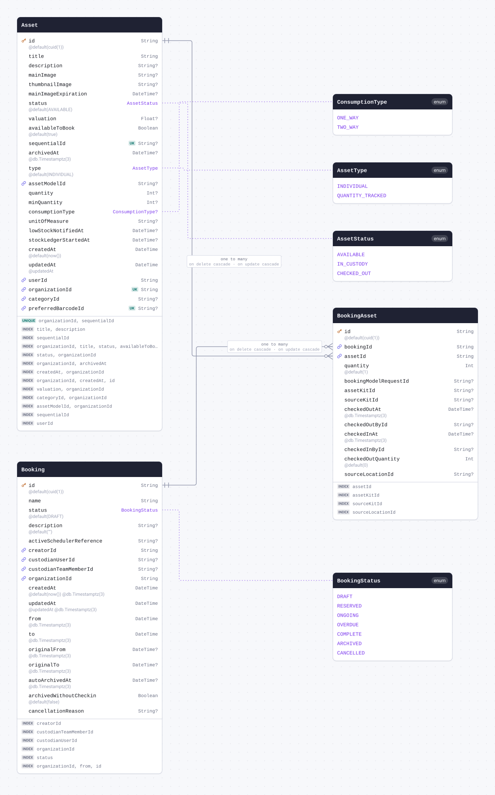

| Field                   | Type                            | Constraints                             | Default   | Description |
| ----------------------- | ------------------------------- | --------------------------------------- | --------- | ----------- |
| `id`                    | `String`                        | PK NOT NULL                             | `cuid(1)` |             |
| `bookingId`             | `String`                        | NOT NULL → [Booking.id](#model-Booking) |           |             |
| `assetId`               | `String`                        | NOT NULL → [Asset.id](#model-Asset)     |           |             |
| `quantity`              | `Int`                           | NOT NULL                                | `1`       |             |
| `bookingModelRequestId` | `String`                        | NULL                                    |           |             |
| `assetKitId`            | `String`                        | NULL                                    |           |             |
| `sourceKitId`           | `String`                        | NULL                                    |           |             |
| `checkedOutAt`          | `DateTime` `@db.Timestamptz(3)` | NULL                                    |           |             |
| `checkedOutById`        | `String`                        | NULL                                    |           |             |
| `checkedInAt`           | `DateTime` `@db.Timestamptz(3)` | NULL                                    |           |             |
| `checkedInById`         | `String`                        | NULL                                    |           |             |
| `checkedOutQuantity`    | `Int`                           | NOT NULL                                | `0`       |             |
| `sourceLocationId`      | `String`                        | NULL                                    |           |             |

#### Indexes

- `@@index([assetId])`
- `@@index([assetKitId])`
- `@@index([sourceKitId])`
- `@@index([sourceLocationId])`

#### References

- `bookingId` → [Booking.id](#model-Booking) (many-to-one, on delete Cascade, on update Cascade)
- `assetId` → [Asset.id](#model-Asset) (many-to-one, on delete Cascade, on update Cascade)

#### Definition

```sql
CREATE TABLE "BookingAsset" (
    "id" TEXT NOT NULL,
    "bookingId" TEXT NOT NULL,
    "assetId" TEXT NOT NULL,
    "quantity" INTEGER NOT NULL DEFAULT 1,
    "bookingModelRequestId" TEXT,
    "assetKitId" TEXT,
    "sourceKitId" TEXT,
    "checkedOutAt" TIMESTAMPTZ(3),
    "checkedOutById" TEXT,
    "checkedInAt" TIMESTAMPTZ(3),
    "checkedInById" TEXT,
    "checkedOutQuantity" INTEGER NOT NULL DEFAULT 0,
    "sourceLocationId" TEXT,

    CONSTRAINT "BookingAsset_pkey" PRIMARY KEY ("id")
);

CREATE INDEX "BookingAsset_assetId_idx" ON "BookingAsset"("assetId");

CREATE INDEX "BookingAsset_assetKitId_idx" ON "BookingAsset"("assetKitId");

CREATE INDEX "BookingAsset_sourceKitId_idx" ON "BookingAsset"("sourceKitId");

CREATE INDEX "BookingAsset_sourceLocationId_idx" ON "BookingAsset"("sourceLocationId");

ALTER TABLE "BookingAsset" ADD CONSTRAINT "BookingAsset_bookingId_fkey" FOREIGN KEY ("bookingId") REFERENCES "Booking"("id") ON DELETE CASCADE ON UPDATE CASCADE;

ALTER TABLE "BookingAsset" ADD CONSTRAINT "BookingAsset_assetId_fkey" FOREIGN KEY ("assetId") REFERENCES "Asset"("id") ON DELETE CASCADE ON UPDATE CASCADE;
```

<details>
<summary>Queries and their SQL</summary>

**findMany**: Every row

```ts
await prisma.bookingAsset.findMany();
```

```sql
SELECT
  "public"."BookingAsset"."id",
  "public"."BookingAsset"."bookingId",
  "public"."BookingAsset"."assetId",
  "public"."BookingAsset"."quantity",
  "public"."BookingAsset"."bookingModelRequestId",
  "public"."BookingAsset"."assetKitId",
  "public"."BookingAsset"."sourceKitId",
  "public"."BookingAsset"."checkedOutAt",
  "public"."BookingAsset"."checkedOutById",
  "public"."BookingAsset"."checkedInAt",
  "public"."BookingAsset"."checkedInById",
  "public"."BookingAsset"."checkedOutQuantity",
  "public"."BookingAsset"."sourceLocationId"
FROM
  "public"."BookingAsset"
WHERE
  1 = 1
OFFSET
  $1
-- params: ["0"]
```

**count**: How many rows there are

```ts
await prisma.bookingAsset.count();
```

```sql
SELECT
  COUNT(*) AS "_count$_all"
FROM
  (
    SELECT
      "public"."BookingAsset"."id"
    FROM
      "public"."BookingAsset"
    WHERE
      1 = 1
    OFFSET
      $1
  ) AS "sub"
-- params: ["0"]
```

**findMany**: Every row with its relations

```ts
await prisma.bookingAsset.findMany({ include: { booking: true, asset: true } });
```

```sql
SELECT
  "public"."BookingAsset"."id",
  "public"."BookingAsset"."bookingId",
  "public"."BookingAsset"."assetId",
  "public"."BookingAsset"."quantity",
  "public"."BookingAsset"."bookingModelRequestId",
  "public"."BookingAsset"."assetKitId",
  "public"."BookingAsset"."sourceKitId",
  "public"."BookingAsset"."checkedOutAt",
  "public"."BookingAsset"."checkedOutById",
  "public"."BookingAsset"."checkedInAt",
  "public"."BookingAsset"."checkedInById",
  "public"."BookingAsset"."checkedOutQuantity",
  "public"."BookingAsset"."sourceLocationId"
FROM
  "public"."BookingAsset"
WHERE
  1 = 1
OFFSET
  $1
-- params: ["0"]

SELECT
  "public"."Booking"."id",
  "public"."Booking"."name",
  "public"."Booking"."status"::text,
  "public"."Booking"."description",
  "public"."Booking"."activeSchedulerReference",
  "public"."Booking"."creatorId",
  "public"."Booking"."custodianUserId",
  "public"."Booking"."custodianTeamMemberId",
  "public"."Booking"."organizationId",
  "public"."Booking"."createdAt",
  "public"."Booking"."updatedAt",
  "public"."Booking"."from",
  "public"."Booking"."to",
  "public"."Booking"."originalFrom",
  "public"."Booking"."originalTo",
  "public"."Booking"."autoArchivedAt",
  "public"."Booking"."archivedWithoutCheckin",
  "public"."Booking"."cancellationReason",
  "public"."Booking"."approvedAt",
  "public"."Booking"."approvedById"
FROM
  "public"."Booking"
WHERE
  "public"."Booking"."id" IN ($1)
OFFSET
  $2
-- params: ["<bookingId of the rows above>","0"]

SELECT
  "public"."Asset"."id",
  "public"."Asset"."title",
  "public"."Asset"."description",
  "public"."Asset"."mainImage",
  "public"."Asset"."thumbnailImage",
  "public"."Asset"."mainImageExpiration",
  "public"."Asset"."status"::text,
  "public"."Asset"."value",
  "public"."Asset"."availableToBook",
  "public"."Asset"."sequentialId",
  "public"."Asset"."archivedAt",
  "public"."Asset"."type"::text,
  "public"."Asset"."assetModelId",
  "public"."Asset"."quantity",
  "public"."Asset"."minQuantity",
  "public"."Asset"."consumptionType"::text,
  "public"."Asset"."unitOfMeasure",
  "public"."Asset"."lowStockNotifiedAt",
  "public"."Asset"."stockLedgerStartedAt",
  "public"."Asset"."createdAt",
  "public"."Asset"."updatedAt",
  "public"."Asset"."userId",
  "public"."Asset"."organizationId",
  "public"."Asset"."categoryId",
  "public"."Asset"."preferredBarcodeId"
FROM
  "public"."Asset"
WHERE
  "public"."Asset"."id" IN ($1)
OFFSET
  $2
-- params: ["<assetId of the rows above>","0"]
```

**findUnique**: One row by what is unique to it

```ts
await prisma.bookingAsset.findUnique({ where: { id: "example" } });
```

```sql
SELECT
  "public"."BookingAsset"."id",
  "public"."BookingAsset"."bookingId",
  "public"."BookingAsset"."assetId",
  "public"."BookingAsset"."quantity",
  "public"."BookingAsset"."bookingModelRequestId",
  "public"."BookingAsset"."assetKitId",
  "public"."BookingAsset"."sourceKitId",
  "public"."BookingAsset"."checkedOutAt",
  "public"."BookingAsset"."checkedOutById",
  "public"."BookingAsset"."checkedInAt",
  "public"."BookingAsset"."checkedInById",
  "public"."BookingAsset"."checkedOutQuantity",
  "public"."BookingAsset"."sourceLocationId"
FROM
  "public"."BookingAsset"
WHERE
  (
    "public"."BookingAsset"."id" = $1
    AND 1 = 1
  )
LIMIT
  $2
OFFSET
  $3
-- params: ["example","1","0"]
```

**create**: Create a row

```ts
await prisma.bookingAsset.create({ data: { bookingId: "example", assetId: "example" } });
```

```sql
INSERT INTO
  "public"."BookingAsset" (
    "id",
    "bookingId",
    "assetId",
    "quantity",
    "checkedOutQuantity"
  )
VALUES
  ($1, $2, $3, $4, $5)
RETURNING
  "public"."BookingAsset"."id",
  "public"."BookingAsset"."bookingId",
  "public"."BookingAsset"."assetId",
  "public"."BookingAsset"."quantity",
  "public"."BookingAsset"."bookingModelRequestId",
  "public"."BookingAsset"."assetKitId",
  "public"."BookingAsset"."sourceKitId",
  "public"."BookingAsset"."checkedOutAt",
  "public"."BookingAsset"."checkedOutById",
  "public"."BookingAsset"."checkedInAt",
  "public"."BookingAsset"."checkedInById",
  "public"."BookingAsset"."checkedOutQuantity",
  "public"."BookingAsset"."sourceLocationId"
-- params: ["<cuid(1)>","example","example","1","0"]
```

**update**: Update a row

```ts
await prisma.bookingAsset.update({ where: { id: "example" }, data: { quantity: 1 } });
```

```sql
UPDATE "public"."BookingAsset"
SET
  "quantity" = $1
WHERE
  (
    "public"."BookingAsset"."id" = $2
    AND 1 = 1
  )
RETURNING
  "public"."BookingAsset"."id",
  "public"."BookingAsset"."bookingId",
  "public"."BookingAsset"."assetId",
  "public"."BookingAsset"."quantity",
  "public"."BookingAsset"."bookingModelRequestId",
  "public"."BookingAsset"."assetKitId",
  "public"."BookingAsset"."sourceKitId",
  "public"."BookingAsset"."checkedOutAt",
  "public"."BookingAsset"."checkedOutById",
  "public"."BookingAsset"."checkedInAt",
  "public"."BookingAsset"."checkedInById",
  "public"."BookingAsset"."checkedOutQuantity",
  "public"."BookingAsset"."sourceLocationId"
-- params: ["1","example"]
```

**delete**: Delete a row

```ts
await prisma.bookingAsset.delete({ where: { id: "example" } });
```

```sql
DELETE FROM "public"."BookingAsset"
WHERE
  (
    "public"."BookingAsset"."id" = $1
    AND 1 = 1
  )
RETURNING
  "public"."BookingAsset"."id",
  "public"."BookingAsset"."bookingId",
  "public"."BookingAsset"."assetId",
  "public"."BookingAsset"."quantity",
  "public"."BookingAsset"."bookingModelRequestId",
  "public"."BookingAsset"."assetKitId",
  "public"."BookingAsset"."sourceKitId",
  "public"."BookingAsset"."checkedOutAt",
  "public"."BookingAsset"."checkedOutById",
  "public"."BookingAsset"."checkedInAt",
  "public"."BookingAsset"."checkedInById",
  "public"."BookingAsset"."checkedOutQuantity",
  "public"."BookingAsset"."sourceLocationId"
-- params: ["example"]
```

</details>

<a id="model-Booking"></a>

### Booking

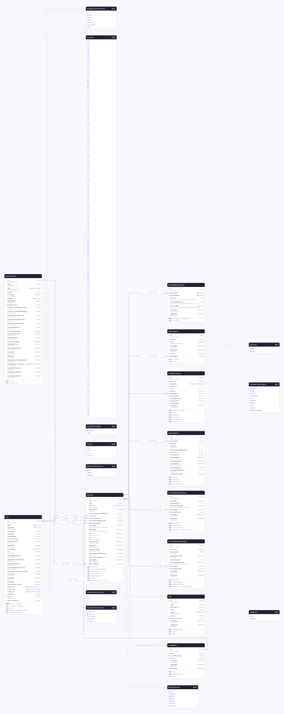

| Field                      | Type                                   | Constraints                                       | Default      | Description |
| -------------------------- | -------------------------------------- | ------------------------------------------------- | ------------ | ----------- |
| `id`                       | `String`                               | PK NOT NULL                                       | `cuid(1)`    |             |
| `name`                     | `String`                               | NOT NULL                                          |              |             |
| `status`                   | [`BookingStatus`](#enum-BookingStatus) | NOT NULL                                          | `DRAFT`      |             |
| `description`              | `String`                               | NULL                                              | `""`         |             |
| `activeSchedulerReference` | `String`                               | NULL                                              |              |             |
| `creatorId`                | `String`                               | NOT NULL → [User.id](#model-User)                 |              |             |
| `custodianUserId`          | `String`                               | NULL → [User.id](#model-User)                     |              |             |
| `custodianTeamMemberId`    | `String`                               | NULL → [TeamMember.id](#model-TeamMember)         |              |             |
| `organizationId`           | `String`                               | NOT NULL → [Organization.id](#model-Organization) |              |             |
| `createdAt`                | `DateTime` `@db.Timestamptz(3)`        | NOT NULL                                          | `now()`      |             |
| `updatedAt`                | `DateTime` `@db.Timestamptz(3)`        | NOT NULL                                          | `@updatedAt` |             |
| `from`                     | `DateTime` `@db.Timestamptz(3)`        | NOT NULL                                          |              |             |
| `to`                       | `DateTime` `@db.Timestamptz(3)`        | NOT NULL                                          |              |             |
| `originalFrom`             | `DateTime` `@db.Timestamptz(3)`        | NULL                                              |              |             |
| `originalTo`               | `DateTime` `@db.Timestamptz(3)`        | NULL                                              |              |             |
| `autoArchivedAt`           | `DateTime` `@db.Timestamptz(3)`        | NULL                                              |              |             |
| `archivedWithoutCheckin`   | `Boolean`                              | NOT NULL                                          | `false`      |             |
| `cancellationReason`       | `String`                               | NULL                                              |              |             |
| `approvedAt`               | `DateTime` `@db.Timestamptz(3)`        | NULL                                              |              |             |
| `approvedById`             | `String`                               | NULL → [User.id](#model-User)                     |              |             |

#### Indexes

- `@@index([creatorId])`
- `@@index([custodianTeamMemberId])`
- `@@index([custodianUserId])`
- `@@index([approvedById])`
- `@@index([organizationId])`
- `@@index([status])`
- `@@index([organizationId, from, id])`

#### References

- `creatorId` → [User.id](#model-User) (many-to-one, on delete Cascade, on update Cascade)
- `custodianUserId` → [User.id](#model-User) (many-to-one, on delete Cascade, on update Cascade)
- `custodianTeamMemberId` → [TeamMember.id](#model-TeamMember) (many-to-one, on delete Cascade, on update Cascade)
- `organizationId` → [Organization.id](#model-Organization) (many-to-one, on delete Cascade, on update Cascade)
- `approvedById` → [User.id](#model-User) (many-to-one, on delete SetNull, on update Cascade)

#### Referenced by

- `id` ← [BookingModelRequest.bookingId](#model-BookingModelRequest) (one-to-many, on delete Cascade, on update Cascade)
- `id` ← [BookingNote.bookingId](#model-BookingNote) (one-to-many, on delete Cascade, on update Cascade)
- `id` ← [ConsumptionLog.bookingId](#model-ConsumptionLog) (one-to-many)
- `id` ← [BookingAsset.bookingId](#model-BookingAsset) (one-to-many, on delete Cascade, on update Cascade)
- `id` ← [PartialBookingCheckin.bookingId](#model-PartialBookingCheckin) (one-to-many, on delete Cascade)
- `id` ← [PartialBookingCheckout.bookingId](#model-PartialBookingCheckout) (one-to-many, on delete Cascade)

#### Many to many

- `tags` ↔ [Tag.bookings](#model-Tag) through `_BookingToTag`
- `notificationRecipients` ↔ [TeamMember.bookingNotifications](#model-TeamMember) through `_BookingNotificationRecipients`

#### Definition

```sql
CREATE TABLE "Booking" (
    "id" TEXT NOT NULL,
    "name" TEXT NOT NULL,
    "status" "BookingStatus" NOT NULL DEFAULT 'DRAFT',
    "description" TEXT DEFAULT '',
    "activeSchedulerReference" TEXT,
    "creatorId" TEXT NOT NULL,
    "custodianUserId" TEXT,
    "custodianTeamMemberId" TEXT,
    "organizationId" TEXT NOT NULL,
    "createdAt" TIMESTAMPTZ(3) NOT NULL DEFAULT CURRENT_TIMESTAMP,
    "updatedAt" TIMESTAMPTZ(3) NOT NULL,
    "from" TIMESTAMPTZ(3) NOT NULL,
    "to" TIMESTAMPTZ(3) NOT NULL,
    "originalFrom" TIMESTAMPTZ(3),
    "originalTo" TIMESTAMPTZ(3),
    "autoArchivedAt" TIMESTAMPTZ(3),
    "archivedWithoutCheckin" BOOLEAN NOT NULL DEFAULT false,
    "cancellationReason" TEXT,
    "approvedAt" TIMESTAMPTZ(3),
    "approvedById" TEXT,

    CONSTRAINT "Booking_pkey" PRIMARY KEY ("id")
);

CREATE INDEX "Booking_creatorId_idx" ON "Booking"("creatorId");

CREATE INDEX "Booking_custodianTeamMemberId_idx" ON "Booking"("custodianTeamMemberId");

CREATE INDEX "Booking_custodianUserId_idx" ON "Booking"("custodianUserId");

CREATE INDEX "Booking_approvedById_idx" ON "Booking"("approvedById");

CREATE INDEX "Booking_organizationId_idx" ON "Booking"("organizationId");

CREATE INDEX "Booking_status_idx" ON "Booking"("status");

CREATE INDEX "Booking_organizationId_from_id_idx" ON "Booking"("organizationId", "from", "id");

ALTER TABLE "Booking" ADD CONSTRAINT "Booking_creatorId_fkey" FOREIGN KEY ("creatorId") REFERENCES "User"("id") ON DELETE CASCADE ON UPDATE CASCADE;

ALTER TABLE "Booking" ADD CONSTRAINT "Booking_custodianUserId_fkey" FOREIGN KEY ("custodianUserId") REFERENCES "User"("id") ON DELETE CASCADE ON UPDATE CASCADE;

ALTER TABLE "Booking" ADD CONSTRAINT "Booking_custodianTeamMemberId_fkey" FOREIGN KEY ("custodianTeamMemberId") REFERENCES "TeamMember"("id") ON DELETE CASCADE ON UPDATE CASCADE;

ALTER TABLE "Booking" ADD CONSTRAINT "Booking_organizationId_fkey" FOREIGN KEY ("organizationId") REFERENCES "Organization"("id") ON DELETE CASCADE ON UPDATE CASCADE;

ALTER TABLE "Booking" ADD CONSTRAINT "Booking_approvedById_fkey" FOREIGN KEY ("approvedById") REFERENCES "User"("id") ON DELETE SET NULL ON UPDATE CASCADE;
```

<details>
<summary>Queries and their SQL</summary>

**findMany**: Every row

```ts
await prisma.booking.findMany();
```

```sql
SELECT
  "public"."Booking"."id",
  "public"."Booking"."name",
  "public"."Booking"."status"::text,
  "public"."Booking"."description",
  "public"."Booking"."activeSchedulerReference",
  "public"."Booking"."creatorId",
  "public"."Booking"."custodianUserId",
  "public"."Booking"."custodianTeamMemberId",
  "public"."Booking"."organizationId",
  "public"."Booking"."createdAt",
  "public"."Booking"."updatedAt",
  "public"."Booking"."from",
  "public"."Booking"."to",
  "public"."Booking"."originalFrom",
  "public"."Booking"."originalTo",
  "public"."Booking"."autoArchivedAt",
  "public"."Booking"."archivedWithoutCheckin",
  "public"."Booking"."cancellationReason",
  "public"."Booking"."approvedAt",
  "public"."Booking"."approvedById"
FROM
  "public"."Booking"
WHERE
  1 = 1
OFFSET
  $1
-- params: ["0"]
```

**count**: How many rows there are

```ts
await prisma.booking.count();
```

```sql
SELECT
  COUNT(*) AS "_count$_all"
FROM
  (
    SELECT
      "public"."Booking"."id"
    FROM
      "public"."Booking"
    WHERE
      1 = 1
    OFFSET
      $1
  ) AS "sub"
-- params: ["0"]
```

**findMany**: Every row with its relations

```ts
await prisma.booking.findMany({
  include: {
    creator: true,
    custodianUser: true,
    custodianTeamMember: true,
    organization: true,
    bookingAssets: true,
    consumptionLogs: true,
    notes: true,
    modelRequests: true,
    tags: true,
    partialCheckins: true,
    partialCheckouts: true,
    approvedBy: true,
    notificationRecipients: true,
  },
});
```

```sql
SELECT
  "public"."Booking"."id",
  "public"."Booking"."name",
  "public"."Booking"."status"::text,
  "public"."Booking"."description",
  "public"."Booking"."activeSchedulerReference",
  "public"."Booking"."creatorId",
  "public"."Booking"."custodianUserId",
  "public"."Booking"."custodianTeamMemberId",
  "public"."Booking"."organizationId",
  "public"."Booking"."createdAt",
  "public"."Booking"."updatedAt",
  "public"."Booking"."from",
  "public"."Booking"."to",
  "public"."Booking"."originalFrom",
  "public"."Booking"."originalTo",
  "public"."Booking"."autoArchivedAt",
  "public"."Booking"."archivedWithoutCheckin",
  "public"."Booking"."cancellationReason",
  "public"."Booking"."approvedAt",
  "public"."Booking"."approvedById"
FROM
  "public"."Booking"
WHERE
  1 = 1
OFFSET
  $1
-- params: ["0"]

SELECT
  "public"."User"."id",
  "public"."User"."email",
  "public"."User"."username",
  "public"."User"."firstName",
  "public"."User"."lastName",
  "public"."User"."displayName",
  "public"."User"."profilePicture",
  "public"."User"."usedFreeTrial",
  "public"."User"."onboarded",
  "public"."User"."customerId",
  "public"."User"."sso",
  "public"."User"."createdWithInvite",
  "public"."User"."skipSubscriptionCheck",
  "public"."User"."hasUnpaidInvoice",
  "public"."User"."warnForNoPaymentMethod",
  "public"."User"."lastSelectedOrganizationId",
  "public"."User"."createdAt",
  "public"."User"."updatedAt",
  "public"."User"."deletedAt",
  "public"."User"."lastMobileActiveAt",
  "public"."User"."dateFormat"::text,
  "public"."User"."timeFormat"::text,
  "public"."User"."weekStart"::text,
  "public"."User"."timeZone",
  "public"."User"."tierId"::text,
  "public"."User"."referralSource"
FROM
  "public"."User"
WHERE
  "public"."User"."id" IN ($1)
OFFSET
  $2
-- params: ["<creatorId of the rows above>","0"]

SELECT
  "public"."User"."id",
  "public"."User"."email",
  "public"."User"."username",
  "public"."User"."firstName",
  "public"."User"."lastName",
  "public"."User"."displayName",
  "public"."User"."profilePicture",
  "public"."User"."usedFreeTrial",
  "public"."User"."onboarded",
  "public"."User"."customerId",
  "public"."User"."sso",
  "public"."User"."createdWithInvite",
  "public"."User"."skipSubscriptionCheck",
  "public"."User"."hasUnpaidInvoice",
  "public"."User"."warnForNoPaymentMethod",
  "public"."User"."lastSelectedOrganizationId",
  "public"."User"."createdAt",
  "public"."User"."updatedAt",
  "public"."User"."deletedAt",
  "public"."User"."lastMobileActiveAt",
  "public"."User"."dateFormat"::text,
  "public"."User"."timeFormat"::text,
  "public"."User"."weekStart"::text,
  "public"."User"."timeZone",
  "public"."User"."tierId"::text,
  "public"."User"."referralSource"
FROM
  "public"."User"
WHERE
  "public"."User"."id" IN ($1)
OFFSET
  $2
-- params: ["<custodianUserId of the rows above>","0"]

SELECT
  "public"."TeamMember"."id",
  "public"."TeamMember"."name",
  "public"."TeamMember"."organizationId",
  "public"."TeamMember"."userId",
  "public"."TeamMember"."createdAt",
  "public"."TeamMember"."updatedAt",
  "public"."TeamMember"."deletedAt"
FROM
  "public"."TeamMember"
WHERE
  "public"."TeamMember"."id" IN ($1)
OFFSET
  $2
-- params: ["<custodianTeamMemberId of the rows above>","0"]

SELECT
  "public"."Organization"."id",
  "public"."Organization"."name",
  "public"."Organization"."type"::text,
  "public"."Organization"."userId",
  "public"."Organization"."currency"::text,
  "public"."Organization"."imageId",
  "public"."Organization"."enabledSso",
  "public"."Organization"."ssoDetailsId",
  "public"."Organization"."selfServiceCanSeeCustody",
  "public"."Organization"."selfServiceCanSeeBookings",
  "public"."Organization"."baseUserCanSeeCustody",
  "public"."Organization"."baseUserCanSeeBookings",
  "public"."Organization"."managersCanEditAssets",
  "public"."Organization"."barcodesEnabled",
  "public"."Organization"."barcodesEnabledAt",
  "public"."Organization"."usedBarcodeTrial",
  "public"."Organization"."auditsEnabled",
  "public"."Organization"."auditsEnabledAt",
  "public"."Organization"."usedAuditTrial",
  "public"."Organization"."workspaceDisabled",
  "public"."Organization"."createdAt",
  "public"."Organization"."updatedAt",
  "public"."Organization"."hasSequentialIdsMigrated",
  "public"."Organization"."qrIdDisplayPreference"::text,
  "public"."Organization"."showShelfBranding",
  "public"."Organization"."showQrCodesOnPdfs",
  "public"."Organization"."customEmailFooter"
FROM
  "public"."Organization"
WHERE
  "public"."Organization"."id" IN ($1)
OFFSET
  $2
-- params: ["<organizationId of the rows above>","0"]

SELECT
  "public"."BookingAsset"."id",
  "public"."BookingAsset"."bookingId",
  "public"."BookingAsset"."assetId",
  "public"."BookingAsset"."quantity",
  "public"."BookingAsset"."bookingModelRequestId",
  "public"."BookingAsset"."assetKitId",
  "public"."BookingAsset"."sourceKitId",
  "public"."BookingAsset"."checkedOutAt",
  "public"."BookingAsset"."checkedOutById",
  "public"."BookingAsset"."checkedInAt",
  "public"."BookingAsset"."checkedInById",
  "public"."BookingAsset"."checkedOutQuantity",
  "public"."BookingAsset"."sourceLocationId"
FROM
  "public"."BookingAsset"
WHERE
  "public"."BookingAsset"."bookingId" IN ($1)
OFFSET
  $2
-- params: ["<id of the rows above>","0"]

SELECT
  "public"."ConsumptionLog"."id",
  "public"."ConsumptionLog"."assetId",
  "public"."ConsumptionLog"."category"::text,
  "public"."ConsumptionLog"."quantity",
  "public"."ConsumptionLog"."note",
  "public"."ConsumptionLog"."userId",
  "public"."ConsumptionLog"."bookingId",
  "public"."ConsumptionLog"."custodianId",
  "public"."ConsumptionLog"."bookingAssetId",
  "public"."ConsumptionLog"."locationId",
  "public"."ConsumptionLog"."stockChange",
  "public"."ConsumptionLog"."createdAt"
FROM
  "public"."ConsumptionLog"
WHERE
  "public"."ConsumptionLog"."bookingId" IN ($1)
OFFSET
  $2
-- params: ["<id of the rows above>","0"]

SELECT
  "public"."BookingNote"."id",
  "public"."BookingNote"."content",
  "public"."BookingNote"."type"::text,
  "public"."BookingNote"."createdAt",
  "public"."BookingNote"."updatedAt",
  "public"."BookingNote"."userId",
  "public"."BookingNote"."bookingId"
FROM
  "public"."BookingNote"
WHERE
  "public"."BookingNote"."bookingId" IN ($1)
OFFSET
  $2
-- params: ["<id of the rows above>","0"]

SELECT
  "public"."BookingModelRequest"."id",
  "public"."BookingModelRequest"."bookingId",
  "public"."BookingModelRequest"."assetModelId",
  "public"."BookingModelRequest"."quantity",
  "public"."BookingModelRequest"."fulfilledQuantity",
  "public"."BookingModelRequest"."fulfilledAt",
  "public"."BookingModelRequest"."createdAt",
  "public"."BookingModelRequest"."updatedAt"
FROM
  "public"."BookingModelRequest"
WHERE
  "public"."BookingModelRequest"."bookingId" IN ($1)
OFFSET
  $2
-- params: ["<id of the rows above>","0"]

SELECT
  "public"."Tag"."id",
  "public"."Tag"."name",
  "public"."Tag"."description",
  "public"."Tag"."color",
  "public"."Tag"."useFor"::text[],
  "public"."Tag"."userId",
  "public"."Tag"."organizationId",
  "public"."Tag"."createdAt",
  "public"."Tag"."updatedAt",
  "t0"."A" AS "BookingToTag@Booking"
FROM
  "public"."Tag"
  INNER JOIN "public"."_BookingToTag" AS "t0" ON "t0"."B" = "public"."Tag"."id"
WHERE
  (
    1 = 1
    AND "t0"."A" IN ($1)
  )
OFFSET
  $2
-- params: ["<id of the rows above>","0"]

SELECT
  "public"."PartialBookingCheckin"."id",
  "public"."PartialBookingCheckin"."assetIds",
  "public"."PartialBookingCheckin"."checkinCount",
  "public"."PartialBookingCheckin"."checkinTimestamp",
  "public"."PartialBookingCheckin"."bookingId",
  "public"."PartialBookingCheckin"."checkedInById",
  "public"."PartialBookingCheckin"."createdAt",
  "public"."PartialBookingCheckin"."updatedAt"
FROM
  "public"."PartialBookingCheckin"
WHERE
  "public"."PartialBookingCheckin"."bookingId" IN ($1)
OFFSET
  $2
-- params: ["<id of the rows above>","0"]

SELECT
  "public"."PartialBookingCheckout"."id",
  "public"."PartialBookingCheckout"."assetIds",
  "public"."PartialBookingCheckout"."quantities",
  "public"."PartialBookingCheckout"."bookingAssetIds",
  "public"."PartialBookingCheckout"."checkoutCount",
  "public"."PartialBookingCheckout"."checkoutTimestamp",
  "public"."PartialBookingCheckout"."bookingId",
  "public"."PartialBookingCheckout"."checkedOutById",
  "public"."PartialBookingCheckout"."createdAt",
  "public"."PartialBookingCheckout"."updatedAt"
FROM
  "public"."PartialBookingCheckout"
WHERE
  "public"."PartialBookingCheckout"."bookingId" IN ($1)
OFFSET
  $2
-- params: ["<id of the rows above>","0"]

SELECT
  "public"."User"."id",
  "public"."User"."email",
  "public"."User"."username",
  "public"."User"."firstName",
  "public"."User"."lastName",
  "public"."User"."displayName",
  "public"."User"."profilePicture",
  "public"."User"."usedFreeTrial",
  "public"."User"."onboarded",
  "public"."User"."customerId",
  "public"."User"."sso",
  "public"."User"."createdWithInvite",
  "public"."User"."skipSubscriptionCheck",
  "public"."User"."hasUnpaidInvoice",
  "public"."User"."warnForNoPaymentMethod",
  "public"."User"."lastSelectedOrganizationId",
  "public"."User"."createdAt",
  "public"."User"."updatedAt",
  "public"."User"."deletedAt",
  "public"."User"."lastMobileActiveAt",
  "public"."User"."dateFormat"::text,
  "public"."User"."timeFormat"::text,
  "public"."User"."weekStart"::text,
  "public"."User"."timeZone",
  "public"."User"."tierId"::text,
  "public"."User"."referralSource"
FROM
  "public"."User"
WHERE
  "public"."User"."id" IN ($1)
OFFSET
  $2
-- params: ["<approvedById of the rows above>","0"]

SELECT
  "public"."TeamMember"."id",
  "public"."TeamMember"."name",
  "public"."TeamMember"."organizationId",
  "public"."TeamMember"."userId",
  "public"."TeamMember"."createdAt",
  "public"."TeamMember"."updatedAt",
  "public"."TeamMember"."deletedAt",
  "t1"."A" AS "BookingNotificationRecipients@Booking"
FROM
  "public"."TeamMember"
  INNER JOIN "public"."_BookingNotificationRecipients" AS "t1" ON "t1"."B" = "public"."TeamMember"."id"
WHERE
  (
    1 = 1
    AND "t1"."A" IN ($1)
  )
OFFSET
  $2
-- params: ["<id of the rows above>","0"]
```

**findUnique**: One row by what is unique to it

```ts
await prisma.booking.findUnique({ where: { id: "example" } });
```

```sql
SELECT
  "public"."Booking"."id",
  "public"."Booking"."name",
  "public"."Booking"."status"::text,
  "public"."Booking"."description",
  "public"."Booking"."activeSchedulerReference",
  "public"."Booking"."creatorId",
  "public"."Booking"."custodianUserId",
  "public"."Booking"."custodianTeamMemberId",
  "public"."Booking"."organizationId",
  "public"."Booking"."createdAt",
  "public"."Booking"."updatedAt",
  "public"."Booking"."from",
  "public"."Booking"."to",
  "public"."Booking"."originalFrom",
  "public"."Booking"."originalTo",
  "public"."Booking"."autoArchivedAt",
  "public"."Booking"."archivedWithoutCheckin",
  "public"."Booking"."cancellationReason",
  "public"."Booking"."approvedAt",
  "public"."Booking"."approvedById"
FROM
  "public"."Booking"
WHERE
  (
    "public"."Booking"."id" = $1
    AND 1 = 1
  )
LIMIT
  $2
OFFSET
  $3
-- params: ["example","1","0"]
```

**create**: Create a row

```ts
await prisma.booking.create({
  data: {
    name: "example",
    creatorId: "example",
    organizationId: "example",
    from: new Date("2026-01-01T00:00:00.000Z"),
    to: new Date("2026-01-01T00:00:00.000Z"),
  },
});
```

```sql
INSERT INTO
  "public"."Booking" (
    "id",
    "name",
    "status",
    "description",
    "creatorId",
    "organizationId",
    "createdAt",
    "updatedAt",
    "from",
    "to",
    "archivedWithoutCheckin"
  )
VALUES
  (
    $1,
    $2,
    CAST($3::text AS "public"."BookingStatus"),
    $4,
    $5,
    $6,
    $7,
    $8,
    $9,
    $10,
    $11
  )
RETURNING
  "public"."Booking"."id",
  "public"."Booking"."name",
  "public"."Booking"."status"::text,
  "public"."Booking"."description",
  "public"."Booking"."activeSchedulerReference",
  "public"."Booking"."creatorId",
  "public"."Booking"."custodianUserId",
  "public"."Booking"."custodianTeamMemberId",
  "public"."Booking"."organizationId",
  "public"."Booking"."createdAt",
  "public"."Booking"."updatedAt",
  "public"."Booking"."from",
  "public"."Booking"."to",
  "public"."Booking"."originalFrom",
  "public"."Booking"."originalTo",
  "public"."Booking"."autoArchivedAt",
  "public"."Booking"."archivedWithoutCheckin",
  "public"."Booking"."cancellationReason",
  "public"."Booking"."approvedAt",
  "public"."Booking"."approvedById"
-- params: ["<cuid(1)>","example","DRAFT","","example","example","<now()>","<now()>","2026-01-01T00:00:00.000Z","2026-01-01T00:00:00.000Z",false]
```

**update**: Update a row

```ts
await prisma.booking.update({ where: { id: "example" }, data: { name: "example" } });
```

```sql
UPDATE "public"."Booking"
SET
  "name" = $1,
  "updatedAt" = $2
WHERE
  (
    "public"."Booking"."id" = $3
    AND 1 = 1
  )
RETURNING
  "public"."Booking"."id",
  "public"."Booking"."name",
  "public"."Booking"."status"::text,
  "public"."Booking"."description",
  "public"."Booking"."activeSchedulerReference",
  "public"."Booking"."creatorId",
  "public"."Booking"."custodianUserId",
  "public"."Booking"."custodianTeamMemberId",
  "public"."Booking"."organizationId",
  "public"."Booking"."createdAt",
  "public"."Booking"."updatedAt",
  "public"."Booking"."from",
  "public"."Booking"."to",
  "public"."Booking"."originalFrom",
  "public"."Booking"."originalTo",
  "public"."Booking"."autoArchivedAt",
  "public"."Booking"."archivedWithoutCheckin",
  "public"."Booking"."cancellationReason",
  "public"."Booking"."approvedAt",
  "public"."Booking"."approvedById"
-- params: ["example",{"prisma__type":"generatorCall","prisma__value":{"name":"now","args":[],"returnType":{"type":"DateTime"}}},"example"]
```

**delete**: Delete a row

```ts
await prisma.booking.delete({ where: { id: "example" } });
```

```sql
DELETE FROM "public"."Booking"
WHERE
  (
    "public"."Booking"."id" = $1
    AND 1 = 1
  )
RETURNING
  "public"."Booking"."id",
  "public"."Booking"."name",
  "public"."Booking"."status"::text,
  "public"."Booking"."description",
  "public"."Booking"."activeSchedulerReference",
  "public"."Booking"."creatorId",
  "public"."Booking"."custodianUserId",
  "public"."Booking"."custodianTeamMemberId",
  "public"."Booking"."organizationId",
  "public"."Booking"."createdAt",
  "public"."Booking"."updatedAt",
  "public"."Booking"."from",
  "public"."Booking"."to",
  "public"."Booking"."originalFrom",
  "public"."Booking"."originalTo",
  "public"."Booking"."autoArchivedAt",
  "public"."Booking"."archivedWithoutCheckin",
  "public"."Booking"."cancellationReason",
  "public"."Booking"."approvedAt",
  "public"."Booking"."approvedById"
-- params: ["example"]
```

</details>

<a id="model-BookingSettings"></a>

### BookingSettings

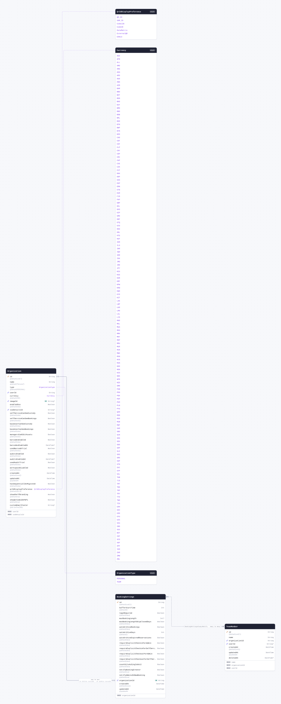

| Field                                   | Type       | Constraints                                              | Default      | Description |
| --------------------------------------- | ---------- | -------------------------------------------------------- | ------------ | ----------- |
| `id`                                    | `String`   | PK NOT NULL                                              | `cuid(1)`    |             |
| `bufferStartTime`                       | `Int`      | NOT NULL                                                 | `0`          |             |
| `tagsRequired`                          | `Boolean`  | NOT NULL                                                 | `false`      |             |
| `maxBookingLength`                      | `Int`      | NULL                                                     |              |             |
| `maxBookingLengthSkipClosedDays`        | `Boolean`  | NOT NULL                                                 | `false`      |             |
| `autoArchiveBookings`                   | `Boolean`  | NOT NULL                                                 | `false`      |             |
| `autoArchiveDays`                       | `Int`      | NOT NULL                                                 | `2`          |             |
| `autoArchiveExpiredReservations`        | `Boolean`  | NOT NULL                                                 | `false`      |             |
| `requireApprovalForBase`                | `Boolean`  | NOT NULL                                                 | `false`      |             |
| `requireApprovalForSelfService`         | `Boolean`  | NOT NULL                                                 | `false`      |             |
| `requireExplicitCheckinForAdmin`        | `Boolean`  | NOT NULL                                                 | `false`      |             |
| `requireExplicitCheckinForSelfService`  | `Boolean`  | NOT NULL                                                 | `false`      |             |
| `requireExplicitCheckoutForAdmin`       | `Boolean`  | NOT NULL                                                 | `false`      |             |
| `requireExplicitCheckoutForSelfService` | `Boolean`  | NOT NULL                                                 | `false`      |             |
| `countKitsAsSingleUnit`                 | `Boolean`  | NOT NULL                                                 | `false`      |             |
| `notifyBookingCreator`                  | `Boolean`  | NOT NULL                                                 | `true`       |             |
| `notifyAdminsOnNewBooking`              | `Boolean`  | NOT NULL                                                 | `true`       |             |
| `organizationId`                        | `String`   | UNIQUE NOT NULL → [Organization.id](#model-Organization) |              |             |
| `createdAt`                             | `DateTime` | NOT NULL                                                 | `now()`      |             |
| `updatedAt`                             | `DateTime` | NOT NULL                                                 | `@updatedAt` |             |

#### Indexes

- `@@index([organizationId])`

#### References

- `organizationId` → [Organization.id](#model-Organization) (one-to-one, on delete Cascade, on update Cascade)

#### Many to many

- `alwaysNotifyTeamMembers` ↔ [TeamMember.alwaysNotifyBookingSettings](#model-TeamMember) through `_BookingSettingsAlwaysNotify`

#### Definition

```sql
CREATE TABLE "BookingSettings" (
    "id" TEXT NOT NULL,
    "bufferStartTime" INTEGER NOT NULL DEFAULT 0,
    "tagsRequired" BOOLEAN NOT NULL DEFAULT false,
    "maxBookingLength" INTEGER,
    "maxBookingLengthSkipClosedDays" BOOLEAN NOT NULL DEFAULT false,
    "autoArchiveBookings" BOOLEAN NOT NULL DEFAULT false,
    "autoArchiveDays" INTEGER NOT NULL DEFAULT 2,
    "autoArchiveExpiredReservations" BOOLEAN NOT NULL DEFAULT false,
    "requireApprovalForBase" BOOLEAN NOT NULL DEFAULT false,
    "requireApprovalForSelfService" BOOLEAN NOT NULL DEFAULT false,
    "requireExplicitCheckinForAdmin" BOOLEAN NOT NULL DEFAULT false,
    "requireExplicitCheckinForSelfService" BOOLEAN NOT NULL DEFAULT false,
    "requireExplicitCheckoutForAdmin" BOOLEAN NOT NULL DEFAULT false,
    "requireExplicitCheckoutForSelfService" BOOLEAN NOT NULL DEFAULT false,
    "countKitsAsSingleUnit" BOOLEAN NOT NULL DEFAULT false,
    "notifyBookingCreator" BOOLEAN NOT NULL DEFAULT true,
    "notifyAdminsOnNewBooking" BOOLEAN NOT NULL DEFAULT true,
    "organizationId" TEXT NOT NULL,
    "createdAt" TIMESTAMP(3) NOT NULL DEFAULT CURRENT_TIMESTAMP,
    "updatedAt" TIMESTAMP(3) NOT NULL,

    CONSTRAINT "BookingSettings_pkey" PRIMARY KEY ("id")
);

CREATE UNIQUE INDEX "BookingSettings_organizationId_key" ON "BookingSettings"("organizationId");

CREATE INDEX "BookingSettings_organizationId_idx" ON "BookingSettings"("organizationId");

ALTER TABLE "BookingSettings" ADD CONSTRAINT "BookingSettings_organizationId_fkey" FOREIGN KEY ("organizationId") REFERENCES "Organization"("id") ON DELETE CASCADE ON UPDATE CASCADE;
```

<details>
<summary>Queries and their SQL</summary>

**findMany**: Every row

```ts
await prisma.bookingSettings.findMany();
```

```sql
SELECT
  "public"."BookingSettings"."id",
  "public"."BookingSettings"."bufferStartTime",
  "public"."BookingSettings"."tagsRequired",
  "public"."BookingSettings"."maxBookingLength",
  "public"."BookingSettings"."maxBookingLengthSkipClosedDays",
  "public"."BookingSettings"."autoArchiveBookings",
  "public"."BookingSettings"."autoArchiveDays",
  "public"."BookingSettings"."autoArchiveExpiredReservations",
  "public"."BookingSettings"."requireApprovalForBase",
  "public"."BookingSettings"."requireApprovalForSelfService",
  "public"."BookingSettings"."requireExplicitCheckinForAdmin",
  "public"."BookingSettings"."requireExplicitCheckinForSelfService",
  "public"."BookingSettings"."requireExplicitCheckoutForAdmin",
  "public"."BookingSettings"."requireExplicitCheckoutForSelfService",
  "public"."BookingSettings"."countKitsAsSingleUnit",
  "public"."BookingSettings"."notifyBookingCreator",
  "public"."BookingSettings"."notifyAdminsOnNewBooking",
  "public"."BookingSettings"."organizationId",
  "public"."BookingSettings"."createdAt",
  "public"."BookingSettings"."updatedAt"
FROM
  "public"."BookingSettings"
WHERE
  1 = 1
OFFSET
  $1
-- params: ["0"]
```

**count**: How many rows there are

```ts
await prisma.bookingSettings.count();
```

```sql
SELECT
  COUNT(*) AS "_count$_all"
FROM
  (
    SELECT
      "public"."BookingSettings"."id"
    FROM
      "public"."BookingSettings"
    WHERE
      1 = 1
    OFFSET
      $1
  ) AS "sub"
-- params: ["0"]
```

**findMany**: Every row with its relations

```ts
await prisma.bookingSettings.findMany({
  include: { alwaysNotifyTeamMembers: true, organization: true },
});
```

```sql
SELECT
  "public"."BookingSettings"."id",
  "public"."BookingSettings"."bufferStartTime",
  "public"."BookingSettings"."tagsRequired",
  "public"."BookingSettings"."maxBookingLength",
  "public"."BookingSettings"."maxBookingLengthSkipClosedDays",
  "public"."BookingSettings"."autoArchiveBookings",
  "public"."BookingSettings"."autoArchiveDays",
  "public"."BookingSettings"."autoArchiveExpiredReservations",
  "public"."BookingSettings"."requireApprovalForBase",
  "public"."BookingSettings"."requireApprovalForSelfService",
  "public"."BookingSettings"."requireExplicitCheckinForAdmin",
  "public"."BookingSettings"."requireExplicitCheckinForSelfService",
  "public"."BookingSettings"."requireExplicitCheckoutForAdmin",
  "public"."BookingSettings"."requireExplicitCheckoutForSelfService",
  "public"."BookingSettings"."countKitsAsSingleUnit",
  "public"."BookingSettings"."notifyBookingCreator",
  "public"."BookingSettings"."notifyAdminsOnNewBooking",
  "public"."BookingSettings"."organizationId",
  "public"."BookingSettings"."createdAt",
  "public"."BookingSettings"."updatedAt"
FROM
  "public"."BookingSettings"
WHERE
  1 = 1
OFFSET
  $1
-- params: ["0"]

SELECT
  "public"."TeamMember"."id",
  "public"."TeamMember"."name",
  "public"."TeamMember"."organizationId",
  "public"."TeamMember"."userId",
  "public"."TeamMember"."createdAt",
  "public"."TeamMember"."updatedAt",
  "public"."TeamMember"."deletedAt",
  "t0"."A" AS "BookingSettingsAlwaysNotify@BookingSettings"
FROM
  "public"."TeamMember"
  INNER JOIN "public"."_BookingSettingsAlwaysNotify" AS "t0" ON "t0"."B" = "public"."TeamMember"."id"
WHERE
  (
    1 = 1
    AND "t0"."A" IN ($1)
  )
OFFSET
  $2
-- params: ["<id of the rows above>","0"]

SELECT
  "public"."Organization"."id",
  "public"."Organization"."name",
  "public"."Organization"."type"::text,
  "public"."Organization"."userId",
  "public"."Organization"."currency"::text,
  "public"."Organization"."imageId",
  "public"."Organization"."enabledSso",
  "public"."Organization"."ssoDetailsId",
  "public"."Organization"."selfServiceCanSeeCustody",
  "public"."Organization"."selfServiceCanSeeBookings",
  "public"."Organization"."baseUserCanSeeCustody",
  "public"."Organization"."baseUserCanSeeBookings",
  "public"."Organization"."managersCanEditAssets",
  "public"."Organization"."barcodesEnabled",
  "public"."Organization"."barcodesEnabledAt",
  "public"."Organization"."usedBarcodeTrial",
  "public"."Organization"."auditsEnabled",
  "public"."Organization"."auditsEnabledAt",
  "public"."Organization"."usedAuditTrial",
  "public"."Organization"."workspaceDisabled",
  "public"."Organization"."createdAt",
  "public"."Organization"."updatedAt",
  "public"."Organization"."hasSequentialIdsMigrated",
  "public"."Organization"."qrIdDisplayPreference"::text,
  "public"."Organization"."showShelfBranding",
  "public"."Organization"."showQrCodesOnPdfs",
  "public"."Organization"."customEmailFooter"
FROM
  "public"."Organization"
WHERE
  "public"."Organization"."id" IN ($1)
OFFSET
  $2
-- params: ["<organizationId of the rows above>","0"]
```

**findUnique**: One row by what is unique to it

```ts
await prisma.bookingSettings.findUnique({ where: { id: "example" } });
```

```sql
SELECT
  "public"."BookingSettings"."id",
  "public"."BookingSettings"."bufferStartTime",
  "public"."BookingSettings"."tagsRequired",
  "public"."BookingSettings"."maxBookingLength",
  "public"."BookingSettings"."maxBookingLengthSkipClosedDays",
  "public"."BookingSettings"."autoArchiveBookings",
  "public"."BookingSettings"."autoArchiveDays",
  "public"."BookingSettings"."autoArchiveExpiredReservations",
  "public"."BookingSettings"."requireApprovalForBase",
  "public"."BookingSettings"."requireApprovalForSelfService",
  "public"."BookingSettings"."requireExplicitCheckinForAdmin",
  "public"."BookingSettings"."requireExplicitCheckinForSelfService",
  "public"."BookingSettings"."requireExplicitCheckoutForAdmin",
  "public"."BookingSettings"."requireExplicitCheckoutForSelfService",
  "public"."BookingSettings"."countKitsAsSingleUnit",
  "public"."BookingSettings"."notifyBookingCreator",
  "public"."BookingSettings"."notifyAdminsOnNewBooking",
  "public"."BookingSettings"."organizationId",
  "public"."BookingSettings"."createdAt",
  "public"."BookingSettings"."updatedAt"
FROM
  "public"."BookingSettings"
WHERE
  (
    "public"."BookingSettings"."id" = $1
    AND 1 = 1
  )
LIMIT
  $2
OFFSET
  $3
-- params: ["example","1","0"]
```

**create**: Create a row

```ts
await prisma.bookingSettings.create({ data: { organizationId: "example" } });
```

```sql
INSERT INTO
  "public"."BookingSettings" (
    "id",
    "bufferStartTime",
    "tagsRequired",
    "maxBookingLengthSkipClosedDays",
    "autoArchiveBookings",
    "autoArchiveDays",
    "autoArchiveExpiredReservations",
    "requireApprovalForBase",
    "requireApprovalForSelfService",
    "requireExplicitCheckinForAdmin",
    "requireExplicitCheckinForSelfService",
    "requireExplicitCheckoutForAdmin",
    "requireExplicitCheckoutForSelfService",
    "countKitsAsSingleUnit",
    "notifyBookingCreator",
    "notifyAdminsOnNewBooking",
    "organizationId",
    "createdAt",
    "updatedAt"
  )
VALUES
  (
    $1,
    $2,
    $3,
    $4,
    $5,
    $6,
    $7,
    $8,
    $9,
    $10,
    $11,
    $12,
    $13,
    $14,
    $15,
    $16,
    $17,
    $18,
    $19
  )
RETURNING
  "public"."BookingSettings"."id",
  "public"."BookingSettings"."bufferStartTime",
  "public"."BookingSettings"."tagsRequired",
  "public"."BookingSettings"."maxBookingLength",
  "public"."BookingSettings"."maxBookingLengthSkipClosedDays",
  "public"."BookingSettings"."autoArchiveBookings",
  "public"."BookingSettings"."autoArchiveDays",
  "public"."BookingSettings"."autoArchiveExpiredReservations",
  "public"."BookingSettings"."requireApprovalForBase",
  "public"."BookingSettings"."requireApprovalForSelfService",
  "public"."BookingSettings"."requireExplicitCheckinForAdmin",
  "public"."BookingSettings"."requireExplicitCheckinForSelfService",
  "public"."BookingSettings"."requireExplicitCheckoutForAdmin",
  "public"."BookingSettings"."requireExplicitCheckoutForSelfService",
  "public"."BookingSettings"."countKitsAsSingleUnit",
  "public"."BookingSettings"."notifyBookingCreator",
  "public"."BookingSettings"."notifyAdminsOnNewBooking",
  "public"."BookingSettings"."organizationId",
  "public"."BookingSettings"."createdAt",
  "public"."BookingSettings"."updatedAt"
-- params: ["<cuid(1)>","0",false,false,false,"2",false,false,false,false,false,false,false,false,true,true,"example","<now()>","<now()>"]
```

**update**: Update a row

```ts
await prisma.bookingSettings.update({ where: { id: "example" }, data: { bufferStartTime: 1 } });
```

```sql
UPDATE "public"."BookingSettings"
SET
  "bufferStartTime" = $1,
  "updatedAt" = $2
WHERE
  (
    "public"."BookingSettings"."id" = $3
    AND 1 = 1
  )
RETURNING
  "public"."BookingSettings"."id",
  "public"."BookingSettings"."bufferStartTime",
  "public"."BookingSettings"."tagsRequired",
  "public"."BookingSettings"."maxBookingLength",
  "public"."BookingSettings"."maxBookingLengthSkipClosedDays",
  "public"."BookingSettings"."autoArchiveBookings",
  "public"."BookingSettings"."autoArchiveDays",
  "public"."BookingSettings"."autoArchiveExpiredReservations",
  "public"."BookingSettings"."requireApprovalForBase",
  "public"."BookingSettings"."requireApprovalForSelfService",
  "public"."BookingSettings"."requireExplicitCheckinForAdmin",
  "public"."BookingSettings"."requireExplicitCheckinForSelfService",
  "public"."BookingSettings"."requireExplicitCheckoutForAdmin",
  "public"."BookingSettings"."requireExplicitCheckoutForSelfService",
  "public"."BookingSettings"."countKitsAsSingleUnit",
  "public"."BookingSettings"."notifyBookingCreator",
  "public"."BookingSettings"."notifyAdminsOnNewBooking",
  "public"."BookingSettings"."organizationId",
  "public"."BookingSettings"."createdAt",
  "public"."BookingSettings"."updatedAt"
-- params: ["1",{"prisma__type":"generatorCall","prisma__value":{"name":"now","args":[],"returnType":{"type":"DateTime"}}},"example"]
```

**delete**: Delete a row

```ts
await prisma.bookingSettings.delete({ where: { id: "example" } });
```

```sql
DELETE FROM "public"."BookingSettings"
WHERE
  (
    "public"."BookingSettings"."id" = $1
    AND 1 = 1
  )
RETURNING
  "public"."BookingSettings"."id",
  "public"."BookingSettings"."bufferStartTime",
  "public"."BookingSettings"."tagsRequired",
  "public"."BookingSettings"."maxBookingLength",
  "public"."BookingSettings"."maxBookingLengthSkipClosedDays",
  "public"."BookingSettings"."autoArchiveBookings",
  "public"."BookingSettings"."autoArchiveDays",
  "public"."BookingSettings"."autoArchiveExpiredReservations",
  "public"."BookingSettings"."requireApprovalForBase",
  "public"."BookingSettings"."requireApprovalForSelfService",
  "public"."BookingSettings"."requireExplicitCheckinForAdmin",
  "public"."BookingSettings"."requireExplicitCheckinForSelfService",
  "public"."BookingSettings"."requireExplicitCheckoutForAdmin",
  "public"."BookingSettings"."requireExplicitCheckoutForSelfService",
  "public"."BookingSettings"."countKitsAsSingleUnit",
  "public"."BookingSettings"."notifyBookingCreator",
  "public"."BookingSettings"."notifyAdminsOnNewBooking",
  "public"."BookingSettings"."organizationId",
  "public"."BookingSettings"."createdAt",
  "public"."BookingSettings"."updatedAt"
-- params: ["example"]
```

</details>

<a id="model-PartialBookingCheckin"></a>

### PartialBookingCheckin

A progressive check-in SESSION, mirroring PartialBookingCheckout.

`assetIds` lists only FULLY reconciled assets: INDIVIDUAL always, and
QUANTITY_TRACKED only once its remaining units hit zero (partial returns
live in `ConsumptionLog`). Completing a booking outright writes no row here,
so the same warning applies — absence is not evidence of anything.
`BookingAsset.checkedInAt` is the per-slice fact.

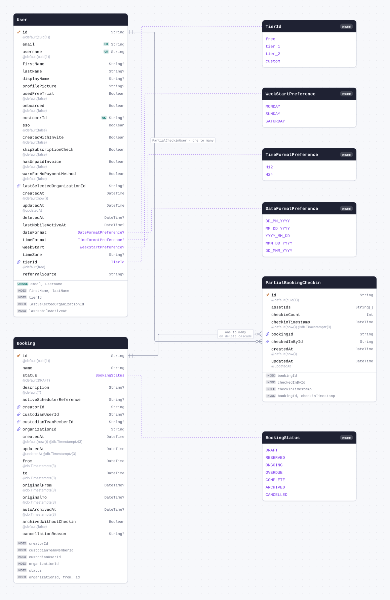

| Field              | Type                            | Constraints                             | Default      | Description |
| ------------------ | ------------------------------- | --------------------------------------- | ------------ | ----------- |
| `id`               | `String`                        | PK NOT NULL                             | `cuid(1)`    |             |
| `assetIds`         | `String[]`                      | NOT NULL                                |              |             |
| `checkinCount`     | `Int`                           | NOT NULL                                |              |             |
| `checkinTimestamp` | `DateTime` `@db.Timestamptz(3)` | NOT NULL                                | `now()`      |             |
| `bookingId`        | `String`                        | NOT NULL → [Booking.id](#model-Booking) |              |             |
| `checkedInById`    | `String`                        | NOT NULL → [User.id](#model-User)       |              |             |
| `createdAt`        | `DateTime`                      | NOT NULL                                | `now()`      |             |
| `updatedAt`        | `DateTime`                      | NOT NULL                                | `@updatedAt` |             |

#### Indexes

- `@@index([bookingId])`
- `@@index([checkedInById])`
- `@@index([checkinTimestamp])`
- `@@index([bookingId, checkinTimestamp])`

#### References

- `bookingId` → [Booking.id](#model-Booking) (many-to-one, on delete Cascade)
- `checkedInById` → [User.id](#model-User) (many-to-one)

#### Definition

```sql
CREATE TABLE "PartialBookingCheckin" (
    "id" TEXT NOT NULL,
    "assetIds" TEXT[],
    "checkinCount" INTEGER NOT NULL,
    "checkinTimestamp" TIMESTAMPTZ(3) NOT NULL DEFAULT CURRENT_TIMESTAMP,
    "bookingId" TEXT NOT NULL,
    "checkedInById" TEXT NOT NULL,
    "createdAt" TIMESTAMP(3) NOT NULL DEFAULT CURRENT_TIMESTAMP,
    "updatedAt" TIMESTAMP(3) NOT NULL,

    CONSTRAINT "PartialBookingCheckin_pkey" PRIMARY KEY ("id")
);

CREATE INDEX "PartialBookingCheckin_bookingId_idx" ON "PartialBookingCheckin"("bookingId");

CREATE INDEX "PartialBookingCheckin_checkedInById_idx" ON "PartialBookingCheckin"("checkedInById");

CREATE INDEX "PartialBookingCheckin_checkinTimestamp_idx" ON "PartialBookingCheckin"("checkinTimestamp");

CREATE INDEX "PartialBookingCheckin_bookingId_checkinTimestamp_idx" ON "PartialBookingCheckin"("bookingId", "checkinTimestamp");

ALTER TABLE "PartialBookingCheckin" ADD CONSTRAINT "PartialBookingCheckin_bookingId_fkey" FOREIGN KEY ("bookingId") REFERENCES "Booking"("id") ON DELETE CASCADE ON UPDATE CASCADE;

ALTER TABLE "PartialBookingCheckin" ADD CONSTRAINT "PartialBookingCheckin_checkedInById_fkey" FOREIGN KEY ("checkedInById") REFERENCES "User"("id") ON DELETE RESTRICT ON UPDATE CASCADE;
```

<details>
<summary>Queries and their SQL</summary>

**findMany**: Every row

```ts
await prisma.partialBookingCheckin.findMany();
```

```sql
SELECT
  "public"."PartialBookingCheckin"."id",
  "public"."PartialBookingCheckin"."assetIds",
  "public"."PartialBookingCheckin"."checkinCount",
  "public"."PartialBookingCheckin"."checkinTimestamp",
  "public"."PartialBookingCheckin"."bookingId",
  "public"."PartialBookingCheckin"."checkedInById",
  "public"."PartialBookingCheckin"."createdAt",
  "public"."PartialBookingCheckin"."updatedAt"
FROM
  "public"."PartialBookingCheckin"
WHERE
  1 = 1
OFFSET
  $1
-- params: ["0"]
```

**count**: How many rows there are

```ts
await prisma.partialBookingCheckin.count();
```

```sql
SELECT
  COUNT(*) AS "_count$_all"
FROM
  (
    SELECT
      "public"."PartialBookingCheckin"."id"
    FROM
      "public"."PartialBookingCheckin"
    WHERE
      1 = 1
    OFFSET
      $1
  ) AS "sub"
-- params: ["0"]
```

**findMany**: Every row with its relations

```ts
await prisma.partialBookingCheckin.findMany({ include: { booking: true, checkedInBy: true } });
```

```sql
SELECT
  "public"."PartialBookingCheckin"."id",
  "public"."PartialBookingCheckin"."assetIds",
  "public"."PartialBookingCheckin"."checkinCount",
  "public"."PartialBookingCheckin"."checkinTimestamp",
  "public"."PartialBookingCheckin"."bookingId",
  "public"."PartialBookingCheckin"."checkedInById",
  "public"."PartialBookingCheckin"."createdAt",
  "public"."PartialBookingCheckin"."updatedAt"
FROM
  "public"."PartialBookingCheckin"
WHERE
  1 = 1
OFFSET
  $1
-- params: ["0"]

SELECT
  "public"."Booking"."id",
  "public"."Booking"."name",
  "public"."Booking"."status"::text,
  "public"."Booking"."description",
  "public"."Booking"."activeSchedulerReference",
  "public"."Booking"."creatorId",
  "public"."Booking"."custodianUserId",
  "public"."Booking"."custodianTeamMemberId",
  "public"."Booking"."organizationId",
  "public"."Booking"."createdAt",
  "public"."Booking"."updatedAt",
  "public"."Booking"."from",
  "public"."Booking"."to",
  "public"."Booking"."originalFrom",
  "public"."Booking"."originalTo",
  "public"."Booking"."autoArchivedAt",
  "public"."Booking"."archivedWithoutCheckin",
  "public"."Booking"."cancellationReason",
  "public"."Booking"."approvedAt",
  "public"."Booking"."approvedById"
FROM
  "public"."Booking"
WHERE
  "public"."Booking"."id" IN ($1)
OFFSET
  $2
-- params: ["<bookingId of the rows above>","0"]

SELECT
  "public"."User"."id",
  "public"."User"."email",
  "public"."User"."username",
  "public"."User"."firstName",
  "public"."User"."lastName",
  "public"."User"."displayName",
  "public"."User"."profilePicture",
  "public"."User"."usedFreeTrial",
  "public"."User"."onboarded",
  "public"."User"."customerId",
  "public"."User"."sso",
  "public"."User"."createdWithInvite",
  "public"."User"."skipSubscriptionCheck",
  "public"."User"."hasUnpaidInvoice",
  "public"."User"."warnForNoPaymentMethod",
  "public"."User"."lastSelectedOrganizationId",
  "public"."User"."createdAt",
  "public"."User"."updatedAt",
  "public"."User"."deletedAt",
  "public"."User"."lastMobileActiveAt",
  "public"."User"."dateFormat"::text,
  "public"."User"."timeFormat"::text,
  "public"."User"."weekStart"::text,
  "public"."User"."timeZone",
  "public"."User"."tierId"::text,
  "public"."User"."referralSource"
FROM
  "public"."User"
WHERE
  "public"."User"."id" IN ($1)
OFFSET
  $2
-- params: ["<checkedInById of the rows above>","0"]
```

**findUnique**: One row by what is unique to it

```ts
await prisma.partialBookingCheckin.findUnique({ where: { id: "example" } });
```

```sql
SELECT
  "public"."PartialBookingCheckin"."id",
  "public"."PartialBookingCheckin"."assetIds",
  "public"."PartialBookingCheckin"."checkinCount",
  "public"."PartialBookingCheckin"."checkinTimestamp",
  "public"."PartialBookingCheckin"."bookingId",
  "public"."PartialBookingCheckin"."checkedInById",
  "public"."PartialBookingCheckin"."createdAt",
  "public"."PartialBookingCheckin"."updatedAt"
FROM
  "public"."PartialBookingCheckin"
WHERE
  (
    "public"."PartialBookingCheckin"."id" = $1
    AND 1 = 1
  )
LIMIT
  $2
OFFSET
  $3
-- params: ["example","1","0"]
```

**create**: Create a row

```ts
await prisma.partialBookingCheckin.create({
  data: { assetIds: ["example"], checkinCount: 1, bookingId: "example", checkedInById: "example" },
});
```

```sql
INSERT INTO
  "public"."PartialBookingCheckin" (
    "id",
    "assetIds",
    "checkinCount",
    "checkinTimestamp",
    "bookingId",
    "checkedInById",
    "createdAt",
    "updatedAt"
  )
VALUES
  ($1, $2, $3, $4, $5, $6, $7, $8)
RETURNING
  "public"."PartialBookingCheckin"."id",
  "public"."PartialBookingCheckin"."assetIds",
  "public"."PartialBookingCheckin"."checkinCount",
  "public"."PartialBookingCheckin"."checkinTimestamp",
  "public"."PartialBookingCheckin"."bookingId",
  "public"."PartialBookingCheckin"."checkedInById",
  "public"."PartialBookingCheckin"."createdAt",
  "public"."PartialBookingCheckin"."updatedAt"
-- params: ["<cuid(1)>",["example"],"1","<now()>","example","example","<now()>","<now()>"]
```

**update**: Update a row

```ts
await prisma.partialBookingCheckin.update({
  where: { id: "example" },
  data: { assetIds: ["example"] },
});
```

```sql
UPDATE "public"."PartialBookingCheckin"
SET
  "assetIds" = $1,
  "updatedAt" = $2
WHERE
  (
    "public"."PartialBookingCheckin"."id" = $3
    AND 1 = 1
  )
RETURNING
  "public"."PartialBookingCheckin"."id",
  "public"."PartialBookingCheckin"."assetIds",
  "public"."PartialBookingCheckin"."checkinCount",
  "public"."PartialBookingCheckin"."checkinTimestamp",
  "public"."PartialBookingCheckin"."bookingId",
  "public"."PartialBookingCheckin"."checkedInById",
  "public"."PartialBookingCheckin"."createdAt",
  "public"."PartialBookingCheckin"."updatedAt"
-- params: [["example"],{"prisma__type":"generatorCall","prisma__value":{"name":"now","args":[],"returnType":{"type":"DateTime"}}},"example"]
```

**delete**: Delete a row

```ts
await prisma.partialBookingCheckin.delete({ where: { id: "example" } });
```

```sql
DELETE FROM "public"."PartialBookingCheckin"
WHERE
  (
    "public"."PartialBookingCheckin"."id" = $1
    AND 1 = 1
  )
RETURNING
  "public"."PartialBookingCheckin"."id",
  "public"."PartialBookingCheckin"."assetIds",
  "public"."PartialBookingCheckin"."checkinCount",
  "public"."PartialBookingCheckin"."checkinTimestamp",
  "public"."PartialBookingCheckin"."bookingId",
  "public"."PartialBookingCheckin"."checkedInById",
  "public"."PartialBookingCheckin"."createdAt",
  "public"."PartialBookingCheckin"."updatedAt"
-- params: ["example"]
```

</details>

<a id="model-PartialBookingCheckout"></a>

### PartialBookingCheckout

A progressive checkout SESSION: one scan batch, covering N assets via the
positional `assetIds` / `quantities` / `bookingAssetIds` arrays.

Records sessions and the units they claimed — NOT whether an asset is out.
The all-at-once checkout (`checkoutBooking`, the Check out button) flips
statuses and writes NO row here, so **absence proves nothing** and must never
be read as "was not checked out". Reading it that way is what let a single
later scan mark every button-checked-out asset on a booking as
"never checked out". `BookingAsset.checkedOutAt` answers that question.

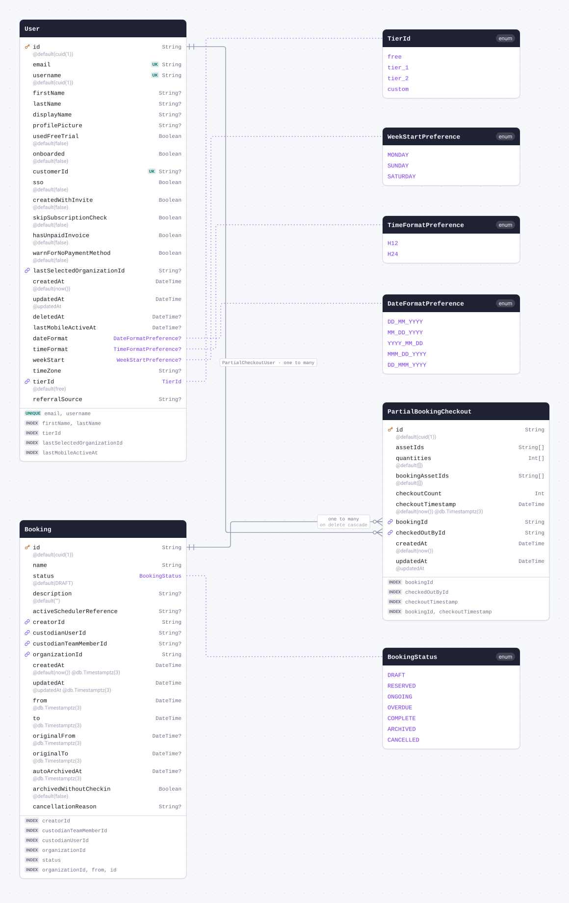

| Field               | Type                            | Constraints                             | Default      | Description |
| ------------------- | ------------------------------- | --------------------------------------- | ------------ | ----------- |
| `id`                | `String`                        | PK NOT NULL                             | `cuid(1)`    |             |
| `assetIds`          | `String[]`                      | NOT NULL                                |              |             |
| `quantities`        | `Int[]`                         | NOT NULL                                | `[]`         |             |
| `bookingAssetIds`   | `String[]`                      | NOT NULL                                | `[]`         |             |
| `checkoutCount`     | `Int`                           | NOT NULL                                |              |             |
| `checkoutTimestamp` | `DateTime` `@db.Timestamptz(3)` | NOT NULL                                | `now()`      |             |
| `bookingId`         | `String`                        | NOT NULL → [Booking.id](#model-Booking) |              |             |
| `checkedOutById`    | `String`                        | NOT NULL → [User.id](#model-User)       |              |             |
| `createdAt`         | `DateTime`                      | NOT NULL                                | `now()`      |             |
| `updatedAt`         | `DateTime`                      | NOT NULL                                | `@updatedAt` |             |

#### Indexes

- `@@index([bookingId])`
- `@@index([checkedOutById])`
- `@@index([checkoutTimestamp])`
- `@@index([bookingId, checkoutTimestamp])`

#### References

- `bookingId` → [Booking.id](#model-Booking) (many-to-one, on delete Cascade)
- `checkedOutById` → [User.id](#model-User) (many-to-one)

#### Definition

```sql
CREATE TABLE "PartialBookingCheckout" (
    "id" TEXT NOT NULL,
    "assetIds" TEXT[],
    "quantities" INTEGER[] DEFAULT ARRAY[]::INTEGER[],
    "bookingAssetIds" TEXT[] DEFAULT ARRAY[]::TEXT[],
    "checkoutCount" INTEGER NOT NULL,
    "checkoutTimestamp" TIMESTAMPTZ(3) NOT NULL DEFAULT CURRENT_TIMESTAMP,
    "bookingId" TEXT NOT NULL,
    "checkedOutById" TEXT NOT NULL,
    "createdAt" TIMESTAMP(3) NOT NULL DEFAULT CURRENT_TIMESTAMP,
    "updatedAt" TIMESTAMP(3) NOT NULL,

    CONSTRAINT "PartialBookingCheckout_pkey" PRIMARY KEY ("id")
);

CREATE INDEX "PartialBookingCheckout_bookingId_idx" ON "PartialBookingCheckout"("bookingId");

CREATE INDEX "PartialBookingCheckout_checkedOutById_idx" ON "PartialBookingCheckout"("checkedOutById");

CREATE INDEX "PartialBookingCheckout_checkoutTimestamp_idx" ON "PartialBookingCheckout"("checkoutTimestamp");

CREATE INDEX "PartialBookingCheckout_bookingId_checkoutTimestamp_idx" ON "PartialBookingCheckout"("bookingId", "checkoutTimestamp");

ALTER TABLE "PartialBookingCheckout" ADD CONSTRAINT "PartialBookingCheckout_bookingId_fkey" FOREIGN KEY ("bookingId") REFERENCES "Booking"("id") ON DELETE CASCADE ON UPDATE CASCADE;

ALTER TABLE "PartialBookingCheckout" ADD CONSTRAINT "PartialBookingCheckout_checkedOutById_fkey" FOREIGN KEY ("checkedOutById") REFERENCES "User"("id") ON DELETE RESTRICT ON UPDATE CASCADE;
```

<details>
<summary>Queries and their SQL</summary>

**findMany**: Every row

```ts
await prisma.partialBookingCheckout.findMany();
```

```sql
SELECT
  "public"."PartialBookingCheckout"."id",
  "public"."PartialBookingCheckout"."assetIds",
  "public"."PartialBookingCheckout"."quantities",
  "public"."PartialBookingCheckout"."bookingAssetIds",
  "public"."PartialBookingCheckout"."checkoutCount",
  "public"."PartialBookingCheckout"."checkoutTimestamp",
  "public"."PartialBookingCheckout"."bookingId",
  "public"."PartialBookingCheckout"."checkedOutById",
  "public"."PartialBookingCheckout"."createdAt",
  "public"."PartialBookingCheckout"."updatedAt"
FROM
  "public"."PartialBookingCheckout"
WHERE
  1 = 1
OFFSET
  $1
-- params: ["0"]
```

**count**: How many rows there are

```ts
await prisma.partialBookingCheckout.count();
```

```sql
SELECT
  COUNT(*) AS "_count$_all"
FROM
  (
    SELECT
      "public"."PartialBookingCheckout"."id"
    FROM
      "public"."PartialBookingCheckout"
    WHERE
      1 = 1
    OFFSET
      $1
  ) AS "sub"
-- params: ["0"]
```

**findMany**: Every row with its relations

```ts
await prisma.partialBookingCheckout.findMany({ include: { booking: true, checkedOutBy: true } });
```

```sql
SELECT
  "public"."PartialBookingCheckout"."id",
  "public"."PartialBookingCheckout"."assetIds",
  "public"."PartialBookingCheckout"."quantities",
  "public"."PartialBookingCheckout"."bookingAssetIds",
  "public"."PartialBookingCheckout"."checkoutCount",
  "public"."PartialBookingCheckout"."checkoutTimestamp",
  "public"."PartialBookingCheckout"."bookingId",
  "public"."PartialBookingCheckout"."checkedOutById",
  "public"."PartialBookingCheckout"."createdAt",
  "public"."PartialBookingCheckout"."updatedAt"
FROM
  "public"."PartialBookingCheckout"
WHERE
  1 = 1
OFFSET
  $1
-- params: ["0"]

SELECT
  "public"."Booking"."id",
  "public"."Booking"."name",
  "public"."Booking"."status"::text,
  "public"."Booking"."description",
  "public"."Booking"."activeSchedulerReference",
  "public"."Booking"."creatorId",
  "public"."Booking"."custodianUserId",
  "public"."Booking"."custodianTeamMemberId",
  "public"."Booking"."organizationId",
  "public"."Booking"."createdAt",
  "public"."Booking"."updatedAt",
  "public"."Booking"."from",
  "public"."Booking"."to",
  "public"."Booking"."originalFrom",
  "public"."Booking"."originalTo",
  "public"."Booking"."autoArchivedAt",
  "public"."Booking"."archivedWithoutCheckin",
  "public"."Booking"."cancellationReason",
  "public"."Booking"."approvedAt",
  "public"."Booking"."approvedById"
FROM
  "public"."Booking"
WHERE
  "public"."Booking"."id" IN ($1)
OFFSET
  $2
-- params: ["<bookingId of the rows above>","0"]

SELECT
  "public"."User"."id",
  "public"."User"."email",
  "public"."User"."username",
  "public"."User"."firstName",
  "public"."User"."lastName",
  "public"."User"."displayName",
  "public"."User"."profilePicture",
  "public"."User"."usedFreeTrial",
  "public"."User"."onboarded",
  "public"."User"."customerId",
  "public"."User"."sso",
  "public"."User"."createdWithInvite",
  "public"."User"."skipSubscriptionCheck",
  "public"."User"."hasUnpaidInvoice",
  "public"."User"."warnForNoPaymentMethod",
  "public"."User"."lastSelectedOrganizationId",
  "public"."User"."createdAt",
  "public"."User"."updatedAt",
  "public"."User"."deletedAt",
  "public"."User"."lastMobileActiveAt",
  "public"."User"."dateFormat"::text,
  "public"."User"."timeFormat"::text,
  "public"."User"."weekStart"::text,
  "public"."User"."timeZone",
  "public"."User"."tierId"::text,
  "public"."User"."referralSource"
FROM
  "public"."User"
WHERE
  "public"."User"."id" IN ($1)
OFFSET
  $2
-- params: ["<checkedOutById of the rows above>","0"]
```

**findUnique**: One row by what is unique to it

```ts
await prisma.partialBookingCheckout.findUnique({ where: { id: "example" } });
```

```sql
SELECT
  "public"."PartialBookingCheckout"."id",
  "public"."PartialBookingCheckout"."assetIds",
  "public"."PartialBookingCheckout"."quantities",
  "public"."PartialBookingCheckout"."bookingAssetIds",
  "public"."PartialBookingCheckout"."checkoutCount",
  "public"."PartialBookingCheckout"."checkoutTimestamp",
  "public"."PartialBookingCheckout"."bookingId",
  "public"."PartialBookingCheckout"."checkedOutById",
  "public"."PartialBookingCheckout"."createdAt",
  "public"."PartialBookingCheckout"."updatedAt"
FROM
  "public"."PartialBookingCheckout"
WHERE
  (
    "public"."PartialBookingCheckout"."id" = $1
    AND 1 = 1
  )
LIMIT
  $2
OFFSET
  $3
-- params: ["example","1","0"]
```

**create**: Create a row

```ts
await prisma.partialBookingCheckout.create({
  data: {
    assetIds: ["example"],
    checkoutCount: 1,
    bookingId: "example",
    checkedOutById: "example",
  },
});
```

```sql
INSERT INTO
  "public"."PartialBookingCheckout" (
    "id",
    "assetIds",
    "quantities",
    "bookingAssetIds",
    "checkoutCount",
    "checkoutTimestamp",
    "bookingId",
    "checkedOutById",
    "createdAt",
    "updatedAt"
  )
VALUES
  ($1, $2, $3, $4, $5, $6, $7, $8, $9, $10)
RETURNING
  "public"."PartialBookingCheckout"."id",
  "public"."PartialBookingCheckout"."assetIds",
  "public"."PartialBookingCheckout"."quantities",
  "public"."PartialBookingCheckout"."bookingAssetIds",
  "public"."PartialBookingCheckout"."checkoutCount",
  "public"."PartialBookingCheckout"."checkoutTimestamp",
  "public"."PartialBookingCheckout"."bookingId",
  "public"."PartialBookingCheckout"."checkedOutById",
  "public"."PartialBookingCheckout"."createdAt",
  "public"."PartialBookingCheckout"."updatedAt"
-- params: ["<cuid(1)>",["example"],[],[],"1","<now()>","example","example","<now()>","<now()>"]
```

**update**: Update a row

```ts
await prisma.partialBookingCheckout.update({
  where: { id: "example" },
  data: { assetIds: ["example"] },
});
```

```sql
UPDATE "public"."PartialBookingCheckout"
SET
  "assetIds" = $1,
  "updatedAt" = $2
WHERE
  (
    "public"."PartialBookingCheckout"."id" = $3
    AND 1 = 1
  )
RETURNING
  "public"."PartialBookingCheckout"."id",
  "public"."PartialBookingCheckout"."assetIds",
  "public"."PartialBookingCheckout"."quantities",
  "public"."PartialBookingCheckout"."bookingAssetIds",
  "public"."PartialBookingCheckout"."checkoutCount",
  "public"."PartialBookingCheckout"."checkoutTimestamp",
  "public"."PartialBookingCheckout"."bookingId",
  "public"."PartialBookingCheckout"."checkedOutById",
  "public"."PartialBookingCheckout"."createdAt",
  "public"."PartialBookingCheckout"."updatedAt"
-- params: [["example"],{"prisma__type":"generatorCall","prisma__value":{"name":"now","args":[],"returnType":{"type":"DateTime"}}},"example"]
```

**delete**: Delete a row

```ts
await prisma.partialBookingCheckout.delete({ where: { id: "example" } });
```

```sql
DELETE FROM "public"."PartialBookingCheckout"
WHERE
  (
    "public"."PartialBookingCheckout"."id" = $1
    AND 1 = 1
  )
RETURNING
  "public"."PartialBookingCheckout"."id",
  "public"."PartialBookingCheckout"."assetIds",
  "public"."PartialBookingCheckout"."quantities",
  "public"."PartialBookingCheckout"."bookingAssetIds",
  "public"."PartialBookingCheckout"."checkoutCount",
  "public"."PartialBookingCheckout"."checkoutTimestamp",
  "public"."PartialBookingCheckout"."bookingId",
  "public"."PartialBookingCheckout"."checkedOutById",
  "public"."PartialBookingCheckout"."createdAt",
  "public"."PartialBookingCheckout"."updatedAt"
-- params: ["example"]
```

</details>

<a id="model-MobileAuthCode"></a>

### MobileAuthCode

Native-app SSO web-delegated login — single-use session-handoff codes.
@see apps/webapp/app/routes/_auth+/oauth.callback.mobile.tsx

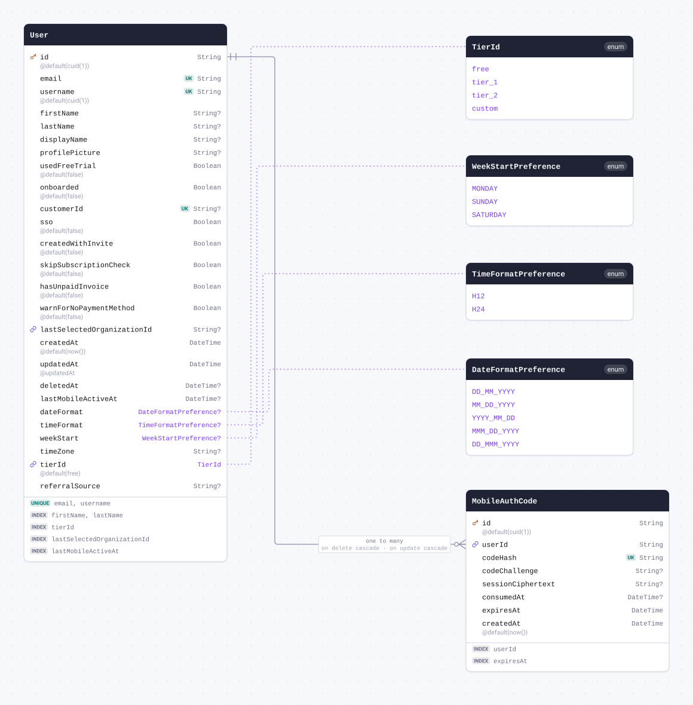

| Field               | Type       | Constraints                       | Default   | Description |
| ------------------- | ---------- | --------------------------------- | --------- | ----------- |
| `id`                | `String`   | PK NOT NULL                       | `cuid(1)` |             |
| `userId`            | `String`   | NOT NULL → [User.id](#model-User) |           |             |
| `codeHash`          | `String`   | UNIQUE NOT NULL                   |           |             |
| `codeChallenge`     | `String`   | NULL                              |           |             |
| `sessionCiphertext` | `String`   | NULL                              |           |             |
| `consumedAt`        | `DateTime` | NULL                              |           |             |
| `expiresAt`         | `DateTime` | NOT NULL                          |           |             |
| `createdAt`         | `DateTime` | NOT NULL                          | `now()`   |             |

#### Indexes

- `@@index([userId])`
- `@@index([expiresAt])`

#### References

- `userId` → [User.id](#model-User) (many-to-one, on delete Cascade, on update Cascade)

#### Definition

```sql
CREATE TABLE "MobileAuthCode" (
    "id" TEXT NOT NULL,
    "userId" TEXT NOT NULL,
    "codeHash" TEXT NOT NULL,
    "codeChallenge" TEXT,
    "sessionCiphertext" TEXT,
    "consumedAt" TIMESTAMP(3),
    "expiresAt" TIMESTAMP(3) NOT NULL,
    "createdAt" TIMESTAMP(3) NOT NULL DEFAULT CURRENT_TIMESTAMP,

    CONSTRAINT "MobileAuthCode_pkey" PRIMARY KEY ("id")
);

CREATE UNIQUE INDEX "MobileAuthCode_codeHash_key" ON "MobileAuthCode"("codeHash");

CREATE INDEX "MobileAuthCode_userId_idx" ON "MobileAuthCode"("userId");

CREATE INDEX "MobileAuthCode_expiresAt_idx" ON "MobileAuthCode"("expiresAt");

ALTER TABLE "MobileAuthCode" ADD CONSTRAINT "MobileAuthCode_userId_fkey" FOREIGN KEY ("userId") REFERENCES "User"("id") ON DELETE CASCADE ON UPDATE CASCADE;
```

<details>
<summary>Queries and their SQL</summary>

**findMany**: Every row

```ts
await prisma.mobileAuthCode.findMany();
```

```sql
SELECT
  "public"."MobileAuthCode"."id",
  "public"."MobileAuthCode"."userId",
  "public"."MobileAuthCode"."codeHash",
  "public"."MobileAuthCode"."codeChallenge",
  "public"."MobileAuthCode"."sessionCiphertext",
  "public"."MobileAuthCode"."consumedAt",
  "public"."MobileAuthCode"."expiresAt",
  "public"."MobileAuthCode"."createdAt"
FROM
  "public"."MobileAuthCode"
WHERE
  1 = 1
OFFSET
  $1
-- params: ["0"]
```

**count**: How many rows there are

```ts
await prisma.mobileAuthCode.count();
```

```sql
SELECT
  COUNT(*) AS "_count$_all"
FROM
  (
    SELECT
      "public"."MobileAuthCode"."id"
    FROM
      "public"."MobileAuthCode"
    WHERE
      1 = 1
    OFFSET
      $1
  ) AS "sub"
-- params: ["0"]
```

**findMany**: Every row with its relations

```ts
await prisma.mobileAuthCode.findMany({ include: { user: true } });
```

```sql
SELECT
  "public"."MobileAuthCode"."id",
  "public"."MobileAuthCode"."userId",
  "public"."MobileAuthCode"."codeHash",
  "public"."MobileAuthCode"."codeChallenge",
  "public"."MobileAuthCode"."sessionCiphertext",
  "public"."MobileAuthCode"."consumedAt",
  "public"."MobileAuthCode"."expiresAt",
  "public"."MobileAuthCode"."createdAt"
FROM
  "public"."MobileAuthCode"
WHERE
  1 = 1
OFFSET
  $1
-- params: ["0"]

SELECT
  "public"."User"."id",
  "public"."User"."email",
  "public"."User"."username",
  "public"."User"."firstName",
  "public"."User"."lastName",
  "public"."User"."displayName",
  "public"."User"."profilePicture",
  "public"."User"."usedFreeTrial",
  "public"."User"."onboarded",
  "public"."User"."customerId",
  "public"."User"."sso",
  "public"."User"."createdWithInvite",
  "public"."User"."skipSubscriptionCheck",
  "public"."User"."hasUnpaidInvoice",
  "public"."User"."warnForNoPaymentMethod",
  "public"."User"."lastSelectedOrganizationId",
  "public"."User"."createdAt",
  "public"."User"."updatedAt",
  "public"."User"."deletedAt",
  "public"."User"."lastMobileActiveAt",
  "public"."User"."dateFormat"::text,
  "public"."User"."timeFormat"::text,
  "public"."User"."weekStart"::text,
  "public"."User"."timeZone",
  "public"."User"."tierId"::text,
  "public"."User"."referralSource"
FROM
  "public"."User"
WHERE
  "public"."User"."id" IN ($1)
OFFSET
  $2
-- params: ["<userId of the rows above>","0"]
```

**findUnique**: One row by what is unique to it

```ts
await prisma.mobileAuthCode.findUnique({ where: { id: "example" } });
```

```sql
SELECT
  "public"."MobileAuthCode"."id",
  "public"."MobileAuthCode"."userId",
  "public"."MobileAuthCode"."codeHash",
  "public"."MobileAuthCode"."codeChallenge",
  "public"."MobileAuthCode"."sessionCiphertext",
  "public"."MobileAuthCode"."consumedAt",
  "public"."MobileAuthCode"."expiresAt",
  "public"."MobileAuthCode"."createdAt"
FROM
  "public"."MobileAuthCode"
WHERE
  (
    "public"."MobileAuthCode"."id" = $1
    AND 1 = 1
  )
LIMIT
  $2
OFFSET
  $3
-- params: ["example","1","0"]
```

**create**: Create a row

```ts
await prisma.mobileAuthCode.create({
  data: { userId: "example", codeHash: "example", expiresAt: new Date("2026-01-01T00:00:00.000Z") },
});
```

```sql
INSERT INTO
  "public"."MobileAuthCode" (
    "id",
    "userId",
    "codeHash",
    "expiresAt",
    "createdAt"
  )
VALUES
  ($1, $2, $3, $4, $5)
RETURNING
  "public"."MobileAuthCode"."id",
  "public"."MobileAuthCode"."userId",
  "public"."MobileAuthCode"."codeHash",
  "public"."MobileAuthCode"."codeChallenge",
  "public"."MobileAuthCode"."sessionCiphertext",
  "public"."MobileAuthCode"."consumedAt",
  "public"."MobileAuthCode"."expiresAt",
  "public"."MobileAuthCode"."createdAt"
-- params: ["<cuid(1)>","example","example","2026-01-01T00:00:00.000Z","<now()>"]
```

**update**: Update a row

```ts
await prisma.mobileAuthCode.update({ where: { id: "example" }, data: { codeHash: "example" } });
```

```sql
UPDATE "public"."MobileAuthCode"
SET
  "codeHash" = $1
WHERE
  (
    "public"."MobileAuthCode"."id" = $2
    AND 1 = 1
  )
RETURNING
  "public"."MobileAuthCode"."id",
  "public"."MobileAuthCode"."userId",
  "public"."MobileAuthCode"."codeHash",
  "public"."MobileAuthCode"."codeChallenge",
  "public"."MobileAuthCode"."sessionCiphertext",
  "public"."MobileAuthCode"."consumedAt",
  "public"."MobileAuthCode"."expiresAt",
  "public"."MobileAuthCode"."createdAt"
-- params: ["example","example"]
```

**delete**: Delete a row

```ts
await prisma.mobileAuthCode.delete({ where: { id: "example" } });
```

```sql
DELETE FROM "public"."MobileAuthCode"
WHERE
  (
    "public"."MobileAuthCode"."id" = $1
    AND 1 = 1
  )
RETURNING
  "public"."MobileAuthCode"."id",
  "public"."MobileAuthCode"."userId",
  "public"."MobileAuthCode"."codeHash",
  "public"."MobileAuthCode"."codeChallenge",
  "public"."MobileAuthCode"."sessionCiphertext",
  "public"."MobileAuthCode"."consumedAt",
  "public"."MobileAuthCode"."expiresAt",
  "public"."MobileAuthCode"."createdAt"
-- params: ["example"]
```

</details>

<a id="model-PushToken"></a>

### PushToken

One Expo push token per installed companion app. A token identifies a
device, not a person: when someone else signs in on the same phone, the
row moves to them. Pushes go only to rows where `disabledAt` is null.
@see apps/webapp/app/modules/push/service.server.ts

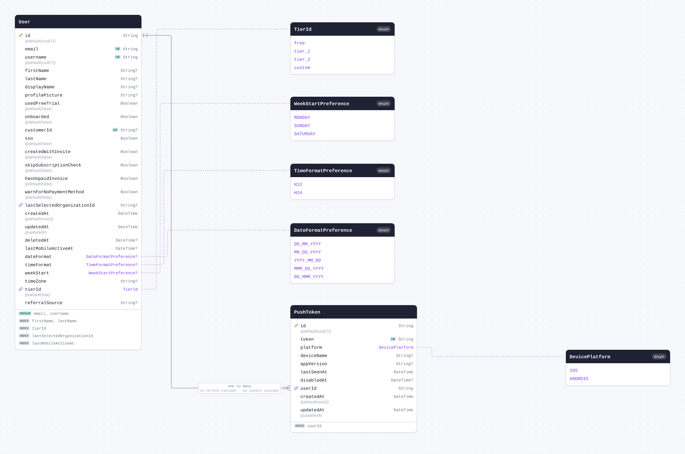

| Field        | Type                                     | Constraints                       | Default      | Description |
| ------------ | ---------------------------------------- | --------------------------------- | ------------ | ----------- |
| `id`         | `String`                                 | PK NOT NULL                       | `cuid(1)`    |             |
| `token`      | `String`                                 | UNIQUE NOT NULL                   |              |             |
| `platform`   | [`DevicePlatform`](#enum-DevicePlatform) | NOT NULL                          |              |             |
| `deviceName` | `String`                                 | NULL                              |              |             |
| `appVersion` | `String`                                 | NULL                              |              |             |
| `lastSeenAt` | `DateTime`                               | NOT NULL                          |              |             |
| `disabledAt` | `DateTime`                               | NULL                              |              |             |
| `userId`     | `String`                                 | NOT NULL → [User.id](#model-User) |              |             |
| `createdAt`  | `DateTime`                               | NOT NULL                          | `now()`      |             |
| `updatedAt`  | `DateTime`                               | NOT NULL                          | `@updatedAt` |             |

#### Indexes

- `@@index([userId])`

#### References

- `userId` → [User.id](#model-User) (many-to-one, on delete Cascade, on update Cascade)

#### Definition

```sql
CREATE TABLE "PushToken" (
    "id" TEXT NOT NULL,
    "token" TEXT NOT NULL,
    "platform" "DevicePlatform" NOT NULL,
    "deviceName" TEXT,
    "appVersion" TEXT,
    "lastSeenAt" TIMESTAMP(3) NOT NULL,
    "disabledAt" TIMESTAMP(3),
    "userId" TEXT NOT NULL,
    "createdAt" TIMESTAMP(3) NOT NULL DEFAULT CURRENT_TIMESTAMP,
    "updatedAt" TIMESTAMP(3) NOT NULL,

    CONSTRAINT "PushToken_pkey" PRIMARY KEY ("id")
);

CREATE UNIQUE INDEX "PushToken_token_key" ON "PushToken"("token");

CREATE INDEX "PushToken_userId_idx" ON "PushToken"("userId");

ALTER TABLE "PushToken" ADD CONSTRAINT "PushToken_userId_fkey" FOREIGN KEY ("userId") REFERENCES "User"("id") ON DELETE CASCADE ON UPDATE CASCADE;
```

<details>
<summary>Queries and their SQL</summary>

**findMany**: Every row

```ts
await prisma.pushToken.findMany();
```

```sql
SELECT
  "public"."PushToken"."id",
  "public"."PushToken"."token",
  "public"."PushToken"."platform"::text,
  "public"."PushToken"."deviceName",
  "public"."PushToken"."appVersion",
  "public"."PushToken"."lastSeenAt",
  "public"."PushToken"."disabledAt",
  "public"."PushToken"."userId",
  "public"."PushToken"."createdAt",
  "public"."PushToken"."updatedAt"
FROM
  "public"."PushToken"
WHERE
  1 = 1
OFFSET
  $1
-- params: ["0"]
```

**count**: How many rows there are

```ts
await prisma.pushToken.count();
```

```sql
SELECT
  COUNT(*) AS "_count$_all"
FROM
  (
    SELECT
      "public"."PushToken"."id"
    FROM
      "public"."PushToken"
    WHERE
      1 = 1
    OFFSET
      $1
  ) AS "sub"
-- params: ["0"]
```

**findMany**: Every row with its relations

```ts
await prisma.pushToken.findMany({ include: { user: true } });
```

```sql
SELECT
  "public"."PushToken"."id",
  "public"."PushToken"."token",
  "public"."PushToken"."platform"::text,
  "public"."PushToken"."deviceName",
  "public"."PushToken"."appVersion",
  "public"."PushToken"."lastSeenAt",
  "public"."PushToken"."disabledAt",
  "public"."PushToken"."userId",
  "public"."PushToken"."createdAt",
  "public"."PushToken"."updatedAt"
FROM
  "public"."PushToken"
WHERE
  1 = 1
OFFSET
  $1
-- params: ["0"]

SELECT
  "public"."User"."id",
  "public"."User"."email",
  "public"."User"."username",
  "public"."User"."firstName",
  "public"."User"."lastName",
  "public"."User"."displayName",
  "public"."User"."profilePicture",
  "public"."User"."usedFreeTrial",
  "public"."User"."onboarded",
  "public"."User"."customerId",
  "public"."User"."sso",
  "public"."User"."createdWithInvite",
  "public"."User"."skipSubscriptionCheck",
  "public"."User"."hasUnpaidInvoice",
  "public"."User"."warnForNoPaymentMethod",
  "public"."User"."lastSelectedOrganizationId",
  "public"."User"."createdAt",
  "public"."User"."updatedAt",
  "public"."User"."deletedAt",
  "public"."User"."lastMobileActiveAt",
  "public"."User"."dateFormat"::text,
  "public"."User"."timeFormat"::text,
  "public"."User"."weekStart"::text,
  "public"."User"."timeZone",
  "public"."User"."tierId"::text,
  "public"."User"."referralSource"
FROM
  "public"."User"
WHERE
  "public"."User"."id" IN ($1)
OFFSET
  $2
-- params: ["<userId of the rows above>","0"]
```

**findUnique**: One row by what is unique to it

```ts
await prisma.pushToken.findUnique({ where: { id: "example" } });
```

```sql
SELECT
  "public"."PushToken"."id",
  "public"."PushToken"."token",
  "public"."PushToken"."platform"::text,
  "public"."PushToken"."deviceName",
  "public"."PushToken"."appVersion",
  "public"."PushToken"."lastSeenAt",
  "public"."PushToken"."disabledAt",
  "public"."PushToken"."userId",
  "public"."PushToken"."createdAt",
  "public"."PushToken"."updatedAt"
FROM
  "public"."PushToken"
WHERE
  (
    "public"."PushToken"."id" = $1
    AND 1 = 1
  )
LIMIT
  $2
OFFSET
  $3
-- params: ["example","1","0"]
```

**create**: Create a row

```ts
await prisma.pushToken.create({
  data: {
    token: "example",
    platform: "IOS",
    lastSeenAt: new Date("2026-01-01T00:00:00.000Z"),
    userId: "example",
  },
});
```

```sql
INSERT INTO
  "public"."PushToken" (
    "id",
    "token",
    "platform",
    "lastSeenAt",
    "userId",
    "createdAt",
    "updatedAt"
  )
VALUES
  (
    $1,
    $2,
    CAST($3::text AS "public"."DevicePlatform"),
    $4,
    $5,
    $6,
    $7
  )
RETURNING
  "public"."PushToken"."id",
  "public"."PushToken"."token",
  "public"."PushToken"."platform"::text,
  "public"."PushToken"."deviceName",
  "public"."PushToken"."appVersion",
  "public"."PushToken"."lastSeenAt",
  "public"."PushToken"."disabledAt",
  "public"."PushToken"."userId",
  "public"."PushToken"."createdAt",
  "public"."PushToken"."updatedAt"
-- params: ["<cuid(1)>","example","IOS","2026-01-01T00:00:00.000Z","example","<now()>","<now()>"]
```

**update**: Update a row

```ts
await prisma.pushToken.update({ where: { id: "example" }, data: { token: "example" } });
```

```sql
UPDATE "public"."PushToken"
SET
  "token" = $1,
  "updatedAt" = $2
WHERE
  (
    "public"."PushToken"."id" = $3
    AND 1 = 1
  )
RETURNING
  "public"."PushToken"."id",
  "public"."PushToken"."token",
  "public"."PushToken"."platform"::text,
  "public"."PushToken"."deviceName",
  "public"."PushToken"."appVersion",
  "public"."PushToken"."lastSeenAt",
  "public"."PushToken"."disabledAt",
  "public"."PushToken"."userId",
  "public"."PushToken"."createdAt",
  "public"."PushToken"."updatedAt"
-- params: ["example",{"prisma__type":"generatorCall","prisma__value":{"name":"now","args":[],"returnType":{"type":"DateTime"}}},"example"]
```

**delete**: Delete a row

```ts
await prisma.pushToken.delete({ where: { id: "example" } });
```

```sql
DELETE FROM "public"."PushToken"
WHERE
  (
    "public"."PushToken"."id" = $1
    AND 1 = 1
  )
RETURNING
  "public"."PushToken"."id",
  "public"."PushToken"."token",
  "public"."PushToken"."platform"::text,
  "public"."PushToken"."deviceName",
  "public"."PushToken"."appVersion",
  "public"."PushToken"."lastSeenAt",
  "public"."PushToken"."disabledAt",
  "public"."PushToken"."userId",
  "public"."PushToken"."createdAt",
  "public"."PushToken"."updatedAt"
-- params: ["example"]
```

</details>

<a id="model-NotificationPreference"></a>

### NotificationPreference

A person's push notification switches. A missing row means every switch
is on, so no backfill is needed. The three category columns are named
after `PushCategory` in apps/webapp/app/modules/push/types.ts.

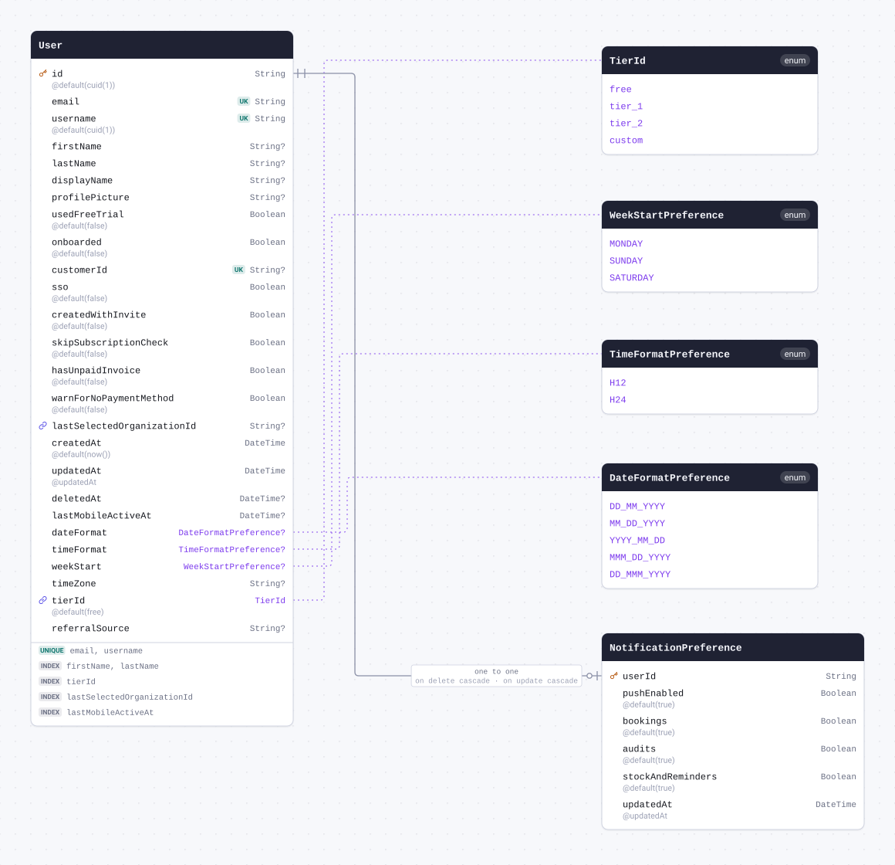

| Field               | Type       | Constraints                          | Default      | Description |
| ------------------- | ---------- | ------------------------------------ | ------------ | ----------- |
| `userId`            | `String`   | PK NOT NULL → [User.id](#model-User) |              |             |
| `pushEnabled`       | `Boolean`  | NOT NULL                             | `true`       |             |
| `bookings`          | `Boolean`  | NOT NULL                             | `true`       |             |
| `audits`            | `Boolean`  | NOT NULL                             | `true`       |             |
| `stockAndReminders` | `Boolean`  | NOT NULL                             | `true`       |             |
| `updatedAt`         | `DateTime` | NOT NULL                             | `@updatedAt` |             |

#### References

- `userId` → [User.id](#model-User) (one-to-one, on delete Cascade, on update Cascade)

#### Definition

```sql
CREATE TABLE "NotificationPreference" (
    "userId" TEXT NOT NULL,
    "pushEnabled" BOOLEAN NOT NULL DEFAULT true,
    "bookings" BOOLEAN NOT NULL DEFAULT true,
    "audits" BOOLEAN NOT NULL DEFAULT true,
    "stockAndReminders" BOOLEAN NOT NULL DEFAULT true,
    "updatedAt" TIMESTAMP(3) NOT NULL,

    CONSTRAINT "NotificationPreference_pkey" PRIMARY KEY ("userId")
);

ALTER TABLE "NotificationPreference" ADD CONSTRAINT "NotificationPreference_userId_fkey" FOREIGN KEY ("userId") REFERENCES "User"("id") ON DELETE CASCADE ON UPDATE CASCADE;
```

<details>
<summary>Queries and their SQL</summary>

**findMany**: Every row

```ts
await prisma.notificationPreference.findMany();
```

```sql
SELECT
  "public"."NotificationPreference"."userId",
  "public"."NotificationPreference"."pushEnabled",
  "public"."NotificationPreference"."bookings",
  "public"."NotificationPreference"."audits",
  "public"."NotificationPreference"."stockAndReminders",
  "public"."NotificationPreference"."updatedAt"
FROM
  "public"."NotificationPreference"
WHERE
  1 = 1
OFFSET
  $1
-- params: ["0"]
```

**count**: How many rows there are

```ts
await prisma.notificationPreference.count();
```

```sql
SELECT
  COUNT(*) AS "_count$_all"
FROM
  (
    SELECT
      "public"."NotificationPreference"."userId"
    FROM
      "public"."NotificationPreference"
    WHERE
      1 = 1
    OFFSET
      $1
  ) AS "sub"
-- params: ["0"]
```

**findMany**: Every row with its relations

```ts
await prisma.notificationPreference.findMany({ include: { user: true } });
```

```sql
SELECT
  "public"."NotificationPreference"."userId",
  "public"."NotificationPreference"."pushEnabled",
  "public"."NotificationPreference"."bookings",
  "public"."NotificationPreference"."audits",
  "public"."NotificationPreference"."stockAndReminders",
  "public"."NotificationPreference"."updatedAt"
FROM
  "public"."NotificationPreference"
WHERE
  1 = 1
OFFSET
  $1
-- params: ["0"]

SELECT
  "public"."User"."id",
  "public"."User"."email",
  "public"."User"."username",
  "public"."User"."firstName",
  "public"."User"."lastName",
  "public"."User"."displayName",
  "public"."User"."profilePicture",
  "public"."User"."usedFreeTrial",
  "public"."User"."onboarded",
  "public"."User"."customerId",
  "public"."User"."sso",
  "public"."User"."createdWithInvite",
  "public"."User"."skipSubscriptionCheck",
  "public"."User"."hasUnpaidInvoice",
  "public"."User"."warnForNoPaymentMethod",
  "public"."User"."lastSelectedOrganizationId",
  "public"."User"."createdAt",
  "public"."User"."updatedAt",
  "public"."User"."deletedAt",
  "public"."User"."lastMobileActiveAt",
  "public"."User"."dateFormat"::text,
  "public"."User"."timeFormat"::text,
  "public"."User"."weekStart"::text,
  "public"."User"."timeZone",
  "public"."User"."tierId"::text,
  "public"."User"."referralSource"
FROM
  "public"."User"
WHERE
  "public"."User"."id" IN ($1)
OFFSET
  $2
-- params: ["<userId of the rows above>","0"]
```

**findUnique**: One row by what is unique to it

```ts
await prisma.notificationPreference.findUnique({ where: { userId: "example" } });
```

```sql
SELECT
  "public"."NotificationPreference"."userId",
  "public"."NotificationPreference"."pushEnabled",
  "public"."NotificationPreference"."bookings",
  "public"."NotificationPreference"."audits",
  "public"."NotificationPreference"."stockAndReminders",
  "public"."NotificationPreference"."updatedAt"
FROM
  "public"."NotificationPreference"
WHERE
  (
    "public"."NotificationPreference"."userId" = $1
    AND 1 = 1
  )
LIMIT
  $2
OFFSET
  $3
-- params: ["example","1","0"]
```

**create**: Create a row

```ts
await prisma.notificationPreference.create({ data: { userId: "example" } });
```

```sql
INSERT INTO
  "public"."NotificationPreference" (
    "userId",
    "pushEnabled",
    "bookings",
    "audits",
    "stockAndReminders",
    "updatedAt"
  )
VALUES
  ($1, $2, $3, $4, $5, $6)
RETURNING
  "public"."NotificationPreference"."userId",
  "public"."NotificationPreference"."pushEnabled",
  "public"."NotificationPreference"."bookings",
  "public"."NotificationPreference"."audits",
  "public"."NotificationPreference"."stockAndReminders",
  "public"."NotificationPreference"."updatedAt"
-- params: ["example",true,true,true,true,"<now()>"]
```

**update**: Update a row

```ts
await prisma.notificationPreference.update({
  where: { userId: "example" },
  data: { pushEnabled: true },
});
```

```sql
UPDATE "public"."NotificationPreference"
SET
  "pushEnabled" = $1,
  "updatedAt" = $2
WHERE
  (
    "public"."NotificationPreference"."userId" = $3
    AND 1 = 1
  )
RETURNING
  "public"."NotificationPreference"."userId",
  "public"."NotificationPreference"."pushEnabled",
  "public"."NotificationPreference"."bookings",
  "public"."NotificationPreference"."audits",
  "public"."NotificationPreference"."stockAndReminders",
  "public"."NotificationPreference"."updatedAt"
-- params: [true,{"prisma__type":"generatorCall","prisma__value":{"name":"now","args":[],"returnType":{"type":"DateTime"}}},"example"]
```

**delete**: Delete a row

```ts
await prisma.notificationPreference.delete({ where: { userId: "example" } });
```

```sql
DELETE FROM "public"."NotificationPreference"
WHERE
  (
    "public"."NotificationPreference"."userId" = $1
    AND 1 = 1
  )
RETURNING
  "public"."NotificationPreference"."userId",
  "public"."NotificationPreference"."pushEnabled",
  "public"."NotificationPreference"."bookings",
  "public"."NotificationPreference"."audits",
  "public"."NotificationPreference"."stockAndReminders",
  "public"."NotificationPreference"."updatedAt"
-- params: ["example"]
```

</details>

<a id="model-Kit"></a>

### Kit

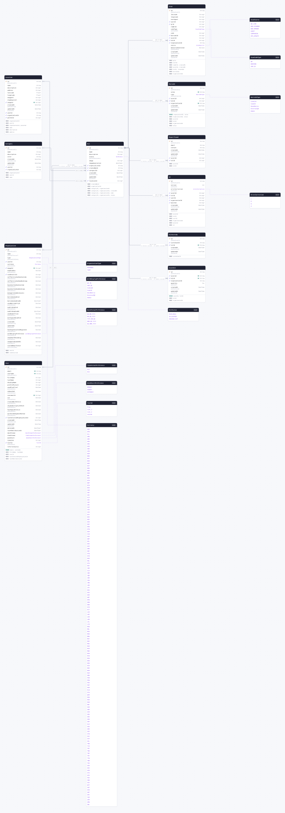

| Field             | Type                           | Constraints                                       | Default      | Description |
| ----------------- | ------------------------------ | ------------------------------------------------- | ------------ | ----------- |
| `id`              | `String`                       | PK NOT NULL                                       | `cuid(1)`    |             |
| `name`            | `String`                       | NOT NULL                                          |              |             |
| `description`     | `String`                       | NULL                                              |              |             |
| `status`          | [`KitStatus`](#enum-KitStatus) | NOT NULL                                          | `AVAILABLE`  |             |
| `image`           | `String`                       | NULL                                              |              |             |
| `imageExpiration` | `DateTime`                     | NULL                                              |              |             |
| `organizationId`  | `String`                       | NOT NULL → [Organization.id](#model-Organization) |              |             |
| `createdById`     | `String`                       | NOT NULL → [User.id](#model-User)                 |              |             |
| `categoryId`      | `String`                       | NULL → [Category.id](#model-Category)             |              |             |
| `createdAt`       | `DateTime`                     | NOT NULL                                          | `now()`      |             |
| `updatedAt`       | `DateTime`                     | NOT NULL                                          | `@updatedAt` |             |
| `locationId`      | `String`                       | NULL → [Location.id](#model-Location)             |              |             |

#### Indexes

- `@@index([createdById])`
- `@@index([organizationId])`
- `@@index([categoryId, organizationId])`
- `@@index([categoryId, organizationId, createdAt])`
- `@@index([categoryId, organizationId, name])`
- `@@index([categoryId, organizationId, status])`

#### References

- `organizationId` → [Organization.id](#model-Organization) (many-to-one, on delete Cascade, on update Cascade)
- `createdById` → [User.id](#model-User) (many-to-one)
- `categoryId` → [Category.id](#model-Category) (many-to-one)
- `locationId` → [Location.id](#model-Location) (many-to-one)

#### Referenced by

- `id` ← [Qr.kitId](#model-Qr) (one-to-many, on delete SetNull)
- `id` ← [Barcode.kitId](#model-Barcode) (one-to-many, on delete SetNull)
- `id` ← [ReportFound.kitId](#model-ReportFound) (one-to-many, on delete Cascade, on update Cascade)
- `id` ← [Scan.kitId](#model-Scan) (one-to-many, on delete SetNull)
- `id` ← [KitCustody.kitId](#model-KitCustody) (one-to-one, on delete Cascade, on update Cascade)
- `id` ← [AssetKit.kitId](#model-AssetKit) (one-to-many, on delete Cascade, on update Cascade)

#### Definition

```sql
CREATE TABLE "Kit" (
    "id" TEXT NOT NULL,
    "name" TEXT NOT NULL,
    "description" TEXT,
    "status" "KitStatus" NOT NULL DEFAULT 'AVAILABLE',
    "image" TEXT,
    "imageExpiration" TIMESTAMP(3),
    "organizationId" TEXT NOT NULL,
    "createdById" TEXT NOT NULL,
    "categoryId" TEXT,
    "createdAt" TIMESTAMP(3) NOT NULL DEFAULT CURRENT_TIMESTAMP,
    "updatedAt" TIMESTAMP(3) NOT NULL,
    "locationId" TEXT,

    CONSTRAINT "Kit_pkey" PRIMARY KEY ("id")
);

CREATE INDEX "Kit_createdById_idx" ON "Kit"("createdById");

CREATE INDEX "Kit_organizationId_idx" ON "Kit"("organizationId");

CREATE INDEX "Kit_categoryId_organizationId_idx" ON "Kit"("categoryId", "organizationId");

CREATE INDEX "Kit_categoryId_organizationId_createdAt_idx" ON "Kit"("categoryId", "organizationId", "createdAt");

CREATE INDEX "Kit_categoryId_organizationId_name_idx" ON "Kit"("categoryId", "organizationId", "name");

CREATE INDEX "Kit_categoryId_organizationId_status_idx" ON "Kit"("categoryId", "organizationId", "status");

ALTER TABLE "Kit" ADD CONSTRAINT "Kit_organizationId_fkey" FOREIGN KEY ("organizationId") REFERENCES "Organization"("id") ON DELETE CASCADE ON UPDATE CASCADE;

ALTER TABLE "Kit" ADD CONSTRAINT "Kit_createdById_fkey" FOREIGN KEY ("createdById") REFERENCES "User"("id") ON DELETE RESTRICT ON UPDATE CASCADE;

ALTER TABLE "Kit" ADD CONSTRAINT "Kit_categoryId_fkey" FOREIGN KEY ("categoryId") REFERENCES "Category"("id") ON DELETE SET NULL ON UPDATE CASCADE;

ALTER TABLE "Kit" ADD CONSTRAINT "Kit_locationId_fkey" FOREIGN KEY ("locationId") REFERENCES "Location"("id") ON DELETE SET NULL ON UPDATE CASCADE;
```

<details>
<summary>Queries and their SQL</summary>

**findMany**: Every row

```ts
await prisma.kit.findMany();
```

```sql
SELECT
  "public"."Kit"."id",
  "public"."Kit"."name",
  "public"."Kit"."description",
  "public"."Kit"."status"::text,
  "public"."Kit"."image",
  "public"."Kit"."imageExpiration",
  "public"."Kit"."organizationId",
  "public"."Kit"."createdById",
  "public"."Kit"."categoryId",
  "public"."Kit"."createdAt",
  "public"."Kit"."updatedAt",
  "public"."Kit"."locationId"
FROM
  "public"."Kit"
WHERE
  1 = 1
OFFSET
  $1
-- params: ["0"]
```

**count**: How many rows there are

```ts
await prisma.kit.count();
```

```sql
SELECT
  COUNT(*) AS "_count$_all"
FROM
  (
    SELECT
      "public"."Kit"."id"
    FROM
      "public"."Kit"
    WHERE
      1 = 1
    OFFSET
      $1
  ) AS "sub"
-- params: ["0"]
```

**findMany**: Every row with its relations

```ts
await prisma.kit.findMany({
  include: {
    assetKits: true,
    custody: true,
    qrCodes: true,
    barcodes: true,
    reports: true,
    scans: true,
    organization: true,
    createdBy: true,
    category: true,
    location: true,
  },
});
```

```sql
SELECT
  "public"."Kit"."id",
  "public"."Kit"."name",
  "public"."Kit"."description",
  "public"."Kit"."status"::text,
  "public"."Kit"."image",
  "public"."Kit"."imageExpiration",
  "public"."Kit"."organizationId",
  "public"."Kit"."createdById",
  "public"."Kit"."categoryId",
  "public"."Kit"."createdAt",
  "public"."Kit"."updatedAt",
  "public"."Kit"."locationId"
FROM
  "public"."Kit"
WHERE
  1 = 1
OFFSET
  $1
-- params: ["0"]

SELECT
  "public"."AssetKit"."id",
  "public"."AssetKit"."assetId",
  "public"."AssetKit"."kitId",
  "public"."AssetKit"."organizationId",
  "public"."AssetKit"."quantity",
  "public"."AssetKit"."createdAt",
  "public"."AssetKit"."updatedAt"
FROM
  "public"."AssetKit"
WHERE
  "public"."AssetKit"."kitId" IN ($1)
OFFSET
  $2
-- params: ["<id of the rows above>","0"]

SELECT
  "public"."KitCustody"."id",
  "public"."KitCustody"."custodianId",
  "public"."KitCustody"."kitId",
  "public"."KitCustody"."createdAt",
  "public"."KitCustody"."updatedAt"
FROM
  "public"."KitCustody"
WHERE
  "public"."KitCustody"."kitId" IN ($1)
OFFSET
  $2
-- params: ["<id of the rows above>","0"]

SELECT
  "public"."Qr"."id",
  "public"."Qr"."version",
  "public"."Qr"."errorCorrection"::text,
  "public"."Qr"."assetId",
  "public"."Qr"."kitId",
  "public"."Qr"."userId",
  "public"."Qr"."organizationId",
  "public"."Qr"."batchId",
  "public"."Qr"."createdAt",
  "public"."Qr"."updatedAt"
FROM
  "public"."Qr"
WHERE
  "public"."Qr"."kitId" IN ($1)
OFFSET
  $2
-- params: ["<id of the rows above>","0"]

SELECT
  "public"."Barcode"."id",
  "public"."Barcode"."value",
  "public"."Barcode"."type"::text,
  "public"."Barcode"."assetId",
  "public"."Barcode"."kitId",
  "public"."Barcode"."organizationId",
  "public"."Barcode"."createdAt",
  "public"."Barcode"."updatedAt"
FROM
  "public"."Barcode"
WHERE
  "public"."Barcode"."kitId" IN ($1)
OFFSET
  $2
-- params: ["<id of the rows above>","0"]

SELECT
  "public"."ReportFound"."id",
  "public"."ReportFound"."email",
  "public"."ReportFound"."content",
  "public"."ReportFound"."createdAt",
  "public"."ReportFound"."updatedAt",
  "public"."ReportFound"."assetId",
  "public"."ReportFound"."kitId"
FROM
  "public"."ReportFound"
WHERE
  "public"."ReportFound"."kitId" IN ($1)
OFFSET
  $2
-- params: ["<id of the rows above>","0"]

SELECT
  "public"."Scan"."id",
  "public"."Scan"."latitude",
  "public"."Scan"."longitude",
  "public"."Scan"."userAgent",
  "public"."Scan"."userId",
  "public"."Scan"."qrId",
  "public"."Scan"."rawQrId",
  "public"."Scan"."codeType"::text,
  "public"."Scan"."code",
  "public"."Scan"."barcodeId",
  "public"."Scan"."assetId",
  "public"."Scan"."kitId",
  "public"."Scan"."organizationId",
  "public"."Scan"."source"::text,
  "public"."Scan"."manuallyGenerated",
  "public"."Scan"."createdAt",
  "public"."Scan"."updatedAt"
FROM
  "public"."Scan"
WHERE
  "public"."Scan"."kitId" IN ($1)
OFFSET
  $2
-- params: ["<id of the rows above>","0"]

SELECT
  "public"."Organization"."id",
  "public"."Organization"."name",
  "public"."Organization"."type"::text,
  "public"."Organization"."userId",
  "public"."Organization"."currency"::text,
  "public"."Organization"."imageId",
  "public"."Organization"."enabledSso",
  "public"."Organization"."ssoDetailsId",
  "public"."Organization"."selfServiceCanSeeCustody",
  "public"."Organization"."selfServiceCanSeeBookings",
  "public"."Organization"."baseUserCanSeeCustody",
  "public"."Organization"."baseUserCanSeeBookings",
  "public"."Organization"."managersCanEditAssets",
  "public"."Organization"."barcodesEnabled",
  "public"."Organization"."barcodesEnabledAt",
  "public"."Organization"."usedBarcodeTrial",
  "public"."Organization"."auditsEnabled",
  "public"."Organization"."auditsEnabledAt",
  "public"."Organization"."usedAuditTrial",
  "public"."Organization"."workspaceDisabled",
  "public"."Organization"."createdAt",
  "public"."Organization"."updatedAt",
  "public"."Organization"."hasSequentialIdsMigrated",
  "public"."Organization"."qrIdDisplayPreference"::text,
  "public"."Organization"."showShelfBranding",
  "public"."Organization"."showQrCodesOnPdfs",
  "public"."Organization"."customEmailFooter"
FROM
  "public"."Organization"
WHERE
  "public"."Organization"."id" IN ($1)
OFFSET
  $2
-- params: ["<organizationId of the rows above>","0"]

SELECT
  "public"."User"."id",
  "public"."User"."email",
  "public"."User"."username",
  "public"."User"."firstName",
  "public"."User"."lastName",
  "public"."User"."displayName",
  "public"."User"."profilePicture",
  "public"."User"."usedFreeTrial",
  "public"."User"."onboarded",
  "public"."User"."customerId",
  "public"."User"."sso",
  "public"."User"."createdWithInvite",
  "public"."User"."skipSubscriptionCheck",
  "public"."User"."hasUnpaidInvoice",
  "public"."User"."warnForNoPaymentMethod",
  "public"."User"."lastSelectedOrganizationId",
  "public"."User"."createdAt",
  "public"."User"."updatedAt",
  "public"."User"."deletedAt",
  "public"."User"."lastMobileActiveAt",
  "public"."User"."dateFormat"::text,
  "public"."User"."timeFormat"::text,
  "public"."User"."weekStart"::text,
  "public"."User"."timeZone",
  "public"."User"."tierId"::text,
  "public"."User"."referralSource"
FROM
  "public"."User"
WHERE
  "public"."User"."id" IN ($1)
OFFSET
  $2
-- params: ["<createdById of the rows above>","0"]

SELECT
  "public"."Category"."id",
  "public"."Category"."name",
  "public"."Category"."description",
  "public"."Category"."color",
  "public"."Category"."createdAt",
  "public"."Category"."updatedAt",
  "public"."Category"."userId",
  "public"."Category"."organizationId"
FROM
  "public"."Category"
WHERE
  "public"."Category"."id" IN ($1)
OFFSET
  $2
-- params: ["<categoryId of the rows above>","0"]

SELECT
  "public"."Location"."id",
  "public"."Location"."name",
  "public"."Location"."description",
  "public"."Location"."address",
  "public"."Location"."latitude",
  "public"."Location"."longitude",
  "public"."Location"."imageUrl",
  "public"."Location"."thumbnailUrl",
  "public"."Location"."imageId",
  "public"."Location"."createdAt",
  "public"."Location"."updatedAt",
  "public"."Location"."userId",
  "public"."Location"."organizationId",
  "public"."Location"."parentId"
FROM
  "public"."Location"
WHERE
  "public"."Location"."id" IN ($1)
OFFSET
  $2
-- params: ["<locationId of the rows above>","0"]
```

**findUnique**: One row by what is unique to it

```ts
await prisma.kit.findUnique({ where: { id: "example" } });
```

```sql
SELECT
  "public"."Kit"."id",
  "public"."Kit"."name",
  "public"."Kit"."description",
  "public"."Kit"."status"::text,
  "public"."Kit"."image",
  "public"."Kit"."imageExpiration",
  "public"."Kit"."organizationId",
  "public"."Kit"."createdById",
  "public"."Kit"."categoryId",
  "public"."Kit"."createdAt",
  "public"."Kit"."updatedAt",
  "public"."Kit"."locationId"
FROM
  "public"."Kit"
WHERE
  (
    "public"."Kit"."id" = $1
    AND 1 = 1
  )
LIMIT
  $2
OFFSET
  $3
-- params: ["example","1","0"]
```

**create**: Create a row

```ts
await prisma.kit.create({
  data: { name: "example", organizationId: "example", createdById: "example" },
});
```

```sql
INSERT INTO
  "public"."Kit" (
    "id",
    "name",
    "status",
    "organizationId",
    "createdById",
    "createdAt",
    "updatedAt"
  )
VALUES
  (
    $1,
    $2,
    CAST($3::text AS "public"."KitStatus"),
    $4,
    $5,
    $6,
    $7
  )
RETURNING
  "public"."Kit"."id",
  "public"."Kit"."name",
  "public"."Kit"."description",
  "public"."Kit"."status"::text,
  "public"."Kit"."image",
  "public"."Kit"."imageExpiration",
  "public"."Kit"."organizationId",
  "public"."Kit"."createdById",
  "public"."Kit"."categoryId",
  "public"."Kit"."createdAt",
  "public"."Kit"."updatedAt",
  "public"."Kit"."locationId"
-- params: ["<cuid(1)>","example","AVAILABLE","example","example","<now()>","<now()>"]
```

**update**: Update a row

```ts
await prisma.kit.update({ where: { id: "example" }, data: { name: "example" } });
```

```sql
UPDATE "public"."Kit"
SET
  "name" = $1,
  "updatedAt" = $2
WHERE
  (
    "public"."Kit"."id" = $3
    AND 1 = 1
  )
RETURNING
  "public"."Kit"."id",
  "public"."Kit"."name",
  "public"."Kit"."description",
  "public"."Kit"."status"::text,
  "public"."Kit"."image",
  "public"."Kit"."imageExpiration",
  "public"."Kit"."organizationId",
  "public"."Kit"."createdById",
  "public"."Kit"."categoryId",
  "public"."Kit"."createdAt",
  "public"."Kit"."updatedAt",
  "public"."Kit"."locationId"
-- params: ["example",{"prisma__type":"generatorCall","prisma__value":{"name":"now","args":[],"returnType":{"type":"DateTime"}}},"example"]
```

**delete**: Delete a row

```ts
await prisma.kit.delete({ where: { id: "example" } });
```

```sql
DELETE FROM "public"."Kit"
WHERE
  (
    "public"."Kit"."id" = $1
    AND 1 = 1
  )
RETURNING
  "public"."Kit"."id",
  "public"."Kit"."name",
  "public"."Kit"."description",
  "public"."Kit"."status"::text,
  "public"."Kit"."image",
  "public"."Kit"."imageExpiration",
  "public"."Kit"."organizationId",
  "public"."Kit"."createdById",
  "public"."Kit"."categoryId",
  "public"."Kit"."createdAt",
  "public"."Kit"."updatedAt",
  "public"."Kit"."locationId"
-- params: ["example"]
```

</details>

<a id="model-KitCustody"></a>

### KitCustody

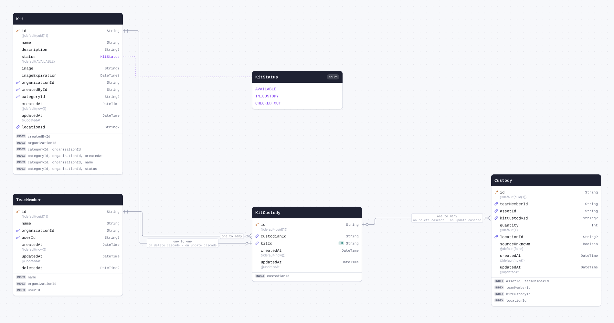

| Field         | Type       | Constraints                                   | Default      | Description |
| ------------- | ---------- | --------------------------------------------- | ------------ | ----------- |
| `id`          | `String`   | PK NOT NULL                                   | `cuid(1)`    |             |
| `custodianId` | `String`   | NOT NULL → [TeamMember.id](#model-TeamMember) |              |             |
| `kitId`       | `String`   | UNIQUE NOT NULL → [Kit.id](#model-Kit)        |              |             |
| `createdAt`   | `DateTime` | NOT NULL                                      | `now()`      |             |
| `updatedAt`   | `DateTime` | NOT NULL                                      | `@updatedAt` |             |

#### Indexes

- `@@index([custodianId])`

#### References

- `custodianId` → [TeamMember.id](#model-TeamMember) (many-to-one)
- `kitId` → [Kit.id](#model-Kit) (one-to-one, on delete Cascade, on update Cascade)

#### Referenced by

- `id` ← [Custody.kitCustodyId](#model-Custody) (one-to-many, on delete Cascade, on update Cascade)

#### Definition

```sql
CREATE TABLE "KitCustody" (
    "id" TEXT NOT NULL,
    "custodianId" TEXT NOT NULL,
    "kitId" TEXT NOT NULL,
    "createdAt" TIMESTAMP(3) NOT NULL DEFAULT CURRENT_TIMESTAMP,
    "updatedAt" TIMESTAMP(3) NOT NULL,

    CONSTRAINT "KitCustody_pkey" PRIMARY KEY ("id")
);

CREATE UNIQUE INDEX "KitCustody_kitId_key" ON "KitCustody"("kitId");

CREATE INDEX "KitCustody_custodianId_idx" ON "KitCustody"("custodianId");

ALTER TABLE "KitCustody" ADD CONSTRAINT "KitCustody_custodianId_fkey" FOREIGN KEY ("custodianId") REFERENCES "TeamMember"("id") ON DELETE RESTRICT ON UPDATE CASCADE;

ALTER TABLE "KitCustody" ADD CONSTRAINT "KitCustody_kitId_fkey" FOREIGN KEY ("kitId") REFERENCES "Kit"("id") ON DELETE CASCADE ON UPDATE CASCADE;
```

<details>
<summary>Queries and their SQL</summary>

**findMany**: Every row

```ts
await prisma.kitCustody.findMany();
```

```sql
SELECT
  "public"."KitCustody"."id",
  "public"."KitCustody"."custodianId",
  "public"."KitCustody"."kitId",
  "public"."KitCustody"."createdAt",
  "public"."KitCustody"."updatedAt"
FROM
  "public"."KitCustody"
WHERE
  1 = 1
OFFSET
  $1
-- params: ["0"]
```

**count**: How many rows there are

```ts
await prisma.kitCustody.count();
```

```sql
SELECT
  COUNT(*) AS "_count$_all"
FROM
  (
    SELECT
      "public"."KitCustody"."id"
    FROM
      "public"."KitCustody"
    WHERE
      1 = 1
    OFFSET
      $1
  ) AS "sub"
-- params: ["0"]
```

**findMany**: Every row with its relations

```ts
await prisma.kitCustody.findMany({
  include: { custodian: true, kit: true, inheritedCustody: true },
});
```

```sql
SELECT
  "public"."KitCustody"."id",
  "public"."KitCustody"."custodianId",
  "public"."KitCustody"."kitId",
  "public"."KitCustody"."createdAt",
  "public"."KitCustody"."updatedAt"
FROM
  "public"."KitCustody"
WHERE
  1 = 1
OFFSET
  $1
-- params: ["0"]

SELECT
  "public"."TeamMember"."id",
  "public"."TeamMember"."name",
  "public"."TeamMember"."organizationId",
  "public"."TeamMember"."userId",
  "public"."TeamMember"."createdAt",
  "public"."TeamMember"."updatedAt",
  "public"."TeamMember"."deletedAt"
FROM
  "public"."TeamMember"
WHERE
  "public"."TeamMember"."id" IN ($1)
OFFSET
  $2
-- params: ["<custodianId of the rows above>","0"]

SELECT
  "public"."Kit"."id",
  "public"."Kit"."name",
  "public"."Kit"."description",
  "public"."Kit"."status"::text,
  "public"."Kit"."image",
  "public"."Kit"."imageExpiration",
  "public"."Kit"."organizationId",
  "public"."Kit"."createdById",
  "public"."Kit"."categoryId",
  "public"."Kit"."createdAt",
  "public"."Kit"."updatedAt",
  "public"."Kit"."locationId"
FROM
  "public"."Kit"
WHERE
  "public"."Kit"."id" IN ($1)
OFFSET
  $2
-- params: ["<kitId of the rows above>","0"]

SELECT
  "public"."Custody"."id",
  "public"."Custody"."teamMemberId",
  "public"."Custody"."assetId",
  "public"."Custody"."kitCustodyId",
  "public"."Custody"."quantity",
  "public"."Custody"."locationId",
  "public"."Custody"."sourceUnknown",
  "public"."Custody"."createdAt",
  "public"."Custody"."updatedAt"
FROM
  "public"."Custody"
WHERE
  "public"."Custody"."kitCustodyId" IN ($1)
OFFSET
  $2
-- params: ["<id of the rows above>","0"]
```

**findUnique**: One row by what is unique to it

```ts
await prisma.kitCustody.findUnique({ where: { id: "example" } });
```

```sql
SELECT
  "public"."KitCustody"."id",
  "public"."KitCustody"."custodianId",
  "public"."KitCustody"."kitId",
  "public"."KitCustody"."createdAt",
  "public"."KitCustody"."updatedAt"
FROM
  "public"."KitCustody"
WHERE
  (
    "public"."KitCustody"."id" = $1
    AND 1 = 1
  )
LIMIT
  $2
OFFSET
  $3
-- params: ["example","1","0"]
```

**create**: Create a row

```ts
await prisma.kitCustody.create({ data: { custodianId: "example", kitId: "example" } });
```

```sql
INSERT INTO
  "public"."KitCustody" (
    "id",
    "custodianId",
    "kitId",
    "createdAt",
    "updatedAt"
  )
VALUES
  ($1, $2, $3, $4, $5)
RETURNING
  "public"."KitCustody"."id",
  "public"."KitCustody"."custodianId",
  "public"."KitCustody"."kitId",
  "public"."KitCustody"."createdAt",
  "public"."KitCustody"."updatedAt"
-- params: ["<cuid(1)>","example","example","<now()>","<now()>"]
```

**update**: Update a row

```ts
await prisma.kitCustody.update({
  where: { id: "example" },
  data: { createdAt: new Date("2026-01-01T00:00:00.000Z") },
});
```

```sql
UPDATE "public"."KitCustody"
SET
  "createdAt" = $1,
  "updatedAt" = $2
WHERE
  (
    "public"."KitCustody"."id" = $3
    AND 1 = 1
  )
RETURNING
  "public"."KitCustody"."id",
  "public"."KitCustody"."custodianId",
  "public"."KitCustody"."kitId",
  "public"."KitCustody"."createdAt",
  "public"."KitCustody"."updatedAt"
-- params: ["2026-01-01T00:00:00.000Z",{"prisma__type":"generatorCall","prisma__value":{"name":"now","args":[],"returnType":{"type":"DateTime"}}},"example"]
```

**delete**: Delete a row

```ts
await prisma.kitCustody.delete({ where: { id: "example" } });
```

```sql
DELETE FROM "public"."KitCustody"
WHERE
  (
    "public"."KitCustody"."id" = $1
    AND 1 = 1
  )
RETURNING
  "public"."KitCustody"."id",
  "public"."KitCustody"."custodianId",
  "public"."KitCustody"."kitId",
  "public"."KitCustody"."createdAt",
  "public"."KitCustody"."updatedAt"
-- params: ["example"]
```

</details>

<a id="model-AssetKit"></a>

### AssetKit

Pivot linking an `Asset` to the `Kit` it belongs to.

`@@unique([assetId])` enforces "at most one kit per asset" today.
The structure already allows multi-row-per-asset; if multi-kit
allocation lands later, drop the `assetId` unique constraint and
add a type-aware single-row trigger + sum-within-total CONSTRAINT
TRIGGER (parallel to the Custody / BookingAsset pivots).

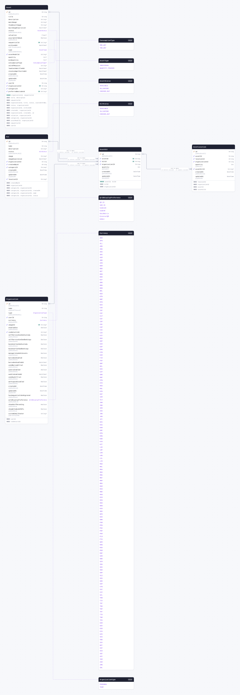

| Field            | Type       | Constraints                                       | Default      | Description |
| ---------------- | ---------- | ------------------------------------------------- | ------------ | ----------- |
| `id`             | `String`   | PK NOT NULL                                       | `cuid(1)`    |             |
| `assetId`        | `String`   | NOT NULL → [Asset.id](#model-Asset)               |              |             |
| `kitId`          | `String`   | NOT NULL → [Kit.id](#model-Kit)                   |              |             |
| `organizationId` | `String`   | NOT NULL → [Organization.id](#model-Organization) |              |             |
| `quantity`       | `Int`      | NOT NULL                                          | `1`          |             |
| `createdAt`      | `DateTime` | NOT NULL                                          | `now()`      |             |
| `updatedAt`      | `DateTime` | NOT NULL                                          | `@updatedAt` |             |

#### Indexes

- `@@index([kitId])`
- `@@index([organizationId])`
- `@@unique([assetId, kitId])`

#### References

- `assetId` → [Asset.id](#model-Asset) (many-to-one, on delete Cascade, on update Cascade)
- `kitId` → [Kit.id](#model-Kit) (many-to-one, on delete Cascade, on update Cascade)
- `organizationId` → [Organization.id](#model-Organization) (many-to-one, on delete Cascade, on update Cascade)

#### Referenced by

- `id` ← [AssetLocation.assetKitId](#model-AssetLocation) (one-to-many, on delete Cascade, on update Cascade)

#### Definition

```sql
CREATE TABLE "AssetKit" (
    "id" TEXT NOT NULL,
    "assetId" TEXT NOT NULL,
    "kitId" TEXT NOT NULL,
    "organizationId" TEXT NOT NULL,
    "quantity" INTEGER NOT NULL DEFAULT 1,
    "createdAt" TIMESTAMP(3) NOT NULL DEFAULT CURRENT_TIMESTAMP,
    "updatedAt" TIMESTAMP(3) NOT NULL,

    CONSTRAINT "AssetKit_pkey" PRIMARY KEY ("id")
);

CREATE INDEX "AssetKit_kitId_idx" ON "AssetKit"("kitId");

CREATE INDEX "AssetKit_organizationId_idx" ON "AssetKit"("organizationId");

CREATE UNIQUE INDEX "AssetKit_assetId_kitId_key" ON "AssetKit"("assetId", "kitId");

ALTER TABLE "AssetKit" ADD CONSTRAINT "AssetKit_assetId_fkey" FOREIGN KEY ("assetId") REFERENCES "Asset"("id") ON DELETE CASCADE ON UPDATE CASCADE;

ALTER TABLE "AssetKit" ADD CONSTRAINT "AssetKit_kitId_fkey" FOREIGN KEY ("kitId") REFERENCES "Kit"("id") ON DELETE CASCADE ON UPDATE CASCADE;

ALTER TABLE "AssetKit" ADD CONSTRAINT "AssetKit_organizationId_fkey" FOREIGN KEY ("organizationId") REFERENCES "Organization"("id") ON DELETE CASCADE ON UPDATE CASCADE;
```

<details>
<summary>Queries and their SQL</summary>

**findMany**: Every row

```ts
await prisma.assetKit.findMany();
```

```sql
SELECT
  "public"."AssetKit"."id",
  "public"."AssetKit"."assetId",
  "public"."AssetKit"."kitId",
  "public"."AssetKit"."organizationId",
  "public"."AssetKit"."quantity",
  "public"."AssetKit"."createdAt",
  "public"."AssetKit"."updatedAt"
FROM
  "public"."AssetKit"
WHERE
  1 = 1
OFFSET
  $1
-- params: ["0"]
```

**count**: How many rows there are

```ts
await prisma.assetKit.count();
```

```sql
SELECT
  COUNT(*) AS "_count$_all"
FROM
  (
    SELECT
      "public"."AssetKit"."id"
    FROM
      "public"."AssetKit"
    WHERE
      1 = 1
    OFFSET
      $1
  ) AS "sub"
-- params: ["0"]
```

**findMany**: Every row with its relations

```ts
await prisma.assetKit.findMany({
  include: { asset: true, kit: true, organization: true, assetLocations: true },
});
```

```sql
SELECT
  "public"."AssetKit"."id",
  "public"."AssetKit"."assetId",
  "public"."AssetKit"."kitId",
  "public"."AssetKit"."organizationId",
  "public"."AssetKit"."quantity",
  "public"."AssetKit"."createdAt",
  "public"."AssetKit"."updatedAt"
FROM
  "public"."AssetKit"
WHERE
  1 = 1
OFFSET
  $1
-- params: ["0"]

SELECT
  "public"."Asset"."id",
  "public"."Asset"."title",
  "public"."Asset"."description",
  "public"."Asset"."mainImage",
  "public"."Asset"."thumbnailImage",
  "public"."Asset"."mainImageExpiration",
  "public"."Asset"."status"::text,
  "public"."Asset"."value",
  "public"."Asset"."availableToBook",
  "public"."Asset"."sequentialId",
  "public"."Asset"."archivedAt",
  "public"."Asset"."type"::text,
  "public"."Asset"."assetModelId",
  "public"."Asset"."quantity",
  "public"."Asset"."minQuantity",
  "public"."Asset"."consumptionType"::text,
  "public"."Asset"."unitOfMeasure",
  "public"."Asset"."lowStockNotifiedAt",
  "public"."Asset"."stockLedgerStartedAt",
  "public"."Asset"."createdAt",
  "public"."Asset"."updatedAt",
  "public"."Asset"."userId",
  "public"."Asset"."organizationId",
  "public"."Asset"."categoryId",
  "public"."Asset"."preferredBarcodeId"
FROM
  "public"."Asset"
WHERE
  "public"."Asset"."id" IN ($1)
OFFSET
  $2
-- params: ["<assetId of the rows above>","0"]

SELECT
  "public"."Kit"."id",
  "public"."Kit"."name",
  "public"."Kit"."description",
  "public"."Kit"."status"::text,
  "public"."Kit"."image",
  "public"."Kit"."imageExpiration",
  "public"."Kit"."organizationId",
  "public"."Kit"."createdById",
  "public"."Kit"."categoryId",
  "public"."Kit"."createdAt",
  "public"."Kit"."updatedAt",
  "public"."Kit"."locationId"
FROM
  "public"."Kit"
WHERE
  "public"."Kit"."id" IN ($1)
OFFSET
  $2
-- params: ["<kitId of the rows above>","0"]

SELECT
  "public"."Organization"."id",
  "public"."Organization"."name",
  "public"."Organization"."type"::text,
  "public"."Organization"."userId",
  "public"."Organization"."currency"::text,
  "public"."Organization"."imageId",
  "public"."Organization"."enabledSso",
  "public"."Organization"."ssoDetailsId",
  "public"."Organization"."selfServiceCanSeeCustody",
  "public"."Organization"."selfServiceCanSeeBookings",
  "public"."Organization"."baseUserCanSeeCustody",
  "public"."Organization"."baseUserCanSeeBookings",
  "public"."Organization"."managersCanEditAssets",
  "public"."Organization"."barcodesEnabled",
  "public"."Organization"."barcodesEnabledAt",
  "public"."Organization"."usedBarcodeTrial",
  "public"."Organization"."auditsEnabled",
  "public"."Organization"."auditsEnabledAt",
  "public"."Organization"."usedAuditTrial",
  "public"."Organization"."workspaceDisabled",
  "public"."Organization"."createdAt",
  "public"."Organization"."updatedAt",
  "public"."Organization"."hasSequentialIdsMigrated",
  "public"."Organization"."qrIdDisplayPreference"::text,
  "public"."Organization"."showShelfBranding",
  "public"."Organization"."showQrCodesOnPdfs",
  "public"."Organization"."customEmailFooter"
FROM
  "public"."Organization"
WHERE
  "public"."Organization"."id" IN ($1)
OFFSET
  $2
-- params: ["<organizationId of the rows above>","0"]

SELECT
  "public"."AssetLocation"."id",
  "public"."AssetLocation"."assetId",
  "public"."AssetLocation"."locationId",
  "public"."AssetLocation"."organizationId",
  "public"."AssetLocation"."quantity",
  "public"."AssetLocation"."assetKitId",
  "public"."AssetLocation"."createdAt",
  "public"."AssetLocation"."updatedAt"
FROM
  "public"."AssetLocation"
WHERE
  "public"."AssetLocation"."assetKitId" IN ($1)
OFFSET
  $2
-- params: ["<id of the rows above>","0"]
```

**findUnique**: One row by what is unique to it

```ts
await prisma.assetKit.findUnique({ where: { id: "example" } });
```

```sql
SELECT
  "public"."AssetKit"."id",
  "public"."AssetKit"."assetId",
  "public"."AssetKit"."kitId",
  "public"."AssetKit"."organizationId",
  "public"."AssetKit"."quantity",
  "public"."AssetKit"."createdAt",
  "public"."AssetKit"."updatedAt"
FROM
  "public"."AssetKit"
WHERE
  (
    "public"."AssetKit"."id" = $1
    AND 1 = 1
  )
LIMIT
  $2
OFFSET
  $3
-- params: ["example","1","0"]
```

**create**: Create a row

```ts
await prisma.assetKit.create({
  data: { assetId: "example", kitId: "example", organizationId: "example" },
});
```

```sql
INSERT INTO
  "public"."AssetKit" (
    "id",
    "assetId",
    "kitId",
    "organizationId",
    "quantity",
    "createdAt",
    "updatedAt"
  )
VALUES
  ($1, $2, $3, $4, $5, $6, $7)
RETURNING
  "public"."AssetKit"."id",
  "public"."AssetKit"."assetId",
  "public"."AssetKit"."kitId",
  "public"."AssetKit"."organizationId",
  "public"."AssetKit"."quantity",
  "public"."AssetKit"."createdAt",
  "public"."AssetKit"."updatedAt"
-- params: ["<cuid(1)>","example","example","example","1","<now()>","<now()>"]
```

**update**: Update a row

```ts
await prisma.assetKit.update({ where: { id: "example" }, data: { quantity: 1 } });
```

```sql
UPDATE "public"."AssetKit"
SET
  "quantity" = $1,
  "updatedAt" = $2
WHERE
  (
    "public"."AssetKit"."id" = $3
    AND 1 = 1
  )
RETURNING
  "public"."AssetKit"."id",
  "public"."AssetKit"."assetId",
  "public"."AssetKit"."kitId",
  "public"."AssetKit"."organizationId",
  "public"."AssetKit"."quantity",
  "public"."AssetKit"."createdAt",
  "public"."AssetKit"."updatedAt"
-- params: ["1",{"prisma__type":"generatorCall","prisma__value":{"name":"now","args":[],"returnType":{"type":"DateTime"}}},"example"]
```

**delete**: Delete a row

```ts
await prisma.assetKit.delete({ where: { id: "example" } });
```

```sql
DELETE FROM "public"."AssetKit"
WHERE
  (
    "public"."AssetKit"."id" = $1
    AND 1 = 1
  )
RETURNING
  "public"."AssetKit"."id",
  "public"."AssetKit"."assetId",
  "public"."AssetKit"."kitId",
  "public"."AssetKit"."organizationId",
  "public"."AssetKit"."quantity",
  "public"."AssetKit"."createdAt",
  "public"."AssetKit"."updatedAt"
-- params: ["example"]
```

</details>

<a id="model-AssetLocation"></a>

### AssetLocation

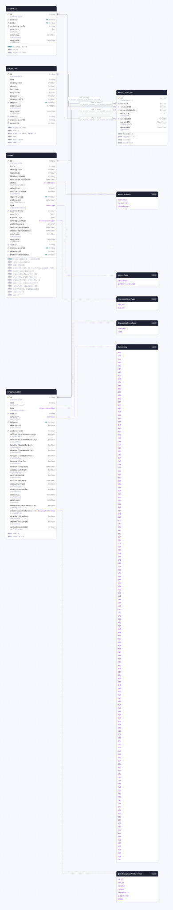

| Field            | Type       | Constraints                                       | Default      | Description |
| ---------------- | ---------- | ------------------------------------------------- | ------------ | ----------- |
| `id`             | `String`   | PK NOT NULL                                       | `cuid(1)`    |             |
| `assetId`        | `String`   | NOT NULL → [Asset.id](#model-Asset)               |              |             |
| `locationId`     | `String`   | NOT NULL → [Location.id](#model-Location)         |              |             |
| `organizationId` | `String`   | NOT NULL → [Organization.id](#model-Organization) |              |             |
| `quantity`       | `Int`      | NOT NULL                                          | `1`          |             |
| `assetKitId`     | `String`   | NULL → [AssetKit.id](#model-AssetKit)             |              |             |
| `createdAt`      | `DateTime` | NOT NULL                                          | `now()`      |             |
| `updatedAt`      | `DateTime` | NOT NULL                                          | `@updatedAt` |             |

#### Indexes

- `@@index([locationId])`
- `@@index([organizationId])`
- `@@index([assetId])`
- `@@index([assetKitId])`

#### References

- `assetId` → [Asset.id](#model-Asset) (many-to-one, on delete Cascade, on update Cascade)
- `locationId` → [Location.id](#model-Location) (many-to-one, on delete Cascade, on update Cascade)
- `organizationId` → [Organization.id](#model-Organization) (many-to-one, on delete Cascade, on update Cascade)
- `assetKitId` → [AssetKit.id](#model-AssetKit) (many-to-one, on delete Cascade, on update Cascade)

#### Definition

```sql
CREATE TABLE "AssetLocation" (
    "id" TEXT NOT NULL,
    "assetId" TEXT NOT NULL,
    "locationId" TEXT NOT NULL,
    "organizationId" TEXT NOT NULL,
    "quantity" INTEGER NOT NULL DEFAULT 1,
    "assetKitId" TEXT,
    "createdAt" TIMESTAMP(3) NOT NULL DEFAULT CURRENT_TIMESTAMP,
    "updatedAt" TIMESTAMP(3) NOT NULL,

    CONSTRAINT "AssetLocation_pkey" PRIMARY KEY ("id")
);

CREATE INDEX "AssetLocation_locationId_idx" ON "AssetLocation"("locationId");

CREATE INDEX "AssetLocation_organizationId_idx" ON "AssetLocation"("organizationId");

CREATE INDEX "AssetLocation_assetId_idx" ON "AssetLocation"("assetId");

CREATE INDEX "AssetLocation_assetKitId_idx" ON "AssetLocation"("assetKitId");

ALTER TABLE "AssetLocation" ADD CONSTRAINT "AssetLocation_assetId_fkey" FOREIGN KEY ("assetId") REFERENCES "Asset"("id") ON DELETE CASCADE ON UPDATE CASCADE;

ALTER TABLE "AssetLocation" ADD CONSTRAINT "AssetLocation_locationId_fkey" FOREIGN KEY ("locationId") REFERENCES "Location"("id") ON DELETE CASCADE ON UPDATE CASCADE;

ALTER TABLE "AssetLocation" ADD CONSTRAINT "AssetLocation_organizationId_fkey" FOREIGN KEY ("organizationId") REFERENCES "Organization"("id") ON DELETE CASCADE ON UPDATE CASCADE;

ALTER TABLE "AssetLocation" ADD CONSTRAINT "AssetLocation_assetKitId_fkey" FOREIGN KEY ("assetKitId") REFERENCES "AssetKit"("id") ON DELETE CASCADE ON UPDATE CASCADE;
```

<details>
<summary>Queries and their SQL</summary>

**findMany**: Every row

```ts
await prisma.assetLocation.findMany();
```

```sql
SELECT
  "public"."AssetLocation"."id",
  "public"."AssetLocation"."assetId",
  "public"."AssetLocation"."locationId",
  "public"."AssetLocation"."organizationId",
  "public"."AssetLocation"."quantity",
  "public"."AssetLocation"."assetKitId",
  "public"."AssetLocation"."createdAt",
  "public"."AssetLocation"."updatedAt"
FROM
  "public"."AssetLocation"
WHERE
  1 = 1
OFFSET
  $1
-- params: ["0"]
```

**count**: How many rows there are

```ts
await prisma.assetLocation.count();
```

```sql
SELECT
  COUNT(*) AS "_count$_all"
FROM
  (
    SELECT
      "public"."AssetLocation"."id"
    FROM
      "public"."AssetLocation"
    WHERE
      1 = 1
    OFFSET
      $1
  ) AS "sub"
-- params: ["0"]
```

**findMany**: Every row with its relations

```ts
await prisma.assetLocation.findMany({
  include: { asset: true, location: true, organization: true, assetKit: true },
});
```

```sql
SELECT
  "public"."AssetLocation"."id",
  "public"."AssetLocation"."assetId",
  "public"."AssetLocation"."locationId",
  "public"."AssetLocation"."organizationId",
  "public"."AssetLocation"."quantity",
  "public"."AssetLocation"."assetKitId",
  "public"."AssetLocation"."createdAt",
  "public"."AssetLocation"."updatedAt"
FROM
  "public"."AssetLocation"
WHERE
  1 = 1
OFFSET
  $1
-- params: ["0"]

SELECT
  "public"."Asset"."id",
  "public"."Asset"."title",
  "public"."Asset"."description",
  "public"."Asset"."mainImage",
  "public"."Asset"."thumbnailImage",
  "public"."Asset"."mainImageExpiration",
  "public"."Asset"."status"::text,
  "public"."Asset"."value",
  "public"."Asset"."availableToBook",
  "public"."Asset"."sequentialId",
  "public"."Asset"."archivedAt",
  "public"."Asset"."type"::text,
  "public"."Asset"."assetModelId",
  "public"."Asset"."quantity",
  "public"."Asset"."minQuantity",
  "public"."Asset"."consumptionType"::text,
  "public"."Asset"."unitOfMeasure",
  "public"."Asset"."lowStockNotifiedAt",
  "public"."Asset"."stockLedgerStartedAt",
  "public"."Asset"."createdAt",
  "public"."Asset"."updatedAt",
  "public"."Asset"."userId",
  "public"."Asset"."organizationId",
  "public"."Asset"."categoryId",
  "public"."Asset"."preferredBarcodeId"
FROM
  "public"."Asset"
WHERE
  "public"."Asset"."id" IN ($1)
OFFSET
  $2
-- params: ["<assetId of the rows above>","0"]

SELECT
  "public"."Location"."id",
  "public"."Location"."name",
  "public"."Location"."description",
  "public"."Location"."address",
  "public"."Location"."latitude",
  "public"."Location"."longitude",
  "public"."Location"."imageUrl",
  "public"."Location"."thumbnailUrl",
  "public"."Location"."imageId",
  "public"."Location"."createdAt",
  "public"."Location"."updatedAt",
  "public"."Location"."userId",
  "public"."Location"."organizationId",
  "public"."Location"."parentId"
FROM
  "public"."Location"
WHERE
  "public"."Location"."id" IN ($1)
OFFSET
  $2
-- params: ["<locationId of the rows above>","0"]

SELECT
  "public"."Organization"."id",
  "public"."Organization"."name",
  "public"."Organization"."type"::text,
  "public"."Organization"."userId",
  "public"."Organization"."currency"::text,
  "public"."Organization"."imageId",
  "public"."Organization"."enabledSso",
  "public"."Organization"."ssoDetailsId",
  "public"."Organization"."selfServiceCanSeeCustody",
  "public"."Organization"."selfServiceCanSeeBookings",
  "public"."Organization"."baseUserCanSeeCustody",
  "public"."Organization"."baseUserCanSeeBookings",
  "public"."Organization"."managersCanEditAssets",
  "public"."Organization"."barcodesEnabled",
  "public"."Organization"."barcodesEnabledAt",
  "public"."Organization"."usedBarcodeTrial",
  "public"."Organization"."auditsEnabled",
  "public"."Organization"."auditsEnabledAt",
  "public"."Organization"."usedAuditTrial",
  "public"."Organization"."workspaceDisabled",
  "public"."Organization"."createdAt",
  "public"."Organization"."updatedAt",
  "public"."Organization"."hasSequentialIdsMigrated",
  "public"."Organization"."qrIdDisplayPreference"::text,
  "public"."Organization"."showShelfBranding",
  "public"."Organization"."showQrCodesOnPdfs",
  "public"."Organization"."customEmailFooter"
FROM
  "public"."Organization"
WHERE
  "public"."Organization"."id" IN ($1)
OFFSET
  $2
-- params: ["<organizationId of the rows above>","0"]

SELECT
  "public"."AssetKit"."id",
  "public"."AssetKit"."assetId",
  "public"."AssetKit"."kitId",
  "public"."AssetKit"."organizationId",
  "public"."AssetKit"."quantity",
  "public"."AssetKit"."createdAt",
  "public"."AssetKit"."updatedAt"
FROM
  "public"."AssetKit"
WHERE
  "public"."AssetKit"."id" IN ($1)
OFFSET
  $2
-- params: ["<assetKitId of the rows above>","0"]
```

**findUnique**: One row by what is unique to it

```ts
await prisma.assetLocation.findUnique({ where: { id: "example" } });
```

```sql
SELECT
  "public"."AssetLocation"."id",
  "public"."AssetLocation"."assetId",
  "public"."AssetLocation"."locationId",
  "public"."AssetLocation"."organizationId",
  "public"."AssetLocation"."quantity",
  "public"."AssetLocation"."assetKitId",
  "public"."AssetLocation"."createdAt",
  "public"."AssetLocation"."updatedAt"
FROM
  "public"."AssetLocation"
WHERE
  (
    "public"."AssetLocation"."id" = $1
    AND 1 = 1
  )
LIMIT
  $2
OFFSET
  $3
-- params: ["example","1","0"]
```

**create**: Create a row

```ts
await prisma.assetLocation.create({
  data: { assetId: "example", locationId: "example", organizationId: "example" },
});
```

```sql
INSERT INTO
  "public"."AssetLocation" (
    "id",
    "assetId",
    "locationId",
    "organizationId",
    "quantity",
    "createdAt",
    "updatedAt"
  )
VALUES
  ($1, $2, $3, $4, $5, $6, $7)
RETURNING
  "public"."AssetLocation"."id",
  "public"."AssetLocation"."assetId",
  "public"."AssetLocation"."locationId",
  "public"."AssetLocation"."organizationId",
  "public"."AssetLocation"."quantity",
  "public"."AssetLocation"."assetKitId",
  "public"."AssetLocation"."createdAt",
  "public"."AssetLocation"."updatedAt"
-- params: ["<cuid(1)>","example","example","example","1","<now()>","<now()>"]
```

**update**: Update a row

```ts
await prisma.assetLocation.update({ where: { id: "example" }, data: { quantity: 1 } });
```

```sql
UPDATE "public"."AssetLocation"
SET
  "quantity" = $1,
  "updatedAt" = $2
WHERE
  (
    "public"."AssetLocation"."id" = $3
    AND 1 = 1
  )
RETURNING
  "public"."AssetLocation"."id",
  "public"."AssetLocation"."assetId",
  "public"."AssetLocation"."locationId",
  "public"."AssetLocation"."organizationId",
  "public"."AssetLocation"."quantity",
  "public"."AssetLocation"."assetKitId",
  "public"."AssetLocation"."createdAt",
  "public"."AssetLocation"."updatedAt"
-- params: ["1",{"prisma__type":"generatorCall","prisma__value":{"name":"now","args":[],"returnType":{"type":"DateTime"}}},"example"]
```

**delete**: Delete a row

```ts
await prisma.assetLocation.delete({ where: { id: "example" } });
```

```sql
DELETE FROM "public"."AssetLocation"
WHERE
  (
    "public"."AssetLocation"."id" = $1
    AND 1 = 1
  )
RETURNING
  "public"."AssetLocation"."id",
  "public"."AssetLocation"."assetId",
  "public"."AssetLocation"."locationId",
  "public"."AssetLocation"."organizationId",
  "public"."AssetLocation"."quantity",
  "public"."AssetLocation"."assetKitId",
  "public"."AssetLocation"."createdAt",
  "public"."AssetLocation"."updatedAt"
-- params: ["example"]
```

</details>

<a id="model-AssetReminder"></a>

### AssetReminder


| Field                      | Type                                                     | Constraints                                       | Default      | Description |
| -------------------------- | -------------------------------------------------------- | ------------------------------------------------- | ------------ | ----------- |
| `id`                       | `String`                                                 | PK NOT NULL                                       | `cuid(1)`    |             |
| `name`                     | `String`                                                 | NOT NULL                                          |              |             |
| `message`                  | `String`                                                 | NOT NULL                                          |              |             |
| `alertDateTime`            | `DateTime`                                               | NOT NULL                                          |              |             |
| `activeSchedulerReference` | `String`                                                 | NULL                                              |              |             |
| `recurrenceUnit`           | [`ReminderRecurrenceUnit`](#enum-ReminderRecurrenceUnit) | NULL                                              |              |             |
| `recurrenceInterval`       | `Int`                                                    | NULL                                              |              |             |
| `recurrenceTimezone`       | `String`                                                 | NULL                                              |              |             |
| `recurrenceEndsAt`         | `DateTime`                                               | NULL                                              |              |             |
| `organizationId`           | `String`                                                 | NOT NULL → [Organization.id](#model-Organization) |              |             |
| `assetId`                  | `String`                                                 | NOT NULL → [Asset.id](#model-Asset)               |              |             |
| `createdById`              | `String`                                                 | NOT NULL → [User.id](#model-User)                 |              |             |
| `createdAt`                | `DateTime`                                               | NOT NULL                                          | `now()`      |             |
| `updatedAt`                | `DateTime`                                               | NOT NULL                                          | `@updatedAt` |             |

#### Indexes

- `@@index([assetId, alertDateTime])`
- `@@index([name, message])`
- `@@index([organizationId, alertDateTime, assetId])`
- `@@index([alertDateTime, activeSchedulerReference])`
- `@@index([createdById])`

#### References

- `organizationId` → [Organization.id](#model-Organization) (many-to-one)
- `assetId` → [Asset.id](#model-Asset) (many-to-one, on delete Cascade)
- `createdById` → [User.id](#model-User) (many-to-one)

#### Many to many

- `teamMembers` ↔ [TeamMember.assetReminders](#model-TeamMember) through `_AssetReminderToTeamMember`

#### Definition

```sql
CREATE TABLE "AssetReminder" (
    "id" TEXT NOT NULL,
    "name" TEXT NOT NULL,
    "message" TEXT NOT NULL,
    "alertDateTime" TIMESTAMP(3) NOT NULL,
    "activeSchedulerReference" TEXT,
    "recurrenceUnit" "ReminderRecurrenceUnit",
    "recurrenceInterval" INTEGER,
    "recurrenceTimezone" TEXT,
    "recurrenceEndsAt" TIMESTAMP(3),
    "organizationId" TEXT NOT NULL,
    "assetId" TEXT NOT NULL,
    "createdById" TEXT NOT NULL,
    "createdAt" TIMESTAMP(3) NOT NULL DEFAULT CURRENT_TIMESTAMP,
    "updatedAt" TIMESTAMP(3) NOT NULL,

    CONSTRAINT "AssetReminder_pkey" PRIMARY KEY ("id")
);

CREATE INDEX "AssetReminder_assetId_alertDateTime_idx" ON "AssetReminder"("assetId", "alertDateTime");

CREATE INDEX "AssetReminder_name_message_idx" ON "AssetReminder" USING GIN ("name" gin_trgm_ops, "message" gin_trgm_ops);

CREATE INDEX "AssetReminder_organizationId_alertDateTime_assetId_idx" ON "AssetReminder"("organizationId", "alertDateTime", "assetId");

CREATE INDEX "AssetReminder_alertDateTime_activeSchedulerReference_idx" ON "AssetReminder"("alertDateTime", "activeSchedulerReference");

CREATE INDEX "AssetReminder_createdById_idx" ON "AssetReminder"("createdById");

ALTER TABLE "AssetReminder" ADD CONSTRAINT "AssetReminder_organizationId_fkey" FOREIGN KEY ("organizationId") REFERENCES "Organization"("id") ON DELETE RESTRICT ON UPDATE CASCADE;

ALTER TABLE "AssetReminder" ADD CONSTRAINT "AssetReminder_assetId_fkey" FOREIGN KEY ("assetId") REFERENCES "Asset"("id") ON DELETE CASCADE ON UPDATE CASCADE;

ALTER TABLE "AssetReminder" ADD CONSTRAINT "AssetReminder_createdById_fkey" FOREIGN KEY ("createdById") REFERENCES "User"("id") ON DELETE RESTRICT ON UPDATE CASCADE;
```

<details>
<summary>Queries and their SQL</summary>

**findMany**: Every row

```ts
await prisma.assetReminder.findMany();
```

```sql
SELECT
  "public"."AssetReminder"."id",
  "public"."AssetReminder"."name",
  "public"."AssetReminder"."message",
  "public"."AssetReminder"."alertDateTime",
  "public"."AssetReminder"."activeSchedulerReference",
  "public"."AssetReminder"."recurrenceUnit"::text,
  "public"."AssetReminder"."recurrenceInterval",
  "public"."AssetReminder"."recurrenceTimezone",
  "public"."AssetReminder"."recurrenceEndsAt",
  "public"."AssetReminder"."organizationId",
  "public"."AssetReminder"."assetId",
  "public"."AssetReminder"."createdById",
  "public"."AssetReminder"."createdAt",
  "public"."AssetReminder"."updatedAt"
FROM
  "public"."AssetReminder"
WHERE
  1 = 1
OFFSET
  $1
-- params: ["0"]
```

**count**: How many rows there are

```ts
await prisma.assetReminder.count();
```

```sql
SELECT
  COUNT(*) AS "_count$_all"
FROM
  (
    SELECT
      "public"."AssetReminder"."id"
    FROM
      "public"."AssetReminder"
    WHERE
      1 = 1
    OFFSET
      $1
  ) AS "sub"
-- params: ["0"]
```

**findMany**: Every row with its relations

```ts
await prisma.assetReminder.findMany({
  include: { organization: true, asset: true, teamMembers: true, createdBy: true },
});
```

```sql
SELECT
  "public"."AssetReminder"."id",
  "public"."AssetReminder"."name",
  "public"."AssetReminder"."message",
  "public"."AssetReminder"."alertDateTime",
  "public"."AssetReminder"."activeSchedulerReference",
  "public"."AssetReminder"."recurrenceUnit"::text,
  "public"."AssetReminder"."recurrenceInterval",
  "public"."AssetReminder"."recurrenceTimezone",
  "public"."AssetReminder"."recurrenceEndsAt",
  "public"."AssetReminder"."organizationId",
  "public"."AssetReminder"."assetId",
  "public"."AssetReminder"."createdById",
  "public"."AssetReminder"."createdAt",
  "public"."AssetReminder"."updatedAt"
FROM
  "public"."AssetReminder"
WHERE
  1 = 1
OFFSET
  $1
-- params: ["0"]

SELECT
  "public"."Organization"."id",
  "public"."Organization"."name",
  "public"."Organization"."type"::text,
  "public"."Organization"."userId",
  "public"."Organization"."currency"::text,
  "public"."Organization"."imageId",
  "public"."Organization"."enabledSso",
  "public"."Organization"."ssoDetailsId",
  "public"."Organization"."selfServiceCanSeeCustody",
  "public"."Organization"."selfServiceCanSeeBookings",
  "public"."Organization"."baseUserCanSeeCustody",
  "public"."Organization"."baseUserCanSeeBookings",
  "public"."Organization"."managersCanEditAssets",
  "public"."Organization"."barcodesEnabled",
  "public"."Organization"."barcodesEnabledAt",
  "public"."Organization"."usedBarcodeTrial",
  "public"."Organization"."auditsEnabled",
  "public"."Organization"."auditsEnabledAt",
  "public"."Organization"."usedAuditTrial",
  "public"."Organization"."workspaceDisabled",
  "public"."Organization"."createdAt",
  "public"."Organization"."updatedAt",
  "public"."Organization"."hasSequentialIdsMigrated",
  "public"."Organization"."qrIdDisplayPreference"::text,
  "public"."Organization"."showShelfBranding",
  "public"."Organization"."showQrCodesOnPdfs",
  "public"."Organization"."customEmailFooter"
FROM
  "public"."Organization"
WHERE
  "public"."Organization"."id" IN ($1)
OFFSET
  $2
-- params: ["<organizationId of the rows above>","0"]

SELECT
  "public"."Asset"."id",
  "public"."Asset"."title",
  "public"."Asset"."description",
  "public"."Asset"."mainImage",
  "public"."Asset"."thumbnailImage",
  "public"."Asset"."mainImageExpiration",
  "public"."Asset"."status"::text,
  "public"."Asset"."value",
  "public"."Asset"."availableToBook",
  "public"."Asset"."sequentialId",
  "public"."Asset"."archivedAt",
  "public"."Asset"."type"::text,
  "public"."Asset"."assetModelId",
  "public"."Asset"."quantity",
  "public"."Asset"."minQuantity",
  "public"."Asset"."consumptionType"::text,
  "public"."Asset"."unitOfMeasure",
  "public"."Asset"."lowStockNotifiedAt",
  "public"."Asset"."stockLedgerStartedAt",
  "public"."Asset"."createdAt",
  "public"."Asset"."updatedAt",
  "public"."Asset"."userId",
  "public"."Asset"."organizationId",
  "public"."Asset"."categoryId",
  "public"."Asset"."preferredBarcodeId"
FROM
  "public"."Asset"
WHERE
  "public"."Asset"."id" IN ($1)
OFFSET
  $2
-- params: ["<assetId of the rows above>","0"]

SELECT
  "public"."TeamMember"."id",
  "public"."TeamMember"."name",
  "public"."TeamMember"."organizationId",
  "public"."TeamMember"."userId",
  "public"."TeamMember"."createdAt",
  "public"."TeamMember"."updatedAt",
  "public"."TeamMember"."deletedAt",
  "t0"."A" AS "AssetReminderToTeamMember@AssetReminder"
FROM
  "public"."TeamMember"
  INNER JOIN "public"."_AssetReminderToTeamMember" AS "t0" ON "t0"."B" = "public"."TeamMember"."id"
WHERE
  (
    1 = 1
    AND "t0"."A" IN ($1)
  )
OFFSET
  $2
-- params: ["<id of the rows above>","0"]

SELECT
  "public"."User"."id",
  "public"."User"."email",
  "public"."User"."username",
  "public"."User"."firstName",
  "public"."User"."lastName",
  "public"."User"."displayName",
  "public"."User"."profilePicture",
  "public"."User"."usedFreeTrial",
  "public"."User"."onboarded",
  "public"."User"."customerId",
  "public"."User"."sso",
  "public"."User"."createdWithInvite",
  "public"."User"."skipSubscriptionCheck",
  "public"."User"."hasUnpaidInvoice",
  "public"."User"."warnForNoPaymentMethod",
  "public"."User"."lastSelectedOrganizationId",
  "public"."User"."createdAt",
  "public"."User"."updatedAt",
  "public"."User"."deletedAt",
  "public"."User"."lastMobileActiveAt",
  "public"."User"."dateFormat"::text,
  "public"."User"."timeFormat"::text,
  "public"."User"."weekStart"::text,
  "public"."User"."timeZone",
  "public"."User"."tierId"::text,
  "public"."User"."referralSource"
FROM
  "public"."User"
WHERE
  "public"."User"."id" IN ($1)
OFFSET
  $2
-- params: ["<createdById of the rows above>","0"]
```

**findUnique**: One row by what is unique to it

```ts
await prisma.assetReminder.findUnique({ where: { id: "example" } });
```

```sql
SELECT
  "public"."AssetReminder"."id",
  "public"."AssetReminder"."name",
  "public"."AssetReminder"."message",
  "public"."AssetReminder"."alertDateTime",
  "public"."AssetReminder"."activeSchedulerReference",
  "public"."AssetReminder"."recurrenceUnit"::text,
  "public"."AssetReminder"."recurrenceInterval",
  "public"."AssetReminder"."recurrenceTimezone",
  "public"."AssetReminder"."recurrenceEndsAt",
  "public"."AssetReminder"."organizationId",
  "public"."AssetReminder"."assetId",
  "public"."AssetReminder"."createdById",
  "public"."AssetReminder"."createdAt",
  "public"."AssetReminder"."updatedAt"
FROM
  "public"."AssetReminder"
WHERE
  (
    "public"."AssetReminder"."id" = $1
    AND 1 = 1
  )
LIMIT
  $2
OFFSET
  $3
-- params: ["example","1","0"]
```

**create**: Create a row

```ts
await prisma.assetReminder.create({
  data: {
    name: "example",
    message: "example",
    alertDateTime: new Date("2026-01-01T00:00:00.000Z"),
    organizationId: "example",
    assetId: "example",
    createdById: "example",
  },
});
```

```sql
INSERT INTO
  "public"."AssetReminder" (
    "id",
    "name",
    "message",
    "alertDateTime",
    "organizationId",
    "assetId",
    "createdById",
    "createdAt",
    "updatedAt"
  )
VALUES
  ($1, $2, $3, $4, $5, $6, $7, $8, $9)
RETURNING
  "public"."AssetReminder"."id",
  "public"."AssetReminder"."name",
  "public"."AssetReminder"."message",
  "public"."AssetReminder"."alertDateTime",
  "public"."AssetReminder"."activeSchedulerReference",
  "public"."AssetReminder"."recurrenceUnit"::text,
  "public"."AssetReminder"."recurrenceInterval",
  "public"."AssetReminder"."recurrenceTimezone",
  "public"."AssetReminder"."recurrenceEndsAt",
  "public"."AssetReminder"."organizationId",
  "public"."AssetReminder"."assetId",
  "public"."AssetReminder"."createdById",
  "public"."AssetReminder"."createdAt",
  "public"."AssetReminder"."updatedAt"
-- params: ["<cuid(1)>","example","example","2026-01-01T00:00:00.000Z","example","example","example","<now()>","<now()>"]
```

**update**: Update a row

```ts
await prisma.assetReminder.update({ where: { id: "example" }, data: { name: "example" } });
```

```sql
UPDATE "public"."AssetReminder"
SET
  "name" = $1,
  "updatedAt" = $2
WHERE
  (
    "public"."AssetReminder"."id" = $3
    AND 1 = 1
  )
RETURNING
  "public"."AssetReminder"."id",
  "public"."AssetReminder"."name",
  "public"."AssetReminder"."message",
  "public"."AssetReminder"."alertDateTime",
  "public"."AssetReminder"."activeSchedulerReference",
  "public"."AssetReminder"."recurrenceUnit"::text,
  "public"."AssetReminder"."recurrenceInterval",
  "public"."AssetReminder"."recurrenceTimezone",
  "public"."AssetReminder"."recurrenceEndsAt",
  "public"."AssetReminder"."organizationId",
  "public"."AssetReminder"."assetId",
  "public"."AssetReminder"."createdById",
  "public"."AssetReminder"."createdAt",
  "public"."AssetReminder"."updatedAt"
-- params: ["example",{"prisma__type":"generatorCall","prisma__value":{"name":"now","args":[],"returnType":{"type":"DateTime"}}},"example"]
```

**delete**: Delete a row

```ts
await prisma.assetReminder.delete({ where: { id: "example" } });
```

```sql
DELETE FROM "public"."AssetReminder"
WHERE
  (
    "public"."AssetReminder"."id" = $1
    AND 1 = 1
  )
RETURNING
  "public"."AssetReminder"."id",
  "public"."AssetReminder"."name",
  "public"."AssetReminder"."message",
  "public"."AssetReminder"."alertDateTime",
  "public"."AssetReminder"."activeSchedulerReference",
  "public"."AssetReminder"."recurrenceUnit"::text,
  "public"."AssetReminder"."recurrenceInterval",
  "public"."AssetReminder"."recurrenceTimezone",
  "public"."AssetReminder"."recurrenceEndsAt",
  "public"."AssetReminder"."organizationId",
  "public"."AssetReminder"."assetId",
  "public"."AssetReminder"."createdById",
  "public"."AssetReminder"."createdAt",
  "public"."AssetReminder"."updatedAt"
-- params: ["example"]
```

</details>

<a id="model-WorkingHours"></a>

### WorkingHours


| Field            | Type       | Constraints                                              | Default                                                                                                                                                                                                                                                                                                                                                                                                                    | Description |
| ---------------- | ---------- | -------------------------------------------------------- | -------------------------------------------------------------------------------------------------------------------------------------------------------------------------------------------------------------------------------------------------------------------------------------------------------------------------------------------------------------------------------------------------------------------------- | ----------- |
| `id`             | `String`   | PK NOT NULL                                              | `cuid(1)`                                                                                                                                                                                                                                                                                                                                                                                                                  |             |
| `enabled`        | `Boolean`  | NOT NULL                                                 | `false`                                                                                                                                                                                                                                                                                                                                                                                                                    |             |
| `weeklySchedule` | `Json`     | NOT NULL                                                 | `"{\"0\":{\"isOpen\":false},\"1\":{\"isOpen\":true,\"openTime\":\"09:00\",\"closeTime\":\"17:00\"},\"2\":{\"isOpen\":true,\"openTime\":\"09:00\",\"closeTime\":\"17:00\"},\"3\":{\"isOpen\":true,\"openTime\":\"09:00\",\"closeTime\":\"17:00\"},\"4\":{\"isOpen\":true,\"openTime\":\"09:00\",\"closeTime\":\"17:00\"},\"5\":{\"isOpen\":true,\"openTime\":\"09:00\",\"closeTime\":\"17:00\"},\"6\":{\"isOpen\":false}}"` |             |
| `organizationId` | `String`   | UNIQUE NOT NULL → [Organization.id](#model-Organization) |                                                                                                                                                                                                                                                                                                                                                                                                                            |             |
| `createdAt`      | `DateTime` | NOT NULL                                                 | `now()`                                                                                                                                                                                                                                                                                                                                                                                                                    |             |
| `updatedAt`      | `DateTime` | NOT NULL                                                 | `@updatedAt`                                                                                                                                                                                                                                                                                                                                                                                                               |             |

#### Indexes

- `@@index([organizationId])`

#### References

- `organizationId` → [Organization.id](#model-Organization) (one-to-one, on delete Cascade, on update Cascade)

#### Referenced by

- `id` ← [WorkingHoursOverride.workingHoursId](#model-WorkingHoursOverride) (one-to-many, on delete Cascade, on update Cascade)

#### Definition

```sql
CREATE TABLE "WorkingHours" (
    "id" TEXT NOT NULL,
    "enabled" BOOLEAN NOT NULL DEFAULT false,
    "weeklySchedule" JSONB NOT NULL DEFAULT '{"0":{"isOpen":false},"1":{"isOpen":true,"openTime":"09:00","closeTime":"17:00"},"2":{"isOpen":true,"openTime":"09:00","closeTime":"17:00"},"3":{"isOpen":true,"openTime":"09:00","closeTime":"17:00"},"4":{"isOpen":true,"openTime":"09:00","closeTime":"17:00"},"5":{"isOpen":true,"openTime":"09:00","closeTime":"17:00"},"6":{"isOpen":false}}',
    "organizationId" TEXT NOT NULL,
    "createdAt" TIMESTAMP(3) NOT NULL DEFAULT CURRENT_TIMESTAMP,
    "updatedAt" TIMESTAMP(3) NOT NULL,

    CONSTRAINT "WorkingHours_pkey" PRIMARY KEY ("id")
);

CREATE UNIQUE INDEX "WorkingHours_organizationId_key" ON "WorkingHours"("organizationId");

CREATE INDEX "WorkingHours_organizationId_idx" ON "WorkingHours"("organizationId");

ALTER TABLE "WorkingHours" ADD CONSTRAINT "WorkingHours_organizationId_fkey" FOREIGN KEY ("organizationId") REFERENCES "Organization"("id") ON DELETE CASCADE ON UPDATE CASCADE;
```

<details>
<summary>Queries and their SQL</summary>

**findMany**: Every row

```ts
await prisma.workingHours.findMany();
```

```sql
SELECT
  "public"."WorkingHours"."id",
  "public"."WorkingHours"."enabled",
  "public"."WorkingHours"."weeklySchedule",
  "public"."WorkingHours"."organizationId",
  "public"."WorkingHours"."createdAt",
  "public"."WorkingHours"."updatedAt"
FROM
  "public"."WorkingHours"
WHERE
  1 = 1
OFFSET
  $1
-- params: ["0"]
```

**count**: How many rows there are

```ts
await prisma.workingHours.count();
```

```sql
SELECT
  COUNT(*) AS "_count$_all"
FROM
  (
    SELECT
      "public"."WorkingHours"."id"
    FROM
      "public"."WorkingHours"
    WHERE
      1 = 1
    OFFSET
      $1
  ) AS "sub"
-- params: ["0"]
```

**findMany**: Every row with its relations

```ts
await prisma.workingHours.findMany({ include: { organization: true, overrides: true } });
```

```sql
SELECT
  "public"."WorkingHours"."id",
  "public"."WorkingHours"."enabled",
  "public"."WorkingHours"."weeklySchedule",
  "public"."WorkingHours"."organizationId",
  "public"."WorkingHours"."createdAt",
  "public"."WorkingHours"."updatedAt"
FROM
  "public"."WorkingHours"
WHERE
  1 = 1
OFFSET
  $1
-- params: ["0"]

SELECT
  "public"."Organization"."id",
  "public"."Organization"."name",
  "public"."Organization"."type"::text,
  "public"."Organization"."userId",
  "public"."Organization"."currency"::text,
  "public"."Organization"."imageId",
  "public"."Organization"."enabledSso",
  "public"."Organization"."ssoDetailsId",
  "public"."Organization"."selfServiceCanSeeCustody",
  "public"."Organization"."selfServiceCanSeeBookings",
  "public"."Organization"."baseUserCanSeeCustody",
  "public"."Organization"."baseUserCanSeeBookings",
  "public"."Organization"."managersCanEditAssets",
  "public"."Organization"."barcodesEnabled",
  "public"."Organization"."barcodesEnabledAt",
  "public"."Organization"."usedBarcodeTrial",
  "public"."Organization"."auditsEnabled",
  "public"."Organization"."auditsEnabledAt",
  "public"."Organization"."usedAuditTrial",
  "public"."Organization"."workspaceDisabled",
  "public"."Organization"."createdAt",
  "public"."Organization"."updatedAt",
  "public"."Organization"."hasSequentialIdsMigrated",
  "public"."Organization"."qrIdDisplayPreference"::text,
  "public"."Organization"."showShelfBranding",
  "public"."Organization"."showQrCodesOnPdfs",
  "public"."Organization"."customEmailFooter"
FROM
  "public"."Organization"
WHERE
  "public"."Organization"."id" IN ($1)
OFFSET
  $2
-- params: ["<organizationId of the rows above>","0"]

SELECT
  "public"."WorkingHoursOverride"."id",
  "public"."WorkingHoursOverride"."date",
  "public"."WorkingHoursOverride"."isOpen",
  "public"."WorkingHoursOverride"."openTime",
  "public"."WorkingHoursOverride"."closeTime",
  "public"."WorkingHoursOverride"."reason",
  "public"."WorkingHoursOverride"."workingHoursId",
  "public"."WorkingHoursOverride"."createdAt",
  "public"."WorkingHoursOverride"."updatedAt"
FROM
  "public"."WorkingHoursOverride"
WHERE
  "public"."WorkingHoursOverride"."workingHoursId" IN ($1)
OFFSET
  $2
-- params: ["<id of the rows above>","0"]
```

**findUnique**: One row by what is unique to it

```ts
await prisma.workingHours.findUnique({ where: { id: "example" } });
```

```sql
SELECT
  "public"."WorkingHours"."id",
  "public"."WorkingHours"."enabled",
  "public"."WorkingHours"."weeklySchedule",
  "public"."WorkingHours"."organizationId",
  "public"."WorkingHours"."createdAt",
  "public"."WorkingHours"."updatedAt"
FROM
  "public"."WorkingHours"
WHERE
  (
    "public"."WorkingHours"."id" = $1
    AND 1 = 1
  )
LIMIT
  $2
OFFSET
  $3
-- params: ["example","1","0"]
```

**create**: Create a row

```ts
await prisma.workingHours.create({ data: { organizationId: "example" } });
```

```sql
INSERT INTO
  "public"."WorkingHours" (
    "id",
    "enabled",
    "weeklySchedule",
    "organizationId",
    "createdAt",
    "updatedAt"
  )
VALUES
  ($1, $2, $3, $4, $5, $6)
RETURNING
  "public"."WorkingHours"."id",
  "public"."WorkingHours"."enabled",
  "public"."WorkingHours"."weeklySchedule",
  "public"."WorkingHours"."organizationId",
  "public"."WorkingHours"."createdAt",
  "public"."WorkingHours"."updatedAt"
-- params: ["<cuid(1)>",false,"{\"0\":{\"isOpen\":false},\"1\":{\"isOpen\":true,\"openTime\":\"09:00\",\"closeTime\":\"17:00\"},\"2\":{\"isOpen\":true,\"openTime\":\"09:00\",\"closeTime\":\"17:00\"},\"3\":{\"isOpen\":true,\"openTime\":\"09:00\",\"closeTime\":\"17:00\"},\"4\":{\"isOpen\":true,\"openTime\":\"09:00\",\"closeTime\":\"17:00\"},\"5\":{\"isOpen\":true,\"openTime\":\"09:00\",\"closeTime\":\"17:00\"},\"6\":{\"isOpen\":false}}","example","<now()>","<now()>"]
```

**update**: Update a row

```ts
await prisma.workingHours.update({ where: { id: "example" }, data: { enabled: true } });
```

```sql
UPDATE "public"."WorkingHours"
SET
  "enabled" = $1,
  "updatedAt" = $2
WHERE
  (
    "public"."WorkingHours"."id" = $3
    AND 1 = 1
  )
RETURNING
  "public"."WorkingHours"."id",
  "public"."WorkingHours"."enabled",
  "public"."WorkingHours"."weeklySchedule",
  "public"."WorkingHours"."organizationId",
  "public"."WorkingHours"."createdAt",
  "public"."WorkingHours"."updatedAt"
-- params: [true,{"prisma__type":"generatorCall","prisma__value":{"name":"now","args":[],"returnType":{"type":"DateTime"}}},"example"]
```

**delete**: Delete a row

```ts
await prisma.workingHours.delete({ where: { id: "example" } });
```

```sql
DELETE FROM "public"."WorkingHours"
WHERE
  (
    "public"."WorkingHours"."id" = $1
    AND 1 = 1
  )
RETURNING
  "public"."WorkingHours"."id",
  "public"."WorkingHours"."enabled",
  "public"."WorkingHours"."weeklySchedule",
  "public"."WorkingHours"."organizationId",
  "public"."WorkingHours"."createdAt",
  "public"."WorkingHours"."updatedAt"
-- params: ["example"]
```

</details>

<a id="model-WorkingHoursOverride"></a>

### WorkingHoursOverride


| Field            | Type                  | Constraints                                       | Default      | Description |
| ---------------- | --------------------- | ------------------------------------------------- | ------------ | ----------- |
| `id`             | `String`              | PK NOT NULL                                       | `cuid(1)`    |             |
| `date`           | `DateTime` `@db.Date` | NOT NULL                                          |              |             |
| `isOpen`         | `Boolean`             | NOT NULL                                          | `false`      |             |
| `openTime`       | `String`              | NULL                                              |              |             |
| `closeTime`      | `String`              | NULL                                              |              |             |
| `reason`         | `String`              | NULL                                              |              |             |
| `workingHoursId` | `String`              | NOT NULL → [WorkingHours.id](#model-WorkingHours) |              |             |
| `createdAt`      | `DateTime`            | NOT NULL                                          | `now()`      |             |
| `updatedAt`      | `DateTime`            | NOT NULL                                          | `@updatedAt` |             |

#### Indexes

- `@@index([workingHoursId, date])`
- `@@index([date, isOpen])`
- `@@unique([workingHoursId, date])`

#### References

- `workingHoursId` → [WorkingHours.id](#model-WorkingHours) (many-to-one, on delete Cascade, on update Cascade)

#### Definition

```sql
CREATE TABLE "WorkingHoursOverride" (
    "id" TEXT NOT NULL,
    "date" DATE NOT NULL,
    "isOpen" BOOLEAN NOT NULL DEFAULT false,
    "openTime" TEXT,
    "closeTime" TEXT,
    "reason" TEXT,
    "workingHoursId" TEXT NOT NULL,
    "createdAt" TIMESTAMP(3) NOT NULL DEFAULT CURRENT_TIMESTAMP,
    "updatedAt" TIMESTAMP(3) NOT NULL,

    CONSTRAINT "WorkingHoursOverride_pkey" PRIMARY KEY ("id")
);

CREATE INDEX "WorkingHoursOverride_workingHoursId_date_idx" ON "WorkingHoursOverride"("workingHoursId", "date");

CREATE INDEX "WorkingHoursOverride_date_isOpen_idx" ON "WorkingHoursOverride"("date", "isOpen");

CREATE UNIQUE INDEX "WorkingHoursOverride_workingHoursId_date_key" ON "WorkingHoursOverride"("workingHoursId", "date");

ALTER TABLE "WorkingHoursOverride" ADD CONSTRAINT "WorkingHoursOverride_workingHoursId_fkey" FOREIGN KEY ("workingHoursId") REFERENCES "WorkingHours"("id") ON DELETE CASCADE ON UPDATE CASCADE;
```

<details>
<summary>Queries and their SQL</summary>

**findMany**: Every row

```ts
await prisma.workingHoursOverride.findMany();
```

```sql
SELECT
  "public"."WorkingHoursOverride"."id",
  "public"."WorkingHoursOverride"."date",
  "public"."WorkingHoursOverride"."isOpen",
  "public"."WorkingHoursOverride"."openTime",
  "public"."WorkingHoursOverride"."closeTime",
  "public"."WorkingHoursOverride"."reason",
  "public"."WorkingHoursOverride"."workingHoursId",
  "public"."WorkingHoursOverride"."createdAt",
  "public"."WorkingHoursOverride"."updatedAt"
FROM
  "public"."WorkingHoursOverride"
WHERE
  1 = 1
OFFSET
  $1
-- params: ["0"]
```

**count**: How many rows there are

```ts
await prisma.workingHoursOverride.count();
```

```sql
SELECT
  COUNT(*) AS "_count$_all"
FROM
  (
    SELECT
      "public"."WorkingHoursOverride"."id"
    FROM
      "public"."WorkingHoursOverride"
    WHERE
      1 = 1
    OFFSET
      $1
  ) AS "sub"
-- params: ["0"]
```

**findMany**: Every row with its relations

```ts
await prisma.workingHoursOverride.findMany({ include: { workingHours: true } });
```

```sql
SELECT
  "public"."WorkingHoursOverride"."id",
  "public"."WorkingHoursOverride"."date",
  "public"."WorkingHoursOverride"."isOpen",
  "public"."WorkingHoursOverride"."openTime",
  "public"."WorkingHoursOverride"."closeTime",
  "public"."WorkingHoursOverride"."reason",
  "public"."WorkingHoursOverride"."workingHoursId",
  "public"."WorkingHoursOverride"."createdAt",
  "public"."WorkingHoursOverride"."updatedAt"
FROM
  "public"."WorkingHoursOverride"
WHERE
  1 = 1
OFFSET
  $1
-- params: ["0"]

SELECT
  "public"."WorkingHours"."id",
  "public"."WorkingHours"."enabled",
  "public"."WorkingHours"."weeklySchedule",
  "public"."WorkingHours"."organizationId",
  "public"."WorkingHours"."createdAt",
  "public"."WorkingHours"."updatedAt"
FROM
  "public"."WorkingHours"
WHERE
  "public"."WorkingHours"."id" IN ($1)
OFFSET
  $2
-- params: ["<workingHoursId of the rows above>","0"]
```

**findUnique**: One row by what is unique to it

```ts
await prisma.workingHoursOverride.findUnique({ where: { id: "example" } });
```

```sql
SELECT
  "public"."WorkingHoursOverride"."id",
  "public"."WorkingHoursOverride"."date",
  "public"."WorkingHoursOverride"."isOpen",
  "public"."WorkingHoursOverride"."openTime",
  "public"."WorkingHoursOverride"."closeTime",
  "public"."WorkingHoursOverride"."reason",
  "public"."WorkingHoursOverride"."workingHoursId",
  "public"."WorkingHoursOverride"."createdAt",
  "public"."WorkingHoursOverride"."updatedAt"
FROM
  "public"."WorkingHoursOverride"
WHERE
  (
    "public"."WorkingHoursOverride"."id" = $1
    AND 1 = 1
  )
LIMIT
  $2
OFFSET
  $3
-- params: ["example","1","0"]
```

**create**: Create a row

```ts
await prisma.workingHoursOverride.create({
  data: { date: new Date("2026-01-01T00:00:00.000Z"), workingHoursId: "example" },
});
```

```sql
INSERT INTO
  "public"."WorkingHoursOverride" (
    "id",
    "date",
    "isOpen",
    "workingHoursId",
    "createdAt",
    "updatedAt"
  )
VALUES
  ($1, $2, $3, $4, $5, $6)
RETURNING
  "public"."WorkingHoursOverride"."id",
  "public"."WorkingHoursOverride"."date",
  "public"."WorkingHoursOverride"."isOpen",
  "public"."WorkingHoursOverride"."openTime",
  "public"."WorkingHoursOverride"."closeTime",
  "public"."WorkingHoursOverride"."reason",
  "public"."WorkingHoursOverride"."workingHoursId",
  "public"."WorkingHoursOverride"."createdAt",
  "public"."WorkingHoursOverride"."updatedAt"
-- params: ["<cuid(1)>","2026-01-01T00:00:00.000Z",false,"example","<now()>","<now()>"]
```

**update**: Update a row

```ts
await prisma.workingHoursOverride.update({
  where: { id: "example" },
  data: { date: new Date("2026-01-01T00:00:00.000Z") },
});
```

```sql
UPDATE "public"."WorkingHoursOverride"
SET
  "date" = $1,
  "updatedAt" = $2
WHERE
  (
    "public"."WorkingHoursOverride"."id" = $3
    AND 1 = 1
  )
RETURNING
  "public"."WorkingHoursOverride"."id",
  "public"."WorkingHoursOverride"."date",
  "public"."WorkingHoursOverride"."isOpen",
  "public"."WorkingHoursOverride"."openTime",
  "public"."WorkingHoursOverride"."closeTime",
  "public"."WorkingHoursOverride"."reason",
  "public"."WorkingHoursOverride"."workingHoursId",
  "public"."WorkingHoursOverride"."createdAt",
  "public"."WorkingHoursOverride"."updatedAt"
-- params: ["2026-01-01T00:00:00.000Z",{"prisma__type":"generatorCall","prisma__value":{"name":"now","args":[],"returnType":{"type":"DateTime"}}},"example"]
```

**delete**: Delete a row

```ts
await prisma.workingHoursOverride.delete({ where: { id: "example" } });
```

```sql
DELETE FROM "public"."WorkingHoursOverride"
WHERE
  (
    "public"."WorkingHoursOverride"."id" = $1
    AND 1 = 1
  )
RETURNING
  "public"."WorkingHoursOverride"."id",
  "public"."WorkingHoursOverride"."date",
  "public"."WorkingHoursOverride"."isOpen",
  "public"."WorkingHoursOverride"."openTime",
  "public"."WorkingHoursOverride"."closeTime",
  "public"."WorkingHoursOverride"."reason",
  "public"."WorkingHoursOverride"."workingHoursId",
  "public"."WorkingHoursOverride"."createdAt",
  "public"."WorkingHoursOverride"."updatedAt"
-- params: ["example"]
```

</details>

<a id="model-Update"></a>

### Update


| Field         | Type                                             | Constraints                       | Default      | Description |
| ------------- | ------------------------------------------------ | --------------------------------- | ------------ | ----------- |
| `id`          | `String`                                         | PK NOT NULL                       | `cuid(1)`    |             |
| `title`       | `String`                                         | NOT NULL                          |              |             |
| `content`     | `String`                                         | NOT NULL                          |              |             |
| `url`         | `String`                                         | NULL                              |              |             |
| `imageUrl`    | `String`                                         | NULL                              |              |             |
| `publishDate` | `DateTime`                                       | NOT NULL                          |              |             |
| `status`      | [`UpdateStatus`](#enum-UpdateStatus)             | NOT NULL                          | `DRAFT`      |             |
| `targetRoles` | [`OrganizationRoles[]`](#enum-OrganizationRoles) | NOT NULL                          |              |             |
| `clickCount`  | `Int`                                            | NOT NULL                          | `0`          |             |
| `viewCount`   | `Int`                                            | NOT NULL                          | `0`          |             |
| `createdById` | `String`                                         | NOT NULL → [User.id](#model-User) |              |             |
| `createdAt`   | `DateTime`                                       | NOT NULL                          | `now()`      |             |
| `updatedAt`   | `DateTime`                                       | NOT NULL                          | `@updatedAt` |             |

#### Indexes

- `@@index([status, publishDate])`
- `@@index([publishDate])`
- `@@index([createdById])`

#### References

- `createdById` → [User.id](#model-User) (many-to-one, on delete Cascade, on update Cascade)

#### Referenced by

- `id` ← [UserUpdateRead.updateId](#model-UserUpdateRead) (one-to-many, on delete Cascade, on update Cascade)

#### Definition

```sql
CREATE TABLE "Update" (
    "id" TEXT NOT NULL,
    "title" TEXT NOT NULL,
    "content" TEXT NOT NULL,
    "url" TEXT,
    "imageUrl" TEXT,
    "publishDate" TIMESTAMP(3) NOT NULL,
    "status" "UpdateStatus" NOT NULL DEFAULT 'DRAFT',
    "targetRoles" "OrganizationRoles"[],
    "clickCount" INTEGER NOT NULL DEFAULT 0,
    "viewCount" INTEGER NOT NULL DEFAULT 0,
    "createdById" TEXT NOT NULL,
    "createdAt" TIMESTAMP(3) NOT NULL DEFAULT CURRENT_TIMESTAMP,
    "updatedAt" TIMESTAMP(3) NOT NULL,

    CONSTRAINT "Update_pkey" PRIMARY KEY ("id")
);

CREATE INDEX "Update_status_publishDate_idx" ON "Update"("status", "publishDate");

CREATE INDEX "Update_publishDate_idx" ON "Update"("publishDate");

CREATE INDEX "Update_createdById_idx" ON "Update"("createdById");

ALTER TABLE "Update" ADD CONSTRAINT "Update_createdById_fkey" FOREIGN KEY ("createdById") REFERENCES "User"("id") ON DELETE CASCADE ON UPDATE CASCADE;
```

<details>
<summary>Queries and their SQL</summary>

**findMany**: Every row

```ts
await prisma.update.findMany();
```

```sql
SELECT
  "public"."Update"."id",
  "public"."Update"."title",
  "public"."Update"."content",
  "public"."Update"."url",
  "public"."Update"."imageUrl",
  "public"."Update"."publishDate",
  "public"."Update"."status"::text,
  "public"."Update"."targetRoles"::text[],
  "public"."Update"."clickCount",
  "public"."Update"."viewCount",
  "public"."Update"."createdById",
  "public"."Update"."createdAt",
  "public"."Update"."updatedAt"
FROM
  "public"."Update"
WHERE
  1 = 1
OFFSET
  $1
-- params: ["0"]
```

**count**: How many rows there are

```ts
await prisma.update.count();
```

```sql
SELECT
  COUNT(*) AS "_count$_all"
FROM
  (
    SELECT
      "public"."Update"."id"
    FROM
      "public"."Update"
    WHERE
      1 = 1
    OFFSET
      $1
  ) AS "sub"
-- params: ["0"]
```

**findMany**: Every row with its relations

```ts
await prisma.update.findMany({ include: { userReads: true, createdBy: true } });
```

```sql
SELECT
  "public"."Update"."id",
  "public"."Update"."title",
  "public"."Update"."content",
  "public"."Update"."url",
  "public"."Update"."imageUrl",
  "public"."Update"."publishDate",
  "public"."Update"."status"::text,
  "public"."Update"."targetRoles"::text[],
  "public"."Update"."clickCount",
  "public"."Update"."viewCount",
  "public"."Update"."createdById",
  "public"."Update"."createdAt",
  "public"."Update"."updatedAt"
FROM
  "public"."Update"
WHERE
  1 = 1
OFFSET
  $1
-- params: ["0"]

SELECT
  "public"."UserUpdateRead"."id",
  "public"."UserUpdateRead"."userId",
  "public"."UserUpdateRead"."updateId",
  "public"."UserUpdateRead"."readAt"
FROM
  "public"."UserUpdateRead"
WHERE
  "public"."UserUpdateRead"."updateId" IN ($1)
OFFSET
  $2
-- params: ["<id of the rows above>","0"]

SELECT
  "public"."User"."id",
  "public"."User"."email",
  "public"."User"."username",
  "public"."User"."firstName",
  "public"."User"."lastName",
  "public"."User"."displayName",
  "public"."User"."profilePicture",
  "public"."User"."usedFreeTrial",
  "public"."User"."onboarded",
  "public"."User"."customerId",
  "public"."User"."sso",
  "public"."User"."createdWithInvite",
  "public"."User"."skipSubscriptionCheck",
  "public"."User"."hasUnpaidInvoice",
  "public"."User"."warnForNoPaymentMethod",
  "public"."User"."lastSelectedOrganizationId",
  "public"."User"."createdAt",
  "public"."User"."updatedAt",
  "public"."User"."deletedAt",
  "public"."User"."lastMobileActiveAt",
  "public"."User"."dateFormat"::text,
  "public"."User"."timeFormat"::text,
  "public"."User"."weekStart"::text,
  "public"."User"."timeZone",
  "public"."User"."tierId"::text,
  "public"."User"."referralSource"
FROM
  "public"."User"
WHERE
  "public"."User"."id" IN ($1)
OFFSET
  $2
-- params: ["<createdById of the rows above>","0"]
```

**findUnique**: One row by what is unique to it

```ts
await prisma.update.findUnique({ where: { id: "example" } });
```

```sql
SELECT
  "public"."Update"."id",
  "public"."Update"."title",
  "public"."Update"."content",
  "public"."Update"."url",
  "public"."Update"."imageUrl",
  "public"."Update"."publishDate",
  "public"."Update"."status"::text,
  "public"."Update"."targetRoles"::text[],
  "public"."Update"."clickCount",
  "public"."Update"."viewCount",
  "public"."Update"."createdById",
  "public"."Update"."createdAt",
  "public"."Update"."updatedAt"
FROM
  "public"."Update"
WHERE
  (
    "public"."Update"."id" = $1
    AND 1 = 1
  )
LIMIT
  $2
OFFSET
  $3
-- params: ["example","1","0"]
```

**create**: Create a row

```ts
await prisma.update.create({
  data: {
    title: "example",
    content: "example",
    publishDate: new Date("2026-01-01T00:00:00.000Z"),
    targetRoles: ["ADMIN"],
    createdById: "example",
  },
});
```

```sql
INSERT INTO
  "public"."Update" (
    "id",
    "title",
    "content",
    "publishDate",
    "status",
    "targetRoles",
    "clickCount",
    "viewCount",
    "createdById",
    "createdAt",
    "updatedAt"
  )
VALUES
  (
    $1,
    $2,
    $3,
    $4,
    CAST($5::text AS "public"."UpdateStatus"),
    CAST($6::text[] AS "public"."OrganizationRoles" []),
    $7,
    $8,
    $9,
    $10,
    $11
  )
RETURNING
  "public"."Update"."id",
  "public"."Update"."title",
  "public"."Update"."content",
  "public"."Update"."url",
  "public"."Update"."imageUrl",
  "public"."Update"."publishDate",
  "public"."Update"."status"::text,
  "public"."Update"."targetRoles"::text[],
  "public"."Update"."clickCount",
  "public"."Update"."viewCount",
  "public"."Update"."createdById",
  "public"."Update"."createdAt",
  "public"."Update"."updatedAt"
-- params: ["<cuid(1)>","example","example","2026-01-01T00:00:00.000Z","DRAFT",["ADMIN"],"0","0","example","<now()>","<now()>"]
```

**update**: Update a row

```ts
await prisma.update.update({ where: { id: "example" }, data: { title: "example" } });
```

```sql
UPDATE "public"."Update"
SET
  "title" = $1,
  "updatedAt" = $2
WHERE
  (
    "public"."Update"."id" = $3
    AND 1 = 1
  )
RETURNING
  "public"."Update"."id",
  "public"."Update"."title",
  "public"."Update"."content",
  "public"."Update"."url",
  "public"."Update"."imageUrl",
  "public"."Update"."publishDate",
  "public"."Update"."status"::text,
  "public"."Update"."targetRoles"::text[],
  "public"."Update"."clickCount",
  "public"."Update"."viewCount",
  "public"."Update"."createdById",
  "public"."Update"."createdAt",
  "public"."Update"."updatedAt"
-- params: ["example",{"prisma__type":"generatorCall","prisma__value":{"name":"now","args":[],"returnType":{"type":"DateTime"}}},"example"]
```

**delete**: Delete a row

```ts
await prisma.update.delete({ where: { id: "example" } });
```

```sql
DELETE FROM "public"."Update"
WHERE
  (
    "public"."Update"."id" = $1
    AND 1 = 1
  )
RETURNING
  "public"."Update"."id",
  "public"."Update"."title",
  "public"."Update"."content",
  "public"."Update"."url",
  "public"."Update"."imageUrl",
  "public"."Update"."publishDate",
  "public"."Update"."status"::text,
  "public"."Update"."targetRoles"::text[],
  "public"."Update"."clickCount",
  "public"."Update"."viewCount",
  "public"."Update"."createdById",
  "public"."Update"."createdAt",
  "public"."Update"."updatedAt"
-- params: ["example"]
```

</details>

<a id="model-UserUpdateRead"></a>

### UserUpdateRead


| Field      | Type       | Constraints                           | Default   | Description |
| ---------- | ---------- | ------------------------------------- | --------- | ----------- |
| `id`       | `String`   | PK NOT NULL                           | `cuid(1)` |             |
| `userId`   | `String`   | NOT NULL → [User.id](#model-User)     |           |             |
| `updateId` | `String`   | NOT NULL → [Update.id](#model-Update) |           |             |
| `readAt`   | `DateTime` | NOT NULL                              | `now()`   |             |

#### Indexes

- `@@index([userId])`
- `@@index([updateId])`
- `@@index([readAt])`
- `@@unique([userId, updateId])`

#### References

- `userId` → [User.id](#model-User) (many-to-one, on delete Cascade, on update Cascade)
- `updateId` → [Update.id](#model-Update) (many-to-one, on delete Cascade, on update Cascade)

#### Definition

```sql
CREATE TABLE "UserUpdateRead" (
    "id" TEXT NOT NULL,
    "userId" TEXT NOT NULL,
    "updateId" TEXT NOT NULL,
    "readAt" TIMESTAMP(3) NOT NULL DEFAULT CURRENT_TIMESTAMP,

    CONSTRAINT "UserUpdateRead_pkey" PRIMARY KEY ("id")
);

CREATE INDEX "UserUpdateRead_userId_idx" ON "UserUpdateRead"("userId");

CREATE INDEX "UserUpdateRead_updateId_idx" ON "UserUpdateRead"("updateId");

CREATE INDEX "UserUpdateRead_readAt_idx" ON "UserUpdateRead"("readAt");

CREATE UNIQUE INDEX "UserUpdateRead_userId_updateId_key" ON "UserUpdateRead"("userId", "updateId");

ALTER TABLE "UserUpdateRead" ADD CONSTRAINT "UserUpdateRead_userId_fkey" FOREIGN KEY ("userId") REFERENCES "User"("id") ON DELETE CASCADE ON UPDATE CASCADE;

ALTER TABLE "UserUpdateRead" ADD CONSTRAINT "UserUpdateRead_updateId_fkey" FOREIGN KEY ("updateId") REFERENCES "Update"("id") ON DELETE CASCADE ON UPDATE CASCADE;
```

<details>
<summary>Queries and their SQL</summary>

**findMany**: Every row

```ts
await prisma.userUpdateRead.findMany();
```

```sql
SELECT
  "public"."UserUpdateRead"."id",
  "public"."UserUpdateRead"."userId",
  "public"."UserUpdateRead"."updateId",
  "public"."UserUpdateRead"."readAt"
FROM
  "public"."UserUpdateRead"
WHERE
  1 = 1
OFFSET
  $1
-- params: ["0"]
```

**count**: How many rows there are

```ts
await prisma.userUpdateRead.count();
```

```sql
SELECT
  COUNT(*) AS "_count$_all"
FROM
  (
    SELECT
      "public"."UserUpdateRead"."id"
    FROM
      "public"."UserUpdateRead"
    WHERE
      1 = 1
    OFFSET
      $1
  ) AS "sub"
-- params: ["0"]
```

**findMany**: Every row with its relations

```ts
await prisma.userUpdateRead.findMany({ include: { user: true, update: true } });
```

```sql
SELECT
  "public"."UserUpdateRead"."id",
  "public"."UserUpdateRead"."userId",
  "public"."UserUpdateRead"."updateId",
  "public"."UserUpdateRead"."readAt"
FROM
  "public"."UserUpdateRead"
WHERE
  1 = 1
OFFSET
  $1
-- params: ["0"]

SELECT
  "public"."User"."id",
  "public"."User"."email",
  "public"."User"."username",
  "public"."User"."firstName",
  "public"."User"."lastName",
  "public"."User"."displayName",
  "public"."User"."profilePicture",
  "public"."User"."usedFreeTrial",
  "public"."User"."onboarded",
  "public"."User"."customerId",
  "public"."User"."sso",
  "public"."User"."createdWithInvite",
  "public"."User"."skipSubscriptionCheck",
  "public"."User"."hasUnpaidInvoice",
  "public"."User"."warnForNoPaymentMethod",
  "public"."User"."lastSelectedOrganizationId",
  "public"."User"."createdAt",
  "public"."User"."updatedAt",
  "public"."User"."deletedAt",
  "public"."User"."lastMobileActiveAt",
  "public"."User"."dateFormat"::text,
  "public"."User"."timeFormat"::text,
  "public"."User"."weekStart"::text,
  "public"."User"."timeZone",
  "public"."User"."tierId"::text,
  "public"."User"."referralSource"
FROM
  "public"."User"
WHERE
  "public"."User"."id" IN ($1)
OFFSET
  $2
-- params: ["<userId of the rows above>","0"]

SELECT
  "public"."Update"."id",
  "public"."Update"."title",
  "public"."Update"."content",
  "public"."Update"."url",
  "public"."Update"."imageUrl",
  "public"."Update"."publishDate",
  "public"."Update"."status"::text,
  "public"."Update"."targetRoles"::text[],
  "public"."Update"."clickCount",
  "public"."Update"."viewCount",
  "public"."Update"."createdById",
  "public"."Update"."createdAt",
  "public"."Update"."updatedAt"
FROM
  "public"."Update"
WHERE
  "public"."Update"."id" IN ($1)
OFFSET
  $2
-- params: ["<updateId of the rows above>","0"]
```

**findUnique**: One row by what is unique to it

```ts
await prisma.userUpdateRead.findUnique({ where: { id: "example" } });
```

```sql
SELECT
  "public"."UserUpdateRead"."id",
  "public"."UserUpdateRead"."userId",
  "public"."UserUpdateRead"."updateId",
  "public"."UserUpdateRead"."readAt"
FROM
  "public"."UserUpdateRead"
WHERE
  (
    "public"."UserUpdateRead"."id" = $1
    AND 1 = 1
  )
LIMIT
  $2
OFFSET
  $3
-- params: ["example","1","0"]
```

**create**: Create a row

```ts
await prisma.userUpdateRead.create({ data: { userId: "example", updateId: "example" } });
```

```sql
INSERT INTO
  "public"."UserUpdateRead" ("id", "userId", "updateId", "readAt")
VALUES
  ($1, $2, $3, $4)
RETURNING
  "public"."UserUpdateRead"."id",
  "public"."UserUpdateRead"."userId",
  "public"."UserUpdateRead"."updateId",
  "public"."UserUpdateRead"."readAt"
-- params: ["<cuid(1)>","example","example","<now()>"]
```

**update**: Update a row

```ts
await prisma.userUpdateRead.update({
  where: { id: "example" },
  data: { readAt: new Date("2026-01-01T00:00:00.000Z") },
});
```

```sql
UPDATE "public"."UserUpdateRead"
SET
  "readAt" = $1
WHERE
  (
    "public"."UserUpdateRead"."id" = $2
    AND 1 = 1
  )
RETURNING
  "public"."UserUpdateRead"."id",
  "public"."UserUpdateRead"."userId",
  "public"."UserUpdateRead"."updateId",
  "public"."UserUpdateRead"."readAt"
-- params: ["2026-01-01T00:00:00.000Z","example"]
```

**delete**: Delete a row

```ts
await prisma.userUpdateRead.delete({ where: { id: "example" } });
```

```sql
DELETE FROM "public"."UserUpdateRead"
WHERE
  (
    "public"."UserUpdateRead"."id" = $1
    AND 1 = 1
  )
RETURNING
  "public"."UserUpdateRead"."id",
  "public"."UserUpdateRead"."userId",
  "public"."UserUpdateRead"."updateId",
  "public"."UserUpdateRead"."readAt"
-- params: ["example"]
```

</details>

<a id="model-AuditNote"></a>

### AuditNote


| Field            | Type                         | Constraints                                       | Default      | Description |
| ---------------- | ---------------------------- | ------------------------------------------------- | ------------ | ----------- |
| `id`             | `String`                     | PK NOT NULL                                       | `cuid(1)`    |             |
| `content`        | `String`                     | NOT NULL                                          |              |             |
| `type`           | [`NoteType`](#enum-NoteType) | NOT NULL                                          | `COMMENT`    |             |
| `createdAt`      | `DateTime`                   | NOT NULL                                          | `now()`      |             |
| `updatedAt`      | `DateTime`                   | NOT NULL                                          | `@updatedAt` |             |
| `userId`         | `String`                     | NULL → [User.id](#model-User)                     |              |             |
| `auditSessionId` | `String`                     | NOT NULL → [AuditSession.id](#model-AuditSession) |              |             |
| `auditAssetId`   | `String`                     | NULL → [AuditAsset.id](#model-AuditAsset)         |              |             |

#### Indexes

- `@@index([auditSessionId])`
- `@@index([userId])`
- `@@index([auditAssetId])`

#### References

- `userId` → [User.id](#model-User) (many-to-one, on delete SetNull, on update Cascade)
- `auditSessionId` → [AuditSession.id](#model-AuditSession) (many-to-one, on delete Cascade, on update Cascade)
- `auditAssetId` → [AuditAsset.id](#model-AuditAsset) (many-to-one, on delete SetNull, on update Cascade)

#### Definition

```sql
CREATE TABLE "AuditNote" (
    "id" TEXT NOT NULL,
    "content" TEXT NOT NULL,
    "type" "NoteType" NOT NULL DEFAULT 'COMMENT',
    "createdAt" TIMESTAMP(3) NOT NULL DEFAULT CURRENT_TIMESTAMP,
    "updatedAt" TIMESTAMP(3) NOT NULL,
    "userId" TEXT,
    "auditSessionId" TEXT NOT NULL,
    "auditAssetId" TEXT,

    CONSTRAINT "AuditNote_pkey" PRIMARY KEY ("id")
);

CREATE INDEX "AuditNote_auditSessionId_idx" ON "AuditNote"("auditSessionId");

CREATE INDEX "AuditNote_userId_idx" ON "AuditNote"("userId");

CREATE INDEX "AuditNote_auditAssetId_idx" ON "AuditNote"("auditAssetId");

ALTER TABLE "AuditNote" ADD CONSTRAINT "AuditNote_userId_fkey" FOREIGN KEY ("userId") REFERENCES "User"("id") ON DELETE SET NULL ON UPDATE CASCADE;

ALTER TABLE "AuditNote" ADD CONSTRAINT "AuditNote_auditSessionId_fkey" FOREIGN KEY ("auditSessionId") REFERENCES "AuditSession"("id") ON DELETE CASCADE ON UPDATE CASCADE;

ALTER TABLE "AuditNote" ADD CONSTRAINT "AuditNote_auditAssetId_fkey" FOREIGN KEY ("auditAssetId") REFERENCES "AuditAsset"("id") ON DELETE SET NULL ON UPDATE CASCADE;
```

<details>
<summary>Queries and their SQL</summary>

**findMany**: Every row

```ts
await prisma.auditNote.findMany();
```

```sql
SELECT
  "public"."AuditNote"."id",
  "public"."AuditNote"."content",
  "public"."AuditNote"."type"::text,
  "public"."AuditNote"."createdAt",
  "public"."AuditNote"."updatedAt",
  "public"."AuditNote"."userId",
  "public"."AuditNote"."auditSessionId",
  "public"."AuditNote"."auditAssetId"
FROM
  "public"."AuditNote"
WHERE
  1 = 1
OFFSET
  $1
-- params: ["0"]
```

**count**: How many rows there are

```ts
await prisma.auditNote.count();
```

```sql
SELECT
  COUNT(*) AS "_count$_all"
FROM
  (
    SELECT
      "public"."AuditNote"."id"
    FROM
      "public"."AuditNote"
    WHERE
      1 = 1
    OFFSET
      $1
  ) AS "sub"
-- params: ["0"]
```

**findMany**: Every row with its relations

```ts
await prisma.auditNote.findMany({ include: { user: true, auditSession: true, auditAsset: true } });
```

```sql
SELECT
  "public"."AuditNote"."id",
  "public"."AuditNote"."content",
  "public"."AuditNote"."type"::text,
  "public"."AuditNote"."createdAt",
  "public"."AuditNote"."updatedAt",
  "public"."AuditNote"."userId",
  "public"."AuditNote"."auditSessionId",
  "public"."AuditNote"."auditAssetId"
FROM
  "public"."AuditNote"
WHERE
  1 = 1
OFFSET
  $1
-- params: ["0"]

SELECT
  "public"."User"."id",
  "public"."User"."email",
  "public"."User"."username",
  "public"."User"."firstName",
  "public"."User"."lastName",
  "public"."User"."displayName",
  "public"."User"."profilePicture",
  "public"."User"."usedFreeTrial",
  "public"."User"."onboarded",
  "public"."User"."customerId",
  "public"."User"."sso",
  "public"."User"."createdWithInvite",
  "public"."User"."skipSubscriptionCheck",
  "public"."User"."hasUnpaidInvoice",
  "public"."User"."warnForNoPaymentMethod",
  "public"."User"."lastSelectedOrganizationId",
  "public"."User"."createdAt",
  "public"."User"."updatedAt",
  "public"."User"."deletedAt",
  "public"."User"."lastMobileActiveAt",
  "public"."User"."dateFormat"::text,
  "public"."User"."timeFormat"::text,
  "public"."User"."weekStart"::text,
  "public"."User"."timeZone",
  "public"."User"."tierId"::text,
  "public"."User"."referralSource"
FROM
  "public"."User"
WHERE
  "public"."User"."id" IN ($1)
OFFSET
  $2
-- params: ["<userId of the rows above>","0"]

SELECT
  "public"."AuditSession"."id",
  "public"."AuditSession"."name",
  "public"."AuditSession"."description",
  "public"."AuditSession"."targetId",
  "public"."AuditSession"."status"::text,
  "public"."AuditSession"."scopeMeta",
  "public"."AuditSession"."expectedAssetCount",
  "public"."AuditSession"."foundAssetCount",
  "public"."AuditSession"."missingAssetCount",
  "public"."AuditSession"."unexpectedAssetCount",
  "public"."AuditSession"."startedAt",
  "public"."AuditSession"."dueDate",
  "public"."AuditSession"."completedAt",
  "public"."AuditSession"."cancelledAt",
  "public"."AuditSession"."activeSchedulerReference",
  "public"."AuditSession"."createdById",
  "public"."AuditSession"."organizationId",
  "public"."AuditSession"."createdAt",
  "public"."AuditSession"."updatedAt"
FROM
  "public"."AuditSession"
WHERE
  "public"."AuditSession"."id" IN ($1)
OFFSET
  $2
-- params: ["<auditSessionId of the rows above>","0"]

SELECT
  "public"."AuditAsset"."id",
  "public"."AuditAsset"."auditSessionId",
  "public"."AuditAsset"."assetId",
  "public"."AuditAsset"."expected",
  "public"."AuditAsset"."status"::text,
  "public"."AuditAsset"."scannedById",
  "public"."AuditAsset"."scannedAt",
  "public"."AuditAsset"."metadata",
  "public"."AuditAsset"."expectedQuantity",
  "public"."AuditAsset"."foundQuantity",
  "public"."AuditAsset"."createdAt",
  "public"."AuditAsset"."updatedAt"
FROM
  "public"."AuditAsset"
WHERE
  "public"."AuditAsset"."id" IN ($1)
OFFSET
  $2
-- params: ["<auditAssetId of the rows above>","0"]
```

**findUnique**: One row by what is unique to it

```ts
await prisma.auditNote.findUnique({ where: { id: "example" } });
```

```sql
SELECT
  "public"."AuditNote"."id",
  "public"."AuditNote"."content",
  "public"."AuditNote"."type"::text,
  "public"."AuditNote"."createdAt",
  "public"."AuditNote"."updatedAt",
  "public"."AuditNote"."userId",
  "public"."AuditNote"."auditSessionId",
  "public"."AuditNote"."auditAssetId"
FROM
  "public"."AuditNote"
WHERE
  (
    "public"."AuditNote"."id" = $1
    AND 1 = 1
  )
LIMIT
  $2
OFFSET
  $3
-- params: ["example","1","0"]
```

**create**: Create a row

```ts
await prisma.auditNote.create({ data: { content: "example", auditSessionId: "example" } });
```

```sql
INSERT INTO
  "public"."AuditNote" (
    "id",
    "content",
    "type",
    "createdAt",
    "updatedAt",
    "auditSessionId"
  )
VALUES
  (
    $1,
    $2,
    CAST($3::text AS "public"."NoteType"),
    $4,
    $5,
    $6
  )
RETURNING
  "public"."AuditNote"."id",
  "public"."AuditNote"."content",
  "public"."AuditNote"."type"::text,
  "public"."AuditNote"."createdAt",
  "public"."AuditNote"."updatedAt",
  "public"."AuditNote"."userId",
  "public"."AuditNote"."auditSessionId",
  "public"."AuditNote"."auditAssetId"
-- params: ["<cuid(1)>","example","COMMENT","<now()>","<now()>","example"]
```

**update**: Update a row

```ts
await prisma.auditNote.update({ where: { id: "example" }, data: { content: "example" } });
```

```sql
UPDATE "public"."AuditNote"
SET
  "content" = $1,
  "updatedAt" = $2
WHERE
  (
    "public"."AuditNote"."id" = $3
    AND 1 = 1
  )
RETURNING
  "public"."AuditNote"."id",
  "public"."AuditNote"."content",
  "public"."AuditNote"."type"::text,
  "public"."AuditNote"."createdAt",
  "public"."AuditNote"."updatedAt",
  "public"."AuditNote"."userId",
  "public"."AuditNote"."auditSessionId",
  "public"."AuditNote"."auditAssetId"
-- params: ["example",{"prisma__type":"generatorCall","prisma__value":{"name":"now","args":[],"returnType":{"type":"DateTime"}}},"example"]
```

**delete**: Delete a row

```ts
await prisma.auditNote.delete({ where: { id: "example" } });
```

```sql
DELETE FROM "public"."AuditNote"
WHERE
  (
    "public"."AuditNote"."id" = $1
    AND 1 = 1
  )
RETURNING
  "public"."AuditNote"."id",
  "public"."AuditNote"."content",
  "public"."AuditNote"."type"::text,
  "public"."AuditNote"."createdAt",
  "public"."AuditNote"."updatedAt",
  "public"."AuditNote"."userId",
  "public"."AuditNote"."auditSessionId",
  "public"."AuditNote"."auditAssetId"
-- params: ["example"]
```

</details>

<a id="model-TeamMemberNote"></a>

### TeamMemberNote


| Field            | Type                         | Constraints                                       | Default      | Description |
| ---------------- | ---------------------------- | ------------------------------------------------- | ------------ | ----------- |
| `id`             | `String`                     | PK NOT NULL                                       | `cuid(1)`    |             |
| `content`        | `String`                     | NOT NULL                                          |              |             |
| `type`           | [`NoteType`](#enum-NoteType) | NOT NULL                                          | `COMMENT`    |             |
| `createdAt`      | `DateTime`                   | NOT NULL                                          | `now()`      |             |
| `updatedAt`      | `DateTime`                   | NOT NULL                                          | `@updatedAt` |             |
| `userId`         | `String`                     | NULL → [User.id](#model-User)                     |              |             |
| `teamMemberId`   | `String`                     | NOT NULL → [TeamMember.id](#model-TeamMember)     |              |             |
| `organizationId` | `String`                     | NOT NULL → [Organization.id](#model-Organization) |              |             |

#### Indexes

- `@@index([teamMemberId])`
- `@@index([userId])`
- `@@index([organizationId])`
- `@@index([teamMemberId, organizationId])`

#### References

- `userId` → [User.id](#model-User) (many-to-one, on delete SetNull, on update Cascade)
- `teamMemberId` → [TeamMember.id](#model-TeamMember) (many-to-one, on delete Cascade, on update Cascade)
- `organizationId` → [Organization.id](#model-Organization) (many-to-one, on delete Cascade, on update Cascade)

#### Definition

```sql
CREATE TABLE "TeamMemberNote" (
    "id" TEXT NOT NULL,
    "content" TEXT NOT NULL,
    "type" "NoteType" NOT NULL DEFAULT 'COMMENT',
    "createdAt" TIMESTAMP(3) NOT NULL DEFAULT CURRENT_TIMESTAMP,
    "updatedAt" TIMESTAMP(3) NOT NULL,
    "userId" TEXT,
    "teamMemberId" TEXT NOT NULL,
    "organizationId" TEXT NOT NULL,

    CONSTRAINT "TeamMemberNote_pkey" PRIMARY KEY ("id")
);

CREATE INDEX "TeamMemberNote_teamMemberId_idx" ON "TeamMemberNote"("teamMemberId");

CREATE INDEX "TeamMemberNote_userId_idx" ON "TeamMemberNote"("userId");

CREATE INDEX "TeamMemberNote_organizationId_idx" ON "TeamMemberNote"("organizationId");

CREATE INDEX "TeamMemberNote_teamMemberId_organizationId_idx" ON "TeamMemberNote"("teamMemberId", "organizationId");

ALTER TABLE "TeamMemberNote" ADD CONSTRAINT "TeamMemberNote_userId_fkey" FOREIGN KEY ("userId") REFERENCES "User"("id") ON DELETE SET NULL ON UPDATE CASCADE;

ALTER TABLE "TeamMemberNote" ADD CONSTRAINT "TeamMemberNote_teamMemberId_fkey" FOREIGN KEY ("teamMemberId") REFERENCES "TeamMember"("id") ON DELETE CASCADE ON UPDATE CASCADE;

ALTER TABLE "TeamMemberNote" ADD CONSTRAINT "TeamMemberNote_organizationId_fkey" FOREIGN KEY ("organizationId") REFERENCES "Organization"("id") ON DELETE CASCADE ON UPDATE CASCADE;
```

<details>
<summary>Queries and their SQL</summary>

**findMany**: Every row

```ts
await prisma.teamMemberNote.findMany();
```

```sql
SELECT
  "public"."TeamMemberNote"."id",
  "public"."TeamMemberNote"."content",
  "public"."TeamMemberNote"."type"::text,
  "public"."TeamMemberNote"."createdAt",
  "public"."TeamMemberNote"."updatedAt",
  "public"."TeamMemberNote"."userId",
  "public"."TeamMemberNote"."teamMemberId",
  "public"."TeamMemberNote"."organizationId"
FROM
  "public"."TeamMemberNote"
WHERE
  1 = 1
OFFSET
  $1
-- params: ["0"]
```

**count**: How many rows there are

```ts
await prisma.teamMemberNote.count();
```

```sql
SELECT
  COUNT(*) AS "_count$_all"
FROM
  (
    SELECT
      "public"."TeamMemberNote"."id"
    FROM
      "public"."TeamMemberNote"
    WHERE
      1 = 1
    OFFSET
      $1
  ) AS "sub"
-- params: ["0"]
```

**findMany**: Every row with its relations

```ts
await prisma.teamMemberNote.findMany({
  include: { user: true, teamMember: true, organization: true },
});
```

```sql
SELECT
  "public"."TeamMemberNote"."id",
  "public"."TeamMemberNote"."content",
  "public"."TeamMemberNote"."type"::text,
  "public"."TeamMemberNote"."createdAt",
  "public"."TeamMemberNote"."updatedAt",
  "public"."TeamMemberNote"."userId",
  "public"."TeamMemberNote"."teamMemberId",
  "public"."TeamMemberNote"."organizationId"
FROM
  "public"."TeamMemberNote"
WHERE
  1 = 1
OFFSET
  $1
-- params: ["0"]

SELECT
  "public"."User"."id",
  "public"."User"."email",
  "public"."User"."username",
  "public"."User"."firstName",
  "public"."User"."lastName",
  "public"."User"."displayName",
  "public"."User"."profilePicture",
  "public"."User"."usedFreeTrial",
  "public"."User"."onboarded",
  "public"."User"."customerId",
  "public"."User"."sso",
  "public"."User"."createdWithInvite",
  "public"."User"."skipSubscriptionCheck",
  "public"."User"."hasUnpaidInvoice",
  "public"."User"."warnForNoPaymentMethod",
  "public"."User"."lastSelectedOrganizationId",
  "public"."User"."createdAt",
  "public"."User"."updatedAt",
  "public"."User"."deletedAt",
  "public"."User"."lastMobileActiveAt",
  "public"."User"."dateFormat"::text,
  "public"."User"."timeFormat"::text,
  "public"."User"."weekStart"::text,
  "public"."User"."timeZone",
  "public"."User"."tierId"::text,
  "public"."User"."referralSource"
FROM
  "public"."User"
WHERE
  "public"."User"."id" IN ($1)
OFFSET
  $2
-- params: ["<userId of the rows above>","0"]

SELECT
  "public"."TeamMember"."id",
  "public"."TeamMember"."name",
  "public"."TeamMember"."organizationId",
  "public"."TeamMember"."userId",
  "public"."TeamMember"."createdAt",
  "public"."TeamMember"."updatedAt",
  "public"."TeamMember"."deletedAt"
FROM
  "public"."TeamMember"
WHERE
  "public"."TeamMember"."id" IN ($1)
OFFSET
  $2
-- params: ["<teamMemberId of the rows above>","0"]

SELECT
  "public"."Organization"."id",
  "public"."Organization"."name",
  "public"."Organization"."type"::text,
  "public"."Organization"."userId",
  "public"."Organization"."currency"::text,
  "public"."Organization"."imageId",
  "public"."Organization"."enabledSso",
  "public"."Organization"."ssoDetailsId",
  "public"."Organization"."selfServiceCanSeeCustody",
  "public"."Organization"."selfServiceCanSeeBookings",
  "public"."Organization"."baseUserCanSeeCustody",
  "public"."Organization"."baseUserCanSeeBookings",
  "public"."Organization"."managersCanEditAssets",
  "public"."Organization"."barcodesEnabled",
  "public"."Organization"."barcodesEnabledAt",
  "public"."Organization"."usedBarcodeTrial",
  "public"."Organization"."auditsEnabled",
  "public"."Organization"."auditsEnabledAt",
  "public"."Organization"."usedAuditTrial",
  "public"."Organization"."workspaceDisabled",
  "public"."Organization"."createdAt",
  "public"."Organization"."updatedAt",
  "public"."Organization"."hasSequentialIdsMigrated",
  "public"."Organization"."qrIdDisplayPreference"::text,
  "public"."Organization"."showShelfBranding",
  "public"."Organization"."showQrCodesOnPdfs",
  "public"."Organization"."customEmailFooter"
FROM
  "public"."Organization"
WHERE
  "public"."Organization"."id" IN ($1)
OFFSET
  $2
-- params: ["<organizationId of the rows above>","0"]
```

**findUnique**: One row by what is unique to it

```ts
await prisma.teamMemberNote.findUnique({ where: { id: "example" } });
```

```sql
SELECT
  "public"."TeamMemberNote"."id",
  "public"."TeamMemberNote"."content",
  "public"."TeamMemberNote"."type"::text,
  "public"."TeamMemberNote"."createdAt",
  "public"."TeamMemberNote"."updatedAt",
  "public"."TeamMemberNote"."userId",
  "public"."TeamMemberNote"."teamMemberId",
  "public"."TeamMemberNote"."organizationId"
FROM
  "public"."TeamMemberNote"
WHERE
  (
    "public"."TeamMemberNote"."id" = $1
    AND 1 = 1
  )
LIMIT
  $2
OFFSET
  $3
-- params: ["example","1","0"]
```

**create**: Create a row

```ts
await prisma.teamMemberNote.create({
  data: { content: "example", teamMemberId: "example", organizationId: "example" },
});
```

```sql
INSERT INTO
  "public"."TeamMemberNote" (
    "id",
    "content",
    "type",
    "createdAt",
    "updatedAt",
    "teamMemberId",
    "organizationId"
  )
VALUES
  (
    $1,
    $2,
    CAST($3::text AS "public"."NoteType"),
    $4,
    $5,
    $6,
    $7
  )
RETURNING
  "public"."TeamMemberNote"."id",
  "public"."TeamMemberNote"."content",
  "public"."TeamMemberNote"."type"::text,
  "public"."TeamMemberNote"."createdAt",
  "public"."TeamMemberNote"."updatedAt",
  "public"."TeamMemberNote"."userId",
  "public"."TeamMemberNote"."teamMemberId",
  "public"."TeamMemberNote"."organizationId"
-- params: ["<cuid(1)>","example","COMMENT","<now()>","<now()>","example","example"]
```

**update**: Update a row

```ts
await prisma.teamMemberNote.update({ where: { id: "example" }, data: { content: "example" } });
```

```sql
UPDATE "public"."TeamMemberNote"
SET
  "content" = $1,
  "updatedAt" = $2
WHERE
  (
    "public"."TeamMemberNote"."id" = $3
    AND 1 = 1
  )
RETURNING
  "public"."TeamMemberNote"."id",
  "public"."TeamMemberNote"."content",
  "public"."TeamMemberNote"."type"::text,
  "public"."TeamMemberNote"."createdAt",
  "public"."TeamMemberNote"."updatedAt",
  "public"."TeamMemberNote"."userId",
  "public"."TeamMemberNote"."teamMemberId",
  "public"."TeamMemberNote"."organizationId"
-- params: ["example",{"prisma__type":"generatorCall","prisma__value":{"name":"now","args":[],"returnType":{"type":"DateTime"}}},"example"]
```

**delete**: Delete a row

```ts
await prisma.teamMemberNote.delete({ where: { id: "example" } });
```

```sql
DELETE FROM "public"."TeamMemberNote"
WHERE
  (
    "public"."TeamMemberNote"."id" = $1
    AND 1 = 1
  )
RETURNING
  "public"."TeamMemberNote"."id",
  "public"."TeamMemberNote"."content",
  "public"."TeamMemberNote"."type"::text,
  "public"."TeamMemberNote"."createdAt",
  "public"."TeamMemberNote"."updatedAt",
  "public"."TeamMemberNote"."userId",
  "public"."TeamMemberNote"."teamMemberId",
  "public"."TeamMemberNote"."organizationId"
-- params: ["example"]
```

</details>

<a id="model-AuditSession"></a>

### AuditSession


| Field                      | Type                               | Constraints                                       | Default      | Description |
| -------------------------- | ---------------------------------- | ------------------------------------------------- | ------------ | ----------- |
| `id`                       | `String`                           | PK NOT NULL                                       | `cuid(1)`    |             |
| `name`                     | `String`                           | NOT NULL                                          |              |             |
| `description`              | `String`                           | NULL                                              |              |             |
| `targetId`                 | `String`                           | NULL                                              |              |             |
| `status`                   | [`AuditStatus`](#enum-AuditStatus) | NOT NULL                                          | `PENDING`    |             |
| `scopeMeta`                | `Json`                             | NULL                                              |              |             |
| `expectedAssetCount`       | `Int`                              | NOT NULL                                          | `0`          |             |
| `foundAssetCount`          | `Int`                              | NOT NULL                                          | `0`          |             |
| `missingAssetCount`        | `Int`                              | NOT NULL                                          | `0`          |             |
| `unexpectedAssetCount`     | `Int`                              | NOT NULL                                          | `0`          |             |
| `startedAt`                | `DateTime`                         | NULL                                              |              |             |
| `dueDate`                  | `DateTime`                         | NULL                                              |              |             |
| `completedAt`              | `DateTime`                         | NULL                                              |              |             |
| `cancelledAt`              | `DateTime`                         | NULL                                              |              |             |
| `activeSchedulerReference` | `String`                           | NULL                                              |              |             |
| `createdById`              | `String`                           | NOT NULL → [User.id](#model-User)                 |              |             |
| `organizationId`           | `String`                           | NOT NULL → [Organization.id](#model-Organization) |              |             |
| `createdAt`                | `DateTime`                         | NOT NULL                                          | `now()`      |             |
| `updatedAt`                | `DateTime`                         | NOT NULL                                          | `@updatedAt` |             |

#### Indexes

- `@@index([organizationId, status])`
- `@@index([createdById])`
- `@@index([status, createdAt])`

#### References

- `createdById` → [User.id](#model-User) (many-to-one)
- `organizationId` → [Organization.id](#model-Organization) (many-to-one, on delete Cascade, on update Cascade)

#### Referenced by

- `id` ← [AuditNote.auditSessionId](#model-AuditNote) (one-to-many, on delete Cascade, on update Cascade)
- `id` ← [AuditAssignment.auditSessionId](#model-AuditAssignment) (one-to-many, on delete Cascade, on update Cascade)
- `id` ← [AuditAsset.auditSessionId](#model-AuditAsset) (one-to-many, on delete Cascade, on update Cascade)
- `id` ← [AuditScan.auditSessionId](#model-AuditScan) (one-to-many, on delete Cascade, on update Cascade)
- `id` ← [AuditImage.auditSessionId](#model-AuditImage) (one-to-many, on delete Cascade, on update Cascade)

#### Definition

```sql
CREATE TABLE "AuditSession" (
    "id" TEXT NOT NULL,
    "name" TEXT NOT NULL,
    "description" TEXT,
    "targetId" TEXT,
    "status" "AuditStatus" NOT NULL DEFAULT 'PENDING',
    "scopeMeta" JSONB,
    "expectedAssetCount" INTEGER NOT NULL DEFAULT 0,
    "foundAssetCount" INTEGER NOT NULL DEFAULT 0,
    "missingAssetCount" INTEGER NOT NULL DEFAULT 0,
    "unexpectedAssetCount" INTEGER NOT NULL DEFAULT 0,
    "startedAt" TIMESTAMP(3),
    "dueDate" TIMESTAMP(3),
    "completedAt" TIMESTAMP(3),
    "cancelledAt" TIMESTAMP(3),
    "activeSchedulerReference" TEXT,
    "createdById" TEXT NOT NULL,
    "organizationId" TEXT NOT NULL,
    "createdAt" TIMESTAMP(3) NOT NULL DEFAULT CURRENT_TIMESTAMP,
    "updatedAt" TIMESTAMP(3) NOT NULL,

    CONSTRAINT "AuditSession_pkey" PRIMARY KEY ("id")
);

CREATE INDEX "AuditSession_organizationId_status_idx" ON "AuditSession"("organizationId", "status");

CREATE INDEX "AuditSession_createdById_idx" ON "AuditSession"("createdById");

CREATE INDEX "AuditSession_status_createdAt_idx" ON "AuditSession"("status", "createdAt");

ALTER TABLE "AuditSession" ADD CONSTRAINT "AuditSession_createdById_fkey" FOREIGN KEY ("createdById") REFERENCES "User"("id") ON DELETE RESTRICT ON UPDATE CASCADE;

ALTER TABLE "AuditSession" ADD CONSTRAINT "AuditSession_organizationId_fkey" FOREIGN KEY ("organizationId") REFERENCES "Organization"("id") ON DELETE CASCADE ON UPDATE CASCADE;
```

<details>
<summary>Queries and their SQL</summary>

**findMany**: Every row

```ts
await prisma.auditSession.findMany();
```

```sql
SELECT
  "public"."AuditSession"."id",
  "public"."AuditSession"."name",
  "public"."AuditSession"."description",
  "public"."AuditSession"."targetId",
  "public"."AuditSession"."status"::text,
  "public"."AuditSession"."scopeMeta",
  "public"."AuditSession"."expectedAssetCount",
  "public"."AuditSession"."foundAssetCount",
  "public"."AuditSession"."missingAssetCount",
  "public"."AuditSession"."unexpectedAssetCount",
  "public"."AuditSession"."startedAt",
  "public"."AuditSession"."dueDate",
  "public"."AuditSession"."completedAt",
  "public"."AuditSession"."cancelledAt",
  "public"."AuditSession"."activeSchedulerReference",
  "public"."AuditSession"."createdById",
  "public"."AuditSession"."organizationId",
  "public"."AuditSession"."createdAt",
  "public"."AuditSession"."updatedAt"
FROM
  "public"."AuditSession"
WHERE
  1 = 1
OFFSET
  $1
-- params: ["0"]
```

**count**: How many rows there are

```ts
await prisma.auditSession.count();
```

```sql
SELECT
  COUNT(*) AS "_count$_all"
FROM
  (
    SELECT
      "public"."AuditSession"."id"
    FROM
      "public"."AuditSession"
    WHERE
      1 = 1
    OFFSET
      $1
  ) AS "sub"
-- params: ["0"]
```

**findMany**: Every row with its relations

```ts
await prisma.auditSession.findMany({
  include: {
    createdBy: true,
    organization: true,
    assignments: true,
    assets: true,
    scans: true,
    notes: true,
    images: true,
  },
});
```

```sql
SELECT
  "public"."AuditSession"."id",
  "public"."AuditSession"."name",
  "public"."AuditSession"."description",
  "public"."AuditSession"."targetId",
  "public"."AuditSession"."status"::text,
  "public"."AuditSession"."scopeMeta",
  "public"."AuditSession"."expectedAssetCount",
  "public"."AuditSession"."foundAssetCount",
  "public"."AuditSession"."missingAssetCount",
  "public"."AuditSession"."unexpectedAssetCount",
  "public"."AuditSession"."startedAt",
  "public"."AuditSession"."dueDate",
  "public"."AuditSession"."completedAt",
  "public"."AuditSession"."cancelledAt",
  "public"."AuditSession"."activeSchedulerReference",
  "public"."AuditSession"."createdById",
  "public"."AuditSession"."organizationId",
  "public"."AuditSession"."createdAt",
  "public"."AuditSession"."updatedAt"
FROM
  "public"."AuditSession"
WHERE
  1 = 1
OFFSET
  $1
-- params: ["0"]

SELECT
  "public"."User"."id",
  "public"."User"."email",
  "public"."User"."username",
  "public"."User"."firstName",
  "public"."User"."lastName",
  "public"."User"."displayName",
  "public"."User"."profilePicture",
  "public"."User"."usedFreeTrial",
  "public"."User"."onboarded",
  "public"."User"."customerId",
  "public"."User"."sso",
  "public"."User"."createdWithInvite",
  "public"."User"."skipSubscriptionCheck",
  "public"."User"."hasUnpaidInvoice",
  "public"."User"."warnForNoPaymentMethod",
  "public"."User"."lastSelectedOrganizationId",
  "public"."User"."createdAt",
  "public"."User"."updatedAt",
  "public"."User"."deletedAt",
  "public"."User"."lastMobileActiveAt",
  "public"."User"."dateFormat"::text,
  "public"."User"."timeFormat"::text,
  "public"."User"."weekStart"::text,
  "public"."User"."timeZone",
  "public"."User"."tierId"::text,
  "public"."User"."referralSource"
FROM
  "public"."User"
WHERE
  "public"."User"."id" IN ($1)
OFFSET
  $2
-- params: ["<createdById of the rows above>","0"]

SELECT
  "public"."Organization"."id",
  "public"."Organization"."name",
  "public"."Organization"."type"::text,
  "public"."Organization"."userId",
  "public"."Organization"."currency"::text,
  "public"."Organization"."imageId",
  "public"."Organization"."enabledSso",
  "public"."Organization"."ssoDetailsId",
  "public"."Organization"."selfServiceCanSeeCustody",
  "public"."Organization"."selfServiceCanSeeBookings",
  "public"."Organization"."baseUserCanSeeCustody",
  "public"."Organization"."baseUserCanSeeBookings",
  "public"."Organization"."managersCanEditAssets",
  "public"."Organization"."barcodesEnabled",
  "public"."Organization"."barcodesEnabledAt",
  "public"."Organization"."usedBarcodeTrial",
  "public"."Organization"."auditsEnabled",
  "public"."Organization"."auditsEnabledAt",
  "public"."Organization"."usedAuditTrial",
  "public"."Organization"."workspaceDisabled",
  "public"."Organization"."createdAt",
  "public"."Organization"."updatedAt",
  "public"."Organization"."hasSequentialIdsMigrated",
  "public"."Organization"."qrIdDisplayPreference"::text,
  "public"."Organization"."showShelfBranding",
  "public"."Organization"."showQrCodesOnPdfs",
  "public"."Organization"."customEmailFooter"
FROM
  "public"."Organization"
WHERE
  "public"."Organization"."id" IN ($1)
OFFSET
  $2
-- params: ["<organizationId of the rows above>","0"]

SELECT
  "public"."AuditAssignment"."id",
  "public"."AuditAssignment"."auditSessionId",
  "public"."AuditAssignment"."userId",
  "public"."AuditAssignment"."role"::text,
  "public"."AuditAssignment"."createdAt",
  "public"."AuditAssignment"."updatedAt"
FROM
  "public"."AuditAssignment"
WHERE
  "public"."AuditAssignment"."auditSessionId" IN ($1)
OFFSET
  $2
-- params: ["<id of the rows above>","0"]

SELECT
  "public"."AuditAsset"."id",
  "public"."AuditAsset"."auditSessionId",
  "public"."AuditAsset"."assetId",
  "public"."AuditAsset"."expected",
  "public"."AuditAsset"."status"::text,
  "public"."AuditAsset"."scannedById",
  "public"."AuditAsset"."scannedAt",
  "public"."AuditAsset"."metadata",
  "public"."AuditAsset"."expectedQuantity",
  "public"."AuditAsset"."foundQuantity",
  "public"."AuditAsset"."createdAt",
  "public"."AuditAsset"."updatedAt"
FROM
  "public"."AuditAsset"
WHERE
  "public"."AuditAsset"."auditSessionId" IN ($1)
OFFSET
  $2
-- params: ["<id of the rows above>","0"]

SELECT
  "public"."AuditScan"."id",
  "public"."AuditScan"."auditSessionId",
  "public"."AuditScan"."auditAssetId",
  "public"."AuditScan"."assetId",
  "public"."AuditScan"."scannedById",
  "public"."AuditScan"."code",
  "public"."AuditScan"."assetTitle",
  "public"."AuditScan"."wasExpected",
  "public"."AuditScan"."metadata",
  "public"."AuditScan"."scannedAt",
  "public"."AuditScan"."createdAt"
FROM
  "public"."AuditScan"
WHERE
  "public"."AuditScan"."auditSessionId" IN ($1)
OFFSET
  $2
-- params: ["<id of the rows above>","0"]

SELECT
  "public"."AuditNote"."id",
  "public"."AuditNote"."content",
  "public"."AuditNote"."type"::text,
  "public"."AuditNote"."createdAt",
  "public"."AuditNote"."updatedAt",
  "public"."AuditNote"."userId",
  "public"."AuditNote"."auditSessionId",
  "public"."AuditNote"."auditAssetId"
FROM
  "public"."AuditNote"
WHERE
  "public"."AuditNote"."auditSessionId" IN ($1)
OFFSET
  $2
-- params: ["<id of the rows above>","0"]

SELECT
  "public"."AuditImage"."id",
  "public"."AuditImage"."imageUrl",
  "public"."AuditImage"."thumbnailUrl",
  "public"."AuditImage"."description",
  "public"."AuditImage"."auditSessionId",
  "public"."AuditImage"."auditAssetId",
  "public"."AuditImage"."uploadedById",
  "public"."AuditImage"."organizationId",
  "public"."AuditImage"."capturedAt",
  "public"."AuditImage"."captureSource"::text,
  "public"."AuditImage"."createdAt",
  "public"."AuditImage"."updatedAt"
FROM
  "public"."AuditImage"
WHERE
  "public"."AuditImage"."auditSessionId" IN ($1)
OFFSET
  $2
-- params: ["<id of the rows above>","0"]
```

**findUnique**: One row by what is unique to it

```ts
await prisma.auditSession.findUnique({ where: { id: "example" } });
```

```sql
SELECT
  "public"."AuditSession"."id",
  "public"."AuditSession"."name",
  "public"."AuditSession"."description",
  "public"."AuditSession"."targetId",
  "public"."AuditSession"."status"::text,
  "public"."AuditSession"."scopeMeta",
  "public"."AuditSession"."expectedAssetCount",
  "public"."AuditSession"."foundAssetCount",
  "public"."AuditSession"."missingAssetCount",
  "public"."AuditSession"."unexpectedAssetCount",
  "public"."AuditSession"."startedAt",
  "public"."AuditSession"."dueDate",
  "public"."AuditSession"."completedAt",
  "public"."AuditSession"."cancelledAt",
  "public"."AuditSession"."activeSchedulerReference",
  "public"."AuditSession"."createdById",
  "public"."AuditSession"."organizationId",
  "public"."AuditSession"."createdAt",
  "public"."AuditSession"."updatedAt"
FROM
  "public"."AuditSession"
WHERE
  (
    "public"."AuditSession"."id" = $1
    AND 1 = 1
  )
LIMIT
  $2
OFFSET
  $3
-- params: ["example","1","0"]
```

**create**: Create a row

```ts
await prisma.auditSession.create({
  data: { name: "example", createdById: "example", organizationId: "example" },
});
```

```sql
INSERT INTO
  "public"."AuditSession" (
    "id",
    "name",
    "status",
    "expectedAssetCount",
    "foundAssetCount",
    "missingAssetCount",
    "unexpectedAssetCount",
    "createdById",
    "organizationId",
    "createdAt",
    "updatedAt"
  )
VALUES
  (
    $1,
    $2,
    CAST($3::text AS "public"."AuditStatus"),
    $4,
    $5,
    $6,
    $7,
    $8,
    $9,
    $10,
    $11
  )
RETURNING
  "public"."AuditSession"."id",
  "public"."AuditSession"."name",
  "public"."AuditSession"."description",
  "public"."AuditSession"."targetId",
  "public"."AuditSession"."status"::text,
  "public"."AuditSession"."scopeMeta",
  "public"."AuditSession"."expectedAssetCount",
  "public"."AuditSession"."foundAssetCount",
  "public"."AuditSession"."missingAssetCount",
  "public"."AuditSession"."unexpectedAssetCount",
  "public"."AuditSession"."startedAt",
  "public"."AuditSession"."dueDate",
  "public"."AuditSession"."completedAt",
  "public"."AuditSession"."cancelledAt",
  "public"."AuditSession"."activeSchedulerReference",
  "public"."AuditSession"."createdById",
  "public"."AuditSession"."organizationId",
  "public"."AuditSession"."createdAt",
  "public"."AuditSession"."updatedAt"
-- params: ["<cuid(1)>","example","PENDING","0","0","0","0","example","example","<now()>","<now()>"]
```

**update**: Update a row

```ts
await prisma.auditSession.update({ where: { id: "example" }, data: { name: "example" } });
```

```sql
UPDATE "public"."AuditSession"
SET
  "name" = $1,
  "updatedAt" = $2
WHERE
  (
    "public"."AuditSession"."id" = $3
    AND 1 = 1
  )
RETURNING
  "public"."AuditSession"."id",
  "public"."AuditSession"."name",
  "public"."AuditSession"."description",
  "public"."AuditSession"."targetId",
  "public"."AuditSession"."status"::text,
  "public"."AuditSession"."scopeMeta",
  "public"."AuditSession"."expectedAssetCount",
  "public"."AuditSession"."foundAssetCount",
  "public"."AuditSession"."missingAssetCount",
  "public"."AuditSession"."unexpectedAssetCount",
  "public"."AuditSession"."startedAt",
  "public"."AuditSession"."dueDate",
  "public"."AuditSession"."completedAt",
  "public"."AuditSession"."cancelledAt",
  "public"."AuditSession"."activeSchedulerReference",
  "public"."AuditSession"."createdById",
  "public"."AuditSession"."organizationId",
  "public"."AuditSession"."createdAt",
  "public"."AuditSession"."updatedAt"
-- params: ["example",{"prisma__type":"generatorCall","prisma__value":{"name":"now","args":[],"returnType":{"type":"DateTime"}}},"example"]
```

**delete**: Delete a row

```ts
await prisma.auditSession.delete({ where: { id: "example" } });
```

```sql
DELETE FROM "public"."AuditSession"
WHERE
  (
    "public"."AuditSession"."id" = $1
    AND 1 = 1
  )
RETURNING
  "public"."AuditSession"."id",
  "public"."AuditSession"."name",
  "public"."AuditSession"."description",
  "public"."AuditSession"."targetId",
  "public"."AuditSession"."status"::text,
  "public"."AuditSession"."scopeMeta",
  "public"."AuditSession"."expectedAssetCount",
  "public"."AuditSession"."foundAssetCount",
  "public"."AuditSession"."missingAssetCount",
  "public"."AuditSession"."unexpectedAssetCount",
  "public"."AuditSession"."startedAt",
  "public"."AuditSession"."dueDate",
  "public"."AuditSession"."completedAt",
  "public"."AuditSession"."cancelledAt",
  "public"."AuditSession"."activeSchedulerReference",
  "public"."AuditSession"."createdById",
  "public"."AuditSession"."organizationId",
  "public"."AuditSession"."createdAt",
  "public"."AuditSession"."updatedAt"
-- params: ["example"]
```

</details>

<a id="model-AssetImport"></a>

### AssetImport

One CSV content import. Holds the parsed rows from preview until the import
completes, so the job imports exactly the file the user previewed.
A partial unique index on (organizationId) WHERE status IN (QUEUED, RUNNING) allows one
active import per workspace. Prisma cannot express it; it lives in migration
20261015120100_asset_import_one_active_per_workspace.


| Field            | Type                                           | Constraints                                       | Default      | Description                                                                   |
| ---------------- | ---------------------------------------------- | ------------------------------------------------- | ------------ | ----------------------------------------------------------------------------- |
| `id`             | `String`                                       | PK NOT NULL                                       | `cuid(1)`    |                                                                               |
| `status`         | [`AssetImportStatus`](#enum-AssetImportStatus) | NOT NULL                                          | `DRAFT`      |                                                                               |
| `phase`          | [`AssetImportPhase`](#enum-AssetImportPhase)   | NOT NULL                                          | `PREPARE`    |                                                                               |
| `fileName`       | `String`                                       | NULL                                              |              |                                                                               |
| `totalRows`      | `Int`                                          | NOT NULL                                          |              |                                                                               |
| `processedRows`  | `Int`                                          | NOT NULL                                          | `0`          | Rows committed so far. Advanced in the same transaction as each chunk.        |
| `rows`           | `Json`                                         | NULL                                              |              | Parsed rows (`StoredImportRow[]`). Cleared when the import completes.         |
| `resolved`       | `Json`                                         | NULL                                              |              | Name to id maps written by the PREPARE step (`ResolvedImportEntities`).       |
| `canUseBarcodes` | `Boolean`                                      | NOT NULL                                          | `false`      |                                                                               |
| `errorMessage`   | `String`                                       | NULL                                              |              | User-facing reason the import failed. Null unless status is FAILED.           |
| `warnings`       | `Json`                                         | NULL                                              |              | Rows imported without a conflicting piece (`ImportWarning[]`), capped at 500. |
| `warningCount`   | `Int`                                          | NOT NULL                                          | `0`          | Exact number of warnings, including any beyond the stored cap.                |
| `lockedUntil`    | `DateTime`                                     | NULL                                              |              | A step holds the import until this time. Null when no step is running.        |
| `confirmedAt`    | `DateTime`                                     | NULL                                              |              |                                                                               |
| `startedAt`      | `DateTime`                                     | NULL                                              |              |                                                                               |
| `completedAt`    | `DateTime`                                     | NULL                                              |              |                                                                               |
| `createdAt`      | `DateTime`                                     | NOT NULL                                          | `now()`      |                                                                               |
| `updatedAt`      | `DateTime`                                     | NOT NULL                                          | `@updatedAt` |                                                                               |
| `createdById`    | `String`                                       | NOT NULL → [User.id](#model-User)                 |              |                                                                               |
| `organizationId` | `String`                                       | NOT NULL → [Organization.id](#model-Organization) |              |                                                                               |

#### Indexes

- `@@index([organizationId, status])`
- `@@index([createdById, organizationId, status])`

#### References

- `createdById` → [User.id](#model-User) (many-to-one, on delete Cascade, on update Cascade)
- `organizationId` → [Organization.id](#model-Organization) (many-to-one, on delete Cascade, on update Cascade)

#### Definition

```sql
CREATE TABLE "AssetImport" (
    "id" TEXT NOT NULL,
    "status" "AssetImportStatus" NOT NULL DEFAULT 'DRAFT',
    "phase" "AssetImportPhase" NOT NULL DEFAULT 'PREPARE',
    "fileName" TEXT,
    "totalRows" INTEGER NOT NULL,
    "processedRows" INTEGER NOT NULL DEFAULT 0,
    "rows" JSONB,
    "resolved" JSONB,
    "canUseBarcodes" BOOLEAN NOT NULL DEFAULT false,
    "errorMessage" TEXT,
    "warnings" JSONB,
    "warningCount" INTEGER NOT NULL DEFAULT 0,
    "lockedUntil" TIMESTAMP(3),
    "confirmedAt" TIMESTAMP(3),
    "startedAt" TIMESTAMP(3),
    "completedAt" TIMESTAMP(3),
    "createdAt" TIMESTAMP(3) NOT NULL DEFAULT CURRENT_TIMESTAMP,
    "updatedAt" TIMESTAMP(3) NOT NULL,
    "createdById" TEXT NOT NULL,
    "organizationId" TEXT NOT NULL,

    CONSTRAINT "AssetImport_pkey" PRIMARY KEY ("id")
);

CREATE INDEX "AssetImport_organizationId_status_idx" ON "AssetImport"("organizationId", "status");

CREATE INDEX "AssetImport_createdById_organizationId_status_idx" ON "AssetImport"("createdById", "organizationId", "status");

ALTER TABLE "AssetImport" ADD CONSTRAINT "AssetImport_createdById_fkey" FOREIGN KEY ("createdById") REFERENCES "User"("id") ON DELETE CASCADE ON UPDATE CASCADE;

ALTER TABLE "AssetImport" ADD CONSTRAINT "AssetImport_organizationId_fkey" FOREIGN KEY ("organizationId") REFERENCES "Organization"("id") ON DELETE CASCADE ON UPDATE CASCADE;
```

<details>
<summary>Queries and their SQL</summary>

**findMany**: Every row

```ts
await prisma.assetImport.findMany();
```

```sql
SELECT
  "public"."AssetImport"."id",
  "public"."AssetImport"."status"::text,
  "public"."AssetImport"."phase"::text,
  "public"."AssetImport"."fileName",
  "public"."AssetImport"."totalRows",
  "public"."AssetImport"."processedRows",
  "public"."AssetImport"."rows",
  "public"."AssetImport"."resolved",
  "public"."AssetImport"."canUseBarcodes",
  "public"."AssetImport"."errorMessage",
  "public"."AssetImport"."warnings",
  "public"."AssetImport"."warningCount",
  "public"."AssetImport"."lockedUntil",
  "public"."AssetImport"."confirmedAt",
  "public"."AssetImport"."startedAt",
  "public"."AssetImport"."completedAt",
  "public"."AssetImport"."createdAt",
  "public"."AssetImport"."updatedAt",
  "public"."AssetImport"."createdById",
  "public"."AssetImport"."organizationId"
FROM
  "public"."AssetImport"
WHERE
  1 = 1
OFFSET
  $1
-- params: ["0"]
```

**count**: How many rows there are

```ts
await prisma.assetImport.count();
```

```sql
SELECT
  COUNT(*) AS "_count$_all"
FROM
  (
    SELECT
      "public"."AssetImport"."id"
    FROM
      "public"."AssetImport"
    WHERE
      1 = 1
    OFFSET
      $1
  ) AS "sub"
-- params: ["0"]
```

**findMany**: Every row with its relations

```ts
await prisma.assetImport.findMany({ include: { createdBy: true, organization: true } });
```

```sql
SELECT
  "public"."AssetImport"."id",
  "public"."AssetImport"."status"::text,
  "public"."AssetImport"."phase"::text,
  "public"."AssetImport"."fileName",
  "public"."AssetImport"."totalRows",
  "public"."AssetImport"."processedRows",
  "public"."AssetImport"."rows",
  "public"."AssetImport"."resolved",
  "public"."AssetImport"."canUseBarcodes",
  "public"."AssetImport"."errorMessage",
  "public"."AssetImport"."warnings",
  "public"."AssetImport"."warningCount",
  "public"."AssetImport"."lockedUntil",
  "public"."AssetImport"."confirmedAt",
  "public"."AssetImport"."startedAt",
  "public"."AssetImport"."completedAt",
  "public"."AssetImport"."createdAt",
  "public"."AssetImport"."updatedAt",
  "public"."AssetImport"."createdById",
  "public"."AssetImport"."organizationId"
FROM
  "public"."AssetImport"
WHERE
  1 = 1
OFFSET
  $1
-- params: ["0"]

SELECT
  "public"."User"."id",
  "public"."User"."email",
  "public"."User"."username",
  "public"."User"."firstName",
  "public"."User"."lastName",
  "public"."User"."displayName",
  "public"."User"."profilePicture",
  "public"."User"."usedFreeTrial",
  "public"."User"."onboarded",
  "public"."User"."customerId",
  "public"."User"."sso",
  "public"."User"."createdWithInvite",
  "public"."User"."skipSubscriptionCheck",
  "public"."User"."hasUnpaidInvoice",
  "public"."User"."warnForNoPaymentMethod",
  "public"."User"."lastSelectedOrganizationId",
  "public"."User"."createdAt",
  "public"."User"."updatedAt",
  "public"."User"."deletedAt",
  "public"."User"."lastMobileActiveAt",
  "public"."User"."dateFormat"::text,
  "public"."User"."timeFormat"::text,
  "public"."User"."weekStart"::text,
  "public"."User"."timeZone",
  "public"."User"."tierId"::text,
  "public"."User"."referralSource"
FROM
  "public"."User"
WHERE
  "public"."User"."id" IN ($1)
OFFSET
  $2
-- params: ["<createdById of the rows above>","0"]

SELECT
  "public"."Organization"."id",
  "public"."Organization"."name",
  "public"."Organization"."type"::text,
  "public"."Organization"."userId",
  "public"."Organization"."currency"::text,
  "public"."Organization"."imageId",
  "public"."Organization"."enabledSso",
  "public"."Organization"."ssoDetailsId",
  "public"."Organization"."selfServiceCanSeeCustody",
  "public"."Organization"."selfServiceCanSeeBookings",
  "public"."Organization"."baseUserCanSeeCustody",
  "public"."Organization"."baseUserCanSeeBookings",
  "public"."Organization"."managersCanEditAssets",
  "public"."Organization"."barcodesEnabled",
  "public"."Organization"."barcodesEnabledAt",
  "public"."Organization"."usedBarcodeTrial",
  "public"."Organization"."auditsEnabled",
  "public"."Organization"."auditsEnabledAt",
  "public"."Organization"."usedAuditTrial",
  "public"."Organization"."workspaceDisabled",
  "public"."Organization"."createdAt",
  "public"."Organization"."updatedAt",
  "public"."Organization"."hasSequentialIdsMigrated",
  "public"."Organization"."qrIdDisplayPreference"::text,
  "public"."Organization"."showShelfBranding",
  "public"."Organization"."showQrCodesOnPdfs",
  "public"."Organization"."customEmailFooter"
FROM
  "public"."Organization"
WHERE
  "public"."Organization"."id" IN ($1)
OFFSET
  $2
-- params: ["<organizationId of the rows above>","0"]
```

**findUnique**: One row by what is unique to it

```ts
await prisma.assetImport.findUnique({ where: { id: "example" } });
```

```sql
SELECT
  "public"."AssetImport"."id",
  "public"."AssetImport"."status"::text,
  "public"."AssetImport"."phase"::text,
  "public"."AssetImport"."fileName",
  "public"."AssetImport"."totalRows",
  "public"."AssetImport"."processedRows",
  "public"."AssetImport"."rows",
  "public"."AssetImport"."resolved",
  "public"."AssetImport"."canUseBarcodes",
  "public"."AssetImport"."errorMessage",
  "public"."AssetImport"."warnings",
  "public"."AssetImport"."warningCount",
  "public"."AssetImport"."lockedUntil",
  "public"."AssetImport"."confirmedAt",
  "public"."AssetImport"."startedAt",
  "public"."AssetImport"."completedAt",
  "public"."AssetImport"."createdAt",
  "public"."AssetImport"."updatedAt",
  "public"."AssetImport"."createdById",
  "public"."AssetImport"."organizationId"
FROM
  "public"."AssetImport"
WHERE
  (
    "public"."AssetImport"."id" = $1
    AND 1 = 1
  )
LIMIT
  $2
OFFSET
  $3
-- params: ["example","1","0"]
```

**create**: Create a row

```ts
await prisma.assetImport.create({
  data: { totalRows: 1, createdById: "example", organizationId: "example" },
});
```

```sql
INSERT INTO
  "public"."AssetImport" (
    "id",
    "status",
    "phase",
    "totalRows",
    "processedRows",
    "canUseBarcodes",
    "warningCount",
    "createdAt",
    "updatedAt",
    "createdById",
    "organizationId"
  )
VALUES
  (
    $1,
    CAST($2::text AS "public"."AssetImportStatus"),
    CAST($3::text AS "public"."AssetImportPhase"),
    $4,
    $5,
    $6,
    $7,
    $8,
    $9,
    $10,
    $11
  )
RETURNING
  "public"."AssetImport"."id",
  "public"."AssetImport"."status"::text,
  "public"."AssetImport"."phase"::text,
  "public"."AssetImport"."fileName",
  "public"."AssetImport"."totalRows",
  "public"."AssetImport"."processedRows",
  "public"."AssetImport"."rows",
  "public"."AssetImport"."resolved",
  "public"."AssetImport"."canUseBarcodes",
  "public"."AssetImport"."errorMessage",
  "public"."AssetImport"."warnings",
  "public"."AssetImport"."warningCount",
  "public"."AssetImport"."lockedUntil",
  "public"."AssetImport"."confirmedAt",
  "public"."AssetImport"."startedAt",
  "public"."AssetImport"."completedAt",
  "public"."AssetImport"."createdAt",
  "public"."AssetImport"."updatedAt",
  "public"."AssetImport"."createdById",
  "public"."AssetImport"."organizationId"
-- params: ["<cuid(1)>","DRAFT","PREPARE","1","0",false,"0","<now()>","<now()>","example","example"]
```

**update**: Update a row

```ts
await prisma.assetImport.update({ where: { id: "example" }, data: { status: "DRAFT" } });
```

```sql
UPDATE "public"."AssetImport"
SET
  "status" = CAST($1::text AS "public"."AssetImportStatus"),
  "updatedAt" = $2
WHERE
  (
    "public"."AssetImport"."id" = $3
    AND 1 = 1
  )
RETURNING
  "public"."AssetImport"."id",
  "public"."AssetImport"."status"::text,
  "public"."AssetImport"."phase"::text,
  "public"."AssetImport"."fileName",
  "public"."AssetImport"."totalRows",
  "public"."AssetImport"."processedRows",
  "public"."AssetImport"."rows",
  "public"."AssetImport"."resolved",
  "public"."AssetImport"."canUseBarcodes",
  "public"."AssetImport"."errorMessage",
  "public"."AssetImport"."warnings",
  "public"."AssetImport"."warningCount",
  "public"."AssetImport"."lockedUntil",
  "public"."AssetImport"."confirmedAt",
  "public"."AssetImport"."startedAt",
  "public"."AssetImport"."completedAt",
  "public"."AssetImport"."createdAt",
  "public"."AssetImport"."updatedAt",
  "public"."AssetImport"."createdById",
  "public"."AssetImport"."organizationId"
-- params: ["DRAFT",{"prisma__type":"generatorCall","prisma__value":{"name":"now","args":[],"returnType":{"type":"DateTime"}}},"example"]
```

**delete**: Delete a row

```ts
await prisma.assetImport.delete({ where: { id: "example" } });
```

```sql
DELETE FROM "public"."AssetImport"
WHERE
  (
    "public"."AssetImport"."id" = $1
    AND 1 = 1
  )
RETURNING
  "public"."AssetImport"."id",
  "public"."AssetImport"."status"::text,
  "public"."AssetImport"."phase"::text,
  "public"."AssetImport"."fileName",
  "public"."AssetImport"."totalRows",
  "public"."AssetImport"."processedRows",
  "public"."AssetImport"."rows",
  "public"."AssetImport"."resolved",
  "public"."AssetImport"."canUseBarcodes",
  "public"."AssetImport"."errorMessage",
  "public"."AssetImport"."warnings",
  "public"."AssetImport"."warningCount",
  "public"."AssetImport"."lockedUntil",
  "public"."AssetImport"."confirmedAt",
  "public"."AssetImport"."startedAt",
  "public"."AssetImport"."completedAt",
  "public"."AssetImport"."createdAt",
  "public"."AssetImport"."updatedAt",
  "public"."AssetImport"."createdById",
  "public"."AssetImport"."organizationId"
-- params: ["example"]
```

</details>

<a id="model-LinkPreview"></a>

### LinkPreview

What Shelf knows about one web link used in a workspace's custom fields,
keyed by its `LinkKey` from @shelf/links. Two writers on disjoint columns:
the link preview job (fetch columns) and people (customTitle).


| Field            | Type                                             | Constraints                                       | Default      | Description                                                                                                                                    |
| ---------------- | ------------------------------------------------ | ------------------------------------------------- | ------------ | ---------------------------------------------------------------------------------------------------------------------------------------------- |
| `id`             | `String`                                         | PK NOT NULL                                       | `cuid(1)`    |                                                                                                                                                |
| `url`            | `String`                                         | NOT NULL                                          |              | `LinkKey` from @shelf/links, never a raw field value. At most 2048 characters (CHECK constraint in the migration).                             |
| `pageTitle`      | `String`                                         | NULL                                              |              |                                                                                                                                                |
| `outcome`        | [`LinkPreviewOutcome`](#enum-LinkPreviewOutcome) | NULL                                              |              | Null until the first fetch finishes.                                                                                                           |
| `attempts`       | `Int`                                            | NOT NULL                                          | `0`          |                                                                                                                                                |
| `fetchedAt`      | `DateTime`                                       | NULL                                              |              |                                                                                                                                                |
| `nextFetchAt`    | `DateTime`                                       | NULL                                              | `now()`      | When the link may be fetched next; null means never again. A claim moves it a few minutes ahead, which is also the lease on a fetch in flight. |
| `customTitle`    | `String`                                         | NULL                                              |              | The name a person gave the link in this workspace; wins over pageTitle.                                                                        |
| `createdAt`      | `DateTime`                                       | NOT NULL                                          | `now()`      |                                                                                                                                                |
| `updatedAt`      | `DateTime`                                       | NOT NULL                                          | `@updatedAt` |                                                                                                                                                |
| `organizationId` | `String`                                         | NOT NULL → [Organization.id](#model-Organization) |              |                                                                                                                                                |

#### Indexes

- `@@unique([organizationId, url])`

#### References

- `organizationId` → [Organization.id](#model-Organization) (many-to-one, on delete Cascade, on update Cascade)

#### Definition

```sql
CREATE TABLE "LinkPreview" (
    "id" TEXT NOT NULL,
    "url" TEXT NOT NULL,
    "pageTitle" TEXT,
    "outcome" "LinkPreviewOutcome",
    "attempts" INTEGER NOT NULL DEFAULT 0,
    "fetchedAt" TIMESTAMP(3),
    "nextFetchAt" TIMESTAMP(3) DEFAULT CURRENT_TIMESTAMP,
    "customTitle" TEXT,
    "createdAt" TIMESTAMP(3) NOT NULL DEFAULT CURRENT_TIMESTAMP,
    "updatedAt" TIMESTAMP(3) NOT NULL,
    "organizationId" TEXT NOT NULL,

    CONSTRAINT "LinkPreview_pkey" PRIMARY KEY ("id")
);

CREATE UNIQUE INDEX "LinkPreview_organizationId_url_key" ON "LinkPreview"("organizationId", "url");

ALTER TABLE "LinkPreview" ADD CONSTRAINT "LinkPreview_organizationId_fkey" FOREIGN KEY ("organizationId") REFERENCES "Organization"("id") ON DELETE CASCADE ON UPDATE CASCADE;
```

<details>
<summary>Queries and their SQL</summary>

**findMany**: Every row

```ts
await prisma.linkPreview.findMany();
```

```sql
SELECT
  "public"."LinkPreview"."id",
  "public"."LinkPreview"."url",
  "public"."LinkPreview"."pageTitle",
  "public"."LinkPreview"."outcome"::text,
  "public"."LinkPreview"."attempts",
  "public"."LinkPreview"."fetchedAt",
  "public"."LinkPreview"."nextFetchAt",
  "public"."LinkPreview"."customTitle",
  "public"."LinkPreview"."createdAt",
  "public"."LinkPreview"."updatedAt",
  "public"."LinkPreview"."organizationId"
FROM
  "public"."LinkPreview"
WHERE
  1 = 1
OFFSET
  $1
-- params: ["0"]
```

**count**: How many rows there are

```ts
await prisma.linkPreview.count();
```

```sql
SELECT
  COUNT(*) AS "_count$_all"
FROM
  (
    SELECT
      "public"."LinkPreview"."id"
    FROM
      "public"."LinkPreview"
    WHERE
      1 = 1
    OFFSET
      $1
  ) AS "sub"
-- params: ["0"]
```

**findMany**: Every row with its relations

```ts
await prisma.linkPreview.findMany({ include: { organization: true } });
```

```sql
SELECT
  "public"."LinkPreview"."id",
  "public"."LinkPreview"."url",
  "public"."LinkPreview"."pageTitle",
  "public"."LinkPreview"."outcome"::text,
  "public"."LinkPreview"."attempts",
  "public"."LinkPreview"."fetchedAt",
  "public"."LinkPreview"."nextFetchAt",
  "public"."LinkPreview"."customTitle",
  "public"."LinkPreview"."createdAt",
  "public"."LinkPreview"."updatedAt",
  "public"."LinkPreview"."organizationId"
FROM
  "public"."LinkPreview"
WHERE
  1 = 1
OFFSET
  $1
-- params: ["0"]

SELECT
  "public"."Organization"."id",
  "public"."Organization"."name",
  "public"."Organization"."type"::text,
  "public"."Organization"."userId",
  "public"."Organization"."currency"::text,
  "public"."Organization"."imageId",
  "public"."Organization"."enabledSso",
  "public"."Organization"."ssoDetailsId",
  "public"."Organization"."selfServiceCanSeeCustody",
  "public"."Organization"."selfServiceCanSeeBookings",
  "public"."Organization"."baseUserCanSeeCustody",
  "public"."Organization"."baseUserCanSeeBookings",
  "public"."Organization"."managersCanEditAssets",
  "public"."Organization"."barcodesEnabled",
  "public"."Organization"."barcodesEnabledAt",
  "public"."Organization"."usedBarcodeTrial",
  "public"."Organization"."auditsEnabled",
  "public"."Organization"."auditsEnabledAt",
  "public"."Organization"."usedAuditTrial",
  "public"."Organization"."workspaceDisabled",
  "public"."Organization"."createdAt",
  "public"."Organization"."updatedAt",
  "public"."Organization"."hasSequentialIdsMigrated",
  "public"."Organization"."qrIdDisplayPreference"::text,
  "public"."Organization"."showShelfBranding",
  "public"."Organization"."showQrCodesOnPdfs",
  "public"."Organization"."customEmailFooter"
FROM
  "public"."Organization"
WHERE
  "public"."Organization"."id" IN ($1)
OFFSET
  $2
-- params: ["<organizationId of the rows above>","0"]
```

**findUnique**: One row by what is unique to it

```ts
await prisma.linkPreview.findUnique({ where: { id: "example" } });
```

```sql
SELECT
  "public"."LinkPreview"."id",
  "public"."LinkPreview"."url",
  "public"."LinkPreview"."pageTitle",
  "public"."LinkPreview"."outcome"::text,
  "public"."LinkPreview"."attempts",
  "public"."LinkPreview"."fetchedAt",
  "public"."LinkPreview"."nextFetchAt",
  "public"."LinkPreview"."customTitle",
  "public"."LinkPreview"."createdAt",
  "public"."LinkPreview"."updatedAt",
  "public"."LinkPreview"."organizationId"
FROM
  "public"."LinkPreview"
WHERE
  (
    "public"."LinkPreview"."id" = $1
    AND 1 = 1
  )
LIMIT
  $2
OFFSET
  $3
-- params: ["example","1","0"]
```

**create**: Create a row

```ts
await prisma.linkPreview.create({ data: { url: "example", organizationId: "example" } });
```

```sql
INSERT INTO
  "public"."LinkPreview" (
    "id",
    "url",
    "attempts",
    "nextFetchAt",
    "createdAt",
    "updatedAt",
    "organizationId"
  )
VALUES
  ($1, $2, $3, $4, $5, $6, $7)
RETURNING
  "public"."LinkPreview"."id",
  "public"."LinkPreview"."url",
  "public"."LinkPreview"."pageTitle",
  "public"."LinkPreview"."outcome"::text,
  "public"."LinkPreview"."attempts",
  "public"."LinkPreview"."fetchedAt",
  "public"."LinkPreview"."nextFetchAt",
  "public"."LinkPreview"."customTitle",
  "public"."LinkPreview"."createdAt",
  "public"."LinkPreview"."updatedAt",
  "public"."LinkPreview"."organizationId"
-- params: ["<cuid(1)>","example","0","<now()>","<now()>","<now()>","example"]
```

**update**: Update a row

```ts
await prisma.linkPreview.update({ where: { id: "example" }, data: { url: "example" } });
```

```sql
UPDATE "public"."LinkPreview"
SET
  "url" = $1,
  "updatedAt" = $2
WHERE
  (
    "public"."LinkPreview"."id" = $3
    AND 1 = 1
  )
RETURNING
  "public"."LinkPreview"."id",
  "public"."LinkPreview"."url",
  "public"."LinkPreview"."pageTitle",
  "public"."LinkPreview"."outcome"::text,
  "public"."LinkPreview"."attempts",
  "public"."LinkPreview"."fetchedAt",
  "public"."LinkPreview"."nextFetchAt",
  "public"."LinkPreview"."customTitle",
  "public"."LinkPreview"."createdAt",
  "public"."LinkPreview"."updatedAt",
  "public"."LinkPreview"."organizationId"
-- params: ["example",{"prisma__type":"generatorCall","prisma__value":{"name":"now","args":[],"returnType":{"type":"DateTime"}}},"example"]
```

**delete**: Delete a row

```ts
await prisma.linkPreview.delete({ where: { id: "example" } });
```

```sql
DELETE FROM "public"."LinkPreview"
WHERE
  (
    "public"."LinkPreview"."id" = $1
    AND 1 = 1
  )
RETURNING
  "public"."LinkPreview"."id",
  "public"."LinkPreview"."url",
  "public"."LinkPreview"."pageTitle",
  "public"."LinkPreview"."outcome"::text,
  "public"."LinkPreview"."attempts",
  "public"."LinkPreview"."fetchedAt",
  "public"."LinkPreview"."nextFetchAt",
  "public"."LinkPreview"."customTitle",
  "public"."LinkPreview"."createdAt",
  "public"."LinkPreview"."updatedAt",
  "public"."LinkPreview"."organizationId"
-- params: ["example"]
```

</details>

<a id="model-AuditAssignment"></a>

### AuditAssignment


| Field            | Type                                               | Constraints                                       | Default      | Description |
| ---------------- | -------------------------------------------------- | ------------------------------------------------- | ------------ | ----------- |
| `id`             | `String`                                           | PK NOT NULL                                       | `cuid(1)`    |             |
| `auditSessionId` | `String`                                           | NOT NULL → [AuditSession.id](#model-AuditSession) |              |             |
| `userId`         | `String`                                           | NOT NULL → [User.id](#model-User)                 |              |             |
| `role`           | [`AuditAssignmentRole`](#enum-AuditAssignmentRole) | NULL                                              |              |             |
| `createdAt`      | `DateTime`                                         | NOT NULL                                          | `now()`      |             |
| `updatedAt`      | `DateTime`                                         | NOT NULL                                          | `@updatedAt` |             |

#### Indexes

- `@@index([userId])`
- `@@unique([auditSessionId, userId])`

#### References

- `auditSessionId` → [AuditSession.id](#model-AuditSession) (many-to-one, on delete Cascade, on update Cascade)
- `userId` → [User.id](#model-User) (many-to-one, on delete Cascade, on update Cascade)

#### Definition

```sql
CREATE TABLE "AuditAssignment" (
    "id" TEXT NOT NULL,
    "auditSessionId" TEXT NOT NULL,
    "userId" TEXT NOT NULL,
    "role" "AuditAssignmentRole",
    "createdAt" TIMESTAMP(3) NOT NULL DEFAULT CURRENT_TIMESTAMP,
    "updatedAt" TIMESTAMP(3) NOT NULL,

    CONSTRAINT "AuditAssignment_pkey" PRIMARY KEY ("id")
);

CREATE INDEX "AuditAssignment_userId_idx" ON "AuditAssignment"("userId");

CREATE UNIQUE INDEX "AuditAssignment_auditSessionId_userId_key" ON "AuditAssignment"("auditSessionId", "userId");

ALTER TABLE "AuditAssignment" ADD CONSTRAINT "AuditAssignment_auditSessionId_fkey" FOREIGN KEY ("auditSessionId") REFERENCES "AuditSession"("id") ON DELETE CASCADE ON UPDATE CASCADE;

ALTER TABLE "AuditAssignment" ADD CONSTRAINT "AuditAssignment_userId_fkey" FOREIGN KEY ("userId") REFERENCES "User"("id") ON DELETE CASCADE ON UPDATE CASCADE;
```

<details>
<summary>Queries and their SQL</summary>

**findMany**: Every row

```ts
await prisma.auditAssignment.findMany();
```

```sql
SELECT
  "public"."AuditAssignment"."id",
  "public"."AuditAssignment"."auditSessionId",
  "public"."AuditAssignment"."userId",
  "public"."AuditAssignment"."role"::text,
  "public"."AuditAssignment"."createdAt",
  "public"."AuditAssignment"."updatedAt"
FROM
  "public"."AuditAssignment"
WHERE
  1 = 1
OFFSET
  $1
-- params: ["0"]
```

**count**: How many rows there are

```ts
await prisma.auditAssignment.count();
```

```sql
SELECT
  COUNT(*) AS "_count$_all"
FROM
  (
    SELECT
      "public"."AuditAssignment"."id"
    FROM
      "public"."AuditAssignment"
    WHERE
      1 = 1
    OFFSET
      $1
  ) AS "sub"
-- params: ["0"]
```

**findMany**: Every row with its relations

```ts
await prisma.auditAssignment.findMany({ include: { auditSession: true, user: true } });
```

```sql
SELECT
  "public"."AuditAssignment"."id",
  "public"."AuditAssignment"."auditSessionId",
  "public"."AuditAssignment"."userId",
  "public"."AuditAssignment"."role"::text,
  "public"."AuditAssignment"."createdAt",
  "public"."AuditAssignment"."updatedAt"
FROM
  "public"."AuditAssignment"
WHERE
  1 = 1
OFFSET
  $1
-- params: ["0"]

SELECT
  "public"."AuditSession"."id",
  "public"."AuditSession"."name",
  "public"."AuditSession"."description",
  "public"."AuditSession"."targetId",
  "public"."AuditSession"."status"::text,
  "public"."AuditSession"."scopeMeta",
  "public"."AuditSession"."expectedAssetCount",
  "public"."AuditSession"."foundAssetCount",
  "public"."AuditSession"."missingAssetCount",
  "public"."AuditSession"."unexpectedAssetCount",
  "public"."AuditSession"."startedAt",
  "public"."AuditSession"."dueDate",
  "public"."AuditSession"."completedAt",
  "public"."AuditSession"."cancelledAt",
  "public"."AuditSession"."activeSchedulerReference",
  "public"."AuditSession"."createdById",
  "public"."AuditSession"."organizationId",
  "public"."AuditSession"."createdAt",
  "public"."AuditSession"."updatedAt"
FROM
  "public"."AuditSession"
WHERE
  "public"."AuditSession"."id" IN ($1)
OFFSET
  $2
-- params: ["<auditSessionId of the rows above>","0"]

SELECT
  "public"."User"."id",
  "public"."User"."email",
  "public"."User"."username",
  "public"."User"."firstName",
  "public"."User"."lastName",
  "public"."User"."displayName",
  "public"."User"."profilePicture",
  "public"."User"."usedFreeTrial",
  "public"."User"."onboarded",
  "public"."User"."customerId",
  "public"."User"."sso",
  "public"."User"."createdWithInvite",
  "public"."User"."skipSubscriptionCheck",
  "public"."User"."hasUnpaidInvoice",
  "public"."User"."warnForNoPaymentMethod",
  "public"."User"."lastSelectedOrganizationId",
  "public"."User"."createdAt",
  "public"."User"."updatedAt",
  "public"."User"."deletedAt",
  "public"."User"."lastMobileActiveAt",
  "public"."User"."dateFormat"::text,
  "public"."User"."timeFormat"::text,
  "public"."User"."weekStart"::text,
  "public"."User"."timeZone",
  "public"."User"."tierId"::text,
  "public"."User"."referralSource"
FROM
  "public"."User"
WHERE
  "public"."User"."id" IN ($1)
OFFSET
  $2
-- params: ["<userId of the rows above>","0"]
```

**findUnique**: One row by what is unique to it

```ts
await prisma.auditAssignment.findUnique({ where: { id: "example" } });
```

```sql
SELECT
  "public"."AuditAssignment"."id",
  "public"."AuditAssignment"."auditSessionId",
  "public"."AuditAssignment"."userId",
  "public"."AuditAssignment"."role"::text,
  "public"."AuditAssignment"."createdAt",
  "public"."AuditAssignment"."updatedAt"
FROM
  "public"."AuditAssignment"
WHERE
  (
    "public"."AuditAssignment"."id" = $1
    AND 1 = 1
  )
LIMIT
  $2
OFFSET
  $3
-- params: ["example","1","0"]
```

**create**: Create a row

```ts
await prisma.auditAssignment.create({ data: { auditSessionId: "example", userId: "example" } });
```

```sql
INSERT INTO
  "public"."AuditAssignment" (
    "id",
    "auditSessionId",
    "userId",
    "createdAt",
    "updatedAt"
  )
VALUES
  ($1, $2, $3, $4, $5)
RETURNING
  "public"."AuditAssignment"."id",
  "public"."AuditAssignment"."auditSessionId",
  "public"."AuditAssignment"."userId",
  "public"."AuditAssignment"."role"::text,
  "public"."AuditAssignment"."createdAt",
  "public"."AuditAssignment"."updatedAt"
-- params: ["<cuid(1)>","example","example","<now()>","<now()>"]
```

**update**: Update a row

```ts
await prisma.auditAssignment.update({ where: { id: "example" }, data: { role: "LEAD" } });
```

```sql
UPDATE "public"."AuditAssignment"
SET
  "role" = CAST($1::text AS "public"."AuditAssignmentRole"),
  "updatedAt" = $2
WHERE
  (
    "public"."AuditAssignment"."id" = $3
    AND 1 = 1
  )
RETURNING
  "public"."AuditAssignment"."id",
  "public"."AuditAssignment"."auditSessionId",
  "public"."AuditAssignment"."userId",
  "public"."AuditAssignment"."role"::text,
  "public"."AuditAssignment"."createdAt",
  "public"."AuditAssignment"."updatedAt"
-- params: ["LEAD",{"prisma__type":"generatorCall","prisma__value":{"name":"now","args":[],"returnType":{"type":"DateTime"}}},"example"]
```

**delete**: Delete a row

```ts
await prisma.auditAssignment.delete({ where: { id: "example" } });
```

```sql
DELETE FROM "public"."AuditAssignment"
WHERE
  (
    "public"."AuditAssignment"."id" = $1
    AND 1 = 1
  )
RETURNING
  "public"."AuditAssignment"."id",
  "public"."AuditAssignment"."auditSessionId",
  "public"."AuditAssignment"."userId",
  "public"."AuditAssignment"."role"::text,
  "public"."AuditAssignment"."createdAt",
  "public"."AuditAssignment"."updatedAt"
-- params: ["example"]
```

</details>

<a id="model-AuditAsset"></a>

### AuditAsset


| Field              | Type                                         | Constraints                                       | Default      | Description                                                                                                                                                                                                                                                                                                                                                                                                                                       |
| ------------------ | -------------------------------------------- | ------------------------------------------------- | ------------ | ------------------------------------------------------------------------------------------------------------------------------------------------------------------------------------------------------------------------------------------------------------------------------------------------------------------------------------------------------------------------------------------------------------------------------------------------- |
| `id`               | `String`                                     | PK NOT NULL                                       | `cuid(1)`    |                                                                                                                                                                                                                                                                                                                                                                                                                                                   |
| `auditSessionId`   | `String`                                     | NOT NULL → [AuditSession.id](#model-AuditSession) |              |                                                                                                                                                                                                                                                                                                                                                                                                                                                   |
| `assetId`          | `String`                                     | NOT NULL → [Asset.id](#model-Asset)               |              |                                                                                                                                                                                                                                                                                                                                                                                                                                                   |
| `expected`         | `Boolean`                                    | NOT NULL                                          | `true`       |                                                                                                                                                                                                                                                                                                                                                                                                                                                   |
| `status`           | [`AuditAssetStatus`](#enum-AuditAssetStatus) | NOT NULL                                          | `PENDING`    |                                                                                                                                                                                                                                                                                                                                                                                                                                                   |
| `scannedById`      | `String`                                     | NULL → [User.id](#model-User)                     |              |                                                                                                                                                                                                                                                                                                                                                                                                                                                   |
| `scannedAt`        | `DateTime`                                   | NULL                                              |              |                                                                                                                                                                                                                                                                                                                                                                                                                                                   |
| `metadata`         | `Json`                                       | NULL                                              |              |                                                                                                                                                                                                                                                                                                                                                                                                                                                   |
| `expectedQuantity` | `Int`                                        | NULL                                              |              | Units the audit expects to find, snapshotted when the row is created: the units in the audit's scope (placed at its locations, held in its kits, or held by its person; at most `Asset.quantity`), or `Asset.quantity` when none are in scope or the audit has no scope. Null for INDIVIDUAL assets, which count as one. A snapshot, not a live read: stock that moves during the audit must not move the target the auditor is counting against. |
| `foundQuantity`    | `Int`                                        | NULL                                              |              | Units the auditor counted. Null until a quantity-tracked asset is counted, and always null for INDIVIDUAL assets. A FOUND row with a count below `expectedQuantity` is a shortfall: the status stays FOUND (the pool was located), the gap is this number. Both columns are non-negative, enforced by CHECK constraints in raw SQL (migration `20261104120000_add_audit_asset_quantities`).                                                       |
| `createdAt`        | `DateTime`                                   | NOT NULL                                          | `now()`      |                                                                                                                                                                                                                                                                                                                                                                                                                                                   |
| `updatedAt`        | `DateTime`                                   | NOT NULL                                          | `@updatedAt` |                                                                                                                                                                                                                                                                                                                                                                                                                                                   |

#### Indexes

- `@@index([status])`
- `@@index([scannedById])`
- `@@index([assetId])`
- `@@unique([auditSessionId, assetId])`

#### References

- `auditSessionId` → [AuditSession.id](#model-AuditSession) (many-to-one, on delete Cascade, on update Cascade)
- `assetId` → [Asset.id](#model-Asset) (many-to-one, on delete Cascade, on update Cascade)
- `scannedById` → [User.id](#model-User) (many-to-one, on delete SetNull, on update Cascade)

#### Referenced by

- `id` ← [AuditNote.auditAssetId](#model-AuditNote) (one-to-many, on delete SetNull, on update Cascade)
- `id` ← [AuditScan.auditAssetId](#model-AuditScan) (one-to-many, on delete SetNull, on update Cascade)
- `id` ← [AuditImage.auditAssetId](#model-AuditImage) (one-to-many, on delete SetNull, on update Cascade)

#### Definition

```sql
CREATE TABLE "AuditAsset" (
    "id" TEXT NOT NULL,
    "auditSessionId" TEXT NOT NULL,
    "assetId" TEXT NOT NULL,
    "expected" BOOLEAN NOT NULL DEFAULT true,
    "status" "AuditAssetStatus" NOT NULL DEFAULT 'PENDING',
    "scannedById" TEXT,
    "scannedAt" TIMESTAMP(3),
    "metadata" JSONB,
    "expectedQuantity" INTEGER,
    "foundQuantity" INTEGER,
    "createdAt" TIMESTAMP(3) NOT NULL DEFAULT CURRENT_TIMESTAMP,
    "updatedAt" TIMESTAMP(3) NOT NULL,

    CONSTRAINT "AuditAsset_pkey" PRIMARY KEY ("id")
);

CREATE INDEX "AuditAsset_status_idx" ON "AuditAsset"("status");

CREATE INDEX "AuditAsset_scannedById_idx" ON "AuditAsset"("scannedById");

CREATE INDEX "AuditAsset_assetId_idx" ON "AuditAsset"("assetId");

CREATE UNIQUE INDEX "AuditAsset_auditSessionId_assetId_key" ON "AuditAsset"("auditSessionId", "assetId");

ALTER TABLE "AuditAsset" ADD CONSTRAINT "AuditAsset_auditSessionId_fkey" FOREIGN KEY ("auditSessionId") REFERENCES "AuditSession"("id") ON DELETE CASCADE ON UPDATE CASCADE;

ALTER TABLE "AuditAsset" ADD CONSTRAINT "AuditAsset_assetId_fkey" FOREIGN KEY ("assetId") REFERENCES "Asset"("id") ON DELETE CASCADE ON UPDATE CASCADE;

ALTER TABLE "AuditAsset" ADD CONSTRAINT "AuditAsset_scannedById_fkey" FOREIGN KEY ("scannedById") REFERENCES "User"("id") ON DELETE SET NULL ON UPDATE CASCADE;
```

<details>
<summary>Queries and their SQL</summary>

**findMany**: Every row

```ts
await prisma.auditAsset.findMany();
```

```sql
SELECT
  "public"."AuditAsset"."id",
  "public"."AuditAsset"."auditSessionId",
  "public"."AuditAsset"."assetId",
  "public"."AuditAsset"."expected",
  "public"."AuditAsset"."status"::text,
  "public"."AuditAsset"."scannedById",
  "public"."AuditAsset"."scannedAt",
  "public"."AuditAsset"."metadata",
  "public"."AuditAsset"."expectedQuantity",
  "public"."AuditAsset"."foundQuantity",
  "public"."AuditAsset"."createdAt",
  "public"."AuditAsset"."updatedAt"
FROM
  "public"."AuditAsset"
WHERE
  1 = 1
OFFSET
  $1
-- params: ["0"]
```

**count**: How many rows there are

```ts
await prisma.auditAsset.count();
```

```sql
SELECT
  COUNT(*) AS "_count$_all"
FROM
  (
    SELECT
      "public"."AuditAsset"."id"
    FROM
      "public"."AuditAsset"
    WHERE
      1 = 1
    OFFSET
      $1
  ) AS "sub"
-- params: ["0"]
```

**findMany**: Every row with its relations

```ts
await prisma.auditAsset.findMany({
  include: {
    auditSession: true,
    asset: true,
    scannedBy: true,
    scans: true,
    images: true,
    notes: true,
  },
});
```

```sql
SELECT
  "public"."AuditAsset"."id",
  "public"."AuditAsset"."auditSessionId",
  "public"."AuditAsset"."assetId",
  "public"."AuditAsset"."expected",
  "public"."AuditAsset"."status"::text,
  "public"."AuditAsset"."scannedById",
  "public"."AuditAsset"."scannedAt",
  "public"."AuditAsset"."metadata",
  "public"."AuditAsset"."expectedQuantity",
  "public"."AuditAsset"."foundQuantity",
  "public"."AuditAsset"."createdAt",
  "public"."AuditAsset"."updatedAt"
FROM
  "public"."AuditAsset"
WHERE
  1 = 1
OFFSET
  $1
-- params: ["0"]

SELECT
  "public"."AuditSession"."id",
  "public"."AuditSession"."name",
  "public"."AuditSession"."description",
  "public"."AuditSession"."targetId",
  "public"."AuditSession"."status"::text,
  "public"."AuditSession"."scopeMeta",
  "public"."AuditSession"."expectedAssetCount",
  "public"."AuditSession"."foundAssetCount",
  "public"."AuditSession"."missingAssetCount",
  "public"."AuditSession"."unexpectedAssetCount",
  "public"."AuditSession"."startedAt",
  "public"."AuditSession"."dueDate",
  "public"."AuditSession"."completedAt",
  "public"."AuditSession"."cancelledAt",
  "public"."AuditSession"."activeSchedulerReference",
  "public"."AuditSession"."createdById",
  "public"."AuditSession"."organizationId",
  "public"."AuditSession"."createdAt",
  "public"."AuditSession"."updatedAt"
FROM
  "public"."AuditSession"
WHERE
  "public"."AuditSession"."id" IN ($1)
OFFSET
  $2
-- params: ["<auditSessionId of the rows above>","0"]

SELECT
  "public"."Asset"."id",
  "public"."Asset"."title",
  "public"."Asset"."description",
  "public"."Asset"."mainImage",
  "public"."Asset"."thumbnailImage",
  "public"."Asset"."mainImageExpiration",
  "public"."Asset"."status"::text,
  "public"."Asset"."value",
  "public"."Asset"."availableToBook",
  "public"."Asset"."sequentialId",
  "public"."Asset"."archivedAt",
  "public"."Asset"."type"::text,
  "public"."Asset"."assetModelId",
  "public"."Asset"."quantity",
  "public"."Asset"."minQuantity",
  "public"."Asset"."consumptionType"::text,
  "public"."Asset"."unitOfMeasure",
  "public"."Asset"."lowStockNotifiedAt",
  "public"."Asset"."stockLedgerStartedAt",
  "public"."Asset"."createdAt",
  "public"."Asset"."updatedAt",
  "public"."Asset"."userId",
  "public"."Asset"."organizationId",
  "public"."Asset"."categoryId",
  "public"."Asset"."preferredBarcodeId"
FROM
  "public"."Asset"
WHERE
  "public"."Asset"."id" IN ($1)
OFFSET
  $2
-- params: ["<assetId of the rows above>","0"]

SELECT
  "public"."User"."id",
  "public"."User"."email",
  "public"."User"."username",
  "public"."User"."firstName",
  "public"."User"."lastName",
  "public"."User"."displayName",
  "public"."User"."profilePicture",
  "public"."User"."usedFreeTrial",
  "public"."User"."onboarded",
  "public"."User"."customerId",
  "public"."User"."sso",
  "public"."User"."createdWithInvite",
  "public"."User"."skipSubscriptionCheck",
  "public"."User"."hasUnpaidInvoice",
  "public"."User"."warnForNoPaymentMethod",
  "public"."User"."lastSelectedOrganizationId",
  "public"."User"."createdAt",
  "public"."User"."updatedAt",
  "public"."User"."deletedAt",
  "public"."User"."lastMobileActiveAt",
  "public"."User"."dateFormat"::text,
  "public"."User"."timeFormat"::text,
  "public"."User"."weekStart"::text,
  "public"."User"."timeZone",
  "public"."User"."tierId"::text,
  "public"."User"."referralSource"
FROM
  "public"."User"
WHERE
  "public"."User"."id" IN ($1)
OFFSET
  $2
-- params: ["<scannedById of the rows above>","0"]

SELECT
  "public"."AuditScan"."id",
  "public"."AuditScan"."auditSessionId",
  "public"."AuditScan"."auditAssetId",
  "public"."AuditScan"."assetId",
  "public"."AuditScan"."scannedById",
  "public"."AuditScan"."code",
  "public"."AuditScan"."assetTitle",
  "public"."AuditScan"."wasExpected",
  "public"."AuditScan"."metadata",
  "public"."AuditScan"."scannedAt",
  "public"."AuditScan"."createdAt"
FROM
  "public"."AuditScan"
WHERE
  "public"."AuditScan"."auditAssetId" IN ($1)
OFFSET
  $2
-- params: ["<id of the rows above>","0"]

SELECT
  "public"."AuditImage"."id",
  "public"."AuditImage"."imageUrl",
  "public"."AuditImage"."thumbnailUrl",
  "public"."AuditImage"."description",
  "public"."AuditImage"."auditSessionId",
  "public"."AuditImage"."auditAssetId",
  "public"."AuditImage"."uploadedById",
  "public"."AuditImage"."organizationId",
  "public"."AuditImage"."capturedAt",
  "public"."AuditImage"."captureSource"::text,
  "public"."AuditImage"."createdAt",
  "public"."AuditImage"."updatedAt"
FROM
  "public"."AuditImage"
WHERE
  "public"."AuditImage"."auditAssetId" IN ($1)
OFFSET
  $2
-- params: ["<id of the rows above>","0"]

SELECT
  "public"."AuditNote"."id",
  "public"."AuditNote"."content",
  "public"."AuditNote"."type"::text,
  "public"."AuditNote"."createdAt",
  "public"."AuditNote"."updatedAt",
  "public"."AuditNote"."userId",
  "public"."AuditNote"."auditSessionId",
  "public"."AuditNote"."auditAssetId"
FROM
  "public"."AuditNote"
WHERE
  "public"."AuditNote"."auditAssetId" IN ($1)
OFFSET
  $2
-- params: ["<id of the rows above>","0"]
```

**findUnique**: One row by what is unique to it

```ts
await prisma.auditAsset.findUnique({ where: { id: "example" } });
```

```sql
SELECT
  "public"."AuditAsset"."id",
  "public"."AuditAsset"."auditSessionId",
  "public"."AuditAsset"."assetId",
  "public"."AuditAsset"."expected",
  "public"."AuditAsset"."status"::text,
  "public"."AuditAsset"."scannedById",
  "public"."AuditAsset"."scannedAt",
  "public"."AuditAsset"."metadata",
  "public"."AuditAsset"."expectedQuantity",
  "public"."AuditAsset"."foundQuantity",
  "public"."AuditAsset"."createdAt",
  "public"."AuditAsset"."updatedAt"
FROM
  "public"."AuditAsset"
WHERE
  (
    "public"."AuditAsset"."id" = $1
    AND 1 = 1
  )
LIMIT
  $2
OFFSET
  $3
-- params: ["example","1","0"]
```

**create**: Create a row

```ts
await prisma.auditAsset.create({ data: { auditSessionId: "example", assetId: "example" } });
```

```sql
INSERT INTO
  "public"."AuditAsset" (
    "id",
    "auditSessionId",
    "assetId",
    "expected",
    "status",
    "createdAt",
    "updatedAt"
  )
VALUES
  (
    $1,
    $2,
    $3,
    $4,
    CAST($5::text AS "public"."AuditAssetStatus"),
    $6,
    $7
  )
RETURNING
  "public"."AuditAsset"."id",
  "public"."AuditAsset"."auditSessionId",
  "public"."AuditAsset"."assetId",
  "public"."AuditAsset"."expected",
  "public"."AuditAsset"."status"::text,
  "public"."AuditAsset"."scannedById",
  "public"."AuditAsset"."scannedAt",
  "public"."AuditAsset"."metadata",
  "public"."AuditAsset"."expectedQuantity",
  "public"."AuditAsset"."foundQuantity",
  "public"."AuditAsset"."createdAt",
  "public"."AuditAsset"."updatedAt"
-- params: ["<cuid(1)>","example","example",true,"PENDING","<now()>","<now()>"]
```

**update**: Update a row

```ts
await prisma.auditAsset.update({ where: { id: "example" }, data: { expected: true } });
```

```sql
UPDATE "public"."AuditAsset"
SET
  "expected" = $1,
  "updatedAt" = $2
WHERE
  (
    "public"."AuditAsset"."id" = $3
    AND 1 = 1
  )
RETURNING
  "public"."AuditAsset"."id",
  "public"."AuditAsset"."auditSessionId",
  "public"."AuditAsset"."assetId",
  "public"."AuditAsset"."expected",
  "public"."AuditAsset"."status"::text,
  "public"."AuditAsset"."scannedById",
  "public"."AuditAsset"."scannedAt",
  "public"."AuditAsset"."metadata",
  "public"."AuditAsset"."expectedQuantity",
  "public"."AuditAsset"."foundQuantity",
  "public"."AuditAsset"."createdAt",
  "public"."AuditAsset"."updatedAt"
-- params: [true,{"prisma__type":"generatorCall","prisma__value":{"name":"now","args":[],"returnType":{"type":"DateTime"}}},"example"]
```

**delete**: Delete a row

```ts
await prisma.auditAsset.delete({ where: { id: "example" } });
```

```sql
DELETE FROM "public"."AuditAsset"
WHERE
  (
    "public"."AuditAsset"."id" = $1
    AND 1 = 1
  )
RETURNING
  "public"."AuditAsset"."id",
  "public"."AuditAsset"."auditSessionId",
  "public"."AuditAsset"."assetId",
  "public"."AuditAsset"."expected",
  "public"."AuditAsset"."status"::text,
  "public"."AuditAsset"."scannedById",
  "public"."AuditAsset"."scannedAt",
  "public"."AuditAsset"."metadata",
  "public"."AuditAsset"."expectedQuantity",
  "public"."AuditAsset"."foundQuantity",
  "public"."AuditAsset"."createdAt",
  "public"."AuditAsset"."updatedAt"
-- params: ["example"]
```

</details>

<a id="model-AuditScan"></a>

### AuditScan


| Field            | Type       | Constraints                                       | Default   | Description                                                                                                                                                                                                                                                                                                                                                                                                                                                                                                                                                                                                                                                                                                                                                                                                                 |
| ---------------- | ---------- | ------------------------------------------------- | --------- | --------------------------------------------------------------------------------------------------------------------------------------------------------------------------------------------------------------------------------------------------------------------------------------------------------------------------------------------------------------------------------------------------------------------------------------------------------------------------------------------------------------------------------------------------------------------------------------------------------------------------------------------------------------------------------------------------------------------------------------------------------------------------------------------------------------------------- |
| `id`             | `String`   | PK NOT NULL                                       | `cuid(1)` |                                                                                                                                                                                                                                                                                                                                                                                                                                                                                                                                                                                                                                                                                                                                                                                                                             |
| `auditSessionId` | `String`   | NOT NULL → [AuditSession.id](#model-AuditSession) |           |                                                                                                                                                                                                                                                                                                                                                                                                                                                                                                                                                                                                                                                                                                                                                                                                                             |
| `auditAssetId`   | `String`   | NULL → [AuditAsset.id](#model-AuditAsset)         |           |                                                                                                                                                                                                                                                                                                                                                                                                                                                                                                                                                                                                                                                                                                                                                                                                                             |
| `assetId`        | `String`   | NULL → [Asset.id](#model-Asset)                   |           |                                                                                                                                                                                                                                                                                                                                                                                                                                                                                                                                                                                                                                                                                                                                                                                                                             |
| `scannedById`    | `String`   | NULL → [User.id](#model-User)                     |           |                                                                                                                                                                                                                                                                                                                                                                                                                                                                                                                                                                                                                                                                                                                                                                                                                             |
| `code`           | `String`   | NULL                                              |           |                                                                                                                                                                                                                                                                                                                                                                                                                                                                                                                                                                                                                                                                                                                                                                                                                             |
| `assetTitle`     | `String`   | NULL                                              |           | What was scanned, recorded BY VALUE at scan time. `asset` and `auditAsset` are both SetNull/Cascade, so deleting an asset leaves this row pointing at nothing: no name, and no way to tell whether it had been expected. An audit is a historical record, and a record whose entries can silently lose their meaning is not one — so the two descriptive facts are snapshotted here rather than only referenced. Readers prefer the LIVE asset when it still exists (a rename should show the current name) and fall back to these. Null means the snapshot could not be taken: scans whose asset had already been deleted before these columns were backfilled. Nothing can recover those, and they degrade to the scanned `code`, which also survives. Every other row carries a snapshot, so null is never merely "old". |
| `wasExpected`    | `Boolean`  | NULL                                              |           |                                                                                                                                                                                                                                                                                                                                                                                                                                                                                                                                                                                                                                                                                                                                                                                                                             |
| `metadata`       | `Json`     | NULL                                              |           |                                                                                                                                                                                                                                                                                                                                                                                                                                                                                                                                                                                                                                                                                                                                                                                                                             |
| `scannedAt`      | `DateTime` | NOT NULL                                          | `now()`   |                                                                                                                                                                                                                                                                                                                                                                                                                                                                                                                                                                                                                                                                                                                                                                                                                             |
| `createdAt`      | `DateTime` | NOT NULL                                          | `now()`   |                                                                                                                                                                                                                                                                                                                                                                                                                                                                                                                                                                                                                                                                                                                                                                                                                             |

#### Indexes

- `@@index([auditSessionId, scannedAt])`
- `@@index([auditAssetId])`
- `@@index([assetId])`

#### References

- `auditSessionId` → [AuditSession.id](#model-AuditSession) (many-to-one, on delete Cascade, on update Cascade)
- `auditAssetId` → [AuditAsset.id](#model-AuditAsset) (many-to-one, on delete SetNull, on update Cascade)
- `assetId` → [Asset.id](#model-Asset) (many-to-one, on delete SetNull, on update Cascade)
- `scannedById` → [User.id](#model-User) (many-to-one, on delete SetNull, on update Cascade)

#### Definition

```sql
CREATE TABLE "AuditScan" (
    "id" TEXT NOT NULL,
    "auditSessionId" TEXT NOT NULL,
    "auditAssetId" TEXT,
    "assetId" TEXT,
    "scannedById" TEXT,
    "code" TEXT,
    "assetTitle" TEXT,
    "wasExpected" BOOLEAN,
    "metadata" JSONB,
    "scannedAt" TIMESTAMP(3) NOT NULL DEFAULT CURRENT_TIMESTAMP,
    "createdAt" TIMESTAMP(3) NOT NULL DEFAULT CURRENT_TIMESTAMP,

    CONSTRAINT "AuditScan_pkey" PRIMARY KEY ("id")
);

CREATE INDEX "AuditScan_auditSessionId_scannedAt_idx" ON "AuditScan"("auditSessionId", "scannedAt");

CREATE INDEX "AuditScan_auditAssetId_idx" ON "AuditScan"("auditAssetId");

CREATE INDEX "AuditScan_assetId_idx" ON "AuditScan"("assetId");

ALTER TABLE "AuditScan" ADD CONSTRAINT "AuditScan_auditSessionId_fkey" FOREIGN KEY ("auditSessionId") REFERENCES "AuditSession"("id") ON DELETE CASCADE ON UPDATE CASCADE;

ALTER TABLE "AuditScan" ADD CONSTRAINT "AuditScan_auditAssetId_fkey" FOREIGN KEY ("auditAssetId") REFERENCES "AuditAsset"("id") ON DELETE SET NULL ON UPDATE CASCADE;

ALTER TABLE "AuditScan" ADD CONSTRAINT "AuditScan_assetId_fkey" FOREIGN KEY ("assetId") REFERENCES "Asset"("id") ON DELETE SET NULL ON UPDATE CASCADE;

ALTER TABLE "AuditScan" ADD CONSTRAINT "AuditScan_scannedById_fkey" FOREIGN KEY ("scannedById") REFERENCES "User"("id") ON DELETE SET NULL ON UPDATE CASCADE;
```

<details>
<summary>Queries and their SQL</summary>

**findMany**: Every row

```ts
await prisma.auditScan.findMany();
```

```sql
SELECT
  "public"."AuditScan"."id",
  "public"."AuditScan"."auditSessionId",
  "public"."AuditScan"."auditAssetId",
  "public"."AuditScan"."assetId",
  "public"."AuditScan"."scannedById",
  "public"."AuditScan"."code",
  "public"."AuditScan"."assetTitle",
  "public"."AuditScan"."wasExpected",
  "public"."AuditScan"."metadata",
  "public"."AuditScan"."scannedAt",
  "public"."AuditScan"."createdAt"
FROM
  "public"."AuditScan"
WHERE
  1 = 1
OFFSET
  $1
-- params: ["0"]
```

**count**: How many rows there are

```ts
await prisma.auditScan.count();
```

```sql
SELECT
  COUNT(*) AS "_count$_all"
FROM
  (
    SELECT
      "public"."AuditScan"."id"
    FROM
      "public"."AuditScan"
    WHERE
      1 = 1
    OFFSET
      $1
  ) AS "sub"
-- params: ["0"]
```

**findMany**: Every row with its relations

```ts
await prisma.auditScan.findMany({
  include: { auditSession: true, auditAsset: true, asset: true, scannedBy: true },
});
```

```sql
SELECT
  "public"."AuditScan"."id",
  "public"."AuditScan"."auditSessionId",
  "public"."AuditScan"."auditAssetId",
  "public"."AuditScan"."assetId",
  "public"."AuditScan"."scannedById",
  "public"."AuditScan"."code",
  "public"."AuditScan"."assetTitle",
  "public"."AuditScan"."wasExpected",
  "public"."AuditScan"."metadata",
  "public"."AuditScan"."scannedAt",
  "public"."AuditScan"."createdAt"
FROM
  "public"."AuditScan"
WHERE
  1 = 1
OFFSET
  $1
-- params: ["0"]

SELECT
  "public"."AuditSession"."id",
  "public"."AuditSession"."name",
  "public"."AuditSession"."description",
  "public"."AuditSession"."targetId",
  "public"."AuditSession"."status"::text,
  "public"."AuditSession"."scopeMeta",
  "public"."AuditSession"."expectedAssetCount",
  "public"."AuditSession"."foundAssetCount",
  "public"."AuditSession"."missingAssetCount",
  "public"."AuditSession"."unexpectedAssetCount",
  "public"."AuditSession"."startedAt",
  "public"."AuditSession"."dueDate",
  "public"."AuditSession"."completedAt",
  "public"."AuditSession"."cancelledAt",
  "public"."AuditSession"."activeSchedulerReference",
  "public"."AuditSession"."createdById",
  "public"."AuditSession"."organizationId",
  "public"."AuditSession"."createdAt",
  "public"."AuditSession"."updatedAt"
FROM
  "public"."AuditSession"
WHERE
  "public"."AuditSession"."id" IN ($1)
OFFSET
  $2
-- params: ["<auditSessionId of the rows above>","0"]

SELECT
  "public"."AuditAsset"."id",
  "public"."AuditAsset"."auditSessionId",
  "public"."AuditAsset"."assetId",
  "public"."AuditAsset"."expected",
  "public"."AuditAsset"."status"::text,
  "public"."AuditAsset"."scannedById",
  "public"."AuditAsset"."scannedAt",
  "public"."AuditAsset"."metadata",
  "public"."AuditAsset"."expectedQuantity",
  "public"."AuditAsset"."foundQuantity",
  "public"."AuditAsset"."createdAt",
  "public"."AuditAsset"."updatedAt"
FROM
  "public"."AuditAsset"
WHERE
  "public"."AuditAsset"."id" IN ($1)
OFFSET
  $2
-- params: ["<auditAssetId of the rows above>","0"]

SELECT
  "public"."Asset"."id",
  "public"."Asset"."title",
  "public"."Asset"."description",
  "public"."Asset"."mainImage",
  "public"."Asset"."thumbnailImage",
  "public"."Asset"."mainImageExpiration",
  "public"."Asset"."status"::text,
  "public"."Asset"."value",
  "public"."Asset"."availableToBook",
  "public"."Asset"."sequentialId",
  "public"."Asset"."archivedAt",
  "public"."Asset"."type"::text,
  "public"."Asset"."assetModelId",
  "public"."Asset"."quantity",
  "public"."Asset"."minQuantity",
  "public"."Asset"."consumptionType"::text,
  "public"."Asset"."unitOfMeasure",
  "public"."Asset"."lowStockNotifiedAt",
  "public"."Asset"."stockLedgerStartedAt",
  "public"."Asset"."createdAt",
  "public"."Asset"."updatedAt",
  "public"."Asset"."userId",
  "public"."Asset"."organizationId",
  "public"."Asset"."categoryId",
  "public"."Asset"."preferredBarcodeId"
FROM
  "public"."Asset"
WHERE
  "public"."Asset"."id" IN ($1)
OFFSET
  $2
-- params: ["<assetId of the rows above>","0"]

SELECT
  "public"."User"."id",
  "public"."User"."email",
  "public"."User"."username",
  "public"."User"."firstName",
  "public"."User"."lastName",
  "public"."User"."displayName",
  "public"."User"."profilePicture",
  "public"."User"."usedFreeTrial",
  "public"."User"."onboarded",
  "public"."User"."customerId",
  "public"."User"."sso",
  "public"."User"."createdWithInvite",
  "public"."User"."skipSubscriptionCheck",
  "public"."User"."hasUnpaidInvoice",
  "public"."User"."warnForNoPaymentMethod",
  "public"."User"."lastSelectedOrganizationId",
  "public"."User"."createdAt",
  "public"."User"."updatedAt",
  "public"."User"."deletedAt",
  "public"."User"."lastMobileActiveAt",
  "public"."User"."dateFormat"::text,
  "public"."User"."timeFormat"::text,
  "public"."User"."weekStart"::text,
  "public"."User"."timeZone",
  "public"."User"."tierId"::text,
  "public"."User"."referralSource"
FROM
  "public"."User"
WHERE
  "public"."User"."id" IN ($1)
OFFSET
  $2
-- params: ["<scannedById of the rows above>","0"]
```

**findUnique**: One row by what is unique to it

```ts
await prisma.auditScan.findUnique({ where: { id: "example" } });
```

```sql
SELECT
  "public"."AuditScan"."id",
  "public"."AuditScan"."auditSessionId",
  "public"."AuditScan"."auditAssetId",
  "public"."AuditScan"."assetId",
  "public"."AuditScan"."scannedById",
  "public"."AuditScan"."code",
  "public"."AuditScan"."assetTitle",
  "public"."AuditScan"."wasExpected",
  "public"."AuditScan"."metadata",
  "public"."AuditScan"."scannedAt",
  "public"."AuditScan"."createdAt"
FROM
  "public"."AuditScan"
WHERE
  (
    "public"."AuditScan"."id" = $1
    AND 1 = 1
  )
LIMIT
  $2
OFFSET
  $3
-- params: ["example","1","0"]
```

**create**: Create a row

```ts
await prisma.auditScan.create({ data: { auditSessionId: "example" } });
```

```sql
INSERT INTO
  "public"."AuditScan" ("id", "auditSessionId", "scannedAt", "createdAt")
VALUES
  ($1, $2, $3, $4)
RETURNING
  "public"."AuditScan"."id",
  "public"."AuditScan"."auditSessionId",
  "public"."AuditScan"."auditAssetId",
  "public"."AuditScan"."assetId",
  "public"."AuditScan"."scannedById",
  "public"."AuditScan"."code",
  "public"."AuditScan"."assetTitle",
  "public"."AuditScan"."wasExpected",
  "public"."AuditScan"."metadata",
  "public"."AuditScan"."scannedAt",
  "public"."AuditScan"."createdAt"
-- params: ["<cuid(1)>","example","<now()>","<now()>"]
```

**update**: Update a row

```ts
await prisma.auditScan.update({ where: { id: "example" }, data: { code: "example" } });
```

```sql
UPDATE "public"."AuditScan"
SET
  "code" = $1
WHERE
  (
    "public"."AuditScan"."id" = $2
    AND 1 = 1
  )
RETURNING
  "public"."AuditScan"."id",
  "public"."AuditScan"."auditSessionId",
  "public"."AuditScan"."auditAssetId",
  "public"."AuditScan"."assetId",
  "public"."AuditScan"."scannedById",
  "public"."AuditScan"."code",
  "public"."AuditScan"."assetTitle",
  "public"."AuditScan"."wasExpected",
  "public"."AuditScan"."metadata",
  "public"."AuditScan"."scannedAt",
  "public"."AuditScan"."createdAt"
-- params: ["example","example"]
```

**delete**: Delete a row

```ts
await prisma.auditScan.delete({ where: { id: "example" } });
```

```sql
DELETE FROM "public"."AuditScan"
WHERE
  (
    "public"."AuditScan"."id" = $1
    AND 1 = 1
  )
RETURNING
  "public"."AuditScan"."id",
  "public"."AuditScan"."auditSessionId",
  "public"."AuditScan"."auditAssetId",
  "public"."AuditScan"."assetId",
  "public"."AuditScan"."scannedById",
  "public"."AuditScan"."code",
  "public"."AuditScan"."assetTitle",
  "public"."AuditScan"."wasExpected",
  "public"."AuditScan"."metadata",
  "public"."AuditScan"."scannedAt",
  "public"."AuditScan"."createdAt"
-- params: ["example"]
```

</details>

<a id="model-AuditImage"></a>

### AuditImage


| Field            | Type                                                       | Constraints                                       | Default      | Description                                                                                                                                                                                    |
| ---------------- | ---------------------------------------------------------- | ------------------------------------------------- | ------------ | ---------------------------------------------------------------------------------------------------------------------------------------------------------------------------------------------- |
| `id`             | `String`                                                   | PK NOT NULL                                       | `cuid(1)`    |                                                                                                                                                                                                |
| `imageUrl`       | `String`                                                   | NOT NULL                                          |              |                                                                                                                                                                                                |
| `thumbnailUrl`   | `String`                                                   | NULL                                              |              |                                                                                                                                                                                                |
| `description`    | `String`                                                   | NULL                                              |              |                                                                                                                                                                                                |
| `auditSessionId` | `String`                                                   | NOT NULL → [AuditSession.id](#model-AuditSession) |              |                                                                                                                                                                                                |
| `auditAssetId`   | `String`                                                   | NULL → [AuditAsset.id](#model-AuditAsset)         |              |                                                                                                                                                                                                |
| `uploadedById`   | `String`                                                   | NULL → [User.id](#model-User)                     |              |                                                                                                                                                                                                |
| `organizationId` | `String`                                                   | NOT NULL → [Organization.id](#model-Organization) |              |                                                                                                                                                                                                |
| `capturedAt`     | `DateTime`                                                 | NULL                                              |              | When the photo was taken, from its EXIF data (or the phone app's copy of it). Null when the photo carried no usable date. EXIF can be edited, so this is the best signal available, not proof. |
| `captureSource`  | [`AuditImageCaptureSource`](#enum-AuditImageCaptureSource) | NULL                                              |              | How the photo reached Shelf. Null only for photos uploaded before this field existed; a phone upload with no or an unknown source is PHONE.                                                    |
| `createdAt`      | `DateTime`                                                 | NOT NULL                                          | `now()`      |                                                                                                                                                                                                |
| `updatedAt`      | `DateTime`                                                 | NOT NULL                                          | `@updatedAt` |                                                                                                                                                                                                |

#### Indexes

- `@@index([auditSessionId])`
- `@@index([auditAssetId])`
- `@@index([organizationId])`
- `@@index([uploadedById])`

#### References

- `auditSessionId` → [AuditSession.id](#model-AuditSession) (many-to-one, on delete Cascade, on update Cascade)
- `auditAssetId` → [AuditAsset.id](#model-AuditAsset) (many-to-one, on delete SetNull, on update Cascade)
- `uploadedById` → [User.id](#model-User) (many-to-one, on delete SetNull, on update Cascade)
- `organizationId` → [Organization.id](#model-Organization) (many-to-one, on delete Cascade, on update Cascade)

#### Definition

```sql
CREATE TABLE "AuditImage" (
    "id" TEXT NOT NULL,
    "imageUrl" TEXT NOT NULL,
    "thumbnailUrl" TEXT,
    "description" TEXT,
    "auditSessionId" TEXT NOT NULL,
    "auditAssetId" TEXT,
    "uploadedById" TEXT,
    "organizationId" TEXT NOT NULL,
    "capturedAt" TIMESTAMP(3),
    "captureSource" "AuditImageCaptureSource",
    "createdAt" TIMESTAMP(3) NOT NULL DEFAULT CURRENT_TIMESTAMP,
    "updatedAt" TIMESTAMP(3) NOT NULL,

    CONSTRAINT "AuditImage_pkey" PRIMARY KEY ("id")
);

CREATE INDEX "AuditImage_auditSessionId_idx" ON "AuditImage"("auditSessionId");

CREATE INDEX "AuditImage_auditAssetId_idx" ON "AuditImage"("auditAssetId");

CREATE INDEX "AuditImage_organizationId_idx" ON "AuditImage"("organizationId");

CREATE INDEX "AuditImage_uploadedById_idx" ON "AuditImage"("uploadedById");

ALTER TABLE "AuditImage" ADD CONSTRAINT "AuditImage_auditSessionId_fkey" FOREIGN KEY ("auditSessionId") REFERENCES "AuditSession"("id") ON DELETE CASCADE ON UPDATE CASCADE;

ALTER TABLE "AuditImage" ADD CONSTRAINT "AuditImage_auditAssetId_fkey" FOREIGN KEY ("auditAssetId") REFERENCES "AuditAsset"("id") ON DELETE SET NULL ON UPDATE CASCADE;

ALTER TABLE "AuditImage" ADD CONSTRAINT "AuditImage_uploadedById_fkey" FOREIGN KEY ("uploadedById") REFERENCES "User"("id") ON DELETE SET NULL ON UPDATE CASCADE;

ALTER TABLE "AuditImage" ADD CONSTRAINT "AuditImage_organizationId_fkey" FOREIGN KEY ("organizationId") REFERENCES "Organization"("id") ON DELETE CASCADE ON UPDATE CASCADE;
```

<details>
<summary>Queries and their SQL</summary>

**findMany**: Every row

```ts
await prisma.auditImage.findMany();
```

```sql
SELECT
  "public"."AuditImage"."id",
  "public"."AuditImage"."imageUrl",
  "public"."AuditImage"."thumbnailUrl",
  "public"."AuditImage"."description",
  "public"."AuditImage"."auditSessionId",
  "public"."AuditImage"."auditAssetId",
  "public"."AuditImage"."uploadedById",
  "public"."AuditImage"."organizationId",
  "public"."AuditImage"."capturedAt",
  "public"."AuditImage"."captureSource"::text,
  "public"."AuditImage"."createdAt",
  "public"."AuditImage"."updatedAt"
FROM
  "public"."AuditImage"
WHERE
  1 = 1
OFFSET
  $1
-- params: ["0"]
```

**count**: How many rows there are

```ts
await prisma.auditImage.count();
```

```sql
SELECT
  COUNT(*) AS "_count$_all"
FROM
  (
    SELECT
      "public"."AuditImage"."id"
    FROM
      "public"."AuditImage"
    WHERE
      1 = 1
    OFFSET
      $1
  ) AS "sub"
-- params: ["0"]
```

**findMany**: Every row with its relations

```ts
await prisma.auditImage.findMany({
  include: { auditSession: true, auditAsset: true, uploadedBy: true, organization: true },
});
```

```sql
SELECT
  "public"."AuditImage"."id",
  "public"."AuditImage"."imageUrl",
  "public"."AuditImage"."thumbnailUrl",
  "public"."AuditImage"."description",
  "public"."AuditImage"."auditSessionId",
  "public"."AuditImage"."auditAssetId",
  "public"."AuditImage"."uploadedById",
  "public"."AuditImage"."organizationId",
  "public"."AuditImage"."capturedAt",
  "public"."AuditImage"."captureSource"::text,
  "public"."AuditImage"."createdAt",
  "public"."AuditImage"."updatedAt"
FROM
  "public"."AuditImage"
WHERE
  1 = 1
OFFSET
  $1
-- params: ["0"]

SELECT
  "public"."AuditSession"."id",
  "public"."AuditSession"."name",
  "public"."AuditSession"."description",
  "public"."AuditSession"."targetId",
  "public"."AuditSession"."status"::text,
  "public"."AuditSession"."scopeMeta",
  "public"."AuditSession"."expectedAssetCount",
  "public"."AuditSession"."foundAssetCount",
  "public"."AuditSession"."missingAssetCount",
  "public"."AuditSession"."unexpectedAssetCount",
  "public"."AuditSession"."startedAt",
  "public"."AuditSession"."dueDate",
  "public"."AuditSession"."completedAt",
  "public"."AuditSession"."cancelledAt",
  "public"."AuditSession"."activeSchedulerReference",
  "public"."AuditSession"."createdById",
  "public"."AuditSession"."organizationId",
  "public"."AuditSession"."createdAt",
  "public"."AuditSession"."updatedAt"
FROM
  "public"."AuditSession"
WHERE
  "public"."AuditSession"."id" IN ($1)
OFFSET
  $2
-- params: ["<auditSessionId of the rows above>","0"]

SELECT
  "public"."AuditAsset"."id",
  "public"."AuditAsset"."auditSessionId",
  "public"."AuditAsset"."assetId",
  "public"."AuditAsset"."expected",
  "public"."AuditAsset"."status"::text,
  "public"."AuditAsset"."scannedById",
  "public"."AuditAsset"."scannedAt",
  "public"."AuditAsset"."metadata",
  "public"."AuditAsset"."expectedQuantity",
  "public"."AuditAsset"."foundQuantity",
  "public"."AuditAsset"."createdAt",
  "public"."AuditAsset"."updatedAt"
FROM
  "public"."AuditAsset"
WHERE
  "public"."AuditAsset"."id" IN ($1)
OFFSET
  $2
-- params: ["<auditAssetId of the rows above>","0"]

SELECT
  "public"."User"."id",
  "public"."User"."email",
  "public"."User"."username",
  "public"."User"."firstName",
  "public"."User"."lastName",
  "public"."User"."displayName",
  "public"."User"."profilePicture",
  "public"."User"."usedFreeTrial",
  "public"."User"."onboarded",
  "public"."User"."customerId",
  "public"."User"."sso",
  "public"."User"."createdWithInvite",
  "public"."User"."skipSubscriptionCheck",
  "public"."User"."hasUnpaidInvoice",
  "public"."User"."warnForNoPaymentMethod",
  "public"."User"."lastSelectedOrganizationId",
  "public"."User"."createdAt",
  "public"."User"."updatedAt",
  "public"."User"."deletedAt",
  "public"."User"."lastMobileActiveAt",
  "public"."User"."dateFormat"::text,
  "public"."User"."timeFormat"::text,
  "public"."User"."weekStart"::text,
  "public"."User"."timeZone",
  "public"."User"."tierId"::text,
  "public"."User"."referralSource"
FROM
  "public"."User"
WHERE
  "public"."User"."id" IN ($1)
OFFSET
  $2
-- params: ["<uploadedById of the rows above>","0"]

SELECT
  "public"."Organization"."id",
  "public"."Organization"."name",
  "public"."Organization"."type"::text,
  "public"."Organization"."userId",
  "public"."Organization"."currency"::text,
  "public"."Organization"."imageId",
  "public"."Organization"."enabledSso",
  "public"."Organization"."ssoDetailsId",
  "public"."Organization"."selfServiceCanSeeCustody",
  "public"."Organization"."selfServiceCanSeeBookings",
  "public"."Organization"."baseUserCanSeeCustody",
  "public"."Organization"."baseUserCanSeeBookings",
  "public"."Organization"."managersCanEditAssets",
  "public"."Organization"."barcodesEnabled",
  "public"."Organization"."barcodesEnabledAt",
  "public"."Organization"."usedBarcodeTrial",
  "public"."Organization"."auditsEnabled",
  "public"."Organization"."auditsEnabledAt",
  "public"."Organization"."usedAuditTrial",
  "public"."Organization"."workspaceDisabled",
  "public"."Organization"."createdAt",
  "public"."Organization"."updatedAt",
  "public"."Organization"."hasSequentialIdsMigrated",
  "public"."Organization"."qrIdDisplayPreference"::text,
  "public"."Organization"."showShelfBranding",
  "public"."Organization"."showQrCodesOnPdfs",
  "public"."Organization"."customEmailFooter"
FROM
  "public"."Organization"
WHERE
  "public"."Organization"."id" IN ($1)
OFFSET
  $2
-- params: ["<organizationId of the rows above>","0"]
```

**findUnique**: One row by what is unique to it

```ts
await prisma.auditImage.findUnique({ where: { id: "example" } });
```

```sql
SELECT
  "public"."AuditImage"."id",
  "public"."AuditImage"."imageUrl",
  "public"."AuditImage"."thumbnailUrl",
  "public"."AuditImage"."description",
  "public"."AuditImage"."auditSessionId",
  "public"."AuditImage"."auditAssetId",
  "public"."AuditImage"."uploadedById",
  "public"."AuditImage"."organizationId",
  "public"."AuditImage"."capturedAt",
  "public"."AuditImage"."captureSource"::text,
  "public"."AuditImage"."createdAt",
  "public"."AuditImage"."updatedAt"
FROM
  "public"."AuditImage"
WHERE
  (
    "public"."AuditImage"."id" = $1
    AND 1 = 1
  )
LIMIT
  $2
OFFSET
  $3
-- params: ["example","1","0"]
```

**create**: Create a row

```ts
await prisma.auditImage.create({
  data: { imageUrl: "example", auditSessionId: "example", organizationId: "example" },
});
```

```sql
INSERT INTO
  "public"."AuditImage" (
    "id",
    "imageUrl",
    "auditSessionId",
    "organizationId",
    "createdAt",
    "updatedAt"
  )
VALUES
  ($1, $2, $3, $4, $5, $6)
RETURNING
  "public"."AuditImage"."id",
  "public"."AuditImage"."imageUrl",
  "public"."AuditImage"."thumbnailUrl",
  "public"."AuditImage"."description",
  "public"."AuditImage"."auditSessionId",
  "public"."AuditImage"."auditAssetId",
  "public"."AuditImage"."uploadedById",
  "public"."AuditImage"."organizationId",
  "public"."AuditImage"."capturedAt",
  "public"."AuditImage"."captureSource"::text,
  "public"."AuditImage"."createdAt",
  "public"."AuditImage"."updatedAt"
-- params: ["<cuid(1)>","example","example","example","<now()>","<now()>"]
```

**update**: Update a row

```ts
await prisma.auditImage.update({ where: { id: "example" }, data: { imageUrl: "example" } });
```

```sql
UPDATE "public"."AuditImage"
SET
  "imageUrl" = $1,
  "updatedAt" = $2
WHERE
  (
    "public"."AuditImage"."id" = $3
    AND 1 = 1
  )
RETURNING
  "public"."AuditImage"."id",
  "public"."AuditImage"."imageUrl",
  "public"."AuditImage"."thumbnailUrl",
  "public"."AuditImage"."description",
  "public"."AuditImage"."auditSessionId",
  "public"."AuditImage"."auditAssetId",
  "public"."AuditImage"."uploadedById",
  "public"."AuditImage"."organizationId",
  "public"."AuditImage"."capturedAt",
  "public"."AuditImage"."captureSource"::text,
  "public"."AuditImage"."createdAt",
  "public"."AuditImage"."updatedAt"
-- params: ["example",{"prisma__type":"generatorCall","prisma__value":{"name":"now","args":[],"returnType":{"type":"DateTime"}}},"example"]
```

**delete**: Delete a row

```ts
await prisma.auditImage.delete({ where: { id: "example" } });
```

```sql
DELETE FROM "public"."AuditImage"
WHERE
  (
    "public"."AuditImage"."id" = $1
    AND 1 = 1
  )
RETURNING
  "public"."AuditImage"."id",
  "public"."AuditImage"."imageUrl",
  "public"."AuditImage"."thumbnailUrl",
  "public"."AuditImage"."description",
  "public"."AuditImage"."auditSessionId",
  "public"."AuditImage"."auditAssetId",
  "public"."AuditImage"."uploadedById",
  "public"."AuditImage"."organizationId",
  "public"."AuditImage"."capturedAt",
  "public"."AuditImage"."captureSource"::text,
  "public"."AuditImage"."createdAt",
  "public"."AuditImage"."updatedAt"
-- params: ["example"]
```

</details>

<a id="model-RoleChangeLog"></a>

### RoleChangeLog


| Field            | Type                                           | Constraints                                       | Default   | Description                                                                |
| ---------------- | ---------------------------------------------- | ------------------------------------------------- | --------- | -------------------------------------------------------------------------- |
| `id`             | `String`                                       | PK NOT NULL                                       | `cuid(1)` |                                                                            |
| `previousRole`   | [`OrganizationRoles`](#enum-OrganizationRoles) | NOT NULL                                          |           |                                                                            |
| `newRole`        | [`OrganizationRoles`](#enum-OrganizationRoles) | NOT NULL                                          |           |                                                                            |
| `source`         | [`RoleChangeSource`](#enum-RoleChangeSource)   | NOT NULL                                          | `MANUAL`  | How the change was made. SSO rows name the member themself as `changedBy`. |
| `createdAt`      | `DateTime`                                     | NOT NULL                                          | `now()`   |                                                                            |
| `userId`         | `String`                                       | NOT NULL → [User.id](#model-User)                 |           |                                                                            |
| `changedById`    | `String`                                       | NOT NULL → [User.id](#model-User)                 |           |                                                                            |
| `organizationId` | `String`                                       | NOT NULL → [Organization.id](#model-Organization) |           |                                                                            |

#### Indexes

- `@@index([userId, organizationId])`
- `@@index([organizationId, createdAt])`

#### References

- `userId` → [User.id](#model-User) (many-to-one)
- `changedById` → [User.id](#model-User) (many-to-one)
- `organizationId` → [Organization.id](#model-Organization) (many-to-one)

#### Definition

```sql
CREATE TABLE "RoleChangeLog" (
    "id" TEXT NOT NULL,
    "previousRole" "OrganizationRoles" NOT NULL,
    "newRole" "OrganizationRoles" NOT NULL,
    "source" "RoleChangeSource" NOT NULL DEFAULT 'MANUAL',
    "createdAt" TIMESTAMP(3) NOT NULL DEFAULT CURRENT_TIMESTAMP,
    "userId" TEXT NOT NULL,
    "changedById" TEXT NOT NULL,
    "organizationId" TEXT NOT NULL,

    CONSTRAINT "RoleChangeLog_pkey" PRIMARY KEY ("id")
);

CREATE INDEX "RoleChangeLog_userId_organizationId_idx" ON "RoleChangeLog"("userId", "organizationId");

CREATE INDEX "RoleChangeLog_organizationId_createdAt_idx" ON "RoleChangeLog"("organizationId", "createdAt");

ALTER TABLE "RoleChangeLog" ADD CONSTRAINT "RoleChangeLog_userId_fkey" FOREIGN KEY ("userId") REFERENCES "User"("id") ON DELETE RESTRICT ON UPDATE CASCADE;

ALTER TABLE "RoleChangeLog" ADD CONSTRAINT "RoleChangeLog_changedById_fkey" FOREIGN KEY ("changedById") REFERENCES "User"("id") ON DELETE RESTRICT ON UPDATE CASCADE;

ALTER TABLE "RoleChangeLog" ADD CONSTRAINT "RoleChangeLog_organizationId_fkey" FOREIGN KEY ("organizationId") REFERENCES "Organization"("id") ON DELETE RESTRICT ON UPDATE CASCADE;
```

<details>
<summary>Queries and their SQL</summary>

**findMany**: Every row

```ts
await prisma.roleChangeLog.findMany();
```

```sql
SELECT
  "public"."RoleChangeLog"."id",
  "public"."RoleChangeLog"."previousRole"::text,
  "public"."RoleChangeLog"."newRole"::text,
  "public"."RoleChangeLog"."source"::text,
  "public"."RoleChangeLog"."createdAt",
  "public"."RoleChangeLog"."userId",
  "public"."RoleChangeLog"."changedById",
  "public"."RoleChangeLog"."organizationId"
FROM
  "public"."RoleChangeLog"
WHERE
  1 = 1
OFFSET
  $1
-- params: ["0"]
```

**count**: How many rows there are

```ts
await prisma.roleChangeLog.count();
```

```sql
SELECT
  COUNT(*) AS "_count$_all"
FROM
  (
    SELECT
      "public"."RoleChangeLog"."id"
    FROM
      "public"."RoleChangeLog"
    WHERE
      1 = 1
    OFFSET
      $1
  ) AS "sub"
-- params: ["0"]
```

**findMany**: Every row with its relations

```ts
await prisma.roleChangeLog.findMany({
  include: { user: true, changedBy: true, organization: true },
});
```

```sql
SELECT
  "public"."RoleChangeLog"."id",
  "public"."RoleChangeLog"."previousRole"::text,
  "public"."RoleChangeLog"."newRole"::text,
  "public"."RoleChangeLog"."source"::text,
  "public"."RoleChangeLog"."createdAt",
  "public"."RoleChangeLog"."userId",
  "public"."RoleChangeLog"."changedById",
  "public"."RoleChangeLog"."organizationId"
FROM
  "public"."RoleChangeLog"
WHERE
  1 = 1
OFFSET
  $1
-- params: ["0"]

SELECT
  "public"."User"."id",
  "public"."User"."email",
  "public"."User"."username",
  "public"."User"."firstName",
  "public"."User"."lastName",
  "public"."User"."displayName",
  "public"."User"."profilePicture",
  "public"."User"."usedFreeTrial",
  "public"."User"."onboarded",
  "public"."User"."customerId",
  "public"."User"."sso",
  "public"."User"."createdWithInvite",
  "public"."User"."skipSubscriptionCheck",
  "public"."User"."hasUnpaidInvoice",
  "public"."User"."warnForNoPaymentMethod",
  "public"."User"."lastSelectedOrganizationId",
  "public"."User"."createdAt",
  "public"."User"."updatedAt",
  "public"."User"."deletedAt",
  "public"."User"."lastMobileActiveAt",
  "public"."User"."dateFormat"::text,
  "public"."User"."timeFormat"::text,
  "public"."User"."weekStart"::text,
  "public"."User"."timeZone",
  "public"."User"."tierId"::text,
  "public"."User"."referralSource"
FROM
  "public"."User"
WHERE
  "public"."User"."id" IN ($1)
OFFSET
  $2
-- params: ["<userId of the rows above>","0"]

SELECT
  "public"."User"."id",
  "public"."User"."email",
  "public"."User"."username",
  "public"."User"."firstName",
  "public"."User"."lastName",
  "public"."User"."displayName",
  "public"."User"."profilePicture",
  "public"."User"."usedFreeTrial",
  "public"."User"."onboarded",
  "public"."User"."customerId",
  "public"."User"."sso",
  "public"."User"."createdWithInvite",
  "public"."User"."skipSubscriptionCheck",
  "public"."User"."hasUnpaidInvoice",
  "public"."User"."warnForNoPaymentMethod",
  "public"."User"."lastSelectedOrganizationId",
  "public"."User"."createdAt",
  "public"."User"."updatedAt",
  "public"."User"."deletedAt",
  "public"."User"."lastMobileActiveAt",
  "public"."User"."dateFormat"::text,
  "public"."User"."timeFormat"::text,
  "public"."User"."weekStart"::text,
  "public"."User"."timeZone",
  "public"."User"."tierId"::text,
  "public"."User"."referralSource"
FROM
  "public"."User"
WHERE
  "public"."User"."id" IN ($1)
OFFSET
  $2
-- params: ["<changedById of the rows above>","0"]

SELECT
  "public"."Organization"."id",
  "public"."Organization"."name",
  "public"."Organization"."type"::text,
  "public"."Organization"."userId",
  "public"."Organization"."currency"::text,
  "public"."Organization"."imageId",
  "public"."Organization"."enabledSso",
  "public"."Organization"."ssoDetailsId",
  "public"."Organization"."selfServiceCanSeeCustody",
  "public"."Organization"."selfServiceCanSeeBookings",
  "public"."Organization"."baseUserCanSeeCustody",
  "public"."Organization"."baseUserCanSeeBookings",
  "public"."Organization"."managersCanEditAssets",
  "public"."Organization"."barcodesEnabled",
  "public"."Organization"."barcodesEnabledAt",
  "public"."Organization"."usedBarcodeTrial",
  "public"."Organization"."auditsEnabled",
  "public"."Organization"."auditsEnabledAt",
  "public"."Organization"."usedAuditTrial",
  "public"."Organization"."workspaceDisabled",
  "public"."Organization"."createdAt",
  "public"."Organization"."updatedAt",
  "public"."Organization"."hasSequentialIdsMigrated",
  "public"."Organization"."qrIdDisplayPreference"::text,
  "public"."Organization"."showShelfBranding",
  "public"."Organization"."showQrCodesOnPdfs",
  "public"."Organization"."customEmailFooter"
FROM
  "public"."Organization"
WHERE
  "public"."Organization"."id" IN ($1)
OFFSET
  $2
-- params: ["<organizationId of the rows above>","0"]
```

**findUnique**: One row by what is unique to it

```ts
await prisma.roleChangeLog.findUnique({ where: { id: "example" } });
```

```sql
SELECT
  "public"."RoleChangeLog"."id",
  "public"."RoleChangeLog"."previousRole"::text,
  "public"."RoleChangeLog"."newRole"::text,
  "public"."RoleChangeLog"."source"::text,
  "public"."RoleChangeLog"."createdAt",
  "public"."RoleChangeLog"."userId",
  "public"."RoleChangeLog"."changedById",
  "public"."RoleChangeLog"."organizationId"
FROM
  "public"."RoleChangeLog"
WHERE
  (
    "public"."RoleChangeLog"."id" = $1
    AND 1 = 1
  )
LIMIT
  $2
OFFSET
  $3
-- params: ["example","1","0"]
```

**create**: Create a row

```ts
await prisma.roleChangeLog.create({
  data: {
    previousRole: "ADMIN",
    newRole: "ADMIN",
    userId: "example",
    changedById: "example",
    organizationId: "example",
  },
});
```

```sql
INSERT INTO
  "public"."RoleChangeLog" (
    "id",
    "previousRole",
    "newRole",
    "source",
    "createdAt",
    "userId",
    "changedById",
    "organizationId"
  )
VALUES
  (
    $1,
    CAST($2::text AS "public"."OrganizationRoles"),
    CAST($3::text AS "public"."OrganizationRoles"),
    CAST($4::text AS "public"."RoleChangeSource"),
    $5,
    $6,
    $7,
    $8
  )
RETURNING
  "public"."RoleChangeLog"."id",
  "public"."RoleChangeLog"."previousRole"::text,
  "public"."RoleChangeLog"."newRole"::text,
  "public"."RoleChangeLog"."source"::text,
  "public"."RoleChangeLog"."createdAt",
  "public"."RoleChangeLog"."userId",
  "public"."RoleChangeLog"."changedById",
  "public"."RoleChangeLog"."organizationId"
-- params: ["<cuid(1)>","ADMIN","ADMIN","MANUAL","<now()>","example","example","example"]
```

**update**: Update a row

```ts
await prisma.roleChangeLog.update({ where: { id: "example" }, data: { previousRole: "ADMIN" } });
```

```sql
UPDATE "public"."RoleChangeLog"
SET
  "previousRole" = CAST($1::text AS "public"."OrganizationRoles")
WHERE
  (
    "public"."RoleChangeLog"."id" = $2
    AND 1 = 1
  )
RETURNING
  "public"."RoleChangeLog"."id",
  "public"."RoleChangeLog"."previousRole"::text,
  "public"."RoleChangeLog"."newRole"::text,
  "public"."RoleChangeLog"."source"::text,
  "public"."RoleChangeLog"."createdAt",
  "public"."RoleChangeLog"."userId",
  "public"."RoleChangeLog"."changedById",
  "public"."RoleChangeLog"."organizationId"
-- params: ["ADMIN","example"]
```

**delete**: Delete a row

```ts
await prisma.roleChangeLog.delete({ where: { id: "example" } });
```

```sql
DELETE FROM "public"."RoleChangeLog"
WHERE
  (
    "public"."RoleChangeLog"."id" = $1
    AND 1 = 1
  )
RETURNING
  "public"."RoleChangeLog"."id",
  "public"."RoleChangeLog"."previousRole"::text,
  "public"."RoleChangeLog"."newRole"::text,
  "public"."RoleChangeLog"."source"::text,
  "public"."RoleChangeLog"."createdAt",
  "public"."RoleChangeLog"."userId",
  "public"."RoleChangeLog"."changedById",
  "public"."RoleChangeLog"."organizationId"
-- params: ["example"]
```

</details>

<a id="model-ActivityEvent"></a>

### ActivityEvent


| Field            | Type                                     | Constraints                                       | Default   | Description |
| ---------------- | ---------------------------------------- | ------------------------------------------------- | --------- | ----------- |
| `id`             | `String`                                 | PK NOT NULL                                       | `cuid(1)` |             |
| `organizationId` | `String`                                 | NOT NULL → [Organization.id](#model-Organization) |           |             |
| `occurredAt`     | `DateTime` `@db.Timestamptz(3)`          | NOT NULL                                          | `now()`   |             |
| `actorUserId`    | `String`                                 | NULL                                              |           |             |
| `actorSnapshot`  | `Json`                                   | NULL                                              |           |             |
| `action`         | [`ActivityAction`](#enum-ActivityAction) | NOT NULL                                          |           |             |
| `entityType`     | [`ActivityEntity`](#enum-ActivityEntity) | NOT NULL                                          |           |             |
| `entityId`       | `String`                                 | NOT NULL                                          |           |             |
| `assetId`        | `String`                                 | NULL                                              |           |             |
| `bookingId`      | `String`                                 | NULL                                              |           |             |
| `auditSessionId` | `String`                                 | NULL                                              |           |             |
| `auditAssetId`   | `String`                                 | NULL                                              |           |             |
| `kitId`          | `String`                                 | NULL                                              |           |             |
| `locationId`     | `String`                                 | NULL                                              |           |             |
| `teamMemberId`   | `String`                                 | NULL                                              |           |             |
| `targetUserId`   | `String`                                 | NULL                                              |           |             |
| `field`          | `String`                                 | NULL                                              |           |             |
| `fromValue`      | `Json`                                   | NULL                                              |           |             |
| `toValue`        | `Json`                                   | NULL                                              |           |             |
| `meta`           | `Json`                                   | NULL                                              |           |             |

#### Indexes

- `@@index([organizationId, occurredAt])`
- `@@index([organizationId, action, occurredAt])`
- `@@index([organizationId, entityType, entityId, occurredAt])`
- `@@index([actorUserId, occurredAt])`
- `@@index([assetId, occurredAt])`
- `@@index([bookingId, occurredAt])`
- `@@index([auditSessionId, occurredAt])`

#### References

- `organizationId` → [Organization.id](#model-Organization) (many-to-one, on delete Cascade, on update Cascade)

#### Definition

```sql
CREATE TABLE "ActivityEvent" (
    "id" TEXT NOT NULL,
    "organizationId" TEXT NOT NULL,
    "occurredAt" TIMESTAMPTZ(3) NOT NULL DEFAULT CURRENT_TIMESTAMP,
    "actorUserId" TEXT,
    "actorSnapshot" JSONB,
    "action" "ActivityAction" NOT NULL,
    "entityType" "ActivityEntity" NOT NULL,
    "entityId" TEXT NOT NULL,
    "assetId" TEXT,
    "bookingId" TEXT,
    "auditSessionId" TEXT,
    "auditAssetId" TEXT,
    "kitId" TEXT,
    "locationId" TEXT,
    "teamMemberId" TEXT,
    "targetUserId" TEXT,
    "field" TEXT,
    "fromValue" JSONB,
    "toValue" JSONB,
    "meta" JSONB,

    CONSTRAINT "ActivityEvent_pkey" PRIMARY KEY ("id")
);

CREATE INDEX "ActivityEvent_organizationId_occurredAt_idx" ON "ActivityEvent"("organizationId", "occurredAt");

CREATE INDEX "ActivityEvent_organizationId_action_occurredAt_idx" ON "ActivityEvent"("organizationId", "action", "occurredAt");

CREATE INDEX "ActivityEvent_organizationId_entityType_entityId_occurredAt_idx" ON "ActivityEvent"("organizationId", "entityType", "entityId", "occurredAt");

CREATE INDEX "ActivityEvent_actorUserId_occurredAt_idx" ON "ActivityEvent"("actorUserId", "occurredAt");

CREATE INDEX "ActivityEvent_assetId_occurredAt_idx" ON "ActivityEvent"("assetId", "occurredAt");

CREATE INDEX "ActivityEvent_bookingId_occurredAt_idx" ON "ActivityEvent"("bookingId", "occurredAt");

CREATE INDEX "ActivityEvent_auditSessionId_occurredAt_idx" ON "ActivityEvent"("auditSessionId", "occurredAt");

ALTER TABLE "ActivityEvent" ADD CONSTRAINT "ActivityEvent_organizationId_fkey" FOREIGN KEY ("organizationId") REFERENCES "Organization"("id") ON DELETE CASCADE ON UPDATE CASCADE;
```

<details>
<summary>Queries and their SQL</summary>

**findMany**: Every row

```ts
await prisma.activityEvent.findMany();
```

```sql
SELECT
  "public"."ActivityEvent"."id",
  "public"."ActivityEvent"."organizationId",
  "public"."ActivityEvent"."occurredAt",
  "public"."ActivityEvent"."actorUserId",
  "public"."ActivityEvent"."actorSnapshot",
  "public"."ActivityEvent"."action"::text,
  "public"."ActivityEvent"."entityType"::text,
  "public"."ActivityEvent"."entityId",
  "public"."ActivityEvent"."assetId",
  "public"."ActivityEvent"."bookingId",
  "public"."ActivityEvent"."auditSessionId",
  "public"."ActivityEvent"."auditAssetId",
  "public"."ActivityEvent"."kitId",
  "public"."ActivityEvent"."locationId",
  "public"."ActivityEvent"."teamMemberId",
  "public"."ActivityEvent"."targetUserId",
  "public"."ActivityEvent"."field",
  "public"."ActivityEvent"."fromValue",
  "public"."ActivityEvent"."toValue",
  "public"."ActivityEvent"."meta"
FROM
  "public"."ActivityEvent"
WHERE
  1 = 1
OFFSET
  $1
-- params: ["0"]
```

**count**: How many rows there are

```ts
await prisma.activityEvent.count();
```

```sql
SELECT
  COUNT(*) AS "_count$_all"
FROM
  (
    SELECT
      "public"."ActivityEvent"."id"
    FROM
      "public"."ActivityEvent"
    WHERE
      1 = 1
    OFFSET
      $1
  ) AS "sub"
-- params: ["0"]
```

**findMany**: Every row with its relations

```ts
await prisma.activityEvent.findMany({ include: { organization: true } });
```

```sql
SELECT
  "public"."ActivityEvent"."id",
  "public"."ActivityEvent"."organizationId",
  "public"."ActivityEvent"."occurredAt",
  "public"."ActivityEvent"."actorUserId",
  "public"."ActivityEvent"."actorSnapshot",
  "public"."ActivityEvent"."action"::text,
  "public"."ActivityEvent"."entityType"::text,
  "public"."ActivityEvent"."entityId",
  "public"."ActivityEvent"."assetId",
  "public"."ActivityEvent"."bookingId",
  "public"."ActivityEvent"."auditSessionId",
  "public"."ActivityEvent"."auditAssetId",
  "public"."ActivityEvent"."kitId",
  "public"."ActivityEvent"."locationId",
  "public"."ActivityEvent"."teamMemberId",
  "public"."ActivityEvent"."targetUserId",
  "public"."ActivityEvent"."field",
  "public"."ActivityEvent"."fromValue",
  "public"."ActivityEvent"."toValue",
  "public"."ActivityEvent"."meta"
FROM
  "public"."ActivityEvent"
WHERE
  1 = 1
OFFSET
  $1
-- params: ["0"]

SELECT
  "public"."Organization"."id",
  "public"."Organization"."name",
  "public"."Organization"."type"::text,
  "public"."Organization"."userId",
  "public"."Organization"."currency"::text,
  "public"."Organization"."imageId",
  "public"."Organization"."enabledSso",
  "public"."Organization"."ssoDetailsId",
  "public"."Organization"."selfServiceCanSeeCustody",
  "public"."Organization"."selfServiceCanSeeBookings",
  "public"."Organization"."baseUserCanSeeCustody",
  "public"."Organization"."baseUserCanSeeBookings",
  "public"."Organization"."managersCanEditAssets",
  "public"."Organization"."barcodesEnabled",
  "public"."Organization"."barcodesEnabledAt",
  "public"."Organization"."usedBarcodeTrial",
  "public"."Organization"."auditsEnabled",
  "public"."Organization"."auditsEnabledAt",
  "public"."Organization"."usedAuditTrial",
  "public"."Organization"."workspaceDisabled",
  "public"."Organization"."createdAt",
  "public"."Organization"."updatedAt",
  "public"."Organization"."hasSequentialIdsMigrated",
  "public"."Organization"."qrIdDisplayPreference"::text,
  "public"."Organization"."showShelfBranding",
  "public"."Organization"."showQrCodesOnPdfs",
  "public"."Organization"."customEmailFooter"
FROM
  "public"."Organization"
WHERE
  "public"."Organization"."id" IN ($1)
OFFSET
  $2
-- params: ["<organizationId of the rows above>","0"]
```

**findUnique**: One row by what is unique to it

```ts
await prisma.activityEvent.findUnique({ where: { id: "example" } });
```

```sql
SELECT
  "public"."ActivityEvent"."id",
  "public"."ActivityEvent"."organizationId",
  "public"."ActivityEvent"."occurredAt",
  "public"."ActivityEvent"."actorUserId",
  "public"."ActivityEvent"."actorSnapshot",
  "public"."ActivityEvent"."action"::text,
  "public"."ActivityEvent"."entityType"::text,
  "public"."ActivityEvent"."entityId",
  "public"."ActivityEvent"."assetId",
  "public"."ActivityEvent"."bookingId",
  "public"."ActivityEvent"."auditSessionId",
  "public"."ActivityEvent"."auditAssetId",
  "public"."ActivityEvent"."kitId",
  "public"."ActivityEvent"."locationId",
  "public"."ActivityEvent"."teamMemberId",
  "public"."ActivityEvent"."targetUserId",
  "public"."ActivityEvent"."field",
  "public"."ActivityEvent"."fromValue",
  "public"."ActivityEvent"."toValue",
  "public"."ActivityEvent"."meta"
FROM
  "public"."ActivityEvent"
WHERE
  (
    "public"."ActivityEvent"."id" = $1
    AND 1 = 1
  )
LIMIT
  $2
OFFSET
  $3
-- params: ["example","1","0"]
```

**create**: Create a row

```ts
await prisma.activityEvent.create({
  data: {
    organizationId: "example",
    action: "ASSET_CREATED",
    entityType: "ASSET",
    entityId: "example",
  },
});
```

```sql
INSERT INTO
  "public"."ActivityEvent" (
    "id",
    "organizationId",
    "occurredAt",
    "action",
    "entityType",
    "entityId"
  )
VALUES
  (
    $1,
    $2,
    $3,
    CAST($4::text AS "public"."ActivityAction"),
    CAST($5::text AS "public"."ActivityEntity"),
    $6
  )
RETURNING
  "public"."ActivityEvent"."id",
  "public"."ActivityEvent"."organizationId",
  "public"."ActivityEvent"."occurredAt",
  "public"."ActivityEvent"."actorUserId",
  "public"."ActivityEvent"."actorSnapshot",
  "public"."ActivityEvent"."action"::text,
  "public"."ActivityEvent"."entityType"::text,
  "public"."ActivityEvent"."entityId",
  "public"."ActivityEvent"."assetId",
  "public"."ActivityEvent"."bookingId",
  "public"."ActivityEvent"."auditSessionId",
  "public"."ActivityEvent"."auditAssetId",
  "public"."ActivityEvent"."kitId",
  "public"."ActivityEvent"."locationId",
  "public"."ActivityEvent"."teamMemberId",
  "public"."ActivityEvent"."targetUserId",
  "public"."ActivityEvent"."field",
  "public"."ActivityEvent"."fromValue",
  "public"."ActivityEvent"."toValue",
  "public"."ActivityEvent"."meta"
-- params: ["<cuid(1)>","example","<now()>","ASSET_CREATED","ASSET","example"]
```

**update**: Update a row

```ts
await prisma.activityEvent.update({
  where: { id: "example" },
  data: { occurredAt: new Date("2026-01-01T00:00:00.000Z") },
});
```

```sql
UPDATE "public"."ActivityEvent"
SET
  "occurredAt" = $1
WHERE
  (
    "public"."ActivityEvent"."id" = $2
    AND 1 = 1
  )
RETURNING
  "public"."ActivityEvent"."id",
  "public"."ActivityEvent"."organizationId",
  "public"."ActivityEvent"."occurredAt",
  "public"."ActivityEvent"."actorUserId",
  "public"."ActivityEvent"."actorSnapshot",
  "public"."ActivityEvent"."action"::text,
  "public"."ActivityEvent"."entityType"::text,
  "public"."ActivityEvent"."entityId",
  "public"."ActivityEvent"."assetId",
  "public"."ActivityEvent"."bookingId",
  "public"."ActivityEvent"."auditSessionId",
  "public"."ActivityEvent"."auditAssetId",
  "public"."ActivityEvent"."kitId",
  "public"."ActivityEvent"."locationId",
  "public"."ActivityEvent"."teamMemberId",
  "public"."ActivityEvent"."targetUserId",
  "public"."ActivityEvent"."field",
  "public"."ActivityEvent"."fromValue",
  "public"."ActivityEvent"."toValue",
  "public"."ActivityEvent"."meta"
-- params: ["2026-01-01T00:00:00.000Z","example"]
```

**delete**: Delete a row

```ts
await prisma.activityEvent.delete({ where: { id: "example" } });
```

```sql
DELETE FROM "public"."ActivityEvent"
WHERE
  (
    "public"."ActivityEvent"."id" = $1
    AND 1 = 1
  )
RETURNING
  "public"."ActivityEvent"."id",
  "public"."ActivityEvent"."organizationId",
  "public"."ActivityEvent"."occurredAt",
  "public"."ActivityEvent"."actorUserId",
  "public"."ActivityEvent"."actorSnapshot",
  "public"."ActivityEvent"."action"::text,
  "public"."ActivityEvent"."entityType"::text,
  "public"."ActivityEvent"."entityId",
  "public"."ActivityEvent"."assetId",
  "public"."ActivityEvent"."bookingId",
  "public"."ActivityEvent"."auditSessionId",
  "public"."ActivityEvent"."auditAssetId",
  "public"."ActivityEvent"."kitId",
  "public"."ActivityEvent"."locationId",
  "public"."ActivityEvent"."teamMemberId",
  "public"."ActivityEvent"."targetUserId",
  "public"."ActivityEvent"."field",
  "public"."ActivityEvent"."fromValue",
  "public"."ActivityEvent"."toValue",
  "public"."ActivityEvent"."meta"
-- params: ["example"]
```

</details>

## Enums

<a id="enum-AssetStatus"></a>

### AssetStatus

- `AVAILABLE`
- `IN_CUSTODY`
- `CHECKED_OUT`

#### Definition

```sql
CREATE TYPE "AssetStatus" AS ENUM ('AVAILABLE', 'IN_CUSTODY', 'CHECKED_OUT');
```

<a id="enum-AssetType"></a>

### AssetType

- Determines how an asset is tracked throughout the system. Immutable after creation.

* `INDIVIDUAL`
* `QUANTITY_TRACKED`

#### Definition

```sql
CREATE TYPE "AssetType" AS ENUM ('INDIVIDUAL', 'QUANTITY_TRACKED');
```

<a id="enum-ConsumptionType"></a>

### ConsumptionType

- Controls what happens after checkout for quantity-tracked assets.

* `ONE_WAY`
* `TWO_WAY`

#### Definition

```sql
CREATE TYPE "ConsumptionType" AS ENUM ('ONE_WAY', 'TWO_WAY');
```

<a id="enum-ConsumptionCategory"></a>

### ConsumptionCategory

- Classifies the type of quantity change in a ConsumptionLog entry.

* `CHECKOUT`
* `RETURN`
* `RESTOCK`
* `ADJUSTMENT`
* `LOSS`
* `CONSUME`
* `DAMAGE`
* `MOVE`
* `INITIAL`
* `OPENING_BALANCE`

#### Definition

```sql
CREATE TYPE "ConsumptionCategory" AS ENUM ('CHECKOUT', 'RETURN', 'RESTOCK', 'ADJUSTMENT', 'LOSS', 'CONSUME', 'DAMAGE', 'MOVE', 'INITIAL', 'OPENING_BALANCE');
```

<a id="enum-PdfTemplateKind"></a>

### PdfTemplateKind

The kind of PDF a PdfTemplate lays out. Only the booking PDF has saved
layouts today; the check-in receipt and the audit receipt can join as new
kinds.

- `BOOKING`

#### Definition

```sql
CREATE TYPE "PdfTemplateKind" AS ENUM ('BOOKING');
```

<a id="enum-AssetIndexMode"></a>

### AssetIndexMode

- `SIMPLE`
- `ADVANCED`

#### Definition

```sql
CREATE TYPE "AssetIndexMode" AS ENUM ('SIMPLE', 'ADVANCED');
```

<a id="enum-TagUseFor"></a>

### TagUseFor

- `ASSET`
- `BOOKING`

#### Definition

```sql
CREATE TYPE "TagUseFor" AS ENUM ('ASSET', 'BOOKING');
```

<a id="enum-NoteType"></a>

### NoteType

- `COMMENT`
- `UPDATE`

#### Definition

```sql
CREATE TYPE "NoteType" AS ENUM ('COMMENT', 'UPDATE');
```

<a id="enum-BarcodeType"></a>

### BarcodeType

- `Code128`
- `Code39`
- `DataMatrix`
- `ExternalQR`
- `EAN13`

#### Definition

```sql
CREATE TYPE "BarcodeType" AS ENUM ('Code128', 'Code39', 'DataMatrix', 'ExternalQR', 'EAN13');
```

<a id="enum-ErrorCorrection"></a>

### ErrorCorrection

- `L`
- `M`
- `Q`
- `H`

#### Definition

```sql
CREATE TYPE "ErrorCorrection" AS ENUM ('L', 'M', 'Q', 'H');
```

<a id="enum-ScanCodeType"></a>

### ScanCodeType

The kind of code a `Scan` recorded.

- `QR`
- `BARCODE`
- `SAM_ID`

#### Definition

```sql
CREATE TYPE "ScanCodeType" AS ENUM ('QR', 'BARCODE', 'SAM_ID');
```

<a id="enum-ScanSource"></a>

### ScanSource

The surface that recorded a `Scan`.

- `QR_LINK`
- `WEB_SCANNER`
- `WEB_DRAWER`
- `AUDIT`
- `COMPANION`
- `GPS_UPDATE`

#### Definition

```sql
CREATE TYPE "ScanSource" AS ENUM ('QR_LINK', 'WEB_SCANNER', 'WEB_DRAWER', 'AUDIT', 'COMPANION', 'GPS_UPDATE');
```

<a id="enum-Roles"></a>

### Roles

- `USER`
- `ADMIN`

#### Definition

```sql
CREATE TYPE "Roles" AS ENUM ('USER', 'ADMIN');
```

<a id="enum-OrganizationType"></a>

### OrganizationType

- `PERSONAL`
- `TEAM`

#### Definition

```sql
CREATE TYPE "OrganizationType" AS ENUM ('PERSONAL', 'TEAM');
```

<a id="enum-QrIdDisplayPreference"></a>

### QrIdDisplayPreference

- `QR_ID`
- `SAM_ID`
- `Code128`
- `Code39`
- `DataMatrix`
- `ExternalQR`
- `EAN13`

#### Definition

```sql
CREATE TYPE "QrIdDisplayPreference" AS ENUM ('QR_ID', 'SAM_ID', 'Code128', 'Code39', 'DataMatrix', 'ExternalQR', 'EAN13');
```

<a id="enum-DateFormatPreference"></a>

### DateFormatPreference

- `DD_MM_YYYY`
- `MM_DD_YYYY`
- `YYYY_MM_DD`
- `MMM_DD_YYYY`
- `DD_MMM_YYYY`

#### Definition

```sql
CREATE TYPE "DateFormatPreference" AS ENUM ('DD_MM_YYYY', 'MM_DD_YYYY', 'YYYY_MM_DD', 'MMM_DD_YYYY', 'DD_MMM_YYYY');
```

<a id="enum-TimeFormatPreference"></a>

### TimeFormatPreference

- `H12`
- `H24`

#### Definition

```sql
CREATE TYPE "TimeFormatPreference" AS ENUM ('H12', 'H24');
```

<a id="enum-WeekStartPreference"></a>

### WeekStartPreference

- `MONDAY`
- `SUNDAY`
- `SATURDAY`

#### Definition

```sql
CREATE TYPE "WeekStartPreference" AS ENUM ('MONDAY', 'SUNDAY', 'SATURDAY');
```

<a id="enum-OrganizationRoles"></a>

### OrganizationRoles

- `ADMIN`
- `BASE`
- `OWNER`
- `SELF_SERVICE`
- `MANAGER`

#### Definition

```sql
CREATE TYPE "OrganizationRoles" AS ENUM ('ADMIN', 'BASE', 'OWNER', 'SELF_SERVICE', 'MANAGER');
```

<a id="enum-TierId"></a>

### TierId

- `free`
- `tier_1`
- `tier_2`
- `custom`

#### Definition

```sql
CREATE TYPE "TierId" AS ENUM ('free', 'tier_1', 'tier_2', 'custom');
```

<a id="enum-CustomFieldType"></a>

### CustomFieldType

- `TEXT`
- `OPTION`
- `BOOLEAN`
- `DATE`
- `MULTILINE_TEXT`
- `AMOUNT`
- `NUMBER`

#### Definition

```sql
CREATE TYPE "CustomFieldType" AS ENUM ('TEXT', 'OPTION', 'BOOLEAN', 'DATE', 'MULTILINE_TEXT', 'AMOUNT', 'NUMBER');
```

<a id="enum-CustomFieldFormat"></a>

### CustomFieldFormat

The format of a TEXT custom field. Unlike the type, it can change after the
field exists.

- `PLAIN`
- `LINK`

#### Definition

```sql
CREATE TYPE "CustomFieldFormat" AS ENUM ('PLAIN', 'LINK');
```

<a id="enum-Currency"></a>

### Currency

- `AED`
- `AFN`
- `ALL`
- `AMD`
- `ANG`
- `AOA`
- `ARS`
- `AUD`
- `AWG`
- `AZN`
- `BAM`
- `BBD`
- `BDT`
- `BGN`
- `BHD`
- `BIF`
- `BMD`
- `BND`
- `BOB`
- `BRL`
- `BSD`
- `BTN`
- `BWP`
- `BYN`
- `BZD`
- `CAD`
- `CDF`
- `CHF`
- `CLP`
- `CNY`
- `COP`
- `CRC`
- `CUP`
- `CVE`
- `CZK`
- `DJF`
- `DKK`
- `DOP`
- `DZD`
- `EGP`
- `ERN`
- `ETB`
- `EUR`
- `FJD`
- `FKP`
- `GBP`
- `GEL`
- `GHS`
- `GIP`
- `GMD`
- `GNF`
- `GTQ`
- `GYD`
- `HKD`
- `HNL`
- `HTG`
- `HUF`
- `IDR`
- `ILS`
- `INR`
- `IQD`
- `IRR`
- `ISK`
- `JMD`
- `JOD`
- `JPY`
- `KES`
- `KGS`
- `KHR`
- `KMF`
- `KPW`
- `KRW`
- `KWD`
- `KYD`
- `KZT`
- `LAK`
- `LBP`
- `LKR`
- `LRD`
- `LSL`
- `LYD`
- `MAD`
- `MDL`
- `MGA`
- `MKD`
- `MMK`
- `MNT`
- `MOP`
- `MRU`
- `MUR`
- `MVR`
- `MWK`
- `MXN`
- `MYR`
- `MZN`
- `NAD`
- `NGN`
- `NIO`
- `NOK`
- `NPR`
- `NZD`
- `OMR`
- `PAB`
- `PEN`
- `PGK`
- `PHP`
- `PKR`
- `PLN`
- `PYG`
- `QAR`
- `RON`
- `RSD`
- `RUB`
- `RWF`
- `SAR`
- `SBD`
- `SCR`
- `SDG`
- `SEK`
- `SGD`
- `SHP`
- `SLE`
- `SOS`
- `SRD`
- `SSP`
- `STN`
- `SVC`
- `SYP`
- `SZL`
- `THB`
- `TJS`
- `TMT`
- `TND`
- `TOP`
- `TRY`
- `TTD`
- `TWD`
- `TZS`
- `UAH`
- `UGX`
- `USD`
- `UYU`
- `UZS`
- `VES`
- `VND`
- `VUV`
- `WST`
- `XAF`
- `XCD`
- `XOF`
- `XPF`
- `YER`
- `ZAR`
- `ZMW`
- `ZWL`

#### Definition

```sql
CREATE TYPE "Currency" AS ENUM ('AED', 'AFN', 'ALL', 'AMD', 'ANG', 'AOA', 'ARS', 'AUD', 'AWG', 'AZN', 'BAM', 'BBD', 'BDT', 'BGN', 'BHD', 'BIF', 'BMD', 'BND', 'BOB', 'BRL', 'BSD', 'BTN', 'BWP', 'BYN', 'BZD', 'CAD', 'CDF', 'CHF', 'CLP', 'CNY', 'COP', 'CRC', 'CUP', 'CVE', 'CZK', 'DJF', 'DKK', 'DOP', 'DZD', 'EGP', 'ERN', 'ETB', 'EUR', 'FJD', 'FKP', 'GBP', 'GEL', 'GHS', 'GIP', 'GMD', 'GNF', 'GTQ', 'GYD', 'HKD', 'HNL', 'HTG', 'HUF', 'IDR', 'ILS', 'INR', 'IQD', 'IRR', 'ISK', 'JMD', 'JOD', 'JPY', 'KES', 'KGS', 'KHR', 'KMF', 'KPW', 'KRW', 'KWD', 'KYD', 'KZT', 'LAK', 'LBP', 'LKR', 'LRD', 'LSL', 'LYD', 'MAD', 'MDL', 'MGA', 'MKD', 'MMK', 'MNT', 'MOP', 'MRU', 'MUR', 'MVR', 'MWK', 'MXN', 'MYR', 'MZN', 'NAD', 'NGN', 'NIO', 'NOK', 'NPR', 'NZD', 'OMR', 'PAB', 'PEN', 'PGK', 'PHP', 'PKR', 'PLN', 'PYG', 'QAR', 'RON', 'RSD', 'RUB', 'RWF', 'SAR', 'SBD', 'SCR', 'SDG', 'SEK', 'SGD', 'SHP', 'SLE', 'SOS', 'SRD', 'SSP', 'STN', 'SVC', 'SYP', 'SZL', 'THB', 'TJS', 'TMT', 'TND', 'TOP', 'TRY', 'TTD', 'TWD', 'TZS', 'UAH', 'UGX', 'USD', 'UYU', 'UZS', 'VES', 'VND', 'VUV', 'WST', 'XAF', 'XCD', 'XOF', 'XPF', 'YER', 'ZAR', 'ZMW', 'ZWL');
```

<a id="enum-InviteStatuses"></a>

### InviteStatuses

- `PENDING`
- `ACCEPTED`
- `REJECTED`
- `INVALIDATED`

#### Definition

```sql
CREATE TYPE "InviteStatuses" AS ENUM ('PENDING', 'ACCEPTED', 'REJECTED', 'INVALIDATED');
```

<a id="enum-BookingStatus"></a>

### BookingStatus

- `DRAFT`
- `RESERVED`
- `ONGOING`
- `OVERDUE`
- `COMPLETE`
- `ARCHIVED`
- `CANCELLED`

#### Definition

```sql
CREATE TYPE "BookingStatus" AS ENUM ('DRAFT', 'RESERVED', 'ONGOING', 'OVERDUE', 'COMPLETE', 'ARCHIVED', 'CANCELLED');
```

<a id="enum-DevicePlatform"></a>

### DevicePlatform

The operating system a companion-app push token was issued for.

- `IOS`
- `ANDROID`

#### Definition

```sql
CREATE TYPE "DevicePlatform" AS ENUM ('IOS', 'ANDROID');
```

<a id="enum-KitStatus"></a>

### KitStatus

- `AVAILABLE`
- `IN_CUSTODY`
- `CHECKED_OUT`

#### Definition

```sql
CREATE TYPE "KitStatus" AS ENUM ('AVAILABLE', 'IN_CUSTODY', 'CHECKED_OUT');
```

<a id="enum-ReminderRecurrenceUnit"></a>

### ReminderRecurrenceUnit

- `DAY`
- `WEEK`
- `MONTH`
- `YEAR`

#### Definition

```sql
CREATE TYPE "ReminderRecurrenceUnit" AS ENUM ('DAY', 'WEEK', 'MONTH', 'YEAR');
```

<a id="enum-UpdateStatus"></a>

### UpdateStatus

- `DRAFT`
- `PUBLISHED`

#### Definition

```sql
CREATE TYPE "UpdateStatus" AS ENUM ('DRAFT', 'PUBLISHED');
```

<a id="enum-AuditStatus"></a>

### AuditStatus

- `PENDING`
- `ACTIVE`
- `COMPLETED`
- `CANCELLED`
- `ARCHIVED`

#### Definition

```sql
CREATE TYPE "AuditStatus" AS ENUM ('PENDING', 'ACTIVE', 'COMPLETED', 'CANCELLED', 'ARCHIVED');
```

<a id="enum-AuditAssetStatus"></a>

### AuditAssetStatus

- `PENDING`
- `FOUND`
- `MISSING`
- `UNEXPECTED`

#### Definition

```sql
CREATE TYPE "AuditAssetStatus" AS ENUM ('PENDING', 'FOUND', 'MISSING', 'UNEXPECTED');
```

<a id="enum-AuditAssignmentRole"></a>

### AuditAssignmentRole

- `LEAD`
- `PARTICIPANT`

#### Definition

```sql
CREATE TYPE "AuditAssignmentRole" AS ENUM ('LEAD', 'PARTICIPANT');
```

<a id="enum-AssetImportStatus"></a>

### AssetImportStatus

Lifecycle of a background asset import.

- `DRAFT`
- `QUEUED`
- `RUNNING`
- `COMPLETED`
- `FAILED`

#### Definition

```sql
CREATE TYPE "AssetImportStatus" AS ENUM ('DRAFT', 'QUEUED', 'RUNNING', 'COMPLETED', 'FAILED');
```

<a id="enum-AssetImportPhase"></a>

### AssetImportPhase

Which step of the background import runs next (or failed).

- `PREPARE`
- `ROWS`
- `FINALIZE`

#### Definition

```sql
CREATE TYPE "AssetImportPhase" AS ENUM ('PREPARE', 'ROWS', 'FINALIZE');
```

<a id="enum-LinkPreviewOutcome"></a>

### LinkPreviewOutcome

How the last fetch of a link's page went.

- `TITLE`
- `NO_TITLE`
- `SIGN_IN`
- `BLOCKED`
- `UNREACHABLE`

#### Definition

```sql
CREATE TYPE "LinkPreviewOutcome" AS ENUM ('TITLE', 'NO_TITLE', 'SIGN_IN', 'BLOCKED', 'UNREACHABLE');
```

<a id="enum-AuditImageCaptureSource"></a>

### AuditImageCaptureSource

How an audit photo reached Shelf, as reported by the client. The phone app
reports CAMERA only for its own camera, which cannot hand back an old
picture, so it is the strongest evidence short of a modified client; a
library photo's date is only what its file claims; the web app cannot tell
a camera shot from a file; PHONE is a phone app version that does not say
which.

- `CAMERA`
- `LIBRARY`
- `WEB_UPLOAD`
- `PHONE`

#### Definition

```sql
CREATE TYPE "AuditImageCaptureSource" AS ENUM ('CAMERA', 'LIBRARY', 'WEB_UPLOAD', 'PHONE');
```

<a id="enum-RoleChangeSource"></a>

### RoleChangeSource

How a membership's role came to change.

- `MANUAL`
- `SSO`

#### Definition

```sql
CREATE TYPE "RoleChangeSource" AS ENUM ('MANUAL', 'SSO');
```

<a id="enum-ActivityEntity"></a>

### ActivityEntity

- `ASSET`
- `BOOKING`
- `AUDIT`
- `KIT`
- `LOCATION`
- `TEAM_MEMBER`
- `CUSTODY`
- `USER`
- `ORGANIZATION`

#### Definition

```sql
CREATE TYPE "ActivityEntity" AS ENUM ('ASSET', 'BOOKING', 'AUDIT', 'KIT', 'LOCATION', 'TEAM_MEMBER', 'CUSTODY', 'USER', 'ORGANIZATION');
```

<a id="enum-ActivityAction"></a>

### ActivityAction

- `ASSET_CREATED`
- `ASSET_NAME_CHANGED`
- `ASSET_DESCRIPTION_CHANGED`
- `ASSET_CATEGORY_CHANGED`
- `ASSET_MODEL_CHANGED`
- `ASSET_KIT_CHANGED`
- `ASSET_LOCATION_CHANGED`
- `ASSET_TAGS_CHANGED`
- `ASSET_STATUS_CHANGED`
- `ASSET_VALUATION_CHANGED`
- `ASSET_QUANTITY_CHANGED`
- `ASSET_MIN_QUANTITY_CHANGED`
- `ASSET_CUSTOM_FIELD_CHANGED`
- `ASSET_PREFERRED_BARCODE_CHANGED`
- `ASSET_AVAILABLE_TO_BOOK_CHANGED`
- `ASSET_ARCHIVED`
- `ASSET_UNARCHIVED`
- `ASSET_DELETED`
- `CUSTODY_ASSIGNED`
- `CUSTODY_RELEASED`
- `BOOKING_CREATED`
- `BOOKING_STATUS_CHANGED`
- `BOOKING_DATES_CHANGED`
- `BOOKING_ASSETS_ADDED`
- `BOOKING_ASSETS_REMOVED`
- `BOOKING_CHECKED_OUT`
- `BOOKING_CHECKED_IN`
- `BOOKING_PARTIAL_CHECKIN`
- `BOOKING_PARTIAL_CHECKOUT`
- `BOOKING_CANCELLED`
- `BOOKING_ARCHIVED`
- `BOOKING_APPROVED`
- `BOOKING_MODEL_REQUESTED`
- `BOOKING_MODEL_REQUEST_CHANGED`
- `BOOKING_MODEL_REQUEST_REMOVED`
- `BOOKING_MODEL_REQUEST_FULFILLED`
- `AUDIT_CREATED`
- `AUDIT_STARTED`
- `AUDIT_ASSETS_ADDED`
- `AUDIT_ASSETS_REMOVED`
- `AUDIT_ASSET_SCANNED`
- `AUDIT_ASSET_SCAN_REMOVED`
- `AUDIT_DUE_DATE_CHANGED`
- `AUDIT_ASSIGNEE_ADDED`
- `AUDIT_ASSIGNEE_REMOVED`
- `AUDIT_UPDATED`
- `AUDIT_COMPLETED`
- `AUDIT_CANCELLED`
- `AUDIT_ARCHIVED`
- `LOCATION_CREATED`
- `LOCATION_UPDATED`
- `KIT_CREATED`
- `KIT_UPDATED`
- `ORGANIZATION_QR_ID_DISPLAY_PREFERENCE_CHANGED`

#### Definition

```sql
CREATE TYPE "ActivityAction" AS ENUM ('ASSET_CREATED', 'ASSET_NAME_CHANGED', 'ASSET_DESCRIPTION_CHANGED', 'ASSET_CATEGORY_CHANGED', 'ASSET_MODEL_CHANGED', 'ASSET_KIT_CHANGED', 'ASSET_LOCATION_CHANGED', 'ASSET_TAGS_CHANGED', 'ASSET_STATUS_CHANGED', 'ASSET_VALUATION_CHANGED', 'ASSET_QUANTITY_CHANGED', 'ASSET_MIN_QUANTITY_CHANGED', 'ASSET_CUSTOM_FIELD_CHANGED', 'ASSET_PREFERRED_BARCODE_CHANGED', 'ASSET_AVAILABLE_TO_BOOK_CHANGED', 'ASSET_ARCHIVED', 'ASSET_UNARCHIVED', 'ASSET_DELETED', 'CUSTODY_ASSIGNED', 'CUSTODY_RELEASED', 'BOOKING_CREATED', 'BOOKING_STATUS_CHANGED', 'BOOKING_DATES_CHANGED', 'BOOKING_ASSETS_ADDED', 'BOOKING_ASSETS_REMOVED', 'BOOKING_CHECKED_OUT', 'BOOKING_CHECKED_IN', 'BOOKING_PARTIAL_CHECKIN', 'BOOKING_PARTIAL_CHECKOUT', 'BOOKING_CANCELLED', 'BOOKING_ARCHIVED', 'BOOKING_APPROVED', 'BOOKING_MODEL_REQUESTED', 'BOOKING_MODEL_REQUEST_CHANGED', 'BOOKING_MODEL_REQUEST_REMOVED', 'BOOKING_MODEL_REQUEST_FULFILLED', 'AUDIT_CREATED', 'AUDIT_STARTED', 'AUDIT_ASSETS_ADDED', 'AUDIT_ASSETS_REMOVED', 'AUDIT_ASSET_SCANNED', 'AUDIT_ASSET_SCAN_REMOVED', 'AUDIT_DUE_DATE_CHANGED', 'AUDIT_ASSIGNEE_ADDED', 'AUDIT_ASSIGNEE_REMOVED', 'AUDIT_UPDATED', 'AUDIT_COMPLETED', 'AUDIT_CANCELLED', 'AUDIT_ARCHIVED', 'LOCATION_CREATED', 'LOCATION_UPDATED', 'KIT_CREATED', 'KIT_UPDATED', 'ORGANIZATION_QR_ID_DISPLAY_PREFERENCE_CHANGED');
```
